# 🏛️ SDD-Parallel — System Architecture (SSOT)

<p align="center">
  <b>🌐 Language:</b>
  <b>English</b> |
  <a href="docs/i18n/zh-CN/ARCHITECTURE.md">简体中文</a> |
  <a href="docs/i18n/es/ARCHITECTURE.md">Español</a> |
  <a href="docs/i18n/pt-BR/ARCHITECTURE.md">Português (BR)</a> |
  <a href="docs/i18n/ja/ARCHITECTURE.md">日本語</a> |
  <a href="docs/i18n/ko/ARCHITECTURE.md">한국어</a> |
  <a href="docs/i18n/ru/ARCHITECTURE.md">Русский</a>
</p>

**Version:** 0.1.0  
**Status:** Approved Architecture Spine (SSOT)

---

## 1. Architectural Module Overview

The `sdd-parallel` system is structured into three loosely coupled subsystems orchestrated through a canonical task graph representation (`src/sdd_parallel/models.py`):

```mermaid
flowchart LR
    subgraph Adapters["Subsystem 1: Polymorphic SDD Kit Adapters (SDDAdapterProtocol & Read-Only ACL)"]
        A1["BMAD Adapter\n(sprint-status.yaml + epics.md + specs)"]
        A2["Spec Kit Adapter\n(.specify/specs/*/tasks.md + constitution)"]
        A3["GSD Adapter\n(.planning/phases/*-PLAN.md + STATE.md)"]
        A4["OpenSpec Adapter\n(openspec/changes/*/tasks.md + proposal)"]
        A5["Beads Adapter\n(.beads/issues.jsonl + dependencies)"]
    end

    subgraph Engine["Subsystem 2: Hexagonal DAG Engine & Conflict Solver"]
        E1["ASTHotspotScanner\n(3-Pass Heuristic: Spine vs Additive Registries)"]
        E2["CRGSidecarAdapter\n(code-review-graph v2.3.9 Weighted Call-Graph WAL)"]
        E3["BSPWaveScheduler\n(Deterministic Wave Packing, K-Tracks, Checkpoints)"]
    end

    subgraph Actuation["Subsystem 3: Worktree Provisioner & Merge Gate"]
        W1["prepare / claim-track\n(Fixed Slots track-<id> + In-Place Reset)"]
        W2["Three-Tier Defense-in-Depth Scope Guard\n(PreToolUse + Terminal Guard + OS chmod a-w)"]
        W3["merge Checkpoint Gate\n(Strict merge-base diff + Polymorphic 3-way status merge + Stack-Agnostic Gates)"]
    end

    Adapters --> E1 & E2
    E1 & E2 --> E3
    E3 --> W1
    W1 --> W2 --> W3
```



### 1.1. Hexagonal Adapter Architecture & `SDDAdapterProtocol`

Adhering to Ports and Adapters (Hexagonal Architecture), the `sdd-parallel` core interacts with all Spec-Driven Development (SDD) frameworks exclusively through the strictly typed `SDDAdapterProtocol` (`src/sdd_parallel/adapters/__init__.py`). The core engine contains no domain path hardcoding or kit-specific branching:

```python
class SDDAdapterProtocol(Protocol):
    """Polymorphic extension contract implemented by all supported SDD frameworks."""

    kit_id: str

    def detect(self) -> bool:
        """Detect presence markers for this SDD framework in the repository."""
        ...

    def load_tasks(self, include_done: bool = False) -> list[TaskNode]:
        """Parse roadmap/backlog artifacts into canonical TaskNode models."""
        ...

    def check_wave_zero_blockers(self, wave: Wave | None = None) -> list[str]:
        """Verify framework-specific prerequisites (Clean Git, compiled contexts, checklists)."""
        ...

    def get_allowed_write_globs(self, track: WaveTrack) -> list[str]:
        """Return framework metadata globs permitted for modification in the worktree."""
        ...

    def get_forbidden_files(self, wave: Wave, track: WaveTrack) -> dict[str, str]:
        """Map framework-specific protected contracts and immutable specifications."""
        ...

    def render_worker_command(self, track: WaveTrack) -> str:
        """Render native CLI command for operator run-guide and Autopilot modes."""
        ...

    def reset_tasks_status(
        self,
        task_ids: Sequence[str],
        target_status: str = "ready-for-dev",
    ) -> None:
        """Polymorphically revert task statuses upon transactional LIFO wave rollback."""
        ...

    def cleanup_wave_artifacts(
        self,
        wave_id: int,
        task_ids: Sequence[str],
    ) -> None:
        """Clean temporary generated specifications and artifacts for a wave."""
        ...
```

### 1.2. Responsibility Matrix: Agnostic Core Engine vs Polymorphic Kit Adapter

The architectural boundary cleanly isolates framework-specific parsing from universal concurrency control:

| Pipeline Stage / Concern | Responsible Subsystem | Architectural Role and Mechanisms |
| :--- | :---: | :--- |
| **Artifact Parsing & Task Model Conversion** | `SDDAdapter` | Parses kit-specific formats (YAML, Markdown checklists, JSONL). Converts tasks into canonical `TaskNode` objects (`write_files`, `read_files`, `depends_on`). |
| **Pre-Flight Wave Blockers** | `SDDAdapter` | Enforces kit-specific readiness gates (`check_wave_zero_blockers`): clean git status, epic context files in BMAD, checklist hygiene in Spec Kit. |
| **AST File Role Classification** | `Core Engine` | 3-pass static analyzer (`ASTHotspotScanner`) categorizing `SPINE`, `ADDITIVE_REGISTRY`, and `STANDARD` modules without hardcoding framework paths. |
| **Semantic Impact Radius** | `Core Engine` | Computes weighted call-graph blast radius ($W_A \cap I_B$) using `CRGSidecarAdapter` (`code-review-graph v2.3.9` WAL). |
| **Wave Partitioning (BSP Scheduler)** | `Core Engine` | Deterministic `BSPWaveScheduler` ensuring 100% story coverage and Kahn acyclicity. |
| **Worktree Slot Provisioning** | `Core Engine` + `Adapter` | Engine allocates fixed slots `track-<id>` and OS permissions (`chmod a-w`). Adapter supplies `get_allowed_write_globs()` and `get_forbidden_files()`. |
| **Worker Launch Instructions** | `SDDAdapter` | Produces native agent commands (`/speckit.implement`, `/gsd-execute-phase`, `/opsx:apply`, `bd update`, `/bmad-build`). |
| **Multi-Tier Scope Guard** | `Core Engine` | Enforces `PreToolUse` hook, Terminal Guard command interception (`Bash`, `run_command`), and OS read-only locks. |
| **3-Way Monotonic Status Merge** | `SDDAdapter` + `Core` | Engine orchestrates barrier git merge; specialized semi-lattice reconciler (`status_merger.py`) merges status files with zero conflict markers. |
| **LIFO Transactional Rollback** | `Core Engine` + `Adapter` | Engine creates safety backup branches (`backup/wave-<K>-before-rollback-*`) and resets `HEAD`; adapter polymorphically resets task statuses. |

### 1.3. Multi-Kit Coexistence & Inactive Sandboxing Protocol

Real-world enterprise repositories often contain artifacts from multiple SDD frameworks (e.g., historical `_bmad-output/` alongside active `.specify/` from GitHub Spec Kit, or OpenSpec RFCs paired with GSD implementation phases):
1. **Explicit Preference:** The `--kit <name>` CLI option or `"default_kit"` key in `.parallel-config.json` / `pyproject.toml` takes absolute precedence.
2. **Active Tasks Heuristic (`kit="auto"`):** The auto-resolver interrogates each detected adapter via `load_tasks(include_done=False)`. It automatically activates the first framework containing uncompleted tasks (`len(active_tasks) > 0`).
3. **Diagnostic Telemetry:** `diagnose_multi_kit_coexistence()` warns the operator regarding coexisting frameworks without breaking the pipeline.
4. **Cross-Framework Sandboxing:** When generating `.parallel-lock.json` (`build_lock_manifest`), directories of all **inactive** SDD frameworks are automatically locked under `forbidden_files` with the reason `"Locked by inactive SDD framework sandboxing"`.

---

## 2. Mathematical Conflict Model and File Taxonomy

For each uncompleted task $T_i$, the engine evaluates:
- $W(T_i)$ — Set of files the task **mutates or creates** (`write_files`).
- $R(T_i)$ — Set of files the task **reads or imports** as prerequisites (`read_files`).
- $I(T_i)$ — **Weighted Impact Radius** around $W(T_i)$, computed via `CRGSidecarAdapter` (`code-review-graph v2.3.9`, method `get_impact_radius_sql` with `resolution="direct"`, `min_impact_score=0.5`, decay $\gamma = 0.7$ along edges `CALLS=1.0`, `INHERITS/IMPLEMENTS/OVERRIDES=0.9`, `TESTED_BY=0.8`, `IMPORTS_FROM=0.7`).

### 2.1. Three File Classes in the Codebase

1. **Spine Lock Files (`FileRole.SPINE`):**
   - Schema definitions, global intermediate representations, and sequential database migration chains (e.g., modules with `SCHEMA_VERSION`, `auto_migrate`, or root data models `schema.py`/`models.py`).
   - **Rule:** Tasks modifying the same `SPINE` file are **never scheduled in the same wave** and are serialized into a strict dependency chain.
2. **Shared Additive Registries (`FileRole.ADDITIVE_REGISTRY`):**
   - High-level entrypoints where features register independent commands or endpoints (`cli.py` with `@app.command`, `mcp/server.py` with `@mcp.tool`, `__init__.py` with `__all__`).
   - *Architectural Invariant (ADR-0002):* Shared formatting utilities (`console.py`, `markdown.py`, `egress/`) are strictly excluded from additive registries and classified as `FileRole.STANDARD`.
   - **Rule:** Tasks intersecting *only* on genuine `ADDITIVE_REGISTRY` files **may execute concurrently** in separate `git worktree` slots with append-only guidance injected into `.tmp/track-context.md`.
3. **Standard Module Files (`FileRole.STANDARD`):**
   - Standard business logic modules, adapters, and egress presenters.
   - **Rule:** Any intersection $W(A) \cap W(B) \neq \emptyset$ blocks concurrent execution within the same wave (unless AST isolated function scope `_has_isolated_function_scope` proves non-overlapping edits without shared calls). `STANDARD` files are never exempted from impact radius calculations.

### 2.2. Three-Pass Static AST Analysis Pipeline (`ASTHotspotScanner`)

In compliance with **Invariant 7 (Anti-Overfitting & Invariant-First Architecture)**, file roles are determined dynamically without hardcoded project names:
1. **Pass 1 (Signature Parsing):** Scan for migration keywords (`_SPINE_KEYWORDS = ("SCHEMA_VERSION", "auto_migrate", "_migrate_v")`) $\to$ `has_schema_version`.
2. **Pass 2 (Import Graph & Decorator Inspection):** Traverse `Import`/`ImportFrom` nodes to compute In-Degree (Fan-In `len(meta.imported_by)`) and inspect `decorator_list` for registration patterns (`_ADDITIVE_DECORATORS = ("command", "tool", "get", "post", "put", "delete", "patch", "include_router", "register", "route")`).
3. **Pass 3 (Deterministic Classification `SPINE > ADDITIVE_REGISTRY > STANDARD`):**
   - Tests (`tests/`, `test_*.py`) $\to$ always `STANDARD`.
   - `SPINE`: if `has_schema_version == True` $\lor$ filename in `{"models.py", "schema.py"}` $\lor$ **Topological Centrality $\text{In-Degree} \ge 5$**.
   - `ADDITIVE_REGISTRY`: if `has_registry_decorators == True` $\lor$ entrypoint in `{"cli.py", "__init__.py"}` $\lor$ `*/mcp/server.py`.
   - `STANDARD`: all remaining business logic modules.

### 2.3. Conflict Graph Edge Types (`ConflictEdge`)

1. **`EXPLICIT_DEP` (Directed Edge $A \to B$):** Explicit dependency declared in roadmap or dataflow requirement. Task $B$ executes in wave $\text{wave}(B) > \text{wave}(A)$.
2. **`SPINE_ORDER` (Directed Edge $A \to B$):** Sequential chain modifying a `SPINE` file (e.g., database schema migrations `v4 -> v5 -> v6`).
3. **`DIRECT_COLLISION` (Undirected Conflict Edge $A \leftrightarrow B$):** $W(A) \cap W(B) \setminus \text{AdditiveRegistries} \neq \emptyset$. Tasks $A$ and $B$ cannot run in the same wave ($\text{wave}(A) \neq \text{wave}(B)$).
4. **`SEMANTIC_COLLISION` (Type-2 Conflict Edge $A \leftrightarrow B$):** $(W(A) \cap I(B)) \cup (W(B) \cap I(A)) \neq \emptyset$. Task $A$ modifies an interface that Task $B$ directly invokes.

---

## 3. Key Runtime Artifact Contracts

### 3.1. Worktree Context Contract (`.tmp/track-context.md`)

Generated by `sdd-parallel prepare --wave K` inside each `git worktree` and injected into the agent prompt:

```markdown
# PARALLEL TRACK CONTEXT BOUNDARY (ENFORCED)
- **Wave:** 1 | **Track:** track-a | **Assigned Stories:** 11-2
- **Recommended Model Effort:** high

## 1. Allowed Exclusive Write Scope
- `src/canonical/intervals.py`
- `tests/test_intervals.py`

## 2. Shared Additive Registries (Isolated Append Scope)
- `src/canonical/normalizer.py` (Scope: function `_classify_reads` only)

## 3. Forbidden Files (Locked by Sibling Tracks in Wave 1)
- `src/canonical/manifest.py` (Locked by track-b)
- `src/storage/schema.py` (Spine Lock Chain)
```

### 3.2. Runtime Scope Lock Manifest (`.parallel-lock.json`)

Machine-readable manifest parsed by `PreToolUse` hooks for sub-millisecond access evaluation:

```json
{
  "wave_id": 1,
  "track_id": "track-a",
  "stories": ["11-2"],
  "repo_root": "/workspace/project",
  "worktree_root": "/workspace/project/.worktrees/track-a",
  "allowed_write_globs": [
    "src/canonical/intervals.py",
    "src/canonical/normalizer.py",
    "tests/**",
    ".tmp/**"
  ],
  "additive_shared_files": [
    "src/canonical/normalizer.py"
  ],
  "forbidden_files": {
    "src/canonical/manifest.py": "Locked by track-b (story 11-3)",
    "src/storage/schema.py": "Locked by Spine Chain"
  }
}
```

---

## 4. Non-Invasive Technical Mechanisms & 5-Kit Support

### 4.1. Non-Invasive Worktree Environment Injection & Zero Worktree Pollution

To guarantee that agent workers start in an environment with `git status --porcelain == ""` across all 5 SDD frameworks:
1. Orchestration context is written to `.tmp/track-context.md` (`.tmp/` in `.gitignore`).
2. Lock manifests are written to `.parallel-lock.json` (`.parallel-lock.json` in `.gitignore`).
3. Local per-worktree ignore rules are written to `.git/worktrees/<worktree-name>/info/exclude`.
4. Framework-specific runtime shims (such as `_bmad/custom/bmad-build.user.toml` for BMAD, or `SPECIFY_FEATURE` environmental context injection for GitHub Spec Kit) are isolated via `info/exclude`.
5. In all frameworks, `git status --porcelain` remains **100% clean**, preventing dirty-tree halts and uncommitted linter pollution.

### 4.2. Pre-Flight SDD Contract Validation & Immutable Specification Protection

Before wave planning or execution begins, `sdd-parallel` audits the repository for prerequisite readiness and freezes canonical contracts (`FORBIDDEN_STATE_FILES`):
- **GitHub Spec Kit:** Validates `.specify/specs/**/tasks.md`. Enforces read-only protection on `.specify/memory/constitution.md`, `.specify/feature.json`, `spec.md`, and `plan.md`.
- **GSD (Get Shit Done):** Ingests phase plans `.planning/phases/*-PLAN.md` via **Artifact Hijack**, protecting `.planning/STATE.md`, `ROADMAP.md`, and `PROJECT.md` from concurrent corruption.
- **OpenSpec:** Ingests change proposals `openspec/changes/*/tasks.md`, protecting `openspec/project.md`, `openspec/specs/**`, and `openspec/config.yaml`.
- **Beads:** Parses `.beads/issues.jsonl`, protecting `.beads/config.yaml` and `.beads/metadata.json`.
- **BMAD Method:** Pre-Flight Context Gate validates compiled `epic-<N>-context.md` in `implementation-artifacts` or `planning-artifacts` (**Zero Cache Invalidation**).

### 4.3. Semantic Blast Radius Computation via `CRGSidecarAdapter`

To catch Type-2 collisions without destabilizing developer environments:
1. **Main Repo Root Anchoring:** `CRGSidecarAdapter` initializes `code-review-graph v2.3.9` with `main_repo_root`, translating worktree-relative paths to avoid `GraphRootMismatchError`.
2. **WAL Mode Compatibility:** Because `get_impact_radius_sql` creates temporary tables (`CREATE TEMP TABLE _impact_seeds`), connections operate in standard SQLite WAL mode from the main repo process.
3. **Tree-Sitter Noise Suppression:** Queries enforce `resolution="direct"` and `min_impact_score=0.5`, filtering unresolved polymorphic method calls.

### 4.4. Polymorphic Deterministic 3-Way Status Merger

At barrier wave merge checkpoints (`sdd-parallel merge --wave K`), task progression is reconciled deterministically across frameworks:
1. **BMAD (`sprint-status.yaml`):** Monotonic rank semi-lattice:
   $$\text{Rank}: \quad \texttt{backlog} (0) < \texttt{ready-for-dev} (1) < \texttt{in-progress} (2) < \texttt{review} (3) < \texttt{done} (4)$$
   Selects $\max(\text{rank}(base), \text{rank}(ours), \text{rank}(theirs))$ while preserving YAML styling and comments.
2. **GitHub Spec Kit & OpenSpec (`tasks.md` Markdown Checklists):** `merge_markdown_task_checklists(base, ours, theirs)` reconciles items matching `- [ ] <id>: <desc>` or `- [ ] <desc>`. Any branch marking a task complete transitions the final status to `[x]` ($\max(\text{todo}, \text{done}) = \text{done}$).
3. **Beads (`.beads/issues.jsonl`):** `merge_beads_issues_jsonl(base, ours, theirs)` streams JSONL records, matches by `id`, and monotonically advances issue status (`open < in-progress < closed`).
4. **GSD Post-Merge Commit:** Synthesizes completed phase tasks and commits updated phase state to `.planning/STATE.md`.
5. **UTF-8 BOM Protection (`utf-8-sig`):** All status and config file I/O uses `utf-8-sig` encoding, neutralizing invisible Windows PowerShell BOM markers (`\ufeff`).

### 4.5. Fixed Track Slots (`track-<id>`) & In-Place Reset ($O(1)$ Footprint, ADR-0003)

Rather than recreating filesystem directories per wave, the orchestrator provisions a fixed pool of $K = \text{max\_tracks}$ permanent slots (`track-a`, `track-b`, ..., `track-<id>`):
- Slots are located at `~/.gemini/antigravity/worktrees/<Project>/<track_id>` (with junction symlinks in `.worktrees/<track_id>`).
- **In-Place Reset:** When transitioning between waves, directories remain on disk, eliminating `Missing Folder` errors in Antigravity Desktop. Slots atomically rebind via:
  ```powershell
  git checkout -B parallel/<track_id> master ; git clean -fd
  ```

### 4.6. Three-Tier Defense-in-Depth Scope Guard

1. **Tier 1 (PreToolUse Hook):** Intercepts file mutation tools (`write_file`, `edit_file`, `replace_file_content`) against `.parallel-lock.json`.
2. **Tier 2 (Terminal Guard):** Intercepts shell execution tools (`Bash`, `run_command`, `cmd`, `powershell`) and blocks bypass attempts (`>`, `>>`, `sed -i`, `rm`, `python open`) targeting locked files.
3. **Tier 3 (OS Read-Only Locks):** Applies filesystem permissions (`chmod a-w`) to `forbidden_files` combined with `git config core.fileMode false` (OS permissions remain invisible to Git, maintaining a clean status).
4. **Verification Gate (`verify_wave`):** Multi-commit inspection auditing `git diff $(git merge-base master HEAD)...HEAD` prior to merge.

### 4.7. LIFO Transactional Wave Rollback Engine

- **`abort-wave --wave K`:** Cleans unmerged slots and deletes ephemeral branches before merge.
- **`rollback-wave --wave K [--save-backup]`:**
  - Strictly enforces LIFO order (only the latest merged wave can be reverted).
  - Creates an immutable safety branch `backup/wave-<K>-before-rollback-<timestamp>`.
  - Atomically resets `master` to the pre-merge commit.
  - Polymorphically resets task statuses (`reset_tasks_status`) across all 5 adapters and deletes wave specifications (`cleanup_wave_artifacts`).

### 4.8. Stack-Agnostic Checkpoint Quality Gates & Transactional Auto-Rollback

- **Universal Gate Resolver (`resolve_checkpoint_gates`):**
  1. *Priority 1:* `.parallel-config.json` (`checkpoint_gates: [...]`).
  2. *Priority 2:* `pyproject.toml` (`[tool.sdd-parallel].checkpoint_gates`).
  3. *Priority 3:* Automatic stack detection (Python `pytest/ruff/mypy`, Node/TS `npm test`, Rust `cargo test`, Go `go test ./...`).
- **Empty Suite Resilience (`_is_no_tests_collected`):** Code 5 in pytest (`NO_TESTS_COLLECTED`) or `"no test files found"` does not fail the merge unless `--strict-gates` is enabled.
- **Transactional Auto-Rollback:** If any checkpoint gate fails during `sdd-parallel merge --wave K`, the orchestrator automatically aborts integration, executing `git reset --hard pre_merge_head` to restore `master` while leaving track slots intact for debugging.

### 4.9. Standalone Offline Merge-Bomb Demonstration (`sdd-parallel demo`)

The autonomous command `sdd-parallel demo [--kit {bmad,spec-kit,gsd,openspec,beads,all}] [--keep-temp]` generates an ephemeral repository and verifies all core invariants in <5 seconds without LLM keys or network access:
1. AST file role classification (`SPINE`, `ADDITIVE_REGISTRY`, `STANDARD`).
2. Type-2 semantic collision detection ($W_{1-2} \cap I_{2-1} \neq \emptyset$) preventing merge bombs.
3. Fixed slot provisioning, Scope Guard enforcement, and clean worktree status verification.
4. Barrier checkpoint merge and monotonic 3-way status reconciliation.
5. `--kit all` option executes sequential validation across all 5 frameworks with a summary matrix `5/5 SDD KITS VERIFIED`.

### 4.10. Complete CLI Command & Flag Reference

| Command | Purpose | Key Flags and Options |
| :--- | :--- | :--- |
| `plan` | Compute conflict DAG and generate parallel wave plan | `--repo <path>`, `--max-tracks <K>`, `--kit <auto\|kit>`, `--plan-source <auto\|plan\|specs>`, `--include-done`, `--dry-run` |
| `prepare` | Provision fixed track slots and boundary locks for Wave K | `--repo <path>`, `--wave <K>`, `--max-tracks <K>`, `--kit <auto\|kit>`, `--antigravity-layout`, `--dynamic-worktrees`, `--headless`, `--dry-run` |
| `claim-track` | Attach boundary locks to an existing external worktree | `--repo <path>`, `--wave <K>`, `--track <id>`, `--worktree <path>`, `--max-tracks <K>`, `--kit <auto\|kit>`, `--headless` |
| `run-guide` | Display formatted operator run-guide matrix for Wave K | `--repo <path>`, `--wave <K>`, `--max-tracks <K>`, `--kit <auto\|kit>`, `--antigravity-layout` |
| `verify-wave` | Audit worktree diffs and lock compliance against merge-base | `--repo <path>`, `--wave <K>`, `--max-tracks <K>`, `--kit <auto\|kit>`, `--dynamic-worktrees` |
| `merge` | Barrier checkpoint merge with 3-way status merge and gates | `--repo <path>`, `--wave <K>`, `--max-tracks <K>`, `--kit <auto\|kit>`, `--strict-gates`, `--skip-gates`, `--cleanup`, `--dry-run`, `--dynamic-worktrees` |
| `merge-status` | Standalone 3-way deterministic merge for sprint-status.yaml | `--base <file>`, `--ours <file>`, `--theirs <file>`, `--out <file>` |
| `check-lock` | Inspect file modification permission via active hook logic | `--file <path>`, `--tool <name>` (outputs formatted JSON with `indent=2`) |
| `install-plugin` | Package and install portable Antigravity plugin | `--target-dir <path>` (defaults to `~/.gemini/config/plugins/sdd-parallel`) |
| `autopilot` | Generate or execute Multi-Conversation Autopilot commands | `--repo <path>`, `--wave <K>`, `--max-tracks <K>`, `--kit <auto\|kit>`, `--harness <antigravity\|claude-code\|codex>`, `--antigravity-layout`, `--execute` |
| `abort-wave` | Abort wave before merge and clean parallel branches | `--repo <path>`, `--wave <K>`, `--dynamic-worktrees` |
| `rollback-wave` | Atomic LIFO rollback of integrated wave with backup branch | `--repo <path>`, `--wave <K>`, `--to-commit <hash>`, `--save-backup` / `--no-backup`, `--kit <auto\|kit>`, `--dynamic-worktrees` |
| `demo` | Run standalone 5-second Merge-Bomb offline demonstration | `--kit <bmad\|spec-kit\|gsd\|openspec\|beads\|all>`, `--keep-temp`, `--scaffold-only`, `--output-dir <path>` |

---

## 5. Parallel Wave Execution Models in Google Antigravity & AI Agents

Platform execution environments (including Google Antigravity) enforce **`Max Subagent Depth = 1`** (subagents cannot spawn nested subagents). Two supported operational models resolve this constraint:

### 5.1. Mode A: `Two-Stage Assisted & Interactive Checkpoints` (Recommended Default)

Human-in-the-loop assisted workflow with interactive checkpoints:
1. **Checkpoint 1 (Plan Confirmation):** The orchestrator calculates the wave DAG, displays track allocations, and prompts the operator for approval.
2. **Checkpoint 2 (Track Execution):**
   - The orchestrator provisions permanent slots `track-a`, `track-b`, ..., `track-<id>` ($K = \text{max\_tracks}$) and generates `sdd-parallel run-guide`.
   - The operator opens active slots in Antigravity IDE / Desktop v2 and triggers native worker commands at `Depth 0`:
     - **GitHub Spec Kit:** `/speckit.implement <task-id>`
     - **GSD:** `/gsd-execute-phase <phase-num>`
     - **OpenSpec:** `/opsx:apply <task-id>`
     - **Beads:** `bd update <task-id> --status in-progress`
     - **BMAD:** `/bmad-build <task-id>` (full workflow: spec generation, TDD implementation, and Code Quality / Edge Cases / Test Coverage lenses).
   - Permanent slots prevent directory pollution ($O(1)$ footprint) and eliminate `Missing Folder` UI errors.
3. **Checkpoint 3 (Barrier Merge):** In the orchestrator session, `sdd-parallel merge --wave K --cleanup` merges track branches, validates locks, executes stack-agnostic quality gates, and reconciles task statuses.

### 5.2. Mode B: `Multi-Window Autopilot` (Target Automation)

Automated orchestration without manual CLI typing:
1. The orchestrator provisions permanent slot worktrees (`track-<id>`).
2. `AutopilotLauncher` (`src/sdd_parallel/autopilot.py`) constructs launch commands for the target harness (`antigravity`, `claude-code`, `codex`) with topological Model Effort Routing (`High` / `Medium` / `Low`).
3. The orchestrator monitors commit emergence on track branches (`parallel/track-*`) and task status progression in SDD artifacts.
4. Upon task completion across all tracks, the orchestrator triggers barrier verification and merges into `master`.

### 5.3. Mode C: `In-Session Flat Dispatch` (Deprecated / Emergency Fallback Only)

Dispatching a flat chain of subagents (`Spec -> Dev -> Review`) within a single chat session is **DEPRECATED / FALLBACK ONLY**. It is reserved strictly for constrained environments where multi-window IDE execution is impossible, acknowledging the loss of nested review lenses.
