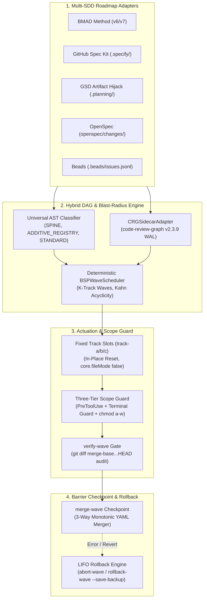

# ⚡ SDD-Parallel

[](https://github.com/stopActingSoSmall/sdd-parallel/actions/workflows/ci.yml)
[](https://www.python.org/)
[](LICENSE)
[](#-5-second-offline-demo-zero-api-keys)

<p align="center">
  <b>🌐 Language:</b>
  <b>English</b> |
  <a href="docs/i18n/zh-CN/README.md">简体中文</a> |
  <a href="docs/i18n/es/README.md">Español</a> |
  <a href="docs/i18n/pt-BR/README.md">Português (BR)</a> |
  <a href="docs/i18n/ja/README.md">日本語</a> |
  <a href="docs/i18n/ko/README.md">한국어</a> |
  <a href="docs/i18n/ru/README.md">Русский</a>
</p>

> **Spec-Driven Concurrency & Blast-Radius Governance Harness for AI Coding Agents**  
> (Google Antigravity, Claude Code, OpenAI Codex)  
> *Available as the `sdd-parallel` CLI and the convenient `parallel-flow` alias.*

---

## 🎯 The Problem

Modern Spec-Driven Development (SDD) harnesses—**BMAD Method (v6/v7)**, **GitHub Spec Kit (`.specify/`)**, **GSD (Get Shit Done)**, **OpenSpec**, and **Beads**—excel at decomposing requirements into verifiable single-task specifications. However, they suffer from a **fatal architectural limitation when scaling to parallel execution**:

1. **Linear Story Queues:** Schedulers enforce strictly serial execution (`Story 1 -> Story 2 -> Story 3`), ignoring independent epics.
2. **Merge-Bombs in Shared Configs:** Concurrent agents collide on shared registries and sprint status files (`sprint-status.yaml`, `STATE.md`, `tasks.md`).
3. **Type-2 Semantic Collisions ($W_A \cap I_B \neq \emptyset$):** Agent A refactors a shared interface, while concurrent Agent B calls the previous signature. Local git branches pass tests in isolation, but fail catastrophically upon merging.
4. **Subagent Depth Limits:** Complex multi-agent workflows (like BMAD's 3 review lenses) break when nested inside flat subagents (`Max Subagent Depth = 1`).

---

## 💡 The Solution: `sdd-parallel`

`sdd-parallel` is a deterministic orchestration and safety harness that:
- **Analyzes SDD Roadmaps Polymorphically:** Zero hardcoding; extracts tasks, dependencies, and code maps across 5 SDD frameworks.
- **Solves Semantic Blast Radius (AST + Call Graph):** Calculates directed dependencies, Spine Locks, and Type-2 impact overlaps ($W_A \cap I_B$).
- **Provisions Fixed Track Slots (`track-a`, `track-b`, ...):** Allocates permanent worktree slots with in-place reset (`git checkout -B` + `git clean -fd`), preserving an $O(1)$ disk footprint.
- **Enforces a Three-Tier Scope Guard:** Intercepts out-of-scope edits via `PreToolUse` hooks, blocks shell escapes in `Bash`/PowerShell, and locks sensitive files via OS `chmod a-w`.
- **Performs Monotonic 3-Way Merges:** Reconciles sprint statuses via monotonic lattice resolution ($\max(\text{rank})$) with zero `<<<<<<<` conflict markers.
- **Guarantees LIFO Transactional Rollbacks:** Safely reverses merged waves with automated backup branches and polymorphic SDD task status resets.

---

## 🚀 5-Second Offline Demo (Zero API Keys)

Clone the repository and run the standalone verification demo offline:

```bash
uv run sdd-parallel demo
```

```text
============================================================================
SDD-PARALLEL STANDALONE MERGE-BOMB DEMO (ZERO API KEYS / OFFLINE)
============================================================================
Workspace: /tmp/sdd-parallel-demo-xyz

[Step 1/4] AST & Architectural Role Classification
----------------------------------------------------------------------------
File Path                              | Detected Role          | Importers
----------------------------------------------------------------------------
src/demo_app/__init__.py               | additive_registry      | -
src/demo_app/api.py                    | standard               | -
src/demo_app/cli.py                    | additive_registry      | -
src/demo_app/exporter.py               | standard               | -
src/demo_app/normalizer.py             | standard               | src/demo_app/api.py
src/demo_app/schema.py                 | spine                  | -

[Step 2/4] Type-2 Semantic Merge-Bomb Detection & BSP Wave Schedule
----------------------------------------------------------------------------
  Collision Analysis:
    - Naive Scheduler : W(1-2)={normalizer.py, cli.py} vs W(2-1)={api.py}
                        -> DISJOINT WRITES (False Safe!)
    - BSPWaveScheduler: Detected semantic_collision between '1-2' and '2-1'
                        -> Overlap W(1-2) ^ I(2-1) on: src/demo_app/api.py
    - Additive Registry: Tasks '1-2' and '1-3' both touch 'src/demo_app/cli.py'
                        -> Role: ADDITIVE_REGISTRY (Parallel allowed in Wave 1)

  Wave Schedule:
    * Wave 1
        - track-a: Story 1-2 -> writes: src/demo_app/normalizer.py (+ shared: src/demo_app/cli.py)
        - track-b: Story 1-3 -> writes: src/demo_app/exporter.py (+ shared: src/demo_app/cli.py)
    * Wave 2
        - track-a: Story 1-1 -> writes: src/demo_app/schema.py
        - track-b: Story 2-1 -> writes: src/demo_app/api.py
    * Wave 3
        - track-a: Story 2-2 -> writes: src/demo_app/schema.py

[Step 3/4] Fixed-Slot Worktree Provisioning & PreToolUse Scope Guard
----------------------------------------------------------------------------
  Provisioned Fixed Slots (100% Clean git status: True):
    - track-a (.worktrees/track-a)
    - track-b (.worktrees/track-b)

  PreToolUse Scope Guard Check (track-a -> 'src/demo_app/schema.py'):
    - Decision : DENY
    - Violation: File 'src/demo_app/schema.py' cannot be modified by Wave 1 / track-a (stories ['1-2'])
    - Reason   : Locked by Spine Chain invariant.

[Step 4/4] Barrier Checkpoint & Monotonic 3-Way YAML Merge
----------------------------------------------------------------------------
  Merged Branches:
    - parallel/track-a
    - parallel/track-b

  Resolved sprint-status.yaml (0 conflict markers):
    - 1-2-normalize-telemetry-payload: done
    - 1-3-cli-batch-export: done
============================================================================
ALL 5 CORE INVARIANTS VERIFIED IN 3.21s
============================================================================
```

> 📖 **Step-by-Step Demo Anatomy, Graph Theory & Interactive Sandbox Quest:**  
> Want to see frame-by-frame disk snapshots (`Before -> Wave Planning -> Slot Locking -> 3-Way Merge`), understand the graph theory behind `SPINE` / `ADDITIVE_REGISTRY` / `STANDARD` (3-pass `ASTHotspotScanner`), and hands-on test `plan`, `prepare`, `check-lock`, `abort-wave`, and `rollback-wave` inside a live `--keep-temp` sandbox or greenfield repository?  
> 👉 Read the algorithmic foundation in **[System Capabilities & Architectural White Paper](docs/dossier/02_SYSTEM_CAPABILITIES_WHITE_PAPER.md)** and walk through the **[Standalone Demo & Interactive E2E Walkthrough Guide](docs/dossier/07_STANDALONE_DEMO_AND_E2E_WALKTHROUGH.md)** *(part of the canonical **[Architecture & Strategy Dossier](docs/dossier/README.md)**; Russian original in **[docs/i18n/ru/dossier/](docs/i18n/ru/dossier/)**).  
> 🏛️ For executive decision-makers and architects: **[Product Brief & Executive Summary](docs/dossier/01_CORE_PRODUCT_BRIEF.md)** | **[System Architecture SSOT](ARCHITECTURE.md)**.

---

## 📦 Requirements & Installation

### Prerequisites
- **Python:** `>= 3.11` (Python 3.11, 3.12, 3.13)
- **Git:** `>= 2.30` (required for modern `git worktree` isolation and `info/exclude` masking)
- **Package Manager:** [`uv`](https://docs.astral.sh/uv/) (recommended) or `pipx`

### Installation

#### As an isolated CLI tool (Recommended)
```bash
# Using uv (fastest)
uv tool install sdd-parallel

# Or using pipx
pipx install sdd-parallel
```

#### From source for local development
```bash
git clone https://github.com/stopActingSoSmall/sdd-parallel.git
cd sdd-parallel
uv sync
```

After installation, the CLI is available globally via `sdd-parallel` (or short alias `parallel-flow`).

---

## 🏛️ System Architecture



---

## 🛡️ Core Invariants

1. **Zero Worktree Pollution:** Injected boundaries (`.tmp/track-context.md`, `.parallel-lock.json`, `ACTIVE_TRACK.md`) are masked via git `info/exclude`. `git status --porcelain` is always 100% clean.
2. **Zero Cache Invalidation:** Epics contexts in `_bmad-output/planning-artifacts/` are read-only; planner state writes to `_bmad-output/parallel-artifacts/`.
3. **100% Task Coverage & Acyclic Invariant:** Kahn/Tarjan topological verification guarantees zero lost stories and zero dependency cycles.
4. **Blast-Radius Enforcement (Type-1 & Type-2):** Disjoint writes ($W_A \cap W_B = \emptyset$) plus disjoint semantic impacts ($W_A \cap I_B = \emptyset$).
5. **Universal Anti-Overfitting (Invariant 7):** Zero domain-specific path or entity hardcoding in the core engine. Classifies `SPINE`, `ADDITIVE_REGISTRY`, and `STANDARD` strictly through AST heuristics and graph centrality.
6. **Fixed Track Slots ($O(1)$ Footprint):** Reuses slots `track-a`, `track-b`, `track-c` via `git checkout -B` and `git clean -fd` to prevent UI folder clutter.
7. **Three-Tier Defense-in-Depth Guard:** `PreToolUse` hook + Terminal command interception (`Bash`, `run_command`) + OS `chmod a-w` file protection.
8. **Monotonic Status Semi-Lattice:** Statuses resolve monotonically: $\texttt{backlog} (0) < \dots < \texttt{done} (4)$ without merge markers.
9. **LIFO Transactional Rollbacks:** Reverts merged waves strictly in reverse order with automated safety backup branches (`backup/wave-<K>-before-rollback-*`).

---

## 🛠️ CLI Reference

| Command | Purpose |
| :--- | :--- |
| `sdd-parallel demo [--kit {bmad,spec-kit,gsd,openspec,beads,all}] [--keep-temp] [--scaffold-only] [--output-dir DIR]` | Run the standalone offline Merge-Bomb demo or scaffold an interactive sandbox across 5 SDD kits. |
| `sdd-parallel plan [--repo REPO] [--max-tracks N] [--kit auto] [--include-done] [--dry-run] [--plan-source {auto,plan,specs}] [--output-dir DIR]` | Analyze roadmap and codebase graph; generate `execution-plan-parallel.md` and `wave-plan.json`. |
| `sdd-parallel prepare --wave K [--repo REPO] [--max-tracks N] [--kit KIT] [--headless] [--antigravity-layout] [--dynamic-worktrees] [--dry-run]` | Provision worktree slots (`track-a`, `track-b`), configure OS locks, and inject boundaries. |
| `sdd-parallel claim-track --wave K --track <id> --worktree <path> [--repo REPO] [--max-tracks N] [--kit KIT] [--headless]` | Attach boundary locks to an existing external worktree slot. |
| `sdd-parallel run-guide --wave K [--repo REPO] [--max-tracks N] [--kit KIT] [--antigravity-layout]` | Display interactive operator run-guide matrix with launch commands for each active track window. |
| `sdd-parallel verify-wave --wave K [--repo REPO] [--max-tracks N] [--kit KIT] [--dynamic-worktrees]` | Audit worktrees against `.parallel-lock.json` and multi-commit diff against `merge-base`. |
| `sdd-parallel merge --wave K [--repo REPO] [--max-tracks N] [--kit KIT] [--dynamic-worktrees] [--skip-gates] [--strict-gates] [--cleanup] [--dry-run]` | Barrier checkpoint merge: 3-way status merge, git merge, polymorphic quality gates, and transactional auto-rollback. |
| `sdd-parallel abort-wave --wave K [--repo REPO] [--dynamic-worktrees]` | Abort unmerged wave: reset slots and remove temporary parallel branches. |
| `sdd-parallel rollback-wave --wave K [--repo REPO] [--dynamic-worktrees] [--to-commit COMMIT] [--save-backup] [--no-backup] [--kit KIT]` | Revert merged wave in LIFO order with safety backup branch and SDD task status reset. |
| `sdd-parallel merge-status --base B --ours O --theirs T --out OUT` | Low-level 3-way deterministic merge tool for `sprint-status.yaml`. |
| `sdd-parallel check-lock --file PATH [--tool TOOL]` | Validate file write permissions against active worktree lock manifest. |
| `sdd-parallel install-plugin [--target-dir DIR]` | Package and install the portable Antigravity plugin. |
| `sdd-parallel autopilot --wave K [--repo REPO] [--max-tracks N] [--kit KIT] [--harness <tool>] [--antigravity-layout] [--execute]` | Generate or execute Multi-Conversation Autopilot launch commands with Model Effort Routing. |

---

## 🧩 Supported SDD Kits

| SDD Framework | Status | Read-Only Artifacts Detected | Task State Synchronization |
| :--- | :---: | :--- | :--- |
| **BMAD Method (`v6.3+` / `v7`)** | ✅ Shipped | `sprint-status.yaml`, `epics.md`, `epic-*-context.md`, `spec-*.md` | Monotonic 3-way YAML merge |
| **GitHub Spec Kit (`.specify/`)** | ✅ Shipped | `.specify/specs/*/tasks.md`, `constitution.md` | Markdown status checkboxes |
| **GSD (Get Shit Done)** | ✅ Shipped | `.planning/phases/*-PLAN.md`, `ROADMAP.md` | Artifact Hijack (`STATE.md` central update) |
| **OpenSpec (`openspec/`)** | ✅ Shipped | `openspec/changes/<id>/tasks.md` | Spec-driven task state tracking |
| **Beads (`.beads/`)** | ✅ Shipped | `.beads/issues.jsonl` | Topological issue state updates |

---

## 🚢 Release Matrix: Shipped (`v0.1.0`) vs Roadmap (`v0.2+`)

### ✅ Shipped in `v0.1.0` (Production Hardened)
- Deterministic Bulk-Synchronous Parallel (BSP) wave scheduler with Kahn acyclicity.
- AST Hotspot Scanner & `code-review-graph v2.3.9` sidecar integration.
- Fixed Track Slots architecture (`track-a`, `track-b`, `track-c`) with in-place reset.
- Three-Tier Defense-in-Depth Scope Guard (`PreToolUse` + Terminal Guard + OS `chmod a-w`).
- Monotonic 3-Way YAML Merger preserving comments and formatting.
- LIFO Transactional Wave Rollback Engine with automated safety branches.
- Two-Stage Assisted (Interactive IDE Slots) operator execution standard (`Depth 0`).
- 5 Multi-SDD Adapters (BMAD, Spec Kit, GSD Artifact Hijack, OpenSpec, Beads).
- Standalone offline Merge-Bomb demo (`sdd-parallel demo`) and GitHub Actions CI suite.
- 95+ automated unit & integration tests, `mypy --strict`, and `ruff` quality gates.

### 🚧 Planned for `v0.2.0+`
- **Community Adapter Ecosystem:** `mattpocock/skills` (`/implement-spec`) and `bmad-loop` v0.8+ frontmatter status adapter.
- **Zero-Pollution Environment Sync:** `workz` pattern with `.venv` and `node_modules` symlinks into fixed slots.
- **Pre-Wave Static Symbol Linker & Scope Escalation:** Automatic write-set expansion via AST symbols and dynamic task rescheduling.
- **FinOps & Observability Exporters:** OpenTelemetry spans and Langfuse token savings telemetry.
- **Headless Autopilot Daemon:** Headless agent execution via local RPC/subagent dispatch.

---

## 🧪 Development & Quality Gates

Run the comprehensive test and validation suite locally:

```bash
# Run test suite
uv run pytest

# Run strict type checking
uv run mypy --strict src/sdd_parallel

# Run linter
uv run ruff check src/ tests/ scripts/

# Run standalone offline demo
uv run sdd-parallel demo
```

---

## 🤝 Contributing & Security

- **Contributing:** Please read our **[Contributing Guide](CONTRIBUTING.md)** for developer environment setup and pull request verification gates.
- **Security:** Security disclosures and vulnerability reporting instructions are outlined in our **[Security Policy](SECURITY.md)**.

---

## 📜 License

MIT License. See [LICENSE](LICENSE) for details.
