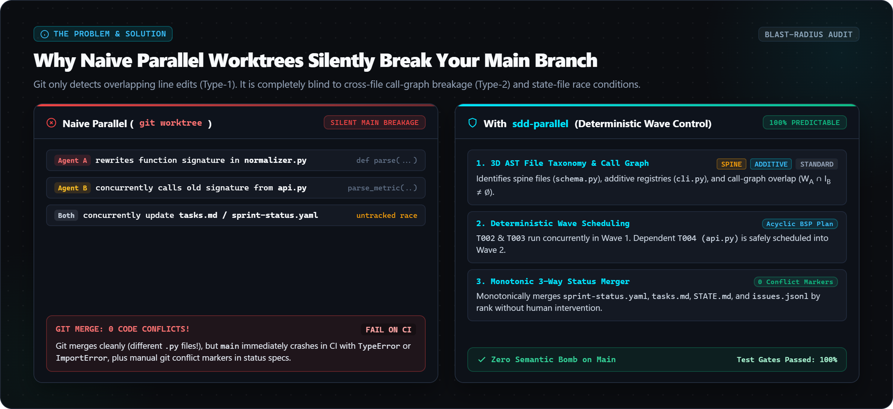
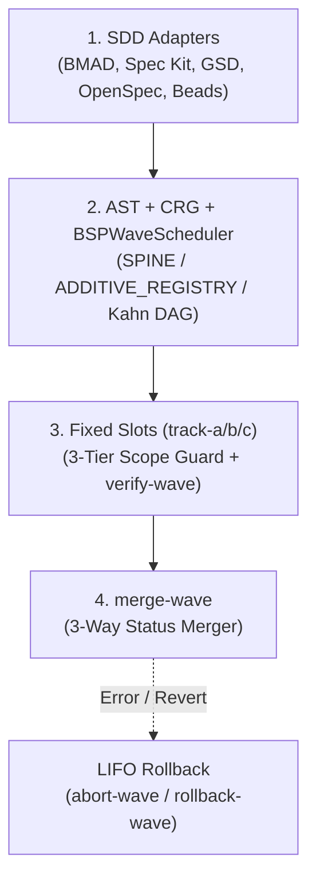

<p align="center">
  
</p>

<p align="center">
  <a href="https://github.com/stopActingSoSmall/sdd-parallel/actions/workflows/ci.yml"></a>
  <a href="https://pypi.org/project/sdd-parallel/"></a>
  <a href="https://www.python.org/"></a>
  <a href="LICENSE"></a>
  <a href="#-try-it-in-5-seconds-zero-api-keys-annotated-walkthrough"></a>
  <br>
  <a href="#-fits-right-into-your-existing-stack-zero-lock-in"></a>
  <a href="#-see-your-exact-sdd-project-layout-before--after"></a>
</p>

<p align="center">
  <b>🌐 Language:</b>
  <b>English</b> |
  <a href="docs/i18n/es/README.md">Español</a> |
  <a href="docs/i18n/pt-BR/README.md">Português (BR)</a> |
  <a href="docs/i18n/ja/README.md">日本語</a> |
  <a href="docs/i18n/ko/README.md">한국어</a> |
  <a href="docs/i18n/zh-CN/README.md">简体中文</a> |
  <a href="docs/i18n/ru/README.md">Русский</a>
</p>

<p align="center">
  <a href="#-try-it-in-5-seconds-zero-api-keys-annotated-walkthrough">Quick Demo</a> ·
  <a href="#-why-does-this-exist-in-plain-english">Why</a> ·
  <a href="#%EF%B8%8F-how-it-works--daily-4-command-workflow">How It Works</a> ·
  <a href="#-see-your-exact-sdd-project-layout-before--after">Your SDD Layout</a> ·
  <a href="#-fits-right-into-your-existing-stack-zero-lock-in">Harnesses</a> ·
  <a href="docs/USER_GUIDE.md">User Guide</a> ·
  <a href="#%EF%B8%8F-full-cli-reference">CLI</a> ·
  <a href="#-architecture-mathematical-model--dossier-deep-dives">Deep-Dives</a>
</p>

> **Deterministic wave scheduler & isolated worktree sandbox for parallel AI coding agents — prevents silent merge-bombs before spending a single LLM token.**  
> `sdd-parallel` sits between your **Spec Kit / BMAD / GSD / OpenSpec / Beads** backlog and coding agents (**Claude Code**, **Codex**, **Antigravity**, or any worktree CLI).

https://github.com/user-attachments/assets/76b8c429-3146-43b9-9ba9-89de15f97b13

<p align="center"><em>🎬 <b>Full 1080p Video Explainer</b> — Voiceover in 7 languages via the <b>🌐 Language</b> switcher above.</em></p>

Explore hands-on: **[⚡ Live Interactive Wave Inspector](https://stopactingsosmall.github.io/sdd-parallel/)** (zero-install browser demo) · **[📘 Operator User Guide & Day-1 Runbook](docs/USER_GUIDE.md)**.

---

## ⚡ Why Does This Exist? (In Plain English)

<p align="center">
  
</p>

With 10–15 specs or stories, teams face two bad choices:
1. **One agent, sequentially** — safe, but **6–8 hours** of waiting.
2. **3–4 agents in naive `git worktree` dirs** — fast until merge time:
   - **Type-1 (direct):** two agents edit `sprint-status.yaml`, `STATE.md`, or `cli.py` → `<<<<<<<` conflicts.
   - **Type-2 (semantic, silent):** Agent A changes `normalizer.py`'s signature; Agent B calls the old one from `api.py`. **Git merges cleanly — and `main` breaks.**
   - **Scope creep:** an agent rewrites shared `schema.py` outside its task.

**`sdd-parallel` prevents this before any token is spent:** it scans AST + call graphs, packs safe tasks into **Waves**, isolates agents in reusable slots (`track-a/b/c`), blocks out-of-scope edits, and merges behind quality gates.

| What Happens | ❌ Sequential | 💥 Naive `--worktree` | ✅ `sdd-parallel` |
| :--- | :--- | :--- | :--- |
| **12-story sprint** | ~6–8 h | ~2 h coding + **~2 h fixing merges** | **~2.5 h total (2x–3x faster)** |
| **Hidden API collisions** | By going slow | **Breaks `main`** ($W_A \cap I_B \neq \emptyset$) | **Prevented upfront** (Wave 1 → 2) |
| **Shared CLI / routers** | Serialized | Git conflict per merge | **Concurrent via AST 3-way merge** (`registry_merger.py` + fail-closed `Partial Barrier Merge`) |
| **Status files** | Serial updates | Constant `<<<<<<<` markers | **Monotonic 3-way merge** (0 markers) |
| **Out-of-scope edits** | Prompt warning | Bypassed via `bash`/`sed` | **Blocked** (`PreToolUse` + Terminal Guard + `chmod a-w`) |
| **Worktree clutter** | None | 15 leftover `task-*` dirs | **Fixed reusable slots** (`track-a/b/c`) |

*Notation: $W$ = modified files (Write set); $I$ = importing/dependent files (Impact radius).*

---

## 🚀 Try It in 5 Seconds (Zero API Keys, Annotated Walkthrough)

No API key, no LLM subscription, no clone. Run via [`uv`](https://docs.astral.sh/uv/) (or `pipx run sdd-parallel demo`):

```bash
uvx sdd-parallel demo --kit all   # or single kit: uvx sdd-parallel demo --kit spec-kit
```

Scaffolds real throwaway Git repos (5 tasks, 6 Python modules), runs AST analysis, tests Scope Guard `DENY` locks, merges concurrent `cli.py` edits via 3-way AST merge, and executes a 0-conflict 3-way status merge + live smoke checkpoint gate (`run_quality_gates=True`, `< 5s` per kit):

```text
================================================================
5/5 SDD KITS VERIFIED (BMAD, SPEC KIT, GSD, OPENSPEC, BEADS)
================================================================
Kit      | Merge-Bomb | Worktrees | Scope Guard | 3-Way Merge
----------------------------------------------------------------
bmad     | PASSED     | PASSED    | PASSED      | PASSED
spec-kit | PASSED     | PASSED    | PASSED      | PASSED
gsd      | PASSED     | PASSED    | PASSED      | PASSED
openspec | PASSED     | PASSED    | PASSED      | PASSED
beads    | PASSED     | PASSED    | PASSED      | PASSED
================================================================
```

<details>
<summary><b>🔍 Click to expand: 4-step walkthrough (<code>--kit spec-kit</code>) &amp; interactive sandbox</b></summary>

1. **`[Step 1/4]` AST Roles:** `schema.py` → `spine` (serialize); `cli.py` → `additive_registry` (append-only); `api.py` imports `normalizer.py`.
2. **`[Step 2/4]` Type-2 Merge-Bomb:** `T002` (`normalizer.py`) and `T004` (`api.py`) both carry `[P]`, yet `BSPWaveScheduler` detects $W(\text{T002}) \cap I(\text{T004}) \neq \emptyset$ and defers `T004` to **Wave 2** while `T002` + `T003` share `cli.py` in **Wave 1**:
```text
Wave 1: [track-a: T002] [track-b: T003]  (normalizer.py + exporter.py + cli.py)
Wave 2: [track-a: T001] [track-b: T004]  (after Wave 1 normalizer)
Wave 3: [track-a: T005]                  (schema barrier)
```
3. **`[Step 3/4]` Clean Slots & Scope Guard:** Injected boundaries (`ACTIVE_TRACK.md`, `.parallel-lock.json`, `.tmp/track-context.md`) are hidden via `info/exclude` (`Clean git status: True`); `track-a` touching `schema.py` returns `DENY`.
4. **`[Step 4/4]` 3-Way Merge & Sandbox:** Monotonic checkbox merge resolves `[ ] < [x]` in `tasks.md` with **0 markers**. Full snapshots in [Dossier 07](docs/dossier/07_STANDALONE_DEMO_AND_E2E_WALKTHROUGH.md), or run a sandbox:
```bash
uvx sdd-parallel demo --kit gsd --scaffold-only --output-dir ./sdd-sandbox
cd sdd-sandbox && sdd-parallel plan && sdd-parallel prepare --wave 1
```

</details>

---

## 🗺️ How It Works & Daily 4-Command Workflow

<p align="center">
  
</p>

`sdd-parallel` follows **Bulk Synchronous Parallel (BSP)**: isolated tracks run with zero cross-edits and synchronize at a quality-gate merge barrier.

**1. Install once** (`Python >= 3.11`, `Git >= 2.30`): `uv tool install sdd-parallel` (or `pipx install sdd-parallel`; exposes `sdd-parallel` & `parallel-flow`).

**2. Run a wave:**

```bash
sdd-parallel plan                  # 1. Scan specs + AST and build waves
sdd-parallel prepare --wave 1      # 2. Provision slots & inject locks
sdd-parallel run-guide --wave 1    #    Print native command per slot
# 3. Run agents in .worktrees/track-a, track-b, ...
sdd-parallel verify-wave --wave 1  # 4. Audit diff vs .parallel-lock.json
sdd-parallel merge --wave 1        #    Quality gates & 3-way merge to main
```

**Undo & Inspect:** `abort-wave --wave 1` · `rollback-wave --wave 1 --save-backup` (LIFO + safety branch) · `inspect --open` (`assets/inspector.html`).

- **Mode A — Interactive Assisted:** `plan` → `inspect --open` → copy `prepare` / `merge` via **CLI Action Bridge** and supervise `.worktrees/track-{a,b}`.
- **Mode B — Cyclic Autopilot:** `sdd-parallel autopilot --wave 1 --harness {antigravity,claude-code,codex} --execute --policy {single-shot,cyclic} [--max-review-rounds N] [--routing-file FILE]`.

👉 See **[`docs/USER_GUIDE.md`](docs/USER_GUIDE.md#3-interactive-wave-inspector--orchestration-modes-mode-a-vs-mode-b)** (Wave Inspector & Modes) and **[Day-1 Recovery Runbook](docs/USER_GUIDE.md#4-day-1-troubleshooting--recovery-runbook)**.

---

## 📂 See Your Exact SDD Project Layout (Before & After)

<p align="center">
  
</p>

Read-only **Anti-Corruption Layer (ACL)** adapters normalize 5 SDD formats without altering your specs:

| SDD Framework | Read-Only Artifacts (Locked) | Task Discovery | Status Sync |
| :--- | :--- | :--- | :--- |
| **Spec Kit** (`.specify/`) | `constitution.md`, `feature.json`, `spec.md`, `plan.md` | `specs/*/tasks.md` (`T001 [P]`) | 3-way Markdown |
| **BMAD** (`v6.3+/v7`) | `epic-*-context.md` (Zero Cache Invalidation) | `sprint-status.yaml`, `epics.md`, `spec-*.md` | 3-way YAML |
| **GSD** (`.planning/`) | `PROJECT.md`, `REQUIREMENTS.md`, `ROADMAP.md`, `STATE.md` | `phases/*/NN-NN-PLAN.md` | Centralized `STATE.md` |
| **OpenSpec** (`openspec/`) | `openspec/specs/**`, `project.md`, `config.yaml`, sibling changes | `openspec/changes/<slug>/tasks.md` | 3-way Markdown |
| **Beads** (`.beads/`) | `.beads/config.yaml` | `.beads/*.jsonl` (`bd-101` + `blocks`) | Line-wise 3-way JSONL |

<details>
<summary><b>🌱 Example: GitHub Spec Kit (<code>.specify/</code> &amp; <code>specs/*/tasks.md</code>) — After <code>plan</code> + <code>prepare --wave 1</code></b></summary>

```text
my-project/
├── .parallel/{artifacts/wave-plan.json, history/, state.json}
├── .specify/…                         # untouched
├── .worktrees/
│   ├── track-a/                       # Wave 1 → T002
│   │   ├── .specify/memory/constitution.md    # 🔒 read-only
│   │   ├── specs/001-telemetry/{plan,spec}.md # 🔒 read-only
│   │   ├── specs/001-telemetry/tasks.md       # ✍️ writable
│   │   ├── .tmp/track-context.md      # 👻 hidden (info/exclude)
│   │   ├── .parallel-lock.json        # 👻 hidden (info/exclude)
│   │   └── ACTIVE_TRACK.md            # 👻 → /speckit.implement T002
│   └── track-b/                       # Wave 1 → T003
└── specs/… & src/…                    # untouched in main
```

</details>

Legend: 🔒 read-only (`chmod a-w` + `PreToolUse` deny) · 👻 hidden (`info/exclude`) · ✍️ writable scope.  
👉 All 5 Before/After trees (**Spec Kit, BMAD, GSD, OpenSpec, Beads & Custom SDD**): **[Section 2 of `docs/USER_GUIDE.md`](docs/USER_GUIDE.md#2-sdd-project-layouts-before--after-all-5-frameworks)**.

---

## 🔌 Fits Right Into Your Existing Stack (Zero Lock-In)

`sdd-parallel run-guide --wave 1` prints each slot's native command (mirrored in `ACTIVE_TRACK.md`):

| SDD Kit | Native command per track |
| :--- | :--- |
| GitHub Spec Kit | `/speckit.implement T002` |
| BMAD Method | `/bmad-build 1-2` |
| GSD | `/gsd-execute-phase 01-02` |
| OpenSpec | `/openspec-apply normalize-telemetry` |
| Beads | `bd update bd-102 --status in-progress` |

> 📦 **Spec Kit Extension (`extension.yml`):** `specify extension add --from https://github.com/stopActingSoSmall/sdd-parallel/archive/refs/tags/v0.2.1.zip` (or `specify extension add sdd-parallel`) adds `/specify plan-waves`, `/specify prepare-wave --wave 1`, `/specify merge-wave --wave 1`.

| Harness | How it plugs in |
| :--- | :--- |
| **Claude Code** (`claude`) | Run `claude` in `.worktrees/track-a` (`blockWritesOutsideWorkingDirectories` + `PreToolUse` + `chmod a-w`), or `autopilot --wave 1 --harness claude-code`. |
| **Codex CLI** (`codex`) | `codex --cd .worktrees/track-b`; `chmod a-w` locks contracts, `verify-wave` audits diffs. Autopilot: `--harness codex`. |
| **Google Antigravity** (`agy`) | `prepare --wave 1 --antigravity-layout` places slots in `~/.gemini/antigravity/worktrees/<Project>/track-a`; `install-plugin` adds the scope-guard hook. |
| **Cursor, Windsurf, OpenCode, Kimi, Aider, Cline, Trae** | Zero-config `.worktrees/track-{a,b,c}`, `chmod a-w`, `ACTIVE_TRACK.md`, `claim-track` for external worktrees, and `verify-wave`. |

👉 Recipes (`local` `.worktrees/` vs `--antigravity-layout`, `claim-track`, MCP) in **[Section 1 of `docs/USER_GUIDE.md`](docs/USER_GUIDE.md#1-harness-connection-recipes-local-slots-vs-antigravity-layout)**.

---

## 🔍 Architecture, Mathematical Model & Dossier Deep-Dives

- 📘 **[Operator User Guide & Day-1 Runbook (`docs/USER_GUIDE.md`)](docs/USER_GUIDE.md)**: harness setup, 5 Before/After trees, Wave Inspector, recovery runbook
- 📖 **[01 — Core Product Brief](docs/dossier/01_CORE_PRODUCT_BRIEF.md)** · **[02 — Capabilities White Paper](docs/dossier/02_SYSTEM_CAPABILITIES_WHITE_PAPER.md)** · **[03 — Integration Spec](docs/dossier/03_INTEGRATION_AND_ECOSYSTEM_SPEC.md)**
- 📊 **[04 — Competitive Taxonomy](docs/dossier/04_COMPETITIVE_AND_BENCHMARK_TAXONOMY.md)** · **[07 — E2E Demo Walkthrough](docs/dossier/07_STANDALONE_DEMO_AND_E2E_WALKTHROUGH.md)** · **[Architecture SSOT](ARCHITECTURE.md)** · **[Dossier Index](docs/dossier/README.md)** · **[RU Dossier](docs/i18n/ru/dossier/)**

<details>
<summary><b>❓ Hard Engineering Questions &amp; Honest Boundaries (FAQ)</b></summary>

1. **How does the planner know `write_files` before code is written?**
   Three layers of protection: **(a)** explicit paths declared in specs (`Code Map`, `Files:`, GSD XML `<files>`, backticks) → **(b)** the Pre-Wave AST Symbol Linker resolving mentioned function/class names to files in $O(1)$ → **(c)** Dynamic Scope Escalation (`.tmp/scope-escalation.json`), where `PreToolUse` logs denied out-of-scope edits, `verify-wave` defers the task to Wave $K+1$ (resetting the emptied slot and updating `.parallel/wave-plan.json`), and `merge` executes against the updated plan.
2. **What about TypeScript, Go, Rust, or non-Python repositories?**
   Honest boundary: the built-in zero-dependency AST scanner (`ast_scanner.py`) and 3-way registry merger (`registry_merger.py`) natively parse Python. For polyglot repositories (TS/JS, Go, Rust, Java), `sdd-parallel` relies on explicit spec file lists, the optional Tree-sitter sidecar **`code-review-graph`** (`CRGSidecarAdapter`), `contract_globs`, `DEPENDENCY_DRIFT` lockfile checks, and **`Partial Barrier Merge`** (default on `merge`) to isolate conflicting tracks safely.
3. **Can an agent bypass `PreToolUse` hooks via shell (`sed -i`, `python -c`, `cp`)?**
   Enforcement never relies on a single hook — it is **3-Tier Defense-in-Depth**: **Tier 1** (`PreToolUse` + Terminal Guard inspecting `Bash`/`run_command`/`powershell` redirects and inline writes) → **Tier 2** (OS-level `chmod a-w` on Spine and sibling-owned files) → **Tier 3** (`verify-wave` auditing actual `git diff merge-base...HEAD` and blocking the merge on any violation).
4. **AST cannot see cross-layer contracts (Pydantic JSON → TS frontend, SQL FK, OpenAPI)!**
   Correct — static import graphs stop at syntax boundaries. `sdd-parallel` closes this gap declaratively via **`DEFAULT_CONTRACT_GLOBS`** (`**/schemas/**`, `**/migrations/**`, `openapi.*`, `*.proto`, `*.graphql`) plus project-specific `file_roles` in `.parallel-config.json`, forcing cross-layer contracts into strict `SPINE` serialization.

</details>

<details>
<summary><b>🏛️ Internal Engine Architecture & 9 Core Invariants</b></summary>



1. **Zero Worktree Pollution:** boundaries masked via `info/exclude`; `git status --porcelain` stays empty.
2. **Zero Cache Invalidation:** pre-compiled contexts stay read-only; state lives in `.parallel/`.
3. **100% Coverage & Acyclicity:** Kahn check ensures zero dropped tasks and zero cycles.
4. **Blast-Radius Isolation:** disjoint writes ($W_A \cap W_B = \emptyset$) and semantic impact ($W_A \cap I_B = \emptyset$).
5. **Universal Anti-Overfitting:** `SPINE`, `ADDITIVE_REGISTRY`, `STANDARD` derive from AST + centrality.
6. **Fixed Slots:** `track-a/b/c` reset in place (`git checkout -B` + `git clean -fd`).
7. **Three-Tier Guard:** `PreToolUse` + Terminal Guard (`Bash`, `run_command`) + OS `chmod a-w`.
8. **Monotonic Status Lattice:** $\texttt{backlog}(0) < \dots < \texttt{done}(4)$ with 0 markers.
9. **LIFO Rollbacks:** reverse-order revert with `backup/wave-<K>-before-rollback-*` branches.

</details>

---

## 🛠️ Full CLI Reference

<details>
<summary><b>Click to expand: all 16 subcommands &amp; flags</b></summary>

Shared flags: `--repo REPO`, `--max-tracks N`, `--kit KIT`, `--routing-file FILE`, `--dry-run`, `--dynamic-worktrees`.

| Command | Specific Flags & Purpose |
| :--- | :--- |
| `sdd-parallel demo` | `[--kit {...,all}] [--keep-temp] [--scaffold-only] [--output-dir DIR]` — Offline demo / sandbox. |
| `sdd-parallel plan` | `[--include-done] [--plan-source {auto,plan,specs}] [--output-dir DIR]` — Build `wave-plan.json`. |
| `sdd-parallel prepare --wave K` | `[--headless] [--antigravity-layout]` — Provision slots, OS locks, boundaries. |
| `sdd-parallel claim-track --wave K` | `--track <id> --worktree <path> [--headless]` — Lock an existing worktree. |
| `sdd-parallel run-guide --wave K` | `[--antigravity-layout]` — Print native launch command per slot. |
| `sdd-parallel verify-wave --wave K` | `[--defer-ast-violations]` — Audit slots vs `.parallel-lock.json`, `merge-base` diff, pre-merge `ast_diff_gate`, and scope escalations. |
| `sdd-parallel merge --wave K` | `[--skip-gates] [--strict-gates] [--partial-merge\|--no-partial-merge] [--cleanup]` — Gates, AST/status 3-way merge, default partial commit with culprit bisection (or atomic rollback with `--no-partial-merge`). |
| `sdd-parallel abort-wave --wave K` | Reset fixed slots in place to `HEAD` (or delete branches in `--dynamic-worktrees`). |
| `sdd-parallel rollback-wave --wave K` | `[--to-commit COMMIT] [--save-backup\|--no-backup]` — LIFO revert + safety branch + status reset. |
| `sdd-parallel merge-status` | `--base B --ours O --theirs T --out OUT` — 3-way merge for `sprint-status.yaml`. |
| `sdd-parallel check-lock` | `--file PATH [--tool TOOL]` — Check write against active lock manifest. |
| `sdd-parallel install-plugin` | `[--target-dir DIR]` — Install portable Antigravity plugin. |
| `sdd-parallel init-custom` | `[--specs-dir DIR] [--format {markdown,yaml}] [--test-cmd CMD] [--non-interactive]` — Initialize `.parallel/custom-kit.yaml`. |
| `sdd-parallel autopilot --wave K` | `[--harness {antigravity,claude-code,codex}] [--antigravity-layout] [--execute] [--policy {single-shot,cyclic}] [--max-review-rounds N]` — Spawn tracks. |
| `sdd-parallel bench` | `[--since REV] [--until REV] [--demo] [--format {text,json}] [--output-file FILE]` — Merge-Bomb backtest vs static model. |
| `sdd-parallel inspect` | `[--plan PATH] [--output PATH] [--open]` — Open HTML Wave Inspector. |

</details>

---

## 🚢 Release Matrix: Shipped (v0.2.2) vs Roadmap (v0.3+)

### ✅ Shipped in `v0.1.0 – v0.2.2`
- [x] BSP wave scheduler (Kahn acyclicity) + AST hotspot scanner + `code-review-graph v2.3.9` sidecar + Spine Bucket Locks (Class C) & `NAMESPACE_COLLISION` (Class D).
- [x] Pre-merge `ast_diff_gate.py`: virtual Tarjan import cycles (Class G), signature/default drift (Classes A/B), AST-shingle duplicate helpers (Class F), lockfile collisions (Class H).
- [x] Partial Barrier Merge (default in CLI `merge`, `--no-partial-merge` for atomic rollback), OCC centrality ordering, deterministic culprit bisection, `.parallel/barrier-feedback-<story_id>.json` NACK injection, and DAG tail re-scheduling (`reschedule_remaining_waves`).
- [x] Python AST-aware 3-way `ADDITIVE_REGISTRY` merger (`registry_merger.py`, fail-closed fallback) + intra-file AST function isolation (`are_functions_isolated`) and receiver-hinted router decorators.
- [x] Fixed slots (`track-a/b/c`) with in-place reset, `info/exclude` masking, `.venv`/`node_modules` NTFS Junctions (Windows, no admin) / POSIX symlinks.
- [x] 3-tier Scope Guard (`PreToolUse` + Terminal Guard + `chmod a-w`), symbol linker, `.tmp/scope-escalation.json`.
- [x] Monotonic 3-way status merger (YAML, Markdown, `STATE.md`, JSONL) + LIFO transactional rollback.
- [x] 5 SDD adapters (Spec Kit + `extension.yml`, BMAD + `mattpocock/skills` + `bmad-loop`, GSD, OpenSpec, Beads).
- [x] Offline `demo --kit all`, `bench` 8-class backtest (A–H, 0 FN), HTML Wave Inspector (`inspect --open`), `--scaffold-only`.
- [x] Multi-window & Depth-0 autopilot (`agy`, Claude Code, Codex) with `--routing-file`, `TaskStructuralSignals`, `--policy cyclic` (`ADR-0009`).
- [x] Clean-clone CI (Ubuntu/macOS/Windows, Python 3.11–3.13) & PyPI Trusted Publishing.

### 🚧 Planned for `v0.3+`
- [ ] Strict Kit Auto-Detection (zero silent fallback, TTY disambiguation)
- [ ] System-1 Intent Extractor (`TaskIntentVector`) & Decision-1 Pairwise Collision Classifier
- [ ] Native Polyglot Tree-sitter AST & Auto-CRG indexing (TS/JS, Go, Rust)
- [ ] Adaptive `--max-tracks auto` & Antigravity `/swarm` brief exporter (`--format swarm-brief`)

---

## 🤝 Contact & Collaborations

- **Research, Grants & Private Inquiries:** [sdd-parallel@metrichub.dev](mailto:sdd-parallel@metrichub.dev)
- **Architecture Q&A & Community:** [GitHub Discussions](https://github.com/stopActingSoSmall/sdd-parallel/discussions)
- **Security Disclosures:** See [SECURITY.md](SECURITY.md)

---

## 🛠️ Contributing, Local Development & Security

```bash
git clone https://github.com/stopActingSoSmall/sdd-parallel.git && cd sdd-parallel && uv sync
uv run pytest && uv run mypy --strict src/sdd_parallel && uv run ruff check src/ tests/ scripts/
uv run sdd-parallel demo --kit all
```

- **Contributing:** [Contributing Guide](CONTRIBUTING.md) · **Security:** [Security Policy](SECURITY.md) · **License:** [MIT](LICENSE) (Voiceover powered by [ElevenLabs](https://elevenlabs.io) and [Google Gemini](https://ai.google.dev/)).

### 💼 Commercial Audits & Enterprise Monorepo Support

Fixed-scope B2B audits (**Parallel SDD Readiness & Blast-Radius Audit**, \$500–\$2,500): `sdd-parallel bench` retrospective, custom `.parallel-config.json` (`contract_globs`, spine serialization, quality gates), and HTML Wave Inspector reports via **[GitHub Discussions](https://github.com/stopActingSoSmall/sdd-parallel/discussions)**.
