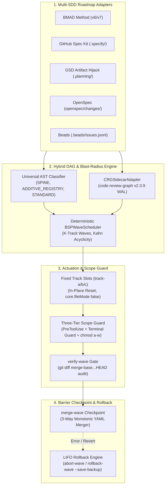

# ⚡ SDD-Parallel (`parallel-flow`)

[](https://github.com/stopActingSoSmall/sdd-parallel/actions/workflows/ci.yml)
[](https://pypi.org/project/sdd-parallel/)
[](https://www.python.org/)
[](LICENSE)
[](#-try-it-in-5-seconds-zero-api-keys-no-clone-needed)

<p align="center">
  
</p>

<p align="center">
  <b>🌐 Language:</b>
  <b>English</b> |
  <a href="docs/i18n/zh-CN/README.md">简体中文</a> |
  <a href="docs/i18n/es/README.md">Español</a> |
  <a href="docs/i18n/pt-BR/README.md">Português (BR)</a> |
  <a href="docs/i18n/ja/README.md">日本語</a> |
  <a href="docs/i18n/ko/README.md">한국어</a> |
  <a href="docs/i18n/ru/README.md">Русский</a>
</p>

> **Run 3–4 AI Coding Agents in Parallel — Without Breaking Your Build or Git History.**  
> The deterministic traffic controller, worktree isolator, and blast-radius guard for **Claude Code**, **OpenAI Codex**, and **Google Antigravity** working on **BMAD**, **GitHub Spec Kit**, **GSD**, **OpenSpec**, or **Beads** projects.

---

## ⚡ Why Does This Exist? (In Plain English)

When you have a backlog of 10–15 specs/stories, you currently face a painful choice:
1. **Run 1 AI agent sequentially:** Safe, but takes **6–8 hours** of waiting.
2. **Spawn 3–4 AI agents in parallel (`git worktree`):** Fast, until you try to merge them and hit a **Merge-Bomb**:
   - **Direct Git Collisions:** Both agents edit `sprint-status.yaml`, `STATE.md`, or `cli.py`.
   - **Silent Semantic Breakage (Type-2 Collision):** Agent A changes a function signature in `normalizer.py`, while Agent B in another worktree calls the old signature from `api.py`. **Git merges cleanly with zero conflict markers, and your `main` branch immediately breaks.**
   - **Scope Creep:** An agent gets "helpful" and modifies a shared database schema (`schema.py`) outside its assigned task.

**`sdd-parallel` acts as a compiler-grade Air Traffic Controller between your SDD specs and your AI coding agents.** Before a single LLM token is spent, it scans your codebase AST + call graph, groups safe tasks into parallel **Waves**, locks each agent inside a clean worktree (`track-a`, `track-b`), physically blocks edits to out-of-scope files, and auto-merges completed waves with zero conflicts.

### 📊 Before vs. After `sdd-parallel`

| What Happens | ❌ Sequential SDD (1 Agent) | 💥 Naive Parallel (`--worktree`) | ✅ With `sdd-parallel` |
| :--- | :--- | :--- | :--- |
| **12-Story Sprint Time** | ~6–8 hours (1 by 1) | ~2 hours coding + **2 hours fixing broken merges** | **~2.5 hours total (2x–3x speedup)** |
| **Hidden Type/API Collisions** | Avoided only by going slow | **Breaks `main` after merge** ($W_A \cap I_B$) | **Prevented upfront** (sorted into Wave 1 → Wave 2) |
| **Shared CLI / Router Files** | 1 agent at a time | Git conflict on every merge | **Parallel-safe** (`ADDITIVE_REGISTRY` detection) |
| **`sprint-status.yaml` / `tasks.md`** | Updated serially | Constant `<<<<<<<` merge conflicts | **Auto-merged** (Monotonic 3-Way Merger) |
| **Agent Edits Wrong File** | Prompt says "please don't" | Agent bypasses via `bash` / `sed` | **Blocked at OS & Hook level** (`chmod a-w` + `PreToolUse`) |
| **Worktree Folder Clutter** | None | 15 leftover `.worktrees/task-*` folders | **Fixed reusable slots** (`track-a`, `track-b`, `track-c`) |

---

## 🚀 Try It in 5 Seconds (Zero API Keys, No Clone Needed)

You don't need an API key, an LLM subscription, or an existing project to see how `sdd-parallel` catches a hidden semantic collision. Run this single command in your terminal via [`uv`](https://docs.astral.sh/uv/) (or `pipx run sdd-parallel demo`):

```bash
uvx sdd-parallel demo
```

**What happens in 3.2 seconds right in your terminal:**
1. Scaffolds a temporary mini-repo with 5 stories and 6 Python modules (`schema.py`, `normalizer.py`, `api.py`, `exporter.py`, `cli.py`).
2. **Catches a hidden trap:** Story `1-2` modifies `normalizer.py` while Story `2-1` modifies `api.py` (which imports `normalizer.py`). A naive file locker thinks they are safe to run together (`normalizer.py != api.py`). `sdd-parallel` detects the call-graph impact overlap and automatically separates them into **Wave 1** and **Wave 2**.
3. **Allows safe parallelism on shared registries:** Recognizes `cli.py` as an `ADDITIVE_REGISTRY`, letting Stories `1-2` and `1-3` run in parallel in **Wave 1** (`track-a` and `track-b`).
4. **Proves the Scope Guard & 3-Way Merge:** Demonstrates a blocked out-of-scope edit to `schema.py` (`DENY: Locked by Spine Chain invariant`) and merges both parallel branches with `0 conflict markers`.

<details>
<summary><b>📺 Click to view the exact terminal output of <code>sdd-parallel demo</code></b></summary>

```text
============================================================================
SDD-PARALLEL STANDALONE MERGE-BOMB DEMO (ZERO API KEYS / OFFLINE)
============================================================================
Workspace: /tmp/sdd-parallel-demo-xyz

[Step 1/4] AST & Architectural Role Classification
----------------------------------------------------------------------------
File Path                              | Detected Role          | Importers
----------------------------------------------------------------------------
src/demo_app/__init__.py               | additive_registry      | -
src/demo_app/api.py                    | standard               | -
src/demo_app/cli.py                    | additive_registry      | -
src/demo_app/exporter.py               | standard               | -
src/demo_app/normalizer.py             | standard               | src/demo_app/api.py
src/demo_app/schema.py                 | spine                  | -

[Step 2/4] Type-2 Semantic Merge-Bomb Detection & BSP Wave Schedule
----------------------------------------------------------------------------
  Collision Analysis:
    - Naive Scheduler : W(1-2)={normalizer.py, cli.py} vs W(2-1)={api.py}
                        -> DISJOINT WRITES (False Safe!)
    - BSPWaveScheduler: Detected semantic_collision between '1-2' and '2-1'
                        -> Overlap W(1-2) ^ I(2-1) on: src/demo_app/api.py
    - Additive Registry: Tasks '1-2' and '1-3' both touch 'src/demo_app/cli.py'
                        -> Role: ADDITIVE_REGISTRY (Parallel allowed in Wave 1)

  Wave Schedule:
    * Wave 1
        - track-a: Story 1-2 -> writes: src/demo_app/normalizer.py (+ shared: src/demo_app/cli.py)
        - track-b: Story 1-3 -> writes: src/demo_app/exporter.py (+ shared: src/demo_app/cli.py)
    * Wave 2
        - track-a: Story 1-1 -> writes: src/demo_app/schema.py
        - track-b: Story 2-1 -> writes: src/demo_app/api.py
    * Wave 3
        - track-a: Story 2-2 -> writes: src/demo_app/schema.py

[Step 3/4] Fixed-Slot Worktree Provisioning & PreToolUse Scope Guard
----------------------------------------------------------------------------
  Provisioned Fixed Slots (100% Clean git status: True):
    - track-a (.worktrees/track-a)
    - track-b (.worktrees/track-b)

  PreToolUse Scope Guard Check (track-a -> 'src/demo_app/schema.py'):
    - Decision : DENY
    - Violation: File 'src/demo_app/schema.py' cannot be modified by Wave 1 / track-a (stories ['1-2'])
    - Reason   : Locked by Spine Chain invariant.

[Step 4/4] Barrier Checkpoint & Monotonic 3-Way YAML Merge
----------------------------------------------------------------------------
  Merged Branches:
    - parallel/track-a
    - parallel/track-b

  Resolved sprint-status.yaml (0 conflict markers):
    - 1-2-normalize-telemetry-payload: done
    - 1-3-cli-batch-export: done
============================================================================
ALL 5 CORE INVARIANTS VERIFIED IN 3.21s
============================================================================
```
</details>

---

## 🗺️ How It Works Visually (From Backlog to Clean Merge)

Instead of throwing 5 agents at your repo at once and praying they don't collide, `sdd-parallel` turns your sprint into deterministic **Waves**:

```mermaid
flowchart LR
    subgraph Backlog["📋 1. Your SDD Backlog"]
        direction TB
        T12["Story 1-2\n(normalizer.py + cli.py)"]
        T13["Story 1-3\n(exporter.py + cli.py)"]
        T21["Story 2-1\n(api.py -> calls normalizer)"]
        T11["Story 1-1\n(schema.py - Spine)"]
    end

    subgraph Planner["🧠 2. sdd-parallel plan"]
        direction TB
        Scan["AST + Call-Graph Scan\n• cli.py = Additive (Safe!)\n• 1-2 ↔ 2-1 = Impact Clash!\n• schema.py = Spine Lock!"]
    end

    subgraph Wave1["🟢 3. Wave 1 (Parallel Worktrees)"]
        direction TB
        SlotA["📁 .worktrees/track-a\nAgent 1 runs Story 1-2\n🔒 schema.py & api.py locked"]
        SlotB["📁 .worktrees/track-b\nAgent 2 runs Story 1-3\n🔒 schema.py & normalizer.py locked"]
    end

    subgraph Gate["🛡️ 4. sdd-parallel merge --wave 1"]
        direction TB
        M1["✅ Scope Diff Verified\n✅ pytest / mypy / ruff\n✅ 3-Way Status Merge"]
    end

    subgraph Wave2["🔵 5. Wave 2 (Reuses Same Slots)"]
        direction TB
        SlotA2["📁 .worktrees/track-a\nAgent 1 runs Story 1-1"]
        SlotB2["📁 .worktrees/track-b\nAgent 2 runs Story 2-1\n(sees new normalizer.py!)"]
    end

    Backlog --> Planner --> Wave1 --> Gate --> Wave2
```



---

## 🔌 Fits Right Into Your Existing Stack (Zero Lock-In)

You **do not** need to rewrite your specs or change how you prompt your coding agents. `sdd-parallel` reads your existing framework files in read-only mode:

| If You Use... | What `sdd-parallel` Adds to Your Workflow |
| :--- | :--- |
| **Claude Code** (`claude`) | Adds deterministic wave planning before `--worktree` / `Agent Teams`, blocks out-of-scope file/Bash edits via `PreToolUse`, and routes task complexity (`High`/`Medium`/`Low` effort). |
| **OpenAI Codex CLI** (`codex`) | Prevents parallel worktree race conditions by pre-sorting conflicting tasks and locking shared schemas (`chmod a-w`) inside each slot. |
| **Google Antigravity** | Provides fixed reusable slots (`track-a`, `track-b`, `track-c`) that eliminate IDE missing-folder bugs and keep `git status --porcelain` 100% clean via `.git/worktrees/*/info/exclude`. |
| **BMAD Method (`v6.3+` / `v7`)** | Turns linear `sprint-status.yaml` queues into multi-epic parallel waves and merges story statuses (`backlog -> done`) with zero YAML conflicts. |
| **GitHub Spec Kit (`.specify/`)** | Verifies manual `[P]` parallel tags in `tasks.md` against actual codebase AST dependencies so false-safe `[P]` tags never break your build. |
| **GSD / OpenSpec / Beads** | Isolates `.planning/STATE.md` (Artifact Hijack mode), `openspec/changes/`, and `.beads/issues.jsonl` across clean parallel worktrees. |

---

## 🛠️ Your Daily Workflow in 4 Commands

### 1. Install Once
```bash
# Recommended via uv (or: pipx install sdd-parallel)
uv tool install sdd-parallel
```
*(Both `sdd-parallel` and the shorthand alias `parallel-flow` are now available globally).*

### 2. Run a Parallel Wave in Any Project
```bash
# Step 1: Scan your SDD specs & codebase AST to build safe waves
sdd-parallel plan

# Step 2: Prepare Wave 1 in fixed worktree slots (.worktrees/track-a, track-b)
#         and print the exact launch instructions for your coding agents
sdd-parallel prepare --wave 1
sdd-parallel run-guide --wave 1

# 👉 Step 3: Let your AI agents (Claude Code / Codex / Antigravity) implement
#            their assigned stories inside track-a and track-b simultaneously.

# Step 4: Verify zero scope violations and merge Wave 1 back into main
sdd-parallel verify-wave --wave 1
sdd-parallel merge --wave 1
```
Need to undo a wave? Run `sdd-parallel abort-wave --wave 1` (before merge) or `sdd-parallel rollback-wave --wave 1` (after merge, with automatic backup branches and SDD status reset).

---

## 🧩 Supported SDD Frameworks Matrix

| SDD Framework | Status | Read-Only Artifacts Detected | Task State Synchronization |
| :--- | :---: | :--- | :--- |
| **BMAD Method (`v6.3+` / `v7`)** | ✅ Shipped | `sprint-status.yaml`, `epics.md`, `epic-*-context.md`, `spec-*.md` | Monotonic 3-way YAML merge |
| **GitHub Spec Kit (`.specify/`)** | ✅ Shipped | `.specify/specs/*/tasks.md`, `constitution.md` | Markdown status checkboxes |
| **GSD (Get Shit Done)** | ✅ Shipped | `.planning/phases/*-PLAN.md`, `ROADMAP.md` | Artifact Hijack (`STATE.md` central update) |
| **OpenSpec (`openspec/`)** | ✅ Shipped | `openspec/changes/<id>/tasks.md` | Spec-driven task state tracking |
| **Beads (`.beads/`)** | ✅ Shipped | `.beads/issues.jsonl` | Topological issue state updates |

---

## 🔍 Progressive Deep-Dives (Architecture, Invariants & Full CLI Reference)

Want to inspect the mathematical model, internal module architecture, or every CLI flag? Expand any section below or jump straight to the **[Architecture \& Strategy Dossier](docs/dossier/README.md)**:

- 📖 **[01 — Core Product Brief \& ROI Model](docs/dossier/01_CORE_PRODUCT_BRIEF.md)** *(Executive summary, token FinOps & Model Effort Routing)*
- 🏛️ **[02 — System Capabilities \& White Paper](docs/dossier/02_SYSTEM_CAPABILITIES_WHITE_PAPER.md)** *(Type-1 vs. Type-2 conflicts, 3D file taxonomy, CRG decay formula)*
- 🔌 **[03 — Integration \& Ecosystem Spec](docs/dossier/03_INTEGRATION_AND_ECOSYSTEM_SPEC.md)** *(`CanonicalTask` IR, `.tmp/track-context.md`, `.parallel-lock.json` contracts)*
- 🧪 **[07 — Standalone Demo \& Interactive E2E Walkthrough](docs/dossier/07_STANDALONE_DEMO_AND_E2E_WALKTHROUGH.md)** *(Frame-by-frame disk snapshots & `--keep-temp` sandbox guide)*
- 📐 **[System Architecture SSOT (`ARCHITECTURE.md`)](ARCHITECTURE.md)** | **[Russian Dossier (docs/i18n/ru/dossier/)](docs/i18n/ru/dossier/)**

<details>
<summary><b>🏛️ Click to expand: Internal Engine Architecture & 9 Core Invariants</b></summary>

### Internal Component Flow



### The 9 Core Engineering Invariants

1. **Zero Worktree Pollution:** Injected boundaries (`.tmp/track-context.md`, `.parallel-lock.json`, `ACTIVE_TRACK.md`) are masked via git `info/exclude`. `git status --porcelain` is always 100% clean.
2. **Zero Cache Invalidation:** Epics contexts in `_bmad-output/planning-artifacts/` are read-only; planner state writes to `_bmad-output/parallel-artifacts/`.
3. **100% Task Coverage & Acyclic Invariant:** Kahn/Tarjan topological verification guarantees zero lost stories and zero dependency cycles.
4. **Blast-Radius Enforcement (Type-1 & Type-2):** Disjoint writes ($W_A \cap W_B = \emptyset$) plus disjoint semantic impacts ($W_A \cap I_B = \emptyset$).
5. **Universal Anti-Overfitting (Invariant 7):** Zero domain-specific path or entity hardcoding in the core engine. Classifies `SPINE`, `ADDITIVE_REGISTRY`, and `STANDARD` strictly through AST heuristics and graph centrality.
6. **Fixed Track Slots ($O(1)$ Footprint):** Reuses slots `track-a`, `track-b`, `track-c` via `git checkout -B` and `git clean -fd` to prevent UI folder clutter.
7. **Three-Tier Defense-in-Depth Guard:** `PreToolUse` hook + Terminal command interception (`Bash`, `run_command`) + OS `chmod a-w` file protection.
8. **Monotonic Status Semi-Lattice:** Statuses resolve monotonically: $\texttt{backlog} (0) < \dots < \texttt{done} (4)$ without merge markers.
9. **LIFO Transactional Rollbacks:** Reverts merged waves strictly in reverse order with automated safety backup branches (`backup/wave-<K>-before-rollback-*`).

</details>

<details>
<summary><b>🛠️ Click to expand: Full CLI Reference (All 13 Subcommands & Flags)</b></summary>

| Command | Purpose |
| :--- | :--- |
| `sdd-parallel demo [--kit {bmad,spec-kit,gsd,openspec,beads,all}] [--keep-temp] [--scaffold-only] [--output-dir DIR]` | Run the standalone offline Merge-Bomb demo or scaffold an interactive sandbox across 5 SDD kits. |
| `sdd-parallel plan [--repo REPO] [--max-tracks N] [--kit auto] [--include-done] [--dry-run] [--plan-source {auto,plan,specs}] [--output-dir DIR]` | Analyze roadmap and codebase graph; generate `execution-plan-parallel.md` and `wave-plan.json`. |
| `sdd-parallel prepare --wave K [--repo REPO] [--max-tracks N] [--kit KIT] [--headless] [--antigravity-layout] [--dynamic-worktrees] [--dry-run]` | Provision worktree slots (`track-a`, `track-b`), configure OS locks, and inject boundaries. |
| `sdd-parallel claim-track --wave K --track <id> --worktree <path> [--repo REPO] [--max-tracks N] [--kit KIT] [--headless]` | Attach boundary locks to an existing external worktree slot. |
| `sdd-parallel run-guide --wave K [--repo REPO] [--max-tracks N] [--kit KIT] [--antigravity-layout]` | Display interactive operator run-guide matrix with launch commands for each active track window. |
| `sdd-parallel verify-wave --wave K [--repo REPO] [--max-tracks N] [--kit KIT] [--dynamic-worktrees]` | Audit worktrees against `.parallel-lock.json` and multi-commit diff against `merge-base`. |
| `sdd-parallel merge --wave K [--repo REPO] [--max-tracks N] [--kit KIT] [--dynamic-worktrees] [--skip-gates] [--strict-gates] [--cleanup] [--dry-run]` | Barrier checkpoint merge: 3-way status merge, git merge, polymorphic quality gates, and transactional auto-rollback. |
| `sdd-parallel abort-wave --wave K [--repo REPO] [--dynamic-worktrees]` | Abort unmerged wave: reset slots and remove temporary parallel branches. |
| `sdd-parallel rollback-wave --wave K [--repo REPO] [--dynamic-worktrees] [--to-commit COMMIT] [--save-backup] [--no-backup] [--kit KIT]` | Revert merged wave in LIFO order with safety backup branch and SDD task status reset. |
| `sdd-parallel merge-status --base B --ours O --theirs T --out OUT` | Low-level 3-way deterministic merge tool for `sprint-status.yaml`. |
| `sdd-parallel check-lock --file PATH [--tool TOOL]` | Validate file write permissions against active worktree lock manifest. |
| `sdd-parallel install-plugin [--target-dir DIR]` | Package and install the portable Antigravity plugin. |
| `sdd-parallel autopilot --wave K [--repo REPO] [--max-tracks N] [--kit KIT] [--harness <tool>] [--antigravity-layout] [--execute]` | Generate or execute Multi-Conversation Autopilot launch commands with Model Effort Routing. |

</details>

<details>
<summary><b>🧪 Click to expand: Local Development & Quality Gates</b></summary>

### Prerequisites
- **Python:** `>= 3.11` (Python 3.11, 3.12, 3.13)
- **Git:** `>= 2.30` (required for modern `git worktree` isolation and `info/exclude` masking)
- **Package Manager:** [`uv`](https://docs.astral.sh/uv/) (recommended) or `pipx`

```bash
git clone https://github.com/stopActingSoSmall/sdd-parallel.git
cd sdd-parallel
uv sync

# Run 95+ automated unit & integration tests
uv run pytest

# Run strict type checking
uv run mypy --strict src/sdd_parallel

# Run linter
uv run ruff check src/ tests/ scripts/

# Run standalone offline demo
uv run sdd-parallel demo
```

</details>

---

## 🚢 Release Matrix: Shipped (`v0.1.0`) vs Roadmap (`v0.2+`)

### ✅ Shipped in `v0.1.0` (Production Hardened)
- Deterministic Bulk-Synchronous Parallel (BSP) wave scheduler with Kahn acyclicity.
- AST Hotspot Scanner & `code-review-graph v2.3.9` sidecar integration.
- Fixed Track Slots architecture (`track-a`, `track-b`, `track-c`) with in-place reset.
- Three-Tier Defense-in-Depth Scope Guard (`PreToolUse` + Terminal Guard + OS `chmod a-w`).
- Monotonic 3-Way YAML Merger preserving comments and formatting.
- LIFO Transactional Wave Rollback Engine with automated safety branches.
- Two-Stage Assisted (Interactive IDE Slots) operator execution standard (`Depth 0`).
- 5 Multi-SDD Adapters (BMAD, Spec Kit, GSD Artifact Hijack, OpenSpec, Beads).
- Standalone offline Merge-Bomb demo (`sdd-parallel demo`) and GitHub Actions CI suite.
- 95+ automated unit & integration tests, `mypy --strict`, and `ruff` quality gates.

### 🚧 Planned for `v0.2.0+`
- **Community Adapter Ecosystem:** `mattpocock/skills` (`/implement-spec`) and `bmad-loop` v0.8+ frontmatter status adapter.
- **Zero-Pollution Environment Sync:** `workz` pattern with `.venv` and `node_modules` symlinks into fixed slots.
- **Pre-Wave Static Symbol Linker & Scope Escalation:** Automatic write-set expansion via AST symbols and dynamic task rescheduling.
- **FinOps & Observability Exporters:** OpenTelemetry spans and Langfuse token savings telemetry.
- **Headless Autopilot Daemon:** Headless agent execution via local RPC/subagent dispatch.

---

## 🤝 Contributing & Security

- **Contributing:** Please read our **[Contributing Guide](CONTRIBUTING.md)** for developer environment setup and pull request verification gates.
- **Security:** Security disclosures and vulnerability reporting instructions are outlined in our **[Security Policy](SECURITY.md)**.

## 📜 License

MIT License. See [LICENSE](LICENSE) for details.
