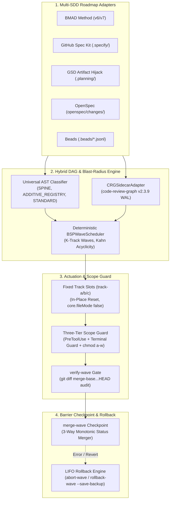

<p align="center">
  
</p>

<p align="center">
  <a href="https://github.com/stopActingSoSmall/sdd-parallel/actions/workflows/ci.yml"></a>
  <a href="https://pypi.org/project/sdd-parallel/"></a>
  <a href="https://www.python.org/"></a>
  <a href="LICENSE"></a>
  <a href="#-try-it-in-5-seconds-zero-api-keys-annotated-walkthrough"></a>
  <br>
  <a href="#-fits-right-into-your-existing-stack-zero-lock-in"></a>
  <a href="#-see-your-exact-sdd-project-layout-before--after"></a>
</p>

<p align="center">
  <b>🌐 Language:</b>
  <b>English</b> |
  <a href="docs/i18n/zh-CN/README.md">简体中文</a> |
  <a href="docs/i18n/es/README.md">Español</a> |
  <a href="docs/i18n/pt-BR/README.md">Português (BR)</a> |
  <a href="docs/i18n/ja/README.md">日本語</a> |
  <a href="docs/i18n/ko/README.md">한국어</a> |
  <a href="docs/i18n/ru/README.md">Русский</a>
</p>

<p align="center">
  <a href="#-try-it-in-5-seconds-zero-api-keys-annotated-walkthrough">Quick Demo</a> ·
  <a href="#-why-does-this-exist-in-plain-english">Why</a> ·
  <a href="#%EF%B8%8F-how-it-works--daily-4-command-workflow">How It Works</a> ·
  <a href="#-see-your-exact-sdd-project-layout-before--after">Your SDD Layout</a> ·
  <a href="#-fits-right-into-your-existing-stack-zero-lock-in">Harnesses</a> ·
  <a href="#%EF%B8%8F-full-cli-reference">Daily CLI</a> ·
  <a href="#-architecture-mathematical-model--dossier-deep-dives">Deep-Dives</a>
</p>

> **Run Multiple AI Coding Agents in Parallel — Up to 3x Faster, Zero Merge-Bombs.**  
> `sdd-parallel` is the deterministic traffic controller, worktree isolator, and blast-radius guard between your **Spec Kit / BMAD / GSD / OpenSpec / Beads** backlog and the coding agents (**Claude Code**, **Codex**, **Antigravity**, or any worktree-capable CLI) that implement it.

---

## ⚡ Why Does This Exist? (In Plain English)

<p align="center">
  
</p>

With a backlog of 10–15 specs or stories, you currently pick one of two bad options:

1. **One agent, sequentially** — safe, but **6–8 hours** of waiting.
2. **3–4 agents in naive `git worktree` folders** — fast, until merge time:
   - **Type-1 collision (direct):** two agents edit `sprint-status.yaml`, `STATE.md`, or `cli.py` → `<<<<<<<` on every merge.
   - **Type-2 collision (semantic, silent):** Agent A changes a signature in `normalizer.py`; Agent B, in another worktree, calls the old signature from `api.py`. **Git merges cleanly with zero conflict markers — and `main` is broken.**
   - **Scope creep:** a "helpful" agent rewrites the shared `schema.py` that was never in its task.

**`sdd-parallel` resolves this before a single LLM token is spent:** it scans your AST and call graph, groups provably safe tasks into parallel **Waves**, locks each agent inside a clean fixed slot (`track-a`, `track-b`, …), blocks out-of-scope writes at the hook and OS level, and merges each wave behind a quality-gate barrier.

| What Happens | ❌ Sequential (1 Agent) | 💥 Naive Parallel (`--worktree`) | ✅ With `sdd-parallel` |
| :--- | :--- | :--- | :--- |
| **12-story sprint time** | ~6–8 h (one by one) | ~2 h coding + **~2 h fixing broken merges** | **~2.5 h total (2x–3x speedup)** |
| **Hidden type / API collisions** | Avoided only by going slow | **Breaks `main` after merge** (W_A ∩ I_B ≠ ∅) | **Prevented upfront** (split into Wave 1 → Wave 2) |
| **Shared CLI / router files** | One agent at a time | Git conflict on every merge | **Parallel-safe** (`ADDITIVE_REGISTRY` detection) |
| **`sprint-status.yaml` / `tasks.md` / `STATE.md`** | Updated serially | Constant `<<<<<<<` conflicts | **Auto-merged** (monotonic 3-way merger) |
| **Agent edits the wrong file** | Prompt says "please don't" | Bypassed via `bash` / `sed` | **Blocked** (`PreToolUse` hook + Terminal Guard + `chmod a-w`) |
| **Worktree folder clutter** | None | 15 leftover `.worktrees/task-*` folders | **Fixed reusable slots** (`track-a`, `track-b`, `track-c`) |

---

## 🚀 Try It in 5 Seconds (Zero API Keys, Annotated Walkthrough)

No API key, no LLM subscription, no clone. One command via [`uv`](https://docs.astral.sh/uv/) (or `pipx run sdd-parallel demo`):

```bash
uvx sdd-parallel demo          # or test a specific kit: uvx sdd-parallel demo --kit spec-kit
```

The demo scaffolds a throwaway repo with 5 tasks and 6 Python modules, runs the real engine against it, and finishes in ~4 seconds. Below is the `--kit spec-kit` run, split into its 4 stages.

#### `[Step 1/4]` AST & Role Classification

```text
File Path                              | Detected Role          | Importers
----------------------------------------------------------------------------
src/demo_app/__init__.py               | additive_registry      | -
src/demo_app/api.py                    | standard               | -
src/demo_app/cli.py                    | additive_registry      | -
src/demo_app/exporter.py               | standard               | -
src/demo_app/normalizer.py             | standard               | src/demo_app/api.py
src/demo_app/schema.py                 | spine                  | -
```

No configuration, no hardcoded paths: the scanner marks `schema.py` as the **`spine`** (everything depends on it → serialize), `cli.py` as an **`additive_registry`** (append-only command registration → safe to share), and records that `api.py` imports `normalizer.py`.

#### `[Step 2/4]` Catching the Hidden Type-2 Merge-Bomb

```text
  Collision Analysis:
    - Naive Scheduler : W(T002)={normalizer.py, cli.py} vs W(T004)={api.py}
                        -> DISJOINT WRITES (False Safe!)
    - BSPWaveScheduler: Detected semantic_collision between 'T002' and 'T004'
                        -> Overlap W(T002) ^ I(T004) on: src/demo_app/api.py
  Wave Schedule:
    * Wave 1  track-a: T002 (normalizer.py + shared cli.py) | track-b: T003 (exporter.py + shared cli.py)
    * Wave 2  track-a: T001 (schema.py)                     | track-b: T004 (api.py)
    * Wave 3  track-a: T005 (schema.py)
```

Both `T002` and `T004` carry a hand-written `[P]` tag in `tasks.md`, and their write sets are disjoint (`normalizer.py ≠ api.py`), so a file-locking scheduler would run them together. `BSPWaveScheduler` sees that `T002`'s writes land inside `T004`'s impact set and moves `T004` to **Wave 2**, where it builds on the already-merged `normalizer.py`. Meanwhile `T002` and `T003` both write `cli.py` and still run in parallel, because it is an additive registry.

#### `[Step 3/4]` Clean Fixed Slots & Scope Guard Interception

```text
  Provisioned Fixed Slots (100% Clean git status: True):
    - track-a (.worktrees/track-a)
    - track-b (.worktrees/track-b)

  PreToolUse Scope Guard Check (track-a -> 'src/demo_app/schema.py'):
    - Decision : DENY
    - Violation: File 'src/demo_app/schema.py' cannot be modified by Wave 1 / track-a (stories ['T002'])
    - Reason   : Locked by Spine Chain invariant.
```

Injected boundary files (`ACTIVE_TRACK.md`, `.parallel-lock.json`, `.tmp/track-context.md`) are masked via the worktree's `info/exclude`, so `git status --porcelain` stays empty. When the `track-a` agent reaches for `schema.py`, the write is denied before it touches disk.

#### `[Step 4/4]` Barrier Checkpoint & Zero-Conflict 3-Way Merge

```text
  Merged Branches:
    - parallel/track-a
    - parallel/track-b
  Resolved tasks.md (0 conflict markers):
    - - [ ] T001 [US1] Upgrade schema in `src/demo_app/schema.py` (depends on T002)
    - - [x] T002 [P] [US1] Normalize `src/demo_app/normalizer.py`, `src/demo_app/cli.py`
    - - [x] T003 [P] [US1] Export `src/demo_app/exporter.py`, `src/demo_app/cli.py`
```

Both branches edited the same `tasks.md`. The status merger resolves each line monotonically (`[ ] < [x]`, `backlog < … < done`), so the result has no `<<<<<<<` markers. The same logic covers `sprint-status.yaml`, `STATE.md`, and `.beads/*.jsonl`.

<details>
<summary><b>🧪 Click to view the 5-kit verification matrix (<code>uvx sdd-parallel demo --kit all</code>) and the sandbox mode</b></summary>

```text
============================================================================
5/5 SDD KITS VERIFIED (BMAD, SPEC KIT, GSD, OPENSPEC, BEADS)
============================================================================
Kit          | Merge-Bomb   | Worktrees    | Scope Guard  | 3-Way Merge
----------------------------------------------------------------------------
bmad         | PASSED       | PASSED       | PASSED       | PASSED
spec-kit     | PASSED       | PASSED       | PASSED       | PASSED
gsd          | PASSED       | PASSED       | PASSED       | PASSED
openspec     | PASSED       | PASSED       | PASSED       | PASSED
beads        | PASSED       | PASSED       | PASSED       | PASSED
============================================================================
```

Want to drive the workflow by hand? Scaffold a persistent sandbox and run the real commands inside it:

```bash
uvx sdd-parallel demo --kit gsd --scaffold-only --output-dir ./sdd-sandbox
cd sdd-sandbox
sdd-parallel plan
sdd-parallel prepare --wave 1
```

</details>

---

## 🗺️ How It Works & Daily 4-Command Workflow

<p align="center">
  
</p>

**1. Install once** (requires `Python >= 3.11`, `Git >= 2.30`):

```bash
uv tool install sdd-parallel     # or: pipx install sdd-parallel
```

Both `sdd-parallel` and the shorthand alias `parallel-flow` become available globally.

**2. Run a wave in any SDD project:**

```bash
# 1. Scan specs + codebase AST and build safe waves
sdd-parallel plan

# 2. Provision Wave 1 into fixed slots and print the launch command for each track
sdd-parallel prepare --wave 1
sdd-parallel run-guide --wave 1

# 3. Start your agents inside .worktrees/track-a, track-b, ... (one per slot)

# 4. Audit scope, run quality gates, and merge Wave 1 back into main
sdd-parallel verify-wave --wave 1
sdd-parallel merge --wave 1
```

Undo: `sdd-parallel abort-wave --wave 1` (before merge) or `sdd-parallel rollback-wave --wave 1` (after merge; LIFO order, automatic `backup/wave-<K>-before-rollback-*` branch, SDD status reset).

---

## 📂 See Your Exact SDD Project Layout (Before & After)

<p align="center">
  
</p>

`sdd-parallel` reads your framework files as they are — no migration, no new spec format.

| SDD Framework | Read-Only Artifacts (locked in slots) | Task Discovery | Status Synchronization |
| :--- | :--- | :--- | :--- |
| **GitHub Spec Kit** (`.specify/`) | `constitution.md`, `feature.json`, `spec.md`, `plan.md` | `specs/*/tasks.md` (`T001 [P]`) | 3-way Markdown checkbox merge |
| **BMAD Method** (`v6.3+` / `v7`) | `epic-*-context.md` (Zero Cache Invalidation) | `sprint-status.yaml`, `epics.md`, `spec-*.md` | Monotonic 3-way YAML merge |
| **GSD** (`.planning/`) | `PROJECT.md`, `REQUIREMENTS.md`, `ROADMAP.md`, `STATE.md` | `phases/*/NN-NN-PLAN.md` | Artifact Hijack (`STATE.md` updated centrally on merge) |
| **OpenSpec** (`openspec/`) | `openspec/specs/**`, `project.md`, `config.yaml`, sibling change folders | `openspec/changes/<slug>/tasks.md` | 3-way Markdown checkbox merge |
| **Beads** (`.beads/`) | `.beads/config.yaml` | `.beads/*.jsonl` (`bd-101` + `blocks` edges) | Line-wise 3-way semi-lattice JSONL merge |

Every snapshot below is taken from the real `sdd-parallel demo --scaffold-only` fixtures after `plan` + `prepare --wave 1`. Source trees are collapsed to `src/…` for readability.

<details>
<summary><b>🌱 GitHub Spec Kit (<code>.specify/</code> &amp; <code>specs/*/tasks.md</code>) — Click to inspect Before &amp; After tree</b></summary>

**Before** — your project as-is:

```text
my-project/
├── .specify/
│   ├── memory/
│   │   └── constitution.md
│   ├── templates/
│   │   └── tasks-template.md
│   └── feature.json
├── specs/
│   └── 001-telemetry/
│       ├── plan.md
│       ├── spec.md
│       └── tasks.md
└── src/…
```

`specs/001-telemetry/tasks.md` — note the hand-written `[P]` on `T004`, which is unsafe next to `T002`:

```markdown
- [ ] T001 [US1] Upgrade schema in `src/demo_app/schema.py` (depends on T002)
- [ ] T002 [P] [US1] Normalize `src/demo_app/normalizer.py`, `src/demo_app/cli.py`
- [ ] T003 [P] [US1] Export `src/demo_app/exporter.py`, `src/demo_app/cli.py`
- [ ] T004 [P] [US2] Expose ingestion in `src/demo_app/api.py`
- [ ] T005 [US2] Add audit log in `src/demo_app/schema.py` (depends on T001)
```

**After** `sdd-parallel plan` + `prepare --wave 1`:

```text
my-project/
├── .parallel/                        # planner state (new)
│   ├── artifacts/
│   │   ├── execution-plan-parallel.md
│   │   └── wave-plan.json
│   ├── history/run-001-<timestamp>/wave-plan.json
│   └── state.json
├── .specify/…                        # untouched
├── .worktrees/
│   ├── track-a/                      # Wave 1 → T002
│   │   ├── .specify/memory/constitution.md   # 🔒 read-only
│   │   ├── specs/001-telemetry/
│   │   │   ├── plan.md               # 🔒 read-only
│   │   │   ├── spec.md               # 🔒 read-only
│   │   │   └── tasks.md
│   │   ├── src/…
│   │   ├── .tmp/track-context.md     # 👻 hidden via info/exclude
│   │   ├── .parallel-lock.json       # 👻 hidden via info/exclude
│   │   └── ACTIVE_TRACK.md           # 👻 → /speckit.implement T002
│   └── track-b/                      # Wave 1 → T003 (same layout)
├── specs/…                           # untouched
└── src/…
```

</details>

<details>
<summary><b>📐 BMAD Method (<code>v6.3+ / v7</code> — <code>_bmad-output/</code>) — Click to inspect Before &amp; After tree</b></summary>

**Before:**

```text
my-project/
├── _bmad-output/
│   ├── implementation-artifacts/
│   │   ├── epic-1-context.md
│   │   ├── epic-2-context.md
│   │   ├── epics.md
│   │   ├── spec-1-1-upgrade-schema-v2.md
│   │   ├── spec-1-2-normalize-telemetry-payload.md
│   │   ├── spec-1-3-cli-batch-export.md
│   │   ├── spec-2-1-expose-ingestion-api.md
│   │   ├── spec-2-2-add-audit-log-schema.md
│   │   └── sprint-status.yaml
│   └── planning-artifacts/
│       ├── epic-1-context.md
│       ├── epic-2-context.md
│       ├── epics.md
│       └── project-context.md
└── src/…
```

**After** `sdd-parallel plan` + `prepare --wave 1`:

```text
my-project/
├── .parallel/
│   ├── history/run-001-<timestamp>/wave-plan.json
│   └── state.json
├── .worktrees/
│   ├── track-a/                      # Wave 1 → story 1-2
│   │   ├── _bmad/custom/             # 👻 per-slot BMAD overlay (hidden)
│   │   │   ├── bmad-build.toml
│   │   │   ├── bmad-build.user.toml
│   │   │   ├── bmad-build-auto.toml
│   │   │   └── bmad-build-auto.user.toml
│   │   ├── _bmad-output/
│   │   │   ├── implementation-artifacts/   # sprint-status.yaml merged 3-way
│   │   │   └── planning-artifacts/
│   │   │       ├── epic-1-context.md # 🔒 Zero Cache Invalidation lock
│   │   │       ├── epic-2-context.md # 🔒
│   │   │       └── project-context.md
│   │   ├── src/…
│   │   ├── .tmp/track-context.md     # 👻
│   │   ├── .parallel-lock.json       # 👻
│   │   └── ACTIVE_TRACK.md           # 👻 → /bmad-build 1-2
│   └── track-b/                      # Wave 1 → story 1-3
├── _bmad-output/
│   ├── implementation-artifacts/…
│   ├── parallel-artifacts/           # planner output (BMAD keeps it under _bmad-output)
│   │   ├── execution-plan-parallel.md
│   │   └── wave-plan.json
│   └── planning-artifacts/…
└── src/…
```

</details>

<details>
<summary><b>⚡ GSD — Get Shit Done (<code>.planning/phases/</code> Artifact Hijack) — Click to inspect Before &amp; After tree</b></summary>

**Before:**

```text
my-project/
├── .planning/
│   ├── phases/
│   │   ├── 01-core/
│   │   │   ├── 01-01-PLAN.md
│   │   │   ├── 01-02-PLAN.md
│   │   │   └── 01-03-PLAN.md
│   │   └── 02-api/
│   │       ├── 02-01-PLAN.md
│   │       └── 02-02-PLAN.md
│   ├── PROJECT.md
│   ├── REQUIREMENTS.md
│   ├── ROADMAP.md
│   └── STATE.md
└── src/…
```

`01-02-PLAN.md` (normalizer) and `02-01-PLAN.md` (API) live in different phases and share no files, yet `02-01` calls into `01-02`'s code. The planner schedules them into different waves.

**After** `sdd-parallel plan` + `prepare --wave 1`:

```text
my-project/
├── .parallel/
│   ├── artifacts/
│   │   ├── execution-plan-parallel.md
│   │   └── wave-plan.json
│   ├── history/run-001-<timestamp>/wave-plan.json
│   └── state.json
├── .planning/…                       # untouched in main
├── .worktrees/
│   ├── track-a/                      # Wave 1 → 01-02
│   │   ├── .planning/
│   │   │   ├── phases/01-core/ · 02-api/
│   │   │   ├── PROJECT.md            # 🔒 read-only
│   │   │   ├── REQUIREMENTS.md       # 🔒 read-only
│   │   │   ├── ROADMAP.md            # 🔒 read-only
│   │   │   └── STATE.md              # 🔒 locked in slots, updated centrally on merge
│   │   ├── src/…
│   │   ├── .tmp/track-context.md     # 👻
│   │   ├── .parallel-lock.json       # 👻
│   │   └── ACTIVE_TRACK.md           # 👻 → /gsd-execute-phase 01-02
│   └── track-b/                      # Wave 1 → 01-03
└── src/…
```

</details>

<details>
<summary><b>📑 OpenSpec (<code>openspec/changes/</code>) — Click to inspect Before &amp; After tree</b></summary>

**Before:**

```text
my-project/
├── openspec/
│   ├── changes/
│   │   ├── audit-log-schema/
│   │   ├── cli-batch-export/
│   │   ├── ingestion-api-endpoint/
│   │   ├── normalize-telemetry/
│   │   │   ├── design.md
│   │   │   ├── proposal.md
│   │   │   └── tasks.md
│   │   └── upgrade-schema-v2/
│   ├── specs/
│   │   └── telemetry/
│   │       └── spec.md
│   ├── config.yaml
│   └── project.md
└── src/…
```

**After** `sdd-parallel plan` + `prepare --wave 1`:

```text
my-project/
├── .parallel/
│   ├── artifacts/
│   │   ├── execution-plan-parallel.md
│   │   └── wave-plan.json
│   ├── history/run-001-<timestamp>/wave-plan.json
│   └── state.json
├── .worktrees/
│   ├── track-a/                      # Wave 1 → normalize-telemetry
│   │   ├── openspec/
│   │   │   ├── changes/
│   │   │   │   ├── normalize-telemetry/   # ✍️ this track's change folder
│   │   │   │   ├── cli-batch-export/      # 🔒 locked by sibling track-b
│   │   │   │   └── …
│   │   │   ├── specs/                # 🔒 canonical specs (changed only via openspec archive)
│   │   │   ├── config.yaml           # 🔒
│   │   │   └── project.md            # 🔒
│   │   ├── src/…
│   │   ├── .tmp/track-context.md     # 👻
│   │   ├── .parallel-lock.json       # 👻
│   │   └── ACTIVE_TRACK.md           # 👻 → /openspec-apply normalize-telemetry
│   └── track-b/                      # Wave 1 → cli-batch-export (mirror locks)
├── openspec/…                        # untouched
└── src/…
```

</details>

<details>
<summary><b>🔗 Beads (<code>.beads/beads.jsonl</code>) — Click to inspect Before &amp; After tree</b></summary>

**Before:**

```text
my-project/
├── .beads/
│   ├── beads.jsonl
│   ├── config.yaml
│   └── issues.jsonl
└── src/…
```

The graph tasks `bd-101`, `bd-102`, `bd-103`, `bd-201`, `bd-202`, with `blocks` edges between them:

```json
{"id": "bd-101", "title": "Upgrade schema to v2", "status": "open", "files": ["src/demo_app/schema.py"], "dependencies": [{"target": "bd-102", "type": "blocks"}], "priority": 1, "epic": "epic-1"}
{"id": "bd-102", "title": "Normalize telemetry payload", "status": "open", "files": ["src/demo_app/normalizer.py", "src/demo_app/cli.py"], "dependencies": [], "priority": 2, "epic": "epic-1"}
```

**After** `sdd-parallel plan` + `prepare --wave 1`:

```text
my-project/
├── .beads/…                          # main copy, merged line-wise on `merge --wave 1`
├── .parallel/
│   ├── artifacts/
│   │   ├── execution-plan-parallel.md
│   │   └── wave-plan.json
│   ├── history/run-001-<timestamp>/wave-plan.json
│   └── state.json
├── .worktrees/
│   ├── track-a/                      # Wave 1 → bd-102
│   │   ├── .beads/
│   │   │   ├── beads.jsonl           # status edits merged 3-way per line (open < closed)
│   │   │   ├── config.yaml           # 🔒 read-only
│   │   │   └── issues.jsonl
│   │   ├── src/…
│   │   ├── .tmp/track-context.md     # 👻
│   │   ├── .parallel-lock.json       # 👻
│   │   └── ACTIVE_TRACK.md           # 👻 → bd update bd-102 --status in-progress
│   └── track-b/                      # Wave 1 → bd-103
└── src/…
```

After `merge --wave 1`, `bd-102` and `bd-103` are both `closed` in `.beads/beads.jsonl`, with 0 conflict markers.

</details>

Legend: 🔒 read-only (`chmod a-w` + `PreToolUse` deny) · 👻 injected, hidden from Git via `.git/worktrees/<slot>/info/exclude` · ✍️ writable scope of the track.

---

## 🔌 Fits Right Into Your Existing Stack (Zero Lock-In)

You keep your agent and your prompts. After `sdd-parallel prepare --wave 1`, `sdd-parallel run-guide --wave 1` prints the exact native command for each slot, and the same line is written to `.worktrees/track-<id>/ACTIVE_TRACK.md`. You don't type any context paths by hand:

| SDD Kit | Native command printed per track |
| :--- | :--- |
| GitHub Spec Kit | `/speckit.implement T002` |
| BMAD Method | `/bmad-build 1-2` |
| GSD | `/gsd-execute-phase 01-02` |
| OpenSpec | `/openspec-apply normalize-telemetry` |
| Beads | `bd update bd-102 --status in-progress` |

| Harness | How it plugs in |
| :--- | :--- |
| **Claude Code** (`claude`) | Open `claude` inside `.worktrees/track-a`; out-of-scope writes and shell bypasses are denied by the `PreToolUse` hook plus OS `chmod a-w`. Or spawn all tracks with `sdd-parallel autopilot --wave 1 --harness claude-code`. |
| **OpenAI Codex CLI** (`codex`) | `codex --cd .worktrees/track-b`; read-only files are protected by `chmod a-w`, and `sdd-parallel verify-wave` audits the diff before merge. Autopilot: `--harness codex`. |
| **Google Antigravity** | `sdd-parallel prepare --wave 1 --antigravity-layout` places slots under `~/.gemini/antigravity/worktrees/<Project>/track-a`; `ACTIVE_TRACK.md` sits at the slot root; `sdd-parallel install-plugin` installs the portable plugin with the scope-guard hook. |
| **Any worktree-capable CLI or IDE** — Cursor, Windsurf, OpenCode, Kimi CLI, MiniMax Code, Aider, Cline, Trae | Works without extra setup: standard `git worktree` slots (`track-a`, `track-b`, `track-c`, … via `--max-tracks N`), OS-level `chmod a-w` locks, `ACTIVE_TRACK.md`, and post-hoc diff verification with `sdd-parallel verify-wave`. |

---

## 🔍 Architecture, Mathematical Model & Dossier Deep-Dives

- 📖 **[01 — Core Product Brief & ROI Model](docs/dossier/01_CORE_PRODUCT_BRIEF.md)**: executive summary, token FinOps, model effort routing
- 🏛️ **[02 — System Capabilities White Paper](docs/dossier/02_SYSTEM_CAPABILITIES_WHITE_PAPER.md)**: Type-1 vs. Type-2 conflicts, 3D file taxonomy, CRG decay formula
- 🔌 **[03 — Integration & Ecosystem Spec](docs/dossier/03_INTEGRATION_AND_ECOSYSTEM_SPEC.md)**: `CanonicalTask` IR, `.tmp/track-context.md` and `.parallel-lock.json` contracts
- 📊 **[04 — Competitive & Benchmark Taxonomy](docs/dossier/04_COMPETITIVE_AND_BENCHMARK_TAXONOMY.md)**: positioning against adjacent orchestration tools
- 🧪 **[07 — Standalone Demo & E2E Walkthrough](docs/dossier/07_STANDALONE_DEMO_AND_E2E_WALKTHROUGH.md)**: frame-by-frame disk snapshots, `--keep-temp` sandbox guide
- 📐 **[System Architecture SSOT (`ARCHITECTURE.md`)](ARCHITECTURE.md)** · **[Dossier index](docs/dossier/README.md)** · **[Russian dossier](docs/i18n/ru/dossier/)**

<details>
<summary><b>🏛️ Click to expand: Internal Engine Architecture & 9 Core Invariants</b></summary>

### Internal Component Flow



### The 9 Core Engineering Invariants

1. **Zero Worktree Pollution:** injected boundaries (`.tmp/track-context.md`, `.parallel-lock.json`, `ACTIVE_TRACK.md`) are masked via git `info/exclude`; `git status --porcelain` stays empty.
2. **Zero Cache Invalidation:** pre-compiled context files (e.g. BMAD `epic-*-context.md`) are read-only during a wave; planner state goes to `.parallel/` (or `_bmad-output/parallel-artifacts/` for BMAD).
3. **100% Task Coverage & Acyclicity:** Kahn topological verification guarantees zero lost tasks and zero dependency cycles.
4. **Blast-Radius Enforcement (Type-1 & Type-2):** disjoint writes ($W_A \cap W_B = \emptyset$) plus disjoint semantic impact ($W_A \cap I_B = \emptyset$).
5. **Universal Anti-Overfitting:** no domain-specific paths in the core engine; `SPINE`, `ADDITIVE_REGISTRY`, and `STANDARD` are derived from AST heuristics and graph centrality only.
6. **Fixed Track Slots:** slots `track-a`, `track-b`, `track-c` are reused in place via `git checkout -B` + `git clean -fd`, with no folder clutter.
7. **Three-Tier Defense-in-Depth Guard:** `PreToolUse` hook + terminal command interception (`Bash`, `run_command`) + OS `chmod a-w`.
8. **Monotonic Status Semi-Lattice:** statuses resolve as $\texttt{backlog}(0) < \dots < \texttt{done}(4)$ with no merge markers.
9. **LIFO Transactional Rollbacks:** merged waves revert strictly in reverse order with automatic safety branches (`backup/wave-<K>-before-rollback-*`).

</details>

---

## 🛠️ Full CLI Reference

<details>
<summary><b>Click to expand: all 13 subcommands &amp; flags</b></summary>

| Command | Purpose |
| :--- | :--- |
| `sdd-parallel demo [--kit {bmad,spec-kit,gsd,openspec,beads,all}] [--keep-temp] [--scaffold-only] [--output-dir DIR]` | Run the offline Merge-Bomb demo or scaffold an interactive sandbox for any of the 5 SDD kits. |
| `sdd-parallel plan [--repo REPO] [--max-tracks N] [--kit KIT] [--include-done] [--dry-run] [--plan-source {auto,plan,specs}] [--output-dir DIR]` | Analyze roadmap + code graph; write `execution-plan-parallel.md` and `wave-plan.json`. |
| `sdd-parallel prepare --wave K [--repo REPO] [--max-tracks N] [--kit KIT] [--headless] [--antigravity-layout] [--dynamic-worktrees] [--dry-run]` | Provision slots (`track-a`, `track-b`, …), apply OS locks, inject boundaries. |
| `sdd-parallel claim-track --wave K --track <id> --worktree <path> [--repo REPO] [--max-tracks N] [--kit KIT] [--headless]` | Attach boundary locks to an existing external worktree. |
| `sdd-parallel run-guide --wave K [--repo REPO] [--max-tracks N] [--kit KIT] [--antigravity-layout]` | Print the operator run-guide with the native launch command for each track. |
| `sdd-parallel verify-wave --wave K [--repo REPO] [--max-tracks N] [--kit KIT] [--dynamic-worktrees]` | Audit slots against `.parallel-lock.json` and the multi-commit diff against `merge-base`. |
| `sdd-parallel merge --wave K [--repo REPO] [--max-tracks N] [--kit KIT] [--dynamic-worktrees] [--skip-gates] [--strict-gates] [--cleanup] [--dry-run]` | Barrier merge: 3-way status merge, git merge, quality gates, transactional auto-rollback. |
| `sdd-parallel abort-wave --wave K [--repo REPO] [--dynamic-worktrees]` | Abort an unmerged wave: reset slots, remove temporary parallel branches. |
| `sdd-parallel rollback-wave --wave K [--repo REPO] [--dynamic-worktrees] [--to-commit COMMIT] [--save-backup] [--no-backup] [--kit KIT]` | Revert a merged wave (LIFO) with a safety backup branch and SDD status reset. |
| `sdd-parallel merge-status --base B --ours O --theirs T --out OUT` | Low-level deterministic 3-way merge for `sprint-status.yaml`. |
| `sdd-parallel check-lock --file PATH [--tool TOOL]` | Check a write against the active worktree lock manifest. |
| `sdd-parallel install-plugin [--target-dir DIR]` | Package and install the portable Antigravity plugin. |
| `sdd-parallel autopilot --wave K [--repo REPO] [--max-tracks N] [--kit KIT] [--harness {antigravity,claude-code,codex}] [--antigravity-layout] [--execute]` | Generate or execute multi-window autopilot launch commands with model effort routing. |

</details>

---

## 🚢 Release Matrix: Shipped (v0.1.0) vs Roadmap (v0.2+)

### ✅ Shipped in `v0.1.0`

- [x] Deterministic Bulk-Synchronous Parallel (BSP) wave scheduler with Kahn acyclicity check.
- [x] AST hotspot scanner + `code-review-graph v2.3.9` sidecar integration.
- [x] Fixed track slots (`track-a`, `track-b`, `track-c`) with in-place reset and `info/exclude` masking.
- [x] Three-tier scope guard (`PreToolUse` + Terminal Guard + OS `chmod a-w`).
- [x] Monotonic 3-way status merger for YAML, Markdown checklists, `STATE.md`, and JSONL.
- [x] LIFO transactional wave rollback with automatic safety branches.
- [x] 5 SDD adapters: Spec Kit, BMAD, GSD (Artifact Hijack), OpenSpec, Beads, each with a native per-track worker command.
- [x] Offline Merge-Bomb demo (`sdd-parallel demo --kit all`) and sandbox scaffolding (`--scaffold-only`).
- [x] Multi-window autopilot for Antigravity, Claude Code, and Codex.
- [x] Clean-clone CI on Ubuntu / macOS / Windows, Python 3.11–3.13; PyPI Trusted Publishing.

### 🚧 Planned for `v0.2.0+`

- [ ] **Community adapters:** `mattpocock/skills` (`/implement-spec`) and `bmad-loop` frontmatter status adapter.
- [ ] **Zero-pollution environment sync:** `.venv` / `node_modules` symlinks into fixed slots.
- [ ] **Pre-wave static symbol linker & scope escalation:** automatic write-set expansion via AST symbols with dynamic rescheduling.
- [ ] **FinOps & observability exporters:** OpenTelemetry spans and Langfuse token-savings telemetry.
- [ ] **Headless autopilot daemon:** agent execution via local RPC / subagent dispatch.

---

## 🤝 Contributing, Local Development & Security

```bash
git clone https://github.com/stopActingSoSmall/sdd-parallel.git
cd sdd-parallel
uv sync

uv run pytest                          # unit + integration suite
uv run mypy --strict src/sdd_parallel  # strict typing
uv run ruff check src/ tests/ scripts/ # lint
uv run sdd-parallel demo --kit all     # offline 5-kit demo
```

- **Contributing:** see the **[Contributing Guide](CONTRIBUTING.md)** for environment setup and pull-request gates.
- **Security:** report vulnerabilities as described in the **[Security Policy](SECURITY.md)**.
- **License:** MIT — see [LICENSE](LICENSE).
