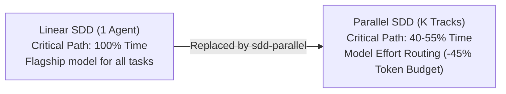

# 📋 SDD-Parallel — Core Product Brief & Executive Summary

**Product:** `sdd-parallel` (`parallel-flow`)  
**Category:** Spec-Driven Concurrency & Blast-Radius Governance Harness  
**Version:** 0.1.0  
**Target Audience:** First-tier abstraction document for C-Level stakeholders, investors, Product Owners, and external researchers. Outlines the core problem, value proposition, token economics, and architectural invariants without binding to language-specific implementation code.

---

## 1. The Problem: The Linear Execution Bottleneck of Agentic SDLC

AI-assisted software engineering has made major strides with the emergence of **Spec-Driven Development (SDD)** methodologies:
- **BMAD Method (v6/v7)**
- **GitHub Spec Kit (`.specify/`)**
- **GSD (Get Shit Done)**
- **OpenSpec & Beads**

These frameworks achieve high implementation quality through upfront design, contract freezing, and strict specification boundaries. However, they share a **fundamental architectural limitation**:
> **All existing SDD kits execute in a STRICTLY LINEAR fashion.**
> An input backlog of 10–20 stories is executed sequentially: $T_1 \to T_2 \to \dots \to T_N$. Attempting to run multiple agents concurrently in a shared repository or across uncoordinated branches leads to:
> 1. **Git Merge-Bombs:** Textual collisions in shared registries and sprint status files (`sprint-status.yaml`, `tasks.md`, `STATE.md`).
> 2. **Silent Semantic Breakages (Type-2 Collisions):** Agent A modifies a method signature in one module, while Agent B concurrently invokes the deprecated signature from another. Local unit tests pass in both branches, but the integrated build fails.
> 3. **Dirty Worktree Halts:** Agents generate intermediate files, polluting `git status --porcelain` and halting verification scripts.

Consequently, engineering teams must either wait hours for single-agent linear pipelines to finish or spend days manually untangling merge conflicts.

---

## 2. Product Vision

**`sdd-parallel`** is a deterministic coordination and safety harness that:
1. Polymorphically ingests existing roadmaps and specifications from any supported SDD framework.
2. Mathematically calculates weighted blast radius (AST + Call Graph) and builds a conflict-free Directed Acyclic Graph (DAG) of parallel execution waves.
3. Provisions isolated `git worktree` environments guaranteed to maintain a 100% clean Git status.
4. Enforces runtime blast-radius boundaries, preventing agents from mutating out-of-scope files.
5. Reconciles wave results at barrier checkpoints via deterministic monotonic 3-way status merging and quality gates.

**Value Formula:**  
$$\text{Swarm Execution Speed} + \text{Compiler-Grade Rigor} - \text{Git Conflict Chaos}$$

---

## 3. Key Value Proposition & ROI

### 1. Critical Path Acceleration (Time-to-Ship: 1.8x–2.5x)
Safely runs independent features from different epics concurrently. For a typical sprint of 12–16 stories, turnaround time decreases from 14 hours of continuous linear generation to 5–6 hours through compaction into 3–4 parallel waves.

### 2. Zero Merge-Bomb Guarantee (100% Clean Merges)
Eliminates both syntactic Git collisions ($W_A \cap W_B = \emptyset$) and semantic interface breakages ($W_A \cap I_B = \emptyset$). Wave branch reconciliation occurs automatically via barrier checkpoints.

### 3. Inference Economics: Model Effort Routing (40–60% Budget Savings)
Most multi-agent architectures run expensive flagship models indiscriminately. `sdd-parallel` assigns each task an effort tier based on topological risk:
- **`High Effort` (Flagship reasoning models):** Tasks altering schema cores (Spine Locks), foundational interfaces, or carrying high impact radius ($I(T) \ge 0.5$).
- **`Medium Effort`:** Standard, isolated business logic and adapters.
- **`Low Effort` (Fast, lightweight models):** Unit tests, documentation, localized formatting, and UI styling.
*Result:* Up to 70% of sprint backlog tasks are fulfilled by fast, economical models without architectural risk.

### 4. Zero Lock-in & Non-Invasive Operation
`sdd-parallel` does not alter underlying prompt chains in BMAD, Spec Kit, or GSD. It acts as a non-invasive external supervisor via standard OS primitives, Git commands, and the Model Context Protocol (MCP).

---

## 4. Core Invariants

1. **Zero Worktree Pollution:** Inside an agent's worktree, `git status --porcelain` remains 100% clean. Context injection and rule files do not pollute commits or break linter pipelines.
2. **Zero Cache Invalidation:** The orchestrator never mutates planning artifact timestamps (`epic-<N>-context.md`), preserving SDD internal compiler caches.
3. **100% Task Coverage:** Every task in the input backlog is accounted for—never dropped, duplicated, or silently skipped during wave planning.
4. **Acyclic & Deterministic Execution:** The conflict graph is mathematically verified to be acyclic via Kahn/Tarjan algorithms. Scheduling is strictly deterministic.
5. **Blast-Radius Isolation & Three-Tier Guard:** Concurrent tasks modifying interacting function signatures are separated into distinct waves. Out-of-scope edits are prevented by three lines of defense: `PreToolUse` hooks, Terminal Guard, and OS `chmod a-w`.
6. **Monotonic Progress State & LIFO Rollback:** Task lifecycle progression (`backlog` $\to$ `ready-for-dev` $\to$ `in-progress` $\to$ `review` $\to$ `done`) forms a semi-lattice: merges never regress status. Wave aborts adhere to strict LIFO order with safety backup branches (`backup/*`).
7. **Anti-Overfitting (Project-Agnostic Core):** Complete prohibition of domain-specific paths, framework names, or entities in the core engine. File roles are derived solely via universal AST analysis and topological centrality heuristics.
8. **Fixed Track Slots ($O(1)$ Footprint):** A parametric pool of permanent slots `track-<id>` with in-place reset (`git checkout -B` + `git clean -fd`) prevents directory accumulation and `Missing Folder` desktop IDE errors.

---

## 5. Target Personas and Use Cases Matrix

| Role | Pain Point Without `sdd-parallel` | Outcome With `sdd-parallel` |
| :--- | :--- | :--- |
| **Solo Engineer / Tech Lead** | Agent spends 40 minutes on a single story; engineer must wait or context-switch. | Launches the entire sprint at once: 3 parallel tracks finish the workload during a lunch break. |
| **AI Team / Engineering Manager** | Ballooning inference token costs while velocity is throttled by developers manually resolving merge conflicts. | 2x Time-to-Market reduction, ~45% inference cost savings via Model Effort Routing, 0 hours spent fixing Git conflicts. |
| **Platform / Harness Maintainer** | Unable to parallelize AI agents safely across enterprise monorepos. | Plugs `sdd-parallel` via MCP into existing harnesses (Cursor, Claude Code, Antigravity) with guaranteed isolation. |
