# 🔌 SDD-Parallel — Integration & Ecosystem Specification

**Product:** `sdd-parallel` (`parallel-flow`)  
**Category:** Integration Protocols, Input/Output Contracts & Ecosystem Specification  
**Version:** 0.1.0  
**Target Audience:** Third-tier abstraction document for integration engineers, harness developers, and adapter contributors. Specifies integration protocols, input/output data formats, and non-invasive extension contracts for external ecosystems.

---

## 1. Non-Invasive Adapter Layer Architecture

`sdd-parallel` was designed with zero enforcement of proprietary specification formats. Rather than imposing a new custom task schema, the architecture relies on a **Canonical Task Intermediate Representation (Task IR)**.

```mermaid
flowchart LR
    subgraph SDDKits["Input Ecosystems (Read-Only ACL)"]
        S1["BMAD Method\n(sprint-status.yaml + specs)"]
        S2["GitHub Spec Kit\n(tasks.md + constitution)"]
        S3["GSD (Get Shit Done)\n(phase-*-PLAN.md)"]
        S4["OpenSpec / Beads\n(changes / issues.jsonl)"]
        S5["Custom Framework\n(Custom Adapter)"]
    end

    subgraph IR["Canonical Layer (Canonical IR)"]
        C1["CanonicalTask\n- id, title, epic_id\n- status, priority\n- write_files, read_files\n- depends_on, model_effort"]
    end

    subgraph CoreEngine["sdd-parallel Engine"]
        E1["Conflict Solver & BSP Scheduler"]
    end

    subgraph OutputContracts["Output Artifacts & Runtimes"]
        O1[".tmp/track-context.md\n(Worker Context)"]
        O2[".parallel-lock.json\n(PreToolUse Guard)"]
        O3["Git Worktrees & Branches"]
        O4["MCP Tool Endpoints\n(FastMCP / stdio)"]
    end

    SDDKits -->|Read-Only Ingestion| IR
    IR --> CoreEngine
    CoreEngine --> OutputContracts
```



### 1.1. Core Engine vs Polymorphic Adapter Responsibility Matrix

The architectural boundary cleanly separates kit-specific file formats and conventions from engine-level concurrency control:

| Responsibility / Pipeline Stage | Owner | Concrete Implementation & Scope |
| :--- | :---: | :--- |
| **Roadmap Parsing & Task Extraction** | `SDDAdapter` | Parses framework files (YAML, Markdown checklists, JSONL). Converts tasks into canonical `TaskNode` objects (`write_files`, `read_files`, `depends_on`). |
| **Pre-Flight Wave Blockers** | `SDDAdapter` | Enforces kit-specific readiness gates (`check_wave_zero_blockers`): clean git status, epic context files in BMAD, checklist hygiene in Spec Kit. |
| **AST File Role Classification** | `Core Engine` | 3-pass static analyzer (`ASTHotspotScanner`) categorizing `SPINE`, `ADDITIVE_REGISTRY`, and `STANDARD` modules without hardcoding framework paths. |
| **Semantic Impact Radius** | `Core Engine` | Computes weighted call-graph blast radius ($W_A \cap I_B$) using `CRGSidecarAdapter` (`code-review-graph v2.3.9` WAL). |
| **Wave Partitioning (BSP Scheduler)** | `Core Engine` | Deterministic `BSPWaveScheduler` ensuring 100% story coverage and Kahn acyclicity. |
| **Worktree Slot Provisioning** | `Core Engine` + `Adapter` | Engine allocates fixed slots `track-<id>` and OS permissions (`chmod a-w`). Adapter supplies `get_allowed_write_globs()` and `get_forbidden_files()`. |
| **Worker Launch Instructions** | `SDDAdapter` | Produces native agent commands (`/bmad-build`, `/speckit.implement`, `/gsd-execute-phase`, `/openspec-apply`, `bd update`). |
| **Multi-Tier Scope Guard** | `Core Engine` | Enforces `PreToolUse` hook, Terminal Guard command interception (`Bash`, `run_command`), and OS read-only locks. |
| **3-Way Monotonic Status Merge** | `SDDAdapter` + `Core` | Engine orchestrates barrier git merge; specialized semi-lattice reconciler (`status_merger.py`) merges status files with zero conflict markers. |
| **LIFO Transactional Rollback** | `Core Engine` + `Adapter` | Engine creates safety backup branches (`backup/wave-<K>-before-rollback-*`) and resets `HEAD`; adapter polymorphically resets task statuses. |

### 1.2. Multi-Kit Coexistence & Inactive Sandboxing Protocol

When repositories contain artifacts from multiple SDD frameworks (e.g., legacy `_bmad-output/` alongside active `.specify/` from GitHub Spec Kit):
1. **Explicit Preference:** `--kit <name>` CLI option or `"default_kit"` key in `.parallel-config.json` / `pyproject.toml` takes absolute precedence.
2. **Active Tasks Heuristic (`kit="auto"`):** The auto-resolver interrogates each detected adapter via `load_tasks(include_done=False)`. It automatically activates the first framework containing uncompleted tasks (`len(active_tasks) > 0`).
3. **Diagnostic Telemetry:** `diagnose_multi_kit_coexistence()` reports coexisting frameworks without failing the run.
4. **Cross-Framework Sandboxing:** `build_lock_manifest()` automatically appends all inactive SDD directories to `forbidden_files` with reason `"Locked by inactive SDD framework sandboxing"`, preventing concurrent agents from mutating other frameworks' specs.

---

## 2. Input Adapters Specification

All framework adapters adhere to a **Read-Only ACL** contract during scheduling: they never mutate original roadmap files, preserving file `mtime` timestamps and internal compiler caches.

### 2.1. BMAD Method Adapter
- **Target Files:** `_bmad-output/implementation-artifacts/sprint-status.yaml`, `epics.md`, `spec-*.md`.
- **Extracted Fields:**
  - Story ID (e.g., `11-2`, `14-1`) and development status.
  - `## Code Map` sections from generated specifications: parsing of `write_files` and `read_files`.
  - Data dependencies declared in `epic-<N>-context.md`.
- **Cache Protection:** All planning calculations are written to `.parallel/` or `_bmad-output/parallel-artifacts/`, keeping BMAD caches untouched.

### 2.2. GitHub Spec Kit Adapter
- **Target Files:** `.specify/specs/*/tasks.md`, `.specify/memory/constitution.md`.
- **Extracted Fields:**
  - Task entries formatted as `- [ ] Task ID: Description`.
  - Parallelism annotations `[P]` (verified through graph analysis: if a human engineer mistakenly marks interdependent tasks as `[P]`, `sdd-parallel` overrides the label to prevent collisions).
  - References to architectural constitution rules to identify `Spine Lock` files.

### 2.3. GSD (Get Shit Done) — Artifact Hijack Mode
- **Target Files:** `.planning/{phase}-*-PLAN.md`.
- **The GSD Problem:** Native GSD executes tasks in a single working directory without worktree isolation, corrupting `.planning/STATE.md` during concurrent runs.
- **The `sdd-parallel` Solution (Artifact Hijack):** Ingests `files_modified` and `depends_on` from GSD phase plans, but executes them inside physically isolated worktrees, safeguarding `.planning/STATE.md`.

### 2.4. OpenSpec & Beads Adapters
- **OpenSpec:** Scans `openspec/changes/` directory (`proposal.md`, `tasks.md` manifests).
- **Beads:** Parses the streaming JSONL task log at `.beads/issues.jsonl` with `blocks` / `blocked_by` relational links.

### 2.5. Summary Protection, Isolation & Merge Matrix for 5 SDD Ecosystems

| SDD Framework (`kit`) | Input Roadmaps / Tasks | Permitted Metadata Files (`allowed_write_globs`) | Protected System Files (`forbidden_files`) | 3-Way Status Merge Strategy | Worker Launch Command (`run-guide`) |
| :--- | :--- | :--- | :--- | :--- | :--- |
| **BMAD Method** (`bmad`) | `sprint-status.yaml`, `epics.md`, `spec-*.md` | `sprint-status.yaml`, `spec-{sid}*.md` | `epic-*-context.md` (*Zero Cache Invalidation*) | `merge_sprint_status_yaml` (monotonic $\max(\text{rank})$) | `/bmad-build <id>` |
| **GitHub Spec Kit** (`spec-kit`) | `.specify/specs/**/tasks.md` | `tasks.md`, `checklists/**` | `.specify/memory/constitution.md`, `spec.md`, `plan.md` | `merge_markdown_task_checklists` (monotonic `[x]`) | `/speckit.implement <id>` |
| **GSD** (`gsd`) | `.planning/phases/*-PLAN.md` | `.planning/phases/**` | `STATE.md`, `ROADMAP.md`, `PROJECT.md`, `REQUIREMENTS.md` | Worktree isolation (*Artifact Hijack*) | `/gsd-execute-phase <id>` |
| **OpenSpec** (`openspec`) | `openspec/changes/*/tasks.md` | `openspec/changes/{sid}/**` | `openspec/project.md`, `openspec/specs/**`, sibling changes | `merge_markdown_task_checklists` (monotonic `[x]`) | `/openspec-apply <id>` |
| **Beads** (`beads`) | `.beads/issues.jsonl` | `.beads/issues.jsonl` | `.beads/config.yaml` | `merge_beads_issues_jsonl` (monotonic by ID) | `bd update <id> --status in-progress` |

---

## 3. Output Contracts & IPC Specifications

### 3.1. Worktree Context Contract (`.tmp/track-context.md`)
Generated within each isolated worktree slot. Injected into agent context via host instructions:

```markdown
# PARALLEL TRACK CONTEXT BOUNDARY (ENFORCED)
- **Wave:** 1 | **Track:** track-a | **Assigned Stories:** 11-2
- **Recommended Model Effort:** high

## 1. Allowed Exclusive Write Scope
- `src/canonical/intervals.py`
- `tests/test_intervals.py`

## 2. Shared Additive Registries (Isolated Append Scope)
- `src/canonical/normalizer.py` (Scope: function `_classify_reads` only)

## 3. Forbidden Files (Locked by Sibling Tracks in Wave 1)
- `src/canonical/manifest.py` (Locked by sibling track-b)
- `src/storage/schema.py` (Spine Lock Chain)
```

### 3.2. Runtime Lock Manifest (`.parallel-lock.json`)
Machine-readable manifest parsed by `PreToolUse` hooks for sub-millisecond access evaluation:

```json
{
  "wave_id": 1,
  "track_id": "track-a",
  "stories": ["11-2"],
  "allowed_write_globs": [
    "src/canonical/intervals.py",
    "src/canonical/normalizer.py",
    "tests/**"
  ],
  "additive_shared_files": [
    "src/canonical/normalizer.py"
  ],
  "forbidden_files": {
    "src/canonical/manifest.py": "Locked by track-b",
    "src/storage/schema.py": "Locked by Spine Chain"
  }
}
```

---

## 4. Orchestrator Interface Specifications

### 4.1. CLI Interface
The orchestrator exposes a complete deterministic command suite:
- `sdd-parallel plan [--kit auto|bmad|spec-kit|gsd|openspec|beads] [--max-tracks K]`
  - Performs graph analysis, schedules waves, and writes `wave-plan.json` and `execution-plan-parallel.md`.
- `sdd-parallel prepare --wave N [--dynamic-worktrees]`
  - Provisions fixed slots `track-<id>` with in-place reset (`git checkout -B` + `git clean -fd`), configures `info/exclude`, generates `.tmp/track-context.md`, `.parallel-lock.json`, and applies OS read-only locks (`chmod a-w`). The `--dynamic-worktrees` flag preserves legacy isolated directory creation.
- `sdd-parallel run-guide --wave N`
  - Outputs an operator terminal matrix with paths and launch commands for each active track window.
- `sdd-parallel verify-wave --wave N`
  - Validates active worktree slots against `.parallel-lock.json`, audits Terminal Guard compliance, and performs multi-commit `git diff` inspection against `merge-base` before integration.
- `sdd-parallel merge --wave N [--cleanup] [--strict-gates] [--skip-gates]`
  - Runs polymorphic stack-agnostic quality gates (Python, Node/TS, Rust, Go, or `.parallel-config.json`), applies transactional auto-rollback to pre-merge commit on gate failure, barrier-merges track branches into master, and applies monotonic 3-way status reconciliation.
- `sdd-parallel abort-wave --wave N`
  - Resets unmerged wave slots and deletes temporary parallel branches.
- `sdd-parallel rollback-wave --wave N [--save-backup]`
  - Performs an atomic LIFO rollback of an integrated wave, preserving an immutable `backup/*` branch and restoring SDD statuses.
- `sdd-parallel check-lock --file <path> [--tool <tool_name>]`
  - Evaluates file access permissions via the active runtime hook logic.

### 4.2. Model Context Protocol (MCP Server)
For integration with Cursor, Windsurf, Claude Desktop, Antigravity, and OpenHands, `sdd-parallel` exposes standard MCP tools over JSON-RPC (stdio):
- **`sdd_plan_waves(scope, max_tracks)`**: Returns the computed wave JSON structure with Model Effort designations.
- **`sdd_prepare_track(wave, track)`**: Provisions the isolated worktree slot and injects boundary contracts.
- **`sdd_verify_and_merge(wave)`**: Runs integration verification and triggers conflict-free barrier merging.

---

## 5. Extension Protocol (Adding a New Framework)

Supporting an additional SDD framework requires implementing a class satisfying the polymorphic `SDDAdapterProtocol` (`src/sdd_parallel/adapters/__init__.py`):

```python
class SDDAdapterProtocol(Protocol):
    """Unified adapter protocol across all SDD kits."""

    kit_id: str

    def detect(self) -> bool:
        """Determines whether this framework is present in the repository."""
        ...

    def load_tasks(self, include_done: bool = False) -> list[TaskNode]:
        """Parses roadmap/specs and converts them into canonical TaskNode instances."""
        ...

    def check_wave_zero_blockers(self, wave: Wave | None = None) -> list[str]:
        """Validates framework-specific preconditions (e.g. clean git status, epic context)."""
        ...

    def get_allowed_write_globs(self, track: WaveTrack) -> list[str]:
        """Returns metadata glob patterns permitted for writes within the isolated worktree."""
        ...

    def get_forbidden_files(self, wave: Wave, track: WaveTrack) -> dict[str, str]:
        """Returns dictionary of {rel_path: reason} for protected canonical specs."""
        ...

    def render_worker_command(self, track: WaveTrack) -> str:
        """Generates the native CLI command for operator execution in run-guide / Autopilot."""
        ...

    def reset_tasks_status(
        self,
        task_ids: Sequence[str],
        target_status: str = "ready-for-dev",
    ) -> None:
        """Polymorphically resets task statuses during LIFO wave rollback."""
        ...

    def cleanup_wave_artifacts(
        self,
        wave_id: int,
        task_ids: Sequence[str],
    ) -> None:
        """Purges wave-specific generated artifacts during rollback."""
        ...
```

### 5.1. How to Implement a New SDD Adapter in 1 File

To connect a new or custom SDD methodology (e.g., `CustomKit`), create a single file `src/sdd_parallel/adapters/custom_kit.py`:

```python
from pathlib import Path
from collections.abc import Sequence
from sdd_parallel.models import TaskNode, TaskStatus, EffortTier, Wave, WaveTrack

class CustomKitAdapter:
    kit_id = "custom-kit"

    def __init__(self, repo_root: Path) -> None:
        self.repo_root = repo_root.resolve()

    def detect(self) -> bool:
        return (self.repo_root / ".custom-kit" / "tasks.json").is_file()

    def load_tasks(self, include_done: bool = False) -> list[TaskNode]:
        # Parse .custom-kit/tasks.json and map tasks to TaskNode
        return [
            TaskNode(
                id="task-1",
                title="Implement Feature",
                status=TaskStatus.READY_FOR_DEV,
                write_files=["src/feature.py"],
                read_files=["src/core.py"],
                depends_on=[],
                model_effort=EffortTier.MEDIUM,
            )
        ]

    def check_wave_zero_blockers(self, wave: Wave | None = None) -> list[str]:
        return []

    def get_allowed_write_globs(self, track: WaveTrack) -> list[str]:
        return [".custom-kit/tasks.json"]

    def get_forbidden_files(self, wave: Wave, track: WaveTrack) -> dict[str, str]:
        return {".custom-kit/config.json": "Locked by CustomKit governance"}

    def render_worker_command(self, track: WaveTrack) -> str:
        return f"`custom-kit-run {track.task_ids[0]}`"

    def reset_tasks_status(self, task_ids: Sequence[str], target_status: str = "ready-for-dev") -> None:
        pass

    def cleanup_wave_artifacts(self, wave_id: int, task_ids: Sequence[str]) -> None:
        pass
```

Register the new adapter in `detect_sdd_kits()` and `_instantiate_adapter()` in `src/sdd_parallel/adapters/__init__.py`. Through the `TaskNode` abstraction, the scheduling engine, AST hotspot scanner, call graph sidecar, and worktree manager operate with any new framework **without modifying a single line of core engine code**.
