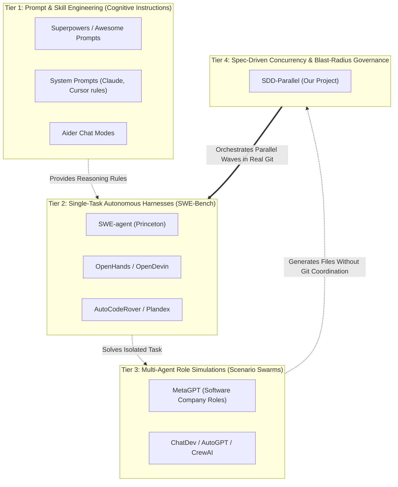

# 🔬 SDD-Parallel — Competitive & Benchmark Taxonomy

**Product:** `sdd-parallel` (`parallel-flow`)  
**Category:** Market Taxonomy, Ecosystem Benchmark & Comparative Analysis  
**Version:** 0.1.0  
**Target Audience:** Fourth-tier abstraction document for AI researchers, industry analysts, and benchmark evaluators. Establishes a rigorous taxonomy of the agentic coding ecosystem, classifies prominent open-source frameworks (10k–300k+ stars on GitHub), and defines an empirical verification methodology.

---

## 1. Four-Tier AI Coding Market Taxonomy (Market Tiers)

Directly comparing `sdd-parallel` against broad open-source agent projects often leads to a **category error**: high-star repositories typically target completely different layers in the engineering stack.

The market stratifies across 4 distinct functional tiers:

---

## 2. Analysis of Established Open-Source Frameworks & Blind Spots

### 2.1. Tier 1: Prompt Frameworks & Skills (Superpowers, Cursor Rules, Aider)
- **Core Value:** Curated sets of granular system instructions, chain-of-thought scaffolds, and formatting rules for LLMs.
- **Strength:** Enhances code generation fidelity within a single interactive session or function implementation.
- **Blind Spot:** Zero awareness of operating system primitives, directory isolation, or Git concurrency control. Running multiple concurrent agents directed by Superpowers in a shared workspace immediately produces dirty `git status` output and merge collisions.

### 2.2. Tier 2: Autonomous Bug Resolvers (SWE-agent, OpenHands / OpenDevin, Aider)
- **Core Value:** Single-threaded execution loops around a shell/sandbox environment, heavily benchmarked on SWE-bench (resolving one GitHub Issue in isolation).
- **Strength:** High pass rates on isolated SWE-bench tasks; solid integration with containerized Docker sandboxes.
- **Blind Spot:** Not built for collaborative feature development across a 20-story roadmap. They lack concepts of sprint wave scheduling, do not ingest BMAD or Spec Kit roadmaps, and cannot prevent Type-2 semantic collisions across concurrent instances.
- **Synergy Opportunity:** `sdd-parallel` can serve as the top-level orchestrator, provisioning worktrees and launching OpenHands or SWE-agent instances as isolated worker nodes within a wave.

### 2.3. Tier 3: Multi-Agent Role Simulators (MetaGPT, ChatDev, AutoGPT)
- **Core Value:** Simulates human organization hierarchies (Product Manager $\to$ Architect $\to$ Project Manager $\to$ Engineer $\to$ QA) via conversational message passing.
- **Strength:** Effective conceptual decomposition of greenfield applications from high-level prompts.
- **Blind Spot:** Detached from the reality of brownfield enterprise engineering. They generate entire codebases into greenfield folders, but struggle to commit incrementally into 500k-line production repositories containing database migrations, strict type hierarchies, and active branches.

### 2.4. Specification Frameworks (BMAD Method, GitHub Spec Kit, GSD)
- **Core Value:** Rigorous requirements engineering, contract freezing, and clear scope boundaries.
- **Blind Spot:** **Strictly linear execution.** Architected around a single agent executing sequentially.

---

## 3. Comparative Capabilities Matrix

| Capability / Benchmark Criterion | Prompt / Skills (Superpowers) | SWE Harness (OpenHands, SWE-agent) | Multi-Agent Sim (MetaGPT, ChatDev) | SDD Kits (BMAD, Spec Kit) | **SDD-Parallel** |
| :--- | :---: | :---: | :---: | :---: | :---: |
| **Sprint Roadmap Management** | ❌ | ❌ (1 Issue) | ⚠️ (Internal) | ✅ (Linear) | **✅ (Parallel DAG)** |
| **Type-1 Syntactic Conflicts ($W_A \cap W_B$)** | ❌ | ❌ | ❌ | ⚠️ (Linear only) | **✅ (AST Hotspots)** |
| **Type-2 Semantic Collisions ($W_A \cap I_B$)** | ❌ | ❌ | ❌ | ❌ | **✅ (CRG Impact Radius)** |
| **Isolation in `git worktree`** | ❌ | ⚠️ (Docker-only) | ❌ | ❌ | **✅ (Zero-Pollution)** |
| **Clean Git Status (`100% Clean`)** | ❌ | ❌ | ❌ | ⚠️ (Partial) | **✅ (`info/exclude`)** |
| **Active Runtime Interception (Scope Guard)** | ❌ | ❌ | ❌ | ❌ | **✅ (Three-Tier Scope Guard)** |
| **Conflict-Free Status 3-Way Merger** | ❌ | ❌ | ❌ | ❌ | **✅ (Monotonic YAML)** |
| **Model Effort Routing (High/Low)** | ❌ | ❌ | ⚠️ (By Role) | ❌ | **✅ (By Code Risk)** |

---

## 4. Benchmark Methodology

For empirical verification of `sdd-parallel`'s advantages over standard multi-agent setups, evaluators should apply the standardized benchmark suite:

### Test 1: The Merge-Bomb Benchmark
- **Scenario:** Two concurrent backlog stories modify interacting components:
  - Task A: Refactors normalization signature in `normalizer.py` (changes return type from `str` to `str | None`).
  - Task B: Implements an ingestion HTTP endpoint in `api.py` that invokes this function.
- **Expected Results:**
  - *Standard Multi-Agent Swarm (Superpowers / MetaGPT / uncoordinated branches):* Both tasks commit successfully. Isolated branch tests pass. Upon Git merge, no syntactic conflicts occur, but `mypy --strict` and integration suites fail with breaking runtime errors.
  - *SDD-Parallel:* The orchestrator discovers the semantic dependency overlap ($W_A \cap I_B \neq \emptyset$) during AST/CRG analysis and serializes the stories across distinct waves. 0 production regressions.

### Test 2: Critical Path Speedup Factor
- **Formulation:**
  $$S = \frac{T_{\text{linear}}}{T_{\text{parallel}}}, \quad \text{where } T_{\text{parallel}} = \sum_{w=1}^{W} \max_{k} (t_{w, k}) + \sum t_{\text{merge}}$$
