# 🏛️ SDD-Parallel — Arquitectura del Sistema (SSOT)

<p align="center">
  <b>🌐 Idioma / Language:</b>
  <a href="../../../ARCHITECTURE.md">English</a> |
  <a href="../zh-CN/ARCHITECTURE.md">简体中文</a> |
  <b>Español</b> |
  <a href="../pt-BR/ARCHITECTURE.md">Português (BR)</a> |
  <a href="../ja/ARCHITECTURE.md">日本語</a> |
  <a href="../ko/ARCHITECTURE.md">한국어</a> |
  <a href="../ru/ARCHITECTURE.md">Русский</a>
</p>

**Versión:** 0.1.0  
**Estado:** Columna Arquitectónica Aprobada (SSOT)

---

## 1. Visión General de Módulos Arquitectónicos

El sistema `sdd-parallel` está estructurado en tres subsistemas débilmente acoplados, orquestados mediante una representación canónica de grafo de tareas (`src/sdd_parallel/models.py`):

```mermaid
flowchart LR
    subgraph Adapters["Subsistema 1: Adaptadores Polimórficos de Kits SDD (SDDAdapterProtocol & ACL Solo Lectura)"]
        A1["Adaptador BMAD\n(sprint-status.yaml + epics.md + specs)"]
        A2["Adaptador Spec Kit\n(.specify/specs/*/tasks.md + constitution)"]
        A3["Adaptador GSD\n(.planning/phases/*-PLAN.md + STATE.md)"]
        A4["Adaptador OpenSpec\n(openspec/changes/*/tasks.md + proposal)"]
        A5["Adaptador Beads\n(.beads/issues.jsonl + dependencies)"]
    end

    subgraph Engine["Subsistema 2: Motor DAG Hexagonal y Resolvedor de Conflictos"]
        E1["ASTHotspotScanner\n(Análisis 3 Pasadas: Spine vs Registros Aditivos)"]
        E2["CRGSidecarAdapter\n(code-review-graph v2.3.9 Grafo de Llamadas WAL)"]
        E3["BSPWaveScheduler\n(Empaquetado Determinista de Olas, K Pistas)"]
    end

    subgraph Actuation["Subsistema 3: Aprovisionador de Worktrees y Compuerta de Fusión"]
        W1["prepare / claim-track\n(Ranuras Fijas track-<id> + Reinicio In Situ)"]
        W2["Guarda de Ámbito en Tres Niveles\n(PreToolUse + Terminal Guard + OS chmod a-w)"]
        W3["merge Checkpoint Gate\n(Diff estricto merge-base + Fusión 3 vías polimórfica)"]
    end

    Adapters --> E1 & E2
    E1 & E2 --> E3
    E3 --> W1
    W1 --> W2 --> W3
```



### 1.1. Arquitectura Hexagonal y `SDDAdapterProtocol`

Siguiendo el patrón de Puertos y Adaptadores (Arquitectura Hexagonal), el núcleo de `sdd-parallel` interactúa con todos los marcos de Desarrollo Dirigido por Especificaciones (SDD) exclusivamente a través del contrato fuertemente tipado `SDDAdapterProtocol` (`src/sdd_parallel/adapters/__init__.py`). El núcleo no contiene rutas fijas ni bifurcaciones específicas de kits:

```python
class SDDAdapterProtocol(Protocol):
    """Contrato polimórfico implementado por todos los marcos SDD soportados."""

    kit_id: str

    def detect(self) -> bool:
        """Detecta marcadores de presencia del marco SDD en el repositorio."""
        ...

    def load_tasks(self, include_done: bool = False) -> list[TaskNode]:
        """Parsea artefactos de backlog a modelos canónicos TaskNode."""
        ...

    def check_wave_zero_blockers(self, wave: Wave | None = None) -> list[str]:
        """Verifica prerequisitos específicos del marco (Git limpio, contextos compilados)."""
        ...

    def get_allowed_write_globs(self, track: WaveTrack) -> list[str]:
        """Retorna patrones glob de metadatos permitidos para escritura en el worktree."""
        ...

    def get_forbidden_files(self, wave: Wave, track: WaveTrack) -> dict[str, str]:
        """Mapea especificaciones inmutables y contratos protegidos del marco."""
        ...

    def render_worker_command(self, track: WaveTrack) -> str:
        """Genera comando nativo CLI para el operador y modo Autopilot."""
        ...

    def reset_tasks_status(
        self,
        task_ids: Sequence[str],
        target_status: str = "ready-for-dev",
    ) -> None:
        """Restablece polimórficamente los estados tras rollback transaccional LIFO."""
        ...

    def cleanup_wave_artifacts(
        self,
        wave_id: int,
        task_ids: Sequence[str],
    ) -> None:
        """Limpia especificaciones temporales generadas para la ola."""
        ...
```

### 1.2. Matriz de Responsabilidades: Motor Agnóstico vs Adaptadores Polimórficos

| Fase / Aspecto | Subsistema Responsable | Rol Arquitectónico y Mecanismos |
| :--- | :---: | :--- |
| **Parseo de Artefactos y Conversión a Tareas** | `SDDAdapter` | Interpreta formatos específicos (YAML, Markdown, JSONL). Convierte tareas a `TaskNode` canónicos (`write_files`, `read_files`, `depends_on`). |
| **Validación Previa de Bloqueos** | `SDDAdapter` | Verifica compuertas de preparación (`check_wave_zero_blockers`): Git limpio, contextos BMAD, listas de Spec Kit. |
| **Clasificación AST de Archivos** | `Core Engine` | Analizador estático de 3 pasadas (`ASTHotspotScanner`) que categoriza módulos en `SPINE`, `ADDITIVE_REGISTRY` y `STANDARD`. |
| **Radio de Impacto Semántico** | `Core Engine` | Calcula el radio de colisión ponderado ($W_A \cap I_B$) mediante `CRGSidecarAdapter` (`code-review-graph v2.3.9` WAL). |
| **Partición en Olas (Planificador BSP)** | `Core Engine` | Planificador determinista `BSPWaveScheduler` que garantiza 100% de cobertura y aciclicidad formal (Kahn). |
| **Aprovisionamiento de Ranuras de Worktrees** | `Core Engine` + `Adapter` | Asigna ranuras fijas `track-<id>` y permisos del SO (`chmod a-w`). El adaptador aporta `allowed_write_globs` y `forbidden_files`. |
| **Instrucciones de Ejecución de Agentes** | `SDDAdapter` | Genera comandos nativos (`/speckit.implement`, `/gsd-execute-phase`, `/opsx:apply`, `bd update`, `/bmad-build`). |
| **Guarda de Ámbito Multinivel** | `Core Engine` | Intercepta llamadas `PreToolUse`, comandos de terminal (`Bash`, `run_command`) y aplica bloqueos de solo lectura del SO. |
| **Fusión Monótona de Estados en 3 Vías** | `SDDAdapter` + `Core` | El motor coordina la fusión Git; el reconciliador semirreticular (`status_merger.py`) fusiona estados sin conflictos. |
| **Rollback Transaccional LIFO** | `Core Engine` + `Adapter` | Crea ramas de seguridad (`backup/wave-<K>-before-rollback-*`) y resetea `HEAD`; el adaptador restablece estados. |

### 1.3. Coexistencia de Múltiples Kits y Aislamiento en Sandboxing

En repositorios empresariales con múltiples marcos coexistentes:
1. **Preferencia Explícita:** La opción CLI `--kit <nombre>` o la clave `"default_kit"` en la configuración tiene prioridad absoluta.
2. **Heurística de Tareas Activas (`kit="auto"`):** Activa automáticamente el primer marco que contenga tareas sin completar (`len(active_tasks) > 0`).
3. **Telemetría de Diagnóstico:** `diagnose_multi_kit_coexistence()` alerta al operador sin interrumpir la ejecución.
4. **Sandboxing entre Marcos:** Al generar `.parallel-lock.json`, los directorios de los marcos **inactivos** se bloquean bajo `forbidden_files` con el motivo `"Locked by inactive SDD framework sandboxing"`.

---

## 2. Modelo Matemático de Conflictos y Taxonomía de Archivos

Para cada tarea pendiente $T_i$:
- $W(T_i)$ — Archivos que la tarea **modifica o crea** (`write_files`).
- $R(T_i)$ — Archivos que la tarea **lee o importa** (`read_files`).
- $I(T_i)$ — **Radio de Impacto Ponderado** alrededor de $W(T_i)$, calculado vía `CRGSidecarAdapter` (`code-review-graph v2.3.9`, atenuación $\gamma = 0.7$).

### 2.1. Tres Clases de Archivos en el Código

1. **Archivos de Columna Troncal (`FileRole.SPINE`):**
   - Esquemas de bases de datos, migraciones secuenciales o modelos raíz (`schema.py`, `models.py`, `SCHEMA_VERSION`).
   - **Regla:** Tareas que modifican el mismo archivo `SPINE` **nunca se ejecutan en la misma ola** y se serializan en orden estricto.
2. **Registros Aditivos Compartidos (`FileRole.ADDITIVE_REGISTRY`):**
   - Puntos de entrada donde se registran comandos o rutas de manera independiente (`cli.py` con `@app.command`, `__init__.py` con `__all__`).
   - *Invariante (ADR-0002):* Utilidades de formateo (`console.py`, `markdown.py`) se clasifican como `FileRole.STANDARD`.
   - **Regla:** Tareas que intersecan exclusivamente en archivos `ADDITIVE_REGISTRY` **pueden ejecutarse concurrentemente** en ranuras aisladas con advertencia de inserción única.
3. **Módulos Estándar (`FileRole.STANDARD`):**
   - Lógica de negocio y adaptadores.
   - **Regla:** Cualquier intersección $W(A) \cap W(B) \neq \emptyset$ bloquea la ejecución en la misma ola.

### 2.2. Flujo de Análisis Estático AST en 3 Pasadas (`ASTHotspotScanner`)

Bajo el **Invariante 7 (Anti-Sobreajuste)**, los roles de archivo se determinan dinámicamente:
1. **Pasada 1 (Firmas):** Detección de palabras clave de migración (`SCHEMA_VERSION`, `auto_migrate`).
2. **Pasada 2 (Grafo de Importaciones y Decoradores):** Cálculo de centralidad de entrada (Fan-In) e inspección de decoradores (`command`, `tool`, `get`, `post`).
3. **Pasada 3 (Clasificación Determinista):**
   - Pruebas (`tests/`) $\to$ siempre `STANDARD`.
   - `SPINE`: si tiene palabras de migración $\lor$ nombre `schema.py`/`models.py` $\lor$ **Fan-In $\ge 5$**.
   - `ADDITIVE_REGISTRY`: si contiene decoradores de registro $\lor$ nombre `cli.py`/`__init__.py`.
   - `STANDARD`: el resto de módulos de lógica.

### 2.3. Tipos de Aristas en el Grafo de Conflictos (`ConflictEdge`)

1. **`EXPLICIT_DEP` (Dependencia Dirigida $A \to B$):** Declarada formalmente en la hoja de ruta.
2. **`SPINE_ORDER` (Orden Troncal Dirigido $A \to B$):** Modificación secuencial sobre archivo `SPINE`.
3. **`DIRECT_COLLISION` (Colisión de Escritura $A \leftrightarrow B$):** $W(A) \cap W(B) \setminus \text{AdditiveRegistries} \neq \emptyset$.
4. **`SEMANTIC_COLLISION` (Colisión Semántica de Tipo 2 $A \leftrightarrow B$):** $(W(A) \cap I(B)) \cup (W(B) \cap I(A)) \neq \emptyset$.

---

## 3. Contratos Clave de Artefactos en Tiempo de Ejecución

### 3.1. Contrato de Contexto de Worktree (`.tmp/track-context.md`)

Inyectado por `sdd-parallel prepare --wave K` en el prompt del agente:

```markdown
# PARALLEL TRACK CONTEXT BOUNDARY (ENFORCED)
- **Wave:** 1 | **Track:** track-a | **Assigned Stories:** 11-2
- **Recommended Model Effort:** high

## 1. Allowed Exclusive Write Scope
- `src/canonical/intervals.py`
- `tests/test_intervals.py`

## 2. Shared Additive Registries (Isolated Append Scope)
- `src/canonical/normalizer.py` (Scope: function `_classify_reads` only)

## 3. Forbidden Files (Locked by Sibling Tracks in Wave 1)
- `src/canonical/manifest.py` (Locked by track-b)
- `src/storage/schema.py` (Spine Lock Chain)
```

### 3.2. Manifiesto de Bloqueo de Ámbito (`.parallel-lock.json`)

Leído por los ganchos `PreToolUse` para evaluación instantánea:

```json
{
  "wave_id": 1,
  "track_id": "track-a",
  "stories": ["11-2"],
  "repo_root": "/workspace/project",
  "worktree_root": "/workspace/project/.worktrees/track-a",
  "allowed_write_globs": [
    "src/canonical/intervals.py",
    "src/canonical/normalizer.py",
    "tests/**",
    ".tmp/**"
  ],
  "additive_shared_files": [
    "src/canonical/normalizer.py"
  ],
  "forbidden_files": {
    "src/canonical/manifest.py": "Locked by track-b (story 11-3)",
    "src/storage/schema.py": "Locked by Spine Chain"
  }
}
```

---

## 4. Mecanismos Técnicos No Invasivos y Soporte de 5 Kits

### 4.1. Inyección de Entorno Sin Contaminación del Worktree

Garantiza que el agente inicie con `git status --porcelain == ""` en los 5 marcos:
1. Contexto de orquestación en `.tmp/track-context.md` (`.tmp/` en `.gitignore`).
2. Manifiesto de bloqueo en `.parallel-lock.json` (`.parallel-lock.json` en `.gitignore`).
3. Reglas de exclusión local en `.git/worktrees/<name>/info/exclude`.
4. Variables de entorno (como `SPECIFY_FEATURE`) inyectadas dinámicamente en el proceso.

### 4.2. Validación Previa y Protección de Especificaciones Inmutables

Auditoría y protección estricta (`FORBIDDEN_STATE_FILES`):
- **GitHub Spec Kit:** Protege `.specify/memory/constitution.md`, `.specify/feature.json`, `spec.md`, `plan.md`.
- **GSD:** Protege `.planning/STATE.md`, `ROADMAP.md`, `PROJECT.md`.
- **OpenSpec:** Protege `openspec/project.md`, `openspec/specs/**`, `openspec/config.yaml`.
- **Beads:** Protege `.beads/config.yaml` y `.beads/metadata.json`.
- **BMAD:** Valida y protege `epic-<N>-context.md`.

### 4.3. Cálculo de Radio de Explosión vía `CRGSidecarAdapter`

1. **Anclaje al Repositorio Principal:** Inicialización con `main_repo_root` evitando errores de ruta relativa.
2. **Compatibilidad con Modo WAL:** Consultas concurrentes seguras sobre SQLite.
3. **Supresión de Ruido:** Filtro `min_impact_score=0.5`.

### 4.4. Fusión Monótona Polimórfica de Estados en 3 Vías

1. **BMAD (`sprint-status.yaml`):** Semirretícula: $\texttt{backlog} (0) < \texttt{ready-for-dev} (1) < \texttt{in-progress} (2) < \texttt{review} (3) < \texttt{done} (4)$, preservando comentarios y formato YAML.
2. **GitHub Spec Kit y OpenSpec (`tasks.md` Markdown):** Conciliación automática de líneas `- [ ]` a `- [x]` con 0 marcadores de conflicto.
3. **Beads (`.beads/issues.jsonl`):** Fusión JSONL monótona por ID (`open < in-progress < closed`).
4. **Protección UTF-8 BOM (`utf-8-sig`):** Neutralización de marcas BOM de PowerShell (`\ufeff`).

### 4.5. Ranuras Fijas (`track-<id>`) y Reinicio In Situ ($O(1)$ Espacio)

Mantiene un grupo permanente de $K = \text{max\_tracks}$ ranuras (`track-a`, `track-b`):
- Evita creación y borrado masivo de carpetas que rompen el árbol del IDE.
- Reinicio atómico in situ: `git checkout -B parallel/<track_id> master ; git clean -fd`.

### 4.6. Guarda de Ámbito en Tres Niveles

1. **Nivel 1 (Gancho PreToolUse):** Intercepta herramientas de mutación de archivos (`write_file`, `edit_file`).
2. **Nivel 2 (Terminal Guard):** Intercepta comandos de shell (`Bash`, `run_command`, `cmd`, `powershell`) bloqueando redirecciones (`>`) o editores en línea (`sed -i`).
3. **Nivel 3 (Bloqueos de Solo Lectura del SO):** Aplica `chmod a-w` y `git config core.fileMode false` impidiendo físicamente la escritura.
4. **Compuerta de Verificación (`verify_wave`):** Inspección de diffs `git diff $(git merge-base master HEAD)...HEAD` previa a la integración.

### 4.7. Motor de Rollback Transaccional LIFO

- **`abort-wave --wave K`:** Limpia ranuras no integradas antes del merge.
- **`rollback-wave --wave K [--save-backup]`:** Revierte en estricto orden LIFO, crea rama de respaldo `backup/wave-<K>-before-rollback-*` y restablece estados polimórficamente.

### 4.8. Compuertas de Calidad Agnósticas y Auto-Rollback Transaccional

- **Resolución Universal:** Lee compuertas de `.parallel-config.json` o `pyproject.toml`, con autodetección para Python, Node, Rust y Go.
- **Auto-Rollback:** Ante fallos en las compuertas de calidad durante el merge, se ejecuta automáticamente `git reset --hard` sobre `master`, dejando los worktrees intactos para depuración.

### 4.9. Comando de Demostración Offline (`sdd-parallel demo`)

Ejecuta en <5 segundos la verificación de los 5 invariantes sin claves de API ni acceso a la red. Con `--kit all` valida los 5 marcos en una matriz unificada.

### 4.10. Referencia Completa de Comandos CLI

| Comando | Propósito | Opciones Principales |
| :--- | :--- | :--- |
| `plan` | Calcula el DAG de conflictos y planifica olas paralelas | `--repo <path>`, `--max-tracks <K>`, `--kit <auto\|kit>`, `--plan-source <auto\|plan\|specs>`, `--include-done`, `--dry-run` |
| `prepare` | Aprovisiona ranuras fijas de pistas y bloqueos para la Ola K | `--repo <path>`, `--wave <K>`, `--max-tracks <K>`, `--kit <auto\|kit>`, `--antigravity-layout`, `--dynamic-worktrees`, `--headless`, `--dry-run` |
| `claim-track` | Asocia bloqueos de límites a un worktree externo existente | `--repo <path>`, `--wave <K>`, `--track <id>`, `--worktree <path>`, `--max-tracks <K>`, `--kit <auto\|kit>`, `--headless` |
| `run-guide` | Muestra la matriz de instrucciones para el operador de la Ola K | `--repo <path>`, `--wave <K>`, `--max-tracks <K>`, `--kit <auto\|kit>`, `--antigravity-layout` |
| `verify-wave` | Audita diffs y cumplimiento de bloqueos contra merge-base | `--repo <path>`, `--wave <K>`, `--max-tracks <K>`, `--kit <auto\|kit>`, `--dynamic-worktrees` |
| `merge` | Fusión de barrera con merge 3-way de estados y compuertas | `--repo <path>`, `--wave <K>`, `--max-tracks <K>`, `--kit <auto\|kit>`, `--strict-gates`, `--skip-gates`, `--cleanup`, `--dry-run`, `--dynamic-worktrees` |
| `merge-status` | Fusión determinista autónoma de 3 vías para sprint-status.yaml | `--base <file>`, `--ours <file>`, `--theirs <file>`, `--out <file>` |
| `check-lock` | Valida permisos de modificación de un archivo mediante lógica de hook | `--file <path>`, `--tool <name>` (salida JSON formateada con `indent=2`) |
| `install-plugin` | Empaqueta e instala el plugin portable para Antigravity | `--target-dir <path>` (por defecto `~/.gemini/config/plugins/sdd-parallel`) |
| `autopilot` | Genera o ejecuta comandos en modo Autopilot Multiconversación | `--repo <path>`, `--wave <K>`, `--max-tracks <K>`, `--kit <auto\|kit>`, `--harness <antigravity\|claude-code\|codex>`, `--antigravity-layout`, `--execute` |
| `abort-wave` | Aborta la ola antes de fusionar y limpia ramas paralelas | `--repo <path>`, `--wave <K>`, `--dynamic-worktrees` |
| `rollback-wave` | Rollback atómico LIFO de ola integrada con rama de respaldo | `--repo <path>`, `--wave <K>`, `--to-commit <hash>`, `--save-backup` / `--no-backup`, `--kit <auto\|kit>`, `--dynamic-worktrees` |
| `demo` | Demostración offline de 5 segundos o creación de sandbox | `--kit <bmad\|spec-kit\|gsd\|openspec\|beads\|all>`, `--keep-temp`, `--scaffold-only`, `--output-dir <path>` |

---

## 5. Modelos de Ejecución Paralela en Google Antigravity y Agentes de IA

Frente a la restricción de entorno **`Max Subagent Depth = 1`** (los subagentes no pueden invocar subagentes anidados), se soportan dos modelos:

### 5.1. Modo A: `Two-Stage Assisted & Interactive Checkpoints` (Recomendado por Defecto)

Flujo asistido con supervisión humana en puntos de control interactivos:
1. **Punto de Control 1 (Confirmación de Plan):** El orquestador genera el DAG de olas y solicita aprobación.
2. **Punto de Control 2 (Ejecución en Pistas):**
   - El orquestador aprovisiona las ranuras fijas `track-a`, `track-b` y muestra `run-guide`.
   - El operador abre las ranuras en Antigravity IDE / terminal y ejecuta los comandos nativos a `Profundidad 0`:
     - **GitHub Spec Kit:** `/speckit.implement <task-id>`
     - **GSD:** `/gsd-execute-phase <phase-num>`
     - **OpenSpec:** `/opsx:apply <task-id>`
     - **Beads:** `bd update <task-id> --status in-progress`
     - **BMAD:** `/bmad-build <task-id>`
3. **Punto de Control 3 (Fusión de Barrera):** En la sesión del orquestador, `sdd-parallel merge --wave K --cleanup` valida bloqueos, ejecuta compuertas de calidad e integra ramas.

### 5.2. Modo B: `Multi-Window Autopilot` (Automatización Objetivo)

Orquestación automatizada sin interacción manual de consola:
1. El orquestador prepara las ranuras de worktree.
2. `AutopilotLauncher` (`src/sdd_parallel/autopilot.py`) genera comandos de lanzamiento con enrutamiento de modelos por esfuerzo (`High` / `Medium` / `Low`).
3. El orquestador monitoriza la llegada de commits y la evolución de estados en los artefactos SDD.
4. Al concluir todas las pistas, ejecuta la verificación de barrera y fusiona en `master`.

### 5.3. Modo C: `In-Session Flat Dispatch` (Obsoleto / Solo Respaldo de Emergencia)

Ejecutar una cadena plana de subagentes en una única conversación se considera **OBSOLETO** y queda relegado únicamente a entornos sin soporte de múltiples ventanas.
