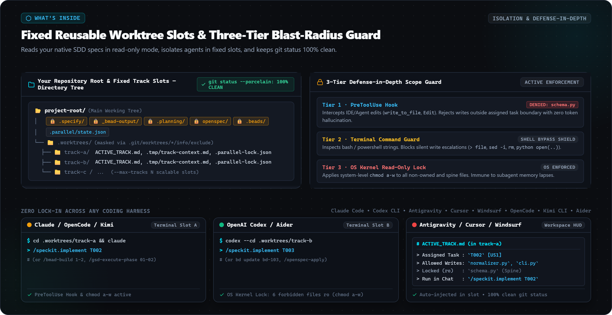
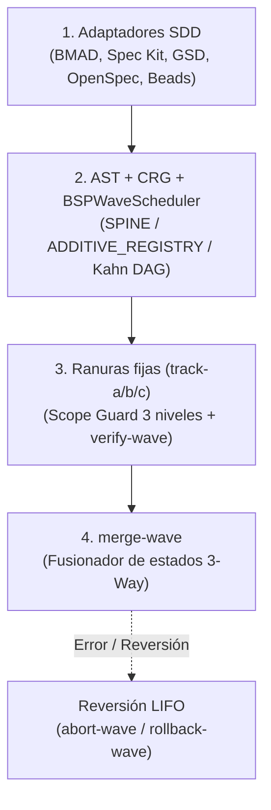

<p align="center">
  
</p>

<p align="center">
  <a href="https://github.com/stopActingSoSmall/sdd-parallel/actions/workflows/ci.yml"></a>
  <a href="https://pypi.org/project/sdd-parallel/"></a>
  <a href="https://www.python.org/"></a>
  <a href="../../../LICENSE"></a>
  <a href="#-pruébalo-en-5-segundos-sin-claves-api-recorrido-anotado"></a>
  <br>
  <a href="#-se-adapta-a-tu-stack-actual-zero-lock-in"></a>
  <a href="#-estructura-exacta-de-tu-proyecto-sdd-antes-y-después"></a>
</p>

<p align="center">
  <b>🌐 Idioma / Language:</b>
  <a href="../../../README.md">English</a> |
  <b>Español</b> |
  <a href="../pt-BR/README.md">Português (BR)</a> |
  <a href="../ja/README.md">日本語</a> |
  <a href="../ko/README.md">한국어</a> |
  <a href="../zh-CN/README.md">简体中文</a> |
  <a href="../ru/README.md">Русский</a>
</p>

<p align="center">
  <a href="#-pruébalo-en-5-segundos-sin-claves-api-recorrido-anotado">Demo rápida</a> ·
  <a href="#-por-qué-existe-esto-en-lenguaje-sencillo">¿Por qué?</a> ·
  <a href="#%EF%B8%8F-cómo-funciona-y-flujo-diario-de-4-comandos">Cómo funciona</a> ·
  <a href="#-estructura-exacta-de-tu-proyecto-sdd-antes-y-después">Estructura SDD</a> ·
  <a href="#-se-adapta-a-tu-stack-actual-zero-lock-in">Harnesses</a> ·
  <a href="../../USER_GUIDE.md">User Guide (EN)</a> ·
  <a href="#%EF%B8%8F-referencia-completa-de-comandos-cli">CLI</a> ·
  <a href="#-arquitectura-modelo-matemático-y-análisis-profundo-del-dossier">Análisis profundo</a>
</p>

> **Planificador determinista de oleadas y sandbox de worktrees aislados para agentes de codificación con IA en paralelo: evita merge-bombs silenciosas antes de gastar un solo token de LLM.**  
> `sdd-parallel` se sitúa entre tu backlog de **Spec Kit / BMAD / GSD / OpenSpec / Beads** y tus agentes (**Claude Code**, **Codex**, **Antigravity** o cualquier CLI con soporte para worktrees).

https://github.com/stopActingSoSmall/sdd-parallel/releases/download/v0.1.0/sdd-parallel-explainer-es.mp4

<p align="center"><em>🎬 <b>Video explicativo completo en 1080p</b> — Narración en 7 idiomas disponible mediante el selector <b>🌐 Idioma / Language</b> superior.</em></p>

Explora de forma práctica: **[⚡ Wave Inspector interactivo en vivo](https://stopactingsosmall.github.io/sdd-parallel/?video=es)** (demo en navegador sin instalación) · **[📘 Guía de usuario y runbook del Día 1 (EN)](../../USER_GUIDE.md)**.

---

## ⚡ ¿Por qué existe esto? (En lenguaje sencillo)

<p align="center">
  
</p>

Con 10–15 especificaciones o historias, los equipos enfrentan dos malas opciones:
1. **Un agente, secuencialmente** — seguro, pero **6–8 horas** de espera.
2. **3–4 agentes en carpetas ingenuas de `git worktree`** — rápido hasta el momento de integrar:
   - **Tipo 1 (directa):** dos agentes editan `sprint-status.yaml`, `STATE.md` o `cli.py` → conflictos `<<<<<<<`.
   - **Tipo 2 (semántica, silenciosa):** el Agente A cambia la firma de `normalizer.py`; el Agente B invoca la anterior desde `api.py`. **Git fusiona limpiamente — y `main` queda roto.**
   - **Desviación de alcance (Scope creep):** un agente reescribe `schema.py` compartido fuera de su tarea.

**`sdd-parallel` evita esto antes de gastar un solo token:** escanea AST + grafos de llamadas, agrupa tareas seguras en **Olas (Waves)**, aísla agentes en ranuras reutilizables (`track-a/b/c`), bloquea ediciones fuera de alcance y fusiona tras quality gates.

| Qué sucede | ❌ Secuencial | 💥 `--worktree` ingenuo | ✅ `sdd-parallel` |
| :--- | :--- | :--- | :--- |
| **Sprint de 12 historias** | ~6–8 h | ~2 h código + **~2 h arreglando merges** | **~2.5 h en total (2x–3x más rápido)** |
| **Colisiones ocultas de API** | Por ir lento | **Rompe `main`** ($W_A \cap I_B \neq \emptyset$) | **Prevenidas de antemano** (Ola 1 → 2) |
| **CLI / enrutadores compartidos** | Serializado | Conflicto Git por merge | **Concurrente vía fusión AST de 3 vías** (`registry_merger.py` + `Partial Barrier Merge` fail-closed) |
| **Archivos de estado** | En serie | Constantes marcas `<<<<<<<` | **Fusión 3-way monótona** (0 marcas) |
| **Ediciones fuera de alcance** | Aviso en prompt | Eludido vía `bash`/`sed` | **Bloqueado** (`PreToolUse` + Terminal Guard + `chmod a-w`) |
| **Desorden de worktrees** | Ninguno | 15 carpetas `task-*` sobrantes | **Ranuras fijas reutilizables** (`track-a/b/c`) |

*Notación: $W$ = archivos modificados (Write set); $I$ = archivos que importan o dependen (Impact radius).*

---

## 🚀 Pruébalo en 5 segundos (sin claves API, recorrido anotado)

Sin clave API, sin suscripción a LLM, sin clonar. Ejecuta vía [`uv`](https://docs.astral.sh/uv/) (o `pipx run sdd-parallel demo`):

```bash
uvx sdd-parallel demo --kit all   # o un solo kit: uvx sdd-parallel demo --kit spec-kit
```

Crea repositorios Git temporales reales (5 tareas, 6 módulos Python), ejecuta análisis AST, prueba bloqueos `DENY` del Scope Guard, fusiona ediciones concurrentes en `cli.py` mediante fusión AST de 3 vías y ejecuta una fusión de estados 3-way con 0 conflictos + compuerta de checkpoint smoke en vivo (`run_quality_gates=True`, `< 5s` por kit):

```text
================================================================
5/5 SDD KITS VERIFIED (BMAD, SPEC KIT, GSD, OPENSPEC, BEADS)
================================================================
Kit      | Merge-Bomb | Worktrees | Scope Guard | 3-Way Merge
----------------------------------------------------------------
bmad     | PASSED     | PASSED    | PASSED      | PASSED
spec-kit | PASSED     | PASSED    | PASSED      | PASSED
gsd      | PASSED     | PASSED    | PASSED      | PASSED
openspec | PASSED     | PASSED    | PASSED      | PASSED
beads    | PASSED     | PASSED    | PASSED      | PASSED
================================================================
```

<details>
<summary><b>🔍 Haz clic para expandir: recorrido en 4 pasos (<code>--kit spec-kit</code>) y sandbox interactivo</b></summary>

1. **`[Paso 1/4]` Roles AST:** `schema.py` → `spine` (serializar); `cli.py` → `additive_registry` (solo adición); `api.py` importa `normalizer.py`.
2. **`[Paso 2/4]` Merge-Bomb de Tipo 2:** `T002` (`normalizer.py`) y `T004` (`api.py`) llevan `[P]`, pero `BSPWaveScheduler` detecta $W(\text{T002}) \cap I(\text{T004}) \neq \emptyset$ y difiere `T004` a la **Ola 2** mientras `T002` + `T003` comparten `cli.py` en la **Ola 1**:
```text
Wave 1: [track-a: T002] [track-b: T003]  (normalizer.py + exporter.py + cli.py)
Wave 2: [track-a: T001] [track-b: T004]  (tras normalizer de Ola 1)
Wave 3: [track-a: T005]                  (barrera de schema)
```
3. **`[Paso 3/4]` Ranuras limpias y Scope Guard:** Los límites inyectados (`ACTIVE_TRACK.md`, `.parallel-lock.json`, `.tmp/track-context.md`) se ocultan vía `info/exclude` (`Clean git status: True`); `track-a` tocando `schema.py` devuelve `DENY`.
4. **`[Paso 4/4]` Fusión 3-Way y Sandbox:** La fusión monótona resuelve `[ ] < [x]` en `tasks.md` con **0 marcas**. Capturas completas en [Dossier 07](07_STANDALONE_DEMO_AND_E2E_WALKTHROUGH.md), o crea un sandbox:
```bash
uvx sdd-parallel demo --kit gsd --scaffold-only --output-dir ./sdd-sandbox
cd sdd-sandbox && sdd-parallel plan && sdd-parallel prepare --wave 1
```

</details>

---

## 🗺️ Cómo funciona y flujo diario de 4 comandos

<p align="center">
  
</p>

`sdd-parallel` sigue **Bulk Synchronous Parallel (BSP)**: los tracks operan aislados sin ediciones cruzadas y se sincronizan en una barrera de fusión con quality gates.

**1. Instala una vez** (`Python >= 3.11`, `Git >= 2.30`): `uv tool install sdd-parallel` (o `pipx install sdd-parallel`; expone `sdd-parallel` y `parallel-flow`).

**2. Ejecuta una ola:**

```bash
sdd-parallel plan                  # 1. Escanea specs + AST y construye olas
sdd-parallel prepare --wave 1      # 2. Despliega ranuras e inyecta bloqueos
sdd-parallel run-guide --wave 1    #    Imprime comando nativo por ranura
# 3. Ejecuta agentes en .worktrees/track-a, track-b, ...
sdd-parallel verify-wave --wave 1  # 4. Audita diff frente a .parallel-lock.json
sdd-parallel merge --wave 1        #    Quality gates y fusión 3-way a main
```

**Deshacer e inspeccionar:** `abort-wave --wave 1` · `rollback-wave --wave 1 --save-backup` (LIFO + rama de seguridad) · `inspect --open` (`assets/inspector.html`).

- **Modo A — Asistido interactivo:** `plan` → `inspect --open` → copia `prepare` / `merge` vía **CLI Action Bridge** y supervisa `.worktrees/track-{a,b}`.
- **Modo B — Autopilot cíclico:** `sdd-parallel autopilot --wave 1 --harness {antigravity,claude-code,codex} --execute --policy {single-shot,cyclic} [--max-review-rounds N] [--routing-file FILE]`.

👉 Consulta **[`docs/USER_GUIDE.md`](../../USER_GUIDE.md#3-interactive-wave-inspector--orchestration-modes-mode-a-vs-mode-b)** (Wave Inspector y Modos) y **[Runbook de recuperación del Día 1](../../USER_GUIDE.md#4-day-1-troubleshooting--recovery-runbook)**.

---

## 📂 Estructura exacta de tu proyecto SDD (Antes y Después)

<p align="center">
  
</p>

Adaptadores **Anti-Corruption Layer (ACL)** de solo lectura normalizan 5 formatos SDD sin alterar tus especificaciones:

| Framework SDD | Artefactos de solo lectura (bloqueados) | Descubrimiento de tareas | Sincronización de estado |
| :--- | :--- | :--- | :--- |
| **Spec Kit** (`.specify/`) | `constitution.md`, `feature.json`, `spec.md`, `plan.md` | `specs/*/tasks.md` (`T001 [P]`) | Markdown 3-way |
| **BMAD** (`v6.3+/v7`) | `epic-*-context.md` (Zero Cache Invalidation) | `sprint-status.yaml`, `epics.md`, `spec-*.md` | YAML 3-way |
| **GSD** (`.planning/`) | `PROJECT.md`, `REQUIREMENTS.md`, `ROADMAP.md`, `STATE.md` | `phases/*/NN-NN-PLAN.md` | `STATE.md` centralizado |
| **OpenSpec** (`openspec/`) | `openspec/specs/**`, `project.md`, `config.yaml`, cambios hermanos | `openspec/changes/<slug>/tasks.md` | Markdown 3-way |
| **Beads** (`.beads/`) | `.beads/config.yaml` | `.beads/*.jsonl` (`bd-101` + `blocks`) | JSONL 3-way por línea |

<details>
<summary><b>🌱 Ejemplo: GitHub Spec Kit (<code>.specify/</code> y <code>specs/*/tasks.md</code>) — Tras <code>plan</code> + <code>prepare --wave 1</code></b></summary>

```text
my-project/
├── .parallel/{artifacts/wave-plan.json, history/, state.json}
├── .specify/…                         # intacto
├── .worktrees/
│   ├── track-a/                       # Ola 1 → T002
│   │   ├── .specify/memory/constitution.md    # 🔒 solo lectura
│   │   ├── specs/001-telemetry/{plan,spec}.md # 🔒 solo lectura
│   │   ├── specs/001-telemetry/tasks.md       # ✍️ modificable
│   │   ├── .tmp/track-context.md      # 👻 oculto (info/exclude)
│   │   ├── .parallel-lock.json        # 👻 oculto (info/exclude)
│   │   └── ACTIVE_TRACK.md            # 👻 → /speckit.implement T002
│   └── track-b/                       # Ola 1 → T003
└── specs/… & src/…                    # intactos en main
```

</details>

Leyenda: 🔒 solo lectura (`chmod a-w` + `PreToolUse` deny) · 👻 oculto (`info/exclude`) · ✍️ ámbito modificable.  
👉 Los 5 árboles Antes/Después (**Spec Kit, BMAD, GSD, OpenSpec, Beads y Custom SDD**): **[Sección 2 de `docs/USER_GUIDE.md`](../../USER_GUIDE.md#2-sdd-project-layouts-before--after-all-5-frameworks)**.

---

## 🔌 Se adapta a tu stack actual (Zero Lock-In)

`sdd-parallel run-guide --wave 1` imprime el comando nativo de cada ranura (reflejado en `ACTIVE_TRACK.md`):

| Kit SDD | Comando nativo por track |
| :--- | :--- |
| GitHub Spec Kit | `/speckit.implement T002` |
| BMAD Method | `/bmad-build 1-2` |
| GSD | `/gsd-execute-phase 01-02` |
| OpenSpec | `/openspec-apply normalize-telemetry` |
| Beads | `bd update bd-102 --status in-progress` |

> 📦 **Extensión de Spec Kit (`extension.yml`):** `specify extension add --from https://github.com/stopActingSoSmall/sdd-parallel/archive/refs/tags/v0.2.2.zip` (o `specify extension add sdd-parallel`) añade `/specify plan-waves`, `/specify prepare-wave --wave 1`, `/specify merge-wave --wave 1`.

| Harness | Cómo se integra |
| :--- | :--- |
| **Claude Code** (`claude`) | Ejecuta `claude` en `.worktrees/track-a` (`blockWritesOutsideWorkingDirectories` + `PreToolUse` + `chmod a-w`), o `autopilot --wave 1 --harness claude-code`. |
| **Codex CLI** (`codex`) | `codex --cd .worktrees/track-b`; `chmod a-w` protege contratos y `verify-wave` audita diffs. Autopilot: `--harness codex`. |
| **Google Antigravity** (`agy`) | `prepare --wave 1 --antigravity-layout` sitúa ranuras en `~/.gemini/antigravity/worktrees/<Proyecto>/track-a`; `install-plugin` instala el hook scope-guard. |
| **Cursor, Windsurf, OpenCode, Kimi, Aider, Cline, Trae** | `.worktrees/track-{a,b,c}` sin configuración extra, `chmod a-w`, `ACTIVE_TRACK.md`, `claim-track` para worktrees externos y `verify-wave`. |

👉 Recetas (`local` `.worktrees/` vs `--antigravity-layout`, `claim-track`, MCP) en **[Sección 1 de `docs/USER_GUIDE.md`](../../USER_GUIDE.md#1-harness-connection-recipes-local-slots-vs-antigravity-layout)**.

---

## 🔍 Arquitectura, modelo matemático y análisis profundo del dossier

- 📘 **[Guía de usuario y runbook del Día 1 (`docs/USER_GUIDE.md`)](../../USER_GUIDE.md)**: configuración de harnesses, 5 árboles Antes/Después, Wave Inspector, runbook de recuperación
- 📖 **[01 — Resumen del producto](../../dossier/01_CORE_PRODUCT_BRIEF.md)** · **[02 — White Paper de capacidades](../../dossier/02_SYSTEM_CAPABILITIES_WHITE_PAPER.md)** · **[03 — Especificación de integración](../../dossier/03_INTEGRATION_AND_ECOSYSTEM_SPEC.md)**
- 📊 **[04 — Taxonomía competitiva](../../dossier/04_COMPETITIVE_AND_BENCHMARK_TAXONOMY.md)** · **[07 — Recorrido E2E de la demo](07_STANDALONE_DEMO_AND_E2E_WALKTHROUGH.md)** · **[Arquitectura SSOT](ARCHITECTURE.md)** · **[Índice del dossier](../../dossier/README.md)** · **[Dossier en ruso](../ru/dossier/)**

<details>
<summary><b>❓ Preguntas difíciles de ingeniería y límites honestos (FAQ)</b></summary>

1. **¿Cómo conoce el planificador `write_files` antes de que se escriba el código?**
   Tres capas de protección: **(a)** rutas explícitas declaradas en las specs (`Code Map`, `Files:`, GSD XML `<files>`, comillas invertidas) → **(b)** el Enlazador de Símbolos AST Pre-Ola que resuelve nombres de funciones/clases mencionados hacia archivos en $O(1)$ → **(c)** Escalado Dinámico de Alcance (`.tmp/scope-escalation.json`), donde `PreToolUse` registra las ediciones denegadas fuera de alcance, `verify-wave` difiere la tarea a la Ola $K+1$ (reiniciando la ranura vaciada y actualizando `.parallel/wave-plan.json`), y `merge` se ejecuta según el plan actualizado.
2. **¿Qué pasa con TypeScript, Go, Rust o repositorios que no son de Python?**
   Límite honesto: el escáner AST integrado sin dependencias (`ast_scanner.py`) y el fusionador de registros 3-way (`registry_merger.py`) analizan Python de forma nativa. Para repositorios políglotas (TS/JS, Go, Rust, Java), `sdd-parallel` se apoya en listas explícitas de archivos en las specs, el sidecar opcional Tree-sitter **`code-review-graph`** (`CRGSidecarAdapter`), `contract_globs`, comprobaciones de lockfiles `DEPENDENCY_DRIFT` y **`Partial Barrier Merge`** (por defecto en `merge`) para aislar de forma segura los tracks en conflicto.
3. **¿Puede un agente eludir los hooks `PreToolUse` mediante shell (`sed -i`, `python -c`, `cp`)?**
   El control nunca depende de un único hook — es **Defensa en Profundidad de 3 Niveles (3-Tier Defense-in-Depth)**: **Nivel 1** (`PreToolUse` + Terminal Guard inspeccionando redirecciones y escrituras en línea de `Bash`/`run_command`/`powershell`) → **Nivel 2** (`chmod a-w` a nivel de SO sobre archivos Spine y de tracks hermanos) → **Nivel 3** (`verify-wave` auditando el `git diff merge-base...HEAD` real y bloqueando la fusión ante cualquier violación).
4. **¡El AST no puede ver contratos entre capas (Pydantic JSON → frontend TS, SQL FK, OpenAPI)!**
   Correcto — los grafos estáticos de importación se detienen en las fronteras sintácticas. `sdd-parallel` cierra esta brecha declarativamente mediante **`DEFAULT_CONTRACT_GLOBS`** (`**/schemas/**`, `**/migrations/**`, `openapi.*`, `*.proto`, `*.graphql`) más `file_roles` específicos del proyecto en `.parallel-config.json`, forzando los contratos entre capas a una estricta serialización `SPINE`.

</details>

<details>
<summary><b>🏛️ Arquitectura interna del motor y 9 invariantes fundamentales</b></summary>



1. **Cero contaminación de worktrees:** límites ocultos vía `info/exclude`; `git status --porcelain` permanece vacío.
2. **Cero invalidación de caché:** contextos precompilados son solo lectura; el estado vive en `.parallel/`.
3. **100% de cobertura y aciclicidad:** Kahn garantiza cero tareas perdidas y cero ciclos.
4. **Aislamiento de Blast-Radius:** escrituras disjuntas ($W_A \cap W_B = \emptyset$) e impacto semántico ($W_A \cap I_B = \emptyset$).
5. **Anti-sobreajuste universal:** `SPINE`, `ADDITIVE_REGISTRY` y `STANDARD` derivan de AST + centralidad.
6. **Ranuras fijas:** `track-a/b/c` se reinician in-situ (`git checkout -B` + `git clean -fd`).
7. **Guardián de tres niveles:** `PreToolUse` + Terminal Guard (`Bash`, `run_command`) + `chmod a-w` del SO.
8. **Semirretículo monótono de estados:** $\texttt{backlog}(0) < \dots < \texttt{done}(4)$ con 0 marcadores.
9. **Reversiones LIFO:** reversión en orden inverso con ramas `backup/wave-<K>-before-rollback-*`.

</details>

---

## 🛠️ Referencia completa de comandos CLI

<details>
<summary><b>Haz clic para expandir: los 16 subcomandos y opciones</b></summary>

Opciones compartidas: `--repo REPO`, `--max-tracks N`, `--kit KIT`, `--routing-file FILE`, `--dry-run`, `--dynamic-worktrees`.

| Comando | Opciones específicas y propósito |
| :--- | :--- |
| `sdd-parallel demo` | `[--kit {...,all}] [--keep-temp] [--scaffold-only] [--output-dir DIR]` — Demo offline / sandbox. |
| `sdd-parallel plan` | `[--include-done] [--plan-source {auto,plan,specs}] [--output-dir DIR]` — Genera `wave-plan.json`. |
| `sdd-parallel prepare --wave K` | `[--headless] [--antigravity-layout]` — Despliega ranuras, bloqueos de SO y límites. |
| `sdd-parallel claim-track --wave K` | `--track <id> --worktree <path> [--headless]` — Bloquea un worktree existente. |
| `sdd-parallel run-guide --wave K` | `[--antigravity-layout]` — Imprime comando de lanzamiento nativo por ranura. |
| `sdd-parallel verify-wave --wave K` | `[--defer-ast-violations]` — Audita ranuras frente a `.parallel-lock.json`, diff respecto a `merge-base`, `ast_diff_gate` pre-merge y escalados de alcance. |
| `sdd-parallel merge --wave K` | `[--skip-gates] [--strict-gates] [--partial-merge\|--no-partial-merge] [--cleanup]` — Quality gates, fusión 3-way AST/estados, commit parcial por defecto con bisección de culpables (o rollback atómico con `--no-partial-merge`). |
| `sdd-parallel abort-wave --wave K` | Reinicia ranuras fijas in situ a `HEAD` (o elimina ramas en `--dynamic-worktrees`). |
| `sdd-parallel rollback-wave --wave K` | `[--to-commit COMMIT] [--save-backup\|--no-backup]` — Reversión LIFO + rama de respaldo + reinicio de estado. |
| `sdd-parallel merge-status` | `--base B --ours O --theirs T --out OUT` — Fusión 3-way para `sprint-status.yaml`. |
| `sdd-parallel check-lock` | `--file PATH [--tool TOOL]` — Comprueba escritura frente al manifiesto de bloqueo activo. |
| `sdd-parallel install-plugin` | `[--target-dir DIR]` — Instala el plugin portátil de Antigravity. |
| `sdd-parallel init-custom` | `[--specs-dir DIR] [--format {markdown,yaml}] [--test-cmd CMD] [--non-interactive]` — Inicializa `.parallel/custom-kit.yaml`. |
| `sdd-parallel autopilot --wave K` | `[--harness {antigravity,claude-code,codex}] [--antigravity-layout] [--execute] [--policy {single-shot,cyclic}] [--max-review-rounds N]` — Lanza tracks. |
| `sdd-parallel bench` | `[--since REV] [--until REV] [--demo] [--format {text,json}] [--output-file FILE]` — Backtest de Merge-Bomb frente al modelo estático. |
| `sdd-parallel inspect` | `[--plan PATH] [--output PATH] [--open]` — Abre el Wave Inspector HTML. |

</details>

---

## 🚢 Matriz de versiones: Publicado (v0.2.2) vs Hoja de ruta (v0.3+)

### ✅ Publicado en `v0.1.0 – v0.2.2`
- [x] Planificador de olas BSP (aciclicidad de Kahn) + escáner AST de puntos calientes + sidecar `code-review-graph v2.3.9` + bloqueos Spine Bucket (Clase C) y `NAMESPACE_COLLISION` (Clase D).
- [x] `ast_diff_gate.py` pre-merge: ciclos de importación virtuales Tarjan (Clase G), deriva de firmas/valores por defecto (Clases A/B), helpers duplicados por AST-shingle (Clase F) y colisiones de lockfiles (Clase H).
- [x] `Partial Barrier Merge` (por defecto en CLI `merge`, `--no-partial-merge` para rollback atómico), ordenamiento por centralidad OCC, bisección determinista de culpables, inyección NACK `.parallel/barrier-feedback-<story_id>.json` y replanificación de cola DAG (`reschedule_remaining_waves`).
- [x] Fusionador 3-way `ADDITIVE_REGISTRY` consciente de AST para Python (`registry_merger.py`, respaldo fail-closed) + aislamiento de funciones AST intra-archivo (`are_functions_isolated`) y decoradores de enrutador con pistas de receptor.
- [x] Ranuras fijas (`track-a/b/c`) con reinicio in-situ, enmascaramiento `info/exclude`, `.venv`/`node_modules` vía NTFS Junctions (Windows, no admin) / POSIX symlinks.
- [x] Scope Guard de 3 niveles (`PreToolUse` + Terminal Guard + `chmod a-w`), enlazador de símbolos, `.tmp/scope-escalation.json`.
- [x] Fusionador 3-way monótono de estados (YAML, Markdown, `STATE.md`, JSONL) + reversión transaccional LIFO.
- [x] 5 adaptadores SDD (Spec Kit + `extension.yml`, BMAD + `mattpocock/skills` + `bmad-loop`, GSD, OpenSpec, Beads).
- [x] Offline `demo --kit all`, backtest `bench` de 8 clases (A–H, 0 FN), Wave Inspector HTML (`inspect --open`), `--scaffold-only`.
- [x] Autopilot multiventana y Depth-0 (`agy`, Claude Code, Codex) con `--routing-file`, `TaskStructuralSignals`, `--policy cyclic` (`ADR-0009`).
- [x] CI en clon limpio (Ubuntu/macOS/Windows, Python 3.11–3.13) y PyPI Trusted Publishing.

### 🚧 Planificado para `v0.3+`
- [ ] Detección automática estricta de kit (cero fallback silencioso, desambiguación TTY)
- [ ] Extractor de intención System-1 (`TaskIntentVector`) y clasificador de colisiones por pares Decision-1
- [ ] AST políglota nativo con Tree-sitter e indexación automática CRG (TS/JS, Go, Rust)
- [ ] `--max-tracks auto` adaptativo y exportador de briefs `/swarm` de Antigravity (`--format swarm-brief`)

---

## 🤝 Contacto y colaboraciones

- **Investigación, subvenciones y consultas privadas:** [sdd-parallel@metrichub.dev](mailto:sdd-parallel@metrichub.dev)
- **Preguntas de arquitectura y comunidad:** [GitHub Discussions](https://github.com/stopActingSoSmall/sdd-parallel/discussions)
- **Divulgación de seguridad:** Consulta [SECURITY.md](../../../SECURITY.md)

---

## 🛠️ Contribución, desarrollo local y seguridad

```bash
git clone https://github.com/stopActingSoSmall/sdd-parallel.git && cd sdd-parallel && uv sync
uv run pytest && uv run mypy --strict src/sdd_parallel && uv run ruff check src/ tests/ scripts/
uv run sdd-parallel demo --kit all
```

- **Contribución:** [Guía de contribución](../../../CONTRIBUTING.md) · **Seguridad:** [Política de seguridad](../../../SECURITY.md) · **Licencia:** [MIT](../../../LICENSE) (Locución con [ElevenLabs](https://elevenlabs.io) y [Google Gemini](https://ai.google.dev/)).

### 💼 Auditorías comerciales y soporte para monorepos empresariales

Auditorías B2B de alcance fijo (**Parallel SDD Readiness & Blast-Radius Audit**, \$500–\$2,500): retrospectiva con `sdd-parallel bench`, configuración `.parallel-config.json` a medida (`contract_globs`, serialización spine, quality gates) e informes HTML Wave Inspector vía **[GitHub Discussions](https://github.com/stopActingSoSmall/sdd-parallel/discussions)**.
