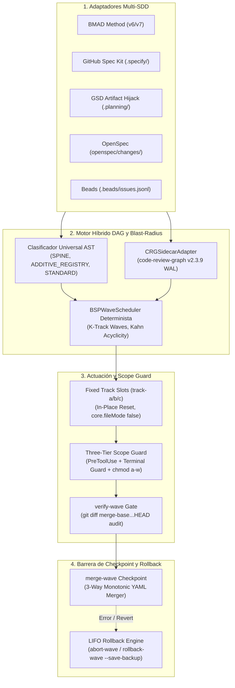

# ⚡ SDD-Parallel

[](https://github.com/stopActingSoSmall/sdd-parallel/actions/workflows/ci.yml)
[](https://www.python.org/)
[](../../../LICENSE)
[](#-demo-offline-en-5-segundos-sin-claves-api)

<p align="center">
  <b>🌐 Idioma / Language:</b>
  <a href="../../../README.md">English</a> |
  <a href="../zh-CN/README.md">简体中文</a> |
  <b>Español</b> |
  <a href="../pt-BR/README.md">Português (BR)</a> |
  <a href="../ja/README.md">日本語</a> |
  <a href="../ko/README.md">한국어</a> |
  <a href="../ru/README.md">Русский</a>
</p>

> **Harness de concurrencia y gobernanza de Blast Radius para desarrollo guiado por especificaciones (SDD) con agentes de IA**  
> (Google Antigravity, Claude Code, OpenAI Codex)  
> *Disponible a través de la CLI `sdd-parallel` y el alias conveniente `parallel-flow`.*

---

## 🎯 El Problema

Los frameworks modernos de Desarrollo Guiado por Especificaciones (Spec-Driven Development, SDD) —**BMAD Method (v6/v7)**, **GitHub Spec Kit (`.specify/`)**, **GSD (Get Shit Done)**, **OpenSpec** y **Beads**— son excelentes para descomponer requisitos en especificaciones unitarias verificables. Sin embargo, sufren de una **limitación arquitectónica fatal al escalar a ejecución paralela**:

1. **Colas lineales de tareas:** Los planificadores fuerzan una ejecución estrictamente secuencial (`Story 1 -> Story 2 -> Story 3`), ignorando la independencia entre epics.
2. **Merge-Bombs en configuraciones compartidas:** Los agentes concurrentes colisionan en registros compartidos y archivos de estado de sprint (`sprint-status.yaml`, `STATE.md`, `tasks.md`).
3. **Colisiones semánticas de Tipo 2 ($W_A \cap I_B \neq \emptyset$):** El Agente A modifica la firma de una interfaz, mientras el Agente B invoca concurrentemente la firma anterior. Las pruebas locales en cada rama pasan de forma aislada, pero fallan catastróficamente al integrarse.
4. **Límites de profundidad de subagentes:** Los flujos complejos multiagente (como las 3 lentes de revisión de BMAD) se rompen cuando se anidan en subagentes planos (`Max Subagent Depth = 1`).

---

## 💡 La Solución: `sdd-parallel`

`sdd-parallel` es un harness de orquestación determinista y seguridad que:
- **Analiza roadmaps SDD de forma polimórfica:** Sin hardcoding; extrae tareas, dependencias y mapas de código en 5 frameworks SDD.
- **Resuelve el Blast Radius semántico (AST + Grafo de llamadas):** Calcula dependencias dirigidas, Spine Locks e impactos de Tipo 2 ($W_A \cap I_B$).
- **Asigna Fixed Track Slots (`track-a`, `track-b`, ...):** Dispone de ranuras worktree permanentes con reinicio en el lugar (`git checkout -B` + `git clean -fd`), manteniendo un uso de disco $O(1)$.
- **Aplica un Three-Tier Scope Guard:** Intercepta ediciones fuera de alcance mediante hooks `PreToolUse`, bloquea escapes a terminal (`Bash`, PowerShell) y protege archivos con `chmod a-w` a nivel de SO.
- **Ejecuta Monotonic 3-Way Merges:** Reconcilia estados mediante semirretículos monótonos ($\max(\text{rank})$) con cero marcadores de conflicto `<<<<<<<`.
- **Garantiza LIFO Transactional Rollbacks:** Revierte olas integradas en orden LIFO estricto, con ramas de respaldo automáticas y reseteo polimórfico de estados.

---

## 🚀 Demo offline en 5 segundos (sin claves API)

Clona el repositorio y ejecuta la demo de verificación independiente offline:

```bash
uv run sdd-parallel demo
```

```text
============================================================================
SDD-PARALLEL STANDALONE MERGE-BOMB DEMO (ZERO API KEYS / OFFLINE)
============================================================================
Workspace: /tmp/sdd-parallel-demo-xyz

[Step 1/4] AST & Architectural Role Classification
----------------------------------------------------------------------------
File Path                              | Detected Role          | Importers
----------------------------------------------------------------------------
src/demo_app/__init__.py               | additive_registry      | -
src/demo_app/api.py                    | standard               | -
src/demo_app/cli.py                    | additive_registry      | -
src/demo_app/exporter.py               | standard               | -
src/demo_app/normalizer.py             | standard               | src/demo_app/api.py
src/demo_app/schema.py                 | spine                  | -

[Step 2/4] Type-2 Semantic Merge-Bomb Detection & BSP Wave Schedule
----------------------------------------------------------------------------
  Collision Analysis:
    - Naive Scheduler : W(1-2)={normalizer.py, cli.py} vs W(2-1)={api.py}
                        -> DISJOINT WRITES (False Safe!)
    - BSPWaveScheduler: Detected semantic_collision between '1-2' and '2-1'
                        -> Overlap W(1-2) ^ I(2-1) on: src/demo_app/api.py
    - Additive Registry: Tasks '1-2' and '1-3' both touch 'src/demo_app/cli.py'
                        -> Role: ADDITIVE_REGISTRY (Parallel allowed in Wave 1)

  Wave Schedule:
    * Wave 1
        - track-a: Story 1-2 -> writes: src/demo_app/normalizer.py (+ shared: src/demo_app/cli.py)
        - track-b: Story 1-3 -> writes: src/demo_app/exporter.py (+ shared: src/demo_app/cli.py)
    * Wave 2
        - track-a: Story 1-1 -> writes: src/demo_app/schema.py
        - track-b: Story 2-1 -> writes: src/demo_app/api.py
    * Wave 3
        - track-a: Story 2-2 -> writes: src/demo_app/schema.py

[Step 3/4] Fixed-Slot Worktree Provisioning & PreToolUse Scope Guard
----------------------------------------------------------------------------
  Provisioned Fixed Slots (100% Clean git status: True):
    - track-a (.worktrees/track-a)
    - track-b (.worktrees/track-b)

  PreToolUse Scope Guard Check (track-a -> 'src/demo_app/schema.py'):
    - Decision : DENY
    - Violation: File 'src/demo_app/schema.py' cannot be modified by Wave 1 / track-a (stories ['1-2'])
    - Reason   : Locked by Spine Chain invariant.

[Step 4/4] Barrier Checkpoint & Monotonic 3-Way YAML Merge
----------------------------------------------------------------------------
  Merged Branches:
    - parallel/track-a
    - parallel/track-b

  Resolved sprint-status.yaml (0 conflict markers):
    - 1-2-normalize-telemetry-payload: done
    - 1-3-cli-batch-export: done
============================================================================
ALL 5 CORE INVARIANTS VERIFIED IN 3.21s
============================================================================
```

> 📖 **Anatomía paso a paso, teoría de grafos y sandbox interactivo:**  
> ¿Deseas ver instantáneas fotograma a fotograma en disco (`Before -> Wave Planning -> Slot Locking -> 3-Way Merge`), comprender la teoría de grafos tras `SPINE` / `ADDITIVE_REGISTRY` / `STANDARD` (3 pasadas de `ASTHotspotScanner`) y probar `plan`, `prepare`, `check-lock`, `abort-wave` y `rollback-wave` en un sandbox `--keep-temp` o proyecto greenfield?  
> 👉 Consulta los fundamentos en **[System Capabilities & Architectural White Paper](../../dossier/02_SYSTEM_CAPABILITIES_WHITE_PAPER.md)** y la guía práctica en **[07_STANDALONE_DEMO_AND_E2E_WALKTHROUGH.md](07_STANDALONE_DEMO_AND_E2E_WALKTHROUGH.md)**.  
> 🏛️ Para líderes técnicos y arquitectos: **[Ficha de Producto y Resumen Ejecutivo](../../dossier/01_CORE_PRODUCT_BRIEF.md)** | **[Arquitectura del Sistema SSOT](ARCHITECTURE.md)**.

---

## 📦 Requisitos e Instalación

### Requisitos previos
- **Python:** `>= 3.11` (Python 3.11, 3.12, 3.13)
- **Git:** `>= 2.30` (requerido para aislamiento moderno de `git worktree` y enmascaramiento con `info/exclude`)
- **Gestor de paquetes:** [`uv`](https://docs.astral.sh/uv/) (recomendado) o `pipx`

### Instalación

#### Como herramienta CLI aislada (Recomendado)
```bash
# Usando uv (más rápido)
uv tool install sdd-parallel

# O usando pipx
pipx install sdd-parallel
```

#### Desde el código fuente para desarrollo local
```bash
git clone https://github.com/stopActingSoSmall/sdd-parallel.git
cd sdd-parallel
uv sync
```

Tras la instalación, la CLI está disponible globalmente a través de `sdd-parallel` (o el alias corto `parallel-flow`).

---

## 🏛️ Arquitectura del Sistema



---

## 🛡️ Invariantes Fundamentales

1. **Zero Worktree Pollution:** Los archivos de contexto inyectados (`.tmp/track-context.md`, `.parallel-lock.json`, `ACTIVE_TRACK.md`) se ocultan vía `info/exclude`. `git status --porcelain` se mantiene 100% limpio.
2. **Zero Cache Invalidation:** Los contextos de epics en `_bmad-output/planning-artifacts/` son de solo lectura; el estado del planificador se guarda en `_bmad-output/parallel-artifacts/`.
3. **100% Task Coverage & Acyclic Invariant:** La verificación topológica de Kahn/Tarjan garantiza cero historias perdidas y cero ciclos de dependencia.
4. **Blast-Radius Enforcement (Tipo 1 y Tipo 2):** Escrituras disjuntas ($W_A \cap W_B = \emptyset$) e impactos semánticos disjuntos ($W_A \cap I_B = \emptyset$).
5. **Universal Anti-Overfitting (Invariante 7):** Cero rutas o entidades de frameworks hardcodeadas en el motor central. Clasificación de `SPINE`, `ADDITIVE_REGISTRY` y `STANDARD` basada en heurísticas AST y centralidad topológica.
6. **Fixed Track Slots ($O(1)$ Footprint):** Reutiliza ranuras `track-a`, `track-b`, `track-c` vía `git checkout -B` y `git clean -fd` evitando acumulación de carpetas.
7. **Three-Tier Defense-in-Depth Guard:** Hook `PreToolUse` + interceptación de terminal (`Bash`, `run_command`) + protección del SO con `chmod a-w`.
8. **Monotonic Status Semi-Lattice:** Los estados progresan monótonamente: $\texttt{backlog} (0) < \dots < \texttt{done} (4)$ sin marcadores de conflicto.
9. **LIFO Transactional Rollbacks:** Reversión estricta en orden inverso de olas integradas con ramas de respaldo de seguridad automáticas (`backup/wave-<K>-before-rollback-*`).

---

## 🛠️ Referencia de Comandos CLI

| Comando | Propósito |
| :--- | :--- |
| `sdd-parallel demo [--kit {bmad,spec-kit,gsd,openspec,beads,all}] [--keep-temp] [--scaffold-only] [--output-dir DIR]` | Ejecuta la demo offline de Merge-Bomb o crea un sandbox interactivo para 5 kits SDD. |
| `sdd-parallel plan [--repo REPO] [--max-tracks N] [--kit auto] [--include-done] [--dry-run] [--plan-source {auto,plan,specs}] [--output-dir DIR]` | Analiza el roadmap y el grafo de código; genera `execution-plan-parallel.md` y `wave-plan.json`. |
| `sdd-parallel prepare --wave K [--repo REPO] [--max-tracks N] [--kit KIT] [--headless] [--antigravity-layout] [--dynamic-worktrees] [--dry-run]` | Dispone ranuras worktree (`track-a`, `track-b`), configura bloqueos de SO e inyecta límites. |
| `sdd-parallel claim-track --wave K --track <id> --worktree <path> [--repo REPO] [--max-tracks N] [--kit KIT] [--headless]` | Asocia bloqueos de límites a una ranura de worktree externa existente. |
| `sdd-parallel run-guide --wave K [--repo REPO] [--max-tracks N] [--kit KIT] [--antigravity-layout]` | Muestra la matriz interactiva de la guía del operador con comandos de inicio para cada ventana activa. |
| `sdd-parallel verify-wave --wave K [--repo REPO] [--max-tracks N] [--kit KIT] [--dynamic-worktrees]` | Audita ranuras worktree contra `.parallel-lock.json` y el diff multi-commit frente a `merge-base`. |
| `sdd-parallel merge --wave K [--repo REPO] [--max-tracks N] [--kit KIT] [--dynamic-worktrees] [--skip-gates] [--strict-gates] [--cleanup] [--dry-run]` | Checkpoint de barrera: 3-way merge de estado, git merge, compuertas de calidad polimórficas y auto-rollback transaccional. |
| `sdd-parallel abort-wave --wave K [--repo REPO] [--dynamic-worktrees]` | Aborta ola no integrada: reinicia ranuras y elimina ramas temporales paralelas. |
| `sdd-parallel rollback-wave --wave K [--repo REPO] [--dynamic-worktrees] [--to-commit COMMIT] [--save-backup] [--no-backup] [--kit KIT]` | Revierte la ola integrada en orden LIFO con rama de respaldo segura y reseteo de estados de tareas SDD. |
| `sdd-parallel merge-status --base B --ours O --theirs T --out OUT` | Herramienta determinista de bajo nivel para 3-way merge de `sprint-status.yaml`. |
| `sdd-parallel check-lock --file PATH [--tool TOOL]` | Valida permisos de escritura según el manifiesto activo de bloqueo del worktree. |
| `sdd-parallel install-plugin [--target-dir DIR]` | Empaqueta e instala el plugin portable para Google Antigravity. |
| `sdd-parallel autopilot --wave K [--repo REPO] [--max-tracks N] [--kit KIT] [--harness <tool>] [--antigravity-layout] [--execute]` | Genera o ejecuta comandos de lanzamiento para Multi-Conversation Autopilot con enrutamiento de modelos por esfuerzo. |

---

## 🧩 Kits SDD Soportados

| Framework SDD | Estado | Artefactos Read-Only Detectados | Sincronización de Estado |
| :--- | :---: | :--- | :--- |
| **BMAD Method (`v6.3+` / `v7`)** | ✅ Soportado | `sprint-status.yaml`, `epics.md`, `epic-*-context.md`, `spec-*.md` | Monotonic 3-way YAML merge |
| **GitHub Spec Kit (`.specify/`)** | ✅ Soportado | `.specify/specs/*/tasks.md`, `constitution.md` | Casillas de verificación Markdown |
| **GSD (Get Shit Done)** | ✅ Soportado | `.planning/phases/*-PLAN.md`, `ROADMAP.md` | Artifact Hijack (aislamiento de `STATE.md`) |
| **OpenSpec (`openspec/`)** | ✅ Soportado | `openspec/changes/<id>/tasks.md` | Seguimiento de tareas guiado por specs |
| **Beads (`.beads/`)** | ✅ Soportado | `.beads/issues.jsonl` | Actualizaciones topológicas de JSONL |

---

## 🚢 Matriz de Lanzamiento: Publicado (`v0.1.0`) vs Hoja de Ruta (`v0.2+`)

### ✅ Publicado en `v0.1.0` (Production Hardened)
- Programador de olas determinista Bulk-Synchronous Parallel (BSP) con aciclicidad de Kahn.
- Escáner AST Hotspots e integración con sidecar `code-review-graph v2.3.9`.
- Arquitectura Fixed Track Slots (`track-a`, `track-b`, `track-c`) con reseteo in-place.
- Three-Tier Defense-in-Depth Scope Guard (`PreToolUse` + Terminal Guard + OS `chmod a-w`).
- Monotonic 3-Way YAML Merger preservando comentarios y formato.
- Motor de rollback transaccional LIFO con ramas de respaldo automatizadas.
- Estándar de ejecución de operador Two-Stage Assisted (Ranuras Interactivas en IDE) (`Depth 0`).
- 5 adaptadores Multi-SDD (BMAD, Spec Kit, GSD Artifact Hijack, OpenSpec, Beads).
- Demo offline independiente de Merge-Bomb (`sdd-parallel demo`) y suite de CI en GitHub Actions.
- 95+ pruebas unitarias y de integración automatizadas, compuertas de calidad mypy --strict y ruff.

### 🚧 Planificado para `v0.2.0+`
- **Ecosistema de adaptadores comunitarios:** Integración con `mattpocock/skills` (`/implement-spec`) y adaptador de estado frontmatter `bmad-loop` v0.8+.
- **Sincronización de entorno Zero-Pollution:** Patrón `workz` con enlaces simbólicos a `.venv` y `node_modules` en ranuras fijas.
- **Enlazador estático de símbolos y escalado dinámico de alcance:** Expansión automática del conjunto de escritura mediante símbolos AST y reprogramación dinámica de tareas.
- **Exportadores FinOps y observabilidad:** Trazas OpenTelemetry y métricas de ahorro de tokens en Langfuse.
- **Demonio Autopilot desatendido:** Ejecución desatendida de agentes mediante despacho RPC/subagente local.

---

## 🧪 Desarrollo y Quality Gates

Ejecuta localmente la suite de validación y pruebas:

```bash
# Ejecutar suite de pruebas
uv run pytest

# Verificación estricta de tipos
uv run mypy --strict src/sdd_parallel

# Linter de código
uv run ruff check src/ tests/ scripts/

# Ejecutar demo offline independiente
uv run sdd-parallel demo
```

---

## 🤝 Contribución y Seguridad

- **Contribución:** Consulta nuestra **[Guía de Contribución](../../../CONTRIBUTING.md)** para la configuración del entorno de desarrollo y las compuertas de verificación de pull requests.
- **Seguridad:** Las divulgaciones de seguridad y las instrucciones para el reporte de vulnerabilidades se detallan en nuestra **[Política de Seguridad](../../../SECURITY.md)**.

---

## 📜 Licencia

Licencia MIT. Consulta [LICENSE](../../../LICENSE) para más detalles.
