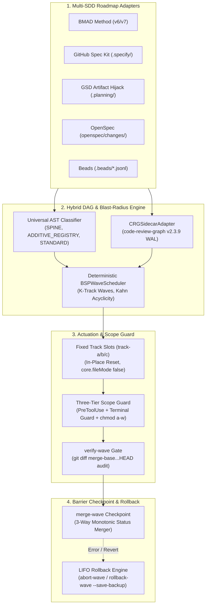

<p align="center">
  
</p>

<p align="center">
  <a href="https://github.com/stopActingSoSmall/sdd-parallel/actions/workflows/ci.yml"></a>
  <a href="https://pypi.org/project/sdd-parallel/"></a>
  <a href="https://www.python.org/"></a>
  <a href="../../../LICENSE"></a>
  <a href="#-pruébalo-en-5-segundos-sin-claves-api-recorrido-anotado"></a>
  <br>
  <a href="#-se-adapta-a-tu-stack-actual-zero-lock-in"></a>
  <a href="#-estructura-exacta-de-tu-proyecto-sdd-antes-y-después"></a>
</p>

<p align="center">
  <b>🌐 Idioma / Language:</b>
  <a href="../../../README.md">English</a> |
  <a href="../zh-CN/README.md">简体中文</a> |
  <b>Español</b> |
  <a href="../pt-BR/README.md">Português (BR)</a> |
  <a href="../ja/README.md">日本語</a> |
  <a href="../ko/README.md">한국어</a> |
  <a href="../ru/README.md">Русский</a>
</p>

<p align="center">
  <a href="#-pruébalo-en-5-segundos-sin-claves-api-recorrido-anotado">Demo rápida</a> ·
  <a href="#-por-qué-existe-esto-en-lenguaje-sencillo">¿Por qué?</a> ·
  <a href="#%EF%B8%8F-cómo-funciona-y-flujo-diario-de-4-comandos">Cómo funciona</a> ·
  <a href="#-estructura-exacta-de-tu-proyecto-sdd-antes-y-después">Estructura SDD</a> ·
  <a href="#-se-adapta-a-tu-stack-actual-zero-lock-in">Harnesses</a> ·
  <a href="#-arquitectura-modelo-matemático-y-análisis-profundo-del-dossier">Análisis profundo</a> ·
  <a href="#%EF%B8%8F-referencia-completa-de-comandos-cli">CLI diario</a> ·
  <a href="#-matriz-de-versiones-publicado-v010-vs-hoja-de-ruta-v02">Versiones</a> ·
  <a href="#-contribución-desarrollo-local-y-seguridad">Contribución</a>
</p>

> **Ejecuta múltiples agentes de codificación con IA en paralelo — hasta 3 veces más rápido, cero Merge-Bombs.**  
> `sdd-parallel` es el controlador de tráfico determinista, aislador de worktrees y guardián de blast radius entre tu backlog de **Spec Kit / BMAD / GSD / OpenSpec / Beads** y los agentes de codificación (**Claude Code**, **Codex**, **Antigravity** o cualquier CLI con soporte para worktrees) que lo implementan.

---

## ⚡ ¿Por qué existe esto? (En lenguaje sencillo)

<p align="center">
  
</p>

Con un backlog de 10–15 especificaciones o historias, actualmente tienes dos malas opciones:

1. **Un agente, secuencialmente** — seguro, pero implica **6–8 horas** de espera.
2. **3–4 agentes en carpetas ingenuas de `git worktree`** — rápido, hasta el momento de integrar (merge):
   - **Colisión de Tipo 1 (directa):** dos agentes editan `sprint-status.yaml`, `STATE.md` o `cli.py` → `<<<<<<<` en cada merge.
   - **Colisión de Tipo 2 (semántica, silenciosa):** el Agente A modifica una firma en `normalizer.py`; el Agente B, en otro worktree, invoca la firma anterior desde `api.py`. **Git fusiona limpiamente sin ningún marcador de conflicto — y `main` queda roto.**
   - **Desviación del alcance (Scope creep):** un agente "servicial" reescribe el archivo compartido `schema.py` que nunca estuvo asignado a su tarea.

**`sdd-parallel` resuelve esto antes de gastar un solo token de LLM:** escanea tu AST y grafo de llamadas, agrupa tareas demostrablemente seguras en **Olas (Waves)** paralelas, bloquea a cada agente dentro de una ranura fija y limpia (`track-a`, `track-b`, …), bloquea escrituras fuera de alcance a nivel de hooks y del sistema operativo, y fusiona cada ola tras una barrera de quality gates.

| Qué sucede | ❌ Secuencial (1 Agente) | 💥 Paralelo ingenuo (`--worktree`) | ✅ Con `sdd-parallel` |
| :--- | :--- | :--- | :--- |
| **Tiempo para un sprint de 12 historias** | ~6–8 h (una a una) | ~2 h codificando + **~2 h reparando merges rotos** | **~2.5 h en total (aceleración de 2x–3x)** |
| **Colisiones ocultas de tipos / API** | Se evitan solo avanzando lento | **Rompe `main` tras el merge** ($W_A \cap I_B \neq \emptyset$) | **Prevenidas de antemano** (dividido en Ola 1 → Ola 2) |
| **Archivos compartidos de CLI / enrutador** | Un agente a la vez | Conflicto de Git en cada merge | **Seguro en paralelo** (detección de `ADDITIVE_REGISTRY`) |
| **`sprint-status.yaml` / `tasks.md` / `STATE.md`** | Actualizados en serie | Conflictos constantes de `<<<<<<<` | **Auto-fusionados** (fusionador 3-way monótono) |
| **El agente edita el archivo equivocado** | El prompt dice "por favor no lo hagas" | Ignorado mediante `bash` / `sed` | **Bloqueado** (hook `PreToolUse` + Terminal Guard + `chmod a-w`) |
| **Desorden de carpetas de worktree** | Ninguno | 15 carpetas sobrantes `.worktrees/task-*` | **Ranuras fijas reutilizables** (`track-a`, `track-b`, `track-c`) |

---

## 🚀 Pruébalo en 5 segundos (sin claves API, recorrido anotado)

Sin clave API, sin suscripción a LLM, sin clonar. Un único comando mediante [`uv`](https://docs.astral.sh/uv/) (o `pipx run sdd-parallel demo`):

```bash
uvx sdd-parallel demo          # o prueba un kit específico: uvx sdd-parallel demo --kit spec-kit
```

La demo crea un repositorio temporal desechable con 5 tareas y 6 módulos de Python, ejecuta el motor real sobre él y termina en ~4 segundos. A continuación se muestra la ejecución con `--kit spec-kit`, dividida en sus 4 etapas.

#### `[Paso 1/4]` AST y clasificación de roles

```text
File Path                              | Detected Role          | Importers
----------------------------------------------------------------------------
src/demo_app/__init__.py               | additive_registry      | -
src/demo_app/api.py                    | standard               | -
src/demo_app/cli.py                    | additive_registry      | -
src/demo_app/exporter.py               | standard               | -
src/demo_app/normalizer.py             | standard               | src/demo_app/api.py
src/demo_app/schema.py                 | spine                  | -
```

Sin configuración, sin rutas hardcodeadas: el escáner etiqueta `schema.py` como la **`columna vertebral (spine)`** (todo depende de él → se serializa), `cli.py` como un **`registro aditivo (additive_registry)`** (registro de comandos de solo adición → seguro para compartir) y registra que `api.py` importa `normalizer.py`.

#### `[Paso 2/4]` Detección de la Merge-Bomb semántica oculta de Tipo 2

```text
  Collision Analysis:
    - Naive Scheduler : W(T002)={normalizer.py, cli.py} vs W(T004)={api.py}
                        -> DISJOINT WRITES (False Safe!)
    - BSPWaveScheduler: Detected semantic_collision between 'T002' and 'T004'
                        -> Overlap W(T002) ^ I(T004) on: src/demo_app/api.py
  Wave Schedule:
    * Wave 1  track-a: T002 (normalizer.py + shared cli.py) | track-b: T003 (exporter.py + shared cli.py)
    * Wave 2  track-a: T001 (schema.py)                     | track-b: T004 (api.py)
    * Wave 3  track-a: T005 (schema.py)
```

Tanto `T002` como `T004` llevan una etiqueta `[P]` escrita a mano en `tasks.md`, y sus conjuntos de escritura son disjuntos (`normalizer.py ≠ api.py`), por lo que un planificador basado en bloqueo de archivos los ejecutaría juntos. `BSPWaveScheduler` detecta que las escrituras de `T002` caen dentro del conjunto de impacto de `T004` y mueve `T004` a la **Ola 2**, donde se construye sobre el `normalizer.py` ya integrado. Mientras tanto, `T002` y `T003` escriben ambos en `cli.py` y aun así se ejecutan en paralelo, porque se trata de un registro aditivo.

#### `[Paso 3/4]` Ranuras fijas limpias e intercepción con Scope Guard

```text
  Provisioned Fixed Slots (100% Clean git status: True):
    - track-a (.worktrees/track-a)
    - track-b (.worktrees/track-b)

  PreToolUse Scope Guard Check (track-a -> 'src/demo_app/schema.py'):
    - Decision : DENY
    - Violation: File 'src/demo_app/schema.py' cannot be modified by Wave 1 / track-a (stories ['T002'])
    - Reason   : Locked by Spine Chain invariant.
```

Los archivos de frontera inyectados (`ACTIVE_TRACK.md`, `.parallel-lock.json`, `.tmp/track-context.md`) se enmascaran mediante `info/exclude` del worktree, por lo que `git status --porcelain` permanece vacío. Cuando el agente en `track-a` intenta acceder a `schema.py`, la escritura es denegada antes de tocar el disco.

#### `[Paso 4/4]` Punto de control de barrera y fusión 3-Way con cero conflictos

```text
  Merged Branches:
    - parallel/track-a
    - parallel/track-b
  Resolved tasks.md (0 conflict markers):
    - - [ ] T001 [US1] Upgrade schema in `src/demo_app/schema.py` (depends on T002)
    - - [x] T002 [P] [US1] Normalize `src/demo_app/normalizer.py`, `src/demo_app/cli.py`
    - - [x] T003 [P] [US1] Export `src/demo_app/exporter.py`, `src/demo_app/cli.py`
```

Ambas ramas editaron el mismo archivo `tasks.md`. El fusionador de estados resuelve cada línea de forma monótona (`[ ] < [x]`, `backlog < … < done`), de modo que el resultado carece de marcas `<<<<<<<`. La misma lógica cubre `sprint-status.yaml`, `STATE.md` y `.beads/*.jsonl`.

<details>
<summary><b>🧪 Haz clic para ver la matriz de verificación de los 5 kits (<code>uvx sdd-parallel demo --kit all</code>) y el modo sandbox</b></summary>

```text
============================================================================
5/5 SDD KITS VERIFIED (BMAD, SPEC KIT, GSD, OPENSPEC, BEADS)
============================================================================
Kit          | Merge-Bomb   | Worktrees    | Scope Guard  | 3-Way Merge
----------------------------------------------------------------------------
bmad         | PASSED       | PASSED       | PASSED       | PASSED
spec-kit     | PASSED       | PASSED       | PASSED       | PASSED
gsd          | PASSED       | PASSED       | PASSED       | PASSED
openspec     | PASSED       | PASSED       | PASSED       | PASSED
beads        | PASSED       | PASSED       | PASSED       | PASSED
============================================================================
```

¿Quieres probar el flujo de trabajo manualmente? Genera un entorno sandbox persistente y ejecuta los comandos reales en su interior:

```bash
uvx sdd-parallel demo --kit gsd --scaffold-only --output-dir ./sdd-sandbox
cd sdd-sandbox
sdd-parallel plan
sdd-parallel prepare --wave 1
```

</details>

---

## 🗺️ Cómo funciona y flujo diario de 4 comandos

<p align="center">
  
</p>

**1. Instálalo una sola vez** (requiere `Python >= 3.11`, `Git >= 2.30`):

```bash
uv tool install sdd-parallel     # o bien: pipx install sdd-parallel
```

Tanto `sdd-parallel` como el alias corto `parallel-flow` estarán disponibles de forma global.

**2. Ejecuta una ola en cualquier proyecto SDD:**

```bash
# 1. Escanea las especificaciones + el AST del código y genera olas seguras
sdd-parallel plan

# 2. Despliega la Ola 1 en ranuras fijas e imprime el comando de lanzamiento para cada track
sdd-parallel prepare --wave 1
sdd-parallel run-guide --wave 1

# 3. Inicia tus agentes dentro de .worktrees/track-a, track-b, ... (uno por ranura)

# 4. Audita el alcance, ejecuta quality gates y fusiona la Ola 1 de vuelta a main
sdd-parallel verify-wave --wave 1
sdd-parallel merge --wave 1
```

Deshacer: `sdd-parallel abort-wave --wave 1` (antes de fusionar) o `sdd-parallel rollback-wave --wave 1` (después de fusionar; orden LIFO estricto, rama de seguridad automática `backup/wave-<K>-before-rollback-*`, restablecimiento de estados SDD).

---

## 📂 Estructura exacta de tu proyecto SDD (Antes y Después)

<p align="center">
  
</p>

`sdd-parallel` lee los archivos de tu framework tal cual están — sin migraciones, sin nuevos formatos de especificación.

| Framework SDD | Artefactos de solo lectura (bloqueados en slots) | Descubrimiento de tareas | Sincronización de estados |
| :--- | :--- | :--- | :--- |
| **GitHub Spec Kit** (`.specify/`) | `constitution.md`, `feature.json`, `spec.md`, `plan.md` | `specs/*/tasks.md` (`T001 [P]`) | Fusión 3-way de casillas de verificación Markdown |
| **BMAD Method** (`v6.3+` / `v7`) | `epic-*-context.md` (Zero Cache Invalidation) | `sprint-status.yaml`, `epics.md`, `spec-*.md` | Fusión 3-way monótona de YAML |
| **GSD** (`.planning/`) | `PROJECT.md`, `REQUIREMENTS.md`, `ROADMAP.md`, `STATE.md` | `phases/*/NN-NN-PLAN.md` | Secuestro de artefactos (Artifact Hijack: `STATE.md` actualizado centralmente en el merge) |
| **OpenSpec** (`openspec/`) | `openspec/specs/**`, `project.md`, `config.yaml`, carpetas de cambios hermanas | `openspec/changes/<slug>/tasks.md` | Fusión 3-way de casillas de verificación Markdown |
| **Beads** (`.beads/`) | `.beads/config.yaml` | `.beads/*.jsonl` (`bd-101` + aristas `blocks`) | Fusión 3-way línea por línea de semirretículo JSONL |

Cada captura a continuación procede de los fixtures reales de `sdd-parallel demo --scaffold-only` tras `plan` + `prepare --wave 1`. Los árboles de código fuente se contraen a `src/…` para facilitar la lectura.

<details>
<summary><b>🌱 GitHub Spec Kit (<code>.specify/</code> &amp; <code>specs/*/tasks.md</code>) — Haz clic para inspeccionar el árbol Antes y Después</b></summary>

**Antes** — tu proyecto tal cual:

```text
my-project/
├── .specify/
│   ├── memory/
│   │   └── constitution.md
│   ├── templates/
│   │   └── tasks-template.md
│   └── feature.json
├── specs/
│   └── 001-telemetry/
│       ├── plan.md
│       ├── spec.md
│       └── tasks.md
└── src/…
```

`specs/001-telemetry/tasks.md` — observa la etiqueta manual `[P]` en `T004`, la cual es insegura junto a `T002`:

```markdown
- [ ] T001 [US1] Upgrade schema in `src/demo_app/schema.py` (depends on T002)
- [ ] T002 [P] [US1] Normalize `src/demo_app/normalizer.py`, `src/demo_app/cli.py`
- [ ] T003 [P] [US1] Export `src/demo_app/exporter.py`, `src/demo_app/cli.py`
- [ ] T004 [P] [US2] Expose ingestion in `src/demo_app/api.py`
- [ ] T005 [US2] Add audit log in `src/demo_app/schema.py` (depends on T001)
```

**Después** de `sdd-parallel plan` + `prepare --wave 1`:

```text
my-project/
├── .parallel/                        # estado del planificador (nuevo)
│   ├── artifacts/
│   │   ├── execution-plan-parallel.md
│   │   └── wave-plan.json
│   ├── history/run-001-<timestamp>/wave-plan.json
│   └── state.json
├── .specify/…                        # intacto
├── .worktrees/
│   ├── track-a/                      # Ola 1 → T002
│   │   ├── .specify/memory/constitution.md   # 🔒 solo lectura
│   │   ├── specs/001-telemetry/
│   │   │   ├── plan.md               # 🔒 solo lectura
│   │   │   ├── spec.md               # 🔒 solo lectura
│   │   │   └── tasks.md
│   │   ├── src/…
│   │   ├── .tmp/track-context.md     # 👻 oculto mediante info/exclude
│   │   ├── .parallel-lock.json       # 👻 oculto mediante info/exclude
│   │   └── ACTIVE_TRACK.md           # 👻 → /speckit.implement T002
│   └── track-b/                      # Ola 1 → T003 (misma estructura)
├── specs/…                           # intacto
└── src/…
```

</details>

<details>
<summary><b>📐 BMAD Method (<code>v6.3+ / v7</code> — <code>_bmad-output/</code>) — Haz clic para inspeccionar el árbol Antes y Después</b></summary>

**Antes:**

```text
my-project/
├── _bmad-output/
│   ├── implementation-artifacts/
│   │   ├── epic-1-context.md
│   │   ├── epic-2-context.md
│   │   ├── epics.md
│   │   ├── spec-1-1-upgrade-schema-v2.md
│   │   ├── spec-1-2-normalize-telemetry-payload.md
│   │   ├── spec-1-3-cli-batch-export.md
│   │   ├── spec-2-1-expose-ingestion-api.md
│   │   ├── spec-2-2-add-audit-log-schema.md
│   │   └── sprint-status.yaml
│   └── planning-artifacts/
│       ├── epic-1-context.md
│       ├── epic-2-context.md
│       ├── epics.md
│       └── project-context.md
└── src/…
```

**Después** de `sdd-parallel plan` + `prepare --wave 1`:

```text
my-project/
├── .parallel/
│   ├── history/run-001-<timestamp>/wave-plan.json
│   └── state.json
├── .worktrees/
│   ├── track-a/                      # Ola 1 → story 1-2
│   │   ├── _bmad/custom/             # 👻 overlay BMAD por slot (oculto)
│   │   │   ├── bmad-build.toml
│   │   │   ├── bmad-build.user.toml
│   │   │   ├── bmad-build-auto.toml
│   │   │   └── bmad-build-auto.user.toml
│   │   ├── _bmad-output/
│   │   │   ├── implementation-artifacts/   # sprint-status.yaml fusionado en 3-way
│   │   │   └── planning-artifacts/
│   │   │       ├── epic-1-context.md # 🔒 bloqueo Zero Cache Invalidation
│   │   │       ├── epic-2-context.md # 🔒
│   │   │       └── project-context.md
│   │   ├── src/…
│   │   ├── .tmp/track-context.md     # 👻
│   │   ├── .parallel-lock.json       # 👻
│   │   └── ACTIVE_TRACK.md           # 👻 → /bmad-build 1-2
│   └── track-b/                      # Ola 1 → story 1-3
├── _bmad-output/
│   ├── implementation-artifacts/…
│   ├── parallel-artifacts/           # salida del planificador (BMAD lo almacena bajo _bmad-output)
│   │   ├── execution-plan-parallel.md
│   │   └── wave-plan.json
│   └── planning-artifacts/…
└── src/…
```

</details>

<details>
<summary><b>⚡ GSD — Get Shit Done (<code>.planning/phases/</code> Secuestro de artefactos / Artifact Hijack) — Haz clic para inspeccionar el árbol Antes y Después</b></summary>

**Antes:**

```text
my-project/
├── .planning/
│   ├── phases/
│   │   ├── 01-core/
│   │   │   ├── 01-01-PLAN.md
│   │   │   ├── 01-02-PLAN.md
│   │   │   └── 01-03-PLAN.md
│   │   └── 02-api/
│   │       ├── 02-01-PLAN.md
│   │       └── 02-02-PLAN.md
│   ├── PROJECT.md
│   ├── REQUIREMENTS.md
│   ├── ROADMAP.md
│   └── STATE.md
└── src/…
```

`01-02-PLAN.md` (normalizer) y `02-01-PLAN.md` (API) residen en fases distintas y no comparten archivos, pero `02-01` llama a código de `01-02`. El planificador los programa en olas diferentes.

**Después** de `sdd-parallel plan` + `prepare --wave 1`:

```text
my-project/
├── .parallel/
│   ├── artifacts/
│   │   ├── execution-plan-parallel.md
│   │   └── wave-plan.json
│   ├── history/run-001-<timestamp>/wave-plan.json
│   └── state.json
├── .planning/…                       # intacto en main
├── .worktrees/
│   ├── track-a/                      # Ola 1 → 01-02
│   │   ├── .planning/
│   │   │   ├── phases/01-core/ · 02-api/
│   │   │   ├── PROJECT.md            # 🔒 solo lectura
│   │   │   ├── REQUIREMENTS.md       # 🔒 solo lectura
│   │   │   ├── ROADMAP.md            # 🔒 solo lectura
│   │   │   └── STATE.md              # 🔒 bloqueado en slots, actualizado centralmente en el merge
│   │   ├── src/…
│   │   ├── .tmp/track-context.md     # 👻
│   │   ├── .parallel-lock.json       # 👻
│   │   └── ACTIVE_TRACK.md           # 👻 → /gsd-execute-phase 01-02
│   └── track-b/                      # Ola 1 → 01-03
└── src/…
```

</details>

<details>
<summary><b>📑 OpenSpec (<code>openspec/changes/</code>) — Haz clic para inspeccionar el árbol Antes y Después</b></summary>

**Antes:**

```text
my-project/
├── openspec/
│   ├── changes/
│   │   ├── audit-log-schema/
│   │   ├── cli-batch-export/
│   │   ├── ingestion-api-endpoint/
│   │   ├── normalize-telemetry/
│   │   │   ├── design.md
│   │   │   ├── proposal.md
│   │   │   └── tasks.md
│   │   └── upgrade-schema-v2/
│   ├── specs/
│   │   └── telemetry/
│   │       └── spec.md
│   ├── config.yaml
│   └── project.md
└── src/…
```

**Después** de `sdd-parallel plan` + `prepare --wave 1`:

```text
my-project/
├── .parallel/
│   ├── artifacts/
│   │   ├── execution-plan-parallel.md
│   │   └── wave-plan.json
│   ├── history/run-001-<timestamp>/wave-plan.json
│   └── state.json
├── .worktrees/
│   ├── track-a/                      # Ola 1 → normalize-telemetry
│   │   ├── openspec/
│   │   │   ├── changes/
│   │   │   │   ├── normalize-telemetry/   # ✍️ carpeta de cambios de este track
│   │   │   │   ├── cli-batch-export/      # 🔒 bloqueado por el track-b hermano
│   │   │   │   └── …
│   │   │   ├── specs/                # 🔒 especificaciones canónicas (modificables solo vía openspec archive)
│   │   │   ├── config.yaml           # 🔒
│   │   │   └── project.md            # 🔒
│   │   ├── src/…
│   │   ├── .tmp/track-context.md     # 👻
│   │   ├── .parallel-lock.json       # 👻
│   │   └── ACTIVE_TRACK.md           # 👻 → /openspec-apply normalize-telemetry
│   └── track-b/                      # Ola 1 → cli-batch-export (bloqueos espejo)
├── openspec/…                        # intacto
└── src/…
```

</details>

<details>
<summary><b>🔗 Beads (<code>.beads/beads.jsonl</code>) — Haz clic para inspeccionar el árbol Antes y Después</b></summary>

**Antes:**

```text
my-project/
├── .beads/
│   ├── beads.jsonl
│   ├── config.yaml
│   └── issues.jsonl
└── src/…
```

Las tareas del grafo `bd-101`, `bd-102`, `bd-103`, `bd-201`, `bd-202`, con aristas `blocks` entre ellas:

```json
{"id": "bd-101", "title": "Upgrade schema to v2", "status": "open", "files": ["src/demo_app/schema.py"], "dependencies": [{"target": "bd-102", "type": "blocks"}], "priority": 1, "epic": "epic-1"}
{"id": "bd-102", "title": "Normalize telemetry payload", "status": "open", "files": ["src/demo_app/normalizer.py", "src/demo_app/cli.py"], "dependencies": [], "priority": 2, "epic": "epic-1"}
```

**Después** de `sdd-parallel plan` + `prepare --wave 1`:

```text
my-project/
├── .beads/…                          # copia principal en main, fusionada línea a línea en merge --wave 1
├── .parallel/
│   ├── artifacts/
│   │   ├── execution-plan-parallel.md
│   │   └── wave-plan.json
│   ├── history/run-001-<timestamp>/wave-plan.json
│   └── state.json
├── .worktrees/
│   ├── track-a/                      # Ola 1 → bd-102
│   │   ├── .beads/
│   │   │   ├── beads.jsonl           # ediciones de estado fusionadas en 3-way por línea (open < closed)
│   │   │   ├── config.yaml           # 🔒 solo lectura
│   │   │   └── issues.jsonl
│   │   ├── src/…
│   │   ├── .tmp/track-context.md     # 👻
│   │   ├── .parallel-lock.json       # 👻
│   │   └── ACTIVE_TRACK.md           # 👻 → bd update bd-102 --status in-progress
│   └── track-b/                      # Ola 1 → bd-103
└── src/…
```

Tras `merge --wave 1`, tanto `bd-102` como `bd-103` quedan `closed` en `.beads/beads.jsonl`, con 0 marcadores de conflicto.

</details>

Leyenda: 🔒 solo lectura (`chmod a-w` + `PreToolUse` deny) · 👻 inyectado, oculto de Git mediante `.git/worktrees/<slot>/info/exclude` · ✍️ ámbito modificable del track.

---

## 🔌 Se adapta a tu stack actual (Zero Lock-In)

Mantienes tu agente y tus prompts. Tras `sdd-parallel prepare --wave 1`, `sdd-parallel run-guide --wave 1` imprime el comando nativo exacto para cada ranura, y la misma línea se escribe en `.worktrees/track-<id>/ACTIVE_TRACK.md`. No necesitas escribir ninguna ruta de contexto manualmente:

| Kit SDD | Comando nativo impreso por track |
| :--- | :--- |
| GitHub Spec Kit | `/speckit.implement T002` |
| BMAD Method | `/bmad-build 1-2` |
| GSD | `/gsd-execute-phase 01-02` |
| OpenSpec | `/openspec-apply normalize-telemetry` |
| Beads | `bd update bd-102 --status in-progress` |

| Harness | Cómo se integra |
| :--- | :--- |
| **Claude Code** (`claude`) | Abre `claude` dentro de `.worktrees/track-a`; las escrituras fuera de alcance y los desvíos por terminal son denegados por el hook `PreToolUse` más `chmod a-w` del SO. O lanza todos los tracks con `sdd-parallel autopilot --wave 1 --harness claude-code`. |
| **OpenAI Codex CLI** (`codex`) | `codex --cd .worktrees/track-b`; los archivos de solo lectura están protegidos mediante `chmod a-w`, y `sdd-parallel verify-wave` audita el diff antes del merge. Autopilot: `--harness codex`. |
| **Google Antigravity** | `sdd-parallel prepare --wave 1 --antigravity-layout` ubica las ranuras bajo `~/.gemini/antigravity/worktrees/<Proyecto>/track-a`; `ACTIVE_TRACK.md` reside en la raíz de la ranura; `sdd-parallel install-plugin` instala el plugin portátil con el hook de scope guard. |
| **Cualquier CLI o IDE con soporte para worktrees** — Cursor, Windsurf, OpenCode, Kimi CLI, MiniMax Code, Aider, Cline, Trae | Funciona sin configuración adicional: ranuras estándar de `git worktree` (`track-a`, `track-b`, `track-c`, … mediante `--max-tracks N`), bloqueos `chmod a-w` a nivel de SO, `ACTIVE_TRACK.md` y verificación post-hoc del diff con `sdd-parallel verify-wave`. |

---

## 🔍 Arquitectura, modelo matemático y análisis profundo del dossier

- 📖 **[01 — Resumen ejecutivo del producto y modelo de ROI](../../dossier/01_CORE_PRODUCT_BRIEF.md)**: resumen ejecutivo, FinOps de tokens, enrutamiento por esfuerzo de modelo
- 🏛️ **[02 — Documento técnico sobre capacidades del sistema](../../dossier/02_SYSTEM_CAPABILITIES_WHITE_PAPER.md)**: conflictos de Tipo 1 vs Tipo 2, taxonomía de archivos en 3D, fórmula de decaimiento CRG
- 🔌 **[03 — Especificación de integración y ecosistema](../../dossier/03_INTEGRATION_AND_ECOSYSTEM_SPEC.md)**: IR `CanonicalTask`, contratos `.tmp/track-context.md` y `.parallel-lock.json`
- 📊 **[04 — Taxonomía competitiva y de benchmarking](../../dossier/04_COMPETITIVE_AND_BENCHMARK_TAXONOMY.md)**: posicionamiento frente a herramientas de orquestación adyacentes
- 🧪 **[07 — Demo independiente y recorrido integral (E2E)](07_STANDALONE_DEMO_AND_E2E_WALKTHROUGH.md)**: capturas de disco fotograma a fotograma, guía de sandbox con `--keep-temp`
- 📐 **[SSOT de la arquitectura del sistema (`ARCHITECTURE.md`)](ARCHITECTURE.md)** · **[Índice del dossier](../../dossier/README.md)** · **[Dossier en ruso](../ru/dossier/)**

<details>
<summary><b>🏛️ Haz clic para expandir: Arquitectura interna del motor y los 9 invariantes fundamentales</b></summary>

### Flujo interno de componentes



### Los 9 invariantes fundamentales de ingeniería

1. **Cero contaminación de worktrees (Zero Worktree Pollution):** los límites inyectados (`.tmp/track-context.md`, `.parallel-lock.json`, `ACTIVE_TRACK.md`) se enmascaran mediante `info/exclude` de Git; `git status --porcelain` permanece vacío.
2. **Cero invalidación de caché (Zero Cache Invalidation):** los archivos de contexto precompilados (p. ej., `epic-*-context.md` de BMAD) son de solo lectura durante una ola; el estado del planificador se guarda en `.parallel/` (o en `_bmad-output/parallel-artifacts/` para BMAD).
3. **100% de cobertura de tareas y aciclicidad:** la verificación topológica de Kahn garantiza cero tareas perdidas y cero ciclos de dependencias.
4. **Aplicación estricta de Blast Radius (Tipo 1 y Tipo 2):** escrituras disjuntas ($W_A \cap W_B = \emptyset$) más impacto semántico disjunto ($W_A \cap I_B = \emptyset$).
5. **Anti-sobreajuste universal (Universal Anti-Overfitting):** sin rutas específicas de dominio en el núcleo del motor; `SPINE`, `ADDITIVE_REGISTRY` y `STANDARD` se deducen únicamente mediante heurísticas AST y centralidad de grafo.
6. **Ranuras de track fijas (Fixed Track Slots):** las ranuras `track-a`, `track-b`, `track-c` se reutilizan in-situ mediante `git checkout -B` + `git clean -fd`, sin proliferación de carpetas.
7. **Guardián de defensa en profundidad de tres niveles:** hook `PreToolUse` + intercepción de comandos de terminal (`Bash`, `run_command`) + `chmod a-w` del SO.
8. **Semirretículo monótono de estados:** los estados se resuelven según $\texttt{backlog}(0) < \dots < \texttt{done}(4)$ sin marcadores de conflicto.
9. **Reversiones transaccionales LIFO (LIFO Transactional Rollbacks):** las olas fusionadas se revierten estrictamente en orden inverso con ramas de seguridad automáticas (`backup/wave-<K>-before-rollback-*`).

</details>

---

## 🛠️ Referencia completa de comandos CLI

<details>
<summary><b>Haz clic para expandir: los 13 subcomandos y opciones</b></summary>

| Comando | Propósito |
| :--- | :--- |
| `sdd-parallel demo [--kit {bmad,spec-kit,gsd,openspec,beads,all}] [--keep-temp] [--scaffold-only] [--output-dir DIR]` | Ejecuta la demo offline de Merge-Bomb o crea un sandbox interactivo para cualquiera de los 5 kits SDD. |
| `sdd-parallel plan [--repo REPO] [--max-tracks N] [--kit KIT] [--include-done] [--dry-run] [--plan-source {auto,plan,specs}] [--output-dir DIR]` | Analiza el roadmap + el grafo de código; genera `execution-plan-parallel.md` y `wave-plan.json`. |
| `sdd-parallel prepare --wave K [--repo REPO] [--max-tracks N] [--kit KIT] [--headless] [--antigravity-layout] [--dynamic-worktrees] [--dry-run]` | Despliega ranuras (`track-a`, `track-b`, …), aplica bloqueos del SO e inyecta límites. |
| `sdd-parallel claim-track --wave K --track <id> --worktree <path> [--repo REPO] [--max-tracks N] [--kit KIT] [--headless]` | Asocia bloqueos de límites a un worktree externo ya existente. |
| `sdd-parallel run-guide --wave K [--repo REPO] [--max-tracks N] [--kit KIT] [--antigravity-layout]` | Imprime la guía de ejecución para el operador con el comando nativo de lanzamiento para cada track. |
| `sdd-parallel verify-wave --wave K [--repo REPO] [--max-tracks N] [--kit KIT] [--dynamic-worktrees]` | Audita las ranuras frente a `.parallel-lock.json` y el diff multicommit frente a `merge-base`. |
| `sdd-parallel merge --wave K [--repo REPO] [--max-tracks N] [--kit KIT] [--dynamic-worktrees] [--skip-gates] [--strict-gates] [--cleanup] [--dry-run]` | Fusión de barrera: merge 3-way de estados, git merge, quality gates y reversión automática transaccional. |
| `sdd-parallel abort-wave --wave K [--repo REPO] [--dynamic-worktrees]` | Aborta una ola no fusionada: restablece ranuras y elimina ramas paralelas temporales. |
| `sdd-parallel rollback-wave --wave K [--repo REPO] [--dynamic-worktrees] [--to-commit COMMIT] [--save-backup] [--no-backup] [--kit KIT]` | Revierte una ola fusionada (LIFO) con rama de respaldo de seguridad y reinicio de estados SDD. |
| `sdd-parallel merge-status --base B --ours O --theirs T --out OUT` | Fusión 3-way determinista de bajo nivel para `sprint-status.yaml`. |
| `sdd-parallel check-lock --file PATH [--tool TOOL]` | Verifica una escritura frente al manifiesto de bloqueo del worktree activo. |
| `sdd-parallel install-plugin [--target-dir DIR]` | Empaqueta e instala el plugin portátil de Antigravity. |
| `sdd-parallel autopilot --wave K [--repo REPO] [--max-tracks N] [--kit KIT] [--harness {antigravity,claude-code,codex}] [--antigravity-layout] [--execute]` | Genera o ejecuta comandos de lanzamiento para piloto automático multiventana con enrutamiento de esfuerzo de modelo. |

</details>

---

## 🚢 Matriz de versiones: Publicado (v0.1.0) vs Hoja de ruta (v0.2+)

### ✅ Publicado en `v0.1.0`

- [x] Planificador de olas Bulk-Synchronous Parallel (BSP) determinista con comprobación de aciclicidad de Kahn.
- [x] Escáner de puntos calientes AST + integración sidecar de `code-review-graph v2.3.9`.
- [x] Ranuras fijas de track (`track-a`, `track-b`, `track-c`) con reinicio in-situ y enmascaramiento mediante `info/exclude`.
- [x] Scope guard de tres niveles (`PreToolUse` + Terminal Guard + `chmod a-w` del SO).
- [x] Fusionador monótono 3-way de estados para YAML, checklists Markdown, `STATE.md` y JSONL.
- [x] Reversión transaccional de olas en orden LIFO con ramas de seguridad automáticas.
- [x] 5 adaptadores SDD: Spec Kit, BMAD, GSD (Secuestro de artefactos), OpenSpec, Beads, cada uno con un comando nativo por track.
- [x] Demo offline de Merge-Bomb (`sdd-parallel demo --kit all`) y scaffolding de sandbox (`--scaffold-only`).
- [x] Piloto automático multiventana para Antigravity, Claude Code y Codex.
- [x] CI en clon limpio en Ubuntu / macOS / Windows, Python 3.11–3.13; PyPI Trusted Publishing.

### 🚧 Planificado para `v0.2.0+`

- [ ] **Adaptadores comunitarios:** `mattpocock/skills` (`/implement-spec`) y adaptador de estado frontmatter para `bmad-loop`.
- [ ] **Sincronización de entorno sin contaminación:** symlinks de `.venv` / `node_modules` hacia las ranuras fijas.
- [ ] **Enlazador estático de símbolos y escalado de alcance pre-ola:** expansión automática del conjunto de escritura mediante símbolos AST con reprogramación dinámica.
- [ ] **Exportadores de observabilidad y FinOps:** spans de OpenTelemetry y telemetría de ahorro de tokens en Langfuse.
- [ ] **Demonio headless para piloto automático:** ejecución de agentes vía RPC local / despacho de subagentes.

---

## 🤝 Contribución, desarrollo local y seguridad

```bash
git clone https://github.com/stopActingSoSmall/sdd-parallel.git
cd sdd-parallel
uv sync

uv run pytest                          # suite de pruebas unitarias e integración
uv run mypy --strict src/sdd_parallel  # tipado estricto
uv run ruff check src/ tests/ scripts/ # linteo
uv run sdd-parallel demo --kit all     # demo offline de los 5 kits
```

- **Contribución:** consulta la **[Guía de contribución](../../../CONTRIBUTING.md)** para la configuración del entorno y los gates de pull requests.
- **Seguridad:** reporta vulnerabilidades tal como se describe en la **[Política de seguridad](../../../SECURITY.md)**.
- **Licencia:** MIT — consulta [LICENSE](../../../LICENSE).
