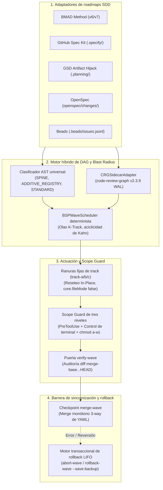

# ⚡ SDD-Parallel (`parallel-flow`)

[](https://github.com/stopActingSoSmall/sdd-parallel/actions/workflows/ci.yml)
[](https://pypi.org/project/sdd-parallel/)
[](https://www.python.org/)
[](../../../LICENSE)
[](#-pruébalo-en-5-segundos-sin-claves-api-sin-clonar)

<p align="center">
  
</p>

<p align="center">
  <b>🌐 Idioma / Language:</b>
  <a href="../../../README.md">English</a> |
  <a href="../zh-CN/README.md">简体中文</a> |
  <b>Español</b> |
  <a href="../pt-BR/README.md">Português (BR)</a> |
  <a href="../ja/README.md">日本語</a> |
  <a href="../ko/README.md">한국어</a> |
  <a href="../ru/README.md">Русский</a>
</p>

> **Ejecuta 3–4 agentes de IA en paralelo — sin romper tu build ni corromper el historial de Git.**  
> El controlador de tráfico determinista, aislador de worktrees y guardián de Blast Radius para **Claude Code**, **OpenAI Codex** y **Google Antigravity** trabajando sobre proyectos **BMAD**, **GitHub Spec Kit**, **GSD**, **OpenSpec** o **Beads**.

---

## ⚡ ¿Por qué existe esto? (En lenguaje sencillo)

Cuando tienes un backlog de 10–15 especificaciones o historias, te enfrentas a un dilema:
1. **Ejecutar 1 agente de IA en serie:** Seguro, pero exige esperar **6–8 horas**.
2. **Lanzar 3–4 agentes de IA en paralelo (`git worktree`):** Rápido, hasta que intentas fusionarlos y chocas contra una **Bomba de Merge (Merge-Bomb)**:
   - **Colisiones directas de Git:** Varios agentes editan a la vez `sprint-status.yaml`, `STATE.md` o `cli.py`.
   - **Ruptura semántica silenciosa (Colisión Tipo 2):** El Agente A modifica la firma de una función en `normalizer.py`, mientras el Agente B en otro worktree invoca la firma anterior desde `api.py`. **Git fusiona sin un solo conflicto, pero tu rama `main` se rompe inmediatamente en ejecución.**
   - **Desviación del alcance (Scope Creep):** Un agente se vuelve "proactivo" y altera el esquema central de la base de datos (`schema.py`) fuera de su tarea asignada.

**`sdd-parallel` actúa como un controlador de tráfico aéreo de grado compilador entre tus especificaciones SDD y tus agentes de IA.** Antes de gastar un solo token de LLM, escanea el AST y el grafo de llamadas del repositorio, agrupa tareas independientes en **Olas (Waves)** paralelas, aísla a cada agente en un worktree limpio (`track-a`, `track-b`), bloquea físicamente escrituras fuera del alcance asignado y fusiona automáticamente las olas completadas con cero conflictos.

### 📊 Comparativa: Antes vs. Después de `sdd-parallel`

| Escenario | ❌ SDD Secuencial (1 Agente) | 💥 Paralelo Ingenuo (`--worktree`) | ✅ Con `sdd-parallel` |
| :--- | :--- | :--- | :--- |
| **Tiempo de sprint (12 historias)** | ~6–8 horas (una por una) | ~2 h desarrollo + **2 h resolviendo merges rotos** | **~2.5 horas en total (aceleración 2x–3x)** |
| **Colisiones ocultas de tipos/APIs** | Evitadas únicamente yendo lento | **Rompe `main` tras el merge** ($W_A \cap I_B$) | **Prevenidas de antemano** (ordenadas en Ola 1 → Ola 2) |
| **Archivos compartidos de CLI/Router** | 1 agente a la vez | Conflictos de Git en cada merge | **Seguro en paralelo** (detección de `ADDITIVE_REGISTRY`) |
| **`sprint-status.yaml` / `tasks.md`** | Actualización estrictamente en serie | Conflictos constantes con marcas `<<<<<<<` | **Auto-fusionado** (Fusionador monótono 3-way) |
| **Agente edita un archivo indebido** | Solo el prompt diciendo "por favor no" | El agente lo elude mediante `bash` / `sed` | **Bloqueo a nivel de SO y hooks** (`chmod a-w` + `PreToolUse`) |
| **Desorden de carpetas worktree** | Ninguno | 15 carpetas huérfanas `.worktrees/task-*` | **Ranuras fijas reutilizables** (`track-a`, `track-b`, `track-c`) |

---

## 🚀 Pruébalo en 5 segundos (Sin claves API, sin clonar)

No necesitas claves API, suscripciones de LLM ni un proyecto existente para comprobar cómo `sdd-parallel` detecta colisiones semánticas ocultas. Ejecuta un único comando con [`uv`](https://docs.astral.sh/uv/) (o `pipx run sdd-parallel demo`):

```bash
uvx sdd-parallel demo
```

**Lo que ocurre en 3.2 segundos en tu terminal:**
1. Genera un repositorio temporal con 5 historias y 6 módulos Python (`schema.py`, `normalizer.py`, `api.py`, `exporter.py`, `cli.py`).
2. **Detecta una trampa oculta:** La historia `1-2` modifica `normalizer.py`, mientras la historia `2-1` modifica `api.py` (que importa `normalizer.py`). Un gestor ingenuo asumiría que son seguras de ejecutar a la vez. `sdd-parallel` detecta el impacto cruzado en el grafo de llamadas y las separa en **Ola 1** y **Ola 2**.
3. **Permite paralelismo seguro en registros compartidos:** Reconoce `cli.py` como `ADDITIVE_REGISTRY`, permitiendo que las historias `1-2` y `1-3` corran en paralelo en la **Ola 1** (`track-a` y `track-b`).
4. **Demuestra el Scope Guard y el merge 3-way:** Bloquea en tiempo real una edición indebida a `schema.py` (`DENY: Locked by Spine Chain invariant`) y fusiona ambas ramas paralelas con `0 marcadores de conflicto`.

<details>
<summary><b>📺 Haz clic para ver la salida exacta del terminal de <code>sdd-parallel demo</code></b></summary>

```text
============================================================================
SDD-PARALLEL STANDALONE MERGE-BOMB DEMO (ZERO API KEYS / OFFLINE)
============================================================================
Workspace: /tmp/sdd-parallel-demo-xyz

[Step 1/4] AST & Architectural Role Classification
----------------------------------------------------------------------------
File Path                              | Detected Role          | Importers
----------------------------------------------------------------------------
src/demo_app/__init__.py               | additive_registry      | -
src/demo_app/api.py                    | standard               | -
src/demo_app/cli.py                    | additive_registry      | -
src/demo_app/exporter.py               | standard               | -
src/demo_app/normalizer.py             | standard               | src/demo_app/api.py
src/demo_app/schema.py                 | spine                  | -

[Step 2/4] Type-2 Semantic Merge-Bomb Detection & BSP Wave Schedule
----------------------------------------------------------------------------
  Collision Analysis:
    - Naive Scheduler : W(1-2)={normalizer.py, cli.py} vs W(2-1)={api.py}
                        -> DISJOINT WRITES (False Safe!)
    - BSPWaveScheduler: Detected semantic_collision between '1-2' and '2-1'
                        -> Overlap W(1-2) ^ I(2-1) on: src/demo_app/api.py
    - Additive Registry: Tasks '1-2' and '1-3' both touch 'src/demo_app/cli.py'
                        -> Role: ADDITIVE_REGISTRY (Parallel allowed in Wave 1)

  Wave Schedule:
    * Wave 1
        - track-a: Story 1-2 -> writes: src/demo_app/normalizer.py (+ shared: src/demo_app/cli.py)
        - track-b: Story 1-3 -> writes: src/demo_app/exporter.py (+ shared: src/demo_app/cli.py)
    * Wave 2
        - track-a: Story 1-1 -> writes: src/demo_app/schema.py
        - track-b: Story 2-1 -> writes: src/demo_app/api.py
    * Wave 3
        - track-a: Story 2-2 -> writes: src/demo_app/schema.py

[Step 3/4] Fixed-Slot Worktree Provisioning & PreToolUse Scope Guard
----------------------------------------------------------------------------
  Provisioned Fixed Slots (100% Clean git status: True):
    - track-a (.worktrees/track-a)
    - track-b (.worktrees/track-b)

  PreToolUse Scope Guard Check (track-a -> 'src/demo_app/schema.py'):
    - Decision : DENY
    - Violation: File 'src/demo_app/schema.py' cannot be modified by Wave 1 / track-a (stories ['1-2'])
    - Reason   : Locked by Spine Chain invariant.

[Step 4/4] Barrier Checkpoint & Monotonic 3-Way YAML Merge
----------------------------------------------------------------------------
  Merged Branches:
    - parallel/track-a
    - parallel/track-b

  Resolved sprint-status.yaml (0 conflict markers):
    - 1-2-normalize-telemetry-payload: done
    - 1-3-cli-batch-export: done
============================================================================
ALL 5 CORE INVARIANTS VERIFIED IN 3.21s
============================================================================
```
</details>

---

## 🗺️ Cómo funciona visualmente (Del backlog al merge limpio)

En lugar de lanzar 5 agentes a la vez sobre tu repositorio y rezar para que no colisionen, `sdd-parallel` estructura tu sprint en **Olas (Waves)** deterministas:

```mermaid
flowchart LR
    subgraph Backlog["📋 1. Backlog SDD"]
        direction TB
        T12["Story 1-2\n(normalizer.py + cli.py)"]
        T13["Story 1-3\n(exporter.py + cli.py)"]
        T21["Story 2-1\n(api.py -> llama normalizer)"]
        T11["Story 1-1\n(schema.py - Bloqueo Spine)"]
    end

    subgraph Planner["🧠 2. sdd-parallel plan"]
        direction TB
        Scan["Escaneo AST + Grafo de llamadas\n• cli.py = Additive (¡Seguro!)\n• 1-2 ↔ 2-1 = ¡Colisión de impacto!\n• schema.py = ¡Bloqueo Spine!"]
    end

    subgraph Wave1["🟢 3. Ola 1 (Worktrees paralelos)"]
        direction TB
        SlotA["📁 .worktrees/track-a\nAgente 1 ejecuta Story 1-2\n🔒 schema.py y api.py bloqueados"]
        SlotB["📁 .worktrees/track-b\nAgente 2 ejecuta Story 1-3\n🔒 schema.py y normalizer.py bloqueados"]
    end

    subgraph Gate["🛡️ 4. sdd-parallel merge --wave 1"]
        direction TB
        M1["✅ Scope Diff auditado\n✅ pytest / mypy / ruff aprobados\n✅ Merge 3-way de estados"]
    end

    subgraph Wave2["🔵 5. Ola 2 (Reutiliza las mismas ranuras)"]
        direction TB
        SlotA2["📁 .worktrees/track-a\nAgente 1 ejecuta Story 1-1"]
        SlotB2["📁 .worktrees/track-b\nAgente 2 ejecuta Story 2-1\n(¡lee el nuevo normalizer.py!)"]
    end

    Backlog --> Planner --> Wave1 --> Gate --> Wave2
```



---

## 🔌 Integración directa en tu stack actual (Zero Lock-In)

**No necesitas** reescribir tus especificaciones ni cambiar tu forma de dar instrucciones a los agentes. `sdd-parallel` lee los archivos de tus frameworks actuales en modo de solo lectura:

| Si utilizas... | Qué añade `sdd-parallel` a tu flujo de trabajo |
| :--- | :--- |
| **Claude Code** (`claude`) | Planificación determinista de olas previa a `--worktree` / `Agent Teams`, bloqueo de archivos indebidos y comandos terminal vía `PreToolUse`, y enrutamiento por complejidad (`High`/`Medium`/`Low`). |
| **OpenAI Codex CLI** (`codex`) | Previene condiciones de carrera ordenando previamente tareas conflictivas y bloqueando esquemas compartidos (`chmod a-w`) dentro de cada slot. |
| **Google Antigravity** | Proporciona ranuras fijas reutilizables (`track-a`, `track-b`, `track-c`) que eliminan fallos de carpetas perdidas en el IDE y mantienen `git status --porcelain` 100% limpio vía `.git/worktrees/*/info/exclude`. |
| **BMAD Method (`v6.3+` / `v7`)** | Convierte colas lineales `sprint-status.yaml` en olas paralelas multi-epic y fusiona estados de historias (`backlog -> done`) sin conflictos YAML. |
| **GitHub Spec Kit (`.specify/`)** | Valida etiquetas de paralelismo manual `[P]` en `tasks.md` contra dependencias reales de AST, evitando que falsos paralelos rompan el build. |
| **GSD / OpenSpec / Beads** | Aísla `.planning/STATE.md` (modo Artifact Hijack), `openspec/changes/` y `.beads/issues.jsonl` en worktrees limpios. |

---

## 🛠️ Tu flujo diario en 4 comandos

### 1. Instalación única
```bash
# Recomendado vía uv (o: pipx install sdd-parallel)
uv tool install sdd-parallel
```
*(Tanto `sdd-parallel` como el alias rápido `parallel-flow` quedan disponibles globalmente).*

### 2. Ejecutar una Ola Paralela en cualquier proyecto
```bash
# Paso 1: Escanear especificaciones SDD y AST para calcular olas seguras
sdd-parallel plan

# Paso 2: Preparar la Ola 1 en slots fijos (.worktrees/track-a, track-b)
#         e imprimir las instrucciones de lanzamiento para los agentes
sdd-parallel prepare --wave 1
sdd-parallel run-guide --wave 1

# 👉 Paso 3: Los agentes de IA (Claude Code / Codex / Antigravity) implementan
#            sus historias en track-a y track-b simultáneamente.

# Paso 4: Verificar ausencia de violaciones de alcance y fusionar la Ola 1 en main
sdd-parallel verify-wave --wave 1
sdd-parallel merge --wave 1
```
¿Necesitas deshacer una ola? Ejecuta `sdd-parallel abort-wave --wave 1` (antes del merge) o `sdd-parallel rollback-wave --wave 1` (después del merge, con ramas de respaldo automáticas y reseteo de estados SDD).

---

## 🧩 Matriz de frameworks SDD soportados

| Framework SDD | Estado | Artefactos detectados (Solo lectura) | Sincronización de estados |
| :--- | :---: | :--- | :--- |
| **BMAD Method (`v6.3+` / `v7`)** | ✅ Publicado | `sprint-status.yaml`, `epics.md`, `epic-*-context.md`, `spec-*.md` | Merge 3-way monótono de YAML |
| **GitHub Spec Kit (`.specify/`)** | ✅ Publicado | `.specify/specs/*/tasks.md`, `constitution.md` | Casillas de verificación en Markdown |
| **GSD (Get Shit Done)** | ✅ Publicado | `.planning/phases/*-PLAN.md`, `ROADMAP.md` | Artifact Hijack (actualización central en `STATE.md`) |
| **OpenSpec (`openspec/`)** | ✅ Publicado | `openspec/changes/<id>/tasks.md` | Seguimiento guiado por especificaciones |
| **Beads (`.beads/`)** | ✅ Publicado | `.beads/issues.jsonl` | Actualizaciones topológicas de issues |

---

## 🔍 Análisis técnico profundo (Arquitectura, invariantes y referencia completa de CLI)

¿Deseas inspeccionar el modelo matemático, la arquitectura modular interna o cada parámetro de la CLI? Despliega las secciones inferiores o accede directamente al **[Dossier de Arquitectura y Estrategia](../../dossier/README.md)**:

- 📖 **[01 — Brief de Producto y Modelo de ROI](../../dossier/01_CORE_PRODUCT_BRIEF.md)** *(Resumen ejecutivo, FinOps de tokens y enrutamiento por esfuerzo)*
- 🏛️ **[02 — Capacidades del Sistema y White Paper](../../dossier/02_SYSTEM_CAPABILITIES_WHITE_PAPER.md)** *(Conflictos Tipo 1 vs Tipo 2, taxonomía 3D de archivos, decaimiento CRG)*
- 🔌 **[03 — Especificación de Integración y Ecosistema](../../dossier/03_INTEGRATION_AND_ECOSYSTEM_SPEC.md)** *(IR `CanonicalTask`, contratos `.tmp/track-context.md`, `.parallel-lock.json`)*
- 🧪 **[07 — Demo Independiente y Guía E2E Interactiva](../../dossier/07_STANDALONE_DEMO_AND_E2E_WALKTHROUGH.md)** *(Capturas paso a paso y sandbox con `--keep-temp`)*
- 📐 **[Arquitectura del Sistema SSOT (`ARCHITECTURE.md`)](ARCHITECTURE.md)** | **[Dossier en Ruso](../../i18n/ru/dossier/)**

<details>
<summary><b>🏛️ Desplegar: Arquitectura interna del motor y 9 invariantes de ingeniería</b></summary>

### Flujo interno de componentes



### Los 9 invariantes fundamentales de ingeniería

1. **Cero polución de worktrees (Zero Worktree Pollution):** Archivos inyectados (`.tmp/track-context.md`, `.parallel-lock.json`, `ACTIVE_TRACK.md`) enmascarados vía `info/exclude`. `git status --porcelain` siempre 100% limpio.
2. **Cero invalidación de caché (Zero Cache Invalidation):** Contextos en `_bmad-output/planning-artifacts/` estrictamente de solo lectura; el estado del planificador escribe en `_bmad-output/parallel-artifacts/`.
3. **100% cobertura de tareas y aciclicidad:** Validación topológica de Kahn/Tarjan que garantiza cero historias perdidas y cero ciclos de dependencia.
4. **Control de Blast Radius (Tipo 1 y Tipo 2):** Escrituras disjuntas ($W_A \cap W_B = \emptyset$) e impactos semánticos disjuntos ($W_A \cap I_B = \emptyset$).
5. **Universalidad sin sobreajuste (Invariante 7):** Sin rutas de dominio ni entidades hardcodeadas en el motor. Clasificación `SPINE`, `ADDITIVE_REGISTRY` y `STANDARD` basada en AST y centralidad de grafos.
6. **Ranuras fijas de track (Huella $O(1)$ en disco):** Reutiliza `track-a`, `track-b`, `track-c` vía `git checkout -B` y `git clean -fd` evitando acumulación de carpetas.
7. **Defensa en profundidad en tres niveles:** Hook `PreToolUse` + interceptación de terminal (`Bash`, `run_command`) + bloqueo OS `chmod a-w`.
8. **Semirretículo de estados monótono:** Convergencia monótona: $\texttt{backlog} (0) < \dots < \texttt{done} (4)$ sin marcas de conflicto.
9. **Rollbacks transaccionales LIFO:** Reversión en orden estrictamente inverso con ramas de seguridad automáticas (`backup/wave-<K>-before-rollback-*`).

</details>

<details>
<summary><b>🛠️ Desplegar: Referencia completa de CLI (Todos los 13 subcomandos y opciones)</b></summary>

| Comando | Propósito |
| :--- | :--- |
| `sdd-parallel demo [--kit {bmad,spec-kit,gsd,openspec,beads,all}] [--keep-temp] [--scaffold-only] [--output-dir DIR]` | Ejecutar la demo offline o generar un sandbox interactivo en los 5 kits SDD. |
| `sdd-parallel plan [--repo REPO] [--max-tracks N] [--kit auto] [--include-done] [--dry-run] [--plan-source {auto,plan,specs}] [--output-dir DIR]` | Analizar roadmap y grafo de código; generar `execution-plan-parallel.md` y `wave-plan.json`. |
| `sdd-parallel prepare --wave K [--repo REPO] [--max-tracks N] [--kit KIT] [--headless] [--antigravity-layout] [--dynamic-worktrees] [--dry-run]` | Provisionar slots de worktree (`track-a`, `track-b`), bloqueos de SO e inyección de contexto. |
| `sdd-parallel claim-track --wave K --track <id> --worktree <path> [--repo REPO] [--max-tracks N] [--kit KIT] [--headless]` | Asociar bloqueos y contexto a un slot worktree externo preexistente. |
| `sdd-parallel run-guide --wave K [--repo REPO] [--max-tracks N] [--kit KIT] [--antigravity-layout]` | Mostrar matriz interactiva con comandos de lanzamiento para cada terminal de track activa. |
| `sdd-parallel verify-wave --wave K [--repo REPO] [--max-tracks N] [--kit KIT] [--dynamic-worktrees]` | Auditar cambios respecto a `.parallel-lock.json` y diff multicommit contra `merge-base`. |
| `sdd-parallel merge --wave K [--repo REPO] [--max-tracks N] [--kit KIT] [--dynamic-worktrees] [--skip-gates] [--strict-gates] [--cleanup] [--dry-run]` | Checkpoint de barrera: merge 3-way de estados, merge git, gates de calidad y autorollback transaccional. |
| `sdd-parallel abort-wave --wave K [--repo REPO] [--dynamic-worktrees]` | Abortar una ola no fusionada: resetear slots y eliminar ramas paralelas temporales. |
| `sdd-parallel rollback-wave --wave K [--repo REPO] [--dynamic-worktrees] [--to-commit COMMIT] [--save-backup] [--no-backup] [--kit KIT]` | Revertir ola fusionada en orden LIFO con rama de respaldo y reseteo de estados SDD. |
| `sdd-parallel merge-status --base B --ours O --theirs T --out OUT` | Herramienta determinista de bajo nivel para merge 3-way de `sprint-status.yaml`. |
| `sdd-parallel check-lock --file PATH [--tool TOOL]` | Validar permisos de escritura según el manifiesto de bloqueo activo del worktree. |
| `sdd-parallel install-plugin [--target-dir DIR]` | Empaquetar e instalar el plugin nativo para Google Antigravity. |
| `sdd-parallel autopilot --wave K [--repo REPO] [--max-tracks N] [--kit KIT] [--harness <tool>] [--antigravity-layout] [--execute]` | Generar o ejecutar comandos de piloto automático multi-conversación con enrutamiento de modelos. |

</details>

<details>
<summary><b>🧪 Desplegar: Desarrollo local y puertas de calidad</b></summary>

### Prerrequisitos
- **Python:** `>= 3.11` (Python 3.11, 3.12, 3.13)
- **Git:** `>= 2.30` (requerido para aislamiento de `git worktree` y enmascaramiento con `info/exclude`)
- **Gestor de paquetes:** [`uv`](https://docs.astral.sh/uv/) (recomendado) o `pipx`

```bash
git clone https://github.com/stopActingSoSmall/sdd-parallel.git
cd sdd-parallel
uv sync

# Ejecutar 99+ pruebas automatizadas (unitarias y de integración)
uv run pytest

# Verificación estricta de tipos estáticos
uv run mypy --strict src/sdd_parallel

# Linter y chequeo de estilo
uv run ruff check src/ tests/ scripts/

# Ejecutar demo offline autónoma
uv run sdd-parallel demo
```

</details>

---

## 🚢 Matriz de versiones: Publicado (v0.1.0) vs Hoja de ruta (v0.2+)

### ✅ Entregado en `v0.1.0` (Producción)
- Planificador determinista de olas Bulk-Synchronous Parallel (BSP) con verificación acíclica de Kahn.
- Escáner AST de hotspots e integración sidecar con `code-review-graph v2.3.9`.
- Arquitectura de slots fijos (`track-a`, `track-b`, `track-c`) con reinicio in-place.
- Scope Guard de tres niveles (`PreToolUse` + Guard de terminal + `chmod a-w` del SO).
- Fusionador monótono 3-way de YAML preservando comentarios y formato.
- Motor transaccional de rollback LIFO con ramas automáticas de respaldo.
- Estándar Two-Stage Assisted (Slots interactivos de IDE, `Depth 0`).
- 5 adaptadores multi-SDD (BMAD, Spec Kit, GSD Artifact Hijack, OpenSpec, Beads).
- Demo offline sin claves API (`sdd-parallel demo`) y suite de CI en GitHub Actions.
- 99 pruebas automáticas, `mypy --strict` y puertas de calidad con `ruff`.

### 🚧 Planificado para `v0.2.0+`
- **Ecosistema de adaptadores comunitarios:** Soporte para `mattpocock/skills` (`/implement-spec`) y `bmad-loop` v0.8+.
- **Sincronización de entornos sin polución:** Patrón `workz` con enlaces simbólicos de `.venv` y `node_modules` en slots fijos.
- **Enlazador estático de símbolos y escalado dinámico de scope:** Expansión automática del write-set mediante símbolos AST y reprogramación dinámica.
- **Exportadores FinOps y observabilidad:** Spans de OpenTelemetry y telemetría de ahorro de tokens en Langfuse.
- **Daemon de piloto automático en segundo plano:** Ejecución completamente headless mediante RPC local y despacho de subagentes.

---

## 🤝 Contribución y seguridad

- **Contribución:** Consulta nuestra **[Guía de Contribución](../../../CONTRIBUTING.md)** para la configuración del entorno de desarrollo y validaciones de PR.
- **Seguridad:** El proceso de divulgación de vulnerabilidades se detalla en nuestra **[Política de Seguridad](../../../SECURITY.md)**.

## 📜 Licencia

Licencia MIT. Consulta [LICENSE](../../../LICENSE) para más detalles.
