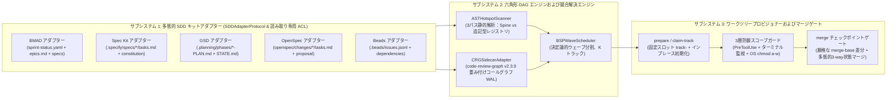

# 🏛️ SDD-Parallel — システムアーキテクチャ（SSOT）

<p align="center">
  <b>🌐 言語 / Language:</b>
  <a href="../../../ARCHITECTURE.md">English</a> |
  <a href="../zh-CN/ARCHITECTURE.md">简体中文</a> |
  <a href="../es/ARCHITECTURE.md">Español</a> |
  <a href="../pt-BR/ARCHITECTURE.md">Português (BR)</a> |
  <b>日本語</b> |
  <a href="../ko/ARCHITECTURE.md">한국어</a> |
  <a href="../ru/ARCHITECTURE.md">Русский</a>
</p>

**バージョン：** 0.1.0  
**ステータス：** 承認済みアーキテクチャ基線（SSOT）

---

## 1. アーキテクチャモジュールの全体像

`sdd-parallel` システムは、標準タスクグラフモデル（`src/sdd_parallel/models.py`）によって統括される3つの疎結合サブシステムから構成されます：



### 1.1. ヘキサゴナルアーキテクチャと `SDDAdapterProtocol`

ポート＆アダプター（ヘキサゴナルアーキテクチャ）の原則に基づき、`sdd-parallel` の中核エンジンは、厳密に型付けされた `SDDAdapterProtocol`（`src/sdd_parallel/adapters/__init__.py`）のみを介してすべての仕様駆動開発（SDD）フレームワークと対話します。エンジン本体には特定のファイルパスや分岐処理は一切ハードコードされていません：

```python
class SDDAdapterProtocol(Protocol):
    """すべてのサポート対象 SDD フレームワークが実装する多態的拡張契約。"""

    kit_id: str

    def detect(self) -> bool:
        """リポジトリ内に当該 SDD フレームワークが存在するか検出する。"""
        ...

    def load_tasks(self, include_done: bool = False) -> list[TaskNode]:
        """バックログやロードマップの成果物を標準 TaskNode モデルに変換する。"""
        ...

    def check_wave_zero_blockers(self, wave: Wave | None = None) -> list[str]:
        """フレームワーク固有の事前条件（Git のクリーン状態、コンパイル済み文脈など）を検証する。"""
        ...

    def get_allowed_write_globs(self, track: WaveTrack) -> list[str]:
        """ワークツリー内で変更が許可されるメタデータの glob パターンを返す。"""
        ...

    def get_forbidden_files(self, wave: Wave, track: WaveTrack) -> dict[str, str]:
        """保護対象の仕様書や不変契約ファイルをマッピングする。"""
        ...

    def render_worker_command(self, track: WaveTrack) -> str:
        """オペレーター向け実行ガイドおよび Autopilot 用のネイティブ CLI コマンドを生成する。"""
        ...

    def reset_tasks_status(
        self,
        task_ids: Sequence[str],
        target_status: str = "ready-for-dev",
    ) -> None:
        """トランザクション LIFO ロールバック時にタスク状態を元に戻す。"""
        ...

    def cleanup_wave_artifacts(
        self,
        wave_id: int,
        task_ids: Sequence[str],
    ) -> None:
        """ウェーブ実行中に生成された一時成果物をクリーンアップする。"""
        ...
```

### 1.2. 責務分担マトリクス：汎用コアエンジン vs 多態的キットアダプター

| パイプライン工程 | 担当サブシステム | アーキテクチャ上の役割およびメカニズム |
| :--- | :---: | :--- |
| **成果物パースとタスク変換** | `SDDAdapter` | キット固有のフォーマット（YAML、Markdown、JSONL）を解釈。標準 `TaskNode`（`write_files`, `read_files`, `depends_on`）に変換。 |
| **事前ブロッキング条件チェック** | `SDDAdapter` | 各キットの前提条件（`check_wave_zero_blockers`）：Git のクリーン状態、エピック文脈の存在、タスクリストの整合性を検証。 |
| **AST ファイル分類** | `Core Engine` | 3パス静的解析（`ASTHotspotScanner`）により、パスのハードコードなしで `SPINE`、`ADDITIVE_REGISTRY`、`STANDARD` に分類。 |
| **意味的影響半径の算出** | `Core Engine` | `CRGSidecarAdapter`（`code-review-graph v2.3.9` WAL）を用いて重み付けコールグラフの影響範囲（$W_A \cap I_B$）を算出。 |
| **ウェーブ分割（BSP スケジューラー）** | `Core Engine` | 決定論的 `BSPWaveScheduler` により、100% のタスク網羅と Kahn 非巡回性を保証。 |
| **ワークツリースロットの割り当て** | `Core Engine` + `Adapter` | 固定スロット `track-<id>` と OS 権限（`chmod a-w`）を設定。アダプターが `allowed_write_globs` と `forbidden_files` を提供。 |
| **エージェント起動コマンド生成** | `SDDAdapter` | ネイティブコマンド（`/speckit.implement`, `/gsd-execute-phase`, `/opsx:apply`, `bd update`, `/bmad-build`）を生成。 |
| **多層スコープガード** | `Core Engine` | `PreToolUse` フック、ターミナルコマンド監視（`Bash`, `run_command`）、OS 読み取り専用ロックで範囲外編集を遮断。 |
| **単調3-way状態マージ** | `SDDAdapter` + `Core` | エンジンが統合を統括し、半順序束マージ器（`status_merger.py`）により競合マーカーなしで状態を自動統合。 |
| **トランザクション LIFO ロールバック** | `Core Engine` + `Adapter` | 安全バックアップブランチ（`backup/wave-<K>-before-rollback-*`）を保持して `HEAD` を戻し、アダプターが状態を復元。 |

### 1.3. 複数キット共存およびサンドボックス隔離プロトコル

エンタープライズリポジトリにおいて複数の SDD 成果物が共存する場合：
1. **明示的優先度：** CLI の `--kit <name>` 引数または設定の `"default_kit"` が最優先されます。
2. **アクティブタスクによる自動解決 (`kit="auto"`)：** 未完了タスクを含む最初のフレームワークを自動的にアクティブ化します。
3. **診断テレメトリ：** `diagnose_multi_kit_coexistence()` により、処理を中断することなくオペレーターに共存状態を警告します。
4. **クロスフレームワークのサンドボックス隔離：** `.parallel-lock.json` 生成時、**非アクティブ** な SDD キットのディレクトリはすべて `forbidden_files` に追加され、変更が禁止されます。

---

## 2. 数学的競合モデルおよびファイル分類法

各未完了タスク $T_i$ に対し、以下を評価します：
- $W(T_i)$ — タスクが**変更または作成**するファイル群（`write_files`）。
- $R(T_i)$ — タスクが**読み取りまたは参照**するファイル群（`read_files`）。
- $I(T_i)$ — $W(T_i)$ を起点とする**重み付け影響半径**（`CRGSidecarAdapter` により算出、減衰係数 $\gamma = 0.7$）。

### 2.1. コードベースにおける3つのファイル分類

1. **背骨ファイル (`FileRole.SPINE`):**
   - データベーススキーマ、順次移行スクリプト、またはルートデータモデル（`schema.py`, `models.py`, `SCHEMA_VERSION`）。
   - **規則：** 同一の `SPINE` ファイルを変更するタスクは**絶対に同じウェーブで実行されず**、厳格な直列順序に並べられます。
2. **共有追記型レジストリ (`FileRole.ADDITIVE_REGISTRY`):**
   - 独立したコマンドやルートが登録されるエントリーポイント（`@app.command` を持つ `cli.py`、`__all__` を持つ `__init__.py` など）。
   - *不変条件 (ADR-0002)：* 共通フォーマットユーティリティ（`console.py` など）はレジストリから除外され、`STANDARD` に分類されます。
   - **規則：** 追記型ファイルのみで交差するタスクは、**別個のワークツリーで並行実行が許可**され、追記専用ガイドが注入されます。
3. **標準モジュールファイル (`FileRole.STANDARD`):**
   - 通常のビジネスロジックやアダプター。
   - **規則：** $W(A) \cap W(B) \neq \emptyset$ となるタスクは同一ウェーブ内で並行実行できません。

### 2.2. 3パス静的 AST 解析パイプライン (`ASTHotspotScanner`)

**不変条件 7（アンチ過学習）** に基づき、動的に分類されます：
1. **パス 1（シグネチャ探索）：** マイグレーション用キーワード（`SCHEMA_VERSION`, `auto_migrate`）を検出。
2. **パス 2（依存グラフおよびデコレーター走査）：** 参照元カウント（Fan-In）および登録デコレーター（`command`, `tool`, `get`, `post`）を走査。
3. **パス 3（決定論的分類）：**
   - テスト（`tests/`）$\to$ 常に `STANDARD`。
   - `SPINE`：スキーマキーワード検出 $\lor$ `schema.py`/`models.py` $\lor$ **Fan-In $\ge 5$**。
   - `ADDITIVE_REGISTRY`：登録デコレーター検出 $\lor$ `cli.py`/`__init__.py`。
   - `STANDARD`：その他の全モジュール。

### 2.3. 競合グラフのエッジ種別 (`ConflictEdge`)

1. **`EXPLICIT_DEP`（明示的依存関係 $A \to B$）：** ロードマップで定義された依存。
2. **`SPINE_ORDER`（背骨順序依存 $A \to B$）：** `SPINE` ファイルに対する順次変更。
3. **`DIRECT_COLLISION`（直接書き込み競合 $A \leftrightarrow B$）：** $W(A) \cap W(B) \setminus \text{AdditiveRegistries} \neq \emptyset$。
4. **`SEMANTIC_COLLISION`（第2種意味的競合 $A \leftrightarrow B$）：** $(W(A) \cap I(B)) \cup (W(B) \cap I(A)) \neq \emptyset$。

---

## 3. 主要な実行時アーティファクト契約

### 3.1. ワークツリー文脈契約 (`.tmp/track-context.md`)

`sdd-parallel prepare --wave K` により生成され、エージェントのプロンプトに注入されます：

```markdown
# PARALLEL TRACK CONTEXT BOUNDARY (ENFORCED)
- **Wave:** 1 | **Track:** track-a | **Assigned Stories:** 11-2
- **Recommended Model Effort:** high

## 1. Allowed Exclusive Write Scope
- `src/canonical/intervals.py`
- `tests/test_intervals.py`

## 2. Shared Additive Registries (Isolated Append Scope)
- `src/canonical/normalizer.py` (Scope: function `_classify_reads` only)

## 3. Forbidden Files (Locked by Sibling Tracks in Wave 1)
- `src/canonical/manifest.py` (Locked by track-b)
- `src/storage/schema.py` (Spine Lock Chain)
```

### 3.2. 実行時スコープロックマニフェスト (`.parallel-lock.json`)

`PreToolUse` フックによって高速参照される機械可読マニフェスト：

```json
{
  "wave_id": 1,
  "track_id": "track-a",
  "stories": ["11-2"],
  "repo_root": "/workspace/project",
  "worktree_root": "/workspace/project/.worktrees/track-a",
  "allowed_write_globs": [
    "src/canonical/intervals.py",
    "src/canonical/normalizer.py",
    "tests/**",
    ".tmp/**"
  ],
  "additive_shared_files": [
    "src/canonical/normalizer.py"
  ],
  "forbidden_files": {
    "src/canonical/manifest.py": "Locked by track-b (story 11-3)",
    "src/storage/schema.py": "Locked by Spine Chain"
  }
}
```

---

## 4. 非侵入型メカニズムおよび 5 キット対応

### 4.1. ワークツリー非汚染環境注入

5つのフレームワークすべてにおいて、エージェントが `git status --porcelain == ""` のクリーンな状態で起動することを保証します：
1. 統括文脈は `.tmp/track-context.md` に出力（`.gitignore` 済み）。
2. ロックマニフェストは `.parallel-lock.json` に出力（`.gitignore` 済み）。
3. ワークツリー固有の除外ルールは `.git/worktrees/<name>/info/exclude` に配置。
4. 環境変数（Spec Kit の `SPECIFY_FEATURE` など）を実行プロセスに注入。

### 4.2. 事前契約監査および不変仕様書の保護

ウェーブ実行前に事前監査を行い、仕様書を保護します（`FORBIDDEN_STATE_FILES`）：
- **GitHub Spec Kit：** `.specify/memory/constitution.md`, `.specify/feature.json`, `spec.md`, `plan.md` を保護。
- **GSD：** `.planning/STATE.md`, `ROADMAP.md`, `PROJECT.md` を保護。
- **OpenSpec：** `openspec/project.md`, `openspec/specs/**`, `openspec/config.yaml` を保護。
- **Beads：** `.beads/config.yaml`, `.beads/metadata.json` を保護。
- **BMAD：** `epic-<N>-context.md` を保護。

### 4.3. `CRGSidecarAdapter` による意味的影響半径の算出

1. **メインリポジトリへのアンカー：** `main_repo_root` で初期化し、相対パスの不一致を防止。
2. **WAL モード互換性：** SQLite WAL モードによる安全な並行読み取り。
3. **ノイズ除去：** `min_impact_score=0.5` による高精度フィルタリング。

### 4.4. 多態的かつ決定論的な 3-Way 状態マージ

1. **BMAD (`sprint-status.yaml`):** 単調半順序束：$\texttt{backlog} (0) < \texttt{ready-for-dev} (1) < \texttt{in-progress} (2) < \texttt{review} (3) < \texttt{done} (4)$。
2. **GitHub Spec Kit & OpenSpec (`tasks.md` Markdown):** `- [ ]` から `- [x]` への単調昇格を自動統合（競合マーカーゼロ）。
3. **Beads (`.beads/issues.jsonl`):** JSONL レコードを ID 単位で単調マージ（`open < in-progress < closed`）。
4. **UTF-8 BOM 保護 (`utf-8-sig`):** Windows PowerShell による BOM（`\ufeff`）を完全に無害化。

### 4.5. 固定トラックスロット (`track-<id>`) とインプレース初期化 ($O(1)$ 空間)

永続的な $K = \text{max\_tracks}$ 個のスロット（`track-a`, `track-b`）を維持します：
- ディレクトリの過剰作成を防ぎ、IDE のファイルツリー破損を防止。
- インプレース初期化：`git checkout -B parallel/<track_id> master ; git clean -fd`。

### 4.6. 3層防御スコープガード

1. **第1層 (PreToolUse フック):** ファイル編集ツール（`write_file`, `edit_file`）を即座に判定。
2. **第2層 (Terminal Guard):** ターミナルコマンド（`Bash`, `run_command`）によるリダイレクト（`>`）や行編集（`sed -i`）を阻止。
3. **第3層 (OS 読み取り専用ロック):** `chmod a-w` と `git config core.fileMode false` により、OS レベルで書き込みを物理的にブロック。
4. **検証ゲート (`verify_wave`):** マージ直前に `git diff $(git merge-base master HEAD)...HEAD` による多層差分検査を実施。

### 4.7. トランザクション LIFO ロールバックエンジン

- **`abort-wave --wave K`：** 未マージのスロットをクリーンアップ。
- **`rollback-wave --wave K [--save-backup]`：** 厳格な LIFO 順で最新ウェーブを巻き戻し、安全ブランチ `backup/wave-<K>-before-rollback-*` を自動作成してタスク状態を復元。

### 4.8. 言語非依存のチェックポイントゲートとトランザクション自動破棄

- **汎用ゲート解決：** `.parallel-config.json` または `pyproject.toml` からテストコマンドを自動検出し、Python、Node、Rust、Go に対応。
- **自動ロールバック：** マージ中に品質ゲートが失敗した場合、直ちに `git reset --hard` を実行して `master` を復元（デバッグ用に各トラックは保持）。

### 4.9. 5秒オフライン完全検証コマンド (`sdd-parallel demo`)

API キー不要で 5 大不変条件をローカル検証。`--kit all` で全 5 キットを一括テスト可能。

### 4.10. CLI コマンドおよび全フラグリファレンス

| コマンド | 目的 | 主要オプションおよびフラグ |
| :--- | :--- | :--- |
| `plan` | 競合 DAG を計算し並行ウェーブ計画を策定 | `--repo <path>`, `--max-tracks <K>`, `--kit <auto\|kit>`, `--plan-source <auto\|plan\|specs>`, `--include-done`, `--dry-run` |
| `prepare` | ウェーブ K の固定トラックスロットと境界ロックを配備 | `--repo <path>`, `--wave <K>`, `--max-tracks <K>`, `--kit <auto\|kit>`, `--antigravity-layout`, `--dynamic-worktrees`, `--headless`, `--dry-run` |
| `claim-track` | 既存の外部ワークツリーに境界ロックをアタッチ | `--repo <path>`, `--wave <K>`, `--track <id>`, `--worktree <path>`, `--max-tracks <K>`, `--kit <auto\|kit>`, `--headless` |
| `run-guide` | ウェーブ K のフォーマット済みオペレーター向け実行ガイドを表示 | `--repo <path>`, `--wave <K>`, `--max-tracks <K>`, `--kit <auto\|kit>`, `--antigravity-layout` |
| `verify-wave` | merge-base に対するワークツリー差分およびロック遵守状況を監査 | `--repo <path>`, `--wave <K>`, `--max-tracks <K>`, `--kit <auto\|kit>`, `--dynamic-worktrees` |
| `merge` | 3-way 状態マージおよび品質ゲートを伴うバリアチェックポイント統合 | `--repo <path>`, `--wave <K>`, `--max-tracks <K>`, `--kit <auto\|kit>`, `--strict-gates`, `--skip-gates`, `--cleanup`, `--dry-run`, `--dynamic-worktrees` |
| `merge-status` | sprint-status.yaml 専用の独立した決定論的 3-way マージツール | `--base <file>`, `--ours <file>`, `--theirs <file>`, `--out <file>` |
| `check-lock` | アクティブなフックロジックによるファイル変更権限の検査 | `--file <path>`, `--tool <name>`（`indent=2` の整形済み JSON を出力） |
| `install-plugin` | ポータブルな Antigravity プラグインのパッケージ化とインストール | `--target-dir <path>`（デフォルトは `~/.gemini/config/plugins/sdd-parallel`） |
| `autopilot` | Multi-Conversation Autopilot コマンドの生成または実行 | `--repo <path>`, `--wave <K>`, `--max-tracks <K>`, `--kit <auto\|kit>`, `--harness <antigravity\|claude-code\|codex>`, `--antigravity-layout`, `--execute` |
| `abort-wave` | 統合前のウェーブを中断し並行ブランチをクリーンアップ | `--repo <path>`, `--wave <K>`, `--dynamic-worktrees` |
| `rollback-wave` | 安全バックアップブランチを伴う統合済みウェーブのアトミック LIFO ロールバック | `--repo <path>`, `--wave <K>`, `--to-commit <hash>`, `--save-backup` / `--no-backup`, `--kit <auto\|kit>`, `--dynamic-worktrees` |
| `demo` | 5秒間のオフライン Merge-Bomb デモ実行またはサンドボックス構築 | `--kit <bmad\|spec-kit\|gsd\|openspec\|beads\|all>`, `--keep-temp`, `--scaffold-only`, `--output-dir <path>` |

---

## 5. Google Antigravity および AI エージェントにおける並行実行モデル

環境の制約である **`Max Subagent Depth = 1`**（サブエージェントが子エージェントを呼出不可）に対応するため、2つの運用モデルを提供します：

### 5.1. モード A: `Two-Stage Assisted & Interactive Checkpoints`（推奨デフォルト）

人間との対話的チェックポイントを備えたアシスト型ワークフロー：
1. **チェックポイント 1（計画承認）：** オーケストレーターがウェーブ DAG を提示し、オペレーターが確認。
2. **チェックポイント 2（トラック実行）：**
   - 固定スロット `track-a`, `track-b` をプロビジョニングし、`run-guide` を表示。
   - オペレーターが IDE / ターミナルで各スロットを開き、`Depth 0` でネイティブコマンドを実行：
     - **GitHub Spec Kit:** `/speckit.implement <task-id>`
     - **GSD:** `/gsd-execute-phase <phase-num>`
     - **OpenSpec:** `/opsx:apply <task-id>`
     - **Beads:** `bd update <task-id> --status in-progress`
     - **BMAD:** `/bmad-build <task-id>`
3. **チェックポイント 3（バリア統合）：** オーケストレーター側で `sdd-parallel merge --wave K --cleanup` を実行し、全ブランチを自動統合。

### 5.2. モード B: `Multi-Window Autopilot`（目標自動化）

手動入力不要の完全自動マルチウィンドウ運用：
1. オーケストレーターがワークツリーを準備。
2. `AutopilotLauncher`（`src/sdd_parallel/autopilot.py`）がモデル負荷ルーティング（`High` / `Medium` / `Low`）を適用した起動コマンドを生成。
3. ブランチのコミット状況と SDD 状態の進捗を自動監視。
4. 全トラック完了時にバリア検証を実行し、`master` へマージ。

### 5.3. モード C: `In-Session Flat Dispatch`（非推奨 / 緊急時フォールバックのみ）

単一チャットセッション内でフラットなサブエージェントチェーン（`Spec -> Dev -> Review`）を順次実行する運用は**非推奨**であり、複数ウィンドウが使えない環境での緊急時のみに制限されます。
