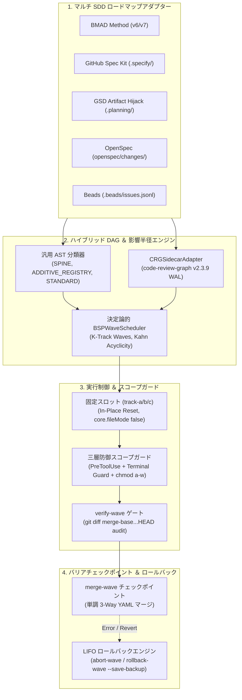

# ⚡ SDD-Parallel

[](https://github.com/stopActingSoSmall/sdd-parallel/actions/workflows/ci.yml)
[](https://www.python.org/)
[](../../../LICENSE)
[](#-5秒オフラインデモapiキー不要)

<p align="center">
  <b>🌐 言語 / Language:</b>
  <a href="../../../README.md">English</a> |
  <a href="../zh-CN/README.md">简体中文</a> |
  <a href="../es/README.md">Español</a> |
  <a href="../pt-BR/README.md">Português (BR)</a> |
  <b>日本語</b> |
  <a href="../ko/README.md">한국어</a> |
  <a href="../ru/README.md">Русский</a>
</p>

> **AIコーディングエージェントのための仕様駆動開発（SDD）並行実行＆影響半径（Blast Radius）ガバナンスハーネス**  
> (Google Antigravity, Claude Code, OpenAI Codex)  
> *`sdd-parallel` CLI および便利な短縮エイリアス `parallel-flow` として利用可能。*

---

## 🎯 課題

最新の仕様駆動開発（Spec-Driven Development, SDD）フレームワーク――**BMAD Method (v6/v7)**、**GitHub Spec Kit (`.specify/`)**、**GSD (Get Shit Done)**、**OpenSpec**、および **Beads**――は、要件を検証可能な個別仕様へと分解することに長けています。しかし、並行実行へとスケールアップする際に**致命的なアーキテクチャ上の制約**に直面します：

1. **線形タスクキュー：** スケジューラが厳格な逐次実行（`Story 1 -> Story 2 -> Story 3`）を強制し、エピック間の独立性を無視します。
2. **共有設定でのマージボム（Merge-Bombs）：** 並行エージェントが共有レジストリやスプリント状態ファイル（`sprint-status.yaml`、`STATE.md`、`tasks.md`）で競合します。
3. **第2種セマンティック衝突（Type-2 Semantic Collisions, $W_A \cap I_B \neq \emptyset$）：** エージェントAが共通インターフェースのシグネチャを変更する一方、並行するエージェントBが古いシグネチャを呼び出します。ローカルブランチの単体テストは通過しても、統合マージ後に本番で壊滅的な障害が発生します。
4. **サブエージェントのネスト深度制限：** BMADの3眼レビューのような高度なマルチエージェントワークフローは、フラットなサブエージェント内にネストされた際に機能不全を起こします（`Max Subagent Depth = 1`）。

---

## 💡 解決策：`sdd-parallel`

`sdd-parallel` は決定論的オーケストレーションおよび安全ガバナンスハーネスです：
- **SDDロードマップのポリモーフィック解析：** ハードコード皆無；5大SDDフレームワークからタスク、依存関係、コードマップを自動抽出。
- **セマンティック影響半径の算出（AST + コールグラフ）：** 有向依存関係、Spine Locks、および第2種影響衝突（$W_A \cap I_B$）を数学的に計算。
- **固定スロットプロビジョニング (`track-a`, `track-b`, ...)：** 原地リセット（`git checkout -B` + `git clean -fd`）による永続 worktree スロットを割り当て、$O(1)$ ディスク容量を維持。
- **三層防御スコープガード（Three-Tier Scope Guard）：** `PreToolUse` フックによる逸脱編集の遮断、ターミナルエスケープ（`Bash`, PowerShell）の検知、および OS レベルの `chmod a-w` ロック。
- **単調3-Way状態マージ（Monotonic 3-Way Merge）：** 半束順序（$\max(\text{rank})$）に基づき、`<<<<<<<` 衝突マーカーを一切出さずに状態を自動調停。
- **LIFO トランザクションロールバック：** 厳格な後入れ先出し（LIFO）順でマージ済みウェーブを安全に取り消し、自動バックアップブランチの作成とタスク状態のポリモーフィック復元を保証。

---

## 🚀 5秒オフラインデモ（APIキー不要）

リポジトリをクローンし、オフラインで独立した検証デモを実行します：

```bash
uv run sdd-parallel demo
```

```text
============================================================================
SDD-PARALLEL STANDALONE MERGE-BOMB DEMO (ZERO API KEYS / OFFLINE)
============================================================================
Workspace: /tmp/sdd-parallel-demo-xyz

[Step 1/4] AST & Architectural Role Classification
----------------------------------------------------------------------------
File Path                              | Detected Role          | Importers
----------------------------------------------------------------------------
src/demo_app/__init__.py               | additive_registry      | -
src/demo_app/api.py                    | standard               | -
src/demo_app/cli.py                    | additive_registry      | -
src/demo_app/exporter.py               | standard               | -
src/demo_app/normalizer.py             | standard               | src/demo_app/api.py
src/demo_app/schema.py                 | spine                  | -

[Step 2/4] Type-2 Semantic Merge-Bomb Detection & BSP Wave Schedule
----------------------------------------------------------------------------
  Collision Analysis:
    - Naive Scheduler : W(1-2)={normalizer.py, cli.py} vs W(2-1)={api.py}
                        -> DISJOINT WRITES (False Safe!)
    - BSPWaveScheduler: Detected semantic_collision between '1-2' and '2-1'
                        -> Overlap W(1-2) ^ I(2-1) on: src/demo_app/api.py
    - Additive Registry: Tasks '1-2' and '1-3' both touch 'src/demo_app/cli.py'
                        -> Role: ADDITIVE_REGISTRY (Parallel allowed in Wave 1)

  Wave Schedule:
    * Wave 1
        - track-a: Story 1-2 -> writes: src/demo_app/normalizer.py (+ shared: src/demo_app/cli.py)
        - track-b: Story 1-3 -> writes: src/demo_app/exporter.py (+ shared: src/demo_app/cli.py)
    * Wave 2
        - track-a: Story 1-1 -> writes: src/demo_app/schema.py
        - track-b: Story 2-1 -> writes: src/demo_app/api.py
    * Wave 3
        - track-a: Story 2-2 -> writes: src/demo_app/schema.py

[Step 3/4] Fixed-Slot Worktree Provisioning & PreToolUse Scope Guard
----------------------------------------------------------------------------
  Provisioned Fixed Slots (100% Clean git status: True):
    - track-a (.worktrees/track-a)
    - track-b (.worktrees/track-b)

  PreToolUse Scope Guard Check (track-a -> 'src/demo_app/schema.py'):
    - Decision : DENY
    - Violation: File 'src/demo_app/schema.py' cannot be modified by Wave 1 / track-a (stories ['1-2'])
    - Reason   : Locked by Spine Chain invariant.

[Step 4/4] Barrier Checkpoint & Monotonic 3-Way YAML Merge
----------------------------------------------------------------------------
  Merged Branches:
    - parallel/track-a
    - parallel/track-b

  Resolved sprint-status.yaml (0 conflict markers):
    - 1-2-normalize-telemetry-payload: done
    - 1-3-cli-batch-export: done
============================================================================
ALL 5 CORE INVARIANTS VERIFIED IN 3.21s
============================================================================
```

> 📖 **デモの詳細解析、グラフ理論および対話型サンドボックス体験：**  
> コマ送りのディスクスナップショット（`Before -> Wave Planning -> Slot Locking -> 3-Way Merge`）や、ロール判定理論（`SPINE` / `ADDITIVE_REGISTRY` / `STANDARD`、3パス `ASTHotspotScanner`）を確認し、`--keep-temp` サンドボックスや新規プロジェクトで `plan`、`prepare`、`check-lock`、`abort-wave`、`rollback-wave` を実際に操作してみたい方は：  
> 👉 アルゴリズム解説 **[System Capabilities & Architectural White Paper](../../dossier/02_SYSTEM_CAPABILITIES_WHITE_PAPER.md)** および実践ガイド **[07_STANDALONE_DEMO_AND_E2E_WALKTHROUGH.md](07_STANDALONE_DEMO_AND_E2E_WALKTHROUGH.md)** をご覧ください。  
> 🏛️ 経営層・設計者向け概要：**[プロダクト概要およびエグゼクティブサマリー](../../dossier/01_CORE_PRODUCT_BRIEF.md)** | **[システムアーキテクチャ SSOT](ARCHITECTURE.md)**。

---

## 📦 動作環境とインストール

### 前提条件
- **Python:** `>= 3.11` (Python 3.11, 3.12, 3.13)
- **Git:** `>= 2.30` (`git worktree` による分離および `info/exclude` によるマスキングに必要)
- **パッケージマネージャー:** [`uv`](https://docs.astral.sh/uv/) (推奨) または `pipx`

### インストール方法

#### 独立した CLI ツールとして導入（推奨）
```bash
# uv を使用（最速）
uv tool install sdd-parallel

# または pipx を使用
pipx install sdd-parallel
```

#### ローカル開発用にソースコードからセットアップ
```bash
git clone https://github.com/stopActingSoSmall/sdd-parallel.git
cd sdd-parallel
uv sync
```

インストール後、グローバルコマンド `sdd-parallel`（または短縮エイリアス `parallel-flow`）として利用できます。

---

## 🏛️ システムアーキテクチャ



---

## 🛡️ 基本不変条件 (Core Invariants)

1. **Zero Worktree Pollution（ワークツリー汚染ゼロ）：** 注入された境界ファイル（`.tmp/track-context.md`, `.parallel-lock.json`, `ACTIVE_TRACK.md`）は `info/exclude` でマスクされ、`git status --porcelain` は常に100%クリーンです。
2. **Zero Cache Invalidation（キャッシュ破壊ゼロ）：** `_bmad-output/planning-artifacts/` 配下のエピックコンテキストは読み取り専用；スケジューラ状態は独立して保存されます。
3. **100% Task Coverage & Acyclic Invariant（全タスク網羅と非巡回性）：** Kahn/Tarjan アルゴリズムによる検証により、タスク漏れゼロと依存サイクルの不在を保証します。
4. **Blast-Radius Enforcement（影響半径の厳格分離）：** 相互排他的な書き込み集合（$W_A \cap W_B = \emptyset$）およびセマンティック影響の分離（$W_A \cap I_B = \emptyset$）を強制します。
5. **Universal Anti-Overfitting（普遍的過剰適合防止 - 不変条件7）：** エンジンコアにおけるプロジェクト固有パスのハードコードを完全排除。ASTヒューリスティクスとグラフ中心性のみでロールを判定します。
6. **Fixed Track Slots（固定スロット - $O(1)$ フットプリント）：** `track-a`, `track-b`, `track-c` を原地再利用し、ディレクトリの増殖を防止します。
7. **Three-Tier Defense-in-Depth Guard（三層縦深防御）：** `PreToolUse` フック + ターミナル監視（`Bash`, `run_command`）+ OS `chmod a-w` ロック。
8. **Monotonic Status Semi-Lattice（単調状態半束）：** 状態は単調に進行（$\texttt{backlog} (0) < \dots < \texttt{done} (4)$）し、競合マーカーなしで統合されます。
9. **LIFO Transactional Rollbacks（後入れ先出しトランザクションロールバック）：** 自動バックアップブランチ（`backup/wave-<K>-before-rollback-*`）を伴い、厳格な逆順でマージを取り消します。

---

## 🛠️ CLI リファレンス

| コマンド | 用途 |
| :--- | :--- |
| `sdd-parallel demo [--kit {bmad,spec-kit,gsd,openspec,beads,all}] [--keep-temp] [--scaffold-only] [--output-dir DIR]` | オフライン Merge-Bomb デモの実行、または 5 大 SDD キットの対話型サンドボックスを構築。 |
| `sdd-parallel plan [--repo REPO] [--max-tracks N] [--kit auto] [--include-done] [--dry-run] [--plan-source {auto,plan,specs}] [--output-dir DIR]` | ロードマップとコードベースグラフを解析し、`execution-plan-parallel.md` と `wave-plan.json` を生成。 |
| `sdd-parallel prepare --wave K [--repo REPO] [--max-tracks N] [--kit KIT] [--headless] [--antigravity-layout] [--dynamic-worktrees] [--dry-run]` | worktree スロット（`track-a`, `track-b`）を準備し、OS ロックを構成して境界を注入。 |
| `sdd-parallel claim-track --wave K --track <id> --worktree <path> [--repo REPO] [--max-tracks N] [--kit KIT] [--headless]` | 境界ロックを既存の外部 worktree スロットにアタッチ。 |
| `sdd-parallel run-guide --wave K [--repo REPO] [--max-tracks N] [--kit KIT] [--antigravity-layout]` | 各アクティブトラックウィンドウ向け起動コマンドを含む対話型オペレータ用ランガイドを表示。 |
| `sdd-parallel verify-wave --wave K [--repo REPO] [--max-tracks N] [--kit KIT] [--dynamic-worktrees]` | worktree スロットを `.parallel-lock.json` と照合し、`merge-base` に対する複数コミット差分を監査。 |
| `sdd-parallel merge --wave K [--repo REPO] [--max-tracks N] [--kit KIT] [--dynamic-worktrees] [--skip-gates] [--strict-gates] [--cleanup] [--dry-run]` | バリアチェックポイント：3-way 状態マージ、git マージ、ポリモーフィック品質ゲート、自動トランザクションロールバック。 |
| `sdd-parallel abort-wave --wave K [--repo REPO] [--dynamic-worktrees]` | 未マージウェーブの中止：スロットをリセットし一時ブランチを削除。 |
| `sdd-parallel rollback-wave --wave K [--repo REPO] [--dynamic-worktrees] [--to-commit COMMIT] [--save-backup] [--no-backup] [--kit KIT]` | 安全バックアップブランチを伴う LIFO 順ロールバックと SDD タスク状態の復元。 |
| `sdd-parallel merge-status --base B --ours O --theirs T --out OUT` | `sprint-status.yaml` 向けの低レベル決定論的 3-way マージツール。 |
| `sdd-parallel check-lock --file PATH [--tool TOOL]` | スロットのアクティブマニフェストに照らしてファイルの書き込み権限を検証。 |
| `sdd-parallel install-plugin [--target-dir DIR]` | ポータブルな Google Antigravity プラグインのパッケージ化とインストール。 |
| `sdd-parallel autopilot --wave K [--repo REPO] [--max-tracks N] [--kit KIT] [--harness <tool>] [--antigravity-layout] [--execute]` | Model Effort Routing に基づく Multi-Conversation Autopilot 起動コマンドの生成または実行。 |

---

## 🧩 対応 SDD キット

| SDD フレームワーク | ステータス | 検出対象の読み取り専用成果物 | 状態同期戦略 |
| :--- | :---: | :--- | :--- |
| **BMAD Method (`v6.3+` / `v7`)** | ✅ 提供済み | `sprint-status.yaml`, `epics.md`, `epic-*-context.md`, `spec-*.md` | 単調 3-Way YAML マージ |
| **GitHub Spec Kit (`.specify/`)** | ✅ 提供済み | `.specify/specs/*/tasks.md`, `constitution.md` | Markdown チェックボックス同期 |
| **GSD (Get Shit Done)** | ✅ 提供済み | `.planning/phases/*-PLAN.md`, `ROADMAP.md` | Artifact Hijack（`STATE.md` を隔離保護） |
| **OpenSpec (`openspec/`)** | ✅ 提供済み | `openspec/changes/<id>/tasks.md` | 仕様駆動タスク追跡 |
| **Beads (`.beads/`)** | ✅ 提供済み | `.beads/issues.jsonl` | トポロジカル JSONL 更新 |

---

## 🚢 リリースマトリクス：提供済み (`v0.1.0`) vs ロードマップ (`v0.2+`)

### ✅ `v0.1.0` で提供済み (Production Hardened)
- Kahn の非巡回性検証を備えた決定論的 BSP ウェーブスケジューラ。
- AST Hotspot Scanner および `code-review-graph v2.3.9` サイドカー連携。
- 原地リセットを備えた固定スロットアーキテクチャ（`track-a`, `track-b`, `track-c`）。
- 三層縦深防御スコープガード（`PreToolUse` + Terminal Guard + OS `chmod a-w`）。
- コメントやフォーマットを保持する単調 3-Way YAML マージャー。
- 自動安全バックアップブランチを備えた LIFO トランザクションロールバックエンジン。
- `Depth 0` での Two-Stage Assisted (インタラクティブ IDE スロット) 実行標準。
- 5大 SDD アダプター（BMAD, Spec Kit, GSD Artifact Hijack, OpenSpec, Beads）。
- 独立オフライン Merge-Bomb デモ（`sdd-parallel demo`）と GitHub Actions CI スイート。
- 95+ 自動単体・結合テスト、mypy --strict および ruff 品質ゲート。

### 🚧 `v0.2.0+` 計画中
- **コミュニティアダプターエコシステム：** `mattpocock/skills`（`/implement-spec`）および `bmad-loop` v0.8+ フロントマター状態アダプター。
- **環境汚染ゼロの同期：** `workz` パターンによる固定スロットへの `.venv` および `node_modules` シンボリックリンク。
- **ウェーブ前静的シンボルリンカーおよび動的スコープ昇格：** AST シンボルによる書き込み集合の自動拡張と動的リスケジューリング。
- **FinOps およびオブザーバビリティエクスポーター：** OpenTelemetry スパンおよび Langfuse トークン節約テレメトリ。
- **ヘッドレス Autopilot デーモン：** ローカル RPC / サブエージェントディスパッチによるヘッドレスエージェント自律実行。

---

## 🧪 開発と品質ゲート

ローカルで包括的なテストスイートを実行します：

```bash
# テストの実行
uv run pytest

# 厳格な型チェック
uv run mypy --strict src/sdd_parallel

# リンターの実行
uv run ruff check src/ tests/ scripts/

# オフラインデモの実行
uv run sdd-parallel demo
```

---

## 🤝 コントリビューションとセキュリティ

- **開発への参加：** 開発環境のセットアップおよびプルリクエストの検証ゲートについては、**[コントリビューションガイド](../../../CONTRIBUTING.md)** をご覧ください。
- **セキュリティ：** 脆弱性の報告手順およびセキュリティポリシーの詳細は、**[セキュリティポリシー](../../../SECURITY.md)** に記載されています。

---

## 📜 ライセンス

MIT License。詳細は [LICENSE](../../../LICENSE) を参照してください。
