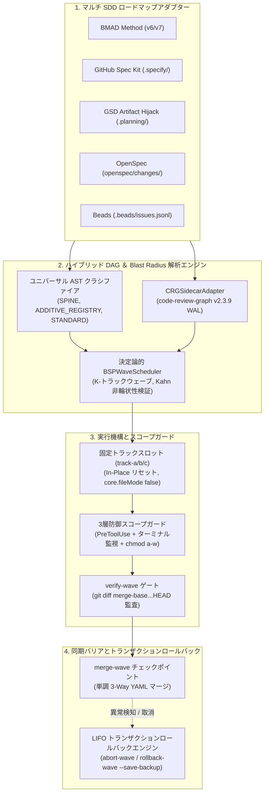

# ⚡ SDD-Parallel (`parallel-flow`)

[](https://github.com/stopActingSoSmall/sdd-parallel/actions/workflows/ci.yml)
[](https://pypi.org/project/sdd-parallel/)
[](https://www.python.org/)
[](../../../LICENSE)
[](#-5秒で試せるクイック体験apiキー不要クローン不要)

<p align="center">
  
</p>

<p align="center">
  <b>🌐 言語 / Language:</b>
  <a href="../../../README.md">English</a> |
  <a href="../zh-CN/README.md">简体中文</a> |
  <a href="../es/README.md">Español</a> |
  <a href="../pt-BR/README.md">Português (BR)</a> |
  <b>日本語</b> |
  <a href="../ko/README.md">한국어</a> |
  <a href="../ru/README.md">Русский</a>
</p>

> **ビルドや Git 履歴を壊すことなく、3〜4 体の AI コーディングエージェントを完全並行稼働。**  
> **BMAD**、**GitHub Spec Kit**、**GSD**、**OpenSpec**、**Beads** プロジェクトで動作する **Claude Code**、**OpenAI Codex**、**Google Antigravity** のための決定論的航空管制官、worktree 分離機構、および影響半径（Blast Radius）防護ネット。

---

## ⚡ なぜこれが必要なのか？（平易な解説）

10〜15 件の仕様書やユーザーストーリーがバックログに並んでいるとき、開発者は常に厳しい二者択一を迫られます：
1. **1体の AI エージェントを順次実行：** 安全ですが、完了までに **6〜8 時間** の待ち時間が発生します。
2. **3〜4体の AI エージェントを単純並行実行 (`git worktree`)：** 実装は瞬時に進みますが、統合時に壊滅的な **マージ爆弾（Merge-Bomb）** が炸裂します：
   - **直接的な Git コンフリクト：** 複数のエージェントが `sprint-status.yaml`、`STATE.md`、`cli.py` を同時に編集。
   - **目に見えないセマンティック破損（第2種衝突）：** エージェントAが `normalizer.py` 内の関数シグネチャを変更する一方、別 worktree のエージェントBが `api.py` から古いシグネチャを呼び出すコードを記述。**Git はコンフリクトマーカーを一切出さずにクリーンにマージし、直後に `main` ブランチが実行時クラッシュします。**
   - **スコープ逸脱（Scope Creep）：** エージェントが気を利かせて、割り当てられたタスク外の共有スキーマ (`schema.py`) を勝手に修正。

**`sdd-parallel` は、仕様駆動開発（SDD）のスペックと AI エージェントの間でコンパイラ級の航空交通管制を行います。** トークンを1つも消費する前に、コードベースの AST とコールグラフを静的解析し、互いに干渉しない安全なタスクを並行 **ウェーブ（Waves）** に編成。エージェントをクリーンな固定スロット (`track-a`, `track-b`) に隔離してスコープ外ファイルへの書き込みを物理ブロックし、ウェーブ完了後はゼロコンフリクトで自動マージします。

### 📊 比較：`sdd-parallel` の導入前後

| 評価項目 | ❌ 逐次実行 SDD（エージェント1体） | 💥 単純並行実行 (`--worktree`) | ✅ `sdd-parallel` 導入後 |
| :--- | :--- | :--- | :--- |
| **12ストーリーのスプリント時間** | 約 6〜8 時間（1件ずつ） | 約2時間実装 ＋ **2時間のマージ修復** | **合計 約2.5時間（2〜3倍の高速化）** |
| **潜在的な型・API の不整合** | ゆっくり実行することでしか防げない | **マージ後に `main` が破損** ($W_A \cap I_B$) | **事前計算で完全分離**（ウェーブ 1 → 2 へ振り分け） |
| **共有 CLI やルーティングファイル** | 1体ずつしか触れない | マージのたびに Git コンフリクト | **安全に並行開発可能** (`ADDITIVE_REGISTRY` 自動識別) |
| **`sprint-status.yaml` / `tasks.md`** | 逐次シリアル更新のみ | `<<<<<<<` マージコンフリクトが頻発 | **完全自動マージ**（単調3-Wayマージャー） |
| **エージェントによる他ファイル改変** | プロンプトで「触るな」と懇願するのみ | エージェントが `bash` / `sed` で規約を突破 | **OS＆フック階層で物理遮断** (`chmod a-w` + `PreToolUse`) |
| **worktree フォルダの散乱** | なし | 15個の `.worktrees/task-*` フォルダが放置 | **固定再利用スロット** (`track-a`, `track-b`, `track-c`) |

---

## 🚀 5秒で試せるクイック体験（APIキー不要・クローン不要）

API キーも LLM サブスクリプションも既存プロジェクトも不要です。[`uv`](https://docs.astral.sh/uv/)（または `pipx run sdd-parallel demo`）から次のコマンドを実行するだけで、潜在的セマンティック衝突の検知を体験できます：

```bash
uvx sdd-parallel demo
```

**ターミナル内でわずか 3.2 秒の間に起こること：**
1. 5つのストーリーと6つの Python モジュール（`schema.py`, `normalizer.py`, `api.py`, `exporter.py`, `cli.py`）から成る一時リポジトリを自動生成。
2. **隠れた罠の看破：** ストーリー `1-2` が `normalizer.py` を変更し、ストーリー `2-1` が同モジュールをインポートする `api.py` を変更。単純なファイルロックでは安全と誤認（`normalizer.py != api.py`）しますが、`sdd-parallel` はコールグラフ上の影響重複を検出し、**ウェーブ 1** と **ウェーブ 2** に自動分離。
3. **共有レジストリの安全な並行開発を許可：** `cli.py` を `ADDITIVE_REGISTRY` と判定し、ストーリー `1-2` と `1-3` の **ウェーブ 1**（`track-a` と `track-b`）での並行実行を許可。
4. **スコープガードと3-Wayマージの実証：** `schema.py` への不正書き込みをブロック（`DENY: Locked by Spine Chain invariant`）し、両並行ブランチを `コンフリクトマーカー 0 件` でクリーンマージ。

<details>
<summary><b>📺 クリックして <code>sdd-parallel demo</code> のターミナル出力を確認</b></summary>

```text
============================================================================
SDD-PARALLEL STANDALONE MERGE-BOMB DEMO (ZERO API KEYS / OFFLINE)
============================================================================
Workspace: /tmp/sdd-parallel-demo-xyz

[Step 1/4] AST & Architectural Role Classification
----------------------------------------------------------------------------
File Path                              | Detected Role          | Importers
----------------------------------------------------------------------------
src/demo_app/__init__.py               | additive_registry      | -
src/demo_app/api.py                    | standard               | -
src/demo_app/cli.py                    | additive_registry      | -
src/demo_app/exporter.py               | standard               | -
src/demo_app/normalizer.py             | standard               | src/demo_app/api.py
src/demo_app/schema.py                 | spine                  | -

[Step 2/4] Type-2 Semantic Merge-Bomb Detection & BSP Wave Schedule
----------------------------------------------------------------------------
  Collision Analysis:
    - Naive Scheduler : W(1-2)={normalizer.py, cli.py} vs W(2-1)={api.py}
                        -> DISJOINT WRITES (False Safe!)
    - BSPWaveScheduler: Detected semantic_collision between '1-2' and '2-1'
                        -> Overlap W(1-2) ^ I(2-1) on: src/demo_app/api.py
    - Additive Registry: Tasks '1-2' and '1-3' both touch 'src/demo_app/cli.py'
                        -> Role: ADDITIVE_REGISTRY (Parallel allowed in Wave 1)

  Wave Schedule:
    * Wave 1
        - track-a: Story 1-2 -> writes: src/demo_app/normalizer.py (+ shared: src/demo_app/cli.py)
        - track-b: Story 1-3 -> writes: src/demo_app/exporter.py (+ shared: src/demo_app/cli.py)
    * Wave 2
        - track-a: Story 1-1 -> writes: src/demo_app/schema.py
        - track-b: Story 2-1 -> writes: src/demo_app/api.py
    * Wave 3
        - track-a: Story 2-2 -> writes: src/demo_app/schema.py

[Step 3/4] Fixed-Slot Worktree Provisioning & PreToolUse Scope Guard
----------------------------------------------------------------------------
  Provisioned Fixed Slots (100% Clean git status: True):
    - track-a (.worktrees/track-a)
    - track-b (.worktrees/track-b)

  PreToolUse Scope Guard Check (track-a -> 'src/demo_app/schema.py'):
    - Decision : DENY
    - Violation: File 'src/demo_app/schema.py' cannot be modified by Wave 1 / track-a (stories ['1-2'])
    - Reason   : Locked by Spine Chain invariant.

[Step 4/4] Barrier Checkpoint & Monotonic 3-Way YAML Merge
----------------------------------------------------------------------------
  Merged Branches:
    - parallel/track-a
    - parallel/track-b

  Resolved sprint-status.yaml (0 conflict markers):
    - 1-2-normalize-telemetry-payload: done
    - 1-3-cli-batch-export: done
============================================================================
ALL 5 CORE INVARIANTS VERIFIED IN 3.21s
============================================================================
```
</details>

---

## 🗺️ ビジュアルで見る動作フロー（バックログからクリーンマージまで）

5体のエージェントを無差別にコードベースに投入して神頼みする代わりに、`sdd-parallel` はスプリントを決定論的な **ウェーブ（Waves）** へと構造化します：

```mermaid
flowchart LR
    subgraph Backlog["📋 1. SDD バックログ"]
        direction TB
        T12["Story 1-2\n(normalizer.py + cli.py)"]
        T13["Story 1-3\n(exporter.py + cli.py)"]
        T21["Story 2-1\n(api.py -> normalizer 呼出)"]
        T11["Story 1-1\n(schema.py - スパインロック)"]
    end

    subgraph Planner["🧠 2. sdd-parallel plan"]
        direction TB
        Scan["AST ＆ コールグラフ解析\n• cli.py = Additive (安全!)\n• 1-2 ↔ 2-1 = 影響衝突!\n• schema.py = スパインロック!"]
    end

    subgraph Wave1["🟢 3. ウェーブ 1 (並行 worktree)"]
        direction TB
        SlotA["📁 .worktrees/track-a\nエージェント1が Story 1-2 を実装\n🔒 schema.py ＆ api.py ロック中"]
        SlotB["📁 .worktrees/track-b\nエージェント2が Story 1-3 を実装\n🔒 schema.py ＆ normalizer.py ロック中"]
    end

    subgraph Gate["🛡️ 4. sdd-parallel merge --wave 1"]
        direction TB
        M1["✅ スコープ Diff 監査完了\n✅ pytest / mypy / ruff 合格\n✅ 3-Way 状態自動マージ"]
    end

    subgraph Wave2["🔵 5. ウェーブ 2 (同一スロットを再利用)"]
        direction TB
        SlotA2["📁 .worktrees/track-a\nエージェント1が Story 1-1 を実装"]
        SlotB2["📁 .worktrees/track-b\nエージェント2が Story 2-1 を実装\n(更新された normalizer.py を参照!)"]
    end

    Backlog --> Planner --> Wave1 --> Gate --> Wave2
```



---

## 🔌 既存スタックへのシームレスな統合（ベンダーロックインなし）

仕様書の書き換えやプロンプトの変更は **一切不要** です。`sdd-parallel` は既存フレームワークのファイルを読み取り専用モードで直接利用します：

| 使用ツール / 構成 | `sdd-parallel` がもたらすメリット |
| :--- | :--- |
| **Claude Code** (`claude`) | `--worktree` / `Agent Teams` 呼び出し前に決定論的ウェーブ計画を策定。`PreToolUse` によりスコープ外ファイルおよびシェル操作を遮断し、タスク複雑度 (`High`/`Medium`/`Low`) を自動ルーティング。 |
| **OpenAI Codex CLI** (`codex`) | 競合タスクを事前整列し、各スロット内の共有スキーマ (`chmod a-w`) をロックして並行 worktree 競合状態を防止。 |
| **Google Antigravity** | 固定スロット (`track-a`, `track-b`, `track-c`) を提供し、IDE のフォルダ喪失バグを解消。`.git/worktrees/*/info/exclude` により `git status --porcelain` を常に 100% クリーンに維持。 |
| **BMAD Method (`v6.3+` / `v7`)** | リニアな `sprint-status.yaml` キューをマルチエピック並行ウェーブに変換し、ストーリー状態 (`backlog -> done`) を YAML コンフリクトなしでマージ。 |
| **GitHub Spec Kit (`.specify/`)** | `tasks.md` 内の手動 `[P]` 並行タグをコードベースの実 AST 依存関係と照合し、誤った並行指定によるビルド破損を防止。 |
| **GSD / OpenSpec / Beads** | クリーンな worktree 環境で `.planning/STATE.md` (Artifact Hijack モード)、`openspec/changes/`、`.beads/issues.jsonl` を安全に分離運用。 |

---

## 🛠️ 4つのコマンドで完結するデイリーワークフロー

### 1. 一度だけインストール
```bash
# uv 経由を推奨（または: pipx install sdd-parallel）
uv tool install sdd-parallel
```
*(コマンド `sdd-parallel` および便利な短縮エイリアス `parallel-flow` がグローバルに利用可能になります)*。

### 2. 任意のプロジェクトで並行ウェーブを実行
```bash
# ステップ 1: SDD 仕様と AST 依存グラフを解析し安全なウェーブを生成
sdd-parallel plan

# ステップ 2: 固定スロット (.worktrees/track-a, track-b) にウェーブ 1 を準備し
#           エージェント向けの実行ガイドを出力
sdd-parallel prepare --wave 1
sdd-parallel run-guide --wave 1

# 👉 ステップ 3: AI エージェント（Claude Code / Codex / Antigravity）が
#              track-a と track-b 内でストーリーを同時並行で実装。

# ステップ 4: スコープ逸脱がないことを検証し、ウェーブ 1 を main へマージ
sdd-parallel verify-wave --wave 1
sdd-parallel merge --wave 1
```
ウェーブを取り消す必要がある場合：マージ前なら `sdd-parallel abort-wave --wave 1`、マージ後なら `sdd-parallel rollback-wave --wave 1`（安全バックアップブランチの自動作成と SDD ステータス復元）を実行。

---

## 🧩 対応SDDフレームワーク一覧

| SDD フレームワーク | 対応ステータス | 自動検出される読み取り専用成果物 | タスク状態同期方式 |
| :--- | :---: | :--- | :--- |
| **BMAD Method (`v6.3+` / `v7`)** | ✅ リリース済み | `sprint-status.yaml`, `epics.md`, `epic-*-context.md`, `spec-*.md` | 単調 3-Way YAML マージ |
| **GitHub Spec Kit (`.specify/`)** | ✅ リリース済み | `.specify/specs/*/tasks.md`, `constitution.md` | Markdown チェックボックス状態同期 |
| **GSD (Get Shit Done)** | ✅ リリース済み | `.planning/phases/*-PLAN.md`, `ROADMAP.md` | Artifact Hijack（`STATE.md` 中央集中更新） |
| **OpenSpec (`openspec/`)** | ✅ リリース済み | `openspec/changes/<id>/tasks.md` | 仕様駆動型タスクステータストラッキング |
| **Beads (`.beads/`)** | ✅ リリース済み | `.beads/issues.jsonl` | トポロジカル Issue ステータス更新 |

---

## 🔍 ディープダイブ技術資料（アーキテクチャ、不変条件、完全CLIリファレンス）

数学モデル、内部モジュールアーキテクチャ、または全 CLI オプションの仕様を確認したい場合は、以下の折りたたみセクションを展開するか、**[アーキテクチャ＆戦略白書 (docs/dossier/)](../../dossier/README.md)** を参照してください：

- 📖 **[01 — コアプロダクト概要と投資対効果（ROI）モデル](../../dossier/01_CORE_PRODUCT_BRIEF.md)** *(エグゼクティブサマリー、トークン FinOps、モデルエフォートルティング)*
- 🏛️ **[02 — システム機能と学術ホワイトペーパー](../../dossier/02_SYSTEM_CAPABILITIES_WHITE_PAPER.md)** *(第1種 vs 第2種衝突、3D ファイル分類学、CRG 減衰式)*
- 🔌 **[03 — 統合およびエコシステム仕様書](../../dossier/03_INTEGRATION_AND_ECOSYSTEM_SPEC.md)** *(中間表現 `CanonicalTask`、`.tmp/track-context.md`、`.parallel-lock.json`)*
- 🧪 **[07 — スタンドアロンデモと対話型 E2E ウォークスルー](../../dossier/07_STANDALONE_DEMO_AND_E2E_WALKTHROUGH.md)** *(ファイルシステムスナップショットと `--keep-temp` サンドボックス)*
- 📐 **[システムアーキテクチャ SSOT (`ARCHITECTURE.md`)](ARCHITECTURE.md)** | **[ロシア語版資料](../../i18n/ru/dossier/)**

<details>
<summary><b>🏛️ クリックして展開：内部エンジン構造と 9 大エンジニアリング不変条件</b></summary>

### 内部コンポーネントデータフロー



### 9 大エンジニアリング不変条件

1. **ワークツリー無汚染原則 (Zero Worktree Pollution)：** 注入される一時ファイル (`.tmp/track-context.md`, `.parallel-lock.json`, `ACTIVE_TRACK.md`) は `info/exclude` でマスクされ、`git status --porcelain` は常に 100% クリーン。
2. **キャッシュ無破壊原則 (Zero Cache Invalidation)：** `_bmad-output/planning-artifacts/` 内のコンテキストは読み取り専用。スケジューラ状態は `_bmad-output/parallel-artifacts/` に隔離出力。
3. **100% タスク網羅率と非巡回性の保証：** Kahn/Tarjan アルゴリズムに基づくトポロジカル検証により、ストーリー脱落と循環依存を完全排除。
4. **影響半径の厳格分離（第1種および第2種）：** 互いに素な書き込み集合 ($W_A \cap W_B = \emptyset$) と互いに素なセマンティック影響 ($W_A \cap I_B = \emptyset$) を数学的に保証。
5. **普遍的汎用性（不変条件 7）：** コアエンジン内にドメイン固有のパスやビジネス概念を一切ハードコードせず、AST ヒューリスティクスとグラフ中心性のみで分類。
6. **固定スロットによる省リソース運用 ($O(1)$ フットプリント)：** `git checkout -B` と `git clean -fd` により `track-a`、`track-b`、`track-c` を原地再利用。
7. **3層縦深防御システム：** `PreToolUse` フック ＋ コマンドインターセプト (`Bash`, `run_command`) ＋ OS レベルの `chmod a-w` 物理ロック。
8. **単調半束ステータス調停：** タスク状態は半束トポロジーにおいて単調に収束（$\texttt{backlog} (0) < \dots < \texttt{done} (4)$）し、マージ競合を根絶。
9. **LIFO 順トランザクションロールバック：** マージされたウェーブを後入れ先出しで厳格に巻き戻し、安全バックアップブランチ (`backup/wave-<K>-before-rollback-*`) を自動保持。

</details>

<details>
<summary><b>🛠️ クリックして展開：完全 CLI コマンドリファレンス（全13サブコマンドとオプション）</b></summary>

| コマンド | 用途 |
| :--- | :--- |
| `sdd-parallel demo [--kit {bmad,spec-kit,gsd,openspec,beads,all}] [--keep-temp] [--scaffold-only] [--output-dir DIR]` | オフラインのマージボム防止デモを実行、または 5 種類の SDD キットで対話型サンドボックスを生成。 |
| `sdd-parallel plan [--repo REPO] [--max-tracks N] [--kit auto] [--include-done] [--dry-run] [--plan-source {auto,plan,specs}] [--output-dir DIR]` | ロードマップと依存関係グラフを解析し、`execution-plan-parallel.md` および `wave-plan.json` を生成。 |
| `sdd-parallel prepare --wave K [--repo REPO] [--max-tracks N] [--kit KIT] [--headless] [--antigravity-layout] [--dynamic-worktrees] [--dry-run]` | 固定スロット (`track-a`, `track-b`) を準備し、OS ロックと境界ファイルを注入。 |
| `sdd-parallel claim-track --wave K --track <id> --worktree <path> [--repo REPO] [--max-tracks N] [--kit KIT] [--headless]` | 既存の外部 worktree スロットに境界ロックとコンテキストをバインド。 |
| `sdd-parallel run-guide --wave K [--repo REPO] [--max-tracks N] [--kit KIT] [--antigravity-layout]` | 各アクティブトラックのターミナル向けに専用起動コマンドマトリクスを表示。 |
| `sdd-parallel verify-wave --wave K [--repo REPO] [--max-tracks N] [--kit KIT] [--dynamic-worktrees]` | `.parallel-lock.json` および `merge-base` に対するコミット差分を検証。 |
| `sdd-parallel merge --wave K [--repo REPO] [--max-tracks N] [--kit KIT] [--dynamic-worktrees] [--skip-gates] [--strict-gates] [--cleanup] [--dry-run]` | チェックポイントマージ：3-Way 状態マージ、Git マージ、品質ゲート監査、障害時自動ロールバック。 |
| `sdd-parallel abort-wave --wave K [--repo REPO] [--dynamic-worktrees]` | 未マージのウェーブを中止：スロットをリセットし一時ブランチを削除。 |
| `sdd-parallel rollback-wave --wave K [--repo REPO] [--dynamic-worktrees] [--to-commit COMMIT] [--save-backup] [--no-backup] [--kit KIT]` | マージ済みウェーブを LIFO 順で取り消し、バックアップブランチの作成とタスク状態を復元。 |
| `sdd-parallel merge-status --base B --ours O --theirs T --out OUT` | `sprint-status.yaml` のための低レベル決定論的 3-Way マージツール。 |
| `sdd-parallel check-lock --file PATH [--tool TOOL]` | アクティブなロックマニフェストに基づきファイルの書き込み権限を判定。 |
| `sdd-parallel install-plugin [--target-dir DIR]` | Google Antigravity 向けネイティブプラグインをパッケージングしてインストール。 |
| `sdd-parallel autopilot --wave K [--repo REPO] [--max-tracks N] [--kit KIT] [--harness <tool>] [--antigravity-layout] [--execute]` | モデルエフォートルティングを備えたマルチ対話自動操縦コマンドを生成または実行。 |

</details>

<details>
<summary><b>🧪 クリックして展開：ローカル開発環境と自動品質ゲート</b></summary>

### 必須要件
- **Python:** `>= 3.11` (Python 3.11, 3.12, 3.13)
- **Git:** `>= 2.30` (最新の `git worktree` 分離および `info/exclude` フィルタに必要)
- **パッケージマネージャー:** [`uv`](https://docs.astral.sh/uv/) (推奨) または `pipx`

```bash
git clone https://github.com/stopActingSoSmall/sdd-parallel.git
cd sdd-parallel
uv sync

# 99+ 件の自動単体・統合テストを実行
uv run pytest

# 厳格な静的型チェックを実行
uv run mypy --strict src/sdd_parallel

# リンターおよびスタイル監査を実行
uv run ruff check src/ tests/ scripts/

# スタンドアロンオフライン検証デモを実行
uv run sdd-parallel demo
```

</details>

---

## 🚢 リリースマトリクス：出荷済み（v0.1.0）vs ロードマップ（v0.2+）

### ✅ `v0.1.0` 実装完了機能（本番運用対応）
- Kahn 非巡回検証を備えた決定論的 Bulk-Synchronous Parallel (BSP) ウェーブスケジューラ。
- AST ホットスポットスキャナーおよび `code-review-graph v2.3.9` サイドカー統合。
- 原地リセット機能を備えた固定スロットアーキテクチャ (`track-a`, `track-b`, `track-c`)。
- 3層縦深防御システム (`PreToolUse` + ターミナル監視 + OS `chmod a-w`)。
- コメントとフォーマットを完全保持する単調 3-Way YAML マージャー。
- 安全バックアップブランチを自動生成する LIFO トランザクションロールバックエンジン。
- 2段階協調実行標準（Two-Stage Assisted, Interactive IDE Slots, `Depth 0`）。
- 5大 SDD アダプター（BMAD, Spec Kit, GSD Artifact Hijack, OpenSpec, Beads）。
- API キー不要のオフラインデモ (`sdd-parallel demo`) および GitHub Actions CI スイート。
- 99件の自動テスト、`mypy --strict`、`ruff` 品質ゲート。

### 🚧 `v0.2.0+` ロードマップ
- **コミュニティアダプターエコシステム：** `mattpocock/skills` (`/implement-spec`) および `bmad-loop` v0.8+ frontmatter アダプターのサポート。
- **ワークスペース汚染防止環境同期：** `.venv` と `node_modules` を固定スロットへシンボリックリンクする `workz` パターン。
- **ウェーブ前静的シンボルリンカーと動的スコープ拡張：** AST シンボル解析による書き込みセット自動拡張とリアルタイム再スケジューリング。
- **FinOps コストおよびオブザーバビリティ出力：** OpenTelemetry スパンおよび Langfuse トークン節約テレメトリ。
- **バックグラウンド自律実行デーモン：** ローカル RPC / サブエージェントディスパッチによる完全ヘッドレス運用。

---

## 🤝 コントリビューションとセキュリティ

- **貢献について：** 開発環境のセットアップやプルリクエストの基準については **[コントリビューションガイド](../../../CONTRIBUTING.md)** をご覧ください。
- **セキュリティ報告：** 脆弱性の報告手順は **[セキュリティポリシー](../../../SECURITY.md)** に記載されています。

## 📜 ライセンス

MIT ライセンスの下で公開されています。詳細は [LICENSE](../../../LICENSE) を参照してください。
