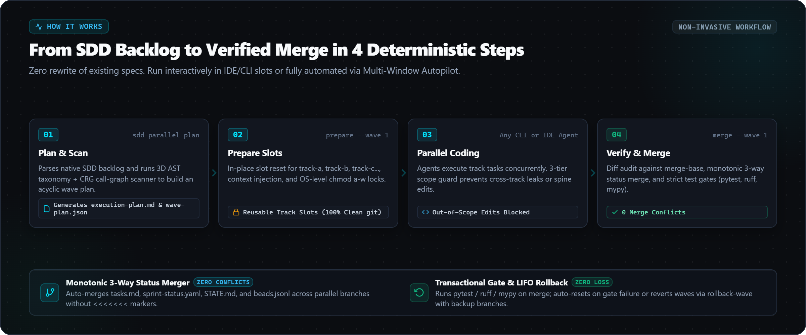
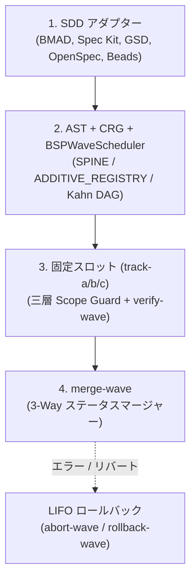

<p align="center">
  
</p>

<p align="center">
  <a href="https://github.com/stopActingSoSmall/sdd-parallel/actions/workflows/ci.yml"></a>
  <a href="https://pypi.org/project/sdd-parallel/"></a>
  <a href="https://www.python.org/"></a>
  <a href="../../../LICENSE"></a>
  <a href="#-5-秒で体験api-キー不要注釈付きウォークスルー"></a>
  <br>
  <a href="#-既存の開発環境にそのまま適合ベンダーロックインなし"></a>
  <a href="#-実際の-sdd-プロジェクト構造導入前後の比較"></a>
</p>

<p align="center">
  <b>🌐 Language:</b>
  <a href="../../../README.md">English</a> |
  <a href="../es/README.md">Español</a> |
  <a href="../pt-BR/README.md">Português (BR)</a> |
  <b>日本語</b> |
  <a href="../ko/README.md">한국어</a> |
  <a href="../zh-CN/README.md">简体中文</a> |
  <a href="../ru/README.md">Русский</a>
</p>

<p align="center">
  <a href="#-5-秒で体験api-キー不要注釈付きウォークスルー">クイックデモ</a> ·
  <a href="#-なぜこれが必要なのか平易な解説">なぜ必要か</a> ·
  <a href="#%EF%B8%8F-動作の仕組みと日常の-4-ステップ運用">動作の仕組み</a> ·
  <a href="#-実際の-sdd-プロジェクト構造導入前後の比較">プロジェクト構造</a> ·
  <a href="#-既存の開発環境にそのまま適合ベンダーロックインなし">ハーネス連携</a> ·
  <a href="../../USER_GUIDE.md">User Guide (EN)</a> ·
  <a href="#%EF%B8%8F-完全-cli-コマンドリファレンス">CLI</a> ·
  <a href="#-アーキテクチャ数学モデル技術ドシエの詳細">詳細ドシエ</a>
</p>

> **並行 AI コーディングエージェント向け決定論的ウェーブスケジューラ＆隔離 worktree サンドボックス — LLM トークン消費前に静かなマージボムを防止。**  
> `sdd-parallel` は **Spec Kit / BMAD / GSD / OpenSpec / Beads** のバックログと **Claude Code / Codex / Antigravity** 等の worktree CLI の間に配置します。

https://github.com/stopActingSoSmall/sdd-parallel/releases/download/v0.1.0/sdd-parallel-explainer-ja.mp4

<p align="center"><em>🎬 <b>1080p 解説動画</b> — 上部の <b>🌐 Language</b> から 7 言語版を選択可能。</em></p>

今すぐ試す：**[⚡ Live Wave Inspector](https://stopactingsosmall.github.io/sdd-parallel/?video=ja)**（ブラウザデモ） · **[📘 User Guide & Day-1 ランブック (EN)](../../USER_GUIDE.md)**。

---

## ⚡ なぜこれが必要なのか？（平易な解説）

<p align="center">
  
</p>

10〜15 件の仕様を抱える場合、従来手段はどちらも難点があります：
1. **1 エージェント逐次実行** — 安全だが **6〜8 時間** 待機。
2. **素朴な `git worktree` に 3〜4 エージェント** — 高速だが統合時に破綻：
   - **第 1 種（直接衝突）：** `sprint-status.yaml`、`STATE.md`、`cli.py` の同時編集 → `<<<<<<<` 衝突。
   - **第 2 種（潜在衝突）：** A が `normalizer.py` のシグネチャを変え、B が `api.py` から旧形式を呼ぶ。**Git は正常マージし、`main` が破損。**
   - **スコープ逸脱：** 共有 `schema.py` をタスク外で書き換える。

**`sdd-parallel` はトークン消費前に解決：** AST＋コールグラフから安全な **Wave** を組み、固定スロット（`track-a/b/c`）に隔離してスコープ外編集を遮断、品質ゲート越しに統合します。

| 事象 | ❌ 逐次実行 | 💥 素朴な `--worktree` | ✅ `sdd-parallel` |
| :--- | :--- | :--- | :--- |
| **12 ストーリー** | 約 6〜8 時間 | 実装 2h ＋ **修正 2h** | **合計約 2.5h（2〜3 倍高速）** |
| **潜在 API 衝突** | 低速で回避 | **`main` 破損** ($W_A \cap I_B \neq \emptyset$) | **事前防止** (Wave 1 → 2) |
| **共有 CLI/ルーター** | 直列実行 | マージ毎に衝突 | **Git 3-Way マージによる並行実行**（`ADDITIVE_REGISTRY`、非重複挿入） |
| **ステータスファイル** | 直列更新 | `<<<<<<<` 頻発 | **単調 3-Way マージ** (衝突 0) |
| **スコープ外編集** | プロンプト警告 | `bash`/`sed` で迂回 | **遮断** (`PreToolUse` + Terminal Guard + `chmod a-w`) |
| **Worktree 散乱** | なし | `task-*` が 15 個残留 | **固定再利用スロット** (`track-a/b/c`) |

*表記: $W$ = 変更ファイル（Write set）、$I$ = インポート/依存ファイル（Impact radius）。*

---

## 🚀 5 秒で体験（API キー不要・注釈付きウォークスルー）

API キー・LLM 契約・クローン不要。[`uv`](https://docs.astral.sh/uv/)（または `pipx run sdd-parallel demo`）で実行：

```bash
uvx sdd-parallel demo --kit all   # 単一キット: uvx sdd-parallel demo --kit spec-kit
```

使い捨て Git リポ（5 タスク・6 モジュール）を生成し、AST 解析・Scope Guard `DENY`・衝突 0 の 3-Way ステータスマージを実行します（`--kit all` 指定時は 1 キットあたり約 `~6–9s`、サンドボックス内は `run_quality_gates=False`）：

```text
================================================================
5/5 SDD KITS VERIFIED (BMAD, SPEC KIT, GSD, OPENSPEC, BEADS)
================================================================
Kit      | Merge-Bomb | Worktrees | Scope Guard | 3-Way Merge
----------------------------------------------------------------
bmad     | PASSED     | PASSED    | PASSED      | PASSED
spec-kit | PASSED     | PASSED    | PASSED      | PASSED
gsd      | PASSED     | PASSED    | PASSED      | PASSED
openspec | PASSED     | PASSED    | PASSED      | PASSED
beads    | PASSED     | PASSED    | PASSED      | PASSED
================================================================
```

<details>
<summary><b>🔍 展開：4 ステップ詳細（<code>--kit spec-kit</code>）＆ サンドボックス</b></summary>

1. **`[Step 1/4]` AST ロール:** `schema.py` → `spine`（直列化）; `cli.py` → `additive_registry`（追記共有可）; `api.py` は `normalizer.py` を import。
2. **`[Step 2/4]` 第 2 種マージボム検知:** `T002`（`normalizer.py`）と `T004`（`api.py`）は両方 `[P]` 付きだが、`BSPWaveScheduler` が $W(\text{T002}) \cap I(\text{T004}) \neq \emptyset$ を検知し `T004` を **Wave 2** へ分離。`T002` + `T003` は **Wave 1** で `cli.py` を共有：
```text
Wave 1: [track-a: T002] [track-b: T003]  (normalizer.py + exporter.py + cli.py)
Wave 2: [track-a: T001] [track-b: T004]  (Wave 1 の normalizer 反映後)
Wave 3: [track-a: T005]                  (schema バリア)
```
3. **`[Step 3/4]` クリーンなスロット ＆ Guard:** 境界ファイル（`ACTIVE_TRACK.md`, `.parallel-lock.json`, `.tmp/track-context.md`）は `info/exclude` で隠蔽（`Clean git status: True`）。`track-a` の `schema.py` 編集は即 `DENY`。
4. **`[Step 4/4]` 3-Way マージ ＆ サンドボックス:** 単調マージ（`[ ] < [x]`）で `tasks.md` を衝突 0 で統合。詳細：[Dossier 07](07_STANDALONE_DEMO_AND_E2E_WALKTHROUGH.md)。手動サンドボックス：
```bash
uvx sdd-parallel demo --kit gsd --scaffold-only --output-dir ./sdd-sandbox
cd sdd-sandbox && sdd-parallel plan && sdd-parallel prepare --wave 1
```

</details>

---

## 🗺️ 動作の仕組みと日常の 4 ステップ運用

<p align="center">
  
</p>

`sdd-parallel` は **Bulk Synchronous Parallel（BSP）** に従い、隔離トラックを相互編集なしで実行し、品質ゲートバリアで同期します。

**1. 導入**（`Python >= 3.11`, `Git >= 2.30`）：`uv tool install sdd-parallel`（`pipx install sdd-parallel` も可、`sdd-parallel` と `parallel-flow` を登録）。

**2. ウェーブ実行：**

```bash
sdd-parallel plan                  # 1. 仕様＋AST 解析でウェーブ生成
sdd-parallel prepare --wave 1      # 2. スロット確保＋ロック注入
sdd-parallel run-guide --wave 1    #    各スロットの起動コマンド表示
# 3. .worktrees/track-a, track-b, ... でエージェント実行
sdd-parallel verify-wave --wave 1  # 4. .parallel-lock.json と diff 監査
sdd-parallel merge --wave 1        #    品質ゲート＋3-Way マージ
```

**取消 ＆ 可視化：** `abort-wave --wave 1` · `rollback-wave --wave 1 --save-backup`（LIFO＋退避ブランチ） · `inspect --open`（`assets/inspector.html`）。

- **Mode A — 対話型アシスト：** `plan` → `inspect --open` → **CLI Action Bridge** から `prepare` / `merge` をコピーし `.worktrees/track-{a,b}` を監視。
- **Mode B — 巡回 Autopilot：** `sdd-parallel autopilot --wave 1 --harness {antigravity,claude-code,codex} --execute --policy {single-shot,cyclic} [--max-review-rounds N] [--routing-file FILE]`。

👉 **[`docs/USER_GUIDE.md` (Wave Inspector & モード)](../../USER_GUIDE.md#3-interactive-wave-inspector--orchestration-modes-mode-a-vs-mode-b)** · **[Day-1 復旧ランブック](../../USER_GUIDE.md#4-day-1-troubleshooting--recovery-runbook)**。

---

## 📂 実際の SDD プロジェクト構造（導入前後の比較）

<p align="center">
  
</p>

読み取り専用の **腐敗防止層（Anti-Corruption Layer, ACL）** アダプターが仕様を変更せず 5 形式を正規化します：

| SDD フレームワーク | 読み取り専用（ロック対象） | タスク検出 | ステータス同期 |
| :--- | :--- | :--- | :--- |
| **Spec Kit** (`.specify/`) | `constitution.md`, `feature.json`, `spec.md`, `plan.md` | `specs/*/tasks.md` (`T001 [P]`) | 3-Way Markdown |
| **BMAD** (`v6.3+/v7`) | `epic-*-context.md` (キャッシュ非破壊) | `sprint-status.yaml`, `epics.md`, `spec-*.md` | 3-Way YAML |
| **GSD** (`.planning/`) | `PROJECT.md`, `REQUIREMENTS.md`, `ROADMAP.md`, `STATE.md` | `phases/*/NN-NN-PLAN.md` | 中央 `STATE.md` 更新 |
| **OpenSpec** (`openspec/`) | `openspec/specs/**`, `project.md`, `config.yaml`, 兄弟変更 | `openspec/changes/<slug>/tasks.md` | 3-Way Markdown |
| **Beads** (`.beads/`) | `.beads/config.yaml` | `.beads/*.jsonl` (`bd-101` + `blocks`) | 行単位 3-Way JSONL |

<details>
<summary><b>🌱 例：GitHub Spec Kit (<code>.specify/</code> &amp; <code>specs/*/tasks.md</code>) — <code>plan</code> + <code>prepare --wave 1</code> 実行後</b></summary>

```text
my-project/
├── .parallel/{artifacts/wave-plan.json, history/, state.json}
├── .specify/…                         # 未変更
├── .worktrees/
│   ├── track-a/                       # Wave 1 → T002
│   │   ├── .specify/memory/constitution.md    # 🔒 読み取り専用
│   │   ├── specs/001-telemetry/{plan,spec}.md # 🔒 読み取り専用
│   │   ├── specs/001-telemetry/tasks.md       # ✍️ 書き込み可
│   │   ├── .tmp/track-context.md      # 👻 非表示 (info/exclude)
│   │   ├── .parallel-lock.json        # 👻 非表示 (info/exclude)
│   │   └── ACTIVE_TRACK.md            # 👻 → /speckit.implement T002
│   └── track-b/                       # Wave 1 → T003
└── specs/… & src/…                    # main では未変更
```

</details>

凡例：🔒 読み取り専用（`chmod a-w` + `PreToolUse` 拒絶） · 👻 非表示（`info/exclude`） · ✍️ 書き込みスコープ。  
👉 全 5 種（**Spec Kit, BMAD, GSD, OpenSpec, Beads, Custom SDD**）の導入前後ツリー：**[`docs/USER_GUIDE.md` §2](../../USER_GUIDE.md#2-sdd-project-layouts-before--after-all-5-frameworks)**。

---

## 🔌 既存の開発環境にそのまま適合（ベンダーロックインなし）

`sdd-parallel run-guide --wave 1` がスロット別のネイティブコマンドを表示（`ACTIVE_TRACK.md` に記録）：

| SDD キット | トラック別コマンド |
| :--- | :--- |
| GitHub Spec Kit | `/speckit.implement T002` |
| BMAD Method | `/bmad-build 1-2` |
| GSD | `/gsd-execute-phase 01-02` |
| OpenSpec | `/openspec-apply normalize-telemetry` |
| Beads | `bd update bd-102 --status in-progress` |

> 📦 **Spec Kit Extension (`extension.yml`):** `specify extension add --from https://github.com/stopActingSoSmall/sdd-parallel/archive/refs/tags/v0.2.2.zip`（または `specify extension add sdd-parallel`）で `/specify plan-waves`、`/specify prepare-wave --wave 1`、`/specify merge-wave --wave 1` を追加。

| ハーネス | 接続方法 |
| :--- | :--- |
| **Claude Code** (`claude`) | `.worktrees/track-a` で `claude` 起動（`blockWritesOutsideWorkingDirectories` + `PreToolUse` + `chmod a-w`）、または `autopilot --wave 1 --harness claude-code`。 |
| **Codex CLI** (`codex`) | `codex --cd .worktrees/track-b`。`chmod a-w` で保護、`verify-wave` で diff 監査。Autopilot：`--harness codex`。 |
| **Google Antigravity** (`agy`) | `prepare --wave 1 --antigravity-layout` で `~/.gemini/antigravity/worktrees/<Project>/track-a` に配置、`install-plugin` でフック導入。 |
| **Cursor, Windsurf, OpenCode, Kimi, Aider, Cline, Trae** | 追加設定不要で `.worktrees/track-{a,b,c}`、`chmod a-w`、`ACTIVE_TRACK.md`、外部 worktree 用 `claim-track`、`verify-wave` が利用可。 |

👉 接続レシピ（`local` `.worktrees/` vs `--antigravity-layout`, `claim-track`, MCP）：**[`docs/USER_GUIDE.md` §1](../../USER_GUIDE.md#1-harness-connection-recipes-local-slots-vs-antigravity-layout)**。

---

## 🔍 アーキテクチャ、数学モデル、技術ドシエの詳細

- 📘 **[User Guide & Day-1 ランブック (`docs/USER_GUIDE.md`)](../../USER_GUIDE.md)**: ハーネス設定、5 種ツリー、Wave Inspector、復旧手順
- 📖 **[01 — 概要](../../dossier/01_CORE_PRODUCT_BRIEF.md)** · **[02 — ホワイトペーパー](../../dossier/02_SYSTEM_CAPABILITIES_WHITE_PAPER.md)** · **[03 — 統合仕様](../../dossier/03_INTEGRATION_AND_ECOSYSTEM_SPEC.md)**
- 📊 **[04 — 競合分類](../../dossier/04_COMPETITIVE_AND_BENCHMARK_TAXONOMY.md)** · **[07 — E2E デモ](07_STANDALONE_DEMO_AND_E2E_WALKTHROUGH.md)** · **[アーキテクチャ SSOT](ARCHITECTURE.md)** · **[ドシエ目次](../../dossier/README.md)** · **[RU 版](../ru/dossier/)**

<details>
<summary><b>❓ 技術的質問と誠実な限界 (FAQ)</b></summary>

1. **コードを書く前に、プランナーはどうやって `write_files` を知るのですか？**
   3 段階の保護レイヤーがあります：**(a)** 仕様内で明示されたパス（`Code Map`、`Files:`、GSD XML `<files>`、バッククォート表記） → **(b)** 言及された関数名・クラス名を $O(1)$ でファイルへ解決する Pre-Wave AST シンボルリンカー → **(c)** 動的スコープエスカレーション（`.tmp/scope-escalation.json`）：`PreToolUse` が拒否された範囲外編集を記録し、`verify-wave` が該当タスクを Wave $K+1$ へ繰り越し（空になったスロットをリセットして `.parallel/wave-plan.json` を更新）、`merge` が更新済みプランに基づいて統合を実行します。
2. **TypeScript、Go、Rust など非 Python リポジトリはどうなりますか？**
   誠実な限界：依存ゼロの組み込み AST スキャナがネイティブ解析するのは Python です。多言語リポジトリ（TS/JS、Go、Rust）では、仕様内の明示ファイルリストとオプションの Tree-sitter サイドカー **`code-review-graph`**（`CRGSidecarAdapter`）を組み合わせ、ファイル間の import および影響エッジを計算します。
3. **エージェントはシェル（`sed -i`、`python -c`、`cp`）経由で `PreToolUse` フックを迂回できませんか？**
   強制力は単一フックに依存しません — **3 層縦深防御（3-Tier Defense-in-Depth）**です：**Tier 1**（`PreToolUse` + `Bash`/`run_command`/`powershell` のリダイレクトやインライン書き込みを検査する Terminal Guard） → **Tier 2**（Spine および兄弟トラック所有ファイルへの OS レベル `chmod a-w`） → **Tier 3**（実際の `git diff merge-base...HEAD` を監査し、違反があればマージを遮断する `verify-wave`）。
4. **AST はレイヤー横断コントラクト（Pydantic JSON → TS フロントエンド、SQL FK、OpenAPI）を見抜けないはずです！**
   その通りです — 静的 import グラフは構文境界で止まります。`sdd-parallel` は **`DEFAULT_CONTRACT_GLOBS`**（`**/schemas/**`、`**/migrations/**`、`openapi.*`、`*.proto`、`*.graphql`）と `.parallel-config.json` のプロジェクト固有 `file_roles` によって宣言的にこのギャップを埋め、レイヤー横断コントラクトを厳格な `SPINE` 直列化へ強制します。

</details>

<details>
<summary><b>🏛️ 内部エンジンアーキテクチャと 9 つのコア不変条件</b></summary>



1. **Worktree 無汚染:** 境界ファイルを `info/exclude` で隠し、`git status --porcelain` を空に維持。
2. **キャッシュ非破壊:** 事前コンパイル済みコンテキストは読み取り専用、状態は `.parallel/` に分離。
3. **100% 網羅と非巡回性:** Kahn 検査でタスク脱落・循環をゼロに保証。
4. **影響半径の隔離:** 書き込み素集合（$W_A \cap W_B = \emptyset$）と意味的影響分離（$W_A \cap I_B = \emptyset$）。
5. **汎用非過学習:** `SPINE` / `ADDITIVE_REGISTRY` / `STANDARD` は AST と中心性から自動導出。
6. **固定スロット:** `track-a/b/c` をその場リセット（`git checkout -B` + `git clean -fd`）で再利用。
7. **三層防御ガード:** `PreToolUse` + Terminal Guard（`Bash`, `run_command`）+ OS `chmod a-w`。
8. **単調ステータス半束:** $\texttt{backlog}(0) < \dots < \texttt{done}(4)$ で衝突マーカー 0。
9. **LIFO ロールバック:** 逆順リバート＋`backup/wave-<K>-before-rollback-*` ブランチ生成。

</details>

---

## 🛠️ 完全 CLI コマンドリファレンス

<details>
<summary><b>クリックして展開：全 16 サブコマンドとフラグ</b></summary>

共通フラグ：`--repo REPO`, `--max-tracks N`, `--kit KIT`, `--routing-file FILE`, `--dry-run`, `--dynamic-worktrees`.

| コマンド | 専用フラグと用途 |
| :--- | :--- |
| `sdd-parallel demo` | `[--kit {...,all}] [--keep-temp] [--scaffold-only] [--output-dir DIR]` — オフラインデモ / サンドボックス生成。 |
| `sdd-parallel plan` | `[--include-done] [--plan-source {auto,plan,specs}] [--output-dir DIR]` — `wave-plan.json` を生成。 |
| `sdd-parallel prepare --wave K` | `[--headless] [--antigravity-layout]` — スロット確保、OS ロック、境界ファイル注入。 |
| `sdd-parallel claim-track --wave K` | `--track <id> --worktree <path> [--headless]` — 既存 worktree へロックを適用。 |
| `sdd-parallel run-guide --wave K` | `[--antigravity-layout]` — スロット別の起動コマンドを表示。 |
| `sdd-parallel verify-wave --wave K` | `.parallel-lock.json`、`merge-base` diff、およびスコープエスカレーションに対してスロットを監査。 |
| `sdd-parallel merge --wave K` | `[--skip-gates] [--strict-gates] [--partial-merge] [--cleanup]` — ゲート検証、3-Way マージ、競合またはゲートエラー時のアトミックロールバック。 |
| `sdd-parallel abort-wave --wave K` | 固定スロットをその場で `HEAD` にリセット（または `--dynamic-worktrees` でブランチ削除）。 |
| `sdd-parallel rollback-wave --wave K` | `[--to-commit COMMIT] [--save-backup\|--no-backup]` — LIFO リバート＋退避ブランチ＋状態復元。 |
| `sdd-parallel merge-status` | `--base B --ours O --theirs T --out OUT` — `sprint-status.yaml` 用 3-Way マージ。 |
| `sdd-parallel check-lock` | `--file PATH [--tool TOOL]` — ロックマニフェストに対する書き込み可否判定。 |
| `sdd-parallel install-plugin` | `[--target-dir DIR]` — ポータブル Antigravity プラグイン導入。 |
| `sdd-parallel init-custom` | `[--specs-dir DIR] [--format {markdown,yaml}] [--test-cmd CMD] [--non-interactive]` — `.parallel/custom-kit.yaml` を初期化。 |
| `sdd-parallel autopilot --wave K` | `[--harness {antigravity,claude-code,codex}] [--antigravity-layout] [--execute] [--policy {single-shot,cyclic}] [--max-review-rounds N]` — トラック自動起動。 |
| `sdd-parallel bench` | `[--since REV] [--until REV] [--demo] [--format {text,json}] [--output-file FILE]` — 静的モデルに対するマージボム遡及ベンチマーク。 |
| `sdd-parallel inspect` | `[--plan PATH] [--output PATH] [--open]` — HTML Wave Inspector を開く。 |

</details>

---

## 🚢 リリースマトリクス：実装済み (v0.2.2) vs ロードマップ (v0.3+)

### ✅ `v0.1.0 – v0.2.2` で実装済み
- [x] BSP スケジューラ（Kahn 非巡回性）+ AST スキャナ + `code-review-graph v2.3.9` サイドカー。
- [x] **8クラス衝突防御 (A–H):** `extract_spine_bucket()` (C), `NAMESPACE_COLLISION` (D), `ast_diff_gate.py` (A/B/F/G/H), および `merge --partial-merge` 原因二分探索と `.parallel/barrier-feedback-<story_id>.json`。
- [x] 固定スロット（`track-a/b/c`）、その場リセット、`info/exclude` 不可視化、`.venv`/`node_modules` の NTFS Junctions (Windows, no admin) / POSIX symlinks。
- [x] 三層 Scope Guard（`PreToolUse` + Terminal Guard + `chmod a-w`）、シンボルリンカー、`.tmp/scope-escalation.json`。
- [x] 単調 3-Way ステータスマージャー（YAML, Markdown, `STATE.md`, JSONL）+ LIFO ロールバック。
- [x] 5 SDD アダプター（Spec Kit + `extension.yml`, BMAD + `mattpocock/skills` + `bmad-loop`, GSD, OpenSpec, Beads）。
- [x] オフライン `demo --kit all`、`bench` バックテスト、HTML Wave Inspector（`inspect --open`）、`--scaffold-only`。
- [x] マルチウィンドウ＆Depth-0 オートパイロット（`agy`, Claude Code, Codex）— `--routing-file`, `TaskStructuralSignals`, `--policy cyclic` (`ADR-0009`)。
- [x] クリーンクローン CI（Ubuntu/macOS/Windows, Python 3.11–3.13）＆ PyPI Trusted Publishing。

### 🚧 `v0.3+` ロードマップ
- [ ] 厳格なキット自動検出（サイレントフォールバック廃止、TTY 曖昧性解消）
- [ ] ネイティブ多言語 Tree-sitter AST＆自動 CRG インデックス化（TS/JS, Go, Rust）
- [ ] オプション System-1 事前抽出器（`--extractor none|gliner|clairic`）＆適応型 `--max-tracks auto`

---

## 🤝 お問い合わせ・コラボレーション

- **研究、助成金、個別相談:** [sdd-parallel@metrichub.dev](mailto:sdd-parallel@metrichub.dev)
- **アーキテクチャ Q&A ＆ コミュニティ:** [GitHub Discussions](https://github.com/stopActingSoSmall/sdd-parallel/discussions)
- **セキュリティ報告:** [SECURITY.md](../../../SECURITY.md)

---

## 🛠️ コントリビューション、ローカル開発、セキュリティ

```bash
git clone https://github.com/stopActingSoSmall/sdd-parallel.git && cd sdd-parallel && uv sync
uv run pytest && uv run mypy --strict src/sdd_parallel && uv run ruff check src/ tests/ scripts/
uv run sdd-parallel demo --kit all
```

- **コントリビューション：** [Contributing Guide](../../../CONTRIBUTING.md) · **セキュリティ：** [Security Policy](../../../SECURITY.md) · **ライセンス：** [MIT](../../../LICENSE)（音声：[ElevenLabs](https://elevenlabs.io) / [Google Gemini](https://ai.google.dev/)）。

### 💼 商用監査 ＆ エンタープライズ・モノレポ支援

固定スコープ B2B 監査（**Parallel SDD Readiness & Blast-Radius Audit**、\$500–\$2,500）：`sdd-parallel bench` 遡及分析、カスタム `.parallel-config.json`（`contract_globs`, Spine 直列化, 品質ゲート）、HTML Wave Inspector レポートを **[GitHub Discussions](https://github.com/stopActingSoSmall/sdd-parallel/discussions)** 経由で提供しています。
