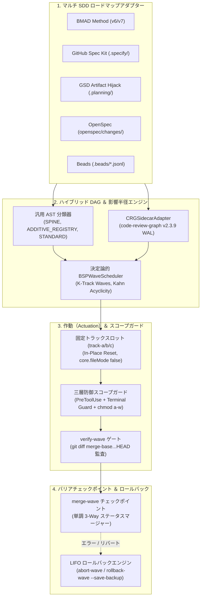

<p align="center">
  
</p>

<p align="center">
  <a href="https://github.com/stopActingSoSmall/sdd-parallel/actions/workflows/ci.yml"></a>
  <a href="https://pypi.org/project/sdd-parallel/"></a>
  <a href="https://www.python.org/"></a>
  <a href="../../../LICENSE"></a>
  <a href="#-5-秒で体験api-キー不要注釈付きウォークスルー"></a>
  <br>
  <a href="#-既存の開発環境にそのまま適合ベンダーロックインなし"></a>
  <a href="#-実際の-sdd-プロジェクト構造導入前後の比較"></a>
</p>

<p align="center">
  <b>🌐 Language:</b>
  <a href="../../../README.md">English</a> |
  <a href="../zh-CN/README.md">简体中文</a> |
  <a href="../es/README.md">Español</a> |
  <a href="../pt-BR/README.md">Português (BR)</a> |
  <b>日本語</b> |
  <a href="../ko/README.md">한국어</a> |
  <a href="../ru/README.md">Русский</a>
</p>

<p align="center">
  <a href="#-5-秒で体験api-キー不要注釈付きウォークスルー">クイックデモ</a> ·
  <a href="#-なぜこれが必要なのか平易な解説">なぜ必要か</a> ·
  <a href="#%EF%B8%8F-動作の仕組みと日常の-4-ステップ運用">動作の仕組み</a> ·
  <a href="#-実際の-sdd-プロジェクト構造導入前後の比較">プロジェクト構造</a> ·
  <a href="#-既存の開発環境にそのまま適合ベンダーロックインなし">ハーネス連携</a> ·
  <a href="#%EF%B8%8F-完全-cli-コマンドリファレンス">日常 CLI</a> ·
  <a href="#-アーキテクチャ数学モデル技術ドシエの詳細">詳細ドシエ</a>
</p>

> **複数の AI コーディングエージェントを安全に並行実行 — 最大 3 倍高速化、マージボム（Merge-Bomb）はゼロ。**  
> `sdd-parallel` は、**Spec Kit / BMAD / GSD / OpenSpec / Beads** のバックログと、それを実装するコーディングエージェント（**Claude Code**、**Codex**、**Antigravity**、または任意の worktree 対応 CLI）の間に立つ、決定論的トラフィックコントローラ、worktree 隔離レイヤ、および影響半径（Blast-Radius）ガードです。

---

## ⚡ なぜこれが必要なのか？（平易な解説）

<p align="center">
  
</p>

10〜15 件の仕様やユーザーストーリーを抱えている場合、現在選べる手段は次の 2 つの好ましくない選択肢のどちらかです：

1. **1 体のエージェントで逐次実行** — 安全ですが、完了まで **6〜8 時間** の待ち時間が発生します。
2. **素朴に `git worktree` ディレクトリを分けて 3〜4 体のエージェントを実行** — 実装は高速ですが、マージ時に破綻します：
   - **第 1 種衝突（直接衝突）：** 2 つのエージェントが `sprint-status.yaml`、`STATE.md`、または `cli.py` を同時に編集 → マージのたびに `<<<<<<<` 衝突マーカーが発生。
   - **第 2 種衝突（セマンティック衝突・潜在的）：** エージェント A が `normalizer.py` の関数シグネチャを変更し、別 worktree のエージェント B が `api.py` から古いシグネチャを呼び出す。**Git はコンフリクトマーカーなしで正常にマージを完了しますが、`main` ブランチは実行時エラーで破壊されます。**
   - **スコープ逸脱（Scope creep）：** 親切心のつもりでエージェントが、自身のタスクスコープ外である共有 `schema.py` を勝手に書き換えてしまう。

**`sdd-parallel` は、LLM トークンを 1 つも消費する前にこれを解決します：** AST とコールグラフをスキャンし、数学的に安全性が証明されたタスク群を並行 **Wave（ウェーブ）** にグループ化し、各エージェントをクリーンな固定スロット（`track-a`、`track-b`、…）に隔離し、フックおよび OS レベルでスコープ外の書き込みを遮断した上で、品質ゲートバリアの背後で各ウェーブを安全にマージします。

| 発生事象 | ❌ 逐次実行（1 エージェント） | 💥 素朴な並行（`--worktree`） | ✅ `sdd-parallel` 導入時 |
| :--- | :--- | :--- | :--- |
| **12 ストーリーのスプリント所要時間** | 約 6〜8 時間（1 つずつ実行） | コーディング約 2 時間 ＋ **破損マージの修正約 2 時間** | **合計約 2.5 時間（2〜3 倍の高速化）** |
| **潜在的な型・API の衝突** | 低速実行によってのみ回避 | **マージ後に `main` が破損** ($W_A \cap I_B \neq \emptyset$) | **事前防止**（Wave 1 → Wave 2 に自動分離） |
| **共有 CLI・ルーターファイル** | 1 エージェントずつ実行 | マージごとに Git コンフリクト | **並行安全**（`ADDITIVE_REGISTRY` 自動検知） |
| **`sprint-status.yaml` / `tasks.md` / `STATE.md`** | 直列で更新 | `<<<<<<<` コンフリクトが頻発 | **自動マージ**（単調 3-Way マージャー） |
| **エージェントが誤ったファイルを編集** | プロンプトで「編集しないで」と懇願 | `bash` や `sed` で指示を迂回 | **確実に遮断**（`PreToolUse` フック ＋ Terminal Guard ＋ `chmod a-w`） |
| **Worktree ディレクトリの散らかり** | なし | 15 個の `.worktrees/task-*` が残留 | **再利用可能な固定スロット**（`track-a`, `track-b`, `track-c`） |

---

## 🚀 5 秒で体験（API キー不要・注釈付きウォークスルー）

API キー不要、LLM サブスクリプション不要、リポジトリのクローンすら不要です。[`uv`](https://docs.astral.sh/uv/) 経由で 1 コマンド実行するだけです（または `pipx run sdd-parallel demo`）：

```bash
uvx sdd-parallel demo          # 特定のキットをテストする場合: uvx sdd-parallel demo --kit spec-kit
```

このデモは、5 つのタスクと 6 つの Python モジュールを含む使い捨てリポジトリをスキャフォールドし、実際のエグゼクティブエンジンを適用して、約 4 秒で完了します。以下は `--kit spec-kit` の実行例を 4 つのステージに分解した解説です。

#### `[Step 1/4]` AST 解析とロール分類

```text
File Path                              | Detected Role          | Importers
----------------------------------------------------------------------------
src/demo_app/__init__.py               | additive_registry      | -
src/demo_app/api.py                    | standard               | -
src/demo_app/cli.py                    | additive_registry      | -
src/demo_app/exporter.py               | standard               | -
src/demo_app/normalizer.py             | standard               | src/demo_app/api.py
src/demo_app/schema.py                 | spine                  | -
```

設定ファイルもハードコードされたパスも不要です。スキャナーは `schema.py` を **`spine`**（全モジュールが依存するため直列化が必要）、`cli.py` を **`additive_registry`**（追記専用のコマンド登録のため安全に共有可能）として分類し、`api.py` が `normalizer.py` をインポートしている事実を記録します。

#### `[Step 2/4]` 潜在的な第 2 種セマンティック・マージボムの検知

```text
  Collision Analysis:
    - Naive Scheduler : W(T002)={normalizer.py, cli.py} vs W(T004)={api.py}
                        -> DISJOINT WRITES (False Safe!)
    - BSPWaveScheduler: Detected semantic_collision between 'T002' and 'T004'
                        -> Overlap W(T002) ^ I(T004) on: src/demo_app/api.py
  Wave Schedule:
    * Wave 1  track-a: T002 (normalizer.py + shared cli.py) | track-b: T003 (exporter.py + shared cli.py)
    * Wave 2  track-a: T001 (schema.py)                     | track-b: T004 (api.py)
    * Wave 3  track-a: T005 (schema.py)
```

`T002` と `T004` はどちらも `tasks.md` に手動で `[P]`（並行可能）タグが付与されており、書き込み対象ファイルも重複していません（`normalizer.py ≠ api.py`）。そのため、従来のファイルロック型スケジューラはこれらを同時に並行実行してしまいます。しかし `BSPWaveScheduler` は、`T002` の書き込みが `T004` の影響セット（Impact Set）に含まれていることを見抜き、`T004` を **Wave 2** へ自動的に分離します。これにより、`T004` はマージ済みの `normalizer.py` の上で安全に動作します。一方、`T002` と `T003` は両方とも `cli.py` を編集しますが、それが加算型レジストリ（`additive_registry`）であるため、同一ウェーブ内で安全に並行実行されます。

#### `[Step 3/4]` クリーンな固定スロットとスコープガードによる遮断

```text
  Provisioned Fixed Slots (100% Clean git status: True):
    - track-a (.worktrees/track-a)
    - track-b (.worktrees/track-b)

  PreToolUse Scope Guard Check (track-a -> 'src/demo_app/schema.py'):
    - Decision : DENY
    - Violation: File 'src/demo_app/schema.py' cannot be modified by Wave 1 / track-a (stories ['T002'])
    - Reason   : Locked by Spine Chain invariant.
```

注入された境界ファイル群（`ACTIVE_TRACK.md`、`.parallel-lock.json`、`.tmp/track-context.md`）は worktree の `info/exclude` によってマスクされるため、`git status --porcelain` は常に完全にクリーン（空）に保たれます。`track-a` のエージェントがスコープ外の `schema.py` を変更しようとすると、ディスクへの書き込みが発生する前に即座にリクエストが拒絶されます。

#### `[Step 4/4]` バリアチェックポイントとコンフリクトゼロの 3-Way マージ

```text
  Merged Branches:
    - parallel/track-a
    - parallel/track-b
  Resolved tasks.md (0 conflict markers):
    - - [ ] T001 [US1] Upgrade schema in `src/demo_app/schema.py` (depends on T002)
    - - [x] T002 [P] [US1] Normalize `src/demo_app/normalizer.py`, `src/demo_app/cli.py`
    - - [x] T003 [P] [US1] Export `src/demo_app/exporter.py`, `src/demo_app/cli.py`
```

両方のブランチが同一の `tasks.md` を編集していました。ステータスマージャーは行ごとに単調半束（`[ ] < [x]`、`backlog < … < done`）として解決するため、マージ結果に `<<<<<<<` コンフリクトマーカーは一切生じません。同様のロジックが `sprint-status.yaml`、`STATE.md`、および `.beads/*.jsonl` にも適用されます。

<details>
<summary><b>🧪 5 大 SDD キット検証マトリクス（<code>uvx sdd-parallel demo --kit all</code>）とサンドボックスモードの表示</b></summary>

```text
============================================================================
5/5 SDD KITS VERIFIED (BMAD, SPEC KIT, GSD, OPENSPEC, BEADS)
============================================================================
Kit          | Merge-Bomb   | Worktrees    | Scope Guard  | 3-Way Merge
----------------------------------------------------------------------------
bmad         | PASSED       | PASSED       | PASSED       | PASSED
spec-kit     | PASSED       | PASSED       | PASSED       | PASSED
gsd          | PASSED       | PASSED       | PASSED       | PASSED
openspec     | PASSED       | PASSED       | PASSED       | PASSED
beads        | PASSED       | PASSED       | PASSED       | PASSED
============================================================================
```

手動でワークフローを試したいですか？永続的なサンドボックス環境をスキャフォールドし、その内部で実際のコマンドを実行できます：

```bash
uvx sdd-parallel demo --kit gsd --scaffold-only --output-dir ./sdd-sandbox
cd sdd-sandbox
sdd-parallel plan
sdd-parallel prepare --wave 1
```

</details>

---

## 🗺️ 動作の仕組みと日常の 4 ステップ運用

<p align="center">
  
</p>

**1. 初回インストール**（要 `Python >= 3.11`、`Git >= 2.30`）：

```bash
uv tool install sdd-parallel     # または: pipx install sdd-parallel
```

`sdd-parallel` と短縮エイリアス `parallel-flow` の両方がグローバルに利用可能になります。

**2. 任意の SDD プロジェクトでウェーブを実行：**

```bash
# 1. 仕様書群とコードベース AST をスキャンし、安全なウェーブを構築
sdd-parallel plan

# 2. Wave 1 を固定スロットにプロビジョニングし、各トラックの起動コマンドを出力
sdd-parallel prepare --wave 1
sdd-parallel run-guide --wave 1

# 3. .worktrees/track-a, track-b, ... 内でエージェントを起動（スロットごとに 1 体）

# 4. スコープを監査し、品質ゲートを実行して Wave 1 を main にマージ
sdd-parallel verify-wave --wave 1
sdd-parallel merge --wave 1
```

取り消し操作：マージ前は `sdd-parallel abort-wave --wave 1`、マージ後は `sdd-parallel rollback-wave --wave 1`（LIFO 順、自動バックアップブランチ `backup/wave-<K>-before-rollback-*` の作成、SDD ステータスの復元を実行）。

---

## 📂 実際の SDD プロジェクト構造（導入前後の比較）

<p align="center">
  
</p>

`sdd-parallel` は既存のフレームワークファイルをそのまま読み取ります。移行作業も、新しい仕様フォーマットも一切不要です。

| SDD フレームワーク | 読み取り専用アーティファクト（スロット内でロック） | タスク検出 | ステータス同期 |
| :--- | :--- | :--- | :--- |
| **GitHub Spec Kit** (`.specify/`) | `constitution.md`, `feature.json`, `spec.md`, `plan.md` | `specs/*/tasks.md` (`T001 [P]`) | 3-Way Markdown チェックボックスマージ |
| **BMAD Method** (`v6.3+` / `v7`) | `epic-*-context.md`（Zero Cache Invalidation） | `sprint-status.yaml`, `epics.md`, `spec-*.md` | 単調 3-Way YAML マージ |
| **GSD** (`.planning/`) | `PROJECT.md`, `REQUIREMENTS.md`, `ROADMAP.md`, `STATE.md` | `phases/*/NN-NN-PLAN.md` | Artifact Hijack（マージ時に `STATE.md` を中央で一括更新） |
| **OpenSpec** (`openspec/`) | `openspec/specs/**`, `project.md`, `config.yaml`, 兄弟 change フォルダ | `openspec/changes/<slug>/tasks.md` | 3-Way Markdown チェックボックスマージ |
| **Beads** (`.beads/`) | `.beads/config.yaml` | `.beads/*.jsonl`（`bd-101` ＋ `blocks` エッジ） | 行単位の 3-Way 半束 JSONL マージ |

以下のスナップショットはすべて、`plan` ＋ `prepare --wave 1` 実行後の実際の `sdd-parallel demo --scaffold-only` フィクスチャから取得したものです。可読性のため、ソースツリーは `src/…` に省略しています。

<details>
<summary><b>🌱 GitHub Spec Kit (<code>.specify/</code> &amp; <code>specs/*/tasks.md</code>) — 導入前後のツリーを展開して確認</b></summary>

**導入前** — 既存のプロジェクト構造：

```text
my-project/
├── .specify/
│   ├── memory/
│   │   └── constitution.md
│   ├── templates/
│   │   └── tasks-template.md
│   └── feature.json
├── specs/
│   └── 001-telemetry/
│       ├── plan.md
│       ├── spec.md
│       └── tasks.md
└── src/…
```

`specs/001-telemetry/tasks.md` — `T004` に手動で `[P]` が付与されている点に注目してください。`T002` と並行実行すると安全ではありません：

```markdown
- [ ] T001 [US1] Upgrade schema in `src/demo_app/schema.py` (depends on T002)
- [ ] T002 [P] [US1] Normalize `src/demo_app/normalizer.py`, `src/demo_app/cli.py`
- [ ] T003 [P] [US1] Export `src/demo_app/exporter.py`, `src/demo_app/cli.py`
- [ ] T004 [P] [US2] Expose ingestion in `src/demo_app/api.py`
- [ ] T005 [US2] Add audit log in `src/demo_app/schema.py` (depends on T001)
```

**導入後** `sdd-parallel plan` + `prepare --wave 1`：

```text
my-project/
├── .parallel/                        # プランナー状態管理（新規生成）
│   ├── artifacts/
│   │   ├── execution-plan-parallel.md
│   │   └── wave-plan.json
│   ├── history/run-001-<timestamp>/wave-plan.json
│   └── state.json
├── .specify/…                        # 未変更
├── .worktrees/
│   ├── track-a/                      # Wave 1 → T002
│   │   ├── .specify/memory/constitution.md   # 🔒 読み取り専用
│   │   ├── specs/001-telemetry/
│   │   │   ├── plan.md               # 🔒 読み取り専用
│   │   │   ├── spec.md               # 🔒 読み取り専用
│   │   │   └── tasks.md
│   │   ├── src/…
│   │   ├── .tmp/track-context.md     # 👻 info/exclude により非表示
│   │   ├── .parallel-lock.json       # 👻 info/exclude により非表示
│   │   └── ACTIVE_TRACK.md           # 👻 → /speckit.implement T002
│   └── track-b/                      # Wave 1 → T003（同一レイアウト）
├── specs/…                           # 未変更
└── src/…
```

</details>

<details>
<summary><b>📐 BMAD Method (<code>v6.3+ / v7</code> — <code>_bmad-output/</code>) — 導入前後のツリーを展開して確認</b></summary>

**導入前：**

```text
my-project/
├── _bmad-output/
│   ├── implementation-artifacts/
│   │   ├── epic-1-context.md
│   │   ├── epic-2-context.md
│   │   ├── epics.md
│   │   ├── spec-1-1-upgrade-schema-v2.md
│   │   ├── spec-1-2-normalize-telemetry-payload.md
│   │   ├── spec-1-3-cli-batch-export.md
│   │   ├── spec-2-1-expose-ingestion-api.md
│   │   ├── spec-2-2-add-audit-log-schema.md
│   │   └── sprint-status.yaml
│   └── planning-artifacts/
│       ├── epic-1-context.md
│       ├── epic-2-context.md
│       ├── epics.md
│       └── project-context.md
└── src/…
```

**導入後** `sdd-parallel plan` + `prepare --wave 1`：

```text
my-project/
├── .parallel/
│   ├── history/run-001-<timestamp>/wave-plan.json
│   └── state.json
├── .worktrees/
│   ├── track-a/                      # Wave 1 → story 1-2
│   │   ├── _bmad/custom/             # 👻 スロットごとの BMAD オーバーレイ（非表示）
│   │   │   ├── bmad-build.toml
│   │   │   ├── bmad-build.user.toml
│   │   │   ├── bmad-build-auto.toml
│   │   │   └── bmad-build-auto.user.toml
│   │   ├── _bmad-output/
│   │   │   ├── implementation-artifacts/   # sprint-status.yaml は 3-way マージ
│   │   │   └── planning-artifacts/
│   │   │       ├── epic-1-context.md # 🔒 Zero Cache Invalidation ロック
│   │   │       ├── epic-2-context.md # 🔒
│   │   │       └── project-context.md
│   │   ├── src/…
│   │   ├── .tmp/track-context.md     # 👻
│   │   ├── .parallel-lock.json       # 👻
│   │   └── ACTIVE_TRACK.md           # 👻 → /bmad-build 1-2
│   └── track-b/                      # Wave 1 → story 1-3
├── _bmad-output/
│   ├── implementation-artifacts/…
│   ├── parallel-artifacts/           # プランナー出力（BMAD は _bmad-output 配下に配置）
│   │   ├── execution-plan-parallel.md
│   │   └── wave-plan.json
│   └── planning-artifacts/…
└── src/…
```

</details>

<details>
<summary><b>⚡ GSD — Get Shit Done (<code>.planning/phases/</code> Artifact Hijack) — 導入前後のツリーを展開して確認</b></summary>

**導入前：**

```text
my-project/
├── .planning/
│   ├── phases/
│   │   ├── 01-core/
│   │   │   ├── 01-01-PLAN.md
│   │   │   ├── 01-02-PLAN.md
│   │   │   └── 01-03-PLAN.md
│   │   └── 02-api/
│   │       ├── 02-01-PLAN.md
│   │       └── 02-02-PLAN.md
│   ├── PROJECT.md
│   ├── REQUIREMENTS.md
│   ├── ROADMAP.md
│   └── STATE.md
└── src/…
```

`01-02-PLAN.md`（normalizer）と `02-01-PLAN.md`（API）は異なるフェーズに属し、共有ファイルもありません。しかし `02-01` は `01-02` のコードを呼び出しています。プランナーはこれらを自動的に異なるウェーブへスケジューリングします。

**導入後** `sdd-parallel plan` + `prepare --wave 1`：

```text
my-project/
├── .parallel/
│   ├── artifacts/
│   │   ├── execution-plan-parallel.md
│   │   └── wave-plan.json
│   ├── history/run-001-<timestamp>/wave-plan.json
│   └── state.json
├── .planning/…                       # main 内では未変更
├── .worktrees/
│   ├── track-a/                      # Wave 1 → 01-02
│   │   ├── .planning/
│   │   │   ├── phases/01-core/ · 02-api/
│   │   │   ├── PROJECT.md            # 🔒 読み取り専用
│   │   │   ├── REQUIREMENTS.md       # 🔒 読み取り専用
│   │   │   ├── ROADMAP.md            # 🔒 読み取り専用
│   │   │   └── STATE.md              # 🔒 スロット内でロック、マージ時に中央で一括更新
│   │   ├── src/…
│   │   ├── .tmp/track-context.md     # 👻
│   │   ├── .parallel-lock.json       # 👻
│   │   └── ACTIVE_TRACK.md           # 👻 → /gsd-execute-phase 01-02
│   └── track-b/                      # Wave 1 → 01-03
└── src/…
```

</details>

<details>
<summary><b>📑 OpenSpec (<code>openspec/changes/</code>) — 導入前後のツリーを展開して確認</b></summary>

**導入前：**

```text
my-project/
├── openspec/
│   ├── changes/
│   │   ├── audit-log-schema/
│   │   ├── cli-batch-export/
│   │   ├── ingestion-api-endpoint/
│   │   ├── normalize-telemetry/
│   │   │   ├── design.md
│   │   │   ├── proposal.md
│   │   │   └── tasks.md
│   │   └── upgrade-schema-v2/
│   ├── specs/
│   │   └── telemetry/
│   │       └── spec.md
│   ├── config.yaml
│   └── project.md
└── src/…
```

**導入後** `sdd-parallel plan` + `prepare --wave 1`：

```text
my-project/
├── .parallel/
│   ├── artifacts/
│   │   ├── execution-plan-parallel.md
│   │   └── wave-plan.json
│   ├── history/run-001-<timestamp>/wave-plan.json
│   └── state.json
├── .worktrees/
│   ├── track-a/                      # Wave 1 → normalize-telemetry
│   │   ├── openspec/
│   │   │   ├── changes/
│   │   │   │   ├── normalize-telemetry/   # ✍️ 当該トラック専用の変更フォルダ
│   │   │   │   ├── cli-batch-export/      # 🔒 兄弟トラック track-b によりロック
│   │   │   │   └── …
│   │   │   ├── specs/                # 🔒 カノニカル仕様（openspec archive 経由でのみ変更可能）
│   │   │   ├── config.yaml           # 🔒
│   │   │   └── project.md            # 🔒
│   │   ├── src/…
│   │   ├── .tmp/track-context.md     # 👻
│   │   ├── .parallel-lock.json       # 👻
│   │   └── ACTIVE_TRACK.md           # 👻 → /openspec-apply normalize-telemetry
│   └── track-b/                      # Wave 1 → cli-batch-export（ミラーロック）
├── openspec/…                        # 未変更
└── src/…
```

</details>

<details>
<summary><b>🔗 Beads (<code>.beads/beads.jsonl</code>) — 導入前後のツリーを展開して確認</b></summary>

**導入前：**

```text
my-project/
├── .beads/
│   ├── beads.jsonl
│   ├── config.yaml
│   └── issues.jsonl
└── src/…
```

グラフタスク `bd-101`、`bd-102`、`bd-103`、`bd-201`、`bd-202` の間に `blocks`（ブロッキング依存関係）エッジが存在します：

```json
{"id": "bd-101", "title": "Upgrade schema to v2", "status": "open", "files": ["src/demo_app/schema.py"], "dependencies": [{"target": "bd-102", "type": "blocks"}], "priority": 1, "epic": "epic-1"}
{"id": "bd-102", "title": "Normalize telemetry payload", "status": "open", "files": ["src/demo_app/normalizer.py", "src/demo_app/cli.py"], "dependencies": [], "priority": 2, "epic": "epic-1"}
```

**導入後** `sdd-parallel plan` + `prepare --wave 1`：

```text
my-project/
├── .beads/…                          # main の原本、merge --wave 1 時に行単位でマージ
├── .parallel/
│   ├── artifacts/
│   │   ├── execution-plan-parallel.md
│   │   └── wave-plan.json
│   ├── history/run-001-<timestamp>/wave-plan.json
│   └── state.json
├── .worktrees/
│   ├── track-a/                      # Wave 1 → bd-102
│   │   ├── .beads/
│   │   │   ├── beads.jsonl           # ステータス編集は行単位で 3-way マージ（open < closed）
│   │   │   ├── config.yaml           # 🔒 読み取り専用
│   │   │   └── issues.jsonl
│   │   ├── src/…
│   │   ├── .tmp/track-context.md     # 👻
│   │   ├── .parallel-lock.json       # 👻
│   │   └── ACTIVE_TRACK.md           # 👻 → bd update bd-102 --status in-progress
│   └── track-b/                      # Wave 1 → bd-103
└── src/…
```

`merge --wave 1` の実行後、`bd-102` と `bd-103` は両方とも `.beads/beads.jsonl` 内でコンフリクトマーカー 0 件で `closed` に更新されます。

</details>

凡例：🔒 読み取り専用（`chmod a-w` ＋ `PreToolUse` による拒絶） · 👻 注入済み（`.git/worktrees/<slot>/info/exclude` により Git から隠蔽） · ✍️ 当該トラックの書き込み可能スコープ。

---

## 🔌 既存の開発環境にそのまま適合（ベンダーロックインなし）

既存のエージェントや使い慣れたプロンプトをそのまま継続利用できます。`sdd-parallel prepare --wave 1` の後、`sdd-parallel run-guide --wave 1` が各スロットに対応するネイティブコマンドを出力し、同様の内容が `.worktrees/track-<id>/ACTIVE_TRACK.md` にも書き込まれます。コンテキストのパスを手作業で入力する必要はありません：

| SDD キット | トラックごとに出力されるネイティブコマンド |
| :--- | :--- |
| GitHub Spec Kit | `/speckit.implement T002` |
| BMAD Method | `/bmad-build 1-2` |
| GSD | `/gsd-execute-phase 01-02` |
| OpenSpec | `/openspec-apply normalize-telemetry` |
| Beads | `bd update bd-102 --status in-progress` |

| ハーネス | 連携方法 |
| :--- | :--- |
| **Claude Code** (`claude`) | `.worktrees/track-a` 内で `claude` を起動します。スコープ外への書き込みやシェルの迂回実行は、`PreToolUse` フックと OS の `chmod a-w` によって遮断されます。または `sdd-parallel autopilot --wave 1 --harness claude-code` で全トラックを一括起動します。 |
| **OpenAI Codex CLI** (`codex`) | `codex --cd .worktrees/track-b` で起動します。読み取り専用ファイルは `chmod a-w` で保護され、マージ前に `sdd-parallel verify-wave` が diff を監査します。オートパイロット：`--harness codex`。 |
| **Google Antigravity** | `sdd-parallel prepare --wave 1 --antigravity-layout` により、スロットが `~/.gemini/antigravity/worktrees/<Project>/track-a` 配下に配置されます。スロット直下に `ACTIVE_TRACK.md` が配置され、`sdd-parallel install-plugin` でスコープガードフックを備えたポータブルプラグインがインストールされます。 |
| **任意の worktree 対応 CLI / IDE** — Cursor、Windsurf、OpenCode、Kimi CLI、MiniMax Code、Aider、Cline、Trae | 追加設定なしで動作：標準の `git worktree` スロット（`--max-tracks N` による `track-a`、`track-b`、`track-c`、…）、OS レベルの `chmod a-w` ロック、`ACTIVE_TRACK.md`、および `sdd-parallel verify-wave` による事後 diff 検証。 |

---

## 🔍 アーキテクチャ、数学モデル、技術ドシエの詳細

- 📖 **[01 — コアプロダクト概要 ＆ ROI モデル](../../dossier/01_CORE_PRODUCT_BRIEF.md)**: エグゼクティブサマリー、トークン FinOps、モデル推論労力ルーティング
- 🏛️ **[02 — システム機能ホワイトペーパー](../../dossier/02_SYSTEM_CAPABILITIES_WHITE_PAPER.md)**: 第 1 種 vs 第 2 種衝突、3D ファイル分類、CRG 減衰式
- 🔌 **[03 — 統合・エコシステム仕様書](../../dossier/03_INTEGRATION_AND_ECOSYSTEM_SPEC.md)**: `CanonicalTask` 中間表現（IR）、`.tmp/track-context.md` および `.parallel-lock.json` の規約
- 📊 **[04 — 競合・ベンチマーク分類体系](../../dossier/04_COMPETITIVE_AND_BENCHMARK_TAXONOMY.md)**: 近接オーケストレーションツールとの比較・ポジショニング
- 🧪 **[07 — スタンドアロンデモ ＆ E2E ウォークスルー](07_STANDALONE_DEMO_AND_E2E_WALKTHROUGH.md)**: フレームごとのディスクスナップショット、`--keep-temp` サンドボックス利用ガイド
- 📐 **[システムアーキテクチャ SSOT (`ARCHITECTURE.md`)](ARCHITECTURE.md)** · **[ドシエ目次](../../dossier/README.md)** · **[ロシア語版ドシエ](../ru/dossier/)**

<details>
<summary><b>🏛️ 内部エンジンアーキテクチャと 9 つのコア不変条件を展開して確認</b></summary>

### 内部コンポーネントフロー



### 9 つのコアエンジニアリング不変条件

1. **Zero Worktree Pollution（Worktree の完全無汚染）：** 注入された境界ファイル（`.tmp/track-context.md`、`.parallel-lock.json`、`ACTIVE_TRACK.md`）は git の `info/exclude` により不可視化され、`git status --porcelain` は常に完全に空を維持します。
2. **Zero Cache Invalidation（キャッシュ破棄ゼロ）：** 事前コンパイルされたコンテキストファイル（例：BMAD の `epic-*-context.md`）はウェーブ中読み取り専用となり、プランナーの状態は `.parallel/`（BMAD の場合は `_bmad-output/parallel-artifacts/`）に分離されます。
3. **100% Task Coverage & Acyclicity（100% タスク網羅と非巡回性）：** Kahn のトポロジカルソート検証により、タスクの脱落ゼロおよび依存循環ゼロを数学的に保証します。
4. **Blast-Radius Enforcement（影響半径の強制）：** 書き込みセットの素集合性（$W_A \cap W_B = \emptyset$）に加え、セマンティック影響セットの素集合性（$W_A \cap I_B = \emptyset$）を強制します。
5. **Universal Anti-Overfitting（汎用性と特定ドメイン非依存）：** コアエンジンに特定ドメイン用のハードコードされたパスは存在しません。`SPINE`、`ADDITIVE_REGISTRY`、`STANDARD` は AST ヒューリスティクスとグラフ中心性のみから導出されます。
6. **Fixed Track Slots（固定トラックスロット）：** `track-a`、`track-b`、`track-c` スロットは `git checkout -B` ＋ `git clean -fd` によりその場で（in-place）再利用され、フォルダの肥大化を防ぎます。
7. **Three-Tier Defense-in-Depth Guard（三層多層防御ガード）：** `PreToolUse` フック ＋ ターミナルコマンド遮断（`Bash`、`run_command`） ＋ OS レベルの `chmod a-w`。
8. **Monotonic Status Semi-Lattice（単調ステータス半束）：** ステータスは $\texttt{backlog}(0) < \dots < \texttt{done}(4)$ の半束順序として解決され、コンフリクトマーカーは一切発生しません。
9. **LIFO Transactional Rollbacks（LIFO トランザクションロールバック）：** マージ済みウェーブは厳格に後入れ先出し（LIFO）順で取り消され、安全なバックアップブランチ（`backup/wave-<K>-before-rollback-*`）が自動生成されます。

</details>

---

## 🛠️ 完全 CLI コマンドリファレンス

<details>
<summary><b>クリックして展開：全 13 個のサブコマンドとフラグ</b></summary>

| コマンド | 目的 |
| :--- | :--- |
| `sdd-parallel demo [--kit {bmad,spec-kit,gsd,openspec,beads,all}] [--keep-temp] [--scaffold-only] [--output-dir DIR]` | オフラインのマージボム実証デモを実行、または 5 大 SDD キットの対話型サンドボックスをスキャフォールド。 |
| `sdd-parallel plan [--repo REPO] [--max-tracks N] [--kit KIT] [--include-done] [--dry-run] [--plan-source {auto,plan,specs}] [--output-dir DIR]` | ロードマップとコードグラフを解析し、`execution-plan-parallel.md` および `wave-plan.json` を出力。 |
| `sdd-parallel prepare --wave K [--repo REPO] [--max-tracks N] [--kit KIT] [--headless] [--antigravity-layout] [--dynamic-worktrees] [--dry-run]` | スロット（`track-a`、`track-b`、…）のプロビジョニング、OS ロックの適用、境界ファイルの注入。 |
| `sdd-parallel claim-track --wave K --track <id> --worktree <path> [--repo REPO] [--max-tracks N] [--kit KIT] [--headless]` | 既存の外部 worktree に対して境界ロックを関連付け。 |
| `sdd-parallel run-guide --wave K [--repo REPO] [--max-tracks N] [--kit KIT] [--antigravity-layout]` | オペレーター向けランガイドを出力（トラックごとのネイティブ起動コマンドを含む）。 |
| `sdd-parallel verify-wave --wave K [--repo REPO] [--max-tracks N] [--kit KIT] [--dynamic-worktrees]` | `.parallel-lock.json` に対するスロットの監査および `merge-base` に対する複数コミット diff の監査。 |
| `sdd-parallel merge --wave K [--repo REPO] [--max-tracks N] [--kit KIT] [--dynamic-worktrees] [--skip-gates] [--strict-gates] [--cleanup] [--dry-run]` | バリアマージ：3-Way ステータスマージ、Git マージ、品質ゲート、トランザクション自動ロールバック。 |
| `sdd-parallel abort-wave --wave K [--repo REPO] [--dynamic-worktrees]` | 未マージのウェーブを破棄：スロットをリセットし、一時並行ブランチを削除。 |
| `sdd-parallel rollback-wave --wave K [--repo REPO] [--dynamic-worktrees] [--to-commit COMMIT] [--save-backup] [--no-backup] [--kit KIT]` | マージ済みウェーブの取り消し（LIFO）：安全バックアップブランチ作成と SDD ステータス復元。 |
| `sdd-parallel merge-status --base B --ours O --theirs T --out OUT` | `sprint-status.yaml` 用の低レベル決定論的 3-Way マージャー。 |
| `sdd-parallel check-lock --file PATH [--tool TOOL]` | アクティブな worktree のロックマニフェストに対してファイル書き込み権限を照合。 |
| `sdd-parallel install-plugin [--target-dir DIR]` | ポータブルな Antigravity プラグインをパッケージングしてインストール。 |
| `sdd-parallel autopilot --wave K [--repo REPO] [--max-tracks N] [--kit KIT] [--harness {antigravity,claude-code,codex}] [--antigravity-layout] [--execute]` | モデル推論労力ルーティングを備えたマルチウィンドウ・オートパイロット起動コマンドの生成または直接実行。 |

</details>

---

## 🚢 リリースマトリクス：実装済み (v0.1.0) vs ロードマップ (v0.2+)

### ✅ `v0.1.0` で実装済み

- [x] Kahn の非巡回性チェックを備えた決定論的一括同期並列（Bulk-Synchronous Parallel, BSP）ウェーブスケジューラ。
- [x] AST ホットスポットスキャナ ＋ `code-review-graph v2.3.9` サイドカー統合。
- [x] その場リセット（in-place reset）と `info/exclude` 不可視化を備えた固定トラックスロット（`track-a`、`track-b`、`track-c`）。
- [x] 三層防御スコープガード（`PreToolUse` ＋ Terminal Guard ＋ OS `chmod a-w`）。
- [x] YAML、Markdown チェックリスト、`STATE.md`、および JSONL に対応した単調 3-Way ステータスマージャー。
- [x] 自動安全バックアップブランチ作成を伴う LIFO トランザクション・ウェーブロールバック。
- [x] 5 つの SDD アダプター：Spec Kit、BMAD、GSD（Artifact Hijack）、OpenSpec、Beads（それぞれ専用のネイティブトラック起動コマンドに対応）。
- [x] オフラインのマージボム実証デモ（`sdd-parallel demo --kit all`）およびサンドボックススキャフォールド（`--scaffold-only`）。
- [x] Antigravity、Claude Code、Codex 対応のマルチウィンドウ・オートパイロット。
- [x] Ubuntu / macOS / Windows、Python 3.11〜3.13 でのクリーンクローン CI；PyPI Trusted Publishing 対応。

### 🚧 `v0.2.0+` ロードマップ

- [ ] **コミュニティアダプター：** `mattpocock/skills`（`/implement-spec`）および `bmad-loop` フロントマターステータスアダプター。
- [ ] **汚染ゼロの環境同期：** 固定スロットへの `.venv` / `node_modules` のシンボリックリンク共有。
- [ ] **ウェーブ実行前の静的シンボルリンカー ＆ スコープエスカレーション：** AST シンボル解析による書き込みセットの動的拡張と自動リスケジューリング。
- [ ] **FinOps ＆ 可観測性エクスポーター：** OpenTelemetry スパンおよび Langfuse トークン削減テレメトリの出力。
- [ ] **ヘッドレス・オートパイロットデーモン：** ローカル RPC / サブエージェントディスパッチによるエージェント自動実行。

---

## 🤝 コントリビューション、ローカル開発、セキュリティ

```bash
git clone https://github.com/stopActingSoSmall/sdd-parallel.git
cd sdd-parallel
uv sync

uv run pytest                          # ユニットテスト ＆ 統合テストスイート
uv run mypy --strict src/sdd_parallel  # 厳格な型チェック
uv run ruff check src/ tests/ scripts/ # リンター実行
uv run sdd-parallel demo --kit all     # 5 大キットのオフラインデモ
```

- **コントリビューション：** 開発環境のセットアップおよびプルリクエストの品質ゲートについては **[Contributing Guide](../../../CONTRIBUTING.md)** を参照してください。
- **セキュリティ：** 脆弱性の報告手順については **[Security Policy](../../../SECURITY.md)** を参照してください。
- **ライセンス：** MIT — 詳細は [LICENSE](../../../LICENSE) を参照してください。
