# 🏛️ SDD-Parallel — 시스템 아키텍처 단일 진실 공급원 (SSOT)

<p align="center">
  <b>🌐 언어 / Language:</b>
  <a href="../../../ARCHITECTURE.md">English</a> |
  <a href="../zh-CN/ARCHITECTURE.md">简体中文</a> |
  <a href="../es/ARCHITECTURE.md">Español</a> |
  <a href="../pt-BR/ARCHITECTURE.md">Português (BR)</a> |
  <a href="../ja/ARCHITECTURE.md">日本語</a> |
  <b>한국어</b> |
  <a href="../ru/ARCHITECTURE.md">Русский</a>
</p>

**버전:** 0.1.0  
**상태:** 승인된 아키텍처 척추 기준선 (SSOT)

---

## 1. 아키텍처 모듈 개요

`sdd-parallel` 시스템은 표준 작업 그래프 모델(`src/sdd_parallel/models.py`)을 통해 조율되는 세 개의 느슨하게 결합된 서브시스템으로 구성됩니다:

```mermaid
flowchart LR
    subgraph Adapters["서브시스템 1: 다형적 SDD 키트 어댑터 (SDDAdapterProtocol & 읽기 전용 ACL)"]
        A1["BMAD 어댑터\n(sprint-status.yaml + epics.md + specs)"]
        A2["Spec Kit 어댑터\n(.specify/specs/*/tasks.md + constitution)"]
        A3["GSD 어댑터\n(.planning/phases/*-PLAN.md + STATE.md)"]
        A4["OpenSpec 어댑터\n(openspec/changes/*/tasks.md + proposal)"]
        A5["Beads 어댑터\n(.beads/issues.jsonl + dependencies)"]
    end

    subgraph Engine["서브시스템 2: 헥사고날 DAG 엔진 및 충돌 해결기"]
        E1["ASTHotspotScanner\n(3단계 정적 분석: Spine vs 추가 전용 레지스트리)"]
        E2["CRGSidecarAdapter\n(code-review-graph v2.3.9 가중 호출 그래프 WAL)"]
        E3["BSPWaveScheduler\n(결정론적 웨이브 패킹, K 트랙)"]
    end

    subgraph Actuation["서브시스템 3: 작업 트리 프로비저너 및 머지 게이트"]
        W1["prepare / claim-track\n(고정 슬롯 track-<id> + 제자리 리셋)"]
        W2["3단계 심층 방어 스코프 가드\n(PreToolUse + 터미널 가드 + OS chmod a-w)"]
        W3["merge 체크포인트 게이트\n(엄격한 merge-base diff + 다형적 3-way 상태 머지)"]
    end

    Adapters --> E1 & E2
    E1 & E2 --> E3
    E3 --> W1
    W1 --> W2 --> W3
```



### 1.1. 헥사고날 어댑터 아키텍처 및 `SDDAdapterProtocol`

포트 및 어댑터(헥사고날 아키텍처) 원칙에 따라, `sdd-parallel` 코어 엔진은 엄격하게 타입이 지정된 `SDDAdapterProtocol`(`src/sdd_parallel/adapters/__init__.py`)을 통해서만 모든 명세 기반 개발(SDD) 프레임워크와 통신합니다. 코어 엔진에는 특정 파일 경로나 키트별 분기 로직이 일절 하드코딩되어 있지 않습니다:

```python
class SDDAdapterProtocol(Protocol):
    """지원되는 모든 SDD 프레임워크가 구현하는 다형적 확장 계약."""

    kit_id: str

    def detect(self) -> bool:
        """저장소 내 해당 SDD 프레임워크의 존재 마커를 감지합니다."""
        ...

    def load_tasks(self, include_done: bool = False) -> list[TaskNode]:
        """백로그 및 로드맵 산출물을 표준 TaskNode 모델로 파싱합니다."""
        ...

    def check_wave_zero_blockers(self, wave: Wave | None = None) -> list[str]:
        """프레임워크별 사전 필수 조건(Git 클린 상태, 컴파일된 컨텍스트 등)을 검증합니다."""
        ...

    def get_allowed_write_globs(self, track: WaveTrack) -> list[str]:
        """작업 트리 내에서 수정이 허용된 메타데이터 glob 패턴을 반환합니다."""
        ...

    def get_forbidden_files(self, wave: Wave, track: WaveTrack) -> dict[str, str]:
        """프레임워크의 불변 명세 및 보호 대상 계약 파일을 매핑합니다."""
        ...

    def render_worker_command(self, track: WaveTrack) -> str:
        """운영자 안내서 및 Autopilot 모드를 위한 네이티브 CLI 명령어를 생성합니다."""
        ...

    def reset_tasks_status(
        self,
        task_ids: Sequence[str],
        target_status: str = "ready-for-dev",
    ) -> None:
        """트랜잭션 LIFO 웨이브 롤백 시 작업 상태를 다형적으로 복원합니다."""
        ...

    def cleanup_wave_artifacts(
        self,
        wave_id: int,
        task_ids: Sequence[str],
    ) -> None:
        """웨이브 실행 중 생성된 임시 명세 및 산출물을 정리합니다."""
        ...
```

### 1.2. 책임 분담 매트릭스: 범용 코어 엔진 vs 다형적 키트 어댑터

| 파이프라인 단계 | 담당 서브시스템 | 아키텍처 역할 및 핵심 메커니즘 |
| :--- | :---: | :--- |
| **산출물 파싱 및 작업 변환** | `SDDAdapter` | 프레임워크 고유 포맷(YAML, Markdown 체크리스트, JSONL) 파싱. 표준 `TaskNode`(`write_files`, `read_files`, `depends_on`)로 변환. |
| **사전 차단 조건 검증** | `SDDAdapter` | 준비성 게이트(`check_wave_zero_blockers`): Git 클린 상태, BMAD 에픽 컨텍스트, Spec Kit 체크리스트 검증. |
| **AST 파일 역할 분류** | `Core Engine` | 3단계 정적 분석기(`ASTHotspotScanner`)를 통해 경로 하드코딩 없이 `SPINE`, `ADDITIVE_REGISTRY`, `STANDARD` 모듈을 분류. |
| **의미적 영향 반경 계산** | `Core Engine` | `CRGSidecarAdapter`(`code-review-graph v2.3.9` WAL)를 사용하여 가중 호출 그래프 폭발 반경($W_A \cap I_B$)을 계산. |
| **웨이브 분할 (BSP 스케줄러)** | `Core Engine` | 결정론적 `BSPWaveScheduler`를 통해 100% 작업 커버리지 및 Kahn 비순환성 보장. |
| **작업 트리 슬롯 프로비저닝** | `Core Engine` + `Adapter` | 고정 슬롯 `track-<id>` 할당 및 OS 권한(`chmod a-w`) 설정. 어댑터가 `allowed_write_globs` 및 `forbidden_files` 제공. |
| **에이전트 실행 명령어 생성** | `SDDAdapter` | 네이티브 에이전트 명령어(`/speckit.implement`, `/gsd-execute-phase`, `/opsx:apply`, `bd update`, `/bmad-build`) 생성. |
| **다계층 스코프 가드** | `Core Engine` | `PreToolUse` 훅, 터미널 명령어 차단(`Bash`, `run_command`), OS 읽기 전용 락으로 범위 밖 수정을 차단. |
| **단조 3-Way 상태 머지** | `SDDAdapter` + `Core` | 엔진이 Git 머지를 조율하며, 반격자 머지기(`status_merger.py`)가 충돌 마커 없이 상태를 자동 병합. |
| **트랜잭션 LIFO 롤백** | `Core Engine` + `Adapter` | 안전 백업 브랜치(`backup/wave-<K>-before-rollback-*`)를 생성하고 `HEAD`를 복원하며, 어댑터가 상태를 복구. |

### 1.3. 다중 키트 공존 및 비활성 샌드박스 격리 프로토콜

엔터프라이즈 모노레포에 여러 SDD 산출물이 공존하는 경우:
1. **명시적 우선순위:** CLI의 `--kit <name>` 옵션 또는 설정 파일의 `"default_kit"`이 최우선 적용됩니다.
2. **활성 작업 기반 자동 감지 (`kit="auto"`):** 미완료 작업(`len(active_tasks) > 0`)을 포함하는 첫 번째 프레임워크를 자동 활성화합니다.
3. **진단 원격 측정:** `diagnose_multi_kit_coexistence()`를 통해 파이프라인 중단 없이 공존 경고를 출력합니다.
4. **프레임워크 간 샌드박스 격리:** `.parallel-lock.json` 생성 시 모든 **비활성** SDD 디렉토리는 `forbidden_files`에 자동 등록되어 변경이 원천 차단됩니다.

---

## 2. 수학적 충돌 모델 및 파일 분류 체계

각 미완료 작업 $T_i$에 대해 다음을 평가합니다:
- $W(T_i)$ — 작업이 **수정하거나 생성**하는 파일 집합(`write_files`).
- $R(T_i)$ — 작업이 선행 조건으로 **읽거나 참조**하는 파일 집합(`read_files`).
- $I(T_i)$ — $W(T_i)$를 중심으로 하는 **가중 영향 반경**(`CRGSidecarAdapter`에 의해 계산, 감쇄 계수 $\gamma = 0.7$).

### 2.1. 코드베이스의 세 가지 파일 역할

1. **척추 코어 파일 (`FileRole.SPINE`):**
   - 데이터베이스 스키마, 순차 마이그레이션 스크립트 또는 루트 데이터 모델(`schema.py`, `models.py`, `SCHEMA_VERSION`).
   - **규칙:** 동일한 `SPINE` 파일을 수정하는 작업은 **절대 같은 웨이브에 배정되지 않으며** 엄격한 직렬 체인으로 정렬됩니다.
2. **공유 추가 전용 레지스트리 (`FileRole.ADDITIVE_REGISTRY`):**
   - 독립적인 명령어 또는 라우트가 등록되는 엔트리포인트(`@app.command`가 있는 `cli.py`, `__all__`을 갖는 `__init__.py`).
   - *아키텍처 불변성 (ADR-0002):* 공통 포맷팅 유틸리티(`console.py` 등)는 레지스트리에서 제외되어 `FileRole.STANDARD`로 분류됩니다.
   - **규칙:** 추가 전용 파일에서만 겹치는 작업은 **독립된 작업 트리에서 동시 실행이 허용**되며 추가 전용 지침이 주입됩니다.
3. **표준 모듈 파일 (`FileRole.STANDARD`):**
   - 일반 비즈니스 로직 및 어댑터 모듈.
   - **규칙:** $W(A) \cap W(B) \neq \emptyset$인 경우 동일 웨이브 내 동시 실행이 차단됩니다.

### 2.2. 3단계 정적 AST 분석 파이프라인 (`ASTHotspotScanner`)

**불변 원칙 7 (안티 오버피팅)**에 따라 동적으로 역할을 분류합니다:
1. **1단계 (시그니처 탐색):** 마이그레이션 키워드(`SCHEMA_VERSION`, `auto_migrate`)를 탐색하여 스키마 코어 여부 판별.
2. **2단계 (임포트 그래프 및 데코레이터 검사):** 인입 차수(Fan-In)를 계산하고 등록 데코레이터(`command`, `tool`, `get`, `post`)를 검사.
3. **3단계 (결정론적 분류):**
   - 테스트(`tests/`) $\to$ 항상 `STANDARD`.
   - `SPINE`: 스키마 키워드 탐색 $\lor$ `schema.py`/`models.py` $\lor$ **Fan-In $\ge 5$**.
   - `ADDITIVE_REGISTRY`: 등록 데코레이터 탐색 $\lor$ `cli.py`/`__init__.py`.
   - `STANDARD`: 그 외 모든 비즈니스 로직 모듈.

### 2.3. 충돌 그래프 엣지 유형 (`ConflictEdge`)

1. **`EXPLICIT_DEP` (명시적 유향 종속성 $A \to B$):** 로드맵에 명시된 선후행 의존성.
2. **`SPINE_ORDER` (척추 체인 유향 종속성 $A \to B$):** `SPINE` 파일에 대한 순차적 수정 체인.
3. **`DIRECT_COLLISION` (직접 쓰기 충돌 $A \leftrightarrow B$):** $W(A) \cap W(B) \setminus \text{AdditiveRegistries} \neq \emptyset$.
4. **`SEMANTIC_COLLISION` (제2종 시맨틱 충돌 $A \leftrightarrow B$):** $(W(A) \cap I(B)) \cup (W(B) \cap I(A)) \neq \emptyset$.

---

## 3. 핵심 런타임 산출물 계약

### 3.1. 작업 트리 컨텍스트 계약 (`.tmp/track-context.md`)

`sdd-parallel prepare --wave K`에 의해 생성되어 에이전트 프롬프트에 주입됩니다:

```markdown
# PARALLEL TRACK CONTEXT BOUNDARY (ENFORCED)
- **Wave:** 1 | **Track:** track-a | **Assigned Stories:** 11-2
- **Recommended Model Effort:** high

## 1. Allowed Exclusive Write Scope
- `src/canonical/intervals.py`
- `tests/test_intervals.py`

## 2. Shared Additive Registries (Isolated Append Scope)
- `src/canonical/normalizer.py` (Scope: function `_classify_reads` only)

## 3. Forbidden Files (Locked by Sibling Tracks in Wave 1)
- `src/canonical/manifest.py` (Locked by track-b)
- `src/storage/schema.py` (Spine Lock Chain)
```

### 3.2. 런타임 스코프 락 매니페스트 (`.parallel-lock.json`)

`PreToolUse` 훅이 서브 밀리초 단위로 검증하기 위해 파싱하는 기계 판독형 매니페스트:

```json
{
  "wave_id": 1,
  "track_id": "track-a",
  "stories": ["11-2"],
  "repo_root": "/workspace/project",
  "worktree_root": "/workspace/project/.worktrees/track-a",
  "allowed_write_globs": [
    "src/canonical/intervals.py",
    "src/canonical/normalizer.py",
    "tests/**",
    ".tmp/**"
  ],
  "additive_shared_files": [
    "src/canonical/normalizer.py"
  ],
  "forbidden_files": {
    "src/canonical/manifest.py": "Locked by track-b (story 11-3)",
    "src/storage/schema.py": "Locked by Spine Chain"
  }
}
```

---

## 4. 비침습적 기술 메커니즘 및 5대 키트 지원

### 4.1. 작업 트리 비오염 환경 주입

모든 5개 프레임워크에서 에이전트가 `git status --porcelain == ""` 상태로 실행되도록 보장합니다:
1. 조율 컨텍스트는 `.tmp/track-context.md`에 기록(`.tmp/`는 `.gitignore` 처리).
2. 락 매니페스트는 `.parallel-lock.json`에 기록(`.parallel-lock.json`은 `.gitignore` 처리).
3. 로컬 작업 트리 제외 규칙은 `.git/worktrees/<name>/info/exclude`에 작성.
4. 환경 변수(Spec Kit의 `SPECIFY_FEATURE` 등)는 실행 프로세스 환경으로 주입.

### 4.2. 사전 계약 감사 및 불변 명세 보호

웨이브 계획 전에 사전 감사를 수행하고 명세를 보호합니다(`FORBIDDEN_STATE_FILES`):
- **GitHub Spec Kit:** `.specify/memory/constitution.md`, `.specify/feature.json`, `spec.md`, `plan.md` 보호.
- **GSD:** `.planning/STATE.md`, `ROADMAP.md`, `PROJECT.md` 보호.
- **OpenSpec:** `openspec/project.md`, `openspec/specs/**`, `openspec/config.yaml` 보호.
- **Beads:** `.beads/config.yaml`, `.beads/metadata.json` 보호.
- **BMAD:** `epic-<N>-context.md` 컴파일 상태 검증 및 보호.

### 4.3. `CRGSidecarAdapter`를 통한 시맨틱 폭발 반경 계산

1. **메인 저장소 앵커링:** `main_repo_root`로 초기화하여 상대 경로 불일치 방지.
2. **WAL 모드 호환성:** SQLite WAL 모드를 통해 안전한 동시 읽기 지원.
3. **노이즈 억제:** `min_impact_score=0.5` 필터링 적용.

### 4.4. 다형적 결정론적 3-Way 상태 머지

1. **BMAD (`sprint-status.yaml`):** 단조 반격자 랭크: $\texttt{backlog} (0) < \texttt{ready-for-dev} (1) < \texttt{in-progress} (2) < \texttt{review} (3) < \texttt{done} (4)$, YAML 주석과 레이아웃 보존.
2. **GitHub Spec Kit 및 OpenSpec (`tasks.md` Markdown):** `- [ ]`에서 `- [x]`로의 단조 승격을 자동 병합(충돌 마커 제로).
3. **Beads (`.beads/issues.jsonl`):** JSONL 레코드를 ID 단위로 단조 머지(`open < in-progress < closed`).
4. **UTF-8 BOM 보호 (`utf-8-sig`):** Windows PowerShell의 BOM 마커(`\ufeff`)를 완전 무해화.

### 4.5. 고정 트랙 슬롯 (`track-<id>`) 및 제자리 리셋 ($O(1)$ 공간 점유)

영구적인 $K = \text{max\_tracks}$개의 슬롯(`track-a`, `track-b`)을 유지합니다:
- 디렉토리 생성/삭제 반복으로 인한 디스크 낭비와 IDE 폴더 유실 오류 방지.
- 제자리 원자적 리셋: `git checkout -B parallel/<track_id> master ; git clean -fd`.

### 4.6. 3단계 심층 방어 스코프 가드

1. **1계층 (PreToolUse 훅):** 파일 수정 도구(`write_file`, `edit_file`)의 권한을 즉각 판별.
2. **2계층 (Terminal Guard):** 셸 도구(`Bash`, `run_command`)를 가로채 리다이렉션(`>`) 또는 인라인 편집(`sed -i`)을 차단.
3. **3계층 (OS 읽기 전용 락):** `chmod a-w`와 `git config core.fileMode false`를 통해 OS 수준에서 쓰기를 물리적으로 차단.
4. **검증 게이트 (`verify_wave`):** 머지 직전 `git diff $(git merge-base master HEAD)...HEAD` 다중 커밋 감사 수행.

### 4.7. 트랜잭션 LIFO 웨이브 롤백 엔진

- **`abort-wave --wave K`:** 머지되지 않은 슬롯과 브랜치를 정리.
- **`rollback-wave --wave K [--save-backup]`:** 엄격한 LIFO 순서로 최신 웨이브를 되돌리고, 안전 브랜치 `backup/wave-<K>-before-rollback-*`를 자동 생성하며 작업 상태를 다형적으로 복원.

### 4.8. 스택 무관 체크포인트 품질 게이트 및 트랜잭션 자동 롤백

- **범용 게이트 해석:** `.parallel-config.json` 또는 `pyproject.toml`에서 게이트를 읽어오며, Python, Node, Rust, Go를 자동 감지.
- **트랜잭션 자동 롤백:** 머지 중 품질 게이트가 실패할 경우 즉시 `git reset --hard`를 실행하여 `master`를 복구(디버깅을 위해 트랙 슬롯은 유지).

### 4.9. 5초 오프라인 단독 Merge-Bomb 데모 (`sdd-parallel demo`)

API 키 없이 5대 핵심 불변성을 5초 만에 검증. `--kit all`을 통해 5개 프레임워크를 일괄 테스트 가능.

### 4.10. 전체 CLI 명령어 및 플래그 일람

| 명령어 | 용도 | 주요 옵션 및 플래그 |
| :--- | :--- | :--- |
| `plan` | 충돌 DAG를 계산하고 병렬 웨이브 계획 수립 | `--repo <path>`, `--max-tracks <K>`, `--kit <auto\|kit>`, `--plan-source <auto\|plan\|specs>`, `--include-done`, `--dry-run` |
| `prepare` | 웨이브 K를 위한 고정 트랙 슬롯 프로비저닝 및 경계 잠금 설정 | `--repo <path>`, `--wave <K>`, `--max-tracks <K>`, `--kit <auto\|kit>`, `--antigravity-layout`, `--dynamic-worktrees`, `--headless`, `--dry-run` |
| `claim-track` | 기존 외부 워크트리에 경계 잠금 매니페스트 연결 | `--repo <path>`, `--wave <K>`, `--track <id>`, `--worktree <path>`, `--max-tracks <K>`, `--kit <auto\|kit>`, `--headless` |
| `run-guide` | 웨이브 K에 대한 운영자 실행 가이드 매트릭스 출력 | `--repo <path>`, `--wave <K>`, `--max-tracks <K>`, `--kit <auto\|kit>`, `--antigravity-layout` |
| `verify-wave` | merge-base 대비 워크트리 diff 및 잠금 규정 준수 감사 | `--repo <path>`, `--wave <K>`, `--max-tracks <K>`, `--kit <auto\|kit>`, `--dynamic-worktrees` |
| `merge` | 3-Way 상태 병합, 브랜치 통합 및 품질 게이트 통과 배리어 병합 | `--repo <path>`, `--wave <K>`, `--max-tracks <K>`, `--kit <auto\|kit>`, `--strict-gates`, `--skip-gates`, `--cleanup`, `--dry-run`, `--dynamic-worktrees` |
| `merge-status` | sprint-status.yaml 전용 독립형 결정론적 3-Way 병합 | `--base <file>`, `--ours <file>`, `--theirs <file>`, `--out <file>` |
| `check-lock` | 훅 로직을 통해 파일 쓰기 권한 여부 검사 | `--file <path>`, `--tool <name>` (`indent=2`로 포맷팅된 JSON 출력) |
| `install-plugin` | 포터블 Antigravity 플러그인 패키징 및 설치 | `--target-dir <path>` (기본값: `~/.gemini/config/plugins/sdd-parallel`) |
| `autopilot` | Multi-Conversation Autopilot 실행 명령어 생성 및 실행 | `--repo <path>`, `--wave <K>`, `--max-tracks <K>`, `--kit <auto\|kit>`, `--harness <antigravity\|claude-code\|codex>`, `--antigravity-layout`, `--execute` |
| `abort-wave` | 병합 전 미완료 웨이브 취소 및 임시 병렬 브랜치 정리 | `--repo <path>`, `--wave <K>`, `--dynamic-worktrees` |
| `rollback-wave` | 안전 백업 브랜치를 동반한 통합 웨이브 원자적 LIFO 롤백 | `--repo <path>`, `--wave <K>`, `--to-commit <hash>`, `--save-backup` / `--no-backup`, `--kit <auto\|kit>`, `--dynamic-worktrees` |
| `demo` | 5초 오프라인 단독 Merge-Bomb 데모 실행 | `--kit <bmad\|spec-kit\|gsd\|openspec\|beads\|all>`, `--keep-temp`, `--scaffold-only`, `--output-dir <path>` |

---

## 5. Google Antigravity 및 AI 에이전트 병렬 실행 모델

환경의 **`Max Subagent Depth = 1`** 제약(서브에이전트가 중첩 서브에이전트를 생성할 수 없음)에 대응하기 위해 두 가지 실행 모델을 지원합니다:

### 5.1. 모드 A: `Two-Stage Assisted & Interactive Checkpoints` (권장 기본값)

사람의 확인 단계를 포함하는 어시스티드 워크플로우:
1. **체크포인트 1 (계획 승인):** 오케스트레이터가 웨이브 DAG를 산출하고 승인을 요청.
2. **체크포인트 2 (트랙 실행):**
   - 영구 슬롯 `track-a`, `track-b`를 할당하고 `run-guide`를 표시.
   - 운영자가 IDE / 터미널에서 슬롯을 열고 `깊이 0`에서 네이티브 명령어를 실행:
     - **GitHub Spec Kit:** `/speckit.implement <task-id>`
     - **GSD:** `/gsd-execute-phase <phase-num>`
     - **OpenSpec:** `/opsx:apply <task-id>`
     - **Beads:** `bd update <task-id> --status in-progress`
     - **BMAD:** `/bmad-build <task-id>`
3. **체크포인트 3 (장벽 머지):** 오케스트레이터 세션에서 `sdd-parallel merge --wave K --cleanup`을 실행하여 자동 검증 및 통합.

### 5.2. 모드 B: `Multi-Window Autopilot` (목표 자동화)

수작업 입력이 없는 전자동 멀티 윈도우 오케스트레이션:
1. 오케스트레이터가 작업 트리를 준비.
2. `AutopilotLauncher`(`src/sdd_parallel/autopilot.py`)가 모델 난이도 라우팅(`High` / `Medium` / `Low`)을 적용한 실행 명령어를 생성.
3. 브랜치 커밋 및 SDD 상태 진행을 자동 감시.
4. 전 트랙 완료 시 장벽 검증을 거쳐 `master`로 머지.

### 5.3. 모드 C: `In-Session Flat Dispatch` (사용 중단 / 비상 대체 전용)

단일 대화 세션 내에서 평면적인 서브에이전트 체인(`Spec -> Dev -> Review`)을 순차 실행하는 방식은 **사용 중단**되었으며, 다중 창을 지원하지 않는 제한된 환경에서만 비상용으로 허용됩니다.
