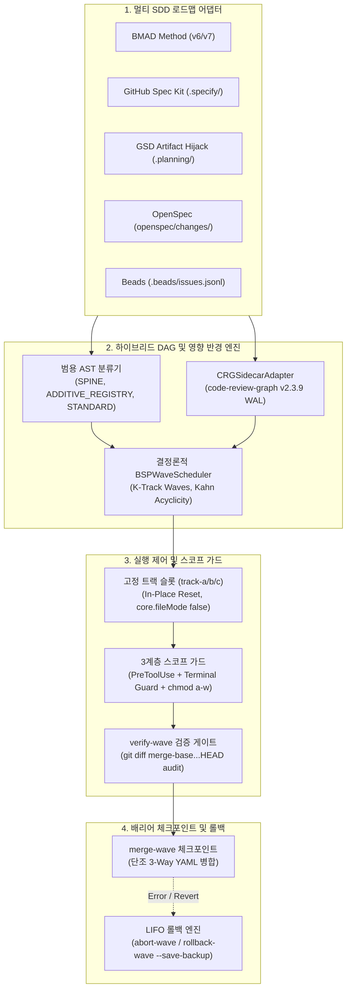

# ⚡ SDD-Parallel

[](https://github.com/stopActingSoSmall/sdd-parallel/actions/workflows/ci.yml)
[](https://www.python.org/)
[](../../../LICENSE)
[](#-5초-오프라인-데모-api-키-불필요)

<p align="center">
  <b>🌐 언어 / Language:</b>
  <a href="../../../README.md">English</a> |
  <a href="../zh-CN/README.md">简体中文</a> |
  <a href="../es/README.md">Español</a> |
  <a href="../pt-BR/README.md">Português (BR)</a> |
  <a href="../ja/README.md">日本語</a> |
  <b>한국어</b> |
  <a href="../ru/README.md">Русский</a>
</p>

> **AI 코딩 에이전트를 위한 명세 기반 개발(SDD) 동시 실행 및 영향 반경(Blast Radius) 거버넌스 하네스**  
> (Google Antigravity, Claude Code, OpenAI Codex)  
> *`sdd-parallel` CLI 및 편리한 `parallel-flow` 단축 별칭으로 제공.*

---

## 🎯 핵심 문제

최신 명세 기반 개발(Spec-Driven Development, SDD) 프레임워크인 **BMAD Method (v6/v7)**, **GitHub Spec Kit (`.specify/`)**, **GSD (Get Shit Done)**, **OpenSpec**, **Beads**는 요구사항을 검증 가능한 단위 명세로 분해하는 데 탁월합니다. 그러나 병렬 실행으로 확장할 때 **치명적인 아키텍처적 한계**에 부딪힙니다:

1. **선형 작업 대기열:** 스케줄러가 엄격한 순차 실행(`Story 1 -> Story 2 -> Story 3`)만을 강제하여 에픽 간의 독립성을 활용하지 못합니다.
2. **공유 설정 파일의 병합 충돌 폭탄(Merge-Bombs):** 동시 실행 중인 에이전트들이 공유 레지스트리 및 스프린트 상태 파일(`sprint-status.yaml`, `STATE.md`, `tasks.md`)을 동시에 수정하여 충돌이 발생합니다.
3. **제2종 시맨틱 충돌(Type-2 Semantic Collisions, $W_A \cap I_B \neq \emptyset$):** 에이전트 A가 공유 인터페이스 시그니처를 수정하는 동안, 에이전트 B가 이전 시그니처를 호출합니다. 각 격리 브랜치의 로컬 테스트는 통과하지만, 병합 후 런타임에서 치명적인 장애가 발생합니다.
4. **서브에이전트 중첩 깊이 제한:** BMAD의 3단계 독립 리뷰와 같은 복잡한 멀티에이전트 워크플로는 플랫 서브에이전트 환경에서 정상 작동하지 못합니다(`Max Subagent Depth = 1`).

---

## 💡 해결책: `sdd-parallel`

`sdd-parallel`은 결정론적 오케스트레이션 및 안전 거버넌스 하네스입니다:
- **다형적 SDD 로드맵 분석:** 하드코딩 없이 5대 SDD 프레임워크 전반에서 작업, 의존성 및 코드 맵을 추출합니다.
- **시맨틱 영향 반경 계산(AST + 호출 그래프):** 유향 의존성, Spine Lock 및 제2종 영향 중복($W_A \cap I_B$)을 수학적으로 산출합니다.
- **고정 트랙 슬롯 할당(`track-a`, `track-b`, ...):** 제자리 재설정(`git checkout -B` + `git clean -fd`)을 지원하는 영구 worktree 슬롯을 배정하여 $O(1)$ 디스크 사용량을 유지합니다.
- **3계층 스코프 가드(Three-Tier Scope Guard) 적용:** `PreToolUse` 훅으로 허용 범위를 벗어난 수정을 차단하고, 터미널 우회(`Bash`, PowerShell)를 검사하며, OS `chmod a-w`로 중요 파일을 보호합니다.
- **단조 3-Way 상태 병합(Monotonic 3-Way Merge):** 반격자 순서($\max(\text{rank})$)를 기반으로 `<<<<<<<` 충돌 마커 없이 작업 상태를 단조적으로 통합합니다.
- **LIFO 트랜잭션 롤백 보장:** 병합된 웨이브를 엄격한 후입선출(LIFO) 순서로 안전하게 되돌리며, 자동 안전 백업 브랜치 생성 및 다형적 상태 복원을 제공합니다.

---

## 🚀 5초 오프라인 데모 (API 키 불필요)

저장소를 복제하고 로컬 오프라인 검증 데모를 실행하세요:

```bash
uv run sdd-parallel demo
```

```text
============================================================================
SDD-PARALLEL STANDALONE MERGE-BOMB DEMO (ZERO API KEYS / OFFLINE)
============================================================================
Workspace: /tmp/sdd-parallel-demo-xyz

[Step 1/4] AST & Architectural Role Classification
----------------------------------------------------------------------------
File Path                              | Detected Role          | Importers
----------------------------------------------------------------------------
src/demo_app/__init__.py               | additive_registry      | -
src/demo_app/api.py                    | standard               | -
src/demo_app/cli.py                    | additive_registry      | -
src/demo_app/exporter.py               | standard               | -
src/demo_app/normalizer.py             | standard               | src/demo_app/api.py
src/demo_app/schema.py                 | spine                  | -

[Step 2/4] Type-2 Semantic Merge-Bomb Detection & BSP Wave Schedule
----------------------------------------------------------------------------
  Collision Analysis:
    - Naive Scheduler : W(1-2)={normalizer.py, cli.py} vs W(2-1)={api.py}
                        -> DISJOINT WRITES (False Safe!)
    - BSPWaveScheduler: Detected semantic_collision between '1-2' and '2-1'
                        -> Overlap W(1-2) ^ I(2-1) on: src/demo_app/api.py
    - Additive Registry: Tasks '1-2' and '1-3' both touch 'src/demo_app/cli.py'
                        -> Role: ADDITIVE_REGISTRY (Parallel allowed in Wave 1)

  Wave Schedule:
    * Wave 1
        - track-a: Story 1-2 -> writes: src/demo_app/normalizer.py (+ shared: src/demo_app/cli.py)
        - track-b: Story 1-3 -> writes: src/demo_app/exporter.py (+ shared: src/demo_app/cli.py)
    * Wave 2
        - track-a: Story 1-1 -> writes: src/demo_app/schema.py
        - track-b: Story 2-1 -> writes: src/demo_app/api.py
    * Wave 3
        - track-a: Story 2-2 -> writes: src/demo_app/schema.py

[Step 3/4] Fixed-Slot Worktree Provisioning & PreToolUse Scope Guard
----------------------------------------------------------------------------
  Provisioned Fixed Slots (100% Clean git status: True):
    - track-a (.worktrees/track-a)
    - track-b (.worktrees/track-b)

  PreToolUse Scope Guard Check (track-a -> 'src/demo_app/schema.py'):
    - Decision : DENY
    - Violation: File 'src/demo_app/schema.py' cannot be modified by Wave 1 / track-a (stories ['1-2'])
    - Reason   : Locked by Spine Chain invariant.

[Step 4/4] Barrier Checkpoint & Monotonic 3-Way YAML Merge
----------------------------------------------------------------------------
  Merged Branches:
    - parallel/track-a
    - parallel/track-b

  Resolved sprint-status.yaml (0 conflict markers):
    - 1-2-normalize-telemetry-payload: done
    - 1-3-cli-batch-export: done
============================================================================
ALL 5 CORE INVARIANTS VERIFIED IN 3.21s
============================================================================
```

> 📖 **상세 분석, 그래프 이론 및 대화형 샌드박스 실습:**  
> 프레임별 디스크 스냅샷(`Before -> Wave Planning -> Slot Locking -> 3-Way Merge`)을 확인하고, 역할 분류 이론(`SPINE` / `ADDITIVE_REGISTRY` / `STANDARD`, 3패스 `ASTHotspotScanner`)을 학습하며, `--keep-temp` 샌드박스 또는 신규 프로젝트에서 `plan`, `prepare`, `check-lock`, `abort-wave`, `rollback-wave`를 직접 테스트해보려면:  
> 👉 아키텍처 이론 분석 **[System Capabilities & Architectural White Paper](../../dossier/02_SYSTEM_CAPABILITIES_WHITE_PAPER.md)** 및 실습 가이드 **[07_STANDALONE_DEMO_AND_E2E_WALKTHROUGH.md](07_STANDALONE_DEMO_AND_E2E_WALKTHROUGH.md)**를 참조하세요 *(표준 **[Architecture & Strategy Dossier](../../dossier/README.md)** 패키지 일부)*.  
> 🏛️ 경영진 및 아키텍트 요약: **[핵심 제품 개요 및 경영진 요약](../../dossier/01_CORE_PRODUCT_BRIEF.md)** | **[시스템 아키텍처 SSOT](ARCHITECTURE.md)**.

---

## 📦 요구 사양 및 설치 방법

### 사전 요구 사항
- **Python:** `>= 3.11` (Python 3.11, 3.12, 3.13)
- **Git:** `>= 2.30` (최신 `git worktree` 격리 및 `info/exclude` 마스킹에 필요)
- **패키지 관리자:** [`uv`](https://docs.astral.sh/uv/) (권장) 또는 `pipx`

### 설치 방법

#### 독립 실행형 CLI 도구로 설치 (권장)
```bash
# uv 사용 시 (가장 빠름)
uv tool install sdd-parallel

# 또는 pipx 사용 시
pipx install sdd-parallel
```

#### 로컬 개발용 소스 코드 설치
```bash
git clone https://github.com/stopActingSoSmall/sdd-parallel.git
cd sdd-parallel
uv sync
```

설치 후 `sdd-parallel`(또는 단축 별칭 `parallel-flow`) 명령어를 통해 전역에서 CLI를 사용할 수 있습니다.

---

## 🏛️ 시스템 아키텍처



---

## 🛡️ 핵심 불변 조건 (Core Invariants)

1. **Zero Worktree Pollution (워크트리 오염 제로):** 주입된 경계 파일(`.tmp/track-context.md`, `.parallel-lock.json`, `ACTIVE_TRACK.md`)은 `info/exclude`로 차단되어 `git status --porcelain`이 항상 100% 클린 상태를 유지합니다.
2. **Zero Cache Invalidation (캐시 무효화 제로):** `_bmad-output/planning-artifacts/` 내 에픽 컨텍스트는 읽기 전용으로 보호되며, 스케줄러 상태는 독립적으로 기록됩니다.
3. **100% Task Coverage & Acyclic Invariant (100% 작업 커버리지 및 비순환 보장):** Kahn/Tarjan 위상 정렬 검증을 통해 누락된 스토리와 의존성 사이클이 존재하지 않음을 보증합니다.
4. **Blast-Radius Enforcement (영향 반경 분리):** 상호 배타적 쓰기 파일 집합($W_A \cap W_B = \emptyset$) 및 시맨틱 영향 반경 분리($W_A \cap I_B = \emptyset$)를 강제합니다.
5. **Universal Anti-Overfitting (범용 과적합 방지 - 불변 조건 7):** 코어 엔진 내 도메인 특정 경로의 하드코딩을 원천 차단합니다. AST 휴리스틱과 위상 중심성만으로 `SPINE`, `ADDITIVE_REGISTRY`, `STANDARD` 역할을 판별합니다.
6. **Fixed Track Slots (고정 슬롯 - $O(1)$ 디스크 사용량):** `track-a`, `track-b`, `track-c`를 제자리에서 재사용(`git checkout -B` + `git clean -fd`)하여 디렉터리 무한 증식을 방지합니다.
7. **Three-Tier Defense-in-Depth Guard (3계층 심층 방어):** `PreToolUse` 훅 + 터미널 감시(`Bash`, `run_command`) + OS 파일 잠금(`chmod a-w`).
8. **Monotonic Status Semi-Lattice (단조 상태 반격자):** 상태가 $\texttt{backlog} (0) < \dots < \texttt{done} (4)$ 순으로 단조 전진하며 충돌 마커 없이 병합됩니다.
9. **LIFO Transactional Rollbacks (후입선출 트랜잭션 롤백):** 자동 백업 브랜치(`backup/wave-<K>-before-rollback-*`)를 동반하여 가장 최근에 병합된 웨이브부터 엄격한 역순으로 되돌립니다.

---

## 🛠️ CLI 명령어 레퍼런스

| 명령어 | 용도 |
| :--- | :--- |
| `sdd-parallel demo [--kit {bmad,spec-kit,gsd,openspec,beads,all}] [--keep-temp] [--scaffold-only] [--output-dir DIR]` | 5초 오프라인 Merge-Bomb 데모 실행 또는 5대 SDD 키트용 대화형 샌드박스 생성. |
| `sdd-parallel plan [--repo REPO] [--max-tracks N] [--kit auto] [--include-done] [--dry-run] [--plan-source {auto,plan,specs}] [--output-dir DIR]` | 로드맵 및 코드베이스 그래프 분석; `execution-plan-parallel.md` 및 `wave-plan.json` 생성. |
| `sdd-parallel prepare --wave K [--repo REPO] [--max-tracks N] [--kit KIT] [--headless] [--antigravity-layout] [--dynamic-worktrees] [--dry-run]` | 트랙 슬롯(`track-a`, `track-b`) 준비, OS 레벨 파일 잠금 적용, 컨텍스트 경계 주입. |
| `sdd-parallel claim-track --wave K --track <id> --worktree <path> [--repo REPO] [--max-tracks N] [--kit KIT] [--headless]` | 잠금 매니페스트를 기존 외부 워크트리 슬롯에 바인딩. |
| `sdd-parallel run-guide --wave K [--repo REPO] [--max-tracks N] [--kit KIT] [--antigravity-layout]` | 각 활성 트랙 창에서 실행할 명령어가 포함된 대화형 운영자 가이드 매트릭스 출력. |
| `sdd-parallel verify-wave --wave K [--repo REPO] [--max-tracks N] [--kit KIT] [--dynamic-worktrees]` | 워크트리 슬롯을 `.parallel-lock.json`과 대조하고 `merge-base` 대비 누적 변경 사항 감사. |
| `sdd-parallel merge --wave K [--repo REPO] [--max-tracks N] [--kit KIT] [--dynamic-worktrees] [--skip-gates] [--strict-gates] [--cleanup] [--dry-run]` | 배리어 체크포인트 병합: 3-Way 상태 병합, git 브랜치 통합, 다형적 품질 게이트 및 트랜잭션 자동 롤백. |
| `sdd-parallel abort-wave --wave K [--repo REPO] [--dynamic-worktrees]` | 미병합 웨이브 중단: 트랙 슬롯을 리셋하고 임시 병렬 브랜치 정리. |
| `sdd-parallel rollback-wave --wave K [--repo REPO] [--dynamic-worktrees] [--to-commit COMMIT] [--save-backup] [--no-backup] [--kit KIT]` | 안전 백업 브랜치를 동반한 LIFO 순서의 트랜잭션 롤백 및 SDD 작업 상태 원복. |
| `sdd-parallel merge-status --base B --ours O --theirs T --out OUT` | `sprint-status.yaml` 전용 하위 레벨 결정론적 3-Way 병합 도구. |
| `sdd-parallel check-lock --file PATH [--tool TOOL]` | 활성 워크트리 잠금 매니페스트를 기준으로 파일 쓰기 권한 검증. |
| `sdd-parallel install-plugin [--target-dir DIR]` | 독립형 Google Antigravity 플러그인 패키징 및 설치. |
| `sdd-parallel autopilot --wave K [--repo REPO] [--max-tracks N] [--kit KIT] [--harness <tool>] [--antigravity-layout] [--execute]` | Model Effort Routing 기반 멀티 대화 Autopilot 실행 명령어 생성 및 실행. |

---

## 🧩 지원 SDD 프레임워크

| SDD 프레임워크 | 상태 | 감지되는 읽기 전용 산출물 | 상태 동기화 방식 |
| :--- | :---: | :--- | :--- |
| **BMAD Method (`v6.3+` / `v7`)** | ✅ 지원 완료 | `sprint-status.yaml`, `epics.md`, `epic-*-context.md`, `spec-*.md` | 단조 3-Way YAML 병합 |
| **GitHub Spec Kit (`.specify/`)** | ✅ 지원 완료 | `.specify/specs/*/tasks.md`, `constitution.md` | Markdown 체크박스 동기화 |
| **GSD (Get Shit Done)** | ✅ 지원 완료 | `.planning/phases/*-PLAN.md`, `ROADMAP.md` | Artifact Hijack (`STATE.md` 격리 보호) |
| **OpenSpec (`openspec/`)** | ✅ 지원 완료 | `openspec/changes/<id>/tasks.md` | 명세 기반 작업 추적 |
| **Beads (`.beads/`)** | ✅ 지원 완료 | `.beads/issues.jsonl` | 위상 JSONL 상태 업데이트 |

---

## 🚢 릴리스 매트릭스: 구현 완료 (v0.1.0) vs 로드맵 (v0.2+)

### ✅ v0.1.0 구현 완료 (Production Hardened)
- Kahn 비순환성 검증을 갖춘 결정론적 BSP(Bulk-Synchronous Parallel) 웨이브 스케줄러.
- AST Hotspot Scanner 및 `code-review-graph v2.3.9` 사이드카 연동.
- 제자리 재설정(in-place reset)을 지원하는 고정 트랙 슬롯 아키텍처(`track-a`, `track-b`, `track-c`).
- 3계층 심층 방어 스코프 가드(`PreToolUse` + 터미널 가드 + OS `chmod a-w`).
- 주석과 서식을 보존하는 단조 3-Way YAML 병합기.
- 자동 안전 백업 브랜치를 지원하는 LIFO 트랜잭션 웨이브 롤백 엔진.
- Two-Stage Assisted (대화형 IDE 슬롯) 운영자 실행 표준(`Depth 0`).
- 5대 멀티 SDD 어댑터 지원(BMAD, Spec Kit, GSD Artifact Hijack, OpenSpec, Beads).
- 독립 오프라인 Merge-Bomb 데모(`sdd-parallel demo`) 및 GitHub Actions CI 파이프라인.
- 95개 이상의 자동화된 단위 및 통합 테스트, mypy --strict 및 ruff 품질 게이트.

### 🚧 향후 계획 (v0.2.0+)
- **커뮤니티 어댑터 생태계:** `mattpocock/skills`(`/implement-spec`) 및 `bmad-loop` v0.8+ 프론트매터 상태 어댑터.
- **환경 오염 제로 동기화:** 고정 슬롯 내 `.venv` 및 `node_modules` 심볼릭 링크를 사용하는 `workz` 패턴.
- **웨이브 전 정적 심볼 링커 및 스코프 에스컬레이션:** AST 심볼 기반 자동 쓰기 집합 확장 및 동적 작업 재스케줄링.
- **FinOps 및 관찰 가능성 익스포터:** OpenTelemetry 스팬 및 Langfuse 토큰 절감 원격 측정.
- **헤드리스 Autopilot 데몬:** 로컬 RPC/서브에이전트 디스패치를 통한 완전 자율 에이전트 실행.

---

## 🧪 개발 및 품질 게이트

로컬에서 전체 테스트 및 검증 스위트를 실행합니다:

```bash
# 테스트 스위트 실행
uv run pytest

# 엄격한 타입 검사
uv run mypy --strict src/sdd_parallel

# 린터 실행
uv run ruff check src/ tests/ scripts/

# 오프라인 데모 실행
uv run sdd-parallel demo
```

---

## 🤝 기여 가이드 및 보안

- **기여 가이드:** 개발 환경 설정 및 풀 리퀘스트 검증 게이트에 대한 안내는 **[기여 가이드](../../../CONTRIBUTING.md)**를 참조하세요.
- **보안 정책:** 취약점 제보 지침 및 보안 정책은 **[보안 정책](../../../SECURITY.md)**에 명시되어 있습니다.

---

## 📜 라이선스

MIT License. 자세한 내용은 [LICENSE](../../../LICENSE)를 참조하세요.
