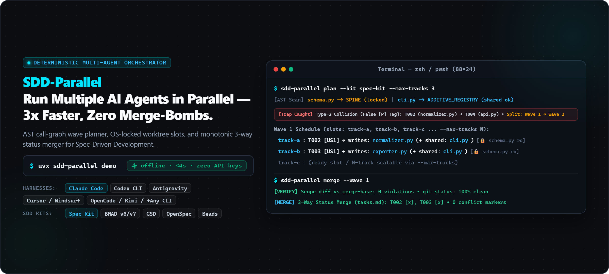
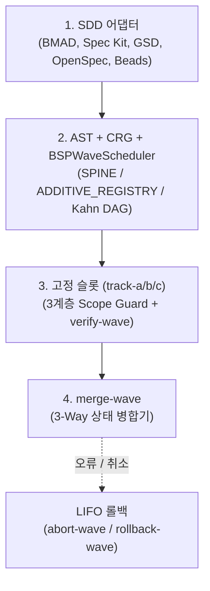

<p align="center">
  
</p>

<p align="center">
  <a href="https://github.com/stopActingSoSmall/sdd-parallel/actions/workflows/ci.yml"></a>
  <a href="https://pypi.org/project/sdd-parallel/"></a>
  <a href="https://www.python.org/"></a>
  <a href="../../../LICENSE"></a>
  <a href="#-5초-만에-체험하기-api-키-불필요-주석이-포함된-안내"></a>
  <br>
  <a href="#-기존-개발-스택에-즉시-통합-종속성-없음"></a>
  <a href="#-실제-sdd-프로젝트-디렉토리-구조-도입-전후-비교"></a>
</p>

<p align="center">
  <b>🌐 언어:</b>
  <a href="../../../README.md">English</a> |
  <a href="../es/README.md">Español</a> |
  <a href="../pt-BR/README.md">Português (BR)</a> |
  <a href="../ja/README.md">日本語</a> |
  <b>한국어</b> |
  <a href="../zh-CN/README.md">简体中文</a> |
  <a href="../ru/README.md">Русский</a>
</p>

<p align="center">
  <a href="#-5초-만에-체험하기-api-키-불필요-주석이-포함된-안내">빠른 데모</a> ·
  <a href="#-왜-이것이-필요한가-쉽게-풀어쓴-설명">도입 배경</a> ·
  <a href="#%EF%B8%8F-동작-원리-및-일상적인-4단계-워크플로우">동작 원리</a> ·
  <a href="#-실제-sdd-프로젝트-디렉토리-구조-도입-전후-비교">프로젝트 구조</a> ·
  <a href="#-기존-개발-스택에-즉시-통합-종속성-없음">지원 하네스</a> ·
  <a href="../../USER_GUIDE.md">User Guide (EN)</a> ·
  <a href="#%EF%B8%8F-전체-cli-명령어-레퍼런스">CLI</a> ·
  <a href="#-시스템-아키텍처-수학적-모델-및-상세-분석-문서">심층 분석</a>
</p>

> **병렬 AI 코딩 에이전트용 결정론적 웨이브 스케줄러 및 격리 worktree 샌드박스 — LLM 토큰을 쓰기 전에 침묵의 머지 폭탄을 방지합니다.**  
> `sdd-parallel`은 **Spec Kit / BMAD / GSD / OpenSpec / Beads** 백로그와 코딩 에이전트(**Claude Code**, **Codex**, **Antigravity**, 모든 worktree CLI) 사이에서 동작합니다.

https://github.com/stopActingSoSmall/sdd-parallel/releases/download/v0.1.0/sdd-parallel-explainer-ko.mp4

<p align="center"><em>🎬 <b>1080p 안내 영상</b> — 상단 <b>🌐 언어</b> 선택기에서 7개 언어 음성을 지원합니다.</em></p>

직접 체험하기: **[⚡ 온라인 Wave Inspector](https://stopactingsosmall.github.io/sdd-parallel/?video=ko)** (설치 없는 브라우저 데모) · **[📘 운영자 사용자 가이드 & Day-1 런북](../../USER_GUIDE.md)**.

---

## ⚡ 왜 이것이 필요한가? (쉽게 풀어쓴 설명)

<p align="center">
  
</p>

10~15개 명세/스토리가 쌓이면 팀은 두 가지 나쁜 선택에 놓입니다:
1. **에이전트 1개로 순차 실행** — 안전하지만 **6~8시간** 대기.
2. **단순 `git worktree`로 3~4개 병렬 실행** — 구현은 빠르지만 병합 시 충돌:
   - **제1종 충돌(직접):** 두 에이전트가 `sprint-status.yaml`, `STATE.md`, `cli.py`를 동시 수정 → `<<<<<<<` 충돌.
   - **제2종 충돌(시맨틱, 무음):** A가 `normalizer.py` 시그니처를 바꾸고 B는 `api.py`에서 구형 시그니처 호출. **Git 병합은 성공하지만 `main`이 깨집니다.**
   - **스코프 침범:** 에이전트가 작업 범위 밖의 공유 `schema.py`를 임의 수정.

**`sdd-parallel`은 토큰 소비 전에 이를 차단합니다:** AST와 호출 그래프를 스캔해 안전한 작업을 **웨이브(Wave)**로 묶고, 고정 슬롯(`track-a/b/c`)에 격리하며, 스코프 외 쓰기를 막고, 품질 게이트 뒤에서 병합합니다.

| 상황 | ❌ 순차 실행 | 💥 단순 `--worktree` | ✅ `sdd-parallel` |
| :--- | :--- | :--- | :--- |
| **12개 스토리 스프린트** | ~6–8시간 | ~2시간 코딩 + **~2시간 머지 복구** | **총 ~2.5시간 (2~3배 빠름)** |
| **숨겨진 API 충돌** | 느린 직렬화로 회피 | **`main` 손상** ($W_A \cap I_B \neq \emptyset$) | **사전 차단** (Wave 1 → 2 분할) |
| **공유 CLI / 라우터** | 직렬 접근 | 매 병합마다 Git 충돌 | **Git 3-way 병합을 통한 동시 실행** (`ADDITIVE_REGISTRY`, 비중복 삽입) |
| **상태 파일** | 순차 갱신 | 반복적 `<<<<<<<` 마커 | **단조 3-way 병합** (마커 0개) |
| **스코프 외 수정** | 프롬프트 경고 | `bash`/`sed`로 우회 | **차단** (`PreToolUse` + 터미널 가드 + `chmod a-w`) |
| **worktree 잔재** | 없음 | 방치된 15개 `task-*` 폴더 | **고정 재사용 슬롯** (`track-a/b/c`) |

*표기: $W$ = 수정 파일 집합(Write set); $I$ = 임포트/의존 파일 집합(Impact radius).*

---

## 🚀 5초 만에 체험하기 (API 키 불필요, 주석이 포함된 안내)

API 키, LLM 구독, 저장소 복제 불필요. [`uv`](https://docs.astral.sh/uv/)로 실행(또는 `pipx run sdd-parallel demo`):

```bash
uvx sdd-parallel demo --kit all   # 단일 키트: uvx sdd-parallel demo --kit spec-kit
```

임시 Git 저장소(5개 작업, 6개 Python 모듈)를 생성해 AST 분석, Scope Guard `DENY` 잠금, 무충돌 3-way 상태 병합을 실행합니다(`--kit all` 사용 시 키트당 약 `~6–9s`, 샌드박스 내 `run_quality_gates=False`):

```text
================================================================
5/5 SDD KITS VERIFIED (BMAD, SPEC KIT, GSD, OPENSPEC, BEADS)
================================================================
Kit      | Merge-Bomb | Worktrees | Scope Guard | 3-Way Merge
----------------------------------------------------------------
bmad     | PASSED     | PASSED    | PASSED      | PASSED
spec-kit | PASSED     | PASSED    | PASSED      | PASSED
gsd      | PASSED     | PASSED    | PASSED      | PASSED
openspec | PASSED     | PASSED    | PASSED      | PASSED
beads    | PASSED     | PASSED    | PASSED      | PASSED
================================================================
```

<details>
<summary><b>🔍 펼쳐보기: 4단계 동작 해설 (<code>--kit spec-kit</code>) 및 샌드박스 모드</b></summary>

1. **`[Step 1/4]` AST 역할 분류:** `schema.py` → `spine`(직렬화); `cli.py` → `additive_registry`(추가 전용); `api.py`는 `normalizer.py`를 임포트.
2. **`[Step 2/4]` 제2종 머지 폭탄 감지:** `T002`(`normalizer.py`)와 `T004`(`api.py`) 모두 `[P]`가 붙어 있지만, `BSPWaveScheduler`가 $W(\text{T002}) \cap I(\text{T004}) \neq \emptyset$를 감지해 `T004`를 **Wave 2**로 미루고 `T002` + `T003`은 **Wave 1**에서 `cli.py`를 안전하게 공유합니다:
```text
Wave 1: [track-a: T002] [track-b: T003]  (normalizer.py + exporter.py + cli.py)
Wave 2: [track-a: T001] [track-b: T004]  (Wave 1 normalizer 이후)
Wave 3: [track-a: T005]                  (schema 배리어)
```
3. **`[Step 3/4]` 깨끗한 슬롯 & 스코프 가드:** 주입된 경계 파일(`ACTIVE_TRACK.md`, `.parallel-lock.json`, `.tmp/track-context.md`)은 `info/exclude`로 숨겨져(`Clean git status: True`), `track-a`가 `schema.py`를 건드리면 `DENY`를 반환합니다.
4. **`[Step 4/4]` 3-Way 병합 & 샌드박스:** 단조 체크박스 병합이 `tasks.md`의 `[ ] < [x]`를 **마커 0개**로 해결합니다. 전체 스냅샷은 [Dossier 07](../../dossier/07_STANDALONE_DEMO_AND_E2E_WALKTHROUGH.md)을 보거나 직접 샌드박스를 실행하세요:
```bash
uvx sdd-parallel demo --kit gsd --scaffold-only --output-dir ./sdd-sandbox
cd sdd-sandbox && sdd-parallel plan && sdd-parallel prepare --wave 1
```

</details>

---

## 🗺️ 동작 원리 및 일상적인 4단계 워크플로우

<p align="center">
  
</p>

`sdd-parallel`은 **Bulk Synchronous Parallel (BSP)** 모델을 따릅니다: 격리된 트랙이 교차 수정 없이 실행되고, 품질 게이트 병합 배리어에서 동기화됩니다.

**1. 최초 1회 설치** (`Python >= 3.11`, `Git >= 2.30`): `uv tool install sdd-parallel` (또는 `pipx install sdd-parallel`; `sdd-parallel` 및 `parallel-flow` 제공).

**2. 웨이브 실행:**

```bash
sdd-parallel plan                  # 1. 명세 + AST 스캔 및 웨이브 계획
sdd-parallel prepare --wave 1      # 2. 슬롯 프로비저닝 및 잠금 주입
sdd-parallel run-guide --wave 1    #    슬롯별 네이티브 명령어 출력
# 3. .worktrees/track-a, track-b, ... 에서 에이전트 실행
sdd-parallel verify-wave --wave 1  # 4. .parallel-lock.json 기준 diff 감사
sdd-parallel merge --wave 1        #    품질 게이트 및 main 3-way 병합
```

**실행 취소 및 검사:** `abort-wave --wave 1` · `rollback-wave --wave 1 --save-backup` (LIFO + 안전 브랜치) · `inspect --open` (`assets/inspector.html`).

- **Mode A — 대화형 지원:** `plan` → `inspect --open` → **CLI Action Bridge**로 `prepare` / `merge` 복사 후 `.worktrees/track-{a,b}` 감독.
- **Mode B — 순환 오토파일럿:** `sdd-parallel autopilot --wave 1 --harness {antigravity,claude-code,codex} --execute --policy {single-shot,cyclic} [--max-review-rounds N] [--routing-file FILE]`.

👉 **[`docs/USER_GUIDE.md`](../../USER_GUIDE.md#3-interactive-wave-inspector--orchestration-modes-mode-a-vs-mode-b)** (Wave Inspector 및 모드) · **[Day-1 복구 런북](../../USER_GUIDE.md#4-day-1-troubleshooting--recovery-runbook)** 참조.

---

## 📂 실제 SDD 프로젝트 디렉토리 구조 (도입 전/후 비교)

<p align="center">
  
</p>

읽기 전용 **부패 방지 계층(Anti-Corruption Layer, ACL)** 어댑터가 원본 명세를 건드리지 않고 5개 SDD 포맷을 정규화합니다:

| SDD 프레임워크 | 읽기 전용 아티팩트 (잠금) | 작업 탐색 대상 | 상태 동기화 |
| :--- | :--- | :--- | :--- |
| **Spec Kit** (`.specify/`) | `constitution.md`, `feature.json`, `spec.md`, `plan.md` | `specs/*/tasks.md` (`T001 [P]`) | 3-way Markdown |
| **BMAD** (`v6.3+/v7`) | `epic-*-context.md` (Zero Cache Invalidation) | `sprint-status.yaml`, `epics.md`, `spec-*.md` | 3-way YAML |
| **GSD** (`.planning/`) | `PROJECT.md`, `REQUIREMENTS.md`, `ROADMAP.md`, `STATE.md` | `phases/*/NN-NN-PLAN.md` | 중앙 `STATE.md` |
| **OpenSpec** (`openspec/`) | `openspec/specs/**`, `project.md`, `config.yaml`, 형제 변경 | `openspec/changes/<slug>/tasks.md` | 3-way Markdown |
| **Beads** (`.beads/`) | `.beads/config.yaml` | `.beads/*.jsonl` (`bd-101` + `blocks`) | 라인 단위 3-way JSONL |

<details>
<summary><b>🌱 예시: GitHub Spec Kit (<code>.specify/</code> &amp; <code>specs/*/tasks.md</code>) — <code>plan</code> + <code>prepare --wave 1</code> 후</b></summary>

```text
my-project/
├── .parallel/{artifacts/wave-plan.json, history/, state.json}
├── .specify/…                         # 원본 유지
├── .worktrees/
│   ├── track-a/                       # Wave 1 → T002
│   │   ├── .specify/memory/constitution.md    # 🔒 읽기 전용
│   │   ├── specs/001-telemetry/{plan,spec}.md # 🔒 읽기 전용
│   │   ├── specs/001-telemetry/tasks.md       # ✍️ 쓰기 가능
│   │   ├── .tmp/track-context.md      # 👻 숨김 (info/exclude)
│   │   ├── .parallel-lock.json        # 👻 숨김 (info/exclude)
│   │   └── ACTIVE_TRACK.md            # 👻 → /speckit.implement T002
│   └── track-b/                       # Wave 1 → T003
└── specs/… & src/…                    # main 원본 유지
```

</details>

범례: 🔒 읽기 전용 (`chmod a-w` + `PreToolUse` 거부) · 👻 숨김 (`info/exclude`) · ✍️ 쓰기 스코프.  
👉 5개 전체 도입 전/후 트리(**Spec Kit, BMAD, GSD, OpenSpec, Beads & Custom SDD**): **[`docs/USER_GUIDE.md` 섹션 2](../../USER_GUIDE.md#2-sdd-project-layouts-before--after-all-5-frameworks)**.

---

## 🔌 기존 개발 스택에 즉시 통합 (종속성 없음)

`sdd-parallel run-guide --wave 1`이 슬롯별 네이티브 명령어를 출력합니다(`ACTIVE_TRACK.md`에도 기록):

| SDD 키트 | 트랙별 네이티브 명령어 |
| :--- | :--- |
| GitHub Spec Kit | `/speckit.implement T002` |
| BMAD Method | `/bmad-build 1-2` |
| GSD | `/gsd-execute-phase 01-02` |
| OpenSpec | `/openspec-apply normalize-telemetry` |
| Beads | `bd update bd-102 --status in-progress` |

> 📦 **Spec Kit 확장 (`extension.yml`):** `specify extension add --from https://github.com/stopActingSoSmall/sdd-parallel/archive/refs/tags/v0.2.1.zip` (또는 `specify extension add sdd-parallel`)로 `/specify plan-waves`, `/specify prepare-wave --wave 1`, `/specify merge-wave --wave 1`을 추가합니다.

| 하네스 | 연동 방식 |
| :--- | :--- |
| **Claude Code** (`claude`) | `.worktrees/track-a`에서 `claude` 실행(`blockWritesOutsideWorkingDirectories` + `PreToolUse` + `chmod a-w`) 또는 `autopilot --wave 1 --harness claude-code`. |
| **Codex CLI** (`codex`) | `codex --cd .worktrees/track-b`; `chmod a-w`로 계약 보호, `verify-wave`로 diff 감사. 오토파일럿: `--harness codex`. |
| **Google Antigravity** (`agy`) | `prepare --wave 1 --antigravity-layout`은 슬롯을 `~/.gemini/antigravity/worktrees/<Project>/track-a`에 배치; `install-plugin`으로 스코프 가드 훅 설치. |
| **Cursor, Windsurf, OpenCode, Kimi, Aider, Cline, Trae** | 무설정 `.worktrees/track-{a,b,c}`, `chmod a-w`, `ACTIVE_TRACK.md`, 외부 worktree용 `claim-track`, `verify-wave`. |

👉 상세 레시피(`local` `.worktrees/` vs `--antigravity-layout`, `claim-track`, MCP)는 **[`docs/USER_GUIDE.md` 섹션 1](../../USER_GUIDE.md#1-harness-connection-recipes-local-slots-vs-antigravity-layout)** 참조.

---

## 🔍 시스템 아키텍처, 수학적 모델 및 상세 분석 문서

- 📘 **[운영자 사용자 가이드 & Day-1 런북 (`docs/USER_GUIDE.md`)](../../USER_GUIDE.md)**: 하네스 설정, 5개 도입 전/후 트리, Wave Inspector, 복구 런북
- 📖 **[01 — 핵심 제품 브리프](../../dossier/01_CORE_PRODUCT_BRIEF.md)** · **[02 — 시스템 기능 백서](../../dossier/02_SYSTEM_CAPABILITIES_WHITE_PAPER.md)** · **[03 — 통합 명세서](../../dossier/03_INTEGRATION_AND_ECOSYSTEM_SPEC.md)**
- 📊 **[04 — 경쟁 분류 체계](../../dossier/04_COMPETITIVE_AND_BENCHMARK_TAXONOMY.md)** · **[07 — E2E 데모 가이드](../../dossier/07_STANDALONE_DEMO_AND_E2E_WALKTHROUGH.md)** · **[아키텍처 SSOT](../../../ARCHITECTURE.md)** · **[도시에 목차](../../dossier/README.md)** · **[RU 도시에](../ru/dossier/)**

<details>
<summary><b>❓ 핵심 엔지니어링 질문 및 정직한 적용 한계 (FAQ)</b></summary>

1. **코드를 작성하기도 전에 플래너가 어떻게 `write_files`를 알 수 있나요?**
   3단계 보호 계층으로 동작합니다: **(a)** 명세에 선언된 명시적 경로(`Code Map`, `Files:`, GSD XML `<files>`, 백틱 경로) → **(b)** 언급된 함수/클래스 이름을 $O(1)$에 파일로 해석하는 Pre-Wave AST 심볼 링커 → **(c)** 동적 스코프 에스컬레이션(`.tmp/scope-escalation.json`): `PreToolUse`가 거부된 범위 밖 편집을 기록하고, `verify-wave`가 해당 작업을 Wave $K+1$로 이월하며(비워진 슬롯을 초기화하고 `.parallel/wave-plan.json`을 저장), `merge`가 갱신된 계획에 따라 병합을 실행합니다.
2. **TypeScript, Go, Rust 또는 비-Python 저장소는 어떻게 처리하나요?**
   정직한 한계: 내장된 무의존성 AST 스캐너는 Python을 네이티브로 파싱합니다. 다중 언어 저장소(TS/JS, Go, Rust)의 경우 `sdd-parallel`은 명세의 명시적 파일 목록과 선택적 Tree-sitter 사이드카 **`code-review-graph`**(`CRGSidecarAdapter`)를 결합하여 파일 간 임포트 및 영향 간선을 계산합니다.
3. **에이전트가 셸(`sed -i`, `python -c`, `cp`)로 `PreToolUse` 훅을 우회할 수 있지 않나요?**
   통제는 단일 훅에 의존하지 않는 **3계층 심층 방어(3-Tier Defense-in-Depth)**로 작동합니다: **Tier 1**(`PreToolUse` + `Bash`/`run_command`/`powershell` 리다이렉션 및 인라인 쓰기를 검사하는 터미널 가드) → **Tier 2**(Spine 및 형제 트랙 소유 파일에 대한 OS 수준 `chmod a-w` 잠금) → **Tier 3**(실제 `git diff merge-base...HEAD`를 감사하고 위반 시 병합을 차단하는 `verify-wave`).
4. **AST는 계층 간 계약(Pydantic JSON → TS 프론트엔드, SQL FK, OpenAPI)을 볼 수 없지 않나요!**
   맞습니다 — 정적 임포트 그래프는 구문 경계에서 멈춥니다. `sdd-parallel`은 **`DEFAULT_CONTRACT_GLOBS`**(`**/schemas/**`, `**/migrations/**`, `openapi.*`, `*.proto`, `*.graphql`)와 `.parallel-config.json`의 프로젝트별 `file_roles`를 통해 이 간극을 선언적으로 메우며, 계층 간 계약을 엄격한 `SPINE` 직렬화로 강제합니다.

</details>

<details>
<summary><b>🏛️ 엔진 내부 아키텍처 및 9대 핵심 불변성 원칙</b></summary>



1. **워크트리 오염 제로:** 경계 파일을 `info/exclude`로 숨겨 `git status --porcelain`을 비워 둡니다.
2. **캐시 무효화 제로:** 사전 컴파일된 컨텍스트는 읽기 전용으로 유지하고 상태는 `.parallel/`에 저장합니다.
3. **100% 커버리지 및 비순환성:** Kahn 검증으로 작업 누락과 순환 의존성 0건을 보장합니다.
4. **영향 반경 격리:** 배타적 쓰기($W_A \cap W_B = \emptyset$) 및 시맨틱 영향($W_A \cap I_B = \emptyset$).
5. **범용 과적합 방지:** `SPINE`, `ADDITIVE_REGISTRY`, `STANDARD`를 AST와 중심성만으로 도출합니다.
6. **고정 슬롯:** `track-a/b/c`를 제자리 재설정(`git checkout -B` + `git clean -fd`)으로 재사용합니다.
7. **3계층 가드:** `PreToolUse` + 터미널 가드(`Bash`, `run_command`) + OS `chmod a-w`.
8. **단조 상태 반격자:** $\texttt{backlog}(0) < \dots < \texttt{done}(4)$ 규칙으로 마커 없이 병합합니다.
9. **LIFO 롤백:** 역순 되돌리기 및 `backup/wave-<K>-before-rollback-*` 안전 브랜치 생성.

</details>

---

## 🛠️ 전체 CLI 명령어 레퍼런스

<details>
<summary><b>클릭하여 펼치기: 16개 서브커맨드 및 플래그 전체 목록</b></summary>

공통 플래그: `--repo REPO`, `--max-tracks N`, `--kit KIT`, `--routing-file FILE`, `--dry-run`, `--dynamic-worktrees`.

| 명령어 | 주요 플래그 및 역할 |
| :--- | :--- |
| `sdd-parallel demo` | `[--kit {...,all}] [--keep-temp] [--scaffold-only] [--output-dir DIR]` — 오프라인 데모 / 샌드박스. |
| `sdd-parallel plan` | `[--include-done] [--plan-source {auto,plan,specs}] [--output-dir DIR]` — `wave-plan.json` 생성. |
| `sdd-parallel prepare --wave K` | `[--headless] [--antigravity-layout]` — 슬롯 프로비저닝, OS 잠금, 경계 주입. |
| `sdd-parallel claim-track --wave K` | `--track <id> --worktree <path> [--headless]` — 기존 worktree에 잠금 연결. |
| `sdd-parallel run-guide --wave K` | `[--antigravity-layout]` — 슬롯별 네이티브 실행 명령어 출력. |
| `sdd-parallel verify-wave --wave K` | `.parallel-lock.json`, `merge-base` diff 및 스코프 에스컬레이션 기준으로 슬롯 감사. |
| `sdd-parallel merge --wave K` | `[--skip-gates] [--strict-gates] [--cleanup]` — 게이트 검증, 3-way 병합, 충돌 또는 게이트 오류 시 원자적 롤백. |
| `sdd-parallel abort-wave --wave K` | 고정 슬롯을 제자리에서 `HEAD`로 리셋(또는 `--dynamic-worktrees`에서 브랜치 삭제). |
| `sdd-parallel rollback-wave --wave K` | `[--to-commit COMMIT] [--save-backup\|--no-backup]` — LIFO 되돌리기 + 안전 브랜치 + 상태 복원. |
| `sdd-parallel merge-status` | `--base B --ours O --theirs T --out OUT` — `sprint-status.yaml` 3-way 병합. |
| `sdd-parallel check-lock` | `--file PATH [--tool TOOL]` — 활성 잠금 매니페스트 대비 쓰기 검증. |
| `sdd-parallel install-plugin` | `[--target-dir DIR]` — 이식형 Antigravity 플러그인 설치. |
| `sdd-parallel init-custom` | `[--specs-dir DIR] [--format {markdown,yaml}] [--test-cmd CMD] [--non-interactive]` — `.parallel/custom-kit.yaml` 초기화. |
| `sdd-parallel autopilot --wave K` | `[--harness {antigravity,claude-code,codex}] [--antigravity-layout] [--execute] [--policy {single-shot,cyclic}] [--max-review-rounds N]` — 트랙 자동 실행. |
| `sdd-parallel bench` | `[--since REV] [--until REV] [--demo] [--format {text,json}] [--output-file FILE]` — 정적 모델 대비 머지 폭탄 백테스트. |
| `sdd-parallel inspect` | `[--plan PATH] [--output PATH] [--open]` — HTML Wave Inspector 열기. |

</details>

---

## 🚢 릴리스 매트릭스: 완료 항목 (v0.2.1) vs 로드맵 (v0.3+)

### ✅ `v0.1.0 – v0.2.1` 구현 완료 항목
- [x] BSP 웨이브 스케줄러(Kahn 비순환성) + AST 핫스팟 스캐너 + `code-review-graph v2.3.9` 사이드카.
- [x] 제자리 재설정, `info/exclude` 마스킹, `.venv`/`node_modules` NTFS Junctions (Windows, no admin) / POSIX symlinks를 지원하는 고정 슬롯(`track-a/b/c`).
- [x] 3계층 스코프 가드(`PreToolUse` + 터미널 가드 + `chmod a-w`), 심볼 링커, `.tmp/scope-escalation.json`.
- [x] 단조 3-way 상태 병합기(YAML, Markdown, `STATE.md`, JSONL) + LIFO 트랜잭션 롤백.
- [x] 5개 SDD 어댑터(Spec Kit + `extension.yml`, BMAD + `mattpocock/skills` + `bmad-loop`, GSD, OpenSpec, Beads).
- [x] 오프라인 `demo --kit all`, `bench` 백테스트, HTML Wave Inspector(`inspect --open`), `--scaffold-only`.
- [x] `--routing-file`, `TaskStructuralSignals`, `--policy cyclic`을 지원하는 멀티 윈도우 및 Depth-0 오토파일럿(`agy`, Claude Code, Codex) (`ADR-0009`).
- [x] 클린 클론 CI(Ubuntu/macOS/Windows, Python 3.11–3.13) 및 PyPI Trusted Publishing.

### 🚧 `v0.3+` 로드맵 예정 항목
- [ ] 엄격한 키트 자동 감지 (무음 폴백 제로, TTY 모호성 해소)
- [ ] 그래프 안전 에스컬레이션 및 원인 이분 탐색 (부분 웨이브 병합 + 수정 루프)
- [ ] 네이티브 다중 언어 Tree-sitter AST 및 자동 CRG 인덱싱 (TS/JS, Go, Rust)
- [ ] 선택적 System-1 사전 추출기 (`--extractor none|gliner|clairic`) 및 적응형 `--max-tracks auto`

---

## 🤝 문의 및 협업

- **연구, 지원금 및 비공개 문의:** [sdd-parallel@metrichub.dev](mailto:sdd-parallel@metrichub.dev)
- **아키텍처 Q&A 및 커뮤니티:** [GitHub Discussions](https://github.com/stopActingSoSmall/sdd-parallel/discussions)
- **보안 취약점 제보:** [SECURITY.md](../../../SECURITY.md) 참조

---

## 🛠️ 기여 안내, 로컬 개발 및 보안 정책

```bash
git clone https://github.com/stopActingSoSmall/sdd-parallel.git && cd sdd-parallel && uv sync
uv run pytest && uv run mypy --strict src/sdd_parallel && uv run ruff check src/ tests/ scripts/
uv run sdd-parallel demo --kit all
```

- **기여:** [Contributing Guide](../../../CONTRIBUTING.md) · **보안:** [Security Policy](../../../SECURITY.md) · **라이선스:** [MIT](../../../LICENSE) (음성 내레이션: [ElevenLabs](https://elevenlabs.io) 및 [Google Gemini](https://ai.google.dev/)).

### 💼 상용 감사 및 엔터프라이즈 모노레포 지원

고정 범위 B2B 감사(**Parallel SDD Readiness & Blast-Radius Audit**, \$500–\$2,500): `sdd-parallel bench` 회고 분석, 맞춤형 `.parallel-config.json`(`contract_globs`, spine 직렬화, 품질 게이트) 및 HTML Wave Inspector 리포트를 **[GitHub Discussions](https://github.com/stopActingSoSmall/sdd-parallel/discussions)**를 통해 제공합니다.
