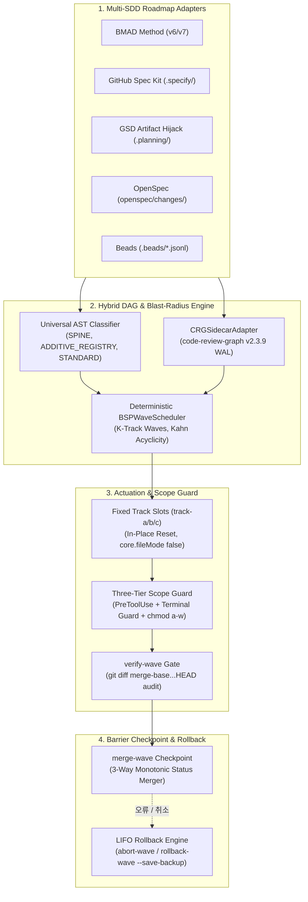

<p align="center">
  
</p>

<p align="center">
  <a href="https://github.com/stopActingSoSmall/sdd-parallel/actions/workflows/ci.yml"></a>
  <a href="https://pypi.org/project/sdd-parallel/"></a>
  <a href="https://www.python.org/"></a>
  <a href="../../../LICENSE"></a>
  <a href="#-5초-만에-체험하기-api-키-불필요-주석이-포함된-안내"></a>
  <br>
  <a href="#-기존-개발-스택에-즉시-통합-종속성-없음"></a>
  <a href="#-실제-sdd-프로젝트-디렉토리-구조-도입-전후-비교"></a>
</p>

<p align="center">
  <b>🌐 언어:</b>
  <a href="../../../README.md">English</a> |
  <a href="../zh-CN/README.md">简体中文</a> |
  <a href="../es/README.md">Español</a> |
  <a href="../pt-BR/README.md">Português (BR)</a> |
  <a href="../ja/README.md">日本語</a> |
  <b>한국어</b> |
  <a href="../ru/README.md">Русский</a>
</p>

<p align="center">
  <a href="#-5초-만에-체험하기-api-키-불필요-주석이-포함된-안내">빠른 데모</a> ·
  <a href="#-왜-이것이-필요한가-쉽게-풀어쓴-설명">도입 배경</a> ·
  <a href="#%EF%B8%8F-동작-원리-및-일상적인-4단계-워크플로우">동작 원리</a> ·
  <a href="#-실제-sdd-프로젝트-디렉토리-구조-도입-전후-비교">프로젝트 구조</a> ·
  <a href="#-기존-개발-스택에-즉시-통합-종속성-없음">지원 하네스</a> ·
  <a href="#%EF%B8%8F-전체-cli-명령어-레퍼런스">CLI 레퍼런스</a> ·
  <a href="#-시스템-아키텍처-수학적-모델-및-상세-분석-문서">심층 분석</a>
</p>

> **여러 AI 코딩 에이전트를 안전하게 병렬 실행 — 최대 3배 빠른 개발, 머지 충돌 폭탄(Merge-Bomb) 제로.**  
> `sdd-parallel`은 **Spec Kit / BMAD / GSD / OpenSpec / Beads** 백로그와 이를 구현하는 코딩 에이전트(**Claude Code**, **Codex**, **Antigravity** 및 worktree를 지원하는 모든 CLI) 사이에서 동작하는 결정론적 트래픽 컨트롤러이자 워크트리 격리기 및 영향 반경(Blast-Radius) 보호 하네스입니다.

---

## ⚡ 왜 이것이 필요한가? (쉽게 풀어쓴 설명)

<p align="center">
  
</p>

10~15개의 명세(spec)나 스토리로 구성된 백로그를 개발할 때, 개발자는 보통 두 가지 불만족스러운 선택지 중 하나를 강요받습니다:

1. **에이전트 1개로 순차 실행** — 안전하지만 작업 완료까지 **6~8시간**을 하염없이 기다려야 합니다.
2. **단순 `git worktree` 폴더에서 에이전트 3~4개 동시 실행** — 코딩은 빠르지만, 병합(merge) 순간 대혼란이 발생합니다:
   - **제1종 충돌(직접 충돌, Direct):** 두 에이전트가 동시에 `sprint-status.yaml`, `STATE.md`, `cli.py`를 수정 → 머지할 때마다 `<<<<<<<` 충돌 마커 발생.
   - **제2종 충돌(시맨틱/무음 충돌, Semantic & Silent):** 에이전트 A가 `normalizer.py`의 함수 시그니처를 변경하고, 다른 워크트리의 에이전트 B는 `api.py`에서 기존 구형 시그니처를 호출. **Git은 충돌 마커 없이 깔끔하게 병합하지만, 병합 직후 `main` 브랜치가 깨집니다.**
   - **스코프 무단 침범(Scope creep):** "지나치게 친절한" 에이전트가 본인의 할당 작업도 아닌 공유 `schema.py`를 마음대로 리팩터링합니다.

**`sdd-parallel`은 단 1개의 LLM 토큰을 소비하기도 전에 이 문제를 해결합니다:** AST 및 호출 그래프를 스캔하여 안전성이 수학적으로 입증된 작업들을 병렬 **웨이브(Wave)**로 그룹화하고, 각 에이전트를 깨끗한 고정 슬롯(`track-a`, `track-b`, …)에 격리하며, 훅과 OS 레벨에서 스코프 외 수정을 원천 차단하고, 퀄리티 게이트 베리어 뒤에서 각 웨이브를 안전하게 병합합니다.

| 발생 상황 | ❌ 순차 실행 (에이전트 1개) | 💥 단순 병렬 (`--worktree`) | ✅ `sdd-parallel` 적용 시 |
| :--- | :--- | :--- | :--- |
| **12개 스토리 스프린트 소요 시간** | ~6–8시간 (하나씩 순차 처리) | ~2시간 코딩 + **~2시간 깨진 머지 복구** | **총 ~2.5시간 (2~3배 가속)** |
| **숨겨진 타입 / API 충돌** | 작업을 극도로 느리게 진행해야만 회피 | **머지 후 `main` 브랜치 손상** (W_A ∩ I_B ≠ ∅) | **사전 원천 차단** (Wave 1 → Wave 2로 분할 격리) |
| **공유 CLI / 라우터 파일 수정** | 한 번에 에이전트 1개만 접근 가능 | 머지할 때마다 Git 충돌 발생 | **병렬 안전 보장** (`ADDITIVE_REGISTRY` 자동 감지) |
| **`sprint-status.yaml` / `tasks.md` / `STATE.md`** | 순차적으로만 업데이트 가능 | 지속적인 `<<<<<<<` 충돌 발생 | **자동 병합** (단조 3-way 병합 엔진) |
| **에이전트가 엉뚱한 파일을 수정할 때** | 프롬프트로 "제발 수정하지 마세요" 당부 | `bash` / `sed` 등을 통해 쉽게 우회됨 | **원천 차단** (`PreToolUse` 훅 + 터미널 가드 + `chmod a-w`) |
| **워크트리 폴더 난립** | 없음 | 방치된 15개의 `.worktrees/task-*` 폴더 잔재 | **고정된 재사용 슬롯** (`track-a`, `track-b`, `track-c`) |

---

## 🚀 5초 만에 체험하기 (API 키 불필요, 주석이 포함된 안내)

API 키도, LLM 구독도, 저장소 복제(clone)도 필요 없습니다. [`uv`](https://docs.astral.sh/uv/)를 통한 단 한 줄의 명령어로 실행할 수 있습니다(또는 `pipx run sdd-parallel demo`):

```bash
uvx sdd-parallel demo          # 특정 키트 테스트 시: uvx sdd-parallel demo --kit spec-kit
```

이 데모는 5개의 작업과 6개의 Python 모듈을 포함하는 임시 저장소를 자동으로 스캐폴딩하고, 실제 엔진을 실행하여 약 4초 만에 완료합니다. 아래는 `--kit spec-kit`을 실행했을 때의 4단계 과정입니다.

#### `[Step 1/4]` AST 및 역할 분류 (AST & Role Classification)

```text
File Path                              | Detected Role          | Importers
----------------------------------------------------------------------------
src/demo_app/__init__.py               | additive_registry      | -
src/demo_app/api.py                    | standard               | -
src/demo_app/cli.py                    | additive_registry      | -
src/demo_app/exporter.py               | standard               | -
src/demo_app/normalizer.py             | standard               | src/demo_app/api.py
src/demo_app/schema.py                 | spine                  | -
```

어떠한 설정 파일이나 하드코딩된 경로도 없습니다: 스캐너가 `schema.py`를 **`spine`**(모든 모듈이 의존하므로 순차 직렬화 필요)으로, `cli.py`를 **`additive_registry`**(추가 전용 명령 등록 파일이므로 동시 공유 안전)로 식별하고, `api.py`가 `normalizer.py`를 임포트한다는 사실을 기록합니다.

#### `[Step 2/4]` 숨겨진 제2종 시맨틱 머지 폭탄 감지 (Catching the Hidden Type-2 Merge-Bomb)

```text
  Collision Analysis:
    - Naive Scheduler : W(T002)={normalizer.py, cli.py} vs W(T004)={api.py}
                        -> DISJOINT WRITES (False Safe!)
    - BSPWaveScheduler: Detected semantic_collision between 'T002' and 'T004'
                        -> Overlap W(T002) ^ I(T004) on: src/demo_app/api.py
  Wave Schedule:
    * Wave 1  track-a: T002 (normalizer.py + shared cli.py) | track-b: T003 (exporter.py + shared cli.py)
    * Wave 2  track-a: T001 (schema.py)                     | track-b: T004 (api.py)
    * Wave 3  track-a: T005 (schema.py)
```

`tasks.md`에서 `T002`와 `T004`는 모두 수동으로 `[P]`(병렬 가능) 태그가 지정되어 있었고, 수정 대상 파일 집합도 서로 겹치지 않습니다(`normalizer.py ≠ api.py`). 따라서 단순한 파일 잠금 방식 스케줄러라면 두 작업을 동시에 실행했을 것입니다. 하지만 `BSPWaveScheduler`는 `T002`의 쓰기 대상이 `T004`의 영향 집합(Impact set)에 포함된다는 것을 감지하고, `T004`를 이미 병합이 완료된 `normalizer.py`를 기반으로 빌드할 수 있는 **Wave 2**로 재배치합니다. 한편 `T002`와 `T003`은 둘 다 `cli.py`를 수정하지만, 이 파일이 추가 전용 레지스트리(Additive Registry)임을 인식하여 안전하게 병렬 실행을 허용합니다.

#### `[Step 3/4]` 깨끗한 고정 슬롯 및 스코프 가드 차단 (Clean Fixed Slots & Scope Guard Interception)

```text
  Provisioned Fixed Slots (100% Clean git status: True):
    - track-a (.worktrees/track-a)
    - track-b (.worktrees/track-b)

  PreToolUse Scope Guard Check (track-a -> 'src/demo_app/schema.py'):
    - Decision : DENY
    - Violation: File 'src/demo_app/schema.py' cannot be modified by Wave 1 / track-a (stories ['T002'])
    - Reason   : Locked by Spine Chain invariant.
```

주입된 경계 컨텍스트 파일(`ACTIVE_TRACK.md`, `.parallel-lock.json`, `.tmp/track-context.md`)은 워크트리의 `info/exclude`를 통해 Git 추적에서 마스킹되므로 `git status --porcelain`은 100% 깨끗한 상태를 유지합니다. `track-a`의 에이전트가 스코프 외의 `schema.py`를 수정하려고 시도하면, 디스크에 쓰기가 실행되기 전에 사전 차단(DENY)됩니다.

#### `[Step 4/4]` 배리어 체크포인트 및 충돌 없는 3-Way 병합 (Barrier Checkpoint & Zero-Conflict 3-Way Merge)

```text
  Merged Branches:
    - parallel/track-a
    - parallel/track-b
  Resolved tasks.md (0 conflict markers):
    - - [ ] T001 [US1] Upgrade schema in `src/demo_app/schema.py` (depends on T002)
    - - [x] T002 [P] [US1] Normalize `src/demo_app/normalizer.py`, `src/demo_app/cli.py`
    - - [x] T003 [P] [US1] Export `src/demo_app/exporter.py`, `src/demo_app/cli.py`
```

두 브랜치가 동일한 `tasks.md` 파일을 동시에 수정했습니다. 상태 병합 엔진은 각 줄을 단조 반격자 규칙(`[ ] < [x]`, `backlog < … < done`)에 따라 자동으로 병합하므로 `<<<<<<<` 충돌 마커가 전혀 발생하지 않습니다. 동일한 논리가 `sprint-status.yaml`, `STATE.md`, `.beads/*.jsonl`에도 적용됩니다.

<details>
<summary><b>🧪 5개 SDD 키트 검증 매트릭스(<code>uvx sdd-parallel demo --kit all</code>) 및 샌드박스 모드 보기 (클릭하여 펼치기)</b></summary>

```text
============================================================================
5/5 SDD KITS VERIFIED (BMAD, SPEC KIT, GSD, OPENSPEC, BEADS)
============================================================================
Kit          | Merge-Bomb   | Worktrees    | Scope Guard  | 3-Way Merge
----------------------------------------------------------------------------
bmad         | PASSED       | PASSED       | PASSED       | PASSED
spec-kit     | PASSED       | PASSED       | PASSED       | PASSED
gsd          | PASSED       | PASSED       | PASSED       | PASSED
openspec     | PASSED       | PASSED       | PASSED       | PASSED
beads        | PASSED       | PASSED       | PASSED       | PASSED
============================================================================
```

직접 워크플로우를 수동으로 제어해보고 싶으신가요? 영구 샌드박스를 스캐폴딩하여 내부에서 실제 명령어를 실행해볼 수 있습니다:

```bash
uvx sdd-parallel demo --kit gsd --scaffold-only --output-dir ./sdd-sandbox
cd sdd-sandbox
sdd-parallel plan
sdd-parallel prepare --wave 1
```

</details>

---

## 🗺️ 동작 원리 및 일상적인 4단계 워크플로우

<p align="center">
  
</p>

**1. 최초 1회 설치** (`Python >= 3.11`, `Git >= 2.30` 필요):

```bash
uv tool install sdd-parallel     # 또는: pipx install sdd-parallel
```
*(시스템 전역에서 `sdd-parallel` 및 빠른 별칭 `parallel-flow` 사용 가능).*

설치 즉시 `sdd-parallel` CLI 및 단축 별칭인 `parallel-flow`를 전역 환경에서 사용할 수 있습니다.

**2. 모든 SDD 프로젝트에서 웨이브 실행:**

```bash
# 1. 명세 및 코드베이스 AST를 스캔하여 안전한 웨이브 계획 수립
sdd-parallel plan

# 2. Wave 1을 고정 슬롯에 프로비저닝하고 각 트랙별 실행 가이드 출력
sdd-parallel prepare --wave 1
sdd-parallel run-guide --wave 1

# 3. .worktrees/track-a, track-b, ... 내부에서 에이전트 시작 (슬롯당 1개 에이전트)

# 4. 스코프 준수 여부 감사, 퀄리티 게이트 실행, Wave 1을 main 브랜치로 병합
sdd-parallel verify-wave --wave 1
sdd-parallel merge --wave 1
```

실행 취소: `sdd-parallel abort-wave --wave 1` (병합 전) 또는 `sdd-parallel rollback-wave --wave 1` (병합 후; 엄격한 LIFO 순서 적용, 자동 `backup/wave-<K>-before-rollback-*` 안전 브랜치 생성, SDD 작업 상태 원복).

---

## 📂 실제 SDD 프로젝트 디렉토리 구조 (도입 전/후 비교)

<p align="center">
  
</p>

`sdd-parallel`은 기존 프레임워크 파일을 그대로 읽습니다 — 마이그레이션이나 새로운 명세 포맷 작성이 일절 불필요합니다.

| SDD 프레임워크 | 읽기 전용 아티팩트 (슬롯 내 잠금) | 작업 탐색 대상 | 상태 동기화 방식 |
| :--- | :--- | :--- | :--- |
| **GitHub Spec Kit** (`.specify/`) | `constitution.md`, `feature.json`, `spec.md`, `plan.md` | `specs/*/tasks.md` (`T001 [P]`) | 3-way 마크다운 체크박스 병합 |
| **BMAD Method** (`v6.3+` / `v7`) | `epic-*-context.md` (Zero Cache Invalidation) | `sprint-status.yaml`, `epics.md`, `spec-*.md` | 단조 3-way YAML 병합 |
| **GSD** (`.planning/`) | `PROJECT.md`, `REQUIREMENTS.md`, `ROADMAP.md`, `STATE.md` | `phases/*/NN-NN-PLAN.md` | 아티팩트 하이재킹 (`STATE.md`는 병합 시 중앙에서 업데이트) |
| **OpenSpec** (`openspec/`) | `openspec/specs/**`, `project.md`, `config.yaml`, 형제 변경 폴더 | `openspec/changes/<slug>/tasks.md` | 3-way 마크다운 체크박스 병합 |
| **Beads** (`.beads/`) | `.beads/config.yaml` | `.beads/*.jsonl` (`bd-101` + `blocks` 엣지) | 라인 단위 3-way 반격자 JSONL 병합 |

아래의 모든 디렉토리 구조 스냅샷은 `plan` + `prepare --wave 1` 실행 후 실제 `sdd-parallel demo --scaffold-only` 픽스처에서 캡처한 것입니다. 소스 트리는 가독성을 위해 `src/…`로 축약되어 있습니다.

<details>
<summary><b>🌱 GitHub Spec Kit (<code>.specify/</code> 및 <code>specs/*/tasks.md</code>) — 도입 전/후 트리 보기 (클릭하여 펼치기)</b></summary>

**도입 전** — 기존 프로젝트 상태 그대로:

```text
my-project/
├── .specify/
│   ├── memory/
│   │   └── constitution.md
│   ├── templates/
│   │   └── tasks-template.md
│   └── feature.json
├── specs/
│   └── 001-telemetry/
│       ├── plan.md
│       ├── spec.md
│       └── tasks.md
└── src/…
```

`specs/001-telemetry/tasks.md` — 수동으로 작성된 `T004`의 `[P]` 태그에 주목하세요. `T002`와 함께 실행하면 충돌을 유발하므로 안전하지 않습니다:

```markdown
- [ ] T001 [US1] Upgrade schema in `src/demo_app/schema.py` (depends on T002)
- [ ] T002 [P] [US1] Normalize `src/demo_app/normalizer.py`, `src/demo_app/cli.py`
- [ ] T003 [P] [US1] Export `src/demo_app/exporter.py`, `src/demo_app/cli.py`
- [ ] T004 [P] [US2] Expose ingestion in `src/demo_app/api.py`
- [ ] T005 [US2] Add audit log in `src/demo_app/schema.py` (depends on T001)
```

`sdd-parallel plan` + `prepare --wave 1` 실행 **후**:

```text
my-project/
├── .parallel/                        # 플래너 상태 (신규 생성)
│   ├── artifacts/
│   │   ├── execution-plan-parallel.md
│   │   └── wave-plan.json
│   ├── history/run-001-<timestamp>/wave-plan.json
│   └── state.json
├── .specify/…                        # 변경 없음 (원본 유지)
├── .worktrees/
│   ├── track-a/                      # Wave 1 → T002
│   │   ├── .specify/memory/constitution.md   # 🔒 읽기 전용
│   │   ├── specs/001-telemetry/
│   │   │   ├── plan.md               # 🔒 읽기 전용
│   │   │   ├── spec.md               # 🔒 읽기 전용
│   │   │   └── tasks.md
│   │   ├── src/…
│   │   ├── .tmp/track-context.md     # 👻 info/exclude를 통해 숨김 처리
│   │   ├── .parallel-lock.json       # 👻 info/exclude를 통해 숨김 처리
│   │   └── ACTIVE_TRACK.md           # 👻 → /speckit.implement T002
│   └── track-b/                      # Wave 1 → T003 (동일한 레이아웃)
├── specs/…                           # 원본 유지
└── src/…
```

</details>

<details>
<summary><b>📐 BMAD Method (<code>v6.3+ / v7</code> — <code>_bmad-output/</code>) — 도입 전/후 트리 보기 (클릭하여 펼치기)</b></summary>

**도입 전:**

```text
my-project/
├── _bmad-output/
│   ├── implementation-artifacts/
│   │   ├── epic-1-context.md
│   │   ├── epic-2-context.md
│   │   ├── epics.md
│   │   ├── spec-1-1-upgrade-schema-v2.md
│   │   ├── spec-1-2-normalize-telemetry-payload.md
│   │   ├── spec-1-3-cli-batch-export.md
│   │   ├── spec-2-1-expose-ingestion-api.md
│   │   ├── spec-2-2-add-audit-log-schema.md
│   │   └── sprint-status.yaml
│   └── planning-artifacts/
│       ├── epic-1-context.md
│       ├── epic-2-context.md
│       ├── epics.md
│       └── project-context.md
└── src/…
```

`sdd-parallel plan` + `prepare --wave 1` 실행 **후**:

```text
my-project/
├── .parallel/
│   ├── history/run-001-<timestamp>/wave-plan.json
│   └── state.json
├── .worktrees/
│   ├── track-a/                      # Wave 1 → story 1-2
│   │   ├── _bmad/custom/             # 👻 슬롯별 BMAD 오버레이 (숨김 처리)
│   │   │   ├── bmad-build.toml
│   │   │   ├── bmad-build.user.toml
│   │   │   ├── bmad-build-auto.toml
│   │   │   └── bmad-build-auto.user.toml
│   │   ├── _bmad-output/
│   │   │   ├── implementation-artifacts/   # sprint-status.yaml은 3-way 병합됨
│   │   │   └── planning-artifacts/
│   │   │       ├── epic-1-context.md # 🔒 Zero Cache Invalidation 잠금
│   │   │       ├── epic-2-context.md # 🔒
│   │   │       └── project-context.md
│   │   ├── src/…
│   │   ├── .tmp/track-context.md     # 👻
│   │   ├── .parallel-lock.json       # 👻
│   │   └── ACTIVE_TRACK.md           # 👻 → /bmad-build 1-2
│   └── track-b/                      # Wave 1 → story 1-3
├── _bmad-output/
│   ├── implementation-artifacts/…
│   ├── parallel-artifacts/           # 플래너 출력물 (BMAD는 _bmad-output 하위에 유지)
│   │   ├── execution-plan-parallel.md
│   │   └── wave-plan.json
│   └── planning-artifacts/…
└── src/…
```

</details>

<details>
<summary><b>⚡ GSD — Get Shit Done (<code>.planning/phases/</code> 아티팩트 하이재킹) — 도입 전/후 트리 보기 (클릭하여 펼치기)</b></summary>

**도입 전:**

```text
my-project/
├── .planning/
│   ├── phases/
│   │   ├── 01-core/
│   │   │   ├── 01-01-PLAN.md
│   │   │   ├── 01-02-PLAN.md
│   │   │   └── 01-03-PLAN.md
│   │   └── 02-api/
│   │       ├── 02-01-PLAN.md
│   │       └── 02-02-PLAN.md
│   ├── PROJECT.md
│   ├── REQUIREMENTS.md
│   ├── ROADMAP.md
│   └── STATE.md
└── src/…
```

`01-02-PLAN.md`(정규화 모듈)와 `02-01-PLAN.md`(API)는 서로 다른 페이즈에 속해 있으며 공유 파일이 없지만, `02-01`이 `01-02`의 코드를 호출합니다. 플래너는 이를 감지하고 서로 다른 웨이브로 스케줄링합니다.

`sdd-parallel plan` + `prepare --wave 1` 실행 **후**:

```text
my-project/
├── .parallel/
│   ├── artifacts/
│   │   ├── execution-plan-parallel.md
│   │   └── wave-plan.json
│   ├── history/run-001-<timestamp>/wave-plan.json
│   └── state.json
├── .planning/…                       # main 브랜치 원본 유지
├── .worktrees/
│   ├── track-a/                      # Wave 1 → 01-02
│   │   ├── .planning/
│   │   │   ├── phases/01-core/ · 02-api/
│   │   │   ├── PROJECT.md            # 🔒 읽기 전용
│   │   │   ├── REQUIREMENTS.md       # 🔒 읽기 전용
│   │   │   ├── ROADMAP.md            # 🔒 읽기 전용
│   │   │   └── STATE.md              # 🔒 슬롯 내 잠금, 머지 시 중앙에서 업데이트
│   │   ├── src/…
│   │   ├── .tmp/track-context.md     # 👻
│   │   ├── .parallel-lock.json       # 👻
│   │   └── ACTIVE_TRACK.md           # 👻 → /gsd-execute-phase 01-02
│   └── track-b/                      # Wave 1 → 01-03
└── src/…
```

</details>

<details>
<summary><b>📑 OpenSpec (<code>openspec/changes/</code>) — 도입 전/후 트리 보기 (클릭하여 펼치기)</b></summary>

**도입 전:**

```text
my-project/
├── openspec/
│   ├── changes/
│   │   ├── audit-log-schema/
│   │   ├── cli-batch-export/
│   │   ├── ingestion-api-endpoint/
│   │   ├── normalize-telemetry/
│   │   │   ├── design.md
│   │   │   ├── proposal.md
│   │   │   └── tasks.md
│   │   └── upgrade-schema-v2/
│   ├── specs/
│   │   └── telemetry/
│   │       └── spec.md
│   ├── config.yaml
│   └── project.md
└── src/…
```

`sdd-parallel plan` + `prepare --wave 1` 실행 **후**:

```text
my-project/
├── .parallel/
│   ├── artifacts/
│   │   ├── execution-plan-parallel.md
│   │   └── wave-plan.json
│   ├── history/run-001-<timestamp>/wave-plan.json
│   └── state.json
├── .worktrees/
│   ├── track-a/                      # Wave 1 → normalize-telemetry
│   │   ├── openspec/
│   │   │   ├── changes/
│   │   │   │   ├── normalize-telemetry/   # ✍️ 해당 트랙 전용 쓰기 허용 폴더
│   │   │   │   ├── cli-batch-export/      # 🔒 형제 트랙인 track-b에 의해 잠김
│   │   │   │   └── …
│   │   │   ├── specs/                # 🔒 표준 명세 (openspec archive 명령어로만 변경 가능)
│   │   │   ├── config.yaml           # 🔒
│   │   │   └── project.md            # 🔒
│   │   ├── src/…
│   │   ├── .tmp/track-context.md     # 👻
│   │   ├── .parallel-lock.json       # 👻
│   │   └── ACTIVE_TRACK.md           # 👻 → /openspec-apply normalize-telemetry
│   └── track-b/                      # Wave 1 → cli-batch-export (대칭 잠금 적용)
├── openspec/…                        # 원본 유지
└── src/…
```

</details>

<details>
<summary><b>🔗 Beads (<code>.beads/beads.jsonl</code>) — 도입 전/후 트리 보기 (클릭하여 펼치기)</b></summary>

**도입 전:**

```text
my-project/
├── .beads/
│   ├── beads.jsonl
│   ├── config.yaml
│   └── issues.jsonl
└── src/…
```

`bd-101`, `bd-102`, `bd-103`, `bd-201`, `bd-202` 작업과 이들 사이의 `blocks` 종속성 그래프:

```json
{"id": "bd-101", "title": "Upgrade schema to v2", "status": "open", "files": ["src/demo_app/schema.py"], "dependencies": [{"target": "bd-102", "type": "blocks"}], "priority": 1, "epic": "epic-1"}
{"id": "bd-102", "title": "Normalize telemetry payload", "status": "open", "files": ["src/demo_app/normalizer.py", "src/demo_app/cli.py"], "dependencies": [], "priority": 2, "epic": "epic-1"}
```

`sdd-parallel plan` + `prepare --wave 1` 실행 **후**:

```text
my-project/
├── .beads/…                          # 메인 사본, `merge --wave 1` 실행 시 라인 단위로 자동 병합
├── .parallel/
│   ├── artifacts/
│   │   ├── execution-plan-parallel.md
│   │   └── wave-plan.json
│   ├── history/run-001-<timestamp>/wave-plan.json
│   └── state.json
├── .worktrees/
│   ├── track-a/                      # Wave 1 → bd-102
│   │   ├── .beads/
│   │   │   ├── beads.jsonl           # 상태 수정 내역은 라인 단위 3-way 병합 (open < closed)
│   │   │   ├── config.yaml           # 🔒 읽기 전용
│   │   │   └── issues.jsonl
│   │   ├── src/…
│   │   ├── .tmp/track-context.md     # 👻
│   │   ├── .parallel-lock.json       # 👻
│   │   └── ACTIVE_TRACK.md           # 👻 → bd update bd-102 --status in-progress
│   └── track-b/                      # Wave 1 → bd-103
└── src/…
```

`merge --wave 1` 실행 후, `.beads/beads.jsonl` 내의 `bd-102`와 `bd-103`은 충돌 마커 없이 0개의 컨플릭트로 모두 `closed` 상태로 갱신됩니다.

</details>

범례: 🔒 읽기 전용 (`chmod a-w` + `PreToolUse` 거부) · 👻 주입된 컨텍스트 파일로, `.git/worktrees/<slot>/info/exclude`를 통해 Git 추적에서 마스킹됨 · ✍️ 해당 트랙의 쓰기 허용 스코프.

---

## 🔌 기존 개발 스택에 즉시 통합 (종속성 없음)

사용 중인 에이전트와 프롬프트를 그대로 유지할 수 있습니다. `sdd-parallel prepare --wave 1` 실행 후, `sdd-parallel run-guide --wave 1`은 각 슬롯별 네이티브 실행 명령어를 출력하며, 동일한 명령어가 `.worktrees/track-<id>/ACTIVE_TRACK.md` 파일에도 기록됩니다. 컨텍스트 경로를 수동으로 입력할 필요가 없습니다:

| SDD 키트 | 트랙별 출력되는 네이티브 실행 명령어 |
| :--- | :--- |
| GitHub Spec Kit | `/speckit.implement T002` |
| BMAD Method | `/bmad-build 1-2` |
| GSD | `/gsd-execute-phase 01-02` |
| OpenSpec | `/openspec-apply normalize-telemetry` |
| Beads | `bd update bd-102 --status in-progress` |

| 에이전트 하네스 | 연동 및 동작 방식 |
| :--- | :--- |
| **Claude Code** (`claude`) | `.worktrees/track-a` 디렉토리 내부에서 `claude`를 실행합니다. 스코프 외 쓰기 및 셸을 통한 우회 시도는 `PreToolUse` 훅 및 OS `chmod a-w`에 의해 차단됩니다. 또는 `sdd-parallel autopilot --wave 1 --harness claude-code`를 통해 모든 트랙을 동시에 구동할 수 있습니다. |
| **OpenAI Codex CLI** (`codex`) | `codex --cd .worktrees/track-b`로 실행합니다. 읽기 전용 파일은 `chmod a-w`로 보호되며, `sdd-parallel verify-wave`가 병합 전 diff를 감사(audit)합니다. 오토파일럿: `--harness codex`. |
| **Google Antigravity** | `sdd-parallel prepare --wave 1 --antigravity-layout` 실행 시 슬롯이 `~/.gemini/antigravity/worktrees/<Project>/track-a` 위치에 배치됩니다. `ACTIVE_TRACK.md`가 슬롯 루트에 생성되며, `sdd-parallel install-plugin` 명령어로 스코프 가드 훅을 갖춘 이식형 플러그인을 설치할 수 있습니다. |
| **워크트리를 지원하는 모든 CLI 및 IDE** — Cursor, Windsurf, OpenCode, Kimi CLI, MiniMax Code, Aider, Cline, Trae | 추가 설정 없이 즉시 동작합니다: 표준 `git worktree` 슬롯(`--max-tracks N`을 통한 `track-a`, `track-b`, `track-c`, …), OS 레벨 `chmod a-w` 파일 잠금, `ACTIVE_TRACK.md` 가이드, 그리고 `sdd-parallel verify-wave`를 통한 사후 diff 검증을 완벽히 지원합니다. |

---

## 🔍 시스템 아키텍처, 수학적 모델 및 상세 분석 문서

- 📖 **[01 — 핵심 제품 브리프 및 ROI 모델](../../dossier/01_CORE_PRODUCT_BRIEF.md)**: 경영진 요약(Executive Summary), 토큰 FinOps, 모델 노력도 라우팅(Model Effort Routing)
- 🏛️ **[02 — 시스템 기능 명세서 백서](../../dossier/02_SYSTEM_CAPABILITIES_WHITE_PAPER.md)**: 제1종 vs 제2종 충돌, 3D 파일 분류 체계, CRG 감쇠 공식
- 🔌 **[03 — 통합 및 에코시스템 명세서](../../dossier/03_INTEGRATION_AND_ECOSYSTEM_SPEC.md)**: `CanonicalTask` 중간 표현(IR), `.tmp/track-context.md` 및 `.parallel-lock.json` 규약
- 📊 **[04 — 경쟁 제품 및 벤치마크 분류 체계](../../dossier/04_COMPETITIVE_AND_BENCHMARK_TAXONOMY.md)**: 인접 오케스트레이션 도구 대비 차별점 및 포지셔닝
- 🧪 **[07 — 단독 실행 데모 및 E2E 상세 안내](../../dossier/07_STANDALONE_DEMO_AND_E2E_WALKTHROUGH.md)**: 프레임 단위 디스크 스냅샷 분석, `--keep-temp` 샌드박스 가이드
- 📐 **[시스템 아키텍처 단일 진실 공급원(SSOT) (`ARCHITECTURE.md`)](../../../ARCHITECTURE.md)** · **[도сье 목차](../../dossier/README.md)** · **[러시아어 상세 문서](../ru/dossier/)**

<details>
<summary><b>🏛️ 엔진 내부 아키텍처 및 9대 핵심 불변성 원칙 (클릭하여 펼치기)</b></summary>

### 내부 컴포넌트 흐름도



### 9대 핵심 엔지니어링 불변성 원칙 (The 9 Core Engineering Invariants)

1. **워크트리 오염 제로(Zero Worktree Pollution):** 주입된 경계 파일(`.tmp/track-context.md`, `.parallel-lock.json`, `ACTIVE_TRACK.md`)은 git `info/exclude`로 마스킹되어 `git status --porcelain`이 항상 비어 있는 상태를 유지합니다.
2. **캐시 무효화 제로(Zero Cache Invalidation):** 사전 컴파일된 컨텍스트 파일(예: BMAD의 `epic-*-context.md`)은 웨이브 진행 중 읽기 전용으로 보호되며, 플래너 상태는 `.parallel/`(BMAD의 경우 `_bmad-output/parallel-artifacts/`)에 격리 저장됩니다.
3. **100% 작업 커버리지 및 비순환성 보장(100% Task Coverage & Acyclicity):** 칸(Kahn) 위상 정렬 검증을 통해 누락되는 작업이나 순환 의존성(Cycle)이 발생하지 않음을 보장합니다.
4. **영향 반경 엄격 격리(Blast-Radius Enforcement - Type-1 & Type-2):** 상호 배타적 쓰기($W_A \cap W_B = \emptyset$)뿐만 아니라 의미론적 영향 집합의 상호 배타성($W_A \cap I_B = \emptyset$)을 수학적으로 강제합니다.
5. **범용 과적합 방지(Universal Anti-Overfitting):** 코어 엔진에는 도메인 종속적 경로가 일절 하드코딩되지 않으며, `SPINE`, `ADDITIVE_REGISTRY`, `STANDARD` 분류는 오직 AST 휴리스틱과 그래프 중심성에 의해서만 결정됩니다.
6. **고정 트랙 슬롯(Fixed Track Slots):** `track-a`, `track-b`, `track-c` 슬롯은 `git checkout -B` + `git clean -fd`를 통해 제자리에서 재사용되므로 디스크 폴더가 난립하지 않습니다.
7. **3계층 심층 방어 스코프 가드(Three-Tier Defense-in-Depth Guard):** `PreToolUse` 훅 + 터미널 명령어 가로채기(`Bash`, `run_command`) + OS 레벨 `chmod a-w`를 통한 철저한 다층 방어를 제공합니다.
8. **단조 상태 반격자(Monotonic Status Semi-Lattice):** 작업 상태는 $\texttt{backlog}(0) < \dots < \texttt{done}(4)$의 단조 증가 반격자 순서에 따라 병합되어 마커 없는 무결점 병합을 달성합니다.
9. **LIFO 트랜잭션 롤백(LIFO Transactional Rollbacks):** 병합된 웨이브는 엄격한 후입선출(LIFO) 역순으로 롤백되며, 자동 안전 브랜치(`backup/wave-<K>-before-rollback-*`)를 생성하여 데이터 유실을 방지합니다.

</details>

<details>
<summary><b>🛠️ 클릭하여 펼치기: 전체 CLI 명령어 레퍼런스 (13개 서브 커맨드 및 옵션)</b></summary>

## 🛠️ 전체 CLI 명령어 레퍼런스

<details>
<summary><b>전체 13개 서브커맨드 및 플래그 상세 보기 (클릭하여 펼치기)</b></summary>

| 명령어 | 설명 |
| :--- | :--- |
| `sdd-parallel demo [--kit {bmad,spec-kit,gsd,openspec,beads,all}] [--keep-temp] [--scaffold-only] [--output-dir DIR]` | 5개 SDD 키트 중 하나를 대상으로 오프라인 머지 폭탄 데모를 실행하거나 대화형 샌드박스를 스캐폴딩합니다. |
| `sdd-parallel plan [--repo REPO] [--max-tracks N] [--kit KIT] [--include-done] [--dry-run] [--plan-source {auto,plan,specs}] [--output-dir DIR]` | 로드맵과 코드 의존성 그래프를 분석하여 `execution-plan-parallel.md` 및 `wave-plan.json`을 생성합니다. |
| `sdd-parallel prepare --wave K [--repo REPO] [--max-tracks N] [--kit KIT] [--headless] [--antigravity-layout] [--dynamic-worktrees] [--dry-run]` | 슬롯(`track-a`, `track-b`, …)을 프로비저닝하고, OS 파일 잠금을 적용하며, 경계 컨텍스트를 주입합니다. |
| `sdd-parallel claim-track --wave K --track <id> --worktree <path> [--repo REPO] [--max-tracks N] [--kit KIT] [--headless]` | 이미 존재하는 외부 worktree에 경계 잠금 매니페스트를 연결합니다. |
| `sdd-parallel run-guide --wave K [--repo REPO] [--max-tracks N] [--kit KIT] [--antigravity-layout]` | 각 트랙별 네이티브 실행 명령어가 포함된 오퍼레이터 실행 가이드를 출력합니다. |
| `sdd-parallel verify-wave --wave K [--repo REPO] [--max-tracks N] [--kit KIT] [--dynamic-worktrees]` | 슬롯의 수정 사항을 `.parallel-lock.json` 및 `merge-base` 대비 멀티 커밋 diff 기준으로 감사(audit)합니다. |
| `sdd-parallel merge --wave K [--repo REPO] [--max-tracks N] [--kit KIT] [--dynamic-worktrees] [--skip-gates] [--strict-gates] [--cleanup] [--dry-run]` | 배리어 병합: 3-way 상태 병합, git merge, 퀄리티 게이트 검증 및 트랜잭션 자동 롤백을 수행합니다. |
| `sdd-parallel abort-wave --wave K [--repo REPO] [--dynamic-worktrees]` | 병합되지 않은 웨이브를 중단합니다: 슬롯을 초기화하고 임시 parallel 브랜치를 삭제합니다. |
| `sdd-parallel rollback-wave --wave K [--repo REPO] [--dynamic-worktrees] [--to-commit COMMIT] [--save-backup] [--no-backup] [--kit KIT]` | 병합된 웨이브를 안전 백업 브랜치 생성 및 SDD 작업 상태 원복과 함께 LIFO 순서로 되돌립니다. |
| `sdd-parallel merge-status --base B --ours O --theirs T --out OUT` | `sprint-status.yaml`을 위한 저수준 결정론적 3-way 상태 병합을 수행합니다. |
| `sdd-parallel check-lock --file PATH [--tool TOOL]` | 특정 파일의 쓰기 시도가 활성 worktree 잠금 매니페스트에 위배되는지 확인합니다. |
| `sdd-parallel install-plugin [--target-dir DIR]` | 이식형 Antigravity 플러그인을 패키징하고 설치합니다. |
| `sdd-parallel autopilot --wave K [--repo REPO] [--max-tracks N] [--kit KIT] [--harness {antigravity,claude-code,codex}] [--antigravity-layout] [--execute]` | 모델 노력도 라우팅(Model Effort Routing)이 적용된 멀티 윈도우 오토파일럿 실행 명령을 생성하거나 실행합니다. |

</details>

</details>

## 🚢 릴리스 매트릭스: 완료 항목 (v0.1.0) vs 로드맵 (v0.2+)

### ✅ `v0.1.0` 구현 완료 항목

- [x] 칸(Kahn) 비순환성 검증이 포함된 결정론적 벌크 동기식 병렬(BSP) 웨이브 스케줄러.
- [x] AST 핫스팟 스캐너 및 `code-review-graph v2.3.9` 사이드카 연동.
- [x] 제자리 재설정(in-place reset) 및 `info/exclude` 마스킹을 지원하는 고정 트랙 슬롯(`track-a`, `track-b`, `track-c`).
- [x] 3계층 스코프 가드(`PreToolUse` + 터미널 가드 + OS `chmod a-w`).
- [x] YAML, 마크다운 체크리스트, `STATE.md`, JSONL을 지원하는 단조 3-way 상태 병합 엔진.
- [x] 자동 안전 백업 브랜치를 지원하는 LIFO 트랜잭션 웨이브 롤백.
- [x] 5대 SDD 어댑터: Spec Kit, BMAD, GSD(아티팩트 하이재킹), OpenSpec, Beads 지원 (각각 트랙별 네이티브 워커 명령어 제공).
- [x] 오프라인 머지 폭탄 데모(`sdd-parallel demo --kit all`) 및 샌드박스 스캐폴딩(`--scaffold-only`).
- [x] Antigravity, Claude Code, Codex를 위한 멀티 윈도우 오토파일럿 지원.
- [x] Ubuntu / macOS / Windows, Python 3.11~3.13 환경에서의 클린 클론 CI 및 PyPI 신뢰 배포(Trusted Publishing).

### 🚧 `v0.2.0+` 로드맵 예정 항목

- [ ] **커뮤니티 어댑터 확충:** `mattpocock/skills` (`/implement-spec`) 및 `bmad-loop` 프런트매터 상태 어댑터.
- [ ] **환경 오염 제로 동기화:** 고정 슬롯 내 `.venv` / `node_modules` 심볼릭 링크 지원.
- [ ] **웨이브 사전 정적 심볼 링커 및 스코프 에스컬레이션:** 동적 재스케줄링을 통한 AST 심볼 기반 쓰기 집합 자동 확장.
- [ ] **FinOps 및 가시성 익스포터:** OpenTelemetry 스팬 및 Langfuse 토큰 절감 텔레메트리 연동.
- [ ] **헤드리스 오토파일럿 데몬:** 로컬 RPC / 서브에이전트 디스패치를 통한 에이전트 자율 실행.

---

## 🤝 기여 안내, 로컬 개발 및 보안 정책

```bash
git clone https://github.com/stopActingSoSmall/sdd-parallel.git
cd sdd-parallel
uv sync

uv run pytest                          # 단위 및 통합 테스트 스위트
uv run mypy --strict src/sdd_parallel  # 엄격한 타입 검사
uv run ruff check src/ tests/ scripts/ # 린트 검사
uv run sdd-parallel demo --kit all     # 오프라인 5개 키트 데모 실행
```

- **기여 가이드:** 환경 설정 및 풀 리퀘스트 게이트는 **[기여 가이드 (Contributing Guide)](../../../CONTRIBUTING.md)**를 참조하세요.
- **보안 정책:** 취약점 발견 시 **[보안 정책 (Security Policy)](../../../SECURITY.md)**에 따라 제보해 주시기 바랍니다.
- **라이선스:** MIT — **[LICENSE](../../../LICENSE)**를 확인하세요.
