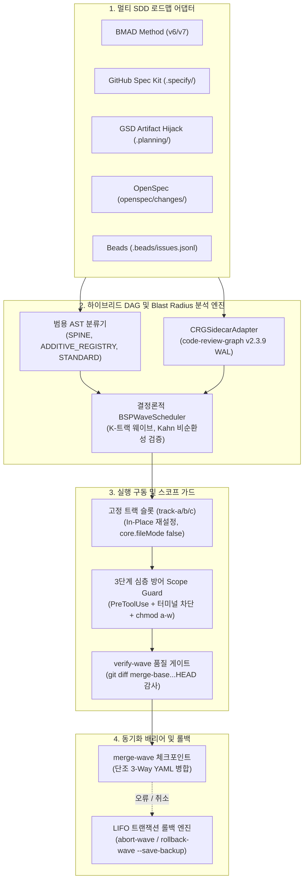

# ⚡ SDD-Parallel (`parallel-flow`)

[](https://github.com/stopActingSoSmall/sdd-parallel/actions/workflows/ci.yml)
[](https://pypi.org/project/sdd-parallel/)
[](https://www.python.org/)
[](../../../LICENSE)
[](#-5초-안에-직접-실행해-보기-api-키-불필요-클론-불필요)

<p align="center">
  
</p>

<p align="center">
  <b>🌐 언어 / Language:</b>
  <a href="../../../README.md">English</a> |
  <a href="../zh-CN/README.md">简体中文</a> |
  <a href="../es/README.md">Español</a> |
  <a href="../pt-BR/README.md">Português (BR)</a> |
  <a href="../ja/README.md">日本語</a> |
  <b>한국어</b> |
  <a href="../ru/README.md">Русский</a>
</p>

> **빌드나 Git 커밋 기록을 망가뜨리지 않고 3~4개의 AI 코딩 에이전트를 안전하게 병렬 실행.**  
> **BMAD**, **GitHub Spec Kit**, **GSD**, **OpenSpec**, **Beads** 프로젝트에서 작업하는 **Claude Code**, **OpenAI Codex**, **Google Antigravity**를 위한 결정론적 항공 관제사, 워크트리 격리 엔진 및 영향 반경(Blast Radius) 보호망.

---

## ⚡ 왜 이것이 필요한가요? (쉬운 설명)

백로그에 10~15개의 명세서나 스토리가 쌓여 있을 때, 개발자는 난처한 선택에 직면합니다:
1. **단일 AI 에이전트 순차 실행:** 안전하지만 완료까지 **6~8시간** 동안 기다려야 합니다.
2. **3~4개 AI 에이전트 단순 병렬 실행 (`git worktree`):** 코딩은 빠르지만, 병합하는 순간 치명적인 **머지 폭탄 (Merge-Bomb)** 에 직면합니다:
   - **직접적인 Git 충돌:** 여러 에ージェント가 `sprint-status.yaml`, `STATE.md`, `cli.py`를 동시에 수정.
   - **보이지 않는 시맨틱 파괴 (제2종 충돌):** 에이전트 A가 `normalizer.py`의 함수 시그니처를 변경하는 동안, 다른 워크트리의 에이전트 B가 `api.py`에서 이전 시그니처를 호출. **Git은 충돌 마커 없이 깔끔하게 병합하지만, `main` 브랜치는 런타임에 즉시 중단됩니다.**
   - **범위 일탈 (Scope Creep):** 에이전트가 지나친 주도성을 발휘하여 할당된 범위를 벗어난 공유 데이터베이스 스키마(`schema.py`)를 임의로 수정.

**`sdd-parallel`은 사용자의 SDD 명세서와 AI 코딩 에이전트 사이에서 컴파일러 수준의 공중 교통 관제탑 역할을 수행합니다.** 단 하나의 LLM 토큰을 소비하기 전에 코드베이스 AST와 호출 그래프를 분석하여 충돌 없는 태스크를 병렬 **웨이브(Waves)** 로 편성하고, 각 에이전트를 깨끗한 고정 슬롯(`track-a`, `track-b`)에 격리하며, 범위 외 파일 접근을 물리적으로 차단하고, 웨이브 완료 후 충돌 없이 자동 병합합니다.

### 📊 비교: `sdd-parallel` 도입 전 vs 도입 후

| 평가 항목 | ❌ 순차 실행 SDD (에이전트 1개) | 💥 단순 병렬 실행 (`--worktree`) | ✅ `sdd-parallel` 도입 시 |
| :--- | :--- | :--- | :--- |
| **12개 스토리 스프린트 소요 시간** | 약 6~8시간 (하나씩 실행) | 약 2시간 코딩 + **2시간 머지 오류 수정** | **총 약 2.5시간 (2~3배 속도 향상)** |
| **잠재적 타입/API 충돌** | 느리게 실행해야만 방지 가능 | **병합 후 `main` 브랜치 장애 발생** ($W_A \cap I_B$) | **사전 계산으로 원천 차단** (웨이브 1 → 웨이브 2로 분리) |
| **공유 CLI 및 라우팅 파일** | 한 번에 하나의 에이전트만 작업 가능 | 병합할 때마다 Git 충돌 발생 | **안전한 병렬 개발 지원** (`ADDITIVE_REGISTRY` 자동 감지) |
| **`sprint-status.yaml` / `tasks.md`** | 엄격히 순차적으로만 업데이트 | `<<<<<<<` 충돌 마커 빈번 | **완전 자동 병합** (단조 3-Way 병합기) |
| **에이전트의 타 파일 무단 수정** | 프롬프트로 "수정하지 마세요" 호소 | 에이전트가 `bash` / `sed`로 규약 우회 | **OS 및 훅 수준에서 원천 차단** (`chmod a-w` + `PreToolUse`) |
| **워크트리 폴더 난립** | 없음 | 방치된 `.worktrees/task-*` 폴더 15개 | **영구 재사용 고정 슬롯** (`track-a`, `track-b`, `track-c`) |

---

## 🚀 5초 안에 직접 실행해 보기 (API 키 불필요, 클론 불필요)

API 키, LLM 구독, 기존 프로젝트가 없어도 `sdd-parallel`이 잠재적 시맨틱 충돌을 어떻게 감지하는지 즉시 확인할 수 있습니다. [`uv`](https://docs.astral.sh/uv/)（또는 `pipx run sdd-parallel demo`）를 통해 터미널에서 다음 명령어를 실행하세요:

```bash
uvx sdd-parallel demo
```

**터미널에서 단 3.2초 만에 일어나는 일:**
1. 5개의 스토리와 6개의 Python 모듈(`schema.py`, `normalizer.py`, `api.py`, `exporter.py`, `cli.py`)로 구성된 임시 미니 저장소를 자동 생성.
2. **숨겨진 함정 간파:** 스토리 `1-2`는 `normalizer.py`를 수정하고, 스토리 `2-1`은 이를 임포트하는 `api.py`를 수정. 단순 파일 락은 안전하다고 오판하지만, `sdd-parallel`은 호출 그래프의 영향 중첩을 감지하여 **웨이브 1**과 **웨이브 2**로 자동 분리.
3. **공유 레지스트리의 안전한 병렬 실행 허용:** `cli.py`를 `ADDITIVE_REGISTRY`로 식별하여 스토리 `1-2`와 `1-3`이 **웨이브 1**(`track-a` 및 `track-b`)에서 병렬로 안전하게 실행되도록 허용.
4. **스코프 가드 및 3-Way 병합 검증:** 허가되지 않은 `schema.py` 수정을 실시간 차단(`DENY: Locked by Spine Chain invariant`)하고, 두 병렬 브랜치를 `충돌 마커 0개`로 깔끔하게 병합.

<details>
<summary><b>📺 클릭하여 <code>sdd-parallel demo</code>의 실제 터미널 출력 결과 확인</b></summary>

```text
============================================================================
SDD-PARALLEL STANDALONE MERGE-BOMB DEMO (ZERO API KEYS / OFFLINE)
============================================================================
Workspace: /tmp/sdd-parallel-demo-xyz

[Step 1/4] AST & Architectural Role Classification
----------------------------------------------------------------------------
File Path                              | Detected Role          | Importers
----------------------------------------------------------------------------
src/demo_app/__init__.py               | additive_registry      | -
src/demo_app/api.py                    | standard               | -
src/demo_app/cli.py                    | additive_registry      | -
src/demo_app/exporter.py               | standard               | -
src/demo_app/normalizer.py             | standard               | src/demo_app/api.py
src/demo_app/schema.py                 | spine                  | -

[Step 2/4] Type-2 Semantic Merge-Bomb Detection & BSP Wave Schedule
----------------------------------------------------------------------------
  Collision Analysis:
    - Naive Scheduler : W(1-2)={normalizer.py, cli.py} vs W(2-1)={api.py}
                        -> DISJOINT WRITES (False Safe!)
    - BSPWaveScheduler: Detected semantic_collision between '1-2' and '2-1'
                        -> Overlap W(1-2) ^ I(2-1) on: src/demo_app/api.py
    - Additive Registry: Tasks '1-2' and '1-3' both touch 'src/demo_app/cli.py'
                        -> Role: ADDITIVE_REGISTRY (Parallel allowed in Wave 1)

  Wave Schedule:
    * Wave 1
        - track-a: Story 1-2 -> writes: src/demo_app/normalizer.py (+ shared: src/demo_app/cli.py)
        - track-b: Story 1-3 -> writes: src/demo_app/exporter.py (+ shared: src/demo_app/cli.py)
    * Wave 2
        - track-a: Story 1-1 -> writes: src/demo_app/schema.py
        - track-b: Story 2-1 -> writes: src/demo_app/api.py
    * Wave 3
        - track-a: Story 2-2 -> writes: src/demo_app/schema.py

[Step 3/4] Fixed-Slot Worktree Provisioning & PreToolUse Scope Guard
----------------------------------------------------------------------------
  Provisioned Fixed Slots (100% Clean git status: True):
    - track-a (.worktrees/track-a)
    - track-b (.worktrees/track-b)

  PreToolUse Scope Guard Check (track-a -> 'src/demo_app/schema.py'):
    - Decision : DENY
    - Violation: File 'src/demo_app/schema.py' cannot be modified by Wave 1 / track-a (stories ['1-2'])
    - Reason   : Locked by Spine Chain invariant.

[Step 4/4] Barrier Checkpoint & Monotonic 3-Way YAML Merge
----------------------------------------------------------------------------
  Merged Branches:
    - parallel/track-a
    - parallel/track-b

  Resolved sprint-status.yaml (0 conflict markers):
    - 1-2-normalize-telemetry-payload: done
    - 1-3-cli-batch-export: done
============================================================================
ALL 5 CORE INVARIANTS VERIFIED IN 3.21s
============================================================================
```
</details>

---

## 🗺️ 시각화로 이해하는 동작 방식 (백로그부터 클린 머지까지)

5개의 에이전트를 무작정 리포지토리에 투입하여 충돌이 나지 않기를 바라는 대신, `sdd-parallel`은 스프린트를 결정론적인 **웨이브(Waves)** 로 구조화합니다:

```mermaid
flowchart LR
    subgraph Backlog["📋 1. SDD 백로그"]
        direction TB
        T12["Story 1-2\n(normalizer.py + cli.py)"]
        T13["Story 1-3\n(exporter.py + cli.py)"]
        T21["Story 2-1\n(api.py -> normalizer 호출)"]
        T11["Story 1-1\n(schema.py - 스파인 잠금)"]
    end

    subgraph Planner["🧠 2. sdd-parallel plan"]
        direction TB
        Scan["AST 및 호출 그래프 분석\n• cli.py = Additive (안전!)\n• 1-2 ↔ 2-1 = 영향 충돌!\n• schema.py = 스파인 잠금!"]
    end

    subgraph Wave1["🟢 3. 웨이브 1 (병렬 워크트리)"]
        direction TB
        SlotA["📁 .worktrees/track-a\n에이전트 1이 Story 1-2 구현\n🔒 schema.py 및 api.py 잠김"]
        SlotB["📁 .worktrees/track-b\n에이전트 2가 Story 1-3 구현\n🔒 schema.py 및 normalizer.py 잠김"]
    end

    subgraph Gate["🛡️ 4. sdd-parallel merge --wave 1"]
        direction TB
        M1["✅ 스코프 Diff 검증 통과\n✅ pytest / mypy / ruff 통과\n✅ 3-Way 상태 자동 병합"]
    end

    subgraph Wave2["🔵 5. 웨이브 2 (동일 슬롯 재사용)"]
        direction TB
        SlotA2["📁 .worktrees/track-a\n에이전트 1이 Story 1-1 구현"]
        SlotB2["📁 .worktrees/track-b\n에이전트 2가 Story 2-1 구현\n(수정된 normalizer.py 즉시 반영!)"]
    end

    Backlog --> Planner --> Wave1 --> Gate --> Wave2
```



---

## 🔌 기존 개발 환경에 완벽한 통합 (종속성 제로)

기존 명세서를 다시 작성하거나 프롬프트를 바꿀 **필요가 전혀 없습니다**. `sdd-parallel`은 기존 프레임워크 파일을 읽기 전용으로 직접 활용합니다:

| 사용 중인 도구 | `sdd-parallel`이 제공하는 기능 |
| :--- | :--- |
| **Claude Code** (`claude`) | `--worktree` / `Agent Teams` 호출 전 결정론적 웨이브 계획 수립, `PreToolUse`를 통한 범위 외 파일 및 셸 조작 차단, 작업 복잡도(`High`/`Medium`/`Low`) 라우팅. |
| **OpenAI Codex CLI** (`codex`) | 충돌 태스크를 사전 정렬하고 각 슬롯 내부의 공유 스키마(`chmod a-w`)를 잠가 병렬 워크트리 경쟁 상태 방지. |
| **Google Antigravity** | 영구 재사용 슬롯(`track-a`, `track-b`, `track-c`)을 제공하여 IDE 폴더 유실 버그를 제거하고 `.git/worktrees/*/info/exclude`를 통해 `git status --porcelain`을 100% 클린 상태로 유지. |
| **BMAD Method (`v6.3+` / `v7`)** | 선형 `sprint-status.yaml` 큐를 멀티 에픽 병렬 웨이브로 전환하고 스토리 상태(`backlog -> done`)를 YAML 충돌 없이 병합. |
| **GitHub Spec Kit (`.specify/`)** | `tasks.md`의 수동 `[P]` 태그를 실제 AST 의존성과 대조하여 허위 병렬 처리로 인한 빌드 파괴 방지. |
| **GSD / OpenSpec / Beads** | 격리된 워크트리에서 `.planning/STATE.md` (Artifact Hijack 모드), `openspec/changes/`, `.beads/issues.jsonl`을 안전하게 독립 운영. |

---

## 🛠️ 단 4개 명령어로 끝나는 일상 워크플로우

### 1. 전역 설치 (1회)
```bash
# uv 사용 권장 (또는: pipx install sdd-parallel)
uv tool install sdd-parallel
```
*(시스템 전역에서 `sdd-parallel` 및 빠른 별칭 `parallel-flow` 사용 가능).*

### 2. 모든 프로젝트에서 병렬 웨이브 실행
```bash
# 1단계: SDD 명세와 AST 의존성 그래프를 스캔하여 안전한 웨이브 계산
sdd-parallel plan

# 2단계: 고정 슬롯(.worktrees/track-a, track-b)에 웨이브 1을 준비하고
#        코딩 에이전트를 위한 실행 가이드 출력
sdd-parallel prepare --wave 1
sdd-parallel run-guide --wave 1

# 👉 3단계: AI 에이전트(Claude Code / Codex / Antigravity)가
#          track-a와 track-b 내부에서 스토리를 동시 구현.

# 4단계: 범위 일탈 검증 후 웨이브 1을 main 브랜치로 자동 병합
sdd-parallel verify-wave --wave 1
sdd-parallel merge --wave 1
```
웨이브를 취소해야 하나요? 병합 전에는 `sdd-parallel abort-wave --wave 1`, 병합 후에는 `sdd-parallel rollback-wave --wave 1`을 실행(안전 백업 브랜치 자동 생성 및 SDD 상태 자동 롤백).

---

## 🧩 지원되는 SDD 프레임워크 매트릭스

| SDD 프레임워크 | 지원 상태 | 감지되는 읽기 전용 아티팩트 | 태스크 상태 동기화 방식 |
| :--- | :---: | :--- | :--- |
| **BMAD Method (`v6.3+` / `v7`)** | ✅ 정식 출시 | `sprint-status.yaml`, `epics.md`, `epic-*-context.md`, `spec-*.md` | 단조 3-Way YAML 병합 |
| **GitHub Spec Kit (`.specify/`)** | ✅ 정식 출시 | `.specify/specs/*/tasks.md`, `constitution.md` | Markdown 체크박스 상태 동기화 |
| **GSD (Get Shit Done)** | ✅ 정식 출시 | `.planning/phases/*-PLAN.md`, `ROADMAP.md` | Artifact Hijack (`STATE.md` 중앙 집중식 업데이트) |
| **OpenSpec (`openspec/`)** | ✅ 정식 출시 | `openspec/changes/<id>/tasks.md` | 명세 기반 태스크 상태 추적 |
| **Beads (`.beads/`)** | ✅ 정식 출시 | `.beads/issues.jsonl` | 위상학적 이슈 상태 원자적 업데이트 |

---

## 🔍 심층 기술 문서 (아키텍처, 핵심 불변 원칙 및 전체 CLI 레퍼런스)

수학적 모델, 내부 모듈 아키텍처, 모든 CLI 옵션에 대한 상세 정보는 아래 접기 섹션을 펼치거나 **[아키텍처 및 전략 도시에 (docs/dossier/)](../../dossier/README.md)** 문서를 참조하세요:

- 📖 **[01 — 핵심 제품 개요 및 투자 대비 수익(ROI) 모델](../../dossier/01_CORE_PRODUCT_BRIEF.md)** *(경영진 요약, 토큰 FinOps 및 모델 에포트 라우팅)*
- 🏛️ **[02 — 시스템 핵심 역량 및 기술 백서](../../dossier/02_SYSTEM_CAPABILITIES_WHITE_PAPER.md)** *(제1종 vs 제2종 충돌, 3D 파일 분류 체계, CRG 감쇠 공식)*
- 🔌 **[03 — 통합 및 에코시스템 명세서](../../dossier/03_INTEGRATION_AND_ECOSYSTEM_SPEC.md)** *(중간 표현 `CanonicalTask`, `.tmp/track-context.md`, `.parallel-lock.json`)*
- 🧪 **[07 — 독립 검증 데모 및 대화형 E2E 가이드](../../dossier/07_STANDALONE_DEMO_AND_E2E_WALKTHROUGH.md)** *(파일 시스템 스냅샷 및 `--keep-temp` 샌드박스)*
- 📐 **[시스템 아키텍처 단일 진실 공급원 (`ARCHITECTURE.md`)](ARCHITECTURE.md)** | **[러시아어 도시에](../../i18n/ru/dossier/)**

<details>
<summary><b>🏛️ 클릭하여 펼치기: 내부 엔진 구조 및 9대 핵심 엔지니어링 불변 원칙</b></summary>

### 내부 컴포넌트 데이터 플로우



### 9대 핵심 엔지니어링 불변 원칙

1. **워크트리 무공해 원칙 (Zero Worktree Pollution):** 주입된 컨텍스트 파일(`.tmp/track-context.md`, `.parallel-lock.json`, `ACTIVE_TRACK.md`)은 `info/exclude`로 필터링되어 `git status --porcelain`은 항상 100% 클린 유지.
2. **캐시 무손상 원칙 (Zero Cache Invalidation):** `_bmad-output/planning-artifacts/` 내부 컨텍스트는 읽기 전용. 플래너 상태는 독립된 `_bmad-output/parallel-artifacts/`에만 기록.
3. **100% 태스크 망라성 및 비순환성 보장:** Kahn/Tarjan 위상 정렬 알고리즘을 통해 스토리 누락과 순환 참조를 수학적으로 배제.
4. **영향 반경의 엄격한 격리 (제1종 및 제2종):** 쓰기 영역의 상호 배제($W_A \cap W_B = \emptyset$) 및 시맨틱 영향의 상호 배제($W_A \cap I_B = \emptyset$) 동시 보장.
5. **도메인 독립성 (Invariant 7):** 코어 엔진 내부에 도메인 경로를 하드코딩하지 않으며, 오직 AST 휴리스틱과 그래프 중심성에 기반하여 분류.
6. **고정 슬롯 운용 ($O(1)$ 디스크 풋프린트):** `git checkout -B` 및 `git clean -fd`를 통해 `track-a`, `track-b`, `track-c`를 제자리에서 재사용.
7. **3단계 종심 방어 체계:** `PreToolUse` 훅 차단 + 터미널 명령어 감시(`Bash`, `run_command`) + OS 파일 잠금 `chmod a-w`.
8. **단조 상태 반격자 이론:** 태스크 상태는 반격자 위상에서 단조 수렴($\texttt{backlog} (0) < \dots < \texttt{done} (4)$)하여 병합 충돌 제거.
9. **후입선출 (LIFO) 트랜잭션 롤백:** 병합된 웨이브를 엄격한 역순으로 되돌리며 안전 백업 브랜치(`backup/wave-<K>-before-rollback-*`)를 자동 생성.

</details>

<details>
<summary><b>🛠️ 클릭하여 펼치기: 전체 CLI 명령어 레퍼런스 (13개 서브 커맨드 및 옵션)</b></summary>

| 명령어 | 목적 |
| :--- | :--- |
| `sdd-parallel demo [--kit {bmad,spec-kit,gsd,openspec,beads,all}] [--keep-temp] [--scaffold-only] [--output-dir DIR]` | 오프라인 머지 폭탄 방지 데모 실행 또는 5개 SDD 프레임워크 샌드박스 생성. |
| `sdd-parallel plan [--repo REPO] [--max-tracks N] [--kit auto] [--include-done] [--dry-run] [--plan-source {auto,plan,specs}] [--output-dir DIR]` | 로드맵과 의존성 그래프를 분석하여 `execution-plan-parallel.md` 및 `wave-plan.json` 생성. |
| `sdd-parallel prepare --wave K [--repo REPO] [--max-tracks N] [--kit KIT] [--headless] [--antigravity-layout] [--dynamic-worktrees] [--dry-run]` | 워크트리 슬롯(`track-a`, `track-b`) 준비, OS 파일 잠금 설정 및 경계 주입. |
| `sdd-parallel claim-track --wave K --track <id> --worktree <path> [--repo REPO] [--max-tracks N] [--kit KIT] [--headless]` | 기존 외부 워크트리 슬롯에 경계 잠금 및 컨텍스트 연결. |
| `sdd-parallel run-guide --wave K [--repo REPO] [--max-tracks N] [--kit KIT] [--antigravity-layout]` | 각 활성 트랙 터미널을 위한 전용 실행 명령어 매트릭스 표시. |
| `sdd-parallel verify-wave --wave K [--repo REPO] [--max-tracks N] [--kit KIT] [--dynamic-worktrees]` | `.parallel-lock.json` 및 `merge-base` 대비 커밋 diff 감사. |
| `sdd-parallel merge --wave K [--repo REPO] [--max-tracks N] [--kit KIT] [--dynamic-worktrees] [--skip-gates] [--strict-gates] [--cleanup] [--dry-run]` | 체크포인트 병합: 3-Way 상태 병합, Git 병합, 품질 게이트 검증 및 트랜잭션 자동 롤백. |
| `sdd-parallel abort-wave --wave K [--repo REPO] [--dynamic-worktrees]` | 미병합 웨이브 중단: 슬롯 재설정 및 임시 병렬 브랜치 삭제. |
| `sdd-parallel rollback-wave --wave K [--repo REPO] [--dynamic-worktrees] [--to-commit COMMIT] [--save-backup] [--no-backup] [--kit KIT]` | 병합된 웨이브를 LIFO 순서로 롤백하고 백업 브랜치 보존 및 SDD 태스크 상태 복구. |
| `sdd-parallel merge-status --base B --ours O --theirs T --out OUT` | `sprint-status.yaml`을 위한 저수준 결정론적 3-Way 병합 도구. |
| `sdd-parallel check-lock --file PATH [--tool TOOL]` | 현재 활성 잠금 매니페스트를 기준으로 파일 쓰기 권한 검증. |
| `sdd-parallel install-plugin [--target-dir DIR]` | Google Antigravity 전용 네이티브 플러그인 패키징 및 설치. |
| `sdd-parallel autopilot --wave K [--repo REPO] [--max-tracks N] [--kit KIT] [--harness <tool>] [--antigravity-layout] [--execute]` | 모델 에포트 라우팅을 지원하는 다중 대화 자동 조종 명령 생성 또는 실행. |

</details>

<details>
<summary><b>🧪 클릭하여 펼치기: 로컬 개발 환경 및 품질 게이트</b></summary>

### 필수 요구사항
- **Python:** `>= 3.11` (Python 3.11, 3.12, 3.13)
- **Git:** `>= 2.30` (최신 `git worktree` 격리 및 `info/exclude` 필터링 지원 필요)
- **패키지 관리자:** [`uv`](https://docs.astral.sh/uv/) (권장) 또는 `pipx`

```bash
git clone https://github.com/stopActingSoSmall/sdd-parallel.git
cd sdd-parallel
uv sync

# 99개 이상의 단위 및 통합 자동화 테스트 실행
uv run pytest

# 엄격한 정적 타입 검사 실행
uv run mypy --strict src/sdd_parallel

# 린터 및 코드 스타일 감사 실행
uv run ruff check src/ tests/ scripts/

# 오프라인 단독 검증 데모 실행
uv run sdd-parallel demo
```

</details>

---

## 🚢 릴리스 매트릭스: 출시 완료 (v0.1.0) vs 로드맵 (v0.2+)

### ✅ `v0.1.0` 정식 구현 완료 기능 (프로덕션 검증 완료)
- Kahn 비순환성 검증을 포함한 결정론적 Bulk-Synchronous Parallel (BSP) 웨이브 스케줄러.
- AST 핫스팟 스캐너 및 `code-review-graph v2.3.9` 사이드카 통합.
- 제자리 재설정(In-Place Reset)이 가능한 고정 슬롯 아키텍처(`track-a`, `track-b`, `track-c`).
- 3단계 심층 방어 체계(`PreToolUse` + 터미널 가드 + OS `chmod a-w`).
- 주석 및 서식을 완벽 보존하는 단조 3-Way YAML 병합기.
- 안전 백업 브랜치를 자동 생성하는 LIFO 트랜잭션 웨이브 롤백 엔진.
- 2단계 협업 표준(Two-Stage Assisted, Interactive IDE Slots, `Depth 0`).
- 5대 멀티 SDD 어댑터(BMAD, Spec Kit, GSD Artifact Hijack, OpenSpec, Beads).
- API 키가 필요 없는 오프라인 데모(`sdd-parallel demo`) 및 GitHub Actions CI 파이프라인.
- 99개 테스트 100% 통과, `mypy --strict` 및 `ruff` 품질 게이트 완비.

### 🚧 `v0.2.0+` 개발 예정 로드맵
- **커뮤니티 어댑터 생태계 확장:** `mattpocock/skills` (`/implement-spec`) 및 `bmad-loop` v0.8+ frontmatter 어댑터 지원.
- **무공해 환경 동기화:** 심볼릭 링크를 통해 `.venv`와 `node_modules`를 고정 슬롯에 연결하는 `workz` 패턴.
- **웨이브 전 정적 심볼 링커 및 동적 스코프 확장:** AST 심볼 분석 기반 쓰기 세트 자동 확장 및 실시간 태스크 재스케줄링.
- **FinOps 비용 및 옵저버빌리티 익스포터:** OpenTelemetry 트레이싱 및 Langfuse 토큰 절감 텔레메트리 연동.
- **백그라운드 자동 조종 데몬:** 로컬 RPC / 서브에이전트 디스패치를 통한 완전한 헤드리스 실행.

---

## 🤝 기여 안내 및 보안 정책

- **기여 가이드:** 로컬 개발 환경 구성 및 Pull Request 기준은 **[기여 가이드](../../../CONTRIBUTING.md)** 문서를 참조하세요.
- **보안 취약점 신고:** 취약점 보고 및 책임 있는 공개 절차는 **[보안 정책](../../../SECURITY.md)** 에 안내되어 있습니다.

## 📜 라이선스

본 프로젝트는 MIT 라이선스에 따라 배포됩니다. 자세한 내용은 [LICENSE](../../../LICENSE) 파일을 참조하세요.
