# 🏛️ SDD-Parallel — Arquitetura do Sistema (SSOT)

<p align="center">
  <b>🌐 Idioma / Language:</b>
  <a href="../../../ARCHITECTURE.md">English</a> |
  <a href="../zh-CN/ARCHITECTURE.md">简体中文</a> |
  <a href="../es/ARCHITECTURE.md">Español</a> |
  <b>Português (BR)</b> |
  <a href="../ja/ARCHITECTURE.md">日本語</a> |
  <a href="../ko/ARCHITECTURE.md">한국어</a> |
  <a href="../ru/ARCHITECTURE.md">Русский</a>
</p>

**Versão:** 0.1.0  
**Status:** Espinha Dorsal Arquitetural Aprovada (SSOT)

---

## 1. Visão Geral dos Módulos Arquiteturais

O sistema `sdd-parallel` é estruturado em três subsistemas fracamente acoplados, orquestrados através de uma representação canônica de grafo de tarefas (`src/sdd_parallel/models.py`):

```mermaid
flowchart LR
    subgraph Adapters["Subsistema 1: Adaptadores Polimórficos de Kits SDD (SDDAdapterProtocol & ACL Somente Leitura)"]
        A1["Adaptador BMAD\n(sprint-status.yaml + epics.md + specs)"]
        A2["Adaptador Spec Kit\n(.specify/specs/*/tasks.md + constitution)"]
        A3["Adaptador GSD\n(.planning/phases/*-PLAN.md + STATE.md)"]
        A4["Adaptador OpenSpec\n(openspec/changes/*/tasks.md + proposal)"]
        A5["Adaptador Beads\n(.beads/issues.jsonl + dependencies)"]
    end

    subgraph Engine["Subsistema 2: Motor DAG Hexagonal e Resolvedor de Conflitos"]
        E1["ASTHotspotScanner\n(Análise em 3 Passadas: Spine vs Registros Aditivos)"]
        E2["CRGSidecarAdapter\n(code-review-graph v2.3.9 Grafo de Chamadas WAL)"]
        E3["BSPWaveScheduler\n(Empacotamento Determinístico de Ondas, K Trilhas)"]
    end

    subgraph Actuation["Subsistema 3: Provisionador de Worktrees e Portão de Integração"]
        W1["prepare / claim-track\n(Slots Fixos track-<id> + Reset In-Place)"]
        W2["Guarda de Escopo em Três Camadas\n(PreToolUse + Terminal Guard + OS chmod a-w)"]
        W3["merge Checkpoint Gate\n(Diff estrito merge-base + Merge 3-way polimórfico)"]
    end

    Adapters --> E1 & E2
    E1 & E2 --> E3
    E3 --> W1
    W1 --> W2 --> W3
```



### 1.1. Arquitetura Hexagonal e `SDDAdapterProtocol`

Seguindo o padrão de Portas e Adaptadores (Arquitetura Hexagonal), o núcleo do `sdd-parallel` interage com todos os frameworks de Desenvolvimento Guiado por Especificações (SDD) exclusivamente através do contrato estritamente tipado `SDDAdapterProtocol` (`src/sdd_parallel/adapters/__init__.py`). O motor não contém caminhos estáticos ou ramificações específicas de kits:

```python
class SDDAdapterProtocol(Protocol):
    """Contrato polimórfico implementado por todos os frameworks SDD suportados."""

    kit_id: str

    def detect(self) -> bool:
        """Detecta marcadores de presença do framework SDD no repositório."""
        ...

    def load_tasks(self, include_done: bool = False) -> list[TaskNode]:
        """Converte artefatos de backlog para modelos canônicos TaskNode."""
        ...

    def check_wave_zero_blockers(self, wave: Wave | None = None) -> list[str]:
        """Valida pré-requisitos específicos do framework (Git limpo, contextos compilados)."""
        ...

    def get_allowed_write_globs(self, track: WaveTrack) -> list[str]:
        """Retorna padrões glob de metadados permitidos para escrita no worktree."""
        ...

    def get_forbidden_files(self, wave: Wave, track: WaveTrack) -> dict[str, str]:
        """Mapeia especificações imutáveis e contratos protegidos do framework."""
        ...

    def render_worker_command(self, track: WaveTrack) -> str:
        """Gera comando nativo de CLI para o operador e modo Autopilot."""
        ...

    def reset_tasks_status(
        self,
        task_ids: Sequence[str],
        target_status: str = "ready-for-dev",
    ) -> None:
        """Restaura polimorficamente status em rollbacks transacionais LIFO."""
        ...

    def cleanup_wave_artifacts(
        self,
        wave_id: int,
        task_ids: Sequence[str],
    ) -> None:
        """Limpa especificações temporárias geradas para a onda."""
        ...
```

### 1.2. Matriz de Responsabilidades: Motor Agnóstico vs Adaptadores de Kits

| Fase / Escopo | Subsistema Responsável | Papel Arquitetural e Mecanismos |
| :--- | :---: | :--- |
| **Parsing de Artefatos e Conversão de Tarefas** | `SDDAdapter` | Interpreta formatos específicos (YAML, Markdown, JSONL). Converte tarefas para `TaskNode` canônicos (`write_files`, `read_files`, `depends_on`). |
| **Validação Prévia de Bloqueios** | `SDDAdapter` | Valida portões de prontidão (`check_wave_zero_blockers`): Git limpo, contextos BMAD, listas de Spec Kit. |
| **Classificação AST de Arquivos** | `Core Engine` | Analisador estático em 3 passadas (`ASTHotspotScanner`) que categoriza módulos em `SPINE`, `ADDITIVE_REGISTRY` e `STANDARD`. |
| **Raio de Impacto Semântico** | `Core Engine` | Calcula o raio de colisão ponderado ($W_A \cap I_B$) via `CRGSidecarAdapter` (`code-review-graph v2.3.9` WAL). |
| **Particionamento de Ondas (Escalonador BSP)** | `Core Engine` | Escalonador determinístico `BSPWaveScheduler` que garante 100% de cobertura e aciclicidade formal (Kahn). |
| **Provisionamento de Slots de Worktree** | `Core Engine` + `Adapter` | Aloca slots fixos `track-<id>` e permissões de SO (`chmod a-w`). O adaptador fornece `allowed_write_globs` e `forbidden_files`. |
| **Instruções de Inicialização de Agentes** | `SDDAdapter` | Gera comandos nativos (`/speckit.implement`, `/gsd-execute-phase`, `/opsx:apply`, `bd update`, `/bmad-build`). |
| **Guarda de Escopo em Múltiplas Camadas** | `Core Engine` | Intercepta chamadas `PreToolUse`, comandos de terminal (`Bash`, `run_command`) e impõe travas de somente leitura do SO. |
| **Merge Monotônico de Estados em 3 Vias** | `SDDAdapter` + `Core` | O motor orquestra a integração Git; o reconciliador semirreticular (`status_merger.py`) une status sem conflitos. |
| **Rollback Transacional LIFO** | `Core Engine` + `Adapter` | Cria branches de segurança (`backup/wave-<K>-before-rollback-*`) e redefine o `HEAD`; o adaptador restaura status. |

### 1.3. Coexistência de Múltiplos Kits e Protocolo de Sandboxing

Em repositórios corporativos com artefatos coexistentes:
1. **Precedência Explícita:** O argumento CLI `--kit <nome>` ou a chave `"default_kit"` possui precedência absoluta.
2. **Heurística de Tarefas Ativas (`kit="auto"`):** Ativa automaticamente o primeiro framework que contém tarefas pendentes (`len(active_tasks) > 0`).
3. **Telemetria Diagnóstica:** `diagnose_multi_kit_coexistence()` notifica o operador sem abortar o fluxo.
4. **Sandboxing entre Frameworks:** Ao gerar `.parallel-lock.json`, os diretórios dos frameworks **inativos** são bloqueados em `forbidden_files` com motivo `"Locked by inactive SDD framework sandboxing"`.

---

## 2. Modelo Matemático de Conflitos e Taxonomia de Arquivos

Para cada tarefa pendente $T_i$:
- $W(T_i)$ — Arquivos que a tarefa **modifica ou cria** (`write_files`).
- $R(T_i)$ — Arquivos que a tarefa **lê ou importa** (`read_files`).
- $I(T_i)$ — **Raio de Impacto Ponderado** ao redor de $W(T_i)$, calculado via `CRGSidecarAdapter` (`code-review-graph v2.3.9`, decaimento $\gamma = 0.7$).

### 2.1. Três Classes de Arquivos no Código

1. **Arquivos de Espinha Dorsal (`FileRole.SPINE`):**
   - Esquemas de banco de dados, migrações sequenciais ou modelos fundamentais (`schema.py`, `models.py`, `SCHEMA_VERSION`).
   - **Regra:** Tarefas que modificam o mesmo arquivo `SPINE` **nunca rodam na mesma onda** e são serializadas em ordem estrita.
2. **Registros Aditivos Compartilhados (`FileRole.ADDITIVE_REGISTRY`):**
   - Pontos de entrada onde funcionalidades registram comandos ou rotas independentes (`cli.py` com `@app.command`, `__init__.py` com `__all__`).
   - *Invariante (ADR-0002):* Utilitários de formatação (`console.py`, `markdown.py`) são classificados como `FileRole.STANDARD`.
   - **Regra:** Tarefas com interseção restrita a arquivos `ADDITIVE_REGISTRY` **podem executar concorrentemente** em slots isolados com injeção de diretiva append-only.
3. **Módulos Padrão (`FileRole.STANDARD`):**
   - Lógica de negócios e adaptadores comuns.
   - **Regra:** Qualquer interseção $W(A) \cap W(B) \neq \emptyset$ impede a execução na mesma onda.

### 2.2. Pipeline de Análise Estática AST em 3 Passadas (`ASTHotspotScanner`)

Sob o **Invariante 7 (Anti-Overfitting)**, os papéis são determinados dinamicamente:
1. **Passada 1 (Assinaturas):** Detecção de palavras-chave de migração (`SCHEMA_VERSION`, `auto_migrate`).
2. **Passada 2 (Grafo de Importações e Decorators):** Cálculo de centralidade de entrada (Fan-In) e inspeção de decorators (`command`, `tool`, `get`, `post`).
3. **Passada 3 (Classificação Determinística):**
   - Testes (`tests/`) $\to$ sempre `STANDARD`.
   - `SPINE`: se possui marcadores de schema $\lor$ nome `schema.py`/`models.py` $\lor$ **Fan-In $\ge 5$**.
   - `ADDITIVE_REGISTRY`: se possui decorators de registro $\lor$ nome `cli.py`/`__init__.py`.
   - `STANDARD`: todos os módulos restantes.

### 2.3. Tipos de Arestas no Grafo de Conflitos (`ConflictEdge`)

1. **`EXPLICIT_DEP` (Dependência Direcionada $A \to B$):** Declarada no roadmap.
2. **`SPINE_ORDER` (Ordem Espinhal Direcionada $A \to B$):** Alteração sequencial sobre arquivo `SPINE`.
3. **`DIRECT_COLLISION` (Colisão Direta de Escrita $A \leftrightarrow B$):** $W(A) \cap W(B) \setminus \text{AdditiveRegistries} \neq \emptyset$.
4. **`SEMANTIC_COLLISION` (Colisão Semântica Tipo 2 $A \leftrightarrow B$):** $(W(A) \cap I(B)) \cup (W(B) \cap I(A)) \neq \emptyset$.

---

## 3. Contratos Principais de Artefatos em Tempo de Execução

### 3.1. Contrato de Contexto de Worktree (`.tmp/track-context.md`)

Injetado pelo `sdd-parallel prepare --wave K` no prompt do agente:

```markdown
# PARALLEL TRACK CONTEXT BOUNDARY (ENFORCED)
- **Wave:** 1 | **Track:** track-a | **Assigned Stories:** 11-2
- **Recommended Model Effort:** high

## 1. Allowed Exclusive Write Scope
- `src/canonical/intervals.py`
- `tests/test_intervals.py`

## 2. Shared Additive Registries (Isolated Append Scope)
- `src/canonical/normalizer.py` (Scope: function `_classify_reads` only)

## 3. Forbidden Files (Locked by Sibling Tracks in Wave 1)
- `src/canonical/manifest.py` (Locked by track-b)
- `src/storage/schema.py` (Spine Lock Chain)
```

### 3.2. Manifesto de Travas de Escopo (`.parallel-lock.json`)

Consultado instantaneamente pelos ganchos `PreToolUse`:

```json
{
  "wave_id": 1,
  "track_id": "track-a",
  "stories": ["11-2"],
  "repo_root": "/workspace/project",
  "worktree_root": "/workspace/project/.worktrees/track-a",
  "allowed_write_globs": [
    "src/canonical/intervals.py",
    "src/canonical/normalizer.py",
    "tests/**",
    ".tmp/**"
  ],
  "additive_shared_files": [
    "src/canonical/normalizer.py"
  ],
  "forbidden_files": {
    "src/canonical/manifest.py": "Locked by track-b (story 11-3)",
    "src/storage/schema.py": "Locked by Spine Chain"
  }
}
```

---

## 4. Mecanismos Técnicos Não Invasivos e Suporte a 5 Kits

### 4.1. Injeção de Ambiente Sem Poluição do Worktree

Garante que os agentes iniciem com `git status --porcelain == ""` em todos os 5 frameworks:
1. Contexto de orquestração em `.tmp/track-context.md` (`.tmp/` no `.gitignore`).
2. Manifesto de travas em `.parallel-lock.json` (`.parallel-lock.json` no `.gitignore`).
3. Regras de exclusão local em `.git/worktrees/<name>/info/exclude`.
4. Variáveis de ambiente (como `SPECIFY_FEATURE`) injetadas no processo de execução.

### 4.2. Pré-Validação de Contratos e Proteção de Especificações Imutáveis

Auditoria e proteção formal (`FORBIDDEN_STATE_FILES`):
- **GitHub Spec Kit:** Protege `.specify/memory/constitution.md`, `.specify/feature.json`, `spec.md`, `plan.md`.
- **GSD:** Protege `.planning/STATE.md`, `ROADMAP.md`, `PROJECT.md`.
- **OpenSpec:** Protege `openspec/project.md`, `openspec/specs/**`, `openspec/config.yaml`.
- **Beads:** Protege `.beads/config.yaml` e `.beads/metadata.json`.
- **BMAD:** Valida e protege `epic-<N>-context.md`.

### 4.3. Cálculo do Raio de Explosão Semântico via `CRGSidecarAdapter`

1. **Ancoragem ao Repositório Principal:** Inicialização com `main_repo_root` prevenindo erros de caminho relativo.
2. **Compatibilidade com Modo WAL:** Consultas seguras e concorrentes em SQLite.
3. **Supressão de Ruído:** Filtro `min_impact_score=0.5`.

### 4.4. Merge Monotônico Polimórfico de Estados em 3 Vias

1. **BMAD (`sprint-status.yaml`):** Semirreticulada: $\texttt{backlog} (0) < \texttt{ready-for-dev} (1) < \texttt{in-progress} (2) < \texttt{review} (3) < \texttt{done} (4)$, preservando layout e comentários YAML.
2. **GitHub Spec Kit e OpenSpec (`tasks.md` Markdown):** Atualização automática de `- [ ]` para `- [x]` com 0 marcadores de conflito.
3. **Beads (`.beads/issues.jsonl`):** Merge monotônico streaming por ID (`open < in-progress < closed`).
4. **Proteção UTF-8 BOM (`utf-8-sig`):** Neutralização de marcadores BOM do PowerShell (`\ufeff`).

### 4.5. Slots Fixos (`track-<id>`) e Reset In-Place ($O(1)$ Espaço)

Mantém um pool permanente de $K = \text{max\_tracks}$ slots (`track-a`, `track-b`):
- Evita criação excessiva de pastas que corrompem a interface visual da IDE.
- Reset atômico in-place: `git checkout -B parallel/<track_id> master ; git clean -fd`.

### 4.6. Guarda de Escopo em Três Camadas

1. **Camada 1 (Gancho PreToolUse):** Intercepta ferramentas de escrita de arquivos (`write_file`, `edit_file`).
2. **Camada 2 (Terminal Guard):** Intercepta ferramentas de terminal (`Bash`, `run_command`, `cmd`, `powershell`) bloqueando redirecionamentos (`>`) ou editores (`sed -i`).
3. **Camada 3 (Travas de Somente Leitura do SO):** Aplica `chmod a-w` e `git config core.fileMode false` impedindo mutações no disco.
4. **Portão de Verificação (`verify_wave`):** Inspeção de diffs `git diff $(git merge-base master HEAD)...HEAD` antes do merge.

### 4.7. Motor de Rollback Transacional LIFO

- **`abort-wave --wave K`:** Limpa slots não integrados antes da mesclagem.
- **`rollback-wave --wave K [--save-backup]`:** Reverte em estrita ordem LIFO, cria branch de segurança `backup/wave-<K>-before-rollback-*` e restaura status polimorficamente.

### 4.8. Portões de Qualidade Agnósticos e Auto-Rollback Transacional

- **Resolução Universal:** Lê portões de `.parallel-config.json` ou `pyproject.toml`, com autodeteção para Python, Node, Rust e Go.
- **Auto-Rollback:** Se algum portão de qualidade falhar durante o merge, o orquestrador executa automaticamente `git reset --hard` na branch `master`, mantendo os worktrees intactos para depuração.

### 4.9. Demonstração Offline Autônoma (`sdd-parallel demo`)

Executa a validação dos 5 invariantes em <5 segundos sem chaves de API ou internet. Com `--kit all`, valida todos os 5 frameworks sequencialmente.

### 4.10. Referência Completa de Comandos e Opções da CLI

| Comando | Finalidade | Principais Opções e Parâmetros |
| :--- | :--- | :--- |
| `plan` | Calcula o DAG de conflitos e gera o plano de ondas paralelas | `--repo <path>`, `--max-tracks <K>`, `--kit <auto\|kit>`, `--plan-source <auto\|plan\|specs>`, `--include-done`, `--dry-run` |
| `prepare` | Provisiona slots fixos e travas de limites para a Onda K | `--repo <path>`, `--wave <K>`, `--max-tracks <K>`, `--kit <auto\|kit>`, `--antigravity-layout`, `--dynamic-worktrees`, `--headless`, `--dry-run` |
| `claim-track` | Vincula travas de limites a uma worktree externa existente | `--repo <path>`, `--wave <K>`, `--track <id>`, `--worktree <path>`, `--max-tracks <K>`, `--kit <auto\|kit>`, `--headless` |
| `run-guide` | Exibe a matriz formatada do guia do operador para a Onda K | `--repo <path>`, `--wave <K>`, `--max-tracks <K>`, `--kit <auto\|kit>`, `--antigravity-layout` |
| `verify-wave` | Audita diffs de worktrees e conformidade de travas contra merge-base | `--repo <path>`, `--wave <K>`, `--max-tracks <K>`, `--kit <auto\|kit>`, `--dynamic-worktrees` |
| `merge` | Merge no checkpoint de barreira com merge 3-way de status e quality gates | `--repo <path>`, `--wave <K>`, `--max-tracks <K>`, `--kit <auto\|kit>`, `--strict-gates`, `--skip-gates`, `--cleanup`, `--dry-run`, `--dynamic-worktrees` |
| `merge-status` | Ferramenta determinística independente de merge 3-way para sprint-status.yaml | `--base <file>`, `--ours <file>`, `--theirs <file>`, `--out <file>` |
| `check-lock` | Inspeciona permissão de modificação de arquivo via lógica de hook ativo | `--file <path>`, `--tool <name>` (produz JSON formatado com `indent=2`) |
| `install-plugin` | Empacota e instala o plugin portátil do Antigravity | `--target-dir <path>` (padrão: `~/.gemini/config/plugins/sdd-parallel`) |
| `autopilot` | Gera ou executa comandos no modo Multi-Conversation Autopilot | `--repo <path>`, `--wave <K>`, `--max-tracks <K>`, `--kit <auto\|kit>`, `--harness <antigravity\|claude-code\|codex>`, `--antigravity-layout`, `--execute` |
| `abort-wave` | Aborta a onda antes do merge e limpa branches temporárias | `--repo <path>`, `--wave <K>`, `--dynamic-worktrees` |
| `rollback-wave` | Rollback atômico LIFO de onda integrada com branch de segurança | `--repo <path>`, `--wave <K>`, `--to-commit <hash>`, `--save-backup` / `--no-backup`, `--kit <auto\|kit>`, `--dynamic-worktrees` |
| `demo` | Executa demonstração offline independente de Merge-Bomb em 5 segundos | `--kit <bmad\|spec-kit\|gsd\|openspec\|beads\|all>`, `--keep-temp`, `--scaffold-only`, `--output-dir <path>` |

---

## 5. Modelos de Execução Paralela no Google Antigravity e Agentes de IA

Diante da restrição de ambiente **`Max Subagent Depth = 1`** (subagentes não podem disparar subagentes aninhados), o sistema oferece dois modelos de operação:

### 5.1. Modo A: `Two-Stage Assisted & Interactive Checkpoints` (Padrão Recomendado)

Fluxo assistido com intervenção humana em pontos de controle interativos:
1. **Checkpoint 1 (Confirmação de Plano):** O orquestrador gera o DAG de ondas e solicita aprovação.
2. **Checkpoint 2 (Execução nas Trilhas):**
   - O orquestrador aloca os slots fixos `track-a`, `track-b` e exibe o `run-guide`.
   - O operador abre os slots no Antigravity IDE / terminal e dispara os comandos nativos em `Profundidade 0`:
     - **GitHub Spec Kit:** `/speckit.implement <task-id>`
     - **GSD:** `/gsd-execute-phase <phase-num>`
     - **OpenSpec:** `/opsx:apply <task-id>`
     - **Beads:** `bd update <task-id> --status in-progress`
     - **BMAD:** `/bmad-build <task-id>`
3. **Checkpoint 3 (Merge de Barreira):** Na sessão do orquestrador, `sdd-parallel merge --wave K --cleanup` valida travas, executa testes e integra os branches.

### 5.2. Modo B: `Multi-Window Autopilot` (Automação Alvo)

Orquestração multijanela automatizada sem comandos manuais:
1. O orquestrador prepara os worktrees nos slots permanentes.
2. O `AutopilotLauncher` (`src/sdd_parallel/autopilot.py`) cria os comandos com roteamento de modelos por esforço (`High` / `Medium` / `Low`).
3. O orquestrador monitora a criação de commits e a evolução dos status nos artefatos de SDD.
4. Ao concluir todas as trilhas, executa a verificação em barreira e faz o merge na branch `master`.

### 5.3. Modo C: `In-Session Flat Dispatch` (Descontinuado / Apenas Contingência)

O disparo de uma cadeia linear de subagentes em uma única sessão é **DESCONTINUADO** e aceito apenas como último recurso em ambientes sem suporte a múltiplas janelas.
