# 🏛️ SDD-Parallel — Arquitetura do Sistema (SSOT)

<p align="center">
  <b>🌐 Idioma / Language:</b>
  <a href="../../../ARCHITECTURE.md">English</a> |
  <a href="../zh-CN/ARCHITECTURE.md">简体中文</a> |
  <a href="../es/ARCHITECTURE.md">Español</a> |
  <b>Português (BR)</b> |
  <a href="../ja/ARCHITECTURE.md">日本語</a> |
  <a href="../ko/ARCHITECTURE.md">한국어</a> |
  <a href="../ru/ARCHITECTURE.md">Русский</a>
</p>

**Versão:** 0.2.2  
**Status:** Espinha Dorsal Arquitetural Aprovada (SSOT)

---

## 1. Visão Geral dos Módulos Arquiteturais

O sistema `sdd-parallel` é estruturado em três subsistemas fracamente acoplados, orquestrados através de uma representação canônica de grafo de tarefas (`src/sdd_parallel/models.py`):

```mermaid
flowchart LR
    subgraph Adapters["Subsistema 1: Adaptadores Polimórficos de Kits SDD (SDDAdapterProtocol & ACL Somente Leitura)"]
        A1["Adaptador BMAD\n(v6 sprint-status.yaml & v7 tickets.toml)"]
        A2["Adaptador Spec Kit\n(.specify/specs/*/tasks.md + extensão oficial)"]
        A3["Adaptador GSD\n(.planning/phases/*-PLAN.md + STATE.md)"]
        A4["Adaptador OpenSpec\n(openspec/changes/*/tasks.md + cabeçalhos v1.16+)"]
        A5["Adaptador Beads\n(.beads/issues.jsonl + sincronização BD dolt)"]
        A6["Adaptador de Manifesto Customizado\n(.parallel/custom-kit.yaml)"]
    end

    subgraph Engine["Subsistema 2: Motor DAG Hexagonal e Resolvedor de Conflitos"]
        E1["ASTHotspotScanner\n(Heurística em 3 Passadas: Spine vs Registros Aditivos)"]
        E2["CRGSidecarAdapter\n(code-review-graph v2.3.9 Grafo de Chamadas WAL)"]
        E3["BSPWaveScheduler\n(Empacotamento Guloso First-Fit de Ondas, K Trilhas, Checkpoints)"]
    end

    subgraph Actuation["Subsistema 3: Provisionador de Worktrees e Portão de Integração"]
        W1["prepare / claim-track\n(Slots Fixos track-<id> + Reset In-Place)"]
        W2["Guarda de Escopo em Três Camadas\n(PreToolUse + Terminal Guard + OS chmod a-w)"]
        W3["merge Checkpoint Gate\n(Diff estrito merge-base + Merge 3-way polimórfico + Portões Agnósticos)"]
    end

    Adapters --> E1 & E2
    E1 & E2 --> E3
    E3 --> W1
    W1 --> W2 --> W3
```



### 1.1. Arquitetura Hexagonal e `SDDAdapterProtocol`

Seguindo o padrão de Portas e Adaptadores (Arquitetura Hexagonal), o núcleo do `sdd-parallel` interage com todos os frameworks de Desenvolvimento Guiado por Especificações (SDD) exclusivamente através do contrato estritamente tipado `SDDAdapterProtocol` (`src/sdd_parallel/adapters/__init__.py`). O motor não contém caminhos estáticos ou ramificações específicas de kits:

```python
class SDDAdapterProtocol(Protocol):
    """Contrato de extensão polimórfico implementado por todos os frameworks SDD suportados."""

    kit_id: str

    def __init__(self, repo_root: Path) -> None: ...

    def detect(self) -> bool:
        """Detecta marcadores de presença deste framework SDD no repositório."""
        ...

    def load_tasks(
        self,
        include_done: bool = False,
        plan_source: str = "auto",
    ) -> list[TaskNode]:
        """Converte artefatos de roadmap/backlog em modelos canônicos TaskNode."""
        ...

    def reset_tasks_status(
        self,
        task_ids: Sequence[str],
        target_status: str = "ready-for-dev",
    ) -> None:
        """Reverte polimorficamente os status das tarefas após rollback transacional LIFO da onda."""
        ...

    def cleanup_wave_artifacts(
        self,
        wave_id: int,
        task_ids: Sequence[str],
    ) -> None:
        """Limpa especificações e artefatos temporários gerados para uma onda."""
        ...

    def check_wave_zero_blockers(self, wave: Wave | None = None) -> list[str]:
        """Verifica pré-requisitos específicos do framework (Git limpo, contextos compilados, checklists)."""
        ...

    def check_preflight_context_gate(self, wave: Wave) -> list[str]:
        """Verifica arquivos de contexto de épico/feature pré-compilados antes de iniciar trilhas paralelas."""
        ...

    def get_allowed_write_globs(self, track: WaveTrack) -> list[str]:
        """Retorna padrões glob de metadados do framework permitidos para modificação na worktree."""
        ...

    def get_forbidden_files(self, wave: Wave, track: WaveTrack) -> dict[str, str]:
        """Mapeia contratos protegidos e especificações imutáveis específicos do framework."""
        ...

    def get_track_env_vars(self, track: WaveTrack) -> dict[str, str]:
        """Retorna variáveis de ambiente específicas do kit injetadas na execução da trilha."""
        ...

    def prepare_worktree_overlay(self, worktree_path: Path, track: WaveTrack) -> list[str]:
        """Injeta arquivos de overlay específicos do kit na worktree e retorna entradas para git exclude."""
        ...

    def verify_track_spec_scope(
        self,
        worktree_path: Path,
        track: WaveTrack,
        forbidden_files: dict[str, str],
    ) -> list[str]:
        """Verifica restrições de escopo em nível de especificação dentro da worktree antes do merge."""
        ...

    def render_worker_command(self, track: WaveTrack) -> str:
        """Gera o comando nativo de CLI para o guia de execução do operador e modos Autopilot."""
        ...

    def default_artifacts_dir(self) -> Path:
        """Retorna o diretório de saída padrão para planos de onda e relatórios gerados."""
        ...

    def get_status_files(self) -> list[str]:
        """Retorna caminhos relativos dos arquivos de status do framework reconciliados via merge 3-vias."""
        ...

    def get_change_worktree(self, change_id: str) -> Path | None:
        """Retorna o caminho de worktree existente atribuído pelo framework para change_id, se houver."""
        ...

    def update_state_on_merge(
        self,
        wave_number: int,
        merged_task_ids: Sequence[str],
    ) -> Path | None:
        """Sincroniza o estado/BD do framework após o checkpoint de merge em barreira da Onda K."""
        ...
```

### 1.2. Matriz de Responsabilidades: Motor Agnóstico vs Adaptadores de Kits

| Fase / Escopo | Subsistema Responsável | Papel Arquitetural e Mecanismos |
| :--- | :---: | :--- |
| **Parsing de Artefatos e Conversão de Tarefas** | `SDDAdapter` | Interpreta formatos específicos (YAML, Markdown, JSONL). Converte tarefas para `TaskNode` canônicos (`write_files`, `read_files`, `depends_on`). |
| **Validação Prévia de Bloqueios** | `SDDAdapter` | Valida portões de prontidão (`check_wave_zero_blockers`): Git limpo, contextos BMAD, listas de Spec Kit. |
| **Classificação AST de Arquivos** | `Core Engine` | Analisador estático em 3 passadas (`ASTHotspotScanner`) que categoriza módulos em `SPINE`, `ADDITIVE_REGISTRY` e `STANDARD`. |
| **Raio de Impacto Semântico** | `Core Engine` | Calcula o raio de colisão ponderado ($W_A \cap I_B$) via `CRGSidecarAdapter` (`code-review-graph v2.3.9` WAL). |
| **Particionamento de Ondas (Escalonador BSP)** | `Core Engine` | Escalonador determinístico guloso `First-Fit` `BSPWaveScheduler` (1 tarefa por trilha na ordem de entrada) que garante 100% de cobertura de histórias e aciclicidade formal (Kahn). |
| **Provisionamento de Slots de Worktree** | `Core Engine` + `Adapter` | Aloca slots fixos `track-<id>` e permissões de SO (`chmod a-w`). O adaptador fornece `allowed_write_globs` e `forbidden_files`. |
| **Instruções de Inicialização de Agentes** | `SDDAdapter` | Gera comandos nativos (`/speckit.implement`, `/gsd-execute-phase`, `/opsx:apply`, `bd update`, `/bmad-build`). |
| **Guarda de Escopo em Múltiplas Camadas** | `Core Engine` | Intercepta chamadas `PreToolUse`, comandos de terminal (`Bash`, `run_command`) e impõe travas de somente leitura do SO. |
| **Merge Monotônico de Estados em 3 Vias** | `SDDAdapter` + `Core` | O motor orquestra a integração Git; o reconciliador semirreticular (`status_merger.py`) une status com zero marcadores de conflito. |
| **Co-Consistência de Estado e BD Pós-Merge** | `SDDAdapter` + `Core` | O hook polimórfico `update_state_on_merge()` garante que motores embarcados (ex.: Dolt DB do Beads via `bd import --allow-stale`) e logs monolíticos de estado (`.planning/STATE.md`) sincronizem imediatamente após o merge 3-vias. |
| **Rollback Transacional LIFO** | `Core Engine` + `Adapter` | Cria branches de segurança (`backup/wave-<K>-before-rollback-*`) e redefine o `HEAD`; o adaptador restaura status. |

### 1.3. Coexistência de Múltiplos Kits e Protocolo de Sandboxing

Em repositórios corporativos com artefatos coexistentes:
1. **Precedência Explícita:** O argumento CLI `--kit <nome>` ou a chave `"default_kit"` possui precedência absoluta.
2. **Heurística de Tarefas Ativas (`kit="auto"`):** Ativa automaticamente o primeiro framework que contém tarefas pendentes (`len(active_tasks) > 0`).
3. **Telemetria Diagnóstica:** `diagnose_multi_kit_coexistence()` notifica o operador sem abortar o fluxo.
4. **Sandboxing entre Frameworks:** Ao gerar `.parallel-lock.json`, os diretórios dos frameworks **inativos** são bloqueados em `forbidden_files` com motivo `"Locked by inactive SDD framework sandboxing"`.

---

## 2. Modelo Matemático de Conflitos e Taxonomia de Arquivos

Para cada tarefa pendente $T_i$, o motor avalia:
- $W(T_i)$ — Conjunto de arquivos que a tarefa **modifica ou cria** (`write_files`).
- $R(T_i)$ — Conjunto de arquivos que a tarefa **lê ou importa** como pré-requisitos (`read_files`).
- $I(T_i)$ — **Raio de Impacto Ponderado** ao redor de $W(T_i)$, calculado via `CRGSidecarAdapter` (`code-review-graph v2.3.9`, método `get_impact_radius_sql` com `resolution="direct"`, `min_impact_score=0.5`, decaimento $\gamma = 0.7$ ao longo das arestas `CALLS=1.0`, `INHERITS/IMPLEMENTS/OVERRIDES=0.9`, `TESTED_BY=0.8`, `IMPORTS_FROM=0.7`).

### 2.1. Três Classes de Arquivos no Código

1. **Arquivos de Espinha Dorsal (`FileRole.SPINE`):**
   - Definições de esquema, representações intermediárias globais e cadeias sequenciais de migração de banco de dados (ex.: módulos com `SCHEMA_VERSION`, `auto_migrate` ou modelos raiz `schema.py`/`models.py`).
   - **Regra:** Tarefas que modificam o mesmo arquivo `SPINE` **nunca são agendadas na mesma onda** e são serializadas em uma cadeia de dependências estrita.
2. **Registros Aditivos Compartilhados (`FileRole.ADDITIVE_REGISTRY`):**
   - Pontos de entrada de alto nível onde funcionalidades registram comandos ou endpoints independentes (`cli.py` com `@app.command`, `mcp/server.py` com `@mcp.tool`, `__init__.py` com `__all__`).
   - *Invariante Arquitetural (ADR-0002):* Utilitários de formatação compartilhados (`console.py`, `markdown.py`, `egress/`) são estritamente excluídos dos registros aditivos e classificados como `FileRole.STANDARD`.
   - **Regra:** Tarefas com interseção *exclusiva* em arquivos `ADDITIVE_REGISTRY` genuínos **podem executar concorrentemente** em slots `git worktree` separados com diretiva append-only injetada em `.tmp/track-context.md`. O merge semântico sem conflitos é garantido para rastreadores de status SDD (`status_merger.py`). Registros aditivos Python (`cli.py`, `__init__.py`, `*/mcp/server.py`) são integrados via merger determinístico 3-vias sobre a AST da biblioteca padrão (`registry_merger.py`: imports de cabeçalho disjuntos, `__all__` e funções/comandos top-level ortogonais), com fallback fail-closed (`None` $\to$ `Partial Barrier Merge`) caso corpos de funções existentes ou símbolos colidentes sejam modificados.
3. **Módulos Padrão (`FileRole.STANDARD`):**
   - Módulos padrão de lógica de negócios, adaptadores e apresentadores de saída.
   - **Regra:** Qualquer interseção $W(A) \cap W(B) \neq \emptyset$ impede a execução concorrente na mesma onda, a menos que as especificações declarem notas distintas de funções isoladas em `shared_function_notes` e `ASTHotspotScanner.are_functions_isolated()` confirme que ambas as funções existem e não possuem aresta de chamada direta ou transitiva intra-arquivo (`_has_isolated_function_scope`). Arquivos `STANDARD` nunca são isentos do cálculo do raio de impacto.

### 2.2. Pipeline de Análise Estática AST em 3 Passadas (`ASTHotspotScanner`)

Em conformidade com o **Invariante 7 (Arquitetura Anti-Overfitting & Invariant-First)**, os papéis de arquivo são determinados dinamicamente sem nomes de projeto codificados:
1. **Passada 1 (Análise de Assinaturas):** Detecção de palavras-chave de migração (`_SPINE_KEYWORDS = ("SCHEMA_VERSION", "auto_migrate", "_migrate_v")`) $\to$ `has_schema_version`.
2. **Passada 2 (Grafo de Importações e Inspeção de Decorators):** Percorre nós `Import`/`ImportFrom` para calcular a centralidade de entrada (Fan-In `len(meta.imported_by)`) e inspeciona `decorator_list` em busca de padrões de registro usando dicas de receptor delimitadas por token (`_ROUTER_RECEIVER_HINTS` em `@app.command`, `@router.get`, `@mcp.tool`, etc.; decorators sem receptor `@get`/`@register`/`@command` e receptores não roteadores como `@cache_client.get` permanecem como `FileRole.STANDARD`).
3. **Passada 3 (Classificação Determinística `SPINE > ADDITIVE_REGISTRY > STANDARD`):**
   - Testes (`tests/`, `test_*.py`) $\to$ sempre `STANDARD`.
   - `SPINE`: se `has_schema_version == True` $\lor$ nome do arquivo em `{"models.py", "schema.py"}` $\lor$ **Centralidade Topológica $\text{In-Degree} \ge 5$**.
   - **Spine Buckets (Classe C):** `DEFAULT_SPINE_BUCKET_GLOBS` (`**/migrations/**`, `**/versions/**`, `docs/adr/**`) mapeados via `extract_spine_bucket()` serializam tarefas concorrentes que criam nomes de arquivo distintos dentro do mesmo diretório ordenado.
   - `ADDITIVE_REGISTRY`: se `has_registry_decorators == True` $\lor$ ponto de entrada em `{"cli.py", "__init__.py"}` $\lor$ `*/mcp/server.py`.
   - `STANDARD`: todos os módulos restantes de lógica de negócios.
   - **Extração de Tokens de Namespace (Classe D):** `extract_namespace_tokens()` extrai flags CLI normalizadas (`cli:--flag`), variáveis de ambiente (`env:VAR`) e rotas HTTP (`route:METHOD /path`) das descrições das tarefas (filtrando seções somente leitura e cláusulas negadas) para detectar colisões de registro entre arquivos distintos.
   - **Fronteira Poliglota:** O parsing AST embutido sem dependências (`ast_scanner.py`, `registry_merger.py`) tem como alvo nativo Python; para repositórios JS/TS, Go, Rust e Java, o planejamento e a segurança na barreira apoiam-se no `code-review-graph` (Tree-sitter), `DEFAULT_CONTRACT_GLOBS`, `DEPENDENCY_DRIFT` e `Partial Barrier Merge`.

### 2.3. Tipos de Arestas no Grafo de Conflitos (`ConflictEdge`)

1. **`EXPLICIT_DEP` (Aresta Direcionada $A \to B$):** Dependência explícita declarada no roadmap ou requisito de fluxo de dados. A tarefa $B$ executa na onda $\text{wave}(B) > \text{wave}(A)$.
2. **`SPINE_ORDER` (Aresta Direcionada $A \to B$):** Cadeia sequencial que modifica um arquivo `SPINE` ou compartilha um `Spine Bucket` (`extract_spine_bucket()`, Classe C — ex.: migrações de banco de dados `005_a.sql` vs `005_b.sql`).
3. **`DIRECT_COLLISION` (Aresta de Conflito Não Direcionada $A \leftrightarrow B$):** $W(A) \cap W(B) \setminus \text{AdditiveRegistries} \neq \emptyset$. As tarefas $A$ e $B$ não podem rodar na mesma onda ($\text{wave}(A) \neq \text{wave}(B)$).
4. **`SEMANTIC_COLLISION` (Aresta de Conflito Tipo 2 $A \leftrightarrow B$):** $(W(A) \cap I(B)) \cup (W(B) \cap I(A)) \neq \emptyset$. A tarefa $A$ modifica uma interface que a tarefa $B$ invoca diretamente.
5. **`NAMESPACE_COLLISION` (Aresta de Conflito Não Direcionada $A \leftrightarrow B$, Classe D):** `namespace_tokens` sobrepostos (flags CLI, variáveis ENV ou rotas HTTP compartilhadas entre arquivos distintos).

---

## 3. Contratos Principais de Artefatos em Tempo de Execução

### 3.1. Contrato de Contexto de Worktree (`.tmp/track-context.md`)

Injetado pelo `sdd-parallel prepare --wave K` no prompt do agente:

```markdown
# PARALLEL TRACK CONTEXT BOUNDARY (ENFORCED)
- **Wave:** 1 | **Track:** track-a | **Assigned Stories:** 11-2
- **Recommended Model Effort:** high

## 1. Allowed Exclusive Write Scope
- `src/canonical/intervals.py`
- `tests/test_intervals.py`

## 2. Shared Additive Registries (Isolated Append Scope)
- `src/canonical/normalizer.py` (Scope: function `_classify_reads` only)

## 3. Forbidden Files (Locked by Sibling Tracks in Wave 1)
- `src/canonical/manifest.py` (Locked by track-b)
- `src/storage/schema.py` (Spine Lock Chain)
```

### 3.2. Manifesto de Travas de Escopo (`.parallel-lock.json`)

Consultado instantaneamente pelos ganchos `PreToolUse`:

```json
{
  "wave_id": 1,
  "track_id": "track-a",
  "stories": ["11-2"],
  "repo_root": "/workspace/project",
  "worktree_root": "/workspace/project/.worktrees/track-a",
  "allowed_write_globs": [
    "src/canonical/intervals.py",
    "src/canonical/normalizer.py",
    "tests/**",
    ".tmp/**"
  ],
  "additive_shared_files": [
    "src/canonical/normalizer.py"
  ],
  "forbidden_files": {
    "src/canonical/manifest.py": "Locked by track-b (story 11-3)",
    "src/storage/schema.py": "Locked by Spine Chain"
  }
}
```

---

## 4. Mecanismos Técnicos Não Invasivos e Suporte a 5 Kits

### 4.1. Injeção de Ambiente Sem Poluição do Worktree

Garante que os agentes iniciem com `git status --porcelain == ""` em todos os 5 frameworks:
1. Contexto de orquestração em `.tmp/track-context.md` (`.tmp/` no `.gitignore`).
2. Manifesto de travas em `.parallel-lock.json` (`.parallel-lock.json` no `.gitignore`).
3. Regras de exclusão local em `.git/worktrees/<name>/info/exclude`.
4. Variáveis de ambiente (como `SPECIFY_FEATURE`) injetadas no processo de execução.

### 4.2. Pré-Validação de Contratos e Proteção de Especificações Imutáveis

Auditoria e proteção formal (`FORBIDDEN_STATE_FILES`):
- **GitHub Spec Kit:** Protege `.specify/memory/constitution.md`, `.specify/feature.json`, `spec.md`, `plan.md`.
- **GSD:** Protege `.planning/STATE.md`, `ROADMAP.md`, `PROJECT.md`.
- **OpenSpec:** Protege `openspec/project.md`, `openspec/specs/**`, `openspec/config.yaml`.
- **Beads:** Protege `.beads/config.yaml` e `.beads/metadata.json`.
- **BMAD:** Valida e protege `epic-<N>-context.md`.

### 4.3. Cálculo do Raio de Explosão Semântico via `CRGSidecarAdapter`

1. **Ancoragem ao Repositório Principal:** Inicialização com `main_repo_root` prevenindo erros de caminho relativo.
2. **Compatibilidade com Modo WAL:** Consultas seguras e concorrentes em SQLite.
3. **Supressão de Ruído:** Filtro `min_impact_score=0.5`.

### 4.4. Merge Monotônico Polimórfico de Estados em 3 Vias

1. **BMAD (`sprint-status.yaml`):** Semirreticulada: $\texttt{backlog} (0) < \texttt{ready-for-dev} (1) < \texttt{in-progress} (2) < \texttt{review} (3) < \texttt{done} (4)$, preservando layout e comentários YAML.
2. **GitHub Spec Kit e OpenSpec (`tasks.md` Markdown):** Atualização automática de `- [ ]` para `- [x]` com 0 marcadores de conflito.
3. **Beads (`.beads/issues.jsonl`):** Merge monotônico streaming por ID (`open < in-progress < closed`).
4. **Proteção UTF-8 BOM (`utf-8-sig`):** Neutralização de marcadores BOM do PowerShell (`\ufeff`).

### 4.5. Slots Fixos (`track-<id>`) e Reset In-Place ($O(1)$ Espaço)

Mantém um pool permanente de $K = \text{max\_tracks}$ slots (`track-a`, `track-b`):
- Evita criação excessiva de pastas que corrompem a interface visual da IDE.
- Reset atômico in-place: `git checkout -B parallel/<track_id> master ; git clean -fd`.

### 4.6. Guarda de Escopo em Três Camadas

1. **Camada 1 (Gancho PreToolUse):** Intercepta ferramentas de escrita de arquivos (`write_file`, `edit_file`).
2. **Camada 2 (Terminal Guard):** Intercepta ferramentas de terminal (`Bash`, `run_command`, `cmd`, `powershell`) bloqueando redirecionamentos (`>`) ou editores (`sed -i`).
3. **Camada 3 (Travas de Somente Leitura do SO):** Aplica `chmod a-w` e `git config core.fileMode false` impedindo mutações no disco.
4. **Portão de Verificação (`verify_wave`):** Inspeção de diffs `git diff $(git merge-base master HEAD)...HEAD` antes do merge.

### 4.7. Motor de Rollback Transacional LIFO

- **`abort-wave --wave K`:** No modo padrão `fixed_slots=True`, redefine os slots (`parallel/track-*`) in-place para o `HEAD` do repositório e reporta as branches redefinidas; com `--dynamic-worktrees`, remove diretórios efêmeros e exclui as branches `parallel/wave-*`. Limpa o arquivo obsoleto `.parallel/wave-plan.json`.
- **`rollback-wave --wave K [--save-backup]`:** Reverte em estrita ordem LIFO, cria branch de segurança `backup/wave-<K>-before-rollback-*` e restaura status polimorficamente.

### 4.8. Portões de Qualidade Agnósticos e Auto-Rollback Transacional

- **Resolvedor Universal de Portões (`resolve_checkpoint_gates`):**
  1. *Prioridade 1:* `.parallel-config.json` (`checkpoint_gates: [...]`).
  2. *Prioridade 2:* `pyproject.toml` (`[tool.sdd-parallel].checkpoint_gates`).
  3. *Prioridade 3:* Detecção automática de stack (Python `pytest/ruff/mypy`, Node/TS `npm test`, Rust `cargo test`, Go `go test ./...`).
- **Resiliência a Suítes Vazias (`_is_no_tests_collected`):** O código 5 no pytest (`NO_TESTS_COLLECTED`) ou `"no test files found"` não reprova o merge, a menos que `--strict-gates` esteja habilitado.
- **Portão AST Pré-Merge (`ast_diff_gate.py`):** Executado dentro de `WorktreeManager.verify_wave()` sobre `>= 2` slots de worktree isolados antes do `git merge`. Detecta ciclos virtuais de importação entre trilhas (Tarjan SCC, Classe G), deriva de assinaturas/padrões/constantes vs `merge-base` (Classes A/B), novas funções auxiliares estruturalmente duplicadas via shingles de AST normalizado (Jaccard $\ge 0.75$, Classe F) e edições concorrentes de manifestos/lockfiles de dependências (Classe H). Passar `--defer-ast-violations` registra feedback NACK (`_record_track_barrier_nack()`), preserva uma branch de segurança `backup/` e adia as trilhas infratoras sem reset manual.
- **Partial Barrier Merge (Padrão) e Rollback Atômico Estrito (`--no-partial-merge`):** A CLI `sdd-parallel merge --wave K` usa por padrão `partial_merge=True` (ordenado por sinais de centralidade estrutural OCC): trilhas saudáveis aterrissam incrementalmente em uma `master` limpa, enquanto trilhas conflitantes ou que falham nos portões são isoladas via bisseção determinística de culpados (`_isolate_culprit_tracks_by_bisection`), preservadas em `backup/wave-<K>-<track>-failed-<ts>`, registradas em `.parallel/barrier-feedback-<story_id>.json` e replanejadas via `BSPWaveScheduler.reschedule_remaining_waves()`. Passar `--no-partial-merge` impõe rollback transacional estrito tudo-ou-nada (`git merge --abort` + `git reset --hard pre_merge_head`).

### 4.9. Demonstração Offline Autônoma (`sdd-parallel demo`)

O comando autônomo `sdd-parallel demo [--kit {bmad,spec-kit,gsd,openspec,beads,all}] [--keep-temp]` gera um repositório efêmero e verifica o planejamento principal, o isolamento, o merge de registros AST em 3 vias e os portões de checkpoint ao vivo offline, sem chaves de API ou acesso à rede (`< 5s` por kit com portão smoke ao vivo `run_quality_gates=True`).

### 4.10. Referência Completa de Comandos e Opções da CLI

| Comando | Finalidade | Principais Opções e Parâmetros |
| :--- | :--- | :--- |
| `plan` | Calcula o DAG de conflitos e gera o plano de ondas paralelas | `--repo <path>`, `--max-tracks <K>`, `--kit <auto\|kit>`, `--plan-source <auto\|plan\|specs>`, `--include-done`, `--dry-run`, `--routing-file <path>` |
| `prepare` | Provisiona slots fixos e travas de limites para a Onda K | `--repo <path>`, `--wave <K>`, `--max-tracks <K>`, `--kit <auto\|kit>`, `--antigravity-layout`, `--dynamic-worktrees`, `--headless`, `--dry-run`, `--routing-file <path>` |
| `claim-track` | Vincula travas de limites a uma worktree externa existente | `--repo <path>`, `--wave <K>`, `--track <id>`, `--worktree <path>`, `--max-tracks <K>`, `--kit <auto\|kit>`, `--headless` |
| `run-guide` | Exibe a matriz formatada do guia do operador para a Onda K | `--repo <path>`, `--wave <K>`, `--max-tracks <K>`, `--kit <auto\|kit>`, `--antigravity-layout`, `--routing-file <path>` |
| `verify-wave` | Audita diffs de worktrees, conformidade de travas, trata escalonamentos de escopo e registra o manifesto de barreira | `--repo <path>`, `--wave <K>`, `--max-tracks <K>`, `--kit <auto\|kit>`, `--defer-ast-violations`, `--dynamic-worktrees` |
| `merge` | Merge no checkpoint de barreira com merge 3-way de AST/status, quality gates, merge parcial / rollback e manifesto | `--repo <path>`, `--wave <K>`, `--max-tracks <K>`, `--kit <auto\|kit>`, `--strict-gates`, `--skip-gates`, `--partial-merge` / `--no-partial-merge`, `--cleanup`, `--dry-run`, `--dynamic-worktrees` |
| `merge-status` | Ferramenta determinística independente de merge 3-way para sprint-status.yaml | `--base <file>`, `--ours <file>`, `--theirs <file>`, `--out <file>` |
| `check-lock` | Inspeciona permissão de modificação de arquivo via lógica de hook ativo | `--file <path>`, `--tool <name>` (produz JSON formatado com `indent=2`) |
| `install-plugin` | Empacota e instala o plugin portátil do Antigravity | `--target-dir <path>` (padrão: `~/.gemini/config/plugins/sdd-parallel`) |
| `init-custom` | Assistente interativo de configuração para gerar `.parallel/custom-kit.yaml` | `--repo <path>`, `--specs-dir <dir>`, `--format <markdown\|yaml>`, `--test-cmd <cmd>`, `--non-interactive`, `--dry-run` |
| `autopilot` | Gera ou executa comandos no modo Multi-Conversation Autopilot | `--repo <path>`, `--wave <K>`, `--max-tracks <K>`, `--kit <auto\|kit>`, `--harness <antigravity\|claude-code\|codex>`, `--antigravity-layout`, `--execute`, `--routing-file <path>` |
| `abort-wave` | Aborta a onda antes do merge; redefine slots fixos para `HEAD` (ou exclui branches dinâmicas) | `--repo <path>`, `--wave <K>`, `--dynamic-worktrees` |
| `rollback-wave` | Rollback atômico LIFO de onda integrada com branch de segurança | `--repo <path>`, `--wave <K>`, `--to-commit <hash>`, `--save-backup` / `--no-backup`, `--kit <auto\|kit>`, `--dynamic-worktrees` |
| `demo` | Executa demonstração offline autônoma de Merge-Bomb (`~6–9s` por kit) | `--kit <bmad\|spec-kit\|gsd\|openspec\|beads\|all>`, `--keep-temp`, `--scaffold-only`, `--output-dir <path>` |
| `bench` | Executa backtest retrospectivo avaliado contra o modelo estático de conflitos `TaskNode` no histórico Git ou demo | `--repo <path>`, `--since <rev>`, `--until <rev>`, `--demo`, `--max-tracks <K>`, `--kit <auto\|kit>`, `--format <text\|json>` |
| `inspect` | Gera e exibe o HTML Wave Inspector offline autônomo | `--repo <path>`, `--plan <path>`, `--output <path>`, `--open`, `--kit <auto\|kit>` |

### 4.11. Fronteiras Modulares de Dark Software Factory, Manifesto de Execução e Roteador Cognitivo (ADR-0009)

Em conformidade com o `ADR-0009`, o `sdd-parallel` segue estritamente fronteiras LEGO de cintura estreita dentro do ecossistema Dark Software Factory:
1. **Zero LLM e Zero Bloat de FinOps no Núcleo:** O motor não contém tabelas de tarifas de modelos, fórmulas de preço de tokens em USD nem clientes de rede para OpenTelemetry / Langfuse. Contagens reais de tokens e cotas de assinatura são analisadas downstream pelo `AgentLens` diretamente a partir das transcrições nativas do harness (`transcript.jsonl`).
2. **Sinais Estruturais Determinísticos (`TaskStructuralSignals`):** Cada `TaskNode` em `wave-plan.json` é enriquecido com fatos de complexidade AST (`files_count`, `max_fan_in`, `touches_spine`, `ast_loc`, `conflict_degree`) consumíveis por Roteadores Cognitivos System-1 externos (`Cloudflare Clef`, `Jev`, `Clairic`, `GLiClass ONNX`).
3. **Contrato de Roteamento de Cintura Estreita (`--routing-file`):** Roteadores externos sobrescrevem `(effort, model, execution_mode)` via `--routing-file <routing-overrides.json>` sem embutir modelos de ML no `sdd-parallel`.
4. **Manifesto de Execução e Correlação:** Nos checkpoints de verificação de onda e merge de barreira (estritamente antes do reset dos slots), o orquestrador registra `.parallel/wave-<K>-manifest.json` e `.parallel/run-manifest.json`, capturando fatos do Git (`commit_sha`, arquivos alterados), metadados de sessão do runner (`session_id`) e conflitos prevenidos (`PreventedConflictEntry`) para análises posteriores.

---

## 5. Modelos de Execução Paralela no Google Antigravity e Agentes de IA

Embora plataformas modernas como Google Antigravity suportem até 10 níveis de aninhamento de subagentes, as APIs de subagentes não oferecem vinculação de diretório (`cwd`) a worktrees isolados e causam exaustão da janela de contexto do orquestrador. A execução dos workers como processos independentes em **`Profundidade 0` em slots de `git worktree`** preserva o orçamento completo de aninhamento de subagentes para os fluxos internos dos frameworks (como as lentes de revisão do BMAD) e mantém compatibilidade agnóstica entre diferentes ferramentas:

### 5.1. Modo A: `Two-Stage Assisted & Interactive Checkpoints` (Padrão Recomendado)

Fluxo assistido com intervenção humana em pontos de controle interativos:
1. **Checkpoint 1 (Confirmação de Plano):** O orquestrador gera o DAG de ondas e solicita aprovação.
2. **Checkpoint 2 (Execução nas Trilhas):**
   - O orquestrador aloca os slots fixos `track-a`, `track-b` e exibe o `run-guide`.
   - O operador abre os slots no Antigravity IDE / terminal e dispara os comandos nativos em `Profundidade 0`:
     - **GitHub Spec Kit:** `/speckit.implement <task-id>`
     - **GSD:** `/gsd-execute-phase <phase-num>`
     - **OpenSpec:** `/opsx:apply <task-id>`
     - **Beads:** `bd update <task-id> --status in-progress`
     - **BMAD:** `/bmad-build <task-id>`
3. **Checkpoint 3 (Merge de Barreira):** Na sessão do orquestrador, `sdd-parallel merge --wave K --cleanup` valida travas, executa testes e integra os branches.

### 5.2. Modo B: `Multi-Window Autopilot` (Automação Alvo)

Orquestração multijanela automatizada sem comandos manuais:
1. O orquestrador prepara os worktrees nos slots permanentes.
2. O `AutopilotLauncher` (`src/sdd_parallel/autopilot.py`) cria os comandos com roteamento de modelos por esforço (`High` / `Medium` / `Low`).
3. O orquestrador monitora a criação de commits e a evolução dos status nos artefatos de SDD.
4. Ao concluir todas as trilhas, executa a verificação em barreira e faz o merge na branch `master`.

### 5.3. Modo C: `In-Session Flat Dispatch` (Descontinuado / Apenas Contingência)

O disparo de subagentes em uma única sessão é **DESCONTINUADO** e aceito apenas como último recurso em ambientes sem suporte a múltiplas janelas ou CLI externo, devido à ausência de isolamento de diretório de trabalho (`CWD`) e ao rápido esgotamento de contexto da sessão principal.
