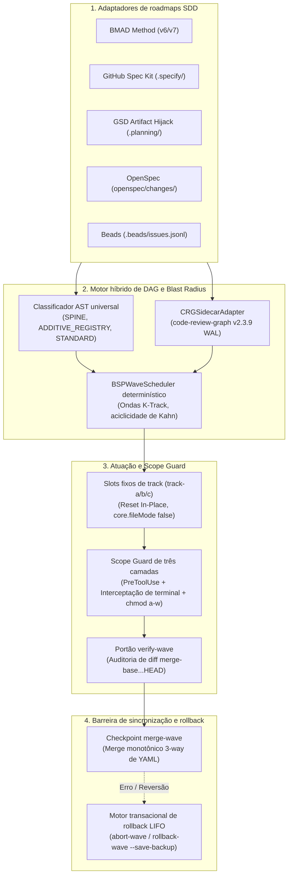

# ⚡ SDD-Parallel (`parallel-flow`)

[](https://github.com/stopActingSoSmall/sdd-parallel/actions/workflows/ci.yml)
[](https://pypi.org/project/sdd-parallel/)
[](https://www.python.org/)
[](../../../LICENSE)
[](#-teste-em-5-segundos-zero-chaves-de-api-sem-clone)

<p align="center">
  
</p>

<p align="center">
  <b>🌐 Idioma / Language:</b>
  <a href="../../../README.md">English</a> |
  <a href="../zh-CN/README.md">简体中文</a> |
  <a href="../es/README.md">Español</a> |
  <b>Português (BR)</b> |
  <a href="../ja/README.md">日本語</a> |
  <a href="../ko/README.md">한국어</a> |
  <a href="../ru/README.md">Русский</a>
</p>

> **Execute 3–4 agentes de IA em paralelo — sem quebrar seu build ou o histórico do Git.**  
> O controlador de tráfego determinístico, isolador de worktrees e protetor de Blast Radius para **Claude Code**, **OpenAI Codex** e **Google Antigravity** operando em projetos **BMAD**, **GitHub Spec Kit**, **GSD**, **OpenSpec** ou **Beads**.

---

## ⚡ Por que isso existe? (Em termos simples)

Quando você tem um backlog de 10–15 especificações ou histórias, você enfrenta uma escolha difícil:
1. **Executar 1 agente de IA sequencialmente:** Seguro, mas exige esperar **6–8 horas**.
2. **Disparar 3–4 agentes de IA em paralelo (`git worktree`):** Rápido, até que você tenta integrá-los e atinge uma **Bomba de Merge (Merge-Bomb)**:
   - **Colisões diretas de Git:** Vários agentes editam simultaneamente `sprint-status.yaml`, `STATE.md` ou `cli.py`.
   - **Quebra semântica silenciosa (Colisão Tipo 2):** O Agente A altera a assinatura de uma função em `normalizer.py`, enquanto o Agente B em outro worktree invoca a assinatura antiga a partir de `api.py`. **O Git faz o merge perfeitamente sem nenhum conflito, mas a branch `main` quebra instantaneamente em tempo de execução.**
   - **Desvio de escopo (Scope Creep):** Um agente decide ser "prestativo" e altera esquemas centrais do banco (`schema.py`) fora da história atribuída.

**O `sdd-parallel` funciona como um controlador de tráfego aéreo com precisão de compilador entre suas especificações SDD e seus agentes de IA.** Antes de gastar um único token de LLM, ele escaneia o AST e o grafo de chamadas do repositório, organiza tarefas seguras em **Ondas (Waves)** paralelas, isola cada agente em um worktree limpo (`track-a`, `track-b`), bloqueia fisicamente escritas fora de escopo e mescla automaticamente ondas concluídas com zero conflitos.

### 📊 Comparativo: Antes vs. Depois do `sdd-parallel`

| Cenário | ❌ SDD Sequencial (1 Agente) | 💥 Paralelo Ingênuo (`--worktree`) | ✅ Com `sdd-parallel` |
| :--- | :--- | :--- | :--- |
| **Tempo de sprint (12 histórias)** | ~6–8 horas (uma por uma) | ~2 h codificando + **2 h corrigindo merges quebrados** | **~2.5 horas no total (ganho de 2x–3x)** |
| **Colisões ocultas de tipo/API** | Evitadas apenas pela lentidão | **Quebra a `main` após o merge** ($W_A \cap I_B$) | **Prevenidas antecipadamente** (separadas em Onda 1 → Onda 2) |
| **Arquivos compartilhados de CLI/Router** | 1 agente por vez | Conflito de Git a cada merge | **Seguro em paralelo** (detecção de `ADDITIVE_REGISTRY`) |
| **`sprint-status.yaml` / `tasks.md`** | Atualizados em série | Conflitos constantes com marcas `<<<<<<<` | **Auto-mesclados** (Mesclador monotônico 3-way) |
| **Agente edita arquivo indevido** | O prompt apenas diz "por favor, não faça" | O agente burla via `bash` / `sed` | **Bloqueio no nível do SO e hooks** (`chmod a-w` + `PreToolUse`) |
| **Desordem de pastas worktree** | Nenhuma | 15 pastas órfãs `.worktrees/task-*` | **Slots fixos reutilizáveis** (`track-a`, `track-b`, `track-c`) |

---

## 🚀 Teste em 5 segundos (Zero chaves de API, sem clone)

Você não precisa de chave de API, assinatura de LLM nem de um projeto existente para ver como o `sdd-parallel` captura uma colisão semântica oculta. Execute este único comando no terminal via [`uv`](https://docs.astral.sh/uv/) (ou `pipx run sdd-parallel demo`):

```bash
uvx sdd-parallel demo
```

**O que acontece em 3.2 segundos no seu terminal:**
1. Cria um repositório temporário com 5 histórias e 6 módulos Python (`schema.py`, `normalizer.py`, `api.py`, `exporter.py`, `cli.py`).
2. **Identifica uma armadilha oculta:** A História `1-2` modifica `normalizer.py`, enquanto a História `2-1` modifica `api.py` (que importa `normalizer.py`). Um bloqueador ingênuo pensaria que são seguras de rodar juntas. O `sdd-parallel` detecta o impacto cruzado no grafo de chamadas e as separa automaticamente na **Onda 1** e **Onda 2**.
3. **Permite paralelismo seguro em registros compartilhados:** Reconhece `cli.py` como `ADDITIVE_REGISTRY`, permitindo que as Histórias `1-2` e `1-3` rodem em paralelo na **Onda 1** (`track-a` e `track-b`).
4. **Demonstra o Scope Guard e o merge 3-way:** Bloqueia uma edição indevida em `schema.py` (`DENY: Locked by Spine Chain invariant`) e mescla ambas as branches paralelas com `0 marcadores de conflito`.

<details>
<summary><b>📺 Clique para visualizar a saída exata do terminal de <code>sdd-parallel demo</code></b></summary>

```text
============================================================================
SDD-PARALLEL STANDALONE MERGE-BOMB DEMO (ZERO API KEYS / OFFLINE)
============================================================================
Workspace: /tmp/sdd-parallel-demo-xyz

[Step 1/4] AST & Architectural Role Classification
----------------------------------------------------------------------------
File Path                              | Detected Role          | Importers
----------------------------------------------------------------------------
src/demo_app/__init__.py               | additive_registry      | -
src/demo_app/api.py                    | standard               | -
src/demo_app/cli.py                    | additive_registry      | -
src/demo_app/exporter.py               | standard               | -
src/demo_app/normalizer.py             | standard               | src/demo_app/api.py
src/demo_app/schema.py                 | spine                  | -

[Step 2/4] Type-2 Semantic Merge-Bomb Detection & BSP Wave Schedule
----------------------------------------------------------------------------
  Collision Analysis:
    - Naive Scheduler : W(1-2)={normalizer.py, cli.py} vs W(2-1)={api.py}
                        -> DISJOINT WRITES (False Safe!)
    - BSPWaveScheduler: Detected semantic_collision between '1-2' and '2-1'
                        -> Overlap W(1-2) ^ I(2-1) on: src/demo_app/api.py
    - Additive Registry: Tasks '1-2' and '1-3' both touch 'src/demo_app/cli.py'
                        -> Role: ADDITIVE_REGISTRY (Parallel allowed in Wave 1)

  Wave Schedule:
    * Wave 1
        - track-a: Story 1-2 -> writes: src/demo_app/normalizer.py (+ shared: src/demo_app/cli.py)
        - track-b: Story 1-3 -> writes: src/demo_app/exporter.py (+ shared: src/demo_app/cli.py)
    * Wave 2
        - track-a: Story 1-1 -> writes: src/demo_app/schema.py
        - track-b: Story 2-1 -> writes: src/demo_app/api.py
    * Wave 3
        - track-a: Story 2-2 -> writes: src/demo_app/schema.py

[Step 3/4] Fixed-Slot Worktree Provisioning & PreToolUse Scope Guard
----------------------------------------------------------------------------
  Provisioned Fixed Slots (100% Clean git status: True):
    - track-a (.worktrees/track-a)
    - track-b (.worktrees/track-b)

  PreToolUse Scope Guard Check (track-a -> 'src/demo_app/schema.py'):
    - Decision : DENY
    - Violation: File 'src/demo_app/schema.py' cannot be modified by Wave 1 / track-a (stories ['1-2'])
    - Reason   : Locked by Spine Chain invariant.

[Step 4/4] Barrier Checkpoint & Monotonic 3-Way YAML Merge
----------------------------------------------------------------------------
  Merged Branches:
    - parallel/track-a
    - parallel/track-b

  Resolved sprint-status.yaml (0 conflict markers):
    - 1-2-normalize-telemetry-payload: done
    - 1-3-cli-batch-export: done
============================================================================
ALL 5 CORE INVARIANTS VERIFIED IN 3.21s
============================================================================
```
</details>

---

## 🗺️ Como funciona visualmente (Do backlog ao merge limpo)

Em vez de lançar 5 agentes no repositório de uma só vez torcendo para que não colidam, o `sdd-parallel` transforma sua sprint em **Ondas (Waves)** determinísticas:

```mermaid
flowchart LR
    subgraph Backlog["📋 1. Backlog SDD"]
        direction TB
        T12["Story 1-2\n(normalizer.py + cli.py)"]
        T13["Story 1-3\n(exporter.py + cli.py)"]
        T21["Story 2-1\n(api.py -> chama normalizer)"]
        T11["Story 1-1\n(schema.py - Bloqueio Spine)"]
    end

    subgraph Planner["🧠 2. sdd-parallel plan"]
        direction TB
        Scan["Varredura AST + Grafo de chamadas\n• cli.py = Additive (Seguro!)\n• 1-2 ↔ 2-1 = Conflito de impacto!\n• schema.py = Bloqueio Spine!"]
    end

    subgraph Wave1["🟢 3. Onda 1 (Worktrees paralelos)"]
        direction TB
        SlotA["📁 .worktrees/track-a\nAgente 1 executa Story 1-2\n🔒 schema.py e api.py bloqueados"]
        SlotB["📁 .worktrees/track-b\nAgente 2 executa Story 1-3\n🔒 schema.py e normalizer.py bloqueados"]
    end

    subgraph Gate["🛡️ 4. sdd-parallel merge --wave 1"]
        direction TB
        M1["✅ Scope Diff auditado\n✅ pytest / mypy / ruff aprovados\n✅ Merge 3-way de status"]
    end

    subgraph Wave2["🔵 5. Onda 2 (Reutiliza mesmos slots)"]
        direction TB
        SlotA2["📁 .worktrees/track-a\nAgente 1 executa Story 1-1"]
        SlotB2["📁 .worktrees/track-b\nAgente 2 executa Story 2-1\n(lê novo normalizer.py!)"]
    end

    Backlog --> Planner --> Wave1 --> Gate --> Wave2
```



---

## 🔌 Integração direta no seu ecossistema (Zero Lock-In)

Você **não precisa** reescrever suas especificações nem alterar como orienta seus agentes. O `sdd-parallel` consome os arquivos do seu framework atual em modo somente leitura:

| Se você usa... | O que o `sdd-parallel` adiciona ao seu fluxo de trabalho |
| :--- | :--- |
| **Claude Code** (`claude`) | Planejamento determinístico de ondas antes de `--worktree` / `Agent Teams`, bloqueio de arquivos indevidos e comandos Bash via `PreToolUse`, e roteamento por complexidade (`High`/`Medium`/`Low`). |
| **OpenAI Codex CLI** (`codex`) | Evita condições de corrida ordenando previamente tarefas conflitantes e bloqueando esquemas centrais (`chmod a-w`) em cada slot. |
| **Google Antigravity** | Fornece slots fixos reutilizáveis (`track-a`, `track-b`, `track-c`) que eliminam falhas de pastas perdidas na IDE e mantêm o `git status --porcelain` 100% limpo via `.git/worktrees/*/info/exclude`. |
| **BMAD Method (`v6.3+` / `v7`)** | Transforma filas lineares em `sprint-status.yaml` em ondas paralelas multi-epic e mescla status de histórias (`backlog -> done`) sem conflitos de YAML. |
| **GitHub Spec Kit (`.specify/`)** | Valida tags manuais de paralelismo `[P]` em `tasks.md` contra dependências reais do AST do código, impedindo falsos paralelos de quebrar a build. |
| **GSD / OpenSpec / Beads** | Isola `.planning/STATE.md` (modo Artifact Hijack), `openspec/changes/` e `.beads/issues.jsonl` em worktrees limpos. |

---

## 🛠️ Seu fluxo diário em 4 comandos

### 1. Instalação única
```bash
# Recomendado via uv (ou: pipx install sdd-parallel)
uv tool install sdd-parallel
```
*(Tanto o comando `sdd-parallel` quanto o alias curto `parallel-flow` ficam disponíveis globalmente).*

### 2. Executar uma Onda Paralela em qualquer projeto
```bash
# Passo 1: Analisar especificações SDD e AST para gerar ondas seguras
sdd-parallel plan

# Passo 2: Preparar a Onda 1 nos slots fixos (.worktrees/track-a, track-b)
#         e exibir as instruções de lançamento para os agentes de código
sdd-parallel prepare --wave 1
sdd-parallel run-guide --wave 1

# 👉 Passo 3: Os agentes de IA (Claude Code / Codex / Antigravity) implementam
#            as histórias simultaneamente dentro de track-a e track-b.

# Passo 4: Verificar ausência de violações de escopo e mesclar a Onda 1 na main
sdd-parallel verify-wave --wave 1
sdd-parallel merge --wave 1
```
Precisa desfazer uma onda? Execute `sdd-parallel abort-wave --wave 1` (antes do merge) ou `sdd-parallel rollback-wave --wave 1` (após o merge, com branches automáticas de backup e redefinição de status SDD).

---

## 🧩 Matriz de frameworks SDD suportados

| Framework SDD | Status | Artefatos detectados (Somente leitura) | Sincronização de status |
| :--- | :---: | :--- | :--- |
| **BMAD Method (`v6.3+` / `v7`)** | ✅ Entregue | `sprint-status.yaml`, `epics.md`, `epic-*-context.md`, `spec-*.md` | Merge 3-way monotônico de YAML |
| **GitHub Spec Kit (`.specify/`)** | ✅ Entregue | `.specify/specs/*/tasks.md`, `constitution.md` | Caixas de seleção em Markdown |
| **GSD (Get Shit Done)** | ✅ Entregue | `.planning/phases/*-PLAN.md`, `ROADMAP.md` | Artifact Hijack (atualização centralizada de `STATE.md`) |
| **OpenSpec (`openspec/`)** | ✅ Entregue | `openspec/changes/<id>/tasks.md` | Rastreamento orientado a especificações |
| **Beads (`.beads/`)** | ✅ Entregue | `.beads/issues.jsonl` | Atualização topológica de status de issues |

---

## 🔍 Aprofundamento técnico (Arquitetura, invariantes e referência completa da CLI)

Quer inspecionar o modelo matemático, a arquitetura interna dos módulos ou cada parâmetro da CLI? Expanda as seções abaixo ou acesse diretamente o **[Dossiê de Arquitetura e Estratégia](../../dossier/README.md)**:

- 📖 **[01 — Briefing do Produto e Modelo de ROI](../../dossier/01_CORE_PRODUCT_BRIEF.md)** *(Resumo executivo, FinOps de tokens e roteamento por esforço)*
- 🏛️ **[02 — Capacidades do Sistema e White Paper](../../dossier/02_SYSTEM_CAPABILITIES_WHITE_PAPER.md)** *(Conflitos Tipo 1 vs Tipo 2, taxonomia 3D de arquivos, decaimento CRG)*
- 🔌 **[03 — Especificação de Integração e Ecossistema](../../dossier/03_INTEGRATION_AND_ECOSYSTEM_SPEC.md)** *(IR `CanonicalTask`, contratos `.tmp/track-context.md`, `.parallel-lock.json`)*
- 🧪 **[07 — Demonstração Autônoma e Guia E2E Interativo](../../dossier/07_STANDALONE_DEMO_AND_E2E_WALKTHROUGH.md)** *(Snapshots passo a passo e sandbox com `--keep-temp`)*
- 📐 **[Arquitetura do Sistema SSOT (`ARCHITECTURE.md`)](ARCHITECTURE.md)** | **[Dossiê em Russo](../../i18n/ru/dossier/)**

<details>
<summary><b>🏛️ Clique para expandir: Arquitetura interna do motor e 9 invariantes de engenharia</b></summary>

### Fluxo interno de componentes



### Os 9 invariantes fundamentais de engenharia

1. **Zero poluição de worktrees (Zero Worktree Pollution):** Arquivos contextuais injetados (`.tmp/track-context.md`, `.parallel-lock.json`, `ACTIVE_TRACK.md`) mascarados via `info/exclude`. `git status --porcelain` sempre 100% limpo.
2. **Zero invalidação de cache (Zero Cache Invalidation):** Contextos em `_bmad-output/planning-artifacts/` estritamente somente leitura; o estado do planejador é gravado em `_bmad-output/parallel-artifacts/`.
3. **100% de cobertura de tarefas e aciclicidade:** Validação topológica por Kahn/Tarjan garantindo zero histórias perdidas e zero ciclos de dependência.
4. **Aplicação de Blast Radius (Tipo 1 e Tipo 2):** Conjuntos de escrita disjuntos ($W_A \cap W_B = \emptyset$) e impactos semânticos disjuntos ($W_A \cap I_B = \emptyset$).
5. **Universalidade sem overfitting (Invariante 7):** Sem caminhos específicos de domínio ou entidades fixadas no motor. Classificação de `SPINE`, `ADDITIVE_REGISTRY` e `STANDARD` estritamente via heurísticas AST e centralidade de grafos.
6. **Slots fixos de track (Pegada $O(1)$ em disco):** Reutiliza `track-a`, `track-b`, `track-c` via `git checkout -B` e `git clean -fd` evitando acúmulo de pastas no sistema e na IDE.
7. **Defesa em profundidade de três camadas:** Hook `PreToolUse` + interceptação de comandos de terminal (`Bash`, `run_command`) + bloqueio de arquivos via SO `chmod a-w`.
8. **Semirreticulado monotônico de status:** Convergência monotônica: $\texttt{backlog} (0) < \dots < \texttt{done} (4)$ sem conflitos de merge.
9. **Rollbacks transacionais LIFO:** Reversão estritamente em ordem inversa com criação automática de branches de segurança (`backup/wave-<K>-before-rollback-*`).

</details>

<details>
<summary><b>🛠️ Clique para expandir: Referência completa da CLI (Todos os 13 subcomandos e opções)</b></summary>

| Comando | Finalidade |
| :--- | :--- |
| `sdd-parallel demo [--kit {bmad,spec-kit,gsd,openspec,beads,all}] [--keep-temp] [--scaffold-only] [--output-dir DIR]` | Executar a demonstração offline ou criar um sandbox interativo nos 5 kits SDD. |
| `sdd-parallel plan [--repo REPO] [--max-tracks N] [--kit auto] [--include-done] [--dry-run] [--plan-source {auto,plan,specs}] [--output-dir DIR]` | Analisar o roadmap e grafo do código; gerar `execution-plan-parallel.md` e `wave-plan.json`. |
| `sdd-parallel prepare --wave K [--repo REPO] [--max-tracks N] [--kit KIT] [--headless] [--antigravity-layout] [--dynamic-worktrees] [--dry-run]` | Provisionar slots de worktree (`track-a`, `track-b`), configurar travas de SO e injetar arquivos de contexto. |
| `sdd-parallel claim-track --wave K --track <id> --worktree <path> [--repo REPO] [--max-tracks N] [--kit KIT] [--headless]` | Associar travas e contexto a um slot de worktree externo pré-existente. |
| `sdd-parallel run-guide --wave K [--repo REPO] [--max-tracks N] [--kit KIT] [--antigravity-layout]` | Exibir matriz interativa de execução com instruções de lançamento para cada janela de terminal de track. |
| `sdd-parallel verify-wave --wave K [--repo REPO] [--max-tracks N] [--kit KIT] [--dynamic-worktrees]` | Auditar alterações em relação a `.parallel-lock.json` e diff de múltiplos commits contra `merge-base`. |
| `sdd-parallel merge --wave K [--repo REPO] [--max-tracks N] [--kit KIT] [--dynamic-worktrees] [--skip-gates] [--strict-gates] [--cleanup] [--dry-run]` | Ponto de controle: merge 3-way de status, merge git, portões de qualidade e autorollback transacional. |
| `sdd-parallel abort-wave --wave K [--repo REPO] [--dynamic-worktrees]` | Abortar onda não mesclada: resetar slots e remover branches paralelas temporárias. |
| `sdd-parallel rollback-wave --wave K [--repo REPO] [--dynamic-worktrees] [--to-commit COMMIT] [--save-backup] [--no-backup] [--kit KIT]` | Reverter onda mesclada em ordem LIFO com branch de backup e redefinição de status SDD. |
| `sdd-parallel merge-status --base B --ours O --theirs T --out OUT` | Ferramenta determinística de baixo nível para merge 3-way de `sprint-status.yaml`. |
| `sdd-parallel check-lock --file PATH [--tool TOOL]` | Validar permissões de escrita de arquivo com base no manifesto ativo de travas. |
| `sdd-parallel install-plugin [--target-dir DIR]` | Empacotar e instalar o plugin nativo para o Google Antigravity. |
| `sdd-parallel autopilot --wave K [--repo REPO] [--max-tracks N] [--kit KIT] [--harness <tool>] [--antigravity-layout] [--execute]` | Gerar ou executar comandos de piloto automático multi-conversa com roteamento de modelos. |

</details>

<details>
<summary><b>🧪 Clique para expandir: Desenvolvimento local e portões de qualidade</b></summary>

### Pré-requisitos
- **Python:** `>= 3.11` (Python 3.11, 3.12, 3.13)
- **Git:** `>= 2.30` (necessário para isolamento de `git worktree` e mascaramento via `info/exclude`)
- **Gerenciador de pacotes:** [`uv`](https://docs.astral.sh/uv/) (recomendado) ou `pipx`

```bash
git clone https://github.com/stopActingSoSmall/sdd-parallel.git
cd sdd-parallel
uv sync

# Executar mais de 99 testes automatizados (unitários e de integração)
uv run pytest

# Verificação estrita de tipagem estática
uv run mypy --strict src/sdd_parallel

# Linter e verificação de estilo
uv run ruff check src/ tests/ scripts/

# Executar demonstração autônoma offline
uv run sdd-parallel demo
```

</details>

---

## 🚢 Matriz de lançamentos: Publicado (v0.1.0) vs Roadmap (v0.2+)

### ✅ Entregue na `v0.1.0` (Ambiente de Produção)
- Agendador determinístico de ondas Bulk-Synchronous Parallel (BSP) com verificação acíclica de Kahn.
- Scanner de hotspots via AST e integração sidecar com `code-review-graph v2.3.9`.
- Arquitetura de slots fixos (`track-a`, `track-b`, `track-c`) com capacidade de reset in-place.
- Scope Guard de três camadas (`PreToolUse` + Guard de terminal + `chmod a-w` do SO).
- Mesclador monotônico 3-way de YAML preservando comentários e formatação.
- Motor transacional de rollback de ondas LIFO com branches automáticas de segurança.
- Padrão Two-Stage Assisted (Slots interativos de IDE, `Depth 0`).
- 5 adaptadores multi-SDD (BMAD, Spec Kit, GSD Artifact Hijack, OpenSpec, Beads).
- Demonstração offline sem chaves de API (`sdd-parallel demo`) e suíte completa de CI no GitHub Actions.
- 99 testes automatizados, `mypy --strict` e portões de qualidade com `ruff`.

### 🚧 Planejado para `v0.2.0+`
- **Ecossistema de adaptadores comunitários:** Suporte para `mattpocock/skills` (`/implement-spec`) e `bmad-loop` v0.8+.
- **Sincronização de ambientes sem poluição:** Padrão `workz` com links simbólicos de `.venv` e `node_modules` nos slots fixos.
- **Linker estático de símbolos e escalabilidade dinâmica de escopo:** Expansão automática do write-set via símbolos AST e reagendamento dinâmico de tarefas.
- **Exportadores FinOps e observabilidade:** Spans OpenTelemetry e telemetria de economia de tokens no Langfuse.
- **Daemon autônomo em segundo plano:** Execução completamente headless via RPC local e despacho de subagentes.

---

## 🤝 Contribuição e segurança

- **Contribuição:** Consulte nosso **[Guia de Contribuição](../../../CONTRIBUTING.md)** para configuração do ambiente de desenvolvimento e diretrizes de PR.
- **Segurança:** O processo de reporte de vulnerabilidades está detalhado em nossa **[Política de Segurança](../../../SECURITY.md)**.

## 📜 Licença

Licença MIT. Consulte [LICENSE](../../../LICENSE) para mais detalhes.
