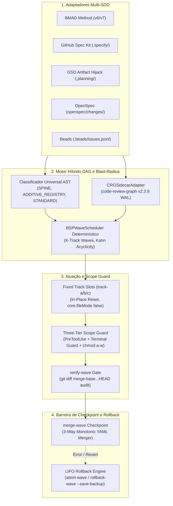

<!-- status: draft -->
# ⚡ SDD-Parallel

[](https://github.com/stopActingSoSmall/sdd-parallel/actions/workflows/ci.yml)
[](https://www.python.org/)
[](../../../LICENSE)
[](#-demo-offline-em-5-segundos-sem-chaves-api)

<p align="center">
  <b>🌐 Idioma / Language:</b>
  <a href="../../../README.md">English</a> |
  <a href="../zh-CN/README.md">简体中文</a> |
  <a href="../es/README.md">Español</a> |
  <b>Português (BR)</b> |
  <a href="../ja/README.md">日本語</a> |
  <a href="../ko/README.md">한국어</a> |
  <a href="../ru/README.md">Русский</a>
</p>

> **Harness de concorrência e governança de Blast Radius para desenvolvimento orientado a especificações (SDD) com agentes de IA**  
> (Google Antigravity, Claude Code, OpenAI Codex)  
> *Disponível como o CLI `sdd-parallel` e o alias conveniente `parallel-flow`.*

---

## 🎯 O Problema

Os frameworks modernos de Desenvolvimento Orientado a Especificações (Spec-Driven Development, SDD) — **BMAD Method (v6/v7)**, **GitHub Spec Kit (`.specify/`)**, **GSD (Get Shit Done)**, **OpenSpec** e **Beads** — são excelentes na decomposição de requisitos em especificações unitárias verificáveis. No entanto, enfrentam uma **limitação arquitetural crítica ao escalar para execução paralela**:

1. **Filas lineares de histórias:** Os agendadores forçam uma execução estritamente sequencial (`Story 1 -> Story 2 -> Story 3`), desconsiderando a independência entre epics.
2. **Merge-Bombs em configurações compartilhadas:** Agentes concorrentes colidem em arquivos de registros compartilhados e status de sprint (`sprint-status.yaml`, `STATE.md`, `tasks.md`).
3. **Colisões semânticas de Tipo 2 ($W_A \cap I_B \neq \emptyset$):** O Agente A refatora a assinatura de uma interface compartilhada, enquanto o Agente B invoca concorrentemente a assinatura antiga. Os testes locais em branches isoladas passam, mas o build falha catastroficamente após o merge.
4. **Limites de profundidade de subagentes:** Fluxos multiagente complexos (como as 3 lentes de revisão do BMAD) quebram quando aninhados em subagentes planos (`Max Subagent Depth = 1`).

---

## 💡 A Solução: `sdd-parallel`

O `sdd-parallel` é um harness de governança e orquestração determinística que:
- **Analisa roadmaps SDD polimorficamente:** Zero hardcoding; extrai tarefas, dependências e mapas de código em 5 frameworks SDD.
- **Calcula o Blast Radius semântico (AST + Grafo de chamadas):** Determina dependências direcionadas, Spine Locks e colisões de Tipo 2 ($W_A \cap I_B$).
- **Aloca Fixed Track Slots (`track-a`, `track-b`, ...):** Configura slots permanentes de worktree com reset in-place (`git checkout -B` + `git clean -fd`), mantendo footprint de disco $O(1)$.
- **Aplica um Three-Tier Scope Guard:** Intercepta edições fora de escopo com hooks `PreToolUse`, barra comandos destrutivos no terminal (`Bash`, PowerShell) e protege arquivos no SO via `chmod a-w`.
- **Executa Monotonic 3-Way Merges:** Reconcilia status de tarefas por meio de semirreticulados monótonos ($\max(\text{rank})$) com zero marcadores de conflito `<<<<<<<`.
- **Garante Rollbacks Transacionais LIFO:** Reverte ondas integradas estritamente em ordem inversa (LIFO), com branches de backup automáticas e reset polimórfico de status.

---

## 🚀 Demo offline em 5 segundos (sem chaves API)

Clone o repositório e execute a demonstração independente offline:

```bash
uv run sdd-parallel demo
```

```text
============================================================================
SDD-PARALLEL STANDALONE MERGE-BOMB DEMO (ZERO API KEYS / OFFLINE)
============================================================================
Workspace: /tmp/sdd-parallel-demo-xyz

[Step 1/4] AST & Architectural Role Classification
----------------------------------------------------------------------------
File Path                              | Detected Role          | Importers
----------------------------------------------------------------------------
src/demo_app/__init__.py               | additive_registry      | -
src/demo_app/api.py                    | standard               | -
src/demo_app/cli.py                    | additive_registry      | -
src/demo_app/exporter.py               | standard               | -
src/demo_app/normalizer.py             | standard               | src/demo_app/api.py
src/demo_app/schema.py                 | spine                  | -

[Step 2/4] Type-2 Semantic Merge-Bomb Detection & BSP Wave Schedule
----------------------------------------------------------------------------
  Collision Analysis:
    - Naive Scheduler : W(1-2)={normalizer.py, cli.py} vs W(2-1)={api.py}
                        -> DISJOINT WRITES (False Safe!)
    - BSPWaveScheduler: Detected semantic_collision between '1-2' and '2-1'
                        -> Overlap W(1-2) ^ I(2-1) on: src/demo_app/api.py
    - Additive Registry: Tasks '1-2' and '1-3' both touch 'src/demo_app/cli.py'
                        -> Role: ADDITIVE_REGISTRY (Parallel allowed in Wave 1)

  Wave Schedule:
    * Wave 1
        - track-a: Story 1-2 -> writes: src/demo_app/normalizer.py (+ shared: src/demo_app/cli.py)
        - track-b: Story 1-3 -> writes: src/demo_app/exporter.py (+ shared: src/demo_app/cli.py)
    * Wave 2
        - track-a: Story 1-1 -> writes: src/demo_app/schema.py
        - track-b: Story 2-1 -> writes: src/demo_app/api.py
    * Wave 3
        - track-a: Story 2-2 -> writes: src/demo_app/schema.py

[Step 3/4] Fixed-Slot Worktree Provisioning & PreToolUse Scope Guard
----------------------------------------------------------------------------
  Provisioned Fixed Slots (100% Clean git status: True):
    - track-a (.worktrees/track-a)
    - track-b (.worktrees/track-b)

  PreToolUse Scope Guard Check (track-a -> 'src/demo_app/schema.py'):
    - Decision : DENY
    - Violation: File 'src/demo_app/schema.py' cannot be modified by Wave 1 / track-a (stories ['1-2'])
    - Reason   : Locked by Spine Chain invariant.

[Step 4/4] Barrier Checkpoint & Monotonic 3-Way YAML Merge
----------------------------------------------------------------------------
  Merged Branches:
    - parallel/track-a
    - parallel/track-b

  Resolved sprint-status.yaml (0 conflict markers):
    - 1-2-normalize-telemetry-payload: done
    - 1-3-cli-batch-export: done
============================================================================
ALL 5 CORE INVARIANTS VERIFIED IN 3.21s
============================================================================
```

> 📖 **Anatomia passo a passo da demo, teoria dos grafos e sandbox interativo:**  
> Deseja conferir snapshots de disco quadro a quadro (`Before -> Wave Planning -> Slot Locking -> 3-Way Merge`), compreender a teoria dos grafos por trás de `SPINE` / `ADDITIVE_REGISTRY` / `STANDARD` (3 passos do `ASTHotspotScanner`) e testar na prática `plan`, `prepare`, `check-lock`, `abort-wave` e `rollback-wave` em um sandbox `--keep-temp` ou projeto greenfield?  
> 👉 Consulte a fundamentação em **[System Capabilities & Architectural White Paper](../../dossier/02_SYSTEM_CAPABILITIES_WHITE_PAPER.md)** e o guia de execução em **[07_STANDALONE_DEMO_AND_E2E_WALKTHROUGH.md](07_STANDALONE_DEMO_AND_E2E_WALKTHROUGH.md)** *(parte do canônico **[Architecture & Strategy Dossier](../../dossier/README.md)**; original em russo em **[docs/i18n/ru/dossier/](../ru/dossier/)**)*.  
> 🏛️ Para tomadores de decisão e arquitetos: **[Resumo Executivo e Visão Geral](../../dossier/01_CORE_PRODUCT_BRIEF.md)** | **[Arquitetura do Sistema SSOT](ARCHITECTURE.md)**.

---

## 📦 Requisitos e Instalação

### Pré-requisitos
- **Python:** `>= 3.11` (Python 3.11, 3.12, 3.13)
- **Git:** `>= 2.30` (necessário para isolamento moderno com `git worktree` e mascaramento via `info/exclude`)
- **Gerenciador de Pacotes:** [`uv`](https://docs.astral.sh/uv/) (recomendado) ou `pipx`

### Instalação

#### Como ferramenta CLI isolada (Recomendado)
```bash
# Usando uv (mais rápido)
uv tool install sdd-parallel

# Ou usando pipx
pipx install sdd-parallel
```

#### A partir do código-fonte para desenvolvimento local
```bash
git clone https://github.com/stopActingSoSmall/sdd-parallel.git
cd sdd-parallel
uv sync
```

Após a instalação, a CLI está disponível globalmente via `sdd-parallel` (ou pelo alias curto `parallel-flow`).

---

## 🏛️ Arquitetura do Sistema



---

## 🛡️ Invariantes Fundamentais

1. **Zero Worktree Pollution:** Arquivos de contexto (`.tmp/track-context.md`, `.parallel-lock.json`, `ACTIVE_TRACK.md`) são ocultados via `info/exclude`. O `git status --porcelain` permanece 100% limpo.
2. **Zero Cache Invalidation:** Contextos de epics em `_bmad-output/planning-artifacts/` são somente leitura; o estado do agendador é gravado em `_bmad-output/parallel-artifacts/`.
3. **100% Task Coverage & Acyclic Invariant:** A validação topológica de Kahn/Tarjan assegura zero tarefas ignoradas e zero ciclos de dependência.
4. **Blast-Radius Enforcement (Tipo 1 e Tipo 2):** Conjuntos de escrita disjuntos ($W_A \cap W_B = \emptyset$) e impactos semânticos disjuntos ($W_A \cap I_B = \emptyset$).
5. **Universal Anti-Overfitting (Invariante 7):** Proibição total de caminhos ou entidades proprietárias no núcleo do motor. A classificação de `SPINE`, `ADDITIVE_REGISTRY` e `STANDARD` baseia-se unicamente em heurísticas AST e centralidade topológica.
6. **Fixed Track Slots ($O(1)$ Footprint):** Reutilização de slots fixos `track-a`, `track-b`, `track-c` via `git checkout -B` e `git clean -fd`, impedindo proliferação de diretórios.
7. **Three-Tier Defense-in-Depth Guard:** Hook `PreToolUse` + interceptação de comandos no terminal (`Bash`, `run_command`) + proteção de arquivos no SO via `chmod a-w`.
8. **Monotonic Status Semi-Lattice:** Os status evoluem de forma monótona: $\texttt{backlog} (0) < \dots < \texttt{done} (4)$ sem marcadores de conflito.
9. **LIFO Transactional Rollbacks:** Reversão estritamente em ordem inversa de ondas mescladas com branches de segurança automáticas (`backup/wave-<K>-before-rollback-*`).

---

## 🛠️ Referência da CLI

| Comando | Finalidade |
| :--- | :--- |
| `sdd-parallel demo [--kit {bmad,spec-kit,gsd,openspec,beads,all}] [--keep-temp] [--scaffold-only] [--output-dir DIR]` | Executa a demo offline independente de Merge-Bomb ou monta um sandbox interativo para os 5 kits SDD. |
| `sdd-parallel plan [--repo REPO] [--max-tracks N] [--kit auto] [--include-done] [--dry-run] [--plan-source {auto,plan,specs}] [--output-dir DIR]` | Analisa o roadmap e o grafo da base de código; gera `execution-plan-parallel.md` e `wave-plan.json`. |
| `sdd-parallel prepare --wave K [--repo REPO] [--max-tracks N] [--kit KIT] [--headless] [--antigravity-layout] [--dynamic-worktrees] [--dry-run]` | Prepara os slots worktree (`track-a`, `track-b`), configura bloqueios no SO e injeta limites de contexto. |
| `sdd-parallel claim-track --wave K --track <id> --worktree <path> [--repo REPO] [--max-tracks N] [--kit KIT] [--headless]` | Vincula o manifesto de bloqueios a um slot worktree externo existente. |
| `sdd-parallel run-guide --wave K [--repo REPO] [--max-tracks N] [--kit KIT] [--antigravity-layout]` | Exibe a matriz interativa do guia do operador com comandos de inicialização para cada janela ativa. |
| `sdd-parallel verify-wave --wave K [--repo REPO] [--max-tracks N] [--kit KIT] [--dynamic-worktrees]` | Audita os slots worktree contra o `.parallel-lock.json` e o diff multi-commit contra o `merge-base`. |
| `sdd-parallel merge --wave K [--repo REPO] [--max-tracks N] [--kit KIT] [--dynamic-worktrees] [--skip-gates] [--strict-gates] [--cleanup] [--dry-run]` | Merge no checkpoint de barreira: merge 3-way de status, integração git, quality gates polimórficos e auto-rollback transacional. |
| `sdd-parallel abort-wave --wave K [--repo REPO] [--dynamic-worktrees]` | Aborta uma onda não integrada: reseta os slots e remove branches temporárias. |
| `sdd-parallel rollback-wave --wave K [--repo REPO] [--dynamic-worktrees] [--to-commit COMMIT] [--save-backup] [--no-backup] [--kit KIT]` | Reverte uma onda integrada em ordem LIFO com branch de segurança e reset de status de tarefas SDD. |
| `sdd-parallel merge-status --base B --ours O --theirs T --out OUT` | Ferramenta determinística de baixo nível para merge 3-way de arquivos de status `sprint-status.yaml`. |
| `sdd-parallel check-lock --file PATH [--tool TOOL]` | Valida permissões de escrita de arquivo contra o manifesto ativo de bloqueios da worktree. |
| `sdd-parallel install-plugin [--target-dir DIR]` | Empacota e instala o plugin portátil para Google Antigravity. |
| `sdd-parallel autopilot --wave K [--repo REPO] [--max-tracks N] [--kit KIT] [--harness <tool>] [--antigravity-layout] [--execute]` | Gera ou executa comandos de inicialização no modo Multi-Conversation Autopilot com roteamento Model Effort. |

---

## 🧩 Frameworks SDD Suportados

| Framework SDD | Status | Artefatos Read-Only Detectados | Sincronização de Estado |
| :--- | :---: | :--- | :--- |
| **BMAD Method (`v6.3+` / `v7`)** | ✅ Suportado | `sprint-status.yaml`, `epics.md`, `epic-*-context.md`, `spec-*.md` | Monotonic 3-Way YAML merge |
| **GitHub Spec Kit (`.specify/`)** | ✅ Suportado | `.specify/specs/*/tasks.md`, `constitution.md` | Sincronização de checkboxes Markdown |
| **GSD (Get Shit Done)** | ✅ Suportado | `.planning/phases/*-PLAN.md`, `ROADMAP.md` | Artifact Hijack (isolamento de `STATE.md`) |
| **OpenSpec (`openspec/`)** | ✅ Suportado | `openspec/changes/<id>/tasks.md` | Rastreamento guiado por especificações |
| **Beads (`.beads/`)** | ✅ Suportado | `.beads/issues.jsonl` | Atualizações topológicas em JSONL |

---

## 🚢 Matriz de Versões: Lançado (v0.1.0) vs Roteiro (v0.2+)

### ✅ Entregue em `v0.1.0` (Production Hardened)
- Agendador determinístico Bulk-Synchronous Parallel (BSP) com verificação de aciclicidade de Kahn.
- Scanner de AST Hotspots e integração de sidecar com `code-review-graph v2.3.9`.
- Arquitetura Fixed Track Slots (`track-a`, `track-b`, `track-c`) com reset in-place.
- Three-Tier Defense-in-Depth Scope Guard (`PreToolUse` + Terminal Guard + `chmod a-w` no SO).
- Monotonic 3-Way YAML Merger preservando comentários e formatação.
- Motor de rollback transacional LIFO com branches automáticas de segurança.
- Padrão de execução do operador Two-Stage Assisted (Slots Interativos de IDE) em `Depth 0`.
- 5 adaptadores Multi-SDD (BMAD, Spec Kit, GSD Artifact Hijack, OpenSpec, Beads).
- Demonstração offline independente de Merge-Bomb (`sdd-parallel demo`) e suíte CI no GitHub Actions.
- 95+ testes automatizados unitários e de integração, portões de qualidade mypy --strict e ruff.

### 🚧 Planejado para `v0.2.0+`
- **Ecossistema de Adaptadores da Comunidade:** `mattpocock/skills` (`/implement-spec`) e adaptador de status frontmatter para `bmad-loop` v0.8+.
- **Sincronização de Ambiente Zero-Pollution:** Padrão `workz` com symlinks de `.venv` e `node_modules` nos slots fixos.
- **Linker Estático de Símbolos Pré-Onda e Escalação de Escopo:** Expansão automática do conjunto de escrita via símbolos AST e reagendamento dinâmico de tarefas.
- **Exportadores FinOps e Observabilidade:** Spans OpenTelemetry e telemetria de economia de tokens Langfuse.
- **Daemon Autopilot Headless:** Execução autônoma de agentes via RPC local / despacho de subagentes.

---

## 🧪 Desenvolvimento e Quality Gates

Execute localmente a suíte completa de testes e validação:

```bash
# Executar suíte de testes
uv run pytest

# Verificação estrita de tipos
uv run mypy --strict src/sdd_parallel

# Linter de código
uv run ruff check src/ tests/ scripts/

# Executar demo offline independente
uv run sdd-parallel demo
```

---

## 🤝 Contribuição e Segurança

- **Contribuição:** Leia nosso **[Guia de Contribuição](../../../CONTRIBUTING.md)** para configuração do ambiente de desenvolvimento e portões de verificação de pull requests.
- **Segurança:** Diretrizes para divulgação e reporte de vulnerabilidades estão descritas em nossa **[Política de Segurança](../../../SECURITY.md)**.

---

## 📜 Licença

Licença MIT. Consulte [LICENSE](../../../LICENSE) para mais detalhes.
