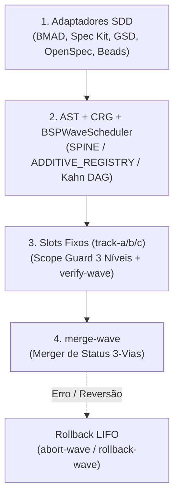

<p align="center">
  
</p>

<p align="center">
  <a href="https://github.com/stopActingSoSmall/sdd-parallel/actions/workflows/ci.yml"></a>
  <a href="https://pypi.org/project/sdd-parallel/"></a>
  <a href="https://www.python.org/"></a>
  <a href="../../../LICENSE"></a>
  <a href="#-experimente-em-5-segundos-zero-chaves-de-api-passo-a-passo-anotado"></a>
  <br>
  <a href="#-encaixa-se-perfeitamente-na-sua-stack-atual-zero-lock-in"></a>
  <a href="#-veja-o-layout-exato-do-seu-projeto-sdd-antes-e-depois"></a>
</p>

<p align="center">
  <b>🌐 Idioma:</b>
  <a href="../../../README.md">English</a> |
  <a href="../es/README.md">Español</a> |
  <b>Português (BR)</b> |
  <a href="../ja/README.md">日本語</a> |
  <a href="../ko/README.md">한국어</a> |
  <a href="../zh-CN/README.md">简体中文</a> |
  <a href="../ru/README.md">Русский</a>
</p>

<p align="center">
  <a href="#-experimente-em-5-segundos-zero-chaves-de-api-passo-a-passo-anotado">Demo rápida</a> ·
  <a href="#-por-que-isso-existe-em-bom-português">Por que existe</a> ·
  <a href="#%EF%B8%8F-como-funciona-e-fluxo-diário-de-4-comandos">Como funciona</a> ·
  <a href="#-veja-o-layout-exato-do-seu-projeto-sdd-antes-e-depois">Seu layout SDD</a> ·
  <a href="#-encaixa-se-perfeitamente-na-sua-stack-atual-zero-lock-in">Harnesses</a> ·
  <a href="../../USER_GUIDE.md">User Guide (EN)</a> ·
  <a href="#%EF%B8%8F-referência-completa-da-cli">CLI</a> ·
  <a href="#-arquitetura-modelo-matemático-e-aprofundamento-no-dossier">Aprofundamento</a>
</p>

> **Agendador de ondas determinístico e sandbox isolado de worktrees para agentes de IA em paralelo — evita merge-bombs silenciosos antes de gastar um único token de LLM.**  
> O `sdd-parallel` atua entre o seu backlog de **Spec Kit / BMAD / GSD / OpenSpec / Beads** e os agentes de codificação (**Claude Code**, **Codex**, **Antigravity** ou qualquer CLI compatível com worktrees).

https://github.com/stopActingSoSmall/sdd-parallel/releases/download/v0.1.0/sdd-parallel-explainer-pt-BR.mp4

<p align="center"><em>🎬 <b>Vídeo explicativo completo em 1080p</b> — Narração em 7 idiomas disponível pelo seletor <b>🌐 Idioma</b> acima.</em></p>

Explore na prática: **[⚡ Wave Inspector interativo online](https://stopactingsosmall.github.io/sdd-parallel/?video=pt-BR)** (demo no navegador sem instalação) · **[📘 Guia do Operador e Runbook Dia-1 (EN)](../../USER_GUIDE.md)**.

---

## ⚡ Por que isso existe? (Em bom português)

<p align="center">
  
</p>

Com 10–15 especificações ou histórias, equipes enfrentam duas opções ruins:
1. **Um único agente, sequencialmente** — seguro, mas **6–8 horas** de espera.
2. **3–4 agentes em pastas ingênuas com `git worktree`** — rápido até a hora do merge:
   - **Tipo 1 (direto):** dois agentes editam `sprint-status.yaml`, `STATE.md` ou `cli.py` → conflitos `<<<<<<<`.
   - **Tipo 2 (semântico, silencioso):** o Agente A muda a assinatura de `normalizer.py`; o Agente B chama a antiga em `api.py`. **O Git faz o merge limpo — e a `main` quebra.**
   - **Fuga de escopo (scope creep):** um agente reescreve `schema.py` compartilhado fora da sua tarefa.

**O `sdd-parallel` previne isso antes que qualquer token seja gasto:** analisa AST + grafos de chamadas, empacota tarefas seguras em **Ondas (Waves)**, isola agentes em slots reutilizáveis (`track-a/b/c`), bloqueia edições fora de escopo e integra atrás de quality gates.

| O que acontece | ❌ Sequencial | 💥 `--worktree` ingênuo | ✅ `sdd-parallel` |
| :--- | :--- | :--- | :--- |
| **Sprint de 12 histórias** | ~6–8 h | ~2 h codificando + **~2 h corrigindo merges** | **~2.5 h no total (2x–3x mais rápido)** |
| **Colisões ocultas de API** | Indo devagar | **Quebra a `main`** ($W_A \cap I_B \neq \emptyset$) | **Prevenidas antes** (Onda 1 → 2) |
| **CLI / roteadores compartilhados** | Serializado | Conflito Git a cada merge | **Seguro em paralelo** (`ADDITIVE_REGISTRY`) |
| **Arquivos de status** | Atualizações em série | Marcadores `<<<<<<<` constantes | **Merge 3-vias monótono** (0 marcadores) |
| **Edições fora de escopo** | Aviso no prompt | Burlado via `bash`/`sed` | **Bloqueado** (`PreToolUse` + Terminal Guard + `chmod a-w`) |
| **Poluição de worktrees** | Nenhuma | 15 pastas órfãs `task-*` | **Slots fixos reutilizáveis** (`track-a/b/c`) |

*Notação: $W$ = arquivos modificados (Write set); $I$ = arquivos que importam ou dependem deles (Impact radius).*

---

## 🚀 Experimente em 5 segundos (zero chaves de API, passo a passo anotado)

Sem chave de API, sem assinatura de LLM, sem clone. Execute via [`uv`](https://docs.astral.sh/uv/) (ou `pipx run sdd-parallel demo`):

```bash
uvx sdd-parallel demo --kit all   # ou um único kit: uvx sdd-parallel demo --kit spec-kit
```

Cria repositórios Git reais descartáveis (5 tarefas, 6 módulos Python), executa análise AST, testa bloqueios `DENY` do Scope Guard e faz merge de 3 vias com 0 conflitos:

```text
================================================================
5/5 SDD KITS VERIFIED (BMAD, SPEC KIT, GSD, OPENSPEC, BEADS)
================================================================
Kit      | Merge-Bomb | Worktrees | Scope Guard | 3-Way Merge
----------------------------------------------------------------
bmad     | PASSED     | PASSED    | PASSED      | PASSED
spec-kit | PASSED     | PASSED    | PASSED      | PASSED
gsd      | PASSED     | PASSED    | PASSED      | PASSED
openspec | PASSED     | PASSED    | PASSED      | PASSED
beads    | PASSED     | PASSED    | PASSED      | PASSED
================================================================
```

<details>
<summary><b>🔍 Clique para expandir: passo a passo em 4 etapas (<code>--kit spec-kit</code>) e sandbox interativa</b></summary>

1. **`[Passo 1/4]` Papéis AST:** `schema.py` → `spine` (serializar); `cli.py` → `additive_registry` (anexação segura); `api.py` importa `normalizer.py`.
2. **`[Passo 2/4]` Merge-Bomb Tipo 2:** `T002` (`normalizer.py`) e `T004` (`api.py`) têm `[P]`, mas o `BSPWaveScheduler` detecta $W(\text{T002}) \cap I(\text{T004}) \neq \emptyset$ e adia `T004` para a **Onda 2**, enquanto `T002` + `T003` compartilham `cli.py` na **Onda 1**:
```text
Wave 1: [track-a: T002] [track-b: T003]  (normalizer.py + exporter.py + cli.py)
Wave 2: [track-a: T001] [track-b: T004]  (após o normalizer da Onda 1)
Wave 3: [track-a: T005]                  (barreira de schema)
```
3. **`[Passo 3/4]` Slots Limpos e Scope Guard:** Limites injetados (`ACTIVE_TRACK.md`, `.parallel-lock.json`, `.tmp/track-context.md`) são ocultados via `info/exclude` (`Clean git status: True`); `track-a` tentando editar `schema.py` retorna `DENY`.
4. **`[Passo 4/4]` Merge 3-Vias e Sandbox:** Merge monótono resolve `[ ] < [x]` em `tasks.md` com **0 marcadores**. Snapshots completos em [Dossier 07](07_STANDALONE_DEMO_AND_E2E_WALKTHROUGH.md), ou gere uma sandbox:
```bash
uvx sdd-parallel demo --kit gsd --scaffold-only --output-dir ./sdd-sandbox
cd sdd-sandbox && sdd-parallel plan && sdd-parallel prepare --wave 1
```

</details>

---

## 🗺️ Como funciona e fluxo diário de 4 comandos

<p align="center">
  
</p>

O `sdd-parallel` segue **Bulk Synchronous Parallel (BSP)**: trilhas isoladas rodam sem edições cruzadas e sincronizam em uma barreira de merge com quality gates.

**1. Instale uma vez** (`Python >= 3.11`, `Git >= 2.30`): `uv tool install sdd-parallel` (ou `pipx install sdd-parallel`; expõe `sdd-parallel` e `parallel-flow`).

**2. Execute uma onda:**

```bash
sdd-parallel plan                  # 1. Analisa specs + AST e monta ondas
sdd-parallel prepare --wave 1      # 2. Aloca slots e injeta travas
sdd-parallel run-guide --wave 1    #    Exibe comando nativo por slot
# 3. Execute os agentes em .worktrees/track-a, track-b, ...
sdd-parallel verify-wave --wave 1  # 4. Audita diff vs .parallel-lock.json
sdd-parallel merge --wave 1        #    Quality gates e merge 3-vias na main
```

**Desfazer e Inspecionar:** `abort-wave --wave 1` · `rollback-wave --wave 1 --save-backup` (LIFO + branch de backup) · `inspect --open` (`assets/inspector.html`).

- **Modo A — Assistido Interativo:** `plan` → `inspect --open` → copie `prepare` / `merge` pela **CLI Action Bridge** e supervisione `.worktrees/track-{a,b}`.
- **Modo B — Autopilot Cíclico:** `sdd-parallel autopilot --wave 1 --harness {antigravity,claude-code,codex} --execute --policy {single-shot,cyclic} [--max-review-rounds N] [--routing-file FILE]`.

👉 Veja **[`docs/USER_GUIDE.md`](../../USER_GUIDE.md#3-interactive-wave-inspector--orchestration-modes-mode-a-vs-mode-b)** (Wave Inspector e Modos) e **[Runbook de Recuperação Dia-1](../../USER_GUIDE.md#4-day-1-troubleshooting--recovery-runbook)**.

---

## 📂 Veja o layout exato do seu projeto SDD (Antes e Depois)

<p align="center">
  
</p>

Adaptadores **ACL** somente leitura normalizam 5 formatos SDD sem alterar suas especificações:

| Framework SDD | Artefatos Somente Leitura (Bloqueados) | Descoberta de Tarefas | Sincronização de Status |
| :--- | :--- | :--- | :--- |
| **Spec Kit** (`.specify/`) | `constitution.md`, `feature.json`, `spec.md`, `plan.md` | `specs/*/tasks.md` (`T001 [P]`) | Markdown 3-vias |
| **BMAD** (`v6.3+/v7`) | `epic-*-context.md` (Zero Invalidação de Cache) | `sprint-status.yaml`, `epics.md`, `spec-*.md` | YAML 3-vias |
| **GSD** (`.planning/`) | `PROJECT.md`, `REQUIREMENTS.md`, `ROADMAP.md`, `STATE.md` | `phases/*/NN-NN-PLAN.md` | `STATE.md` centralizado |
| **OpenSpec** (`openspec/`) | `openspec/specs/**`, `project.md`, `config.yaml`, mudanças irmãs | `openspec/changes/<slug>/tasks.md` | Markdown 3-vias |
| **Beads** (`.beads/`) | `.beads/config.yaml` | `.beads/*.jsonl` (`bd-101` + `blocks`) | JSONL 3-vias por linha |

<details>
<summary><b>🌱 Exemplo: GitHub Spec Kit (<code>.specify/</code> &amp; <code>specs/*/tasks.md</code>) — Depois de <code>plan</code> + <code>prepare --wave 1</code></b></summary>

```text
my-project/
├── .parallel/{artifacts/wave-plan.json, history/, state.json}
├── .specify/…                         # intocado
├── .worktrees/
│   ├── track-a/                       # Onda 1 → T002
│   │   ├── .specify/memory/constitution.md    # 🔒 somente leitura
│   │   ├── specs/001-telemetry/{plan,spec}.md # 🔒 somente leitura
│   │   ├── specs/001-telemetry/tasks.md       # ✍️ gravável
│   │   ├── .tmp/track-context.md      # 👻 oculto (info/exclude)
│   │   ├── .parallel-lock.json        # 👻 oculto (info/exclude)
│   │   └── ACTIVE_TRACK.md            # 👻 → /speckit.implement T002
│   └── track-b/                       # Onda 1 → T003
└── specs/… & src/…                    # intocado na main
```

</details>

Legenda: 🔒 somente leitura (`chmod a-w` + rejeição no `PreToolUse`) · 👻 oculto (`info/exclude`) · ✍️ escopo gravável.  
👉 Todas as 5 árvores Antes/Depois (**Spec Kit, BMAD, GSD, OpenSpec, Beads & Custom SDD**): **[Seção 2 de `docs/USER_GUIDE.md`](../../USER_GUIDE.md#2-sdd-project-layouts-before--after-all-5-frameworks)**.

---

## 🔌 Encaixa-se perfeitamente na sua stack atual (Zero Lock-In)

`sdd-parallel run-guide --wave 1` exibe o comando nativo de cada slot (espelhado em `ACTIVE_TRACK.md`):

| Kit SDD | Comando nativo por trilha |
| :--- | :--- |
| GitHub Spec Kit | `/speckit.implement T002` |
| BMAD Method | `/bmad-build 1-2` |
| GSD | `/gsd-execute-phase 01-02` |
| OpenSpec | `/opsx:apply normalize-telemetry` |
| Beads | `bd update bd-102 --status in-progress` |

> 📦 **Extensão do Spec Kit (`extension.yml`):** `specify extension add --from https://github.com/stopActingSoSmall/sdd-parallel/archive/refs/tags/v0.2.1.zip` (ou `specify extension add sdd-parallel`) adiciona `/specify plan-waves`, `/specify prepare-wave --wave 1`, `/specify merge-wave --wave 1`.

| Harness | Como se integra |
| :--- | :--- |
| **Claude Code** (`claude`) | Execute `claude` em `.worktrees/track-a` (`blockWritesOutsideWorkingDirectories` + `PreToolUse` + `chmod a-w`), ou `autopilot --wave 1 --harness claude-code`. |
| **Codex CLI** (`codex`) | `codex --cd .worktrees/track-b`; `chmod a-w` protege contratos, `verify-wave` audita diffs. Autopilot: `--harness codex`. |
| **Google Antigravity** (`agy`) | `prepare --wave 1 --antigravity-layout` coloca slots em `~/.gemini/antigravity/worktrees/<Project>/track-a`; `install-plugin` adiciona o hook scope-guard. |
| **Cursor, Windsurf, OpenCode, Kimi, Aider, Cline, Trae** | Zero-config `.worktrees/track-{a,b,c}`, `chmod a-w`, `ACTIVE_TRACK.md`, `claim-track` para worktrees externas e `verify-wave`. |

👉 Receitas (`local` `.worktrees/` vs `--antigravity-layout`, `claim-track`, MCP) na **[Seção 1 de `docs/USER_GUIDE.md`](../../USER_GUIDE.md#1-harness-connection-recipes-local-slots-vs-antigravity-layout)**.

---

## 🔍 Arquitetura, modelo matemático e aprofundamento no dossier

- 📘 **[Guia do Operador e Runbook Dia-1 (`docs/USER_GUIDE.md`)](../../USER_GUIDE.md)**: configuração de harnesses, 5 árvores Antes/Depois, Wave Inspector, runbook de recuperação
- 📖 **[01 — Resumo do Produto](../../dossier/01_CORE_PRODUCT_BRIEF.md)** · **[02 — White Paper de Capacidades](../../dossier/02_SYSTEM_CAPABILITIES_WHITE_PAPER.md)** · **[03 — Especificação de Integração](../../dossier/03_INTEGRATION_AND_ECOSYSTEM_SPEC.md)**
- 📊 **[04 — Taxonomia Competitiva](../../dossier/04_COMPETITIVE_AND_BENCHMARK_TAXONOMY.md)** · **[07 — Walkthrough Demo E2E](07_STANDALONE_DEMO_AND_E2E_WALKTHROUGH.md)** · **[Architecture SSOT](ARCHITECTURE.md)** · **[Índice do Dossier](../../dossier/README.md)** · **[Dossier RU](../ru/dossier/)**

<details>
<summary><b>❓ Perguntas difíceis de engenharia e limites honestos (FAQ)</b></summary>

1. **`write_files` antecipados:** **(a)** caminhos explícitos na spec (`Code Map`, `Files:`, crases) → **(b)** Linker Estático de Símbolos AST Pré-Onda → **(c)** Escalonamento Dinâmico de Escopo (`.tmp/scope-escalation.json`) no `verify-wave`.
2. **Repos não-Python (TS/JS, Go, Rust):** AST embutido analisa Python; repos poliglotas combinam caminhos explícitos na spec com **`code-review-graph`** (`CRGSidecarAdapter`).
3. **Bypass via shell (`sed -i`, `python -c`):** **Defesa em Profundidade em 3 Níveis**: `PreToolUse` + Terminal Guard → `chmod a-w` no SO → `verify-wave` auditando `git diff merge-base...HEAD`.
4. **Contratos entre camadas (Pydantic → TS, SQL, OpenAPI):** **`DEFAULT_CONTRACT_GLOBS`** (`**/schemas/**`, `**/migrations/**`, `openapi.*`, `*.proto`, `*.graphql`) e `file_roles` em `.parallel-config.json` (`SPINE`).

</details>

<details>
<summary><b>🏛️ Arquitetura Interna do Motor e 9 Invariantes Fundamentais</b></summary>



1. **Zero Poluição de Worktrees:** limites mascarados via `info/exclude`; `git status --porcelain` permanece limpo.
2. **Zero Invalidação de Cache:** contextos pré-compilados ficam somente leitura; estado reside em `.parallel/`.
3. **100% de Cobertura e Aciclicidade:** validação de Kahn garante zero tarefas perdidas e zero ciclos.
4. **Isolamento do Raio de Impacto:** gravações disjuntas ($W_A \cap W_B = \emptyset$) e impacto semântico ($W_A \cap I_B = \emptyset$).
5. **Anti-Overfitting Universal:** `SPINE`, `ADDITIVE_REGISTRY`, `STANDARD` derivam de AST + centralidade.
6. **Slots Fixos:** `track-a/b/c` reiniciados in-place (`git checkout -B` + `git clean -fd`).
7. **Guarda em Três Níveis:** `PreToolUse` + Terminal Guard (`Bash`, `run_command`) + `chmod a-w` no SO.
8. **Semirreticulado de Status Monótono:** $\texttt{backlog}(0) < \dots < \texttt{done}(4)$ com 0 marcadores.
9. **Rollbacks LIFO:** reversão em ordem inversa com branches `backup/wave-<K>-before-rollback-*`.

</details>

---

## 🛠️ Referência completa da CLI

<details>
<summary><b>Clique para expandir: todos os 15 subcomandos e opções</b></summary>

Opções compartilhadas: `--repo REPO`, `--max-tracks N`, `--kit KIT`, `--routing-file FILE`, `--dry-run`, `--dynamic-worktrees`.

| Comando | Opções Específicas e Finalidade |
| :--- | :--- |
| `sdd-parallel demo` | `[--kit {...,all}] [--keep-temp] [--scaffold-only] [--output-dir DIR]` — Demo offline / sandbox. |
| `sdd-parallel plan` | `[--include-done] [--plan-source {auto,plan,specs}] [--output-dir DIR]` — Gera `wave-plan.json`. |
| `sdd-parallel prepare --wave K` | `[--headless] [--antigravity-layout]` — Aloca slots, travas no SO e limites. |
| `sdd-parallel claim-track --wave K` | `--track <id> --worktree <path> [--headless]` — Vincula worktree externa existente. |
| `sdd-parallel run-guide --wave K` | `[--antigravity-layout]` — Exibe comando nativo de execução por slot. |
| `sdd-parallel verify-wave --wave K` | Audita slots contra `.parallel-lock.json` e diff do `merge-base`. |
| `sdd-parallel merge --wave K` | `[--skip-gates] [--strict-gates] [--cleanup]` — Quality gates, merge 3-vias, auto-rollback. |
| `sdd-parallel abort-wave --wave K` | Reinicia slots não integrados e remove branches temporárias. |
| `sdd-parallel rollback-wave --wave K` | `[--to-commit COMMIT] [--save-backup\|--no-backup]` — Reversão LIFO + branch de segurança + reset de status. |
| `sdd-parallel merge-status` | `--base B --ours O --theirs T --out OUT` — Merge 3-vias para `sprint-status.yaml`. |
| `sdd-parallel check-lock` | `--file PATH [--tool TOOL]` — Valida gravação contra manifesto de bloqueio ativo. |
| `sdd-parallel install-plugin` | `[--target-dir DIR]` — Instala plugin portátil do Antigravity. |
| `sdd-parallel autopilot --wave K` | `[--harness {antigravity,claude-code,codex}] [--antigravity-layout] [--execute] [--policy {single-shot,cyclic}] [--max-review-rounds N]` — Dispara trilhas. |
| `sdd-parallel bench` | `[--since REV] [--until REV] [--demo] [--format {text,json}] [--output-file FILE]` — Backtest de Merge-Bomb. |
| `sdd-parallel inspect` | `[--plan PATH] [--output PATH] [--open]` — Abre o Wave Inspector HTML. |

</details>

---

## 🚢 Matriz de lançamento: Entregue (v0.2.1) vs Roadmap (v0.3+)

### ✅ Entregue na `v0.1.0 – v0.2.1`
- [x] Agendador de ondas BSP (aciclicidade de Kahn) + scanner AST de hotspots + sidecar `code-review-graph v2.3.9`.
- [x] Slots fixos (`track-a/b/c`) com reset in-place, mascaramento `info/exclude` e symlinks `.venv`/`node_modules`.
- [x] Scope Guard em 3 níveis (`PreToolUse` + Terminal Guard + `chmod a-w`), linker de símbolos e `.tmp/scope-escalation.json`.
- [x] Merger monótono de status 3-vias (YAML, Markdown, `STATE.md`, JSONL) + rollback transacional LIFO.
- [x] 5 adaptadores SDD (Spec Kit + `extension.yml`, BMAD + `mattpocock/skills` + `bmad-loop`, GSD, OpenSpec, Beads).
- [x] `demo --kit all` offline, backtest `bench`, Wave Inspector HTML (`inspect --open`), `--scaffold-only`.
- [x] Autopilot multi-janela e Depth-0 (`agy`, Claude Code, Codex) com `--routing-file`, `TaskStructuralSignals`, `--policy cyclic` (`ADR-0009`).
- [x] CI clean-clone (Ubuntu/macOS/Windows, Python 3.11–3.13) e PyPI Trusted Publishing.

### 🚧 Planejado para `v0.3+`
- [ ] Detecção automática estrita de kit (zero fallback silencioso, desambiguação TTY)
- [ ] Escalonamento seguro no grafo e bissecção de culpado (merge parcial de onda + loop de reparo)
- [ ] AST poliglota nativa Tree-sitter e indexação Auto-CRG (TS/JS, Go, Rust)
- [ ] Pré-extrator System-1 opcional (`--extractor none|gliner|clairic`) e `--max-tracks auto` adaptativo

---

## 🤝 Contato e colaborações

- **Pesquisa, subsídios e consultas privadas:** [sdd-parallel@metrichub.dev](mailto:sdd-parallel@metrichub.dev)
- **Arquitetura e comunidade:** [GitHub Discussions](https://github.com/stopActingSoSmall/sdd-parallel/discussions)
- **Divulgações de segurança:** consulte [SECURITY.md](../../../SECURITY.md)

---

## 🛠️ Contribuição, desenvolvimento local e segurança

```bash
git clone https://github.com/stopActingSoSmall/sdd-parallel.git && cd sdd-parallel && uv sync
uv run pytest && uv run mypy --strict src/sdd_parallel && uv run ruff check src/ tests/ scripts/
uv run sdd-parallel demo --kit all
```

- **Contribuição:** [Guia de Contribuição](../../../CONTRIBUTING.md) · **Segurança:** [Política de Segurança](../../../SECURITY.md) · **Licença:** [MIT](../../../LICENSE) (Locução via [ElevenLabs](https://elevenlabs.io) e [Google Gemini](https://ai.google.dev/)).

### 💼 Auditorias Comerciais e Suporte Enterprise para Monorepos

Auditorias B2B de escopo fixo (**Parallel SDD Readiness & Blast-Radius Audit**, \$500–\$2,500): retrospectiva com `sdd-parallel bench`, `.parallel-config.json` customizado (`contract_globs`, serialização de spine, quality gates) e relatórios HTML do Wave Inspector via **[GitHub Discussions](https://github.com/stopActingSoSmall/sdd-parallel/discussions)**.
