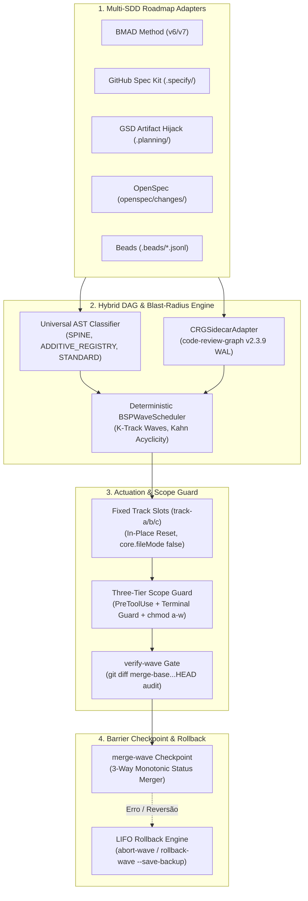

<p align="center">
  
</p>

<p align="center">
  <a href="https://github.com/stopActingSoSmall/sdd-parallel/actions/workflows/ci.yml"></a>
  <a href="https://pypi.org/project/sdd-parallel/"></a>
  <a href="https://www.python.org/"></a>
  <a href="../../../LICENSE"></a>
  <a href="#-experimente-em-5-segundos-zero-chaves-de-api-passo-a-passo-anotado"></a>
  <br>
  <a href="#-encaixa-se-perfeitamente-na-sua-stack-atual-zero-lock-in"></a>
  <a href="#-veja-o-layout-exato-do-seu-projeto-sdd-antes-e-depois"></a>
</p>

<p align="center">
  <b>🌐 Idioma:</b>
  <a href="../../../README.md">English</a> |
  <a href="../zh-CN/README.md">简体中文</a> |
  <a href="../es/README.md">Español</a> |
  <b>Português (BR)</b> |
  <a href="../ja/README.md">日本語</a> |
  <a href="../ko/README.md">한국어</a> |
  <a href="../ru/README.md">Русский</a>
</p>

<p align="center">
  <a href="#-experimente-em-5-segundos-zero-chaves-de-api-passo-a-passo-anotado">Demo rápida</a> ·
  <a href="#-por-que-isso-existe-em-bom-português">Por que existe</a> ·
  <a href="#%EF%B8%8F-como-funciona-e-fluxo-diário-de-4-comandos">Como funciona</a> ·
  <a href="#-veja-o-layout-exato-do-seu-projeto-sdd-antes-e-depois">Seu layout SDD</a> ·
  <a href="#-encaixa-se-perfeitamente-na-sua-stack-atual-zero-lock-in">Harnesses</a> ·
  <a href="#%EF%B8%8F-referência-completa-da-cli">CLI diária</a> ·
  <a href="#-arquitetura-modelo-matemático-e-aprofundamento-no-dossier">Aprofundamento</a>
</p>

> **Execute múltiplos agentes de codificação por IA em paralelo — até 3x mais rápido, zero Merge-Bombs.**  
> O `sdd-parallel` é o controlador de tráfego determinístico, isolador de worktrees e protetor de raio de impacto (blast radius) entre o seu backlog de **Spec Kit / BMAD / GSD / OpenSpec / Beads** e os agentes de IA (**Claude Code**, **Codex**, **Antigravity** ou qualquer CLI compatível com worktrees) que o implementam.

---

## ⚡ Por que isso existe? (Em bom português)

<p align="center">
  
</p>

Com um backlog de 10 a 15 especificações ou histórias, atualmente você é forçado a escolher entre duas opções ruins:

1. **Um único agente, sequencialmente** — seguro, mas são **6 a 8 horas** de espera ociosa.
2. **3 a 4 agentes em pastas ingênuas com `git worktree`** — rápido, até o momento do merge:
   - **Colisão do Tipo 1 (direta):** dois agentes editam `sprint-status.yaml`, `STATE.md` ou `cli.py` ao mesmo tempo → conflitos com marcadores `<<<<<<<` a cada merge.
   - **Colisão do Tipo 2 (semântica, silenciosa):** o Agente A altera uma assinatura em `normalizer.py`; o Agente B, em outra worktree concorrente, chama a assinatura antiga a partir de `api.py`. **O Git realiza o merge de forma limpa, sem nenhum marcador de conflito — e a branch `main` quebra.**
   - **Fuga de escopo (scope creep):** um agente "prestativo" reescreve o arquivo compartilhado `schema.py`, que jamais fez parte da sua tarefa atribuída.

**O `sdd-parallel` resolve isso antes que um único token de LLM seja gasto:** ele analisa a AST e o grafo de chamadas do seu projeto, agrupa tarefas comprovadamente seguras em **Ondas (Waves)** paralelas, isola cada agente dentro de um slot fixo e limpo (`track-a`, `track-b`, …), bloqueia gravações fora de escopo no nível de hooks e do sistema operacional e realiza o merge de cada onda atrás de uma barreira de quality gates.

| O que acontece | ❌ Sequencial (1 Agente) | 💥 Paralelo ingênuo (`--worktree`) | ✅ Com `sdd-parallel` |
| :--- | :--- | :--- | :--- |
| **Tempo de sprint (12 histórias)** | ~6–8 h (uma por uma) | ~2 h codificando + **~2 h corrigindo merges quebrados** | **~2.5 h no total (aceleração de 2x a 3x)** |
| **Colisões ocultas de tipos / API** | Evitadas apenas avançando devagar | **Quebra a `main` após o merge** ($W_A \cap I_B \neq \emptyset$) | **Prevenidas antecipadamente** (divididas em Onda 1 → Onda 2) |
| **Arquivos compartilhados de CLI / roteamento** | Um agente de cada vez | Conflito no Git a cada merge | **Seguro para paralelismo** (detecção de `ADDITIVE_REGISTRY`) |
| **`sprint-status.yaml` / `tasks.md` / `STATE.md`** | Atualizados em série | Conflitos constantes com `<<<<<<<` | **Auto-merge** (merger de 3 vias monótono) |
| **Agente edita o arquivo errado** | Prompt pede "por favor, não faça isso" | Burlar via `bash` / `sed` | **Bloqueado** (hook `PreToolUse` + Terminal Guard + `chmod a-w`) |
| **Poluição de pastas de worktree** | Nenhuma | 15 pastas órfãs `.worktrees/task-*` | **Slots fixos reutilizáveis** (`track-a`, `track-b`, `track-c`) |

---

## 🚀 Experimente em 5 segundos (zero chaves de API, passo a passo anotado)

Sem chave de API, sem assinatura de LLM, sem clone manual. Um único comando via [`uv`](https://docs.astral.sh/uv/) (ou `pipx run sdd-parallel demo`):

```bash
uvx sdd-parallel demo          # ou teste um kit específico: uvx sdd-parallel demo --kit spec-kit
```

A demonstração cria um repositório temporário com 5 tarefas e 6 módulos Python, executa o motor real sobre ele e conclui em ~4 segundos. Abaixo está a execução do `--kit spec-kit`, dividida em suas 4 etapas.

#### `[Passo 1/4]` AST e Classificação de Papéis

```text
File Path                              | Detected Role          | Importers
----------------------------------------------------------------------------
src/demo_app/__init__.py               | additive_registry      | -
src/demo_app/api.py                    | standard               | -
src/demo_app/cli.py                    | additive_registry      | -
src/demo_app/exporter.py               | standard               | -
src/demo_app/normalizer.py             | standard               | src/demo_app/api.py
src/demo_app/schema.py                 | spine                  | -
```

Zero configuração, sem caminhos codificados: o scanner marca `schema.py` como a **`spine`** (espinha dorsal; todos dependem dele → serializar), `cli.py` como um **`additive_registry`** (registro de comandos apenas para anexação → seguro para compartilhar) e identifica que `api.py` importa `normalizer.py`.

#### `[Passo 2/4]` Interceptando o Merge-Bomb Oculto de Tipo 2

```text
  Collision Analysis:
    - Naive Scheduler : W(T002)={normalizer.py, cli.py} vs W(T004)={api.py}
                        -> DISJOINT WRITES (False Safe!)
    - BSPWaveScheduler: Detected semantic_collision between 'T002' and 'T004'
                        -> Overlap W(T002) ^ I(T004) on: src/demo_app/api.py
  Wave Schedule:
    * Wave 1  track-a: T002 (normalizer.py + shared cli.py) | track-b: T003 (exporter.py + shared cli.py)
    * Wave 2  track-a: T001 (schema.py)                     | track-b: T004 (api.py)
    * Wave 3  track-a: T005 (schema.py)
```

Tanto `T002` quanto `T004` possuem uma tag manual `[P]` em `tasks.md`, e seus conjuntos de escrita são disjuntos (`normalizer.py ≠ api.py`), de modo que um agendador ingênuo baseado em bloqueio de arquivos os executaria juntos. O `BSPWaveScheduler` detecta que as gravações de `T002` incidem dentro do conjunto de impacto de `T004` e move `T004` para a **Onda 2**, onde ele construirá sobre o `normalizer.py` já integrado. Enquanto isso, `T002` e `T003` escrevem em `cli.py` e ainda assim rodam em paralelo, pois trata-se de um registro aditivo (`additive_registry`).

#### `[Passo 3/4]` Slots Fixos Limpos e Interceptação do Scope Guard

```text
  Provisioned Fixed Slots (100% Clean git status: True):
    - track-a (.worktrees/track-a)
    - track-b (.worktrees/track-b)

  PreToolUse Scope Guard Check (track-a -> 'src/demo_app/schema.py'):
    - Decision : DENY
    - Violation: File 'src/demo_app/schema.py' cannot be modified by Wave 1 / track-a (stories ['T002'])
    - Reason   : Locked by Spine Chain invariant.
```

Arquivos de limites injetados (`ACTIVE_TRACK.md`, `.parallel-lock.json`, `.tmp/track-context.md`) são mascarados pelo `info/exclude` da worktree, portanto `git status --porcelain` permanece limpo. Quando o agente de `track-a` tenta modificar `schema.py`, a gravação é bloqueada antes de atingir o disco.

#### `[Passo 4/4]` Ponto de Controle de Barreira e Merge de 3 Vias Sem Conflitos

```text
  Merged Branches:
    - parallel/track-a
    - parallel/track-b
  Resolved tasks.md (0 conflict markers):
    - - [ ] T001 [US1] Upgrade schema in `src/demo_app/schema.py` (depends on T002)
    - - [x] T002 [P] [US1] Normalize `src/demo_app/normalizer.py`, `src/demo_app/cli.py`
    - - [x] T003 [P] [US1] Export `src/demo_app/exporter.py`, `src/demo_app/cli.py`
```

Ambas as branches editaram o mesmo arquivo `tasks.md`. O unificador de status resolve cada linha de forma monótona (`[ ] < [x]`, `backlog < … < done`), garantindo que o resultado não tenha nenhum marcador `<<<<<<<`. A mesma lógica cobre `sprint-status.yaml`, `STATE.md` e `.beads/*.jsonl`.

<details>
<summary><b>🧪 Clique para ver a matriz de verificação dos 5 kits (<code>uvx sdd-parallel demo --kit all</code>) e o modo sandbox</b></summary>

```text
============================================================================
5/5 SDD KITS VERIFIED (BMAD, SPEC KIT, GSD, OPENSPEC, BEADS)
============================================================================
Kit          | Merge-Bomb   | Worktrees    | Scope Guard  | 3-Way Merge
----------------------------------------------------------------------------
bmad         | PASSED       | PASSED       | PASSED       | PASSED
spec-kit     | PASSED       | PASSED       | PASSED       | PASSED
gsd          | PASSED       | PASSED       | PASSED       | PASSED
openspec     | PASSED       | PASSED       | PASSED       | PASSED
beads        | PASSED       | PASSED       | PASSED       | PASSED
============================================================================
```

Quer conduzir o fluxo de trabalho manualmente? Gere uma sandbox persistente e execute os comandos reais dentro dela:

```bash
uvx sdd-parallel demo --kit gsd --scaffold-only --output-dir ./sdd-sandbox
cd sdd-sandbox
sdd-parallel plan
sdd-parallel prepare --wave 1
```

</details>

---

## 🗺️ Como funciona e fluxo diário de 4 comandos

<p align="center">
  
</p>

**1. Instale uma vez** (requer `Python >= 3.11`, `Git >= 2.30`):

```bash
uv tool install sdd-parallel     # ou: pipx install sdd-parallel
```
*(Tanto o comando `sdd-parallel` quanto o alias curto `parallel-flow` ficam disponíveis globalmente).*

Tanto `sdd-parallel` quanto o alias conveniente `parallel-flow` ficam disponíveis globalmente.

**2. Execute uma onda em qualquer projeto SDD:**

```bash
# 1. Analise as especificações + AST da base de código e construa ondas seguras
sdd-parallel plan

# 2. Aloque a Onda 1 em slots fixos e exiba o comando de inicialização para cada trilha
sdd-parallel prepare --wave 1
sdd-parallel run-guide --wave 1

# 3. Inicie seus agentes dentro de .worktrees/track-a, track-b, ... (um por slot)

# 4. Audite o escopo, execute os quality gates e integre a Onda 1 de volta na main
sdd-parallel verify-wave --wave 1
sdd-parallel merge --wave 1
```

Desfazer: `sdd-parallel abort-wave --wave 1` (antes do merge) ou `sdd-parallel rollback-wave --wave 1` (após o merge; ordem LIFO estrita, branch automática `backup/wave-<K>-before-rollback-*`, restauração polimórfica de status SDD).

---

## 📂 Veja o layout exato do seu projeto SDD (Antes e Depois)

<p align="center">
  
</p>

O `sdd-parallel` lê os arquivos do seu framework exatamente como eles estão — sem necessidade de migração e sem novo formato de especificação.

| Framework SDD | Artefatos Somente Leitura (bloqueados nos slots) | Descoberta de Tarefas | Sincronização de Status |
| :--- | :--- | :--- | :--- |
| **GitHub Spec Kit** (`.specify/`) | `constitution.md`, `feature.json`, `spec.md`, `plan.md` | `specs/*/tasks.md` (`T001 [P]`) | Merge de 3 vias de caixas de seleção Markdown |
| **BMAD Method** (`v6.3+` / `v7`) | `epic-*-context.md` (Zero Invalidação de Cache) | `sprint-status.yaml`, `epics.md`, `spec-*.md` | Merge de 3 vias monótono de YAML |
| **GSD** (`.planning/`) | `PROJECT.md`, `REQUIREMENTS.md`, `ROADMAP.md`, `STATE.md` | `phases/*/NN-NN-PLAN.md` | Artifact Hijack (`STATE.md` atualizado centralmente no merge) |
| **OpenSpec** (`openspec/`) | `openspec/specs/**`, `project.md`, `config.yaml`, pastas irmãs de mudanças | `openspec/changes/<slug>/tasks.md` | Merge de 3 vias de caixas de seleção Markdown |
| **Beads** (`.beads/`) | `.beads/config.yaml` | `.beads/*.jsonl` (`bd-101` + arestas `blocks`) | Merge de 3 vias por linha em semirreticulado JSONL |

Cada instantâneo abaixo foi extraído de fixtures reais do `sdd-parallel demo --scaffold-only` após executar `plan` + `prepare --wave 1`. As árvores de código-fonte foram recolhidas para `src/…` para facilitar a leitura.

<details>
<summary><b>🌱 GitHub Spec Kit (<code>.specify/</code> &amp; <code>specs/*/tasks.md</code>) — Clique para inspecionar a árvore Antes e Depois</b></summary>

**Antes** — seu projeto no estado atual:

```text
my-project/
├── .specify/
│   ├── memory/
│   │   └── constitution.md
│   ├── templates/
│   │   └── tasks-template.md
│   └── feature.json
├── specs/
│   └── 001-telemetry/
│       ├── plan.md
│       ├── spec.md
│       └── tasks.md
└── src/…
```

`specs/001-telemetry/tasks.md` — observe a tag manual `[P]` em `T004`, que é insegura concorrentemente com `T002`:

```markdown
- [ ] T001 [US1] Upgrade schema in `src/demo_app/schema.py` (depends on T002)
- [ ] T002 [P] [US1] Normalize `src/demo_app/normalizer.py`, `src/demo_app/cli.py`
- [ ] T003 [P] [US1] Export `src/demo_app/exporter.py`, `src/demo_app/cli.py`
- [ ] T004 [P] [US2] Expose ingestion in `src/demo_app/api.py`
- [ ] T005 [US2] Add audit log in `src/demo_app/schema.py` (depends on T001)
```

**Depois** de `sdd-parallel plan` + `prepare --wave 1`:

```text
my-project/
├── .parallel/                        # estado do planejador (novo)
│   ├── artifacts/
│   │   ├── execution-plan-parallel.md
│   │   └── wave-plan.json
│   ├── history/run-001-<timestamp>/wave-plan.json
│   └── state.json
├── .specify/…                        # intocado
├── .worktrees/
│   ├── track-a/                      # Onda 1 → T002
│   │   ├── .specify/memory/constitution.md   # 🔒 somente leitura
│   │   ├── specs/001-telemetry/
│   │   │   ├── plan.md               # 🔒 somente leitura
│   │   │   ├── spec.md               # 🔒 somente leitura
│   │   │   └── tasks.md
│   │   ├── src/…
│   │   ├── .tmp/track-context.md     # 👻 oculto via info/exclude
│   │   ├── .parallel-lock.json       # 👻 oculto via info/exclude
│   │   └── ACTIVE_TRACK.md           # 👻 → /speckit.implement T002
│   └── track-b/                      # Onda 1 → T003 (mesmo layout)
├── specs/…                           # intocado
└── src/…
```

</details>

<details>
<summary><b>📐 BMAD Method (<code>v6.3+ / v7</code> — <code>_bmad-output/</code>) — Clique para inspecionar a árvore Antes e Depois</b></summary>

**Antes:**

```text
my-project/
├── _bmad-output/
│   ├── implementation-artifacts/
│   │   ├── epic-1-context.md
│   │   ├── epic-2-context.md
│   │   ├── epics.md
│   │   ├── spec-1-1-upgrade-schema-v2.md
│   │   ├── spec-1-2-normalize-telemetry-payload.md
│   │   ├── spec-1-3-cli-batch-export.md
│   │   ├── spec-2-1-expose-ingestion-api.md
│   │   ├── spec-2-2-add-audit-log-schema.md
│   │   └── sprint-status.yaml
│   └── planning-artifacts/
│       ├── epic-1-context.md
│       ├── epic-2-context.md
│       ├── epics.md
│       └── project-context.md
└── src/…
```

**Depois** de `sdd-parallel plan` + `prepare --wave 1`:

```text
my-project/
├── .parallel/
│   ├── history/run-001-<timestamp>/wave-plan.json
│   └── state.json
├── .worktrees/
│   ├── track-a/                      # Onda 1 → história 1-2
│   │   ├── _bmad/custom/             # 👻 overlay BMAD por slot (oculto)
│   │   │   ├── bmad-build.toml
│   │   │   ├── bmad-build.user.toml
│   │   │   ├── bmad-build-auto.toml
│   │   │   └── bmad-build-auto.user.toml
│   │   ├── _bmad-output/
│   │   │   ├── implementation-artifacts/   # sprint-status.yaml mesclado em 3 vias
│   │   │   └── planning-artifacts/
│   │   │       ├── epic-1-context.md # 🔒 trava Zero Invalidação de Cache
│   │   │       ├── epic-2-context.md # 🔒
│   │   │       └── project-context.md
│   │   ├── src/…
│   │   ├── .tmp/track-context.md     # 👻
│   │   ├── .parallel-lock.json       # 👻
│   │   └── ACTIVE_TRACK.md           # 👻 → /bmad-build 1-2
│   └── track-b/                      # Onda 1 → história 1-3
├── _bmad-output/
│   ├── implementation-artifacts/…
│   ├── parallel-artifacts/           # saída do planejador (o BMAD a mantém sob _bmad-output)
│   │   ├── execution-plan-parallel.md
│   │   └── wave-plan.json
│   └── planning-artifacts/…
└── src/…
```

</details>

<details>
<summary><b>⚡ GSD — Get Shit Done (<code>.planning/phases/</code> Artifact Hijack) — Clique para inspecionar a árvore Antes e Depois</b></summary>

**Antes:**

```text
my-project/
├── .planning/
│   ├── phases/
│   │   ├── 01-core/
│   │   │   ├── 01-01-PLAN.md
│   │   │   ├── 01-02-PLAN.md
│   │   │   └── 01-03-PLAN.md
│   │   └── 02-api/
│   │       ├── 02-01-PLAN.md
│   │       └── 02-02-PLAN.md
│   ├── PROJECT.md
│   ├── REQUIREMENTS.md
│   ├── ROADMAP.md
│   └── STATE.md
└── src/…
```

`01-02-PLAN.md` (normalizador) e `02-01-PLAN.md` (API) residem em fases diferentes e não compartilham arquivos, mas `02-01` faz chamadas ao código de `01-02`. O planejador os agenda em ondas distintas.

**Depois** de `sdd-parallel plan` + `prepare --wave 1`:

```text
my-project/
├── .parallel/
│   ├── artifacts/
│   │   ├── execution-plan-parallel.md
│   │   └── wave-plan.json
│   ├── history/run-001-<timestamp>/wave-plan.json
│   └── state.json
├── .planning/…                       # intocado na main
├── .worktrees/
│   ├── track-a/                      # Onda 1 → 01-02
│   │   ├── .planning/
│   │   │   ├── phases/01-core/ · 02-api/
│   │   │   ├── PROJECT.md            # 🔒 somente leitura
│   │   │   ├── REQUIREMENTS.md       # 🔒 somente leitura
│   │   │   ├── ROADMAP.md            # 🔒 somente leitura
│   │   │   └── STATE.md              # 🔒 bloqueado nos slots, atualizado centralmente no merge
│   │   ├── src/…
│   │   ├── .tmp/track-context.md     # 👻
│   │   ├── .parallel-lock.json       # 👻
│   │   └── ACTIVE_TRACK.md           # 👻 → /gsd-execute-phase 01-02
│   └── track-b/                      # Onda 1 → 01-03
└── src/…
```

</details>

<details>
<summary><b>📑 OpenSpec (<code>openspec/changes/</code>) — Clique para inspecionar a árvore Antes e Depois</b></summary>

**Antes:**

```text
my-project/
├── openspec/
│   ├── changes/
│   │   ├── audit-log-schema/
│   │   ├── cli-batch-export/
│   │   ├── ingestion-api-endpoint/
│   │   ├── normalize-telemetry/
│   │   │   ├── design.md
│   │   │   ├── proposal.md
│   │   │   └── tasks.md
│   │   └── upgrade-schema-v2/
│   ├── specs/
│   │   └── telemetry/
│   │       └── spec.md
│   ├── config.yaml
│   └── project.md
└── src/…
```

**Depois** de `sdd-parallel plan` + `prepare --wave 1`:

```text
my-project/
├── .parallel/
│   ├── artifacts/
│   │   ├── execution-plan-parallel.md
│   │   └── wave-plan.json
│   ├── history/run-001-<timestamp>/wave-plan.json
│   └── state.json
├── .worktrees/
│   ├── track-a/                      # Onda 1 → normalize-telemetry
│   │   ├── openspec/
│   │   │   ├── changes/
│   │   │   │   ├── normalize-telemetry/   # ✍️ pasta de mudanças desta trilha
│   │   │   │   ├── cli-batch-export/      # 🔒 bloqueada pela trilha irmã track-b
│   │   │   │   └── …
│   │   │   ├── specs/                # 🔒 especificações canônicas (alteradas apenas via openspec archive)
│   │   │   ├── config.yaml           # 🔒
│   │   │   └── project.md            # 🔒
│   │   ├── src/…
│   │   ├── .tmp/track-context.md     # 👻
│   │   ├── .parallel-lock.json       # 👻
│   │   └── ACTIVE_TRACK.md           # 👻 → /openspec-apply normalize-telemetry
│   └── track-b/                      # Onda 1 → cli-batch-export (bloqueios espelhados)
├── openspec/…                        # intocado
└── src/…
```

</details>

<details>
<summary><b>🔗 Beads (<code>.beads/beads.jsonl</code>) — Clique para inspecionar a árvore Antes e Depois</b></summary>

**Antes:**

```text
my-project/
├── .beads/
│   ├── beads.jsonl
│   ├── config.yaml
│   └── issues.jsonl
└── src/…
```

As tarefas em grafo `bd-101`, `bd-102`, `bd-103`, `bd-201`, `bd-202`, com arestas `blocks` entre elas:

```json
{"id": "bd-101", "title": "Upgrade schema to v2", "status": "open", "files": ["src/demo_app/schema.py"], "dependencies": [{"target": "bd-102", "type": "blocks"}], "priority": 1, "epic": "epic-1"}
{"id": "bd-102", "title": "Normalize telemetry payload", "status": "open", "files": ["src/demo_app/normalizer.py", "src/demo_app/cli.py"], "dependencies": [], "priority": 2, "epic": "epic-1"}
```

**Depois** de `sdd-parallel plan` + `prepare --wave 1`:

```text
my-project/
├── .beads/…                          # cópia principal, mesclada linha a linha em `merge --wave 1`
├── .parallel/
│   ├── artifacts/
│   │   ├── execution-plan-parallel.md
│   │   └── wave-plan.json
│   ├── history/run-001-<timestamp>/wave-plan.json
│   └── state.json
├── .worktrees/
│   ├── track-a/                      # Onda 1 → bd-102
│   │   ├── .beads/
│   │   │   ├── beads.jsonl           # edições de status mescladas por linha em 3 vias (open < closed)
│   │   │   ├── config.yaml           # 🔒 somente leitura
│   │   │   └── issues.jsonl
│   │   ├── src/…
│   │   ├── .tmp/track-context.md     # 👻
│   │   ├── .parallel-lock.json       # 👻
│   │   └── ACTIVE_TRACK.md           # 👻 → bd update bd-102 --status in-progress
│   └── track-b/                      # Onda 1 → bd-103
└── src/…
```

Após `merge --wave 1`, tanto `bd-102` quanto `bd-103` estão com status `closed` em `.beads/beads.jsonl`, com 0 marcadores de conflito.

</details>

Legenda: 🔒 somente leitura (`chmod a-w` + rejeição no `PreToolUse`) · 👻 injetado, oculto do Git via `.git/worktrees/<slot>/info/exclude` · ✍️ escopo com permissão de escrita da trilha.

---

## 🔌 Encaixa-se perfeitamente na sua stack atual (Zero Lock-In)

Você mantém seu agente e seus prompts. Após `sdd-parallel prepare --wave 1`, o comando `sdd-parallel run-guide --wave 1` exibe o comando nativo exato para cada slot, e essa mesma linha é gravada em `.worktrees/track-<id>/ACTIVE_TRACK.md`. Você não precisa digitar caminhos de contexto manualmente:

| Kit SDD | Comando nativo exibido por trilha |
| :--- | :--- |
| GitHub Spec Kit | `/speckit.implement T002` |
| BMAD Method | `/bmad-build 1-2` |
| GSD | `/gsd-execute-phase 01-02` |
| OpenSpec | `/openspec-apply normalize-telemetry` |
| Beads | `bd update bd-102 --status in-progress` |

| Harness | Como ele se integra |
| :--- | :--- |
| **Claude Code** (`claude`) | Abra o `claude` dentro de `.worktrees/track-a`; gravações fora de escopo e escapes via shell são negados pelo hook `PreToolUse` e pelo `chmod a-w` do SO. Ou dispare todas as trilhas com `sdd-parallel autopilot --wave 1 --harness claude-code`. |
| **OpenAI Codex CLI** (`codex`) | `codex --cd .worktrees/track-b`; arquivos somente leitura são protegidos por `chmod a-w`, e o `sdd-parallel verify-wave` audita o diff antes do merge. Autopilot: `--harness codex`. |
| **Google Antigravity** | `sdd-parallel prepare --wave 1 --antigravity-layout` posiciona os slots em `~/.gemini/antigravity/worktrees/<Project>/track-a`; o arquivo `ACTIVE_TRACK.md` fica na raiz do slot; `sdd-parallel install-plugin` instala o plugin portátil com o hook de scope-guard. |
| **Qualquer CLI ou IDE compatível com worktrees** — Cursor, Windsurf, OpenCode, Kimi CLI, MiniMax Code, Aider, Cline, Trae | Funciona sem configuração adicional: slots padrão de `git worktree` (`track-a`, `track-b`, `track-c`, … via `--max-tracks N`), travas com `chmod a-w` no SO, `ACTIVE_TRACK.md` e auditoria posterior do diff com `sdd-parallel verify-wave`. |

---

## 🔍 Arquitetura, modelo matemático e aprofundamento no dossier

- 📖 **[01 — Resumo do Produto e Modelo de ROI](../../dossier/01_CORE_PRODUCT_BRIEF.md)**: sumário executivo, FinOps de tokens, roteamento por esforço de modelo
- 🏛️ **[02 — White Paper de Capacidades do Sistema](../../dossier/02_SYSTEM_CAPABILITIES_WHITE_PAPER.md)**: conflitos Tipo 1 vs. Tipo 2, taxonomia 3D de arquivos, fórmula de decaimento CRG
- 🔌 **[03 — Especificação de Integração e Ecossistema](../../dossier/03_INTEGRATION_AND_ECOSYSTEM_SPEC.md)**: RI de `CanonicalTask`, contratos de `.tmp/track-context.md` e `.parallel-lock.json`
- 📊 **[04 — Taxonomia Competitiva e de Benchmarks](../../dossier/04_COMPETITIVE_AND_BENCHMARK_TAXONOMY.md)**: posicionamento frente a ferramentas de orquestração correlatas
- 🧪 **[07 — Demonstração Independente e Guia Passo a Passo E2E](07_STANDALONE_DEMO_AND_E2E_WALKTHROUGH.md)**: snapshots de disco quadro a quadro, guia da sandbox com `--keep-temp`
- 📐 **[SSOT da Arquitetura do Sistema (`ARCHITECTURE.md`)](ARCHITECTURE.md)** · **[Índice do Dossier](../../dossier/README.md)** · **[Dossier em russo](../ru/dossier/)**

<details>
<summary><b>🏛️ Clique para expandir: Arquitetura Interna do Motor e 9 Invariantes Fundamentais</b></summary>

### Fluxo de Componentes Internos



### Os 9 Invariantes Fundamentais de Engenharia

1. **Zero Poluição de Worktrees:** limites injetados (`.tmp/track-context.md`, `.parallel-lock.json`, `ACTIVE_TRACK.md`) são mascarados via `info/exclude` do git; o `git status --porcelain` permanece limpo.
2. **Zero Invalidação de Cache:** arquivos de contexto pré-compilados (ex.: `epic-*-context.md` do BMAD) são somente leitura durante uma onda; o estado do planejador é salvo em `.parallel/` (ou `_bmad-output/parallel-artifacts/` no caso do BMAD).
3. **100% de Cobertura de Tarefas e Aciclicidade:** a verificação topológica de Kahn garante zero tarefas perdidas e zero ciclos de dependência.
4. **Aplicação Estrita do Raio de Impacto (Tipo 1 e Tipo 2):** gravações disjuntas ($W_A \cap W_B = \emptyset$) somadas a impacto semântico disjunto ($W_A \cap I_B = \emptyset$).
5. **Anti-Overfitting Universal:** sem caminhos específicos de domínio no núcleo do motor; `SPINE`, `ADDITIVE_REGISTRY` e `STANDARD` são derivados unicamente de heurísticas AST e centralidade no grafo.
6. **Slots Fixos de Trilhas:** os slots `track-a`, `track-b`, `track-c` são reutilizados in-place via `git checkout -B` + `git clean -fd`, sem acúmulo de pastas órfãs.
7. **Defesa em Profundidade em Três Níveis (Scope Guard):** hook `PreToolUse` + interceptação de comandos no terminal (`Bash`, `run_command`) + `chmod a-w` no sistema operacional.
8. **Semirreticulado de Status Monótono:** os status são resolvidos como $\texttt{backlog}(0) < \dots < \texttt{done}(4)$, sem marcadores de merge.
9. **Rollbacks Transacionais LIFO:** ondas integradas são revertidas estritamente em ordem inversa, com branches de segurança automáticas (`backup/wave-<K>-before-rollback-*`).

</details>

---

## 🛠️ Referência completa da CLI

<details>
<summary><b>Clique para expandir: todos os 13 subcomandos e opções</b></summary>

| Comando | Finalidade |
| :--- | :--- |
| `sdd-parallel demo [--kit {bmad,spec-kit,gsd,openspec,beads,all}] [--keep-temp] [--scaffold-only] [--output-dir DIR]` | Executa a demonstração offline do Merge-Bomb ou gera uma sandbox interativa para qualquer um dos 5 kits SDD. |
| `sdd-parallel plan [--repo REPO] [--max-tracks N] [--kit KIT] [--include-done] [--dry-run] [--plan-source {auto,plan,specs}] [--output-dir DIR]` | Analisa o roadmap e o grafo de código; gera `execution-plan-parallel.md` e `wave-plan.json`. |
| `sdd-parallel prepare --wave K [--repo REPO] [--max-tracks N] [--kit KIT] [--headless] [--antigravity-layout] [--dynamic-worktrees] [--dry-run]` | Aloca os slots (`track-a`, `track-b`, …), aplica travas no SO e injeta os arquivos de limite. |
| `sdd-parallel claim-track --wave K --track <id> --worktree <path> [--repo REPO] [--max-tracks N] [--kit KIT] [--headless]` | Anexa travas e limites a uma worktree externa já existente. |
| `sdd-parallel run-guide --wave K [--repo REPO] [--max-tracks N] [--kit KIT] [--antigravity-layout]` | Exibe o guia de execução do operador com o comando de inicialização nativo para cada trilha. |
| `sdd-parallel verify-wave --wave K [--repo REPO] [--max-tracks N] [--kit KIT] [--dynamic-worktrees]` | Audita os slots contra o manifesto `.parallel-lock.json` e verifica o diff de múltiplos commits contra o `merge-base`. |
| `sdd-parallel merge --wave K [--repo REPO] [--max-tracks N] [--kit KIT] [--dynamic-worktrees] [--skip-gates] [--strict-gates] [--cleanup] [--dry-run]` | Integração em barreira: merge de 3 vias de status, git merge, quality gates e auto-rollback transacional. |
| `sdd-parallel abort-wave --wave K [--repo REPO] [--dynamic-worktrees]` | Aborta uma onda não integrada: reinicia os slots e remove branches paralelas temporárias. |
| `sdd-parallel rollback-wave --wave K [--repo REPO] [--dynamic-worktrees] [--to-commit COMMIT] [--save-backup] [--no-backup] [--kit KIT]` | Reverte uma onda já integrada (ordem LIFO) com branch de backup de segurança e restauração de status SDD. |
| `sdd-parallel merge-status --base B --ours O --theirs T --out OUT` | Merge determinístico de 3 vias em baixo nível para `sprint-status.yaml`. |
| `sdd-parallel check-lock --file PATH [--tool TOOL]` | Verifica uma tentativa de gravação contra o manifesto de bloqueio da worktree ativa. |
| `sdd-parallel install-plugin [--target-dir DIR]` | Empacota e instala o plugin portátil do Antigravity. |
| `sdd-parallel autopilot --wave K [--repo REPO] [--max-tracks N] [--kit KIT] [--harness {antigravity,claude-code,codex}] [--antigravity-layout] [--execute]` | Gera ou executa comandos de inicialização em múltiplas janelas com roteamento por esforço de modelo. |

</details>

</details>

## 🚢 Matriz de lançamento: Entregue (v0.1.0) vs Roadmap (v0.2+)

### ✅ Entregue na `v0.1.0`

- [x] Agendador de ondas Bulk-Synchronous Parallel (BSP) determinístico com validação de aciclicidade de Kahn.
- [x] Scanner de hotspots por AST + integração com sidecar `code-review-graph v2.3.9`.
- [x] Slots fixos de trilhas (`track-a`, `track-b`, `track-c`) com reset in-place e mascaramento via `info/exclude`.
- [x] Scope Guard em três níveis (`PreToolUse` + Terminal Guard + `chmod a-w` no SO).
- [x] Fusão monótona de status em 3 vias para YAML, listas de verificação Markdown, `STATE.md` e JSONL.
- [x] Rollback transacional de ondas em LIFO com branches de backup automáticas.
- [x] 5 adaptadores SDD: Spec Kit, BMAD, GSD (Artifact Hijack), OpenSpec e Beads, cada um com comando de worker nativo por trilha.
- [x] Demonstração offline do Merge-Bomb (`sdd-parallel demo --kit all`) e geração de sandboxes interativas (`--scaffold-only`).
- [x] Piloto automático (autopilot) multi-janela para Antigravity, Claude Code e Codex.
- [x] CI com clean-clone no Ubuntu / macOS / Windows, Python 3.11–3.13; PyPI Trusted Publishing.

### 🚧 Planejado para `v0.2.0+`

- [ ] **Adaptadores da comunidade:** `mattpocock/skills` (`/implement-spec`) e adaptador de status frontmatter para `bmad-loop`.
- [ ] **Sincronização de ambiente sem poluição:** symlinks de `.venv` / `node_modules` para dentro dos slots fixos.
- [ ] **Linker estático de símbolos pré-onda e escalonamento de escopo:** expansão automática do conjunto de escrita via símbolos AST com reagendamento dinâmico.
- [ ] **Exportadores de FinOps e observabilidade:** spans OpenTelemetry e telemetria de economia de tokens com Langfuse.
- [ ] **Daemon de piloto automático headless:** execução de agentes via RPC local / despacho de subagentes.

---

## 🤝 Contribuição, desenvolvimento local e segurança

```bash
git clone https://github.com/stopActingSoSmall/sdd-parallel.git
cd sdd-parallel
uv sync

uv run pytest                          # suite de testes unitários + integração
uv run mypy --strict src/sdd_parallel  # tipagem estrita
uv run ruff check src/ tests/ scripts/ # linter
uv run sdd-parallel demo --kit all     # demonstração offline com 5 kits
```

- **Contribuição:** consulte o **[Guia de Contribuição](../../../CONTRIBUTING.md)** para configuração do ambiente e gates de pull request.
- **Segurança:** reporte vulnerabilidades conforme descrito na **[Política de Segurança](../../../SECURITY.md)**.
- **Licença:** MIT — consulte [LICENSE](../../../LICENSE).
