# 🏛️ SDD-Parallel — Архитектура системы (SSOT)

<p align="center">
  <b>🌐 Язык:</b>
  <a href="../../../ARCHITECTURE.md">English</a> |
  <a href="../zh-CN/ARCHITECTURE.md">简体中文</a> |
  <a href="../es/ARCHITECTURE.md">Español</a> |
  <a href="../pt-BR/ARCHITECTURE.md">Português (BR)</a> |
  <a href="../ja/ARCHITECTURE.md">日本語</a> |
  <a href="../ko/ARCHITECTURE.md">한국어</a> |
  <b>Русский</b>
</p>

**Версия:** 0.1.0  
**Статус:** Утверждённый архитектурный хребет (SSOT)

---

## 1. Обзор архитектурных модулей

Система `sdd-parallel` состоит из трёх слабосвязанных модулей, объединённых канонической моделью графа задач (`src/sdd_parallel/models.py`):

```mermaid
flowchart LR
    subgraph Adapters["Модуль 1: Полиморфные SDD-адаптеры (SDDAdapterProtocol & Read-Only ACL)"]
        A1["BMAD Adapter\n(sprint-status.yaml + epics.md + specs)"]
        A2["Spec Kit Adapter\n(.specify/specs/*/tasks.md + constitution)"]
        A3["GSD Adapter\n(.planning/phases/*-PLAN.md + STATE.md)"]
        A4["OpenSpec Adapter\n(openspec/changes/*/tasks.md + proposal)"]
        A5["Beads Adapter\n(.beads/issues.jsonl + dependencies)"]
    end

    subgraph Engine["Модуль 2: Гексагональный DAG-движок & Conflict Solver"]
        E1["ASTHotspotScanner\n(3-проходная эвристика: Spine vs Additive Registries)"]
        E2["CRGSidecarAdapter\n(code-review-graph v2.3.9 Взвешенный Call-Graph WAL)"]
        E3["BSPWaveScheduler\n(Детерминированная упаковка волн, K-треки, чекпоинты)"]
    end

    subgraph Actuation["Модуль 3: Провайдер ворк-три & Merge Gate"]
        W1["prepare / claim-track\n(Постоянные слоты track-<id> + In-Place Reset)"]
        W2["Three-Tier Defense-in-Depth Scope Guard\n(PreToolUse + Terminal Guard + OS chmod a-w)"]
        W3["merge Checkpoint Gate\n(Строгий merge-base diff + Полиморфный 3-way status merge + Stack-Agnostic гейты)"]
    end

    Adapters --> E1 & E2
    E1 & E2 --> E3
    E3 --> W1
    W1 --> W2 --> W3
```



### 1.1. Гексагональная архитектура адаптеров и протокол `SDDAdapterProtocol`

В соответствии с принципом инверсии зависимостей и гексагональной архитектурой (Ports and Adapters), ядро `sdd-parallel` взаимодействует со всеми SDD-фреймворками исключительно через строго типизированный контракт `SDDAdapterProtocol` (`src/sdd_parallel/adapters/__init__.py`). Ядро не содержит жестких проверок путей и полностью изолировано от внутренней структуры папок конкретных методологий:

```python
class SDDAdapterProtocol(Protocol):
    """Единый полиморфный контракт расширения для всех поддерживаемых SDD-фреймворков."""

    kit_id: str

    def detect(self) -> bool:
        """Обнаружение маркеров присутствия данного SDD-фреймворка в репозитории."""
        ...

    def load_tasks(self, include_done: bool = False) -> list[TaskNode]:
        """Парсинг артефактов дорожной карты/бэклога и конвертация в канонические TaskNode."""
        ...

    def check_wave_zero_blockers(self, wave: Wave | None = None) -> list[str]:
        """Проверка специфичных для фреймворка предусловий (Clean Git, скомпилированные контексты, чек-листы)."""
        ...

    def get_allowed_write_globs(self, track: WaveTrack) -> list[str]:
        """Список путей метаданных активного фреймворка, разрешённых для записи внутри ворк-три."""
        ...

    def get_forbidden_files(self, wave: Wave, track: WaveTrack) -> dict[str, str]:
        """Словарь защищаемых системных файлов и спецификаций активного фреймворка."""
        ...

    def render_worker_command(self, track: WaveTrack) -> str:
        """Команда запуска агентного воркера для шпаргалки run-guide и режима Autopilot."""
        ...

    def reset_tasks_status(
        self,
        task_ids: Sequence[str],
        target_status: str = "ready-for-dev",
    ) -> None:
        """Полиморфный сброс статусов задач при выполнении транзакционного LIFO-отката волны."""
        ...

    def cleanup_wave_artifacts(
        self,
        wave_id: int,
        task_ids: Sequence[str],
    ) -> None:
        """Удаление сгенерированных во время исполнения волны временных спецификаций."""
        ...
```

### 1.2. Матрица разделения ответственности: Agnostic Core Engine vs Polymorphic Kit Adapter

Архитектурная граница между ядром и адаптерами строго разделяет доменную специфику SDD-методологий и системные механизмы параллелизации:

| Подсистема / Операция | Кто отвечает | Архитектурная роль и механизмы |
| :--- | :---: | :--- |
| **Парсинг артефактов и задач** | `SDDAdapter` | Знает структуру файлов конкретного SDD (YAML, Markdown, JSONL). Преобразует разнородные задачи в канонический `TaskNode` (id, title, write_files, read_files, depends_on). |
| **Проверка pre-flight блокеров** | `SDDAdapter` | Знает правила готовности: проверка `epic-*-context.md` (BMAD), валидность чек-листов (Spec Kit), отсутствие незакрытых блокировок (Beads). |
| **AST-анализ и классификация файлов** | `Core Engine` | Полностью проектно- и фреймворк-агностичен (`ASTHotspotScanner`). Находит `SPINE`, `ADDITIVE_REGISTRY` и `STANDARD` модули без хардкода путей. |
| **Семантический радиус поражения** | `Core Engine` | Вычисляет взвешенный Call-Graph радиус ($W_A \cap I_B$) через `CRGSidecarAdapter` (`code-review-graph v2.3.9` WAL). |
| **Планирование волн (BSP Scheduler)** | `Core Engine` | Детерминированный планировщик волн `BSPWaveScheduler` с гарантией 100% покрытия задач и ацикличности (алгоритм Кана). |
| **Подготовка слотов ворк-три** | `Core Engine` + `Adapter` | Ядро выделяет постоянные слоты `track-<id>` и применяет права ОС (`chmod a-w`). Адаптер поставляет `allowed_write_globs` и `forbidden_files`. |
| **Инструкции запуска воркеров** | `SDDAdapter` | Формирует нативную команду для инструмента (`/speckit.implement`, `/gsd-execute-phase`, `/opsx:apply`, `bd update`, `/bmad-build`). |
| **Многоуровневый Scope Guard** | `Core Engine` | Перехватывает вызовы `PreToolUse`, терминальные команды (`Bash`, `run_command`) и предотвращает побег агента из ворк-три. |
| **3-Way слияние статусов задач** | `SDDAdapter` + `Core` | Ядро оркеструет слияние; специализированный монотонный резолвер (`status_merger.py`) объединяет статусы без Git-конфликтов. |
| **Транзакционный откат волн (LIFO)** | `Core Engine` + `Adapter` | Ядро создаёт страховочную ветку `backup/wave-<K>-before-rollback-*` и возвращает `HEAD`; адаптер полиморфно сбрасывает статусы задач. |

### 1.3. Интеллектуальный автовыбор и изоляция неактивных китов (Multi-Kit Coexistence)

В реальных проектах несколько SDD-фреймворков часто присутствуют в репозитории одновременно (например, исторический `_bmad-output/` и активный `.specify/` от GitHub Spec Kit, либо OpenSpec для RFC и GSD для фаз реализации):
1. **Приоритет конфигурации:** Явный флаг `--kit <name>` или ключ `default_kit` в `.parallel-config.json` / `pyproject.toml` имеют абсолютный приоритет.
2. **Эвристика активных задач (`get_adapter(kit="auto")`):** При обнаружении нескольких китов ядро опрашивает каждый адаптер (`load_tasks(include_done=False)`). Автоматически выбирается первый кит, содержащий незавершённые задачи (`len(active_tasks) > 0`).
3. **Диагностическое предупреждение:** `diagnose_multi_kit_coexistence()` выводит понятное сообщение оператору о найденных альтернативных фреймворках без блокировки конвейера.
4. **Кросс-фреймворковая изоляция:** При формировании `.parallel-lock.json` (`build_lock_manifest`) каталоги всех обнаруженных **неактивных** SDD-фреймворков автоматически заносятся в `forbidden_files` с причиной `"Locked by inactive SDD framework sandboxing"`. Это исключает случайное загрязнение или повреждение чужих артефактов параллельными агентами.

---

## 2. Математическая модель конфликтов и классификация файлов

Для каждой незавершённой задачи $T_i$ определяется:
- $W(T_i)$ — множество файлов, которые задача **модифицирует или создаёт** (`write_files`).
- $R(T_i)$ — множество файлов, которые задача **читает/импортирует** как пререквизиты (`read_files`).
- $I(T_i)$ — **взвешенный радиус поражения (Impact Radius)** вокруг $W(T_i)$, вычисляемый через `CRGSidecarAdapter` (`code-review-graph v2.3.9`, метод `get_impact_radius_sql` с `resolution="direct"`, `min_impact_score=0.5`, коэффициент затухания $\gamma = 0.7$ по рёбрам `CALLS=1.0`, `INHERITS/IMPLEMENTS/OVERRIDES=0.9`, `TESTED_BY=0.8`, `IMPORTS_FROM=0.7`).

### 2.1. Три класса файлов в кодовой базе

1. **Spine Lock Files (`FileRole.SPINE`):**
   - Схемные ядра, глобальные модели IR и цепочки миграций БД (например, файлы с `SCHEMA_VERSION`, `auto_migrate`, корневыми моделями `schema.py`/`models.py`).
   - **Правило:** Задачи, модифицирующие один и тот же `SPINE`-файл, **никогда не ставятся в одну волну** и выстраиваются в строгую последовательную цепочку («Схемный хребет»).
2. **Shared Additive Registries (`FileRole.ADDITIVE_REGISTRY`):**
   - Крупные файлы-точки входа, куда разные фичи добавляют независимые блоки регистрации (исключительно `cli.py` с декораторами `@app.command`, `mcp/server.py` с `@mcp.tool`, `__init__.py` с `__all__`).
   - *Важное разграничение (ADR-0002):* Модули форматирования вывода (`console.py`, `markdown.py`, каталог `egress/`) категорически **запрещено** относить к аддитивным реестрам, так как они содержат общие функции рендеринга и монолитные хелперы. Они относятся к `FileRole.STANDARD`.
   - **Правило:** Задачи, пересекающиеся *только* по истинным `ADDITIVE_REGISTRY`, **могут исполняться параллельно** в разных `git worktree` при условии инъекции правила аддитивной вставки в `.tmp/track-context.md` и обязательного прогона тестов на `merge` чекпоинте.
3. **Standard Module Files (`FileRole.STANDARD`):**
   - Обычные модули бизнес-логики, адаптеров и модули вывода/презентации.
   - **Правило:** Пересечение $W(A) \cap W(B) \neq \emptyset$ блокирует параллельный запуск в одной волне (кроме случая, когда доказано редактирование строго непересекающихся функций через AST-анализатор `_has_isolated_function_scope` без общих внутренних вызовов). Файлы `STANDARD` никогда не вычитаются из семантического радиуса поражения (Impact Radius).

### 2.2. Алгоритмический конвейер детекции ролей (`ASTHotspotScanner` — 3 прохода без хардкода)

В соответствии с **Инвариантом 7 (Anti-Overfitting & Invariant-First Architecture)** ядро движка не привязано к конкретным именам файлов. Роль каждого модуля вычисляется 3-проходным статическим AST-анализатором (`src/sdd_parallel/ast_scanner.py`):
1. **Проход 1 (Сигнатурный разбор):** Поиск маркеров версионирования схем данных и миграций (`_SPINE_KEYWORDS = ("SCHEMA_VERSION", "auto_migrate", "_migrate_v")`) $\to$ флаг `has_schema_version`.
2. **Проход 2 (Граф импортов и декораторы):** Обход узлов `Import`/`ImportFrom` (вычисление Fan-In `len(meta.imported_by)`) и проверка `decorator_list` на паттерны регистрации (`_ADDITIVE_DECORATORS = ("command", "tool", "get", "post", "put", "delete", "patch", "include_router", "register", "route")`).
3. **Проход 3 (Детерминированная классификация `SPINE > ADDITIVE_REGISTRY > STANDARD`):**
   - Тесты (`tests/`, `test_*.py`) $\to$ всегда `STANDARD`.
   - `SPINE`: если `has_schema_version == True` $\lor$ имя файла `{"models.py", "schema.py"}` $\lor$ **топологическая центральность $\text{In-Degree} \ge 5$**.
   - `ADDITIVE_REGISTRY`: если `has_registry_decorators == True` $\lor$ точка входа `{"cli.py", "__init__.py"}` $\lor$ `*/mcp/server.py`.
   - `STANDARD`: все остальные модули бизнес-логики.

### 2.3. Типы рёбер в графе планирования (`ConflictEdge`)

1. **`EXPLICIT_DEP` (Направленное ребро $A \to B$):** Явная зависимость из роадмапа/спеки или семантическая зависимость по потоку данных. Задача $B$ обязана выполняться в волне $\text{wave}(B) > \text{wave}(A)$.
2. **`SPINE_ORDER` (Направленное ребро $A \to B$):** Последовательная цепочка модификации `SPINE`-файла (например, миграции БД `v4 -> v5 -> v6`).
3. **`DIRECT_COLLISION` (Ненаправленное ребро конфликта $A \leftrightarrow B$):** $W(A) \cap W(B) \setminus \text{AdditiveRegistries} \neq \emptyset$. Задачи $A$ и $B$ не могут находиться в одной волне ($\text{wave}(A) \neq \text{wave}(B)$).
4. **`SEMANTIC_COLLISION` (Конфликт 2-го рода $A \leftrightarrow B$):** $(W(A) \cap I(B)) \cup (W(B) \cap I(A)) \neq \emptyset$. Задача $A$ меняет контракт модуля, от которого напрямую зависит код задачи $B$.

---

## 3. Схемы ключевых артефактов

### 3.1. Контракт границ рабочего дерева (`.tmp/track-context.md`)

Генерируется командой `sdd-parallel prepare --wave K` внутри каждого `git worktree` и инжектируется в контекст воркера:

```markdown
# PARALLEL TRACK CONTEXT BOUNDARY (ENFORCED)
- **Wave:** 1 | **Track:** track-a | **Assigned Stories:** 11-2
- **Recommended Model Effort:** high

## 1. Allowed Exclusive Write Scope
- `src/canonical/intervals.py`
- `tests/test_intervals.py`

## 2. Shared Additive Registries (Isolated Append Scope)
- `src/canonical/normalizer.py` (Scope: function `_classify_reads` only)

## 3. Forbidden Files (Locked by Sibling Tracks in Wave 1)
- `src/canonical/manifest.py` (Locked by track-b)
- `src/storage/schema.py` (Spine Lock Chain)
```

### 3.2. Манифест блокировок для `PreToolUse` хука (`.parallel-lock.json`)

Машиночитаемый манифест в корне каждого активного слота worktree для суб-миллисекундной валидации хуками:

```json
{
  "wave_id": 1,
  "track_id": "track-a",
  "stories": ["11-2"],
  "repo_root": "/workspace/project",
  "worktree_root": "/workspace/project/.worktrees/track-a",
  "allowed_write_globs": [
    "src/canonical/intervals.py",
    "src/canonical/normalizer.py",
    "tests/**",
    ".tmp/**"
  ],
  "additive_shared_files": [
    "src/canonical/normalizer.py"
  ],
  "forbidden_files": {
    "src/canonical/manifest.py": "Locked by track-b (story 11-3)",
    "src/storage/schema.py": "Locked by Spine Chain"
  }
}
```

---

## 4. Технические механизмы неинвазивной интеграции и поддержка 5 китов

### 4.1. Неинвазивная инъекция контекста и чистота рабочего дерева (`100% Clean Git Status`)

Для гарантии того, что воркеры в любом из 5 поддерживаемых китов начинают работу при `git status --porcelain == ""`:
1. Контекст потока пишется в `.tmp/track-context.md` (`.tmp/` в `.gitignore`).
2. Манифест блокировок сохраняется в `.parallel-lock.json` (`.parallel-lock.json` в `.gitignore`).
3. Локальные исключения worktree вносятся в `.git/worktrees/<worktree-name>/info/exclude`.
4. Специфичные конфигурации китов (например, `bmad-build.user.toml` в BMAD или инъекция `SPECIFY_FEATURE` в GitHub Spec Kit) изолируются через `info/exclude`.
5. Во всех фреймворках `git status --porcelain` остаётся **100% чистым**, исключая аварийные остановки проверочных скриптов.

### 4.2. Pre-Flight валидация контрактов и защита неизменяемых спецификаций (`FORBIDDEN_STATE_FILES`)

Перед стартом планирования или исполнения волны `sdd-parallel` выполняет аудит готовности репозитория и блокирует от изменений канонические файлы фреймворков:
- **GitHub Spec Kit:** Валидирует `.specify/specs/**/tasks.md`. Защищает от изменений `.specify/memory/constitution.md`, `.specify/feature.json`, `spec.md` и `plan.md`.
- **GSD (Get Shit Done):** Читает фазовые планы `.planning/phases/*-PLAN.md` в режиме **Artifact Hijack**, защищая `.planning/STATE.md`, `ROADMAP.md` и `PROJECT.md` от одновременной перезаписи.
- **OpenSpec:** Читает пропозалы `openspec/changes/*/tasks.md`, защищая `openspec/project.md`, `openspec/specs/**` и `openspec/config.yaml`.
- **Beads:** Читает `.beads/issues.jsonl`, защищая `.beads/config.yaml` и `.beads/metadata.json`.
- **BMAD Method:** Pre-Flight Context Gate проверяет наличие скомпилированных `epic-<N>-context.md` в `implementation-artifacts` или `planning-artifacts` (**Zero Cache Invalidation**).

### 4.3. Вычисление семантического радиуса поражения через `CRGSidecarAdapter`

Для предотвращения конфликтов 2-го рода без дестабилизации рабочего окружения:
1. **Инициализация от основного корня:** `CRGSidecarAdapter` инициализирует `code-review-graph v2.3.9` путём `main_repo_root`, транслируя относительные пути файлов worktree для исключения `GraphRootMismatchError`.
2. **Штатный WAL-режим:** Так как `get_impact_radius_sql` выполняет `CREATE TEMP TABLE _impact_seeds`, подключение работает в штатном режиме WAL из процесса оркестратора.
3. **Подавление шума:** Запросы используют `resolution="direct"` и `min_impact_score=0.5`, отсекая неразрешённые полиморфные вызовы методов.

### 4.4. Полиморфный детерминированный 3-Way Merger статусов

При барьерном слиянии волны (`sdd-parallel merge --wave K`) статус задач вычисляется специализированным монотонным мерджером в зависимости от используемого SDD-фреймворка:
1. **BMAD Method (`sprint-status.yaml`):** Монотонная полурешётка рангов:
   $$\text{Rank}: \quad \texttt{backlog} (0) < \texttt{ready-for-dev} (1) < \texttt{in-progress} (2) < \texttt{review} (3) < \texttt{done} (4)$$
   Для каждого ключа выбирается $\max(\text{rank}(base), \text{rank}(ours), \text{rank}(theirs))$ с сохранением структуры и комментариев YAML.
2. **GitHub Spec Kit & OpenSpec (`tasks.md` чек-листы Markdown):** Функция `merge_markdown_task_checklists(base, ours, theirs)` сопоставляет элементы формата `- [ ] <id>: <desc>` или `- [ ] <desc>`. Задача помечается выполненной, если закрыта хотя бы в одной ветке ($\max(\text{todo}, \text{done}) = \text{done}$).
3. **Beads (`.beads/issues.jsonl`):** Функция `merge_beads_issues_jsonl(base, ours, theirs)` сопоставляет записи по `id` и монотонно продвигает статус (`open < in-progress < closed`).
4. **GSD Post-Merge Commit:** Агрегирует выполненные задачи фазы и фиксирует коммитом обновлённый статус в `.planning/STATE.md`.
5. **Защита от UTF-8 BOM (`utf-8-sig`):** Чтение и запись всех статусных файлов выполняется через кодек `utf-8-sig`, нейтрализуя невидимый маркер `\ufeff` Windows PowerShell.

### 4.5. Fixed Track Slots (`track-<id>`) & In-Place Reset ($O(1)$ Footprint, ADR-0003)

Вместо динамического создания и удаления папок репозиторий использует параметрический пул постоянных слотов размера $K = \text{max\_tracks}$ (`track-a`, `track-b`, ..., `track-<id>`):
- Каталоги располагаются в `~/.gemini/antigravity/worktrees/<Project>/<track_id>` с локальными связями в `.worktrees/<track_id>`.
- **In-Place Reset:** При переходе между волнами папки остаются на диске, исключая ошибку `Missing Folder` в Antigravity Desktop. Слот атомарно переключается на новую волну через:
  ```powershell
  git checkout -B parallel/<track_id> master ; git clean -fd
  ```

### 4.6. Трёхуровневый Scope Guard (Defense-in-Depth)

1. **Рубеж 1 (PreToolUse Hook):** Перехват `write_file`, `edit_file`, `replace_file_content` по манифесту `.parallel-lock.json`.
2. **Рубеж 2 (Terminal Guard):** Перехват команд интерпретатора (`Bash`, `run_command`, `cmd`, `powershell`) с блокировкой попыток записи (`>`, `>>`, `sed -i`, `rm`, `python open`) в файлы вне `allowed_write_globs`.
3. **Рубеж 3 (OS Read-Only Locks):** Снятие прав записи ОС (`chmod a-w`) на файлы из `forbidden_files` в сочетании с `git config core.fileMode false`.
4. **Контрольный гейт (`verify-wave`):** Детерминированная проверка `git diff $(git merge-base master HEAD)...HEAD` перед слиянием.

### 4.7. LIFO Transactional Wave Rollback Engine

- **`abort-wave --wave K`:** Очистка слотов и удаление параллельных веток до слияния.
- **`rollback-wave --wave K [--save-backup]`:**
  - Строгий инвариант LIFO: разрешён откат только последней подмерженной волны.
  - Автоматическое создание страховочной ветки `backup/wave-<K>-before-rollback-<timestamp>`.
  - Атомарный возврат `master` к состоянию до слияния.
  - Полиморфный сброс статусов задач (`reset_tasks_status`) во всех 5 адаптерах и очистка временных спек (`cleanup_wave_artifacts`).

### 4.8. Полиморфные гейты верификации и транзакционный авто-откат при слиянии

- **Универсальный резолвер гейтов (`resolve_checkpoint_gates`):**
  1. *Приоритет 1:* `.parallel-config.json` (`checkpoint_gates: [...]`).
  2. *Приоритет 2:* `pyproject.toml` (`[tool.sdd-parallel].checkpoint_gates`).
  3. *Приоритет 3:* Автоопределение стека (Python `pytest/ruff/mypy`, Node/TS `npm test`, Rust `cargo test`, Go `go test ./...`).
- **Устойчивость к пустым сьютам (`_is_no_tests_collected`):** Код выхода 5 в `pytest` (`NO_TESTS_COLLECTED`) или `"no test files found"` не ломает слияние при `strict_gates=False`.
- **Транзакционный авто-откат:** Если гейт завершается ошибкой при `sdd-parallel merge --wave K`, оркестратор выполняет `git reset --hard pre_merge_head`, возвращая `master` в исходное состояние и сохраняя слоты для отладки.

### 4.9. Standalone Offline Merge-Bomb Demonstration (`sdd-parallel demo`)

Автономная команда `sdd-parallel demo [--kit {bmad,spec-kit,gsd,openspec,beads,all}] [--keep-temp]` разворачивает временный репозиторий и проверяет ключевые инварианты за <5 секунд без API-ключей и сети:
1. AST-классификация файлов (`SPINE`, `ADDITIVE_REGISTRY`, `STANDARD`).
2. Отлов семантического конфликта 2-го рода ($W_{1-2} \cap I_{2-1} \neq \emptyset$).
3. Развёртывание слотов, проверка чистоты Git и работа Scope Guard.
4. Барьерное слияние волны и монотонный 3-way merge статусов.
5. При флаге `--kit all` выполняется последовательная верификация всех 5 китов со сводкой `5/5 SDD KITS VERIFIED`.

### 4.10. Полный справочник команд и флагов CLI

| Команда | Назначение | Ключевые флаги и параметры |
| :--- | :--- | :--- |
| `plan` | Расчёт DAG конфликтов и формирование расписания волн | `--repo <path>`, `--max-tracks <K>`, `--kit <auto\|kit>`, `--plan-source <auto\|plan\|specs>`, `--include-done`, `--dry-run` |
| `prepare` | Подготовка слотов треков и локов для Wave K | `--repo <path>`, `--wave <K>`, `--max-tracks <K>`, `--kit <auto\|kit>`, `--antigravity-layout`, `--dynamic-worktrees`, `--headless`, `--dry-run` |
| `claim-track` | Присоединение локов к существующему ворк-три | `--repo <path>`, `--wave <K>`, `--track <id>`, `--worktree <path>`, `--max-tracks <K>`, `--kit <auto\|kit>`, `--headless` |
| `run-guide` | Вывод форматированной таблицы запуска для оператора | `--repo <path>`, `--wave <K>`, `--max-tracks <K>`, `--kit <auto\|kit>`, `--antigravity-layout` |
| `verify-wave` | Аудит диффов и соблюдения локов относительно merge-base | `--repo <path>`, `--wave <K>`, `--max-tracks <K>`, `--kit <auto\|kit>`, `--dynamic-worktrees` |
| `merge` | Барьерное слияние с 3-way мерджем статусов и гейтами | `--repo <path>`, `--wave <K>`, `--max-tracks <K>`, `--kit <auto\|kit>`, `--strict-gates`, `--skip-gates`, `--cleanup`, `--dry-run`, `--dynamic-worktrees` |
| `merge-status` | Автономный 3-way детерминированный мердж sprint-status.yaml | `--base <file>`, `--ours <file>`, `--theirs <file>`, `--out <file>` |
| `check-lock` | Проверка разрешения на запись в файл через логику хука | `--file <path>`, `--tool <name>` (вывод форматированного JSON с `indent=2`) |
| `install-plugin` | Сборка и установка портативного плагина Antigravity | `--target-dir <path>` (по умолчанию `~/.gemini/config/plugins/sdd-parallel`) |
| `autopilot` | Генерация или запуск команд в режиме Autopilot | `--repo <path>`, `--wave <K>`, `--max-tracks <K>`, `--kit <auto\|kit>`, `--harness <antigravity\|claude-code\|codex>`, `--antigravity-layout`, `--execute` |
| `abort-wave` | Отмена волны до слияния и удаление параллельных веток | `--repo <path>`, `--wave <K>`, `--dynamic-worktrees` |
| `rollback-wave` | Атомарный LIFO-откат волны со страховочной веткой | `--repo <path>`, `--wave <K>`, `--to-commit <hash>`, `--save-backup` / `--no-backup`, `--kit <auto\|kit>`, `--dynamic-worktrees` |
| `demo` | Запуск 5-секундного автономного оффлайн-демо | `--kit <bmad\|spec-kit\|gsd\|openspec\|beads\|all>`, `--keep-temp`, `--scaffold-only`, `--output-dir <path>` |

---

## 5. Модели исполнения параллельных волн в Google Antigravity и AI-агентах

Платформа Google Antigravity накладывает ограничение: **`Max Subagent Depth = 1`** (субагенты не имеют инструмента `invoke_subagent`). Две целевые модели исполнения решают данное ограничение:

### 5.1. Модель A: `Two-Stage Assisted & Interactive Checkpoints` (Рекомендованный стандарт)

Режим с участием оператора и интерактивными чекпоинтами:
1. **Чекпоинт 1 (План и разбиение):** Оркестратор рассчитывает граф волн, выводит сводку треков и запрашивает одобрение оператора.
2. **Чекпоинт 2 (Исполнение треков):**
   - Оркестратор готовит постоянные слоты `track-a`, `track-b`, ..., `track-<id>` ($K = \text{max\_tracks}$) и выводит таблицу `sdd-parallel run-guide`.
   - Оператор открывает слоты в Antigravity IDE / Desktop v2 и запускает нативный воркер на уровне `Depth 0`:
     - **GitHub Spec Kit:** `/speckit.implement <task-id>`
     - **GSD:** `/gsd-execute-phase <phase-num>`
     - **OpenSpec:** `/opsx:apply <task-id>`
     - **Beads:** `bd update <task-id> --status in-progress`
     - **BMAD:** `/bmad-build <task-id>` (полный цикл: спека, TDD-код и 3 линзы ревью).
   - Постоянные слоты исключают накопление мусора ($O(1)$ Footprint) и ошибки `Missing Folder`.
3. **Чекпоинт 3 (Барьерное слияние):** В сессии оркестратора запускается `sdd-parallel merge --wave K --cleanup` с автоматическим 3-way merge статусов, верификацией локов, прогоном гейтов и формированием отчёта.

### 5.2. Модель B: `Multi-Window Autopilot` (Целевая автоматизация)

Автоматизированный контур запуска параллельных воркеров без ручного набора команд:
1. Оркестратор подготавливает рабочие деревья постоянных слотов (`track-<id>`).
2. Модуль `AutopilotLauncher` (`src/sdd_parallel/autopilot.py`) формирует точные команды запуска для целевых сред (`antigravity`, `claude-code`, `codex`) с топологическим `Model Effort Routing` (`High` / `Medium` / `Low`).
3. Оркестратор отслеживает появление коммитов в ветках треков (`parallel/track-*`) и продвижение статусов задач в артефактах SDD.
4. По завершении всех треков оркестратор верифицирует изменения и выполняет барьерное слияние в `master`.

### 5.3. Модель C: `In-Session Flat Dispatch` (Депрекейтирован / Только аварийный Fallback)

Запуск плоской цепочки субагентов (`Spec -> Dev -> Review`) в рамках одной сессии объявлен **DEPRECATED / FALLBACK ONLY**. Допускается к использованию исключительно в ограниченных средах, где запуск отдельных окон IDE физически невозможен, с явным пониманием потери гарантий вложенных линз ревью.
