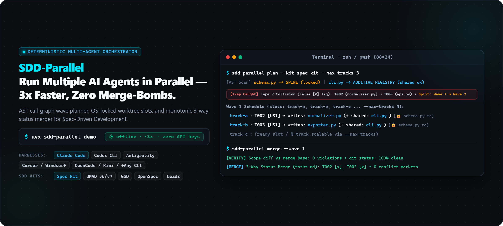
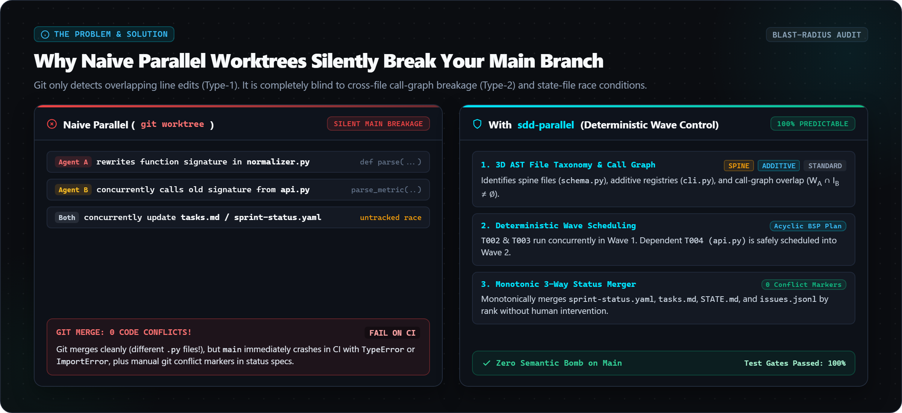
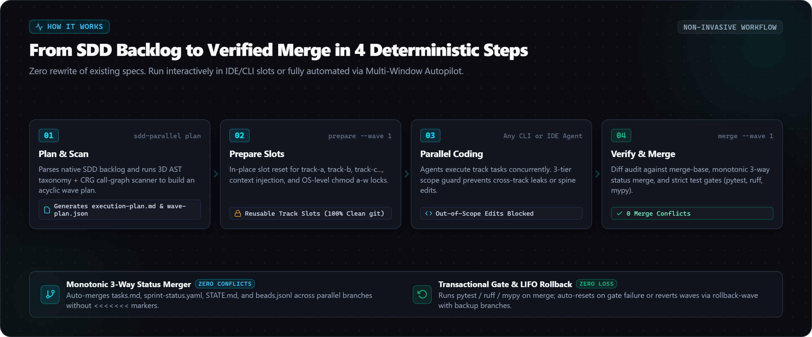
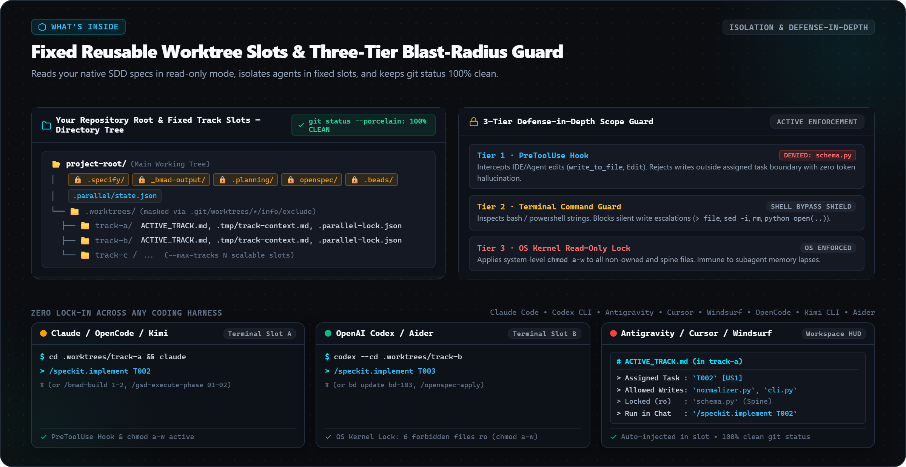
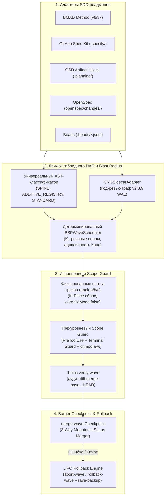

<p align="center">
  
</p>

<p align="center">
  <a href="https://github.com/stopActingSoSmall/sdd-parallel/actions/workflows/ci.yml"></a>
  <a href="https://pypi.org/project/sdd-parallel/"></a>
  <a href="https://www.python.org/"></a>
  <a href="../../../LICENSE"></a>
  <a href="#-попробуйте-за-5-секунд-без-api-ключей-аннотированный-разбор"></a>
  <br>
  <a href="#-совместимость-с-любым-стеком-zero-lock-in"></a>
  <a href="#-структура-вашего-sdd-проекта-до-и-после"></a>
</p>

<p align="center">
  <b>🌐 Язык / Language:</b>
  <a href="../../../README.md">English</a> |
  <a href="../zh-CN/README.md">简体中文</a> |
  <a href="../es/README.md">Español</a> |
  <a href="../pt-BR/README.md">Português (BR)</a> |
  <a href="../ja/README.md">日本語</a> |
  <a href="../ko/README.md">한국어</a> |
  <b>Русский</b>
</p>

<p align="center">
  <a href="#-попробуйте-за-5-секунд-без-api-ключей-аннотированный-разбор">Быстрое демо</a> ·
  <a href="#-зачем-это-нужно-простыми-словами">Зачем</a> ·
  <a href="#%EF%B8%8F-как-это-работает-и-ежедневный-4-командный-воркфлоу">Как это работает</a> ·
  <a href="#-структура-вашего-sdd-проекта-до-и-после">Структура проектов</a> ·
  <a href="#-совместимость-с-любым-стеком-zero-lock-in">Харнессы</a> ·
  <a href="#%EF%B8%8F-полный-справочник-команд-cli">Команды CLI</a> ·
  <a href="#-архитектура-математическая-модель-и-детальные-досье">Досье</a>
</p>

> **Параллельный запуск нескольких ИИ-агентов программирования — до 3x быстрее, без Merge-Bombs.**  
> `sdd-parallel` — это детерминированный регулировщик, изолятор worktree и защитник blast radius между бэклогом ваших спецификаций (**Spec Kit / BMAD / GSD / OpenSpec / Beads**) и кодинг-агентами (**Claude Code**, **Codex**, **Antigravity** или любым CLI с поддержкой worktree), которые его реализуют.

---

## ⚡ Зачем это нужно? (Простыми словами)

<p align="center">
  
</p>

Когда у вас есть бэклог из 10–15 спецификаций или историй (stories), сейчас вам приходится выбирать между двумя плохими вариантами:

1. **Один агент, строго последовательно** — безопасно, но приходится ждать **6–8 часов**.
2. **3–4 агента в наивных папках `git worktree`** — быстро, ровно до момента слияния:
   - **Коллизия 1-го рода (прямая):** два агента одновременно редактируют `sprint-status.yaml`, `STATE.md` или `cli.py` → маркеры `<<<<<<<` при каждом мердже.
   - **Коллизия 2-го рода (семантическая, скрытая):** Агент А меняет сигнатуру в `normalizer.py`; Агент Б в другом worktree вызывает старую сигнатуру из `api.py`. **Git сливает изменения чисто, без единого конфликта слияния — но ветка `main` оказывается сломана в рантайме.**
   - **Выход за границы скоупа (Scope creep):** «чрезмерно услужливый» агент переписывает общий `schema.py`, хотя этой задачи вообще не было в его задании.

**`sdd-parallel` решает эти проблемы ещё до того, как будет потрачен хотя бы один токен LLM:** он сканирует AST и граф вызовов кодовой базы, группирует доказанно безопасные задачи в параллельные **Волны (Waves)**, изолирует каждого агента внутри чистого постоянного слота (`track-a`, `track-b`, …), блокирует попытки записи вне разрешённого скоупа на уровне хуков и ОС (`chmod a-w`), и сливает каждую волну через барьерный гейт контроля качества.

| Что происходит | ❌ Последовательно (1 агент) | 💥 Наивный параллелизм (`--worktree`) | ✅ С `sdd-parallel` |
| :--- | :--- | :--- | :--- |
| **Время спринта на 12 историй** | ~6–8 ч (по одной задаче) | ~2 ч кодинга + **~2 ч починки сломанных мерджей** | **~2.5 ч итого (ускорение в 2x–3x)** |
| **Скрытые коллизии типов / API** | Предотвращаются только черепашьим темпом | **Ломают `main` после слияния** ($W_A \cap I_B \neq \emptyset$) | **Предотвращаются заранее** (разнесение на Wave 1 → Wave 2) |
| **Общие файлы CLI / роутеры** | Только один агент за раз | Конфликт Git при каждом слиянии | **Безопасны в параллели** (детекция роли `ADDITIVE_REGISTRY`) |
| **`sprint-status.yaml` / `tasks.md` / `STATE.md`** | Обновляются строго последовательно | Постоянные конфликты с маркерами `<<<<<<<` | **Автомердж** (монотонный 3-way слиятель статусов) |
| **Агент пытается изменить чужой файл** | Промпт жалобно просит «пожалуйста, не трогай» | Легко обходится через `bash` / `sed` | **Заблокировано** (хук `PreToolUse` + Terminal Guard + `chmod a-w`) |
| **Захламление диска папками worktree** | Отсутствует | 15 оставшихся папок `.worktrees/task-*` | **Фиксированные переиспользуемые слоты** (`track-a`, `track-b`, `track-c`) |

---

## 🚀 Попробуйте за 5 секунд (без API-ключей, аннотированный разбор)

Без API-ключей, без платных подписок на LLM, даже без клонирования репозитория. Одна команда через [`uv`](https://docs.astral.sh/uv/) (или `pipx run sdd-parallel demo`):

```bash
uvx sdd-parallel demo          # или тест конкретного кита: uvx sdd-parallel demo --kit spec-kit
```

Демо разворачивает временный репозиторий с 5 задачами и 6 модулями Python, запускает реальный движок и завершается примерно за 4 секунды. Ниже представлен запуск с флагом `--kit spec-kit`, разбитый на 4 этапа.

#### `[Step 1/4]` AST & Role Classification

```text
File Path                              | Detected Role          | Importers
----------------------------------------------------------------------------
src/demo_app/__init__.py               | additive_registry      | -
src/demo_app/api.py                    | standard               | -
src/demo_app/cli.py                    | additive_registry      | -
src/demo_app/exporter.py               | standard               | -
src/demo_app/normalizer.py             | standard               | src/demo_app/api.py
src/demo_app/schema.py                 | spine                  | -
```

Никаких конфигурационных файлов, никаких захардкоженных путей: сканер помечает `schema.py` как **`spine`** (от него зависит всё остальное → сериализовать), `cli.py` как **`additive_registry`** (только добавление регистраций команд → безопасно для совместного доступа), и фиксирует, что `api.py` импортирует `normalizer.py`.

#### `[Step 2/4]` Catching the Hidden Type-2 Merge-Bomb

```text
  Collision Analysis:
    - Naive Scheduler : W(T002)={normalizer.py, cli.py} vs W(T004)={api.py}
                        -> DISJOINT WRITES (False Safe!)
    - BSPWaveScheduler: Detected semantic_collision between 'T002' and 'T004'
                        -> Overlap W(T002) ^ I(T004) on: src/demo_app/api.py
  Wave Schedule:
    * Wave 1  track-a: T002 (normalizer.py + shared cli.py) | track-b: T003 (exporter.py + shared cli.py)
    * Wave 2  track-a: T001 (schema.py)                     | track-b: T004 (api.py)
    * Wave 3  track-a: T005 (schema.py)
```

Обе задачи `T002` и `T004` содержат вручную проставленный тег `[P]` в `tasks.md`, а множества их файлов на запись не пересекаются (`normalizer.py ≠ api.py`), поэтому обычный планировщик с блокировкой файлов запустил бы их параллельно. `BSPWaveScheduler` видит, что изменения `T002` попадают во множество импортов `T004`, и переносит `T004` в **Wave 2**, где она будет выполняться поверх уже смердженного `normalizer.py`. При этом `T002` и `T003` обе модифицируют `cli.py` и спокойно выполняются параллельно, поскольку это аддитивный реестр.

#### `[Step 3/4]` Clean Fixed Slots & Scope Guard Interception

```text
  Provisioned Fixed Slots (100% Clean git status: True):
    - track-a (.worktrees/track-a)
    - track-b (.worktrees/track-b)

  PreToolUse Scope Guard Check (track-a -> 'src/demo_app/schema.py'):
    - Decision : DENY
    - Violation: File 'src/demo_app/schema.py' cannot be modified by Wave 1 / track-a (stories ['T002'])
    - Reason   : Locked by Spine Chain invariant.
```

Внедряемые контекстные файлы границы (`ACTIVE_TRACK.md`, `.parallel-lock.json`, `.tmp/track-context.md`) маскируются через `info/exclude` соответствующего worktree, поэтому `git status --porcelain` остаётся кристально чистым. Когда агент из `track-a` пытается изменить `schema.py`, попытка записи отклоняется ещё до того, как файл будет затронут на диске.

#### `[Step 4/4]` Barrier Checkpoint & Zero-Conflict 3-Way Merge

```text
  Merged Branches:
    - parallel/track-a
    - parallel/track-b
  Resolved tasks.md (0 conflict markers):
    - - [ ] T001 [US1] Upgrade schema in `src/demo_app/schema.py` (depends on T002)
    - - [x] T002 [P] [US1] Normalize `src/demo_app/normalizer.py`, `src/demo_app/cli.py`
    - - [x] T003 [P] [US1] Export `src/demo_app/exporter.py`, `src/demo_app/cli.py`
```

Обе ветки редактировали один и тот же файл `tasks.md`. Слиятель статусов разрешает каждую строчку монотонно (`[ ] < [x]`, `backlog < … < done`), поэтому в итоговом файле нет ни одного маркера `<<<<<<<`. Та же логика применяется к `sprint-status.yaml`, `STATE.md` и `.beads/*.jsonl`.

<details>
<summary><b>🧪 Нажмите, чтобы посмотреть матрицу верификации 5 китов (<code>uvx sdd-parallel demo --kit all</code>) и режим песочницы</b></summary>

```text
============================================================================
5/5 SDD KITS VERIFIED (BMAD, SPEC KIT, GSD, OPENSPEC, BEADS)
============================================================================
Kit          | Merge-Bomb   | Worktrees    | Scope Guard  | 3-Way Merge
----------------------------------------------------------------------------
bmad         | PASSED       | PASSED       | PASSED       | PASSED
spec-kit     | PASSED       | PASSED       | PASSED       | PASSED
gsd          | PASSED       | PASSED       | PASSED       | PASSED
openspec     | PASSED       | PASSED       | PASSED       | PASSED
beads        | PASSED       | PASSED       | PASSED       | PASSED
============================================================================
```

Хотите опробовать процесс вручную? Разверните постоянную песочницу и запускайте реальные команды внутри неё:

```bash
uvx sdd-parallel demo --kit gsd --scaffold-only --output-dir ./sdd-sandbox
cd sdd-sandbox
sdd-parallel plan
sdd-parallel prepare --wave 1
```

</details>

---

## 🗺️ Как это работает и ежедневный 4-командный воркфлоу

<p align="center">
  
</p>

**1. Однократная установка** (требуется `Python >= 3.11`, `Git >= 2.30`):

```bash
uv tool install sdd-parallel     # или: pipx install sdd-parallel
```
*(Обе команды — `sdd-parallel` и короткий алиас `parallel-flow` — доступны глобально).*

Обе команды `sdd-parallel` и короткий алиас `parallel-flow` становятся доступны глобально.

**2. Запуск волны в любом SDD-проекте:**

```bash
# 1. Сканирование спецификаций + AST кодовой базы и построение безопасных волн
sdd-parallel plan

# 2. Подготовка Волны 1 в фиксированные слоты и печать команды запуска для каждого трека
sdd-parallel prepare --wave 1
sdd-parallel run-guide --wave 1

# 3. Запуск ваших агентов внутри .worktrees/track-a, track-b, ... (по одному на слот)

# 4. Аудит скоупа, запуск quality gates и слияние Волны 1 обратно в main
sdd-parallel verify-wave --wave 1
sdd-parallel merge --wave 1
```

Откат: `sdd-parallel abort-wave --wave 1` (до слияния) или `sdd-parallel rollback-wave --wave 1` (после слияния; строгий LIFO-порядок, автоматическая страховочная ветка `backup/wave-<K>-before-rollback-*` и полиморфный сброс статусов SDD).

---

## 📂 Структура вашего SDD-проекта (До и После)

<p align="center">
  
</p>

`sdd-parallel` работает с файлами вашего фреймворка напрямую — никакой миграции и никаких новых форматов спецификаций.

| SDD-фреймворк | Артефакты только для чтения (заблокированы в слотах) | Обнаружение задач | Синхронизация статусов |
| :--- | :--- | :--- | :--- |
| **GitHub Spec Kit** (`.specify/`) | `constitution.md`, `feature.json`, `spec.md`, `plan.md` | `specs/*/tasks.md` (`T001 [P]`) | 3-way слияние чекбоксов Markdown |
| **BMAD Method** (`v6.3+` / `v7`) | `epic-*-context.md` (Zero Cache Invalidation) | `sprint-status.yaml`, `epics.md`, `spec-*.md` | Монотонное 3-way слияние YAML |
| **GSD** (`.planning/`) | `PROJECT.md`, `REQUIREMENTS.md`, `ROADMAP.md`, `STATE.md` | `phases/*/NN-NN-PLAN.md` | Artifact Hijack (`STATE.md` централизованно обновляется при слиянии) |
| **OpenSpec** (`openspec/`) | `openspec/specs/**`, `project.md`, `config.yaml`, соседние папки изменений | `openspec/changes/<slug>/tasks.md` | 3-way слияние чекбоксов Markdown |
| **Beads** (`.beads/`) | `.beads/config.yaml` | `.beads/*.jsonl` (`bd-101` + связи `blocks`) | Построчное 3-way слияние полурешётки JSONL |

Каждый снимок структуры ниже взят из реальных фикстур `sdd-parallel demo --scaffold-only` после выполнения `plan` + `prepare --wave 1`. Деревья исходного кода свернуты до `src/…` для наглядности.

<details>
<summary><b>🌱 GitHub Spec Kit (<code>.specify/</code> &amp; <code>specs/*/tasks.md</code>) — Нажмите для просмотра дерева До и После</b></summary>

**До** — проект как есть:

```text
my-project/
├── .specify/
│   ├── memory/
│   │   └── constitution.md
│   ├── templates/
│   │   └── tasks-template.md
│   └── feature.json
├── specs/
│   └── 001-telemetry/
│       ├── plan.md
│       ├── spec.md
│       └── tasks.md
└── src/…
```

`specs/001-telemetry/tasks.md` — обратите внимание на ручной тег `[P]` у `T004`, небезопасный по отношению к `T002`:

```markdown
- [ ] T001 [US1] Upgrade schema in `src/demo_app/schema.py` (depends on T002)
- [ ] T002 [P] [US1] Normalize `src/demo_app/normalizer.py`, `src/demo_app/cli.py`
- [ ] T003 [P] [US1] Export `src/demo_app/exporter.py`, `src/demo_app/cli.py`
- [ ] T004 [P] [US2] Expose ingestion in `src/demo_app/api.py`
- [ ] T005 [US2] Add audit log in `src/demo_app/schema.py` (depends on T001)
```

**После** `sdd-parallel plan` + `prepare --wave 1`:

```text
my-project/
├── .parallel/                        # состояние планировщика (новое)
│   ├── artifacts/
│   │   ├── execution-plan-parallel.md
│   │   └── wave-plan.json
│   ├── history/run-001-<timestamp>/wave-plan.json
│   └── state.json
├── .specify/…                        # не затронуто
├── .worktrees/
│   ├── track-a/                      # Волна 1 → T002
│   │   ├── .specify/memory/constitution.md   # 🔒 только для чтения
│   │   ├── specs/001-telemetry/
│   │   │   ├── plan.md               # 🔒 только для чтения
│   │   │   ├── spec.md               # 🔒 только для чтения
│   │   └── tasks.md
│   │   ├── src/…
│   │   ├── .tmp/track-context.md     # 👻 скрыто через info/exclude
│   │   ├── .parallel-lock.json       # 👻 скрыто через info/exclude
│   │   └── ACTIVE_TRACK.md           # 👻 → /speckit.implement T002
│   └── track-b/                      # Волна 1 → T003 (та же структура)
├── specs/…                           # не затронуто
└── src/…
```

</details>

<details>
<summary><b>📐 BMAD Method (<code>v6.3+ / v7</code> — <code>_bmad-output/</code>) — Нажмите для просмотра дерева До и После</b></summary>

**До:**

```text
my-project/
├── _bmad-output/
│   ├── implementation-artifacts/
│   │   ├── epic-1-context.md
│   │   ├── epic-2-context.md
│   │   ├── epics.md
│   │   ├── spec-1-1-upgrade-schema-v2.md
│   │   ├── spec-1-2-normalize-telemetry-payload.md
│   │   ├── spec-1-3-cli-batch-export.md
│   │   ├── spec-2-1-expose-ingestion-api.md
│   │   ├── spec-2-2-add-audit-log-schema.md
│   │   └── sprint-status.yaml
│   └── planning-artifacts/
│       ├── epic-1-context.md
│       ├── epic-2-context.md
│       ├── epics.md
│       └── project-context.md
└── src/…
```

**После** `sdd-parallel plan` + `prepare --wave 1`:

```text
my-project/
├── .parallel/
│   ├── history/run-001-<timestamp>/wave-plan.json
│   └── state.json
├── .worktrees/
│   ├── track-a/                      # Волна 1 → story 1-2
│   │   ├── _bmad/custom/             # 👻 оверлей BMAD для слота (скрыт)
│   │   │   ├── bmad-build.toml
│   │   │   ├── bmad-build.user.toml
│   │   │   ├── bmad-build-auto.toml
│   │   │   └── bmad-build-auto.user.toml
│   │   ├── _bmad-output/
│   │   │   ├── implementation-artifacts/   # sprint-status.yaml с 3-way слиянием
│   │   │   └── planning-artifacts/
│   │   │       ├── epic-1-context.md # 🔒 блокировка Zero Cache Invalidation
│   │   │       ├── epic-2-context.md # 🔒
│   │   │       └── project-context.md
│   │   ├── src/…
│   │   ├── .tmp/track-context.md     # 👻
│   │   ├── .parallel-lock.json       # 👻
│   │   └── ACTIVE_TRACK.md           # 👻 → /bmad-build 1-2
│   └── track-b/                      # Волна 1 → story 1-3
├── _bmad-output/
│   ├── implementation-artifacts/…
│   ├── parallel-artifacts/           # вывод планировщика (BMAD хранит его в _bmad-output)
│   │   ├── execution-plan-parallel.md
│   │   └── wave-plan.json
│   └── planning-artifacts/…
└── src/…
```

</details>

<details>
<summary><b>⚡ GSD — Get Shit Done (<code>.planning/phases/</code> Artifact Hijack) — Нажмите для просмотра дерева До и После</b></summary>

**До:**

```text
my-project/
├── .planning/
│   ├── phases/
│   │   ├── 01-core/
│   │   │   ├── 01-01-PLAN.md
│   │   │   ├── 01-02-PLAN.md
│   │   │   └── 01-03-PLAN.md
│   │   └── 02-api/
│   │       ├── 02-01-PLAN.md
│   │       └── 02-02-PLAN.md
│   ├── PROJECT.md
│   ├── REQUIREMENTS.md
│   ├── ROADMAP.md
│   └── STATE.md
└── src/…
```

`01-02-PLAN.md` (нормализатор) и `02-01-PLAN.md` (API) находятся в разных фазах и не делят общие файлы, однако `02-01` вызывает код `01-02`. Планировщик разносит их по разным волнам.

**После** `sdd-parallel plan` + `prepare --wave 1`:

```text
my-project/
├── .parallel/
│   ├── artifacts/
│   │   ├── execution-plan-parallel.md
│   │   └── wave-plan.json
│   ├── history/run-001-<timestamp>/wave-plan.json
│   └── state.json
├── .planning/…                       # не затронуто в main
├── .worktrees/
│   ├── track-a/                      # Волна 1 → 01-02
│   │   ├── .planning/
│   │   │   ├── phases/01-core/ · 02-api/
│   │   │   ├── PROJECT.md            # 🔒 только для чтения
│   │   │   ├── REQUIREMENTS.md       # 🔒 только для чтения
│   │   │   ├── ROADMAP.md            # 🔒 только для чтения
│   │   │   └── STATE.md              # 🔒 заблокирован в слотах, централизованно обновляется при слиянии
│   │   ├── src/…
│   │   ├── .tmp/track-context.md     # 👻
│   │   ├── .parallel-lock.json       # 👻
│   │   └── ACTIVE_TRACK.md           # 👻 → /gsd-execute-phase 01-02
│   └── track-b/                      # Волна 1 → 01-03
└── src/…
```

</details>

<details>
<summary><b>📑 OpenSpec (<code>openspec/changes/</code>) — Нажмите для просмотра дерева До и После</b></summary>

**До:**

```text
my-project/
├── openspec/
│   ├── changes/
│   │   ├── audit-log-schema/
│   │   ├── cli-batch-export/
│   │   ├── ingestion-api-endpoint/
│   │   ├── normalize-telemetry/
│   │   │   ├── design.md
│   │   │   ├── proposal.md
│   │   │   └── tasks.md
│   │   └── upgrade-schema-v2/
│   ├── specs/
│   │   └── telemetry/
│   │       └── spec.md
│   ├── config.yaml
│   └── project.md
└── src/…
```

**После** `sdd-parallel plan` + `prepare --wave 1`:

```text
my-project/
├── .parallel/
│   ├── artifacts/
│   │   ├── execution-plan-parallel.md
│   │   └── wave-plan.json
│   ├── history/run-001-<timestamp>/wave-plan.json
│   └── state.json
├── .worktrees/
│   ├── track-a/                      # Волна 1 → normalize-telemetry
│   │   ├── openspec/
│   │   │   ├── changes/
│   │   │   │   ├── normalize-telemetry/   # ✍️ папка изменений текущего трека
│   │   │   │   ├── cli-batch-export/      # 🔒 заблокировано соседним треком track-b
│   │   │   │   └── …
│   │   │   ├── specs/                # 🔒 канонические спеки (меняются только через openspec archive)
│   │   │   ├── config.yaml           # 🔒
│   │   │   └── project.md            # 🔒
│   │   ├── src/…
│   │   ├── .tmp/track-context.md     # 👻
│   │   ├── .parallel-lock.json       # 👻
│   │   └── ACTIVE_TRACK.md           # 👻 → /openspec-apply normalize-telemetry
│   └── track-b/                      # Волна 1 → cli-batch-export (зеркальные блокировки)
├── openspec/…                        # не затронуто
└── src/…
```

</details>

<details>
<summary><b>🔗 Beads (<code>.beads/beads.jsonl</code>) — Нажмите для просмотра дерева До и После</b></summary>

**До:**

```text
my-project/
├── .beads/
│   ├── beads.jsonl
│   ├── config.yaml
│   └── issues.jsonl
└── src/…
```

Задачи графа `bd-101`, `bd-102`, `bd-103`, `bd-201`, `bd-202` со связями `blocks` между ними:

```json
{"id": "bd-101", "title": "Upgrade schema to v2", "status": "open", "files": ["src/demo_app/schema.py"], "dependencies": [{"target": "bd-102", "type": "blocks"}], "priority": 1, "epic": "epic-1"}
{"id": "bd-102", "title": "Normalize telemetry payload", "status": "open", "files": ["src/demo_app/normalizer.py", "src/demo_app/cli.py"], "dependencies": [], "priority": 2, "epic": "epic-1"}
```

**После** `sdd-parallel plan` + `prepare --wave 1`:

```text
my-project/
├── .beads/…                          # основная копия, мерджится построчно при merge --wave 1
├── .parallel/
│   ├── artifacts/
│   │   ├── execution-plan-parallel.md
│   │   └── wave-plan.json
│   ├── history/run-001-<timestamp>/wave-plan.json
│   └── state.json
├── .worktrees/
│   ├── track-a/                      # Волна 1 → bd-102
│   │   ├── .beads/
│   │   │   ├── beads.jsonl           # статусы мерджатся 3-way построчно (open < closed)
│   │   │   ├── config.yaml           # 🔒 только для чтения
│   │   │   └── issues.jsonl
│   │   ├── src/…
│   │   ├── .tmp/track-context.md     # 👻
│   │   ├── .parallel-lock.json       # 👻
│   │   └── ACTIVE_TRACK.md           # 👻 → bd update bd-102 --status in-progress
│   └── track-b/                      # Волна 1 → bd-103
└── src/…
```

После `merge --wave 1` обе задачи `bd-102` и `bd-103` получают статус `closed` в `.beads/beads.jsonl` без единого маркера конфликта.

</details>

Обозначения: 🔒 только для чтения (`chmod a-w` + запрет в `PreToolUse`) · 👻 внедрено, скрыто от Git через `.git/worktrees/<slot>/info/exclude` · ✍️ область разрешённой записи трека.

---

## 🔌 Совместимость с любым стеком (Zero Lock-In)

Вы сохраняете привычного агента и свои промпты. После `sdd-parallel prepare --wave 1` команда `sdd-parallel run-guide --wave 1` выводит точную нативную команду для каждого слота, и эта же строка записывается в `.worktrees/track-<id>/ACTIVE_TRACK.md`. Вам не нужно вручную вводить пути к контексту:

| SDD-кит | Нативная команда, выводимая для трека |
| :--- | :--- |
| GitHub Spec Kit | `/speckit.implement T002` |
| BMAD Method | `/bmad-build 1-2` |
| GSD | `/gsd-execute-phase 01-02` |
| OpenSpec | `/openspec-apply normalize-telemetry` |
| Beads | `bd update bd-102 --status in-progress` |

| Харнесс | Как подключается |
| :--- | :--- |
| **Claude Code** (`claude`) | Запустите `claude` внутри `.worktrees/track-a`; попытки записи вне скоупа и обходы через шелл отклоняются хуком `PreToolUse` и правами ОС `chmod a-w`. Либо запустите все треки сразу: `sdd-parallel autopilot --wave 1 --harness claude-code`. |
| **OpenAI Codex CLI** (`codex`) | `codex --cd .worktrees/track-b`; файлы только для чтения защищены через `chmod a-w`, а `sdd-parallel verify-wave` выполняет аудит diff перед слиянием. Автопилот: `--harness codex`. |
| **Google Antigravity** | `sdd-parallel prepare --wave 1 --antigravity-layout` размещает слоты в `~/.gemini/antigravity/worktrees/<Project>/track-a`; `ACTIVE_TRACK.md` находится в корне слота; `sdd-parallel install-plugin` устанавливает переносимый плагин с хуком scope-guard. |
| **Любой CLI или IDE с поддержкой worktree** — Cursor, Windsurf, OpenCode, Kimi CLI, MiniMax Code, Aider, Cline, Trae | Работает без дополнительной настройки: стандартные слоты `git worktree` (`track-a`, `track-b`, `track-c`, … через `--max-tracks N`), блокировки ОС `chmod a-w`, `ACTIVE_TRACK.md` и аудит diff через `sdd-parallel verify-wave`. |

---

## 🔍 Архитектура, математическая модель и детальные досье

- 📖 **[01 — Краткий обзор продукта и модель ROI](dossier/01_CORE_PRODUCT_BRIEF.md)**: резюме для руководителей, FinOps токенов, маршрутизация усилий моделей (effort)
- 🏛️ **[02 — White Paper по возможностям системы](dossier/02_SYSTEM_CAPABILITIES_WHITE_PAPER.md)**: конфликты 1-го и 2-го рода, 3D-таксономия файлов, формула затухания CRG
- 🔌 **[03 — Спецификация интеграции и экосистемы](dossier/03_INTEGRATION_AND_ECOSYSTEM_SPEC.md)**: промежуточное представление `CanonicalTask`, контракты `.tmp/track-context.md` и `.parallel-lock.json`
- 📊 **[04 — Сравнительный анализ и таксономия бенчмарков](dossier/04_COMPETITIVE_AND_BENCHMARK_TAXONOMY.md)**: позиционирование относительно смежных инструментов оркестрации
- 🧪 **[07 — Автономное демо и сквозной E2E-практикум](dossier/07_STANDALONE_DEMO_AND_E2E_WALKTHROUGH.md)**: пошаговые снимки диска, руководство по песочнице с `--keep-temp`
- 📐 **[Архитектурный SSOT системы (`ARCHITECTURE.md`)](ARCHITECTURE.md)** · **[Индекс досье](dossier/README.md)** · **[Английский оригинал архитектуры](../../../ARCHITECTURE.md)**

<details>
<summary><b>🏛️ Нажмите, чтобы раскрыть: внутренняя архитектура движка и 9 ключевых инвариантов</b></summary>

### Внутренний поток компонентов



### 9 ключевых инженерных инвариантов

1. **Zero Worktree Pollution:** внедряемые контекстные файлы границы (`.tmp/track-context.md`, `.parallel-lock.json`, `ACTIVE_TRACK.md`) маскируются через git `info/exclude`; вывод `git status --porcelain` остаётся пустым.
2. **Zero Cache Invalidation:** предкомпилированные контекстные файлы (например, BMAD `epic-*-context.md`) защищены от записи во время волны; состояние планировщика сохраняется в `.parallel/` (или `_bmad-output/parallel-artifacts/` для BMAD).
3. **100% покрытия задач и ацикличность:** топологическая верификация алгоритмом Кана гарантирует нулевую потерю задач и отсутствие циклических зависимостей.
4. **Контроль радиуса поражения (1-й и 2-й род):** непересекающиеся множества записи ($W_A \cap W_B = \emptyset$) плюс непересекающееся семантическое влияние ($W_A \cap I_B = \emptyset$).
5. **Универсальная защита от переобучения (Anti-Overfitting):** отсутствие специфичных для домена путей в ядре движка; роли `SPINE`, `ADDITIVE_REGISTRY` и `STANDARD` выводятся исключительно на основе эвристик AST и центральности графа.
6. **Фиксированные слоты треков:** слоты `track-a`, `track-b`, `track-c` переиспользуются in-place через `git checkout -B` + `git clean -fd`, без накопления мусорных папок.
7. **Трёхуровневая эшелонированная защита (Defense-in-Depth):** перехватчик `PreToolUse` + перехват команд терминала (`Bash`, `run_command`) + защита ОС `chmod a-w`.
8. **Полурешётка монотонных статусов:** статусы разрешаются согласно порядку $\texttt{backlog}(0) < \dots < \texttt{done}(4)$ без конфликтов и маркеров слияния.
9. **Транзакционные LIFO-откаты:** смердженные волны откатываются строго в обратном порядке с автоматическим созданием страховочных веток (`backup/wave-<K>-before-rollback-*`).

</details>

---

## 🛠️ Полный справочник команд CLI

<details>
<summary><b>Нажмите, чтобы раскрыть: все 13 подкоманд и флагов</b></summary>

| Команда | Назначение |
| :--- | :--- |
| `sdd-parallel demo [--kit {bmad,spec-kit,gsd,openspec,beads,all}] [--keep-temp] [--scaffold-only] [--output-dir DIR]` | Запуск офлайн-демо Merge-Bomb или создание интерактивной песочницы для любого из 5 SDD-китов. |
| `sdd-parallel plan [--repo REPO] [--max-tracks N] [--kit KIT] [--include-done] [--dry-run] [--plan-source {auto,plan,specs}] [--output-dir DIR]` | Анализ роадмапа + графа кода; генерация `execution-plan-parallel.md` и `wave-plan.json`. |
| `sdd-parallel prepare --wave K [--repo REPO] [--max-tracks N] [--kit KIT] [--headless] [--antigravity-layout] [--dynamic-worktrees] [--dry-run]` | Подготовка слотов (`track-a`, `track-b`, …), установка блокировок ОС, внедрение файлов контекста. |
| `sdd-parallel claim-track --wave K --track <id> --worktree <path> [--repo REPO] [--max-tracks N] [--kit KIT] [--headless]` | Привязка блокировок скоупа к существующему внешнему worktree. |
| `sdd-parallel run-guide --wave K [--repo REPO] [--max-tracks N] [--kit KIT] [--antigravity-layout]` | Вывод интерактивного руководства оператора с нативной командой запуска для каждого трека. |
| `sdd-parallel verify-wave --wave K [--repo REPO] [--max-tracks N] [--kit KIT] [--dynamic-worktrees]` | Аудит слотов по манифесту `.parallel-lock.json` и проверка мульти-коммитного diff относительно `merge-base`. |
| `sdd-parallel merge --wave K [--repo REPO] [--max-tracks N] [--kit KIT] [--dynamic-worktrees] [--skip-gates] [--strict-gates] [--cleanup] [--dry-run]` | Барьерное слияние: 3-way мердж статусов, git merge, quality gates, транзакционный автооткат. |
| `sdd-parallel abort-wave --wave K [--repo REPO] [--dynamic-worktrees]` | Прерывание несмердженной волны: сброс слотов, удаление временных параллельных веток. |
| `sdd-parallel rollback-wave --wave K [--repo REPO] [--dynamic-worktrees] [--to-commit COMMIT] [--save-backup] [--no-backup] [--kit KIT]` | Откат смердженной волны (LIFO) со страховочной веткой бэкапа и полиморфным сбросом статусов SDD. |
| `sdd-parallel merge-status --base B --ours O --theirs T --out OUT` | Низкоуровневое детерминированное 3-way слияние для `sprint-status.yaml`. |
| `sdd-parallel check-lock --file PATH [--tool TOOL]` | Проверка операции записи на соответствие манифесту блокировок активного worktree. |
| `sdd-parallel install-plugin [--target-dir DIR]` | Сборка и установка переносимого плагина Google Antigravity. |
| `sdd-parallel autopilot --wave K [--repo REPO] [--max-tracks N] [--kit KIT] [--harness {antigravity,claude-code,codex}] [--antigravity-layout] [--execute]` | Генерация или выполнение многооконных команд автопилота с маршрутизацией усилий моделей. |

</details>

</details>

## 🚢 Матрица релиза: Готово (v0.1.0) vs Роадмап (v0.2+)

### ✅ Реализовано в `v0.1.0`

- [x] Детерминированный планировщик волн Bulk-Synchronous Parallel (BSP) с проверкой ацикличности Кана.
- [x] Сканер хотспотов AST + интеграция с сайдкаром `code-review-graph v2.3.9`.
- [x] Фиксированные слоты треков (`track-a`, `track-b`, `track-c`) с in-place сбросом и маскированием через `info/exclude`.
- [x] Трёхуровневый Scope Guard (`PreToolUse` + Terminal Guard + `chmod a-w` операционной системы).
- [x] Монотонный 3-way слиятель статусов для YAML, чек-листов Markdown, `STATE.md` и JSONL.
- [x] Транзакционный LIFO-откат волн с автоматическим созданием страховочных веток.
- [x] 5 SDD-адаптеров: Spec Kit, BMAD, GSD (Artifact Hijack), OpenSpec, Beads, каждый с нативной командой воркера на трек.
- [x] Автономное офлайн-демо Merge-Bomb (`sdd-parallel demo --kit all`) и генерация песочницы (`--scaffold-only`).
- [x] Многооконный автопилот для Antigravity, Claude Code и Codex.
- [x] Чистый CI на Ubuntu / macOS / Windows, Python 3.11–3.13; PyPI Trusted Publishing.

### 🚧 Запланировано в `v0.2.0+`

- [ ] **Комьюнити-адаптеры:** `mattpocock/skills` (`/implement-spec`) и адаптер frontmatter-статусов `bmad-loop`.
- [ ] **Синхронизация окружения Zero-Pollution:** симлинки `.venv` / `node_modules` в фиксированные слоты.
- [ ] **Статический линковщик символов и эскалация скоупа:** автоматическое расширение набора файлов на запись по AST-символам с динамическим перепланированием волн.
- [ ] **Экспортёры FinOps и наблюдаемости:** трейсы OpenTelemetry и телеметрия экономии токенов Langfuse.
- [ ] **Headless демон автопилота:** исполнение агентов через локальный RPC / диспетчеризацию субагентов.

---

## 🤝 Участие в разработке, локальный запуск и безопасность

```bash
git clone https://github.com/stopActingSoSmall/sdd-parallel.git
cd sdd-parallel
uv sync

uv run pytest                          # набор юнит- и интеграционных тестов
uv run mypy --strict src/sdd_parallel  # строгая типизация
uv run ruff check src/ tests/ scripts/ # линтер
uv run sdd-parallel demo --kit all     # офлайн-демо для всех 5 китов
```

- **Участие в разработке:** см. **[Руководство для контрибьюторов](../../../CONTRIBUTING.md)** с описанием настройки окружения и гейтов pull-request.
- **Безопасность:** сообщайте об уязвимостях в соответствии с **[Политикой безопасности](../../../SECURITY.md)**.
- **Лицензия:** MIT — см. [LICENSE](../../../LICENSE).
