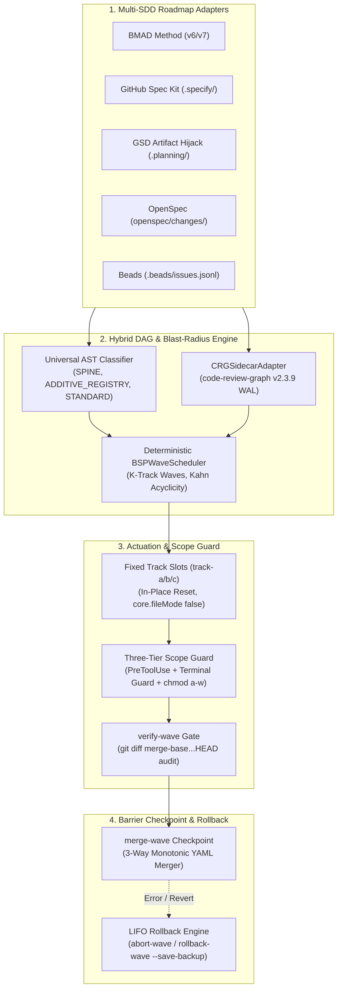

<!-- status: draft -->
# ⚡ SDD-Parallel

[](https://github.com/stopActingSoSmall/sdd-parallel/actions/workflows/ci.yml)
[](https://www.python.org/)
[](../../../LICENSE)
[](#-5-секундное-офлайн-демо-без-api-ключей)

<p align="center">
  <b>🌐 Язык / Language:</b>
  <a href="../../../README.md">English</a> |
  <a href="../zh-CN/README.md">简体中文</a> |
  <a href="../es/README.md">Español</a> |
  <a href="../pt-BR/README.md">Português (BR)</a> |
  <a href="../ja/README.md">日本語</a> |
  <a href="../ko/README.md">한국어</a> |
  <b>Русский</b>
</p>

> **Харнесс параллелизации Spec-Driven Development (SDD) и контроля Blast Radius для ИИ-агентов**  
> (Google Antigravity, Claude Code, OpenAI Codex)  
> *Доступен через CLI-команду `sdd-parallel` и короткий алиас `parallel-flow`.*

---

## 🎯 Проблема

Современные среды Spec-Driven Development (SDD) — **BMAD Method (v6/v7)**, **GitHub Spec Kit (`.specify/`)**, **GSD (Get Shit Done)**, **OpenSpec** и **Beads** — отлично декомпозируют требования на проверяемые изолированные спецификации. Однако при попытке распараллелить разработку они сталкиваются с **фундаментальным архитектурным тупиком**:

1. **Линейные очереди задач:** Планировщики поддерживают только последовательное выполнение (`Story 1 -> Story 2 -> Story 3`), игнорируя независимость эпиков.
2. **Merge-Bombs в общих конфигурациях:** Параллельные агенты одновременно меняют общие реестры и статусные файлы спринта (`sprint-status.yaml`, `STATE.md`, `tasks.md`).
3. **Семантические коллизии 2-го рода ($W_A \cap I_B \neq \emptyset$):** Агент А меняет сигнатуру общего интерфейса, пока параллельный Агент Б вызывает прежнюю сигнатуру. Локальные тесты в ветках проходят, но после слияния проект ломается в рантайме.
4. **Ограничение глубины субагентов:** Сложные агентные сценарии (например, 3 независимые линзы ревью BMAD) ломаются при вложенном запуске (`Max Subagent Depth = 1`).

---

## 💡 Решение: `sdd-parallel`

`sdd-parallel` — это детерминированный оркестратор и защитный харнесс:
- **Полиморфный анализ SDD-роадмапов:** Без хардкода проектных сущностей извлекает задачи, зависимости и карты кода для 5 SDD-фреймворков.
- **Расчёт семантического радиуса поражения (AST + Call Graph):** Вычисляет направленные зависимости, Spine Locks и пересечения влияния 2-го рода ($W_A \cap I_B$).
- **Постоянные слоты `track-a`, `track-b`, ...:** Выделяет фиксированные слоты worktree с in-place ресетом (`git checkout -B` + `git clean -fd`), сохраняя размер $O(1)$.
- **Трёхуровневый Scope Guard:** Перехватывает вызовы `PreToolUse`, блокирует попытки обхода через шелл (`Bash`, PowerShell) и защищает файлы флагом ОС `chmod a-w`.
- **Монотонный 3-way мердж статусов:** Разрешает статусы задач через полурешётку ($\max(\text{rank})$) с 0 маркеров конфликта `<<<<<<<`.
- **Гарантированный LIFO-откат волн:** Безопасно откатывает смердженные волны с созданием страховочной ветки и полиморфным сбросом статусов.

---

## 🚀 5-секундное офлайн-демо (без API-ключей)

Склонируйте репозиторий и запустите автономный верификационный стенд:

```bash
uv run sdd-parallel demo
```

```text
============================================================================
SDD-PARALLEL STANDALONE MERGE-BOMB DEMO (ZERO API KEYS / OFFLINE)
============================================================================
Workspace: /tmp/sdd-parallel-demo-xyz

[Step 1/4] AST & Architectural Role Classification
----------------------------------------------------------------------------
File Path                              | Detected Role          | Importers
----------------------------------------------------------------------------
src/demo_app/__init__.py               | additive_registry      | -
src/demo_app/api.py                    | standard               | -
src/demo_app/cli.py                    | additive_registry      | -
src/demo_app/exporter.py               | standard               | -
src/demo_app/normalizer.py             | standard               | src/demo_app/api.py
src/demo_app/schema.py                 | spine                  | -

[Step 2/4] Type-2 Semantic Merge-Bomb Detection & BSP Wave Schedule
----------------------------------------------------------------------------
  Collision Analysis:
    - Naive Scheduler : W(1-2)={normalizer.py, cli.py} vs W(2-1)={api.py}
                        -> DISJOINT WRITES (False Safe!)
    - BSPWaveScheduler: Detected semantic_collision between '1-2' and '2-1'
                        -> Overlap W(1-2) ^ I(2-1) on: src/demo_app/api.py
    - Additive Registry: Tasks '1-2' and '1-3' both touch 'src/demo_app/cli.py'
                        -> Role: ADDITIVE_REGISTRY (Parallel allowed in Wave 1)

  Wave Schedule:
    * Wave 1
        - track-a: Story 1-2 -> writes: src/demo_app/normalizer.py (+ shared: src/demo_app/cli.py)
        - track-b: Story 1-3 -> writes: src/demo_app/exporter.py (+ shared: src/demo_app/cli.py)
    * Wave 2
        - track-a: Story 1-1 -> writes: src/demo_app/schema.py
        - track-b: Story 2-1 -> writes: src/demo_app/api.py
    * Wave 3
        - track-a: Story 2-2 -> writes: src/demo_app/schema.py

[Step 3/4] Fixed-Slot Worktree Provisioning & PreToolUse Scope Guard
----------------------------------------------------------------------------
  Provisioned Fixed Slots (100% Clean git status: True):
    - track-a (.worktrees/track-a)
    - track-b (.worktrees/track-b)

  PreToolUse Scope Guard Check (track-a -> 'src/demo_app/schema.py'):
    - Decision : DENY
    - Violation: File 'src/demo_app/schema.py' cannot be modified by Wave 1 / track-a (stories ['1-2'])
    - Reason   : Locked by Spine Chain invariant.

[Step 4/4] Barrier Checkpoint & Monotonic 3-Way YAML Merge
----------------------------------------------------------------------------
  Merged Branches:
    - parallel/track-a
    - parallel/track-b

  Resolved sprint-status.yaml (0 conflict markers):
    - 1-2-normalize-telemetry-payload: done
    - 1-3-cli-batch-export: done
============================================================================
ALL 5 CORE INVARIANTS VERIFIED IN 3.21s
============================================================================
```

> 📖 **Пошаговая анатомия демо, теория графов и интерактивный практикум:**  
> Чтобы увидеть покадровую эволюцию диска (`Before -> Wave Planning -> Slot Locking -> 3-Way Merge`), изучить теорию графов классификатора ролей (`SPINE` / `ADDITIVE_REGISTRY` / `STANDARD`) и попрактиковаться с командами `plan`, `prepare`, `check-lock`, `abort-wave`, `rollback-wave` в песочнице `--keep-temp` или greenfield-проекте:  
> 👉 Ознакомьтесь с теорией в **[System Capabilities & Architectural White Paper](dossier/02_SYSTEM_CAPABILITIES_WHITE_PAPER.md)** и пройдите руководство в **[Standalone Demo & Interactive E2E Walkthrough Guide](dossier/07_STANDALONE_DEMO_AND_E2E_WALKTHROUGH.md)** *(в составе полного пакета **[Architecture & Strategy Dossier](dossier/README.md)**)*.  
> 🏛️ Для руководителей и архитекторов: **[Продуктовый бриф и резюме](dossier/01_CORE_PRODUCT_BRIEF.md)** | **[Архитектура системы SSOT](ARCHITECTURE.md)**.

---

## 📦 Требования и установка

### Системные требования
- **Python:** `>= 3.11` (Python 3.11, 3.12, 3.13)
- **Git:** `>= 2.30` (требуется для изоляции `git worktree` и маскирования `info/exclude`)
- **Пакетный менеджер:** [`uv`](https://docs.astral.sh/uv/) (рекомендуется) или `pipx`

### Установка

#### В виде изолированной CLI-утилиты (Рекомендуется)
```bash
# Через uv (быстрее всего)
uv tool install sdd-parallel

# Или через pipx
pipx install sdd-parallel
```

#### Из исходного кода для локальной разработки
```bash
git clone https://github.com/stopActingSoSmall/sdd-parallel.git
cd sdd-parallel
uv sync
```

После установки инструмент доступен глобально как `sdd-parallel` (или через короткий алиас `parallel-flow`).

---

## 🏛️ Архитектура системы



---

## 🛡️ Фундаментальные инварианты

1. **Zero Worktree Pollution:** Внедряемые файлы границ (`.tmp/track-context.md`, `.parallel-lock.json`, `ACTIVE_TRACK.md`) скрыты через `info/exclude`. Команда `git status --porcelain` всегда на 100% чистая.
2. **Zero Cache Invalidation:** Контексты эпиков в `_bmad-output/planning-artifacts/` открыты только на чтение; состояние планировщика пишется в `_bmad-output/parallel-artifacts/`.
3. **100% Task Coverage & Acyclic Invariant:** Топологическая проверка алгоритмами Кана/Тарьяна гарантирует 0 потерянных историй и 0 циклических зависимостей.
4. **Контроль Blast-Radius (1-й и 2-й род):** Непересекающиеся множества записи ($W_A \cap W_B = \emptyset$) и непересекающиеся зоны влияния ($W_A \cap I_B = \emptyset$).
5. **Универсальный Anti-Overfitting (Инвариант 7):** Полный запрет хардкода путей и сущностей в ядре. Классификация `SPINE`, `ADDITIVE_REGISTRY` и `STANDARD` выполняется строго по AST-эвристикам и топологической центральности.
6. **Fixed Track Slots ($O(1)$ Footprint):** Повторное использование слотов `track-a`, `track-b`, `track-c` через `git checkout -B` и `git clean -fd` без захламления файловой системы.
7. **Трёхуровневая защита Defense-in-Depth:** Хук `PreToolUse` + перехват шелл-команд (`Bash`, `run_command`) + защита прав ОС `chmod a-w`.
8. **Полурешётка монотонных статусов:** Статусы сливаются строго монотонно: $\texttt{backlog} (0) < \dots < \texttt{done} (4)$ без маркеров конфликта.
9. **LIFO-откат волн:** Транзакционный откат волн строго в обратном порядке с созданием неизменяемой страховочной ветки (`backup/wave-<K>-before-rollback-*`).

---

## 🛠️ Справочник CLI

| Команда | Назначение |
| :--- | :--- |
| `sdd-parallel demo [--kit {bmad,spec-kit,gsd,openspec,beads,all}] [--keep-temp] [--scaffold-only] [--output-dir DIR]` | Запуск офлайн-демо Merge-Bomb или создание чистой песочницы для 5 SDD-китов. |
| `sdd-parallel plan [--repo REPO] [--max-tracks N] [--kit auto] [--include-done] [--dry-run] [--plan-source {auto,plan,specs}] [--output-dir DIR]` | Анализ роадмапа и графа проекта; создание `execution-plan-parallel.md` и `wave-plan.json`. |
| `sdd-parallel prepare --wave K [--repo REPO] [--max-tracks N] [--kit KIT] [--headless] [--antigravity-layout] [--dynamic-worktrees] [--dry-run]` | Подготовка слотов worktree (`track-a`, `track-b`), наложение ОС-локов и инъекция границ. |
| `sdd-parallel claim-track --wave K --track <id> --worktree <path> [--repo REPO] [--max-tracks N] [--kit KIT] [--headless]` | Подключение манифеста блокировок к существующему внешнему слоту worktree. |
| `sdd-parallel run-guide --wave K [--repo REPO] [--max-tracks N] [--kit KIT] [--antigravity-layout]` | Вывод интерактивного руководства оператора со шпаргалкой команд для каждого окна. |
| `sdd-parallel verify-wave --wave K [--repo REPO] [--max-tracks N] [--kit KIT] [--dynamic-worktrees]` | Аудит слотов worktree на соответствие `.parallel-lock.json` и накопительного диффа против `merge-base`. |
| `sdd-parallel merge --wave K [--repo REPO] [--max-tracks N] [--kit KIT] [--dynamic-worktrees] [--skip-gates] [--strict-gates] [--cleanup] [--dry-run]` | Барьерное слияние: 3-way мердж статусов, слияние веток, полиморфные гейты и транзакционный авто-откат. |
| `sdd-parallel abort-wave --wave K [--repo REPO] [--dynamic-worktrees]` | Сброс неслитой волны: очистка слотов и удаление временных веток. |
| `sdd-parallel rollback-wave --wave K [--repo REPO] [--dynamic-worktrees] [--to-commit COMMIT] [--save-backup] [--no-backup] [--kit KIT]` | Транзакционный LIFO-откат слитой волны со страховочной веткой и сбросом статусов задач. |
| `sdd-parallel merge-status --base B --ours O --theirs T --out OUT` | Низкоуровневый 3-way детерминированный мерджер файлов статусов. |
| `sdd-parallel check-lock --file PATH [--tool TOOL]` | Валидация прав на запись в файл через активный манифест блокировок. |
| `sdd-parallel install-plugin [--target-dir DIR]` | Упаковка и установка плагина для Google Antigravity. |
| `sdd-parallel autopilot --wave K [--repo REPO] [--max-tracks N] [--kit KIT] [--harness <tool>] [--antigravity-layout] [--execute]` | Генерация или запуск команд в режиме Multi-Conversation Autopilot с маршрутизацией моделей по Effort. |

---

## 🧩 Поддерживаемые SDD-киты

| SDD-фреймворк | Статус | Обнаруживаемые Read-Only артефакты | Синхронизация статусов |
| :--- | :---: | :--- | :--- |
| **BMAD Method (`v6.3+` / `v7`)** | ✅ Поддерживается | `sprint-status.yaml`, `epics.md`, `epic-*-context.md`, `spec-*.md` | Монотонный 3-way YAML мердж |
| **GitHub Spec Kit (`.specify/`)** | ✅ Поддерживается | `.specify/specs/*/tasks.md`, `constitution.md` | Чекбоксы Markdown |
| **GSD (Get Shit Done)** | ✅ Поддерживается | `.planning/phases/*-PLAN.md`, `ROADMAP.md` | Artifact Hijack (изоляция `STATE.md`) |
| **OpenSpec (`openspec/`)** | ✅ Поддерживается | `openspec/changes/<id>/tasks.md` | Спецификационное отслеживание задач |
| **Beads (`.beads/`)** | ✅ Поддерживается | `.beads/issues.jsonl` | Топологические обновления JSONL |

---

## 🚢 Матрица релизов: Доступно в `v0.1.0` vs Роадмап `v0.2+`

### ✅ Реализовано в `v0.1.0` (Production Hardened)
- Детерминированный BSP-планировщик волн с проверкой ацикличности Кана.
- AST Hotspot Scanner и интеграция `code-review-graph v2.3.9` сайдкара.
- Архитектура Fixed Track Slots (`track-a`, `track-b`, `track-c`) с in-place сбросом.
- Трёхуровневый Scope Guard (`PreToolUse` + Terminal Guard + `chmod a-w`).
- Монотонный 3-Way YAML Merger с сохранением комментариев и форматирования.
- Транзакционный LIFO-движок отката волн с автоматическими страховочными ветками.
- Исполнительский стандарт Two-Stage Assisted (интерактивные слоты IDE) на уровне `Depth 0`.
- 5 мульти-SDD адаптеров (BMAD, Spec Kit, GSD Artifact Hijack, OpenSpec, Beads).
- Автономный офлайн Merge-Bomb демо-стенд (`sdd-parallel demo`) и конвейер GitHub Actions CI.
- 95+ автоматических юнит- и интеграционных тестов, `mypy --strict` и `ruff` гейты качества.

### 🚧 В бэклоге для `v0.2.0+`
- **Экосистема адаптеров сообщества:** Интеграция `mattpocock/skills` (`/implement-spec`) и адаптер frontmatter-статусов `bmad-loop` v0.8+.
- **Синхронизация окружения Zero-Pollution:** `workz` паттерн с симлинками `.venv` и `node_modules` в фиксированные слоты.
- **Статический линкер символов и динамическая эскалация скоупа:** Автодостройка списка записи по AST-символам и перепланирование задач.
- **Экспортёры FinOps и телеметрии:** Сланы OpenTelemetry и метрики экономии токенов Langfuse.
- **Фоновый демон Autopilot:** Автономный запуск воркеров через локальный RPC/субагентный диспетчер.

---

## 🧪 Разработка и гейты качества

Запуск полного тестового и верификационного набора локально:

```bash
# Запуск тестов
uv run pytest

# Строгая проверка типов
uv run mypy --strict src/sdd_parallel

# Линтер
uv run ruff check src/ tests/ scripts/

# Запуск офлайн-демо
uv run sdd-parallel demo
```

---

## 🤝 Содействие проекту и безопасность

- **Участие в разработке:** Ознакомьтесь с нашим **[Руководством разработчика](../../../CONTRIBUTING.md)** для настройки рабочего окружения и прохождения гейтов качества.
- **Безопасность:** Инструкции по сообщению об уязвимостях и политика безопасности описаны в **[Политике безопасности](../../../SECURITY.md)**.

---

## 📜 Лицензия

MIT License. Подробности см. в файле [LICENSE](../../../LICENSE).
