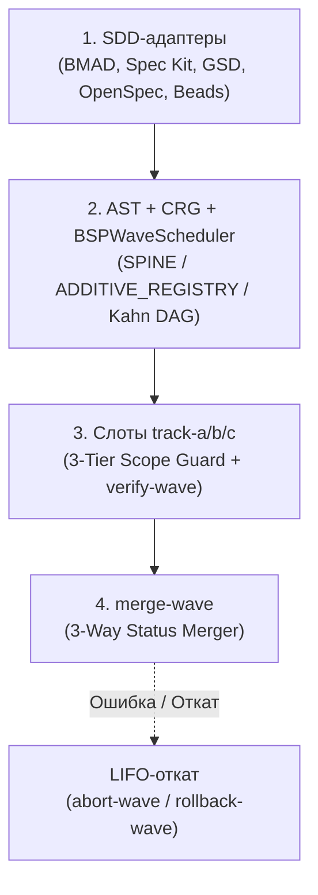

<p align="center">
  
</p>

<p align="center">
  <a href="https://github.com/stopActingSoSmall/sdd-parallel/actions/workflows/ci.yml"></a>
  <a href="https://pypi.org/project/sdd-parallel/"></a>
  <a href="https://www.python.org/"></a>
  <a href="../../../LICENSE"></a>
  <a href="#-попробуйте-за-5-секунд-без-api-ключей-аннотированный-разбор"></a>
  <br>
  <a href="#-совместимость-с-любым-стеком-zero-lock-in"></a>
  <a href="#-структура-вашего-sdd-проекта-до-и-после"></a>
</p>

<p align="center">
  <b>🌐 Язык / Language:</b>
  <a href="../../../README.md">English</a> |
  <a href="../es/README.md">Español</a> |
  <a href="../pt-BR/README.md">Português (BR)</a> |
  <a href="../ja/README.md">日本語</a> |
  <a href="../ko/README.md">한국어</a> |
  <a href="../zh-CN/README.md">简体中文</a> |
  <b>Русский</b>
</p>

<p align="center">
  <a href="#-попробуйте-за-5-секунд-без-api-ключей-аннотированный-разбор">Демо</a> ·
  <a href="#-зачем-это-нужно-простыми-словами">Зачем</a> ·
  <a href="#%EF%B8%8F-как-это-работает-и-ежедневный-4-командный-воркфлоу">Как работает</a> ·
  <a href="#-структура-вашего-sdd-проекта-до-и-после">Структура SDD</a> ·
  <a href="#-совместимость-с-любым-стеком-zero-lock-in">Харнессы</a> ·
  <a href="../../USER_GUIDE.md">User Guide (EN)</a> ·
  <a href="#%EF%B8%8F-полный-справочник-команд-cli">CLI</a> ·
  <a href="#-архитектура-математическая-модель-и-детальные-досье">Досье</a>
</p>

> **Планировщик волн и песочница worktree для параллельных ИИ-агентов — отсекает скрытые merge-bombs до траты токенов LLM.**  
> Работает между бэклогом **Spec Kit / BMAD / GSD / OpenSpec / Beads** и агентами (**Claude Code**, **Codex**, **Antigravity** и др.).

https://github.com/user-attachments/assets/5dcfeb80-e48f-4bf8-8e90-76cc463f5edd

<p align="center"><em>🎬 <b>1080p видео-разбор</b> — 7 языков в переключателе <b>🌐 Язык / Language</b> выше.</em></p>

Интерактивно: **[⚡ Live Wave Inspector](https://stopactingsosmall.github.io/sdd-parallel/?video=ru)** (онлайн) · **[📘 User Guide & Day-1 Runbook (`docs/USER_GUIDE.md`, EN)](../../USER_GUIDE.md)**.

---

## ⚡ Зачем это нужно? (Простыми словами)

<p align="center">
  
</p>

При 10–15 спеках два плохих пути:
1. **1 агент по очереди** — безопасно, но **6–8 ч**.
2. **3–4 агента в наивных `git worktree`** — быстро до мерджа:
   - **Тип 1 (прямой):** правки `sprint-status.yaml`, `STATE.md`, `cli.py` из двух веток → `<<<<<<<`.
   - **Тип 2 (семантический):** Агент А меняет `normalizer.py`; Агент Б зовёт старое API из `api.py`. **Git мерджит чисто — `main` падает.**
   - **Scope creep:** правка `schema.py` вне задачи.

**`sdd-parallel` отсекает это до траты токенов:** AST + граф вызовов → **Волны**, слоты (`track-a/b/c`), блок чужих файлов и quality gates.

| Сценарий | ❌ По очереди | 💥 Наивный `--worktree` | ✅ `sdd-parallel` |
| :--- | :--- | :--- | :--- |
| **Спринт (12 задач)** | ~6–8 ч | ~2 ч кода + **~2 ч мерджей** | **~2.5 ч (2x–3x быстрее)** |
| **Коллизии API** | Медленным ходом | **Ломают `main`** ($W_A \cap I_B \neq \emptyset$) | **Отсечены** (Волна 1 → 2) |
| **CLI / роутеры** | По очереди | Конфликт Git на мердже | **Параллельно** (`ADDITIVE_REGISTRY`) |
| **Статусы** | Последовательно | Маркеры `<<<<<<<` | **3-way мердж** (0 маркеров) |
| **Чужие файлы** | Просьба в промпте | Обход через `bash`/`sed` | **Блок** (`PreToolUse` + Terminal Guard + `chmod a-w`) |
| **Worktree** | Нет | 15 папок `task-*` | **Слоты** (`track-a/b/c`) |

*$W$ = запись (Write set); $I$ = зависимые файлы (Impact radius).*

---

## 🚀 Попробуйте за 5 секунд (без API-ключей, аннотированный разбор)

Без ключей, LLM и `git clone`. Через [`uv`](https://docs.astral.sh/uv/) (или `pipx run sdd-parallel demo`):

```bash
uvx sdd-parallel demo --kit all   # или один: uvx sdd-parallel demo --kit spec-kit
```

Создаёт Git-репо (5 задач, 6 модулей Python), гоняет AST, `DENY`-блоки и 3-way мердж без конфликтов:

```text
================================================================
5/5 SDD KITS VERIFIED (BMAD, SPEC KIT, GSD, OPENSPEC, BEADS)
================================================================
Kit      | Merge-Bomb | Worktrees | Scope Guard | 3-Way Merge
----------------------------------------------------------------
bmad     | PASSED     | PASSED    | PASSED      | PASSED
spec-kit | PASSED     | PASSED    | PASSED      | PASSED
gsd      | PASSED     | PASSED    | PASSED      | PASSED
openspec | PASSED     | PASSED    | PASSED      | PASSED
beads    | PASSED     | PASSED    | PASSED      | PASSED
================================================================
```

<details>
<summary><b>🔍 Раскрыть: 4 шага (<code>--kit spec-kit</code>) и песочница</b></summary>

1. **`[Step 1/4]` AST:** `schema.py` → `spine` (сериализация); `cli.py` → `additive_registry`; `api.py` импортирует `normalizer.py`.
2. **`[Step 2/4]` Merge-Bomb Тип 2:** `T002` (`normalizer.py`) и `T004` (`api.py`) с `[P]`, но `BSPWaveScheduler` видит $W(\text{T002}) \cap I(\text{T004}) \neq \emptyset$ и переносит `T004` во **Волну 2**; `T002` + `T003` делят `cli.py` в **Волне 1**:
```text
Wave 1: [track-a: T002] [track-b: T003]  (normalizer.py + exporter.py + cli.py)
Wave 2: [track-a: T001] [track-b: T004]  (после normalizer Волны 1)
Wave 3: [track-a: T005]                  (барьер schema)
```
3. **`[Step 3/4]` Слоты и Guard:** `ACTIVE_TRACK.md`, `.parallel-lock.json`, `.tmp/track-context.md` скрыты в `info/exclude` (`Clean git status: True`); запись `track-a` в `schema.py` → `DENY`.
4. **`[Step 4/4]` 3-Way мердж:** `[ ] < [x]` в `tasks.md` с **0 маркерами**. Снимки — [Досье 07](dossier/07_STANDALONE_DEMO_AND_E2E_WALKTHROUGH.md), или песочница:
```bash
uvx sdd-parallel demo --kit gsd --scaffold-only --output-dir ./sdd-sandbox
cd sdd-sandbox && sdd-parallel plan && sdd-parallel prepare --wave 1
```

</details>

---

## 🗺️ Как это работает и ежедневный 4-командный воркфлоу

<p align="center">
  
</p>

Модель **Bulk Synchronous Parallel (BSP)**: треки изолированы и синхронизируются на барьере тестов и мерджа.

**1. Установка** (`Python >= 3.11`, `Git >= 2.30`): `uv tool install sdd-parallel` (или `pipx install sdd-parallel`; даёт `sdd-parallel` и `parallel-flow`).

**2. Волна:**

```bash
sdd-parallel plan                  # 1. Спеки + AST -> волны
sdd-parallel prepare --wave 1      # 2. Слоты и блоки
sdd-parallel run-guide --wave 1    #    Команда на слот
# 3. Агенты в .worktrees/track-a, track-b, ...
sdd-parallel verify-wave --wave 1  # 4. Аудит diff vs .parallel-lock.json
sdd-parallel merge --wave 1        #    Gates и 3-way merge в main
```

**Откат и обзор:** `abort-wave --wave 1` · `rollback-wave --wave 1 --save-backup` (LIFO + backup) · `inspect --open` (`assets/inspector.html`).

- **Режим А (Интерактивный):** `plan` → `inspect --open` → копируйте `prepare` / `merge` из **CLI Action Bridge** для `.worktrees/track-{a,b}`.
- **Режим Б (Автопилот):** `sdd-parallel autopilot --wave 1 --harness {antigravity,claude-code,codex} --execute --policy {single-shot,cyclic} [--max-review-rounds N] [--routing-file FILE]`.

👉 **[`docs/USER_GUIDE.md`](../../USER_GUIDE.md#3-interactive-wave-inspector--orchestration-modes-mode-a-vs-mode-b)** (Inspector и режимы, EN) · **[Day-1 Runbook](../../USER_GUIDE.md#4-day-1-troubleshooting--recovery-runbook)**.

---

## 📂 Структура вашего SDD-проекта (До и После)

<p align="center">
  
</p>

Read-only **ACL** нормализуют 5 форматов SDD без правки спеков:

| SDD | Read-Only (🔒) | Задачи | Синхронизация |
| :--- | :--- | :--- | :--- |
| **Spec Kit** (`.specify/`) | `constitution.md`, `feature.json`, `spec.md`, `plan.md` | `specs/*/tasks.md` (`T001 [P]`) | 3-way Markdown |
| **BMAD** (`v6.3+/v7`) | `epic-*-context.md` (Zero Cache Invalidation) | `sprint-status.yaml`, `epics.md`, `spec-*.md` | 3-way YAML |
| **GSD** (`.planning/`) | `PROJECT.md`, `REQUIREMENTS.md`, `ROADMAP.md`, `STATE.md` | `phases/*/NN-NN-PLAN.md` | Единый `STATE.md` |
| **OpenSpec** (`openspec/`) | `openspec/specs/**`, `project.md`, `config.yaml`, чужие changes | `openspec/changes/<slug>/tasks.md` | 3-way Markdown |
| **Beads** (`.beads/`) | `.beads/config.yaml` | `.beads/*.jsonl` (`bd-101` + `blocks`) | 3-way JSONL |

<details>
<summary><b>🌱 Пример: GitHub Spec Kit (<code>.specify/</code> и <code>specs/*/tasks.md</code>) — После <code>plan</code> + <code>prepare --wave 1</code></b></summary>

```text
my-project/
├── .parallel/{artifacts/wave-plan.json, history/, state.json}
├── .specify/…                         # не тронуто
├── .worktrees/
│   ├── track-a/                       # Волна 1 → T002
│   │   ├── .specify/memory/constitution.md    # 🔒 read-only
│   │   ├── specs/001-telemetry/{plan,spec}.md # 🔒 read-only
│   │   ├── specs/001-telemetry/tasks.md       # ✍️ запись
│   │   ├── .tmp/track-context.md      # 👻 скрыто
│   │   ├── .parallel-lock.json        # 👻 скрыто
│   │   └── ACTIVE_TRACK.md            # 👻 → /speckit.implement T002
│   └── track-b/                       # Волна 1 → T003
└── specs/… & src/…                    # не тронуто в main
```

</details>

Легенда: 🔒 read-only (`chmod a-w` + `PreToolUse` deny) · 👻 скрыто (`info/exclude`) · ✍️ запись.  
👉 Все 5 деревьев До/После (**Spec Kit, BMAD, GSD, OpenSpec, Beads, Custom SDD**): **[Раздел 2 `docs/USER_GUIDE.md` (EN)](../../USER_GUIDE.md#2-sdd-project-layouts-before--after-all-5-frameworks)**.

---

## 🔌 Совместимость с любым стеком (Zero Lock-In)

`sdd-parallel run-guide --wave 1` выводит команду слота (дублируется в `ACTIVE_TRACK.md`):

| SDD-кит | Команда на трек |
| :--- | :--- |
| GitHub Spec Kit | `/speckit.implement T002` |
| BMAD Method | `/bmad-build 1-2` |
| GSD | `/gsd-execute-phase 01-02` |
| OpenSpec | `/opsx:apply normalize-telemetry` |
| Beads | `bd update bd-102 --status in-progress` |

> 📦 **Spec Kit Extension (`extension.yml`):** `specify extension add --from https://github.com/stopActingSoSmall/sdd-parallel/archive/refs/tags/v0.2.1.zip` (или `specify extension add sdd-parallel`) даёт `/specify plan-waves`, `/specify prepare-wave --wave 1`, `/specify merge-wave --wave 1`.

| Харнесс | Подключение |
| :--- | :--- |
| **Claude Code** (`claude`) | `claude` в `.worktrees/track-a` (`blockWritesOutsideWorkingDirectories` + `PreToolUse` + `chmod a-w`) или `autopilot --wave 1 --harness claude-code`. |
| **Codex CLI** (`codex`) | `codex --cd .worktrees/track-b`; `chmod a-w` защищает контракты, `verify-wave` аудирует diff. Автопилот: `--harness codex`. |
| **Google Antigravity** (`agy`) | `prepare --wave 1 --antigravity-layout` → `~/.gemini/antigravity/worktrees/<Project>/track-a`; `install-plugin` ставит hook. |
| **Cursor, Windsurf, OpenCode, Kimi, Aider, Cline, Trae** | Из коробки: `.worktrees/track-{a,b,c}`, `chmod a-w`, `ACTIVE_TRACK.md`, `claim-track` для внешних worktree, `verify-wave`. |

👉 Рецепты (`local` `.worktrees/` vs `--antigravity-layout`, `claim-track`, MCP) — **[Раздел 1 `docs/USER_GUIDE.md` (EN)](../../USER_GUIDE.md#1-harness-connection-recipes-local-slots-vs-antigravity-layout)**.

---

## 🔍 Архитектура, математическая модель и детальные досье

- 📘 **[Operator User Guide & Day-1 Runbook (`docs/USER_GUIDE.md`, EN)](../../USER_GUIDE.md)**: харнессы, 5 деревьев, Inspector, восстановление
- 📖 **[01 — Обзор](dossier/01_CORE_PRODUCT_BRIEF.md)** · **[02 — White Paper](dossier/02_SYSTEM_CAPABILITIES_WHITE_PAPER.md)** · **[03 — Интеграция](dossier/03_INTEGRATION_AND_ECOSYSTEM_SPEC.md)**
- 📊 **[04 — Таксономия](dossier/04_COMPETITIVE_AND_BENCHMARK_TAXONOMY.md)** · **[07 — E2E-демо](dossier/07_STANDALONE_DEMO_AND_E2E_WALKTHROUGH.md)** · **[SSOT (RU)](ARCHITECTURE.md)** · **[SSOT (EN)](../../../ARCHITECTURE.md)** · **[Индекс досье](dossier/README.md)**

<details>
<summary><b>❓ Инженерные вопросы и границы (FAQ)</b></summary>

1. **`write_files` заранее:** **(a)** пути в спеках (`Code Map`, `Files:`, backticks) → **(b)** AST Symbol Linker → **(c)** эскалация (`.tmp/scope-escalation.json`) на `verify-wave`.
2. **Не-Python (TS/JS, Go, Rust):** AST парсит Python; полиглотные репо используют пути в спеках + **`code-review-graph`** (`CRGSidecarAdapter`).
3. **Обход через shell (`sed -i`, `python -c`):** **3 уровня**: `PreToolUse` + Terminal Guard → `chmod a-w` → `verify-wave` (`git diff merge-base...HEAD`).
4. **Межслойные контракты (Pydantic → TS, SQL, OpenAPI):** **`DEFAULT_CONTRACT_GLOBS`** (`**/schemas/**`, `**/migrations/**`, `openapi.*`, `*.proto`, `*.graphql`) и `file_roles` (`SPINE`) в `.parallel-config.json`.

</details>

<details>
<summary><b>🏛️ Архитектура движка и 9 инвариантов</b></summary>



1. **Zero Worktree Pollution:** `info/exclude`; `git status --porcelain` пуст.
2. **Zero Cache Invalidation:** контексты read-only; состояние в `.parallel/`.
3. **100% покрытие и ацикличность:** Kahn check (0 потерь, 0 циклов).
4. **Радиус поражения:** $W_A \cap W_B = \emptyset$ и $W_A \cap I_B = \emptyset$.
5. **Anti-Overfitting:** `SPINE`, `ADDITIVE_REGISTRY`, `STANDARD` из AST и центральности.
6. **Слоты:** `track-a/b/c` сбрасываются на месте (`git checkout -B` + `git clean -fd`).
7. **3-уровневая защита:** `PreToolUse` + Terminal Guard (`Bash`, `run_command`) + `chmod a-w`.
8. **Полурешётка статусов:** $\texttt{backlog}(0) < \dots < \texttt{done}(4)$, 0 маркеров.
9. **LIFO-откаты:** обратный порядок + ветки `backup/wave-<K>-before-rollback-*`.

</details>

---

## 🛠️ Полный справочник команд CLI

<details>
<summary><b>Раскрыть: все 15 подкоманд и флагов</b></summary>

Общие: `--repo REPO`, `--max-tracks N`, `--kit KIT`, `--routing-file FILE`, `--dry-run`, `--dynamic-worktrees`.

| Команда | Флаги и назначение |
| :--- | :--- |
| `sdd-parallel demo` | `[--kit {...,all}] [--keep-temp] [--scaffold-only] [--output-dir DIR]` — Демо / песочница. |
| `sdd-parallel plan` | `[--include-done] [--plan-source {auto,plan,specs}] [--output-dir DIR]` — `wave-plan.json`. |
| `sdd-parallel prepare --wave K` | `[--headless] [--antigravity-layout]` — Слоты, блокировки, границы. |
| `sdd-parallel claim-track --wave K` | `--track <id> --worktree <path> [--headless]` — Привязка к внешнему worktree. |
| `sdd-parallel run-guide --wave K` | `[--antigravity-layout]` — Команда запуска для слота. |
| `sdd-parallel verify-wave --wave K` | Аудит слотов по `.parallel-lock.json` и `merge-base`. |
| `sdd-parallel merge --wave K` | `[--skip-gates] [--strict-gates] [--cleanup]` — Gates, 3-way merge, откат. |
| `sdd-parallel abort-wave --wave K` | Сброс слотов и удаление временных веток. |
| `sdd-parallel rollback-wave --wave K` | `[--to-commit COMMIT] [--save-backup\|--no-backup]` — LIFO-откат + backup + статусы. |
| `sdd-parallel merge-status` | `--base B --ours O --theirs T --out OUT` — 3-way merge `sprint-status.yaml`. |
| `sdd-parallel check-lock` | `--file PATH [--tool TOOL]` — Проверка записи по lock-манифесту. |
| `sdd-parallel install-plugin` | `[--target-dir DIR]` — Плагин Antigravity. |
| `sdd-parallel autopilot --wave K` | `[--harness {antigravity,claude-code,codex}] [--antigravity-layout] [--execute] [--policy {single-shot,cyclic}] [--max-review-rounds N]` — Автозапуск. |
| `sdd-parallel bench` | `[--since REV] [--until REV] [--demo] [--format {text,json}] [--output-file FILE]` — Бэктест. |
| `sdd-parallel inspect` | `[--plan PATH] [--output PATH] [--open]` — HTML Wave Inspector. |

</details>

---

## 🚢 Матрица релиза: Готово (v0.2.1) vs Роадмап (v0.3+)

### ✅ Реализовано в `v0.1.0 – v0.2.1`
- [x] Планировщик BSP (Kahn) + AST-сканер + сайдкар `code-review-graph v2.3.9`.
- [x] Слоты (`track-a/b/c`), in-place сброс, `info/exclude`, симлинки `.venv`/`node_modules`.
- [x] 3-уровневый Scope Guard (`PreToolUse` + Terminal Guard + `chmod a-w`), symbol linker, `.tmp/scope-escalation.json`.
- [x] Монотонный 3-way слиятель (YAML, Markdown, `STATE.md`, JSONL) + LIFO-откат.
- [x] 5 SDD-адаптеров (Spec Kit + `extension.yml`, BMAD + `mattpocock/skills` + `bmad-loop`, GSD, OpenSpec, Beads).
- [x] Офлайн `demo --kit all`, `bench`, HTML Wave Inspector (`inspect --open`), `--scaffold-only`.
- [x] Автопилот (`agy`, Claude Code, Codex) с `--routing-file`, `TaskStructuralSignals`, `--policy cyclic` (`ADR-0009`).
- [x] Clean-clone CI (Ubuntu/macOS/Windows, Python 3.11–3.13) и PyPI Trusted Publishing.

### 🚧 Запланировано в `v0.3+`
- [ ] Строгое автоопределение кита (без молчаливого отката, TTY)
- [ ] Граф-безопасная эскалация и бисекция виновника (частичное слияние + починка)
- [ ] Tree-sitter AST и автоиндексация CRG (TS/JS, Go, Rust)
- [ ] Пре-экстрактор System-1 (`--extractor none|gliner|clairic`) и `--max-tracks auto`

---

## 🤝 Контакты и сотрудничество

- **Исследования и гранты:** [sdd-parallel@metrichub.dev](mailto:sdd-parallel@metrichub.dev)
- **Вопросы и комьюнити:** [GitHub Discussions](https://github.com/stopActingSoSmall/sdd-parallel/discussions)
- **Безопасность:** [SECURITY.md](../../../SECURITY.md)

---

## 🛠️ Участие в разработке, локальный запуск и безопасность

```bash
git clone https://github.com/stopActingSoSmall/sdd-parallel.git && cd sdd-parallel && uv sync
uv run pytest && uv run mypy --strict src/sdd_parallel && uv run ruff check src/ tests/ scripts/
uv run sdd-parallel demo --kit all
```

- **Участие:** [CONTRIBUTING.md](../../../CONTRIBUTING.md) · **Безопасность:** [SECURITY.md](../../../SECURITY.md) · **Лицензия:** [MIT](../../../LICENSE) (Озвучка: [ElevenLabs](https://elevenlabs.io) и [Google Gemini](https://ai.google.dev/)).

### 💼 Коммерческий аудит и поддержка enterprise-монорепозиториев

B2B-аудиты (**Parallel SDD Readiness & Blast-Radius Audit**, \$500–\$2,500): ретроспектива `sdd-parallel bench`, `.parallel-config.json` (`contract_globs`, сериализация `SPINE`, quality gates) и отчёты HTML Wave Inspector через **[GitHub Discussions](https://github.com/stopActingSoSmall/sdd-parallel/discussions)**.
