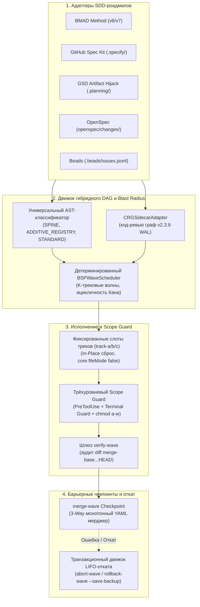

# ⚡ SDD-Parallel (`parallel-flow`)

[](https://github.com/stopActingSoSmall/sdd-parallel/actions/workflows/ci.yml)
[](https://pypi.org/project/sdd-parallel/)
[](https://www.python.org/)
[](../../../LICENSE)
[](#-5-секундное-демо-без-api-ключей-и-клонирования)

<p align="center">
  
</p>

<p align="center">
  <b>🌐 Язык / Language:</b>
  <a href="../../../README.md">English</a> |
  <a href="../zh-CN/README.md">简体中文</a> |
  <a href="../es/README.md">Español</a> |
  <a href="../pt-BR/README.md">Português (BR)</a> |
  <a href="../ja/README.md">日本語</a> |
  <a href="../ko/README.md">한국어</a> |
  <b>Русский</b>
</p>

> **Параллельный запуск 3–4 ИИ-агентов разработки — без поломки сборки и истории Git.**  
> Детерминированный диспетчер параллелизма, изолятор ворк-три и контроль радиуса поражения (Blast Radius) для **Claude Code**, **OpenAI Codex** и **Google Antigravity**, работающих с проектами **BMAD**, **GitHub Spec Kit**, **GSD**, **OpenSpec** и **Beads**.

---

## ⚡ Зачем это нужно? (Простыми словами)

Когда у вас в бэклоге 10–15 спецификаций/историй, возникает болезненный выбор:
1. **Последовательный запуск 1 ИИ-агента:** Безопасно, но требует **6–8 часов** ожидания.
2. **Параллельный запуск 3–4 ИИ-агентов (`git worktree`):** Быстро, пока вы не попытаетесь их объединить и не столкнетесь с **Merge-Bomb**:
   - **Прямые Git-коллизии:** Несколько агентов одновременно редактируют `sprint-status.yaml`, `STATE.md` или `cli.py`.
   - **Скрытые семантические поломки (коллизии 2-го рода):** Агент A меняет сигнатуру функции в `normalizer.py`, а Агент B в другом ворк-три вызывает старую сигнатуру из `api.py`. **Git мерджит ветки без единого маркера конфликта, и ветка `main` мгновенно ломается в рантайме.**
   - **Расползание скоупа (Scope Creep):** Агент проявляет «инициативу» и модифицирует общую схему базы данных (`schema.py`) за пределами поставленной задачи.

**`sdd-parallel` выполняет роль авиадиспетчера компиляторного уровня между вашими SDD-спецификациями и кодинг-агентами.** До того как потратится хотя бы один токен LLM, движок сканирует AST и граф вызовов кодовой базы, группирует бесконфликтные задачи в параллельные **Волны (Waves)**, изолирует каждого агента в чистом ворк-три (`track-a`, `track-b`), физически блокирует запись в неразрешенные файлы и автоматически мерджит завершенные волны с 0 конфликтов.

### 📊 Сравнение: До и после `sdd-parallel`

| Ситуация | ❌ Последовательный SDD (1 агент) | 💥 Наивный параллелизм (`--worktree`) | ✅ С `sdd-parallel` |
| :--- | :--- | :--- | :--- |
| **Время спринта на 12 историй** | ~6–8 часов (по одной) | ~2 ч кодинга + **2 ч починки сломанных мерджей** | **~2.5 часа суммарно (ускорение в 2x–3x)** |
| **Скрытые API/Type коллизии** | Избегаются только за счет черепашьей скорости | **Ломают `main` после мерджа** ($W_A \cap I_B$) | **Предотвращаются заранее** (разведение по Волнам 1 → 2) |
| **Общие файлы CLI и роутеров** | 1 агент за раз | Конфликт Git при каждом слиянии | **Безопасны в параллели** (распознавание `ADDITIVE_REGISTRY`) |
| **`sprint-status.yaml` / `tasks.md`** | Обновляются строго последовательно | Постоянные `<<<<<<<` маркеры конфликтов | **Автомердж** (монотонный 3-way слиятель) |
| **Агент правит чужой файл** | Промпт просит «пожалуйста, не трогай» | Агент обходит через `bash` / `sed` | **Блокировка на уровне ОС и хуков** (`chmod a-w` + `PreToolUse`) |
| **Мусор от сотен папок ворк-три** | Нет | 15 брошенных папок `.worktrees/task-*` | **Фиксированные слоты** (`track-a`, `track-b`, `track-c`) |

---

## 🚀 5-секундное демо (без API-ключей и клонирования)

Вам не нужны API-ключи, подписки на LLM или настроенный проект, чтобы увидеть, как `sdd-parallel` ловит скрытую семантическую коллизию. Выполните команду через [`uv`](https://docs.astral.sh/uv/) (или `pipx run sdd-parallel demo`):

```bash
uvx sdd-parallel demo
```

**Что происходит за 3.2 секунды прямо в вашем терминале:**
1. Разворачивается временный мини-репозиторий с 5 историями и 6 модулями Python (`schema.py`, `normalizer.py`, `api.py`, `exporter.py`, `cli.py`).
2. **Обнаружение ловушки:** История `1-2` меняет `normalizer.py`, а История `2-1` меняет `api.py` (который импортирует `normalizer.py`). Наивный планировщик посчитал бы их независимыми (`normalizer.py != api.py`). `sdd-parallel` вычисляет пересечение влияния по графу вызовов и автоматически разделяет их на **Волну 1** и **Волну 2**.
3. **Безопасный параллелизм на общих реестрах:** Движок определяет `cli.py` как `ADDITIVE_REGISTRY`, позволяя Историям `1-2` и `1-3` выполняться параллельно в **Волне 1** (`track-a` и `track-b`).
4. **Проверка Scope Guard и 3-way мерджа:** Демонстрирует блокировку несанкционированной правки `schema.py` (`DENY: Locked by Spine Chain invariant`) и чистое слияние обеих параллельных веток с `0 маркеров конфликта`.

<details>
<summary><b>📺 Посмотреть точный вывод команды <code>sdd-parallel demo</code></b></summary>

```text
============================================================================
SDD-PARALLEL STANDALONE MERGE-BOMB DEMO (ZERO API KEYS / OFFLINE)
============================================================================
Workspace: /tmp/sdd-parallel-demo-xyz

[Step 1/4] AST & Architectural Role Classification
----------------------------------------------------------------------------
File Path                              | Detected Role          | Importers
----------------------------------------------------------------------------
src/demo_app/__init__.py               | additive_registry      | -
src/demo_app/api.py                    | standard               | -
src/demo_app/cli.py                    | additive_registry      | -
src/demo_app/exporter.py               | standard               | -
src/demo_app/normalizer.py             | standard               | src/demo_app/api.py
src/demo_app/schema.py                 | spine                  | -

[Step 2/4] Type-2 Semantic Merge-Bomb Detection & BSP Wave Schedule
----------------------------------------------------------------------------
  Collision Analysis:
    - Naive Scheduler : W(1-2)={normalizer.py, cli.py} vs W(2-1)={api.py}
                        -> DISJOINT WRITES (False Safe!)
    - BSPWaveScheduler: Detected semantic_collision between '1-2' and '2-1'
                        -> Overlap W(1-2) ^ I(2-1) on: src/demo_app/api.py
    - Additive Registry: Tasks '1-2' and '1-3' both touch 'src/demo_app/cli.py'
                        -> Role: ADDITIVE_REGISTRY (Parallel allowed in Wave 1)

  Wave Schedule:
    * Wave 1
        - track-a: Story 1-2 -> writes: src/demo_app/normalizer.py (+ shared: src/demo_app/cli.py)
        - track-b: Story 1-3 -> writes: src/demo_app/exporter.py (+ shared: src/demo_app/cli.py)
    * Wave 2
        - track-a: Story 1-1 -> writes: src/demo_app/schema.py
        - track-b: Story 2-1 -> writes: src/demo_app/api.py
    * Wave 3
        - track-a: Story 2-2 -> writes: src/demo_app/schema.py

[Step 3/4] Fixed-Slot Worktree Provisioning & PreToolUse Scope Guard
----------------------------------------------------------------------------
  Provisioned Fixed Slots (100% Clean git status: True):
    - track-a (.worktrees/track-a)
    - track-b (.worktrees/track-b)

  PreToolUse Scope Guard Check (track-a -> 'src/demo_app/schema.py'):
    - Decision : DENY
    - Violation: File 'src/demo_app/schema.py' cannot be modified by Wave 1 / track-a (stories ['1-2'])
    - Reason   : Locked by Spine Chain invariant.

[Step 4/4] Barrier Checkpoint & Monotonic 3-Way YAML Merge
----------------------------------------------------------------------------
  Merged Branches:
    - parallel/track-a
    - parallel/track-b

  Resolved sprint-status.yaml (0 conflict markers):
    - 1-2-normalize-telemetry-payload: done
    - 1-3-cli-batch-export: done
============================================================================
ALL 5 CORE INVARIANTS VERIFIED IN 3.21s
============================================================================
```
</details>

---

## 🗺️ Как это устроено визуально (от бэклога до чистого мерджа)

Вместо хаотичного натравливания 5 агентов на проект с надеждой избежать конфликтов, `sdd-parallel` превращает разработку спринта в детерминированные **Волны**:

```mermaid
flowchart LR
    subgraph Backlog["📋 1. SDD-бэклог"]
        direction TB
        T12["Story 1-2
(normalizer.py + cli.py)"]
        T13["Story 1-3
(exporter.py + cli.py)"]
        T21["Story 2-1
(api.py -> вызов normalizer)"]
        T11["Story 1-1
(schema.py - Spine)"]
    end

    subgraph Planner["🧠 2. sdd-parallel plan"]
        direction TB
        Scan["AST + Граф вызовов
• cli.py = Additive (Безопасно!)
• 1-2 ↔ 2-1 = Коллизия влияния!
• schema.py = Блокировка Spine!"]
    end

    subgraph Wave1["🟢 3. Волна 1 (Параллельные ворк-три)"]
        direction TB
        SlotA["📁 .worktrees/track-a
Агент 1 делает Story 1-2
🔒 schema.py и api.py заблокированы"]
        SlotB["📁 .worktrees/track-b
Агент 2 делает Story 1-3
🔒 schema.py и normalizer.py заблокированы"]
    end

    subgraph Gate["🛡️ 4. sdd-parallel merge --wave 1"]
        direction TB
        M1["✅ Аудит диффа скоупа
✅ pytest / mypy / ruff
✅ 3-Way мердж статусов"]
    end

    subgraph Wave2["🔵 5. Волна 2 (Те же слоты)"]
        direction TB
        SlotA2["📁 .worktrees/track-a
Агент 1 делает Story 1-1"]
        SlotB2["📁 .worktrees/track-b
Агент 2 делает Story 2-1
(видит обновленный normalizer.py!)"]
    end

    Backlog --> Planner --> Wave1 --> Gate --> Wave2
```



---

## 🔌 Интеграция в существующий стек (Zero Lock-In)

Вам **не нужно** переписывать спецификации или менять формулировки в промптах. `sdd-parallel` работает с артефактами существующих фреймворков в режиме чтения:

| Инструмент / Фреймворк | Что `sdd-parallel` добавляет в ваш рабочий процесс |
| :--- | :--- |
| **Claude Code** (`claude`) | Добавляет детерминированное планирование волн перед запуском `--worktree` / `Agent Teams`, блокирует несанкционированные правки файлов и шелл-команд через `PreToolUse`, маршрутизирует задачи по сложности (`High`/`Medium`/`Low`). |
| **OpenAI Codex CLI** (`codex`) | Устраняет race conditions при параллельной работе, изолируя файлы схем (`chmod a-w`) внутри каждого выделенного слота. |
| **Google Antigravity** | Предоставляет фиксированные слоты (`track-a`, `track-b`, `track-c`), предотвращая баги потери папок в IDE и сохраняя `git status --porcelain` на 100% чистым через `.git/worktrees/*/info/exclude`. |
| **BMAD Method (`v6.3+` / `v7`)** | Преобразует линейную очередь `sprint-status.yaml` в многоэпиковые параллельные волны и объединяет статусы историй (`backlog -> done`) без YAML-конфликтов. |
| **GitHub Spec Kit (`.specify/`)** | Валидирует ручные теги `[P]` в `tasks.md` по реальным AST-зависимостям, защищая сборку от ложноположительного параллелизма. |
| **GSD / OpenSpec / Beads** | Изолирует `.planning/STATE.md` (режим Artifact Hijack), `openspec/changes/` и `.beads/issues.jsonl` в чистых ворк-три. |

---

## 🛠️ Ежедневный рабочий процесс в 4 команды

### 1. Установка один раз
```bash
# Рекомендуется через uv (или: pipx install sdd-parallel)
uv tool install sdd-parallel
```
*(Обе команды — `sdd-parallel` и короткий алиас `parallel-flow` — доступны глобально).*

### 2. Запуск параллельной волны в любом проекте
```bash
# Шаг 1: Сканирование SDD-спецификаций и AST кодовой базы для построения волн
sdd-parallel plan

# Шаг 2: Подготовка Волны 1 в постоянных слотах (.worktrees/track-a, track-b)
#        и вывод точных инструкций по запуску для кодинг-агентов
sdd-parallel prepare --wave 1
sdd-parallel run-guide --wave 1

# 👉 Шаг 3: Ваши ИИ-агенты (Claude Code / Codex / Antigravity) одновременно
#            реализуют свои задачи внутри track-a и track-b.

# Шаг 4: Верификация скоупа и слияние Волны 1 обратно в основную ветку
sdd-parallel verify-wave --wave 1
sdd-parallel merge --wave 1
```
Нужно отменить волну? Выполните `sdd-parallel abort-wave --wave 1` (до слияния) или `sdd-parallel rollback-wave --wave 1` (после слияния, с созданием резервной ветки и сбросом статусов SDD-задач).

---

## 🧩 Матрица поддержки SDD-фреймворков

| SDD-фреймворк | Статус | Обнаруживаемые артефакты (Read-Only) | Синхронизация статусов задач |
| :--- | :---: | :--- | :--- |
| **BMAD Method (`v6.3+` / `v7`)** | ✅ Поддерживается | `sprint-status.yaml`, `epics.md`, `epic-*-context.md`, `spec-*.md` | Монотонный 3-way YAML мердж |
| **GitHub Spec Kit (`.specify/`)** | ✅ Поддерживается | `.specify/specs/*/tasks.md`, `constitution.md` | Чекбоксы статусов Markdown |
| **GSD (Get Shit Done)** | ✅ Поддерживается | `.planning/phases/*-PLAN.md`, `ROADMAP.md` | Artifact Hijack (центральное обновление `STATE.md`) |
| **OpenSpec (`openspec/`)** | ✅ Поддерживается | `openspec/changes/<id>/tasks.md` | Отслеживание статусов по спецификациям |
| **Beads (`.beads/`)** | ✅ Поддерживается | `.beads/issues.jsonl` | Топологическое обновление состояния issues |

---

## 🔍 Углубленный анализ (архитектура, инварианты и полный справочник CLI)

Хотите изучить математическую модель, внутреннюю архитектуру модулей или параметры каждой CLI-команды? Разверните нужный блок ниже или перейдите в **[Пакет документации и досье](dossier/README.md)**:

- 📖 **[01 — Продуктовый бриф и модель окупаемости (ROI)](dossier/01_CORE_PRODUCT_BRIEF.md)** *(Резюме для руководства, FinOps токенов и маршрутизация сложности)*
- 🏛️ **[02 — Возможности системы и White Paper](dossier/02_SYSTEM_CAPABILITIES_WHITE_PAPER.md)** *(Коллизии 1-го и 2-го рода, 3D-таксономия файлов, формула затухания CRG)*
- 🔌 **[03 — Спецификация интеграции и экосистемы](dossier/03_INTEGRATION_AND_ECOSYSTEM_SPEC.md)** *(Промежуточное представление `CanonicalTask`, контракты `.tmp/track-context.md`, `.parallel-lock.json`)*
- 🧪 **[07 — Автономное демо и интерактивный E2E-гайд](dossier/07_STANDALONE_DEMO_AND_E2E_WALKTHROUGH.md)** *(Пошаговые снимки файловой системы и песочница с флагом `--keep-temp`)*
- 📐 **[Архитектура системы SSOT (`ARCHITECTURE.md`)](ARCHITECTURE.md)** | **[Английское досье (docs/dossier/)](../../dossier/README.md)**

<details>
<summary><b>🏛️ Развернуть: Внутренняя архитектура движка и 9 фундаментальных инвариантов</b></summary>

### Поток внутренних компонентов



### 9 фундаментальных инженерных инвариантов

1. **Изоляция служебных файлов (Zero Worktree Pollution):** Контекстные файлы (`.tmp/track-context.md`, `.parallel-lock.json`, `ACTIVE_TRACK.md`) скрыты через `info/exclude`. Вывод `git status --porcelain` всегда на 100% чист.
2. **Сохранение целостности кэша (Zero Cache Invalidation):** Контексты эпиков в `_bmad-output/planning-artifacts/` открыты только на чтение; состояние планировщика пишется в `_bmad-output/parallel-artifacts/`.
3. **100% покрытие задач и ацикличность:** Топологическая валидация по Кану/Тарьяну гарантирует отсутствие потерянных историй и циклических зависимостей.
4. **Контроль радиуса поражения (1-й и 2-й род):** Непересекающиеся области записи ($W_A \cap W_B = \emptyset$) и непересекающиеся семантические влияния ($W_A \cap I_B = \emptyset$).
5. **Универсальность и отсутствие оверфиттинга (Инвариант 7):** Запрет на хардкод проектных путей и бизнес-сущностей в ядре. Классификация `SPINE`, `ADDITIVE_REGISTRY` и `STANDARD` выполняется строго по AST-эвристикам и центральности графа.
6. **Постоянные слоты треков ($O(1)$ на диске):** Переиспользование папок `track-a`, `track-b`, `track-c` через `git checkout -B` и `git clean -fd` устраняет захламление файловой системы и IDE.
7. **Трёхуровневая эшелонированная защита:** Хук `PreToolUse` + перехват шелл-команд (`Bash`, `run_command`) + защита файлов на уровне ОС `chmod a-w`.
8. **Монотонная полурешётка статусов:** Статусы задач сходятся монотонно: $	exttt{backlog} (0) < \dots < 	exttt{done} (4)$ без конфликтов слияния.
9. **Транзакционный LIFO-откат волн:** Откат смердженных волн выполняется строго в обратном порядке с созданием автоматических резервных веток (`backup/wave-<K>-before-rollback-*`).

</details>

<details>
<summary><b>🛠️ Развернуть: Полный справочник команд CLI (все 13 команд и флагов)</b></summary>

| Команда | Назначение |
| :--- | :--- |
| `sdd-parallel demo [--kit {bmad,spec-kit,gsd,openspec,beads,all}] [--keep-temp] [--scaffold-only] [--output-dir DIR]` | Запуск автономного демо без API-ключей или генерация интерактивной песочницы для 5 SDD-китов. |
| `sdd-parallel plan [--repo REPO] [--max-tracks N] [--kit auto] [--include-done] [--dry-run] [--plan-source {auto,plan,specs}] [--output-dir DIR]` | Анализ роадмапа и графа кода; формирование `execution-plan-parallel.md` и `wave-plan.json`. |
| `sdd-parallel prepare --wave K [--repo REPO] [--max-tracks N] [--kit KIT] [--headless] [--antigravity-layout] [--dynamic-worktrees] [--dry-run]` | Подготовка слотов ворк-три (`track-a`, `track-b`), установка OS-блокировок и генерация контекста. |
| `sdd-parallel claim-track --wave K --track <id> --worktree <path> [--repo REPO] [--max-tracks N] [--kit KIT] [--headless]` | Привязка блокировок и контекста к существующему внешнему слоту ворк-три. |
| `sdd-parallel run-guide --wave K [--repo REPO] [--max-tracks N] [--kit KIT] [--antigravity-layout]` | Отображение матрицы запуска для оператора с точными командами для каждого открытого окна ворк-три. |
| `sdd-parallel verify-wave --wave K [--repo REPO] [--max-tracks N] [--kit KIT] [--dynamic-worktrees]` | Проверка изменений в ворк-три на соответствие манифесту `.parallel-lock.json` и аудит diff против `merge-base`. |
| `sdd-parallel merge --wave K [--repo REPO] [--max-tracks N] [--kit KIT] [--dynamic-worktrees] [--skip-gates] [--strict-gates] [--cleanup] [--dry-run]` | Чекпоинт слияния волны: 3-way мердж статусов, слияние веток Git, гейты качества и транзакционный автооткат при сбоях. |
| `sdd-parallel abort-wave --wave K [--repo REPO] [--dynamic-worktrees]` | Отмена неслитой волны: сброс слотов и удаление временных параллельных веток. |
| `sdd-parallel rollback-wave --wave K [--repo REPO] [--dynamic-worktrees] [--to-commit COMMIT] [--save-backup] [--no-backup] [--kit KIT]` | Откат смердженной волны в порядке LIFO с сохранением резервной ветки и сбросом статусов SDD-задач. |
| `sdd-parallel merge-status --base B --ours O --theirs T --out OUT` | Низкоуровневый детерминированный инструмент 3-way слияния для `sprint-status.yaml`. |
| `sdd-parallel check-lock --file PATH [--tool TOOL]` | Валидация прав на запись файла по активному манифесту блокировок ворк-три. |
| `sdd-parallel install-plugin [--target-dir DIR]` | Сборка и установка портативного плагина для Google Antigravity. |
| `sdd-parallel autopilot --wave K [--repo REPO] [--max-tracks N] [--kit KIT] [--harness <tool>] [--antigravity-layout] [--execute]` | Генерация и запуск параллельных сессий автопилота с маршрутизацией моделей по сложности (Model Effort Routing). |

</details>

<details>
<summary><b>🧪 Развернуть: Локальная разработка и гейты качества</b></summary>

### Требования
- **Python:** `>= 3.11` (Python 3.11, 3.12, 3.13)
- **Git:** `>= 2.30` (требуется для изоляции `git worktree` и маскирования `info/exclude`)
- **Пакетный менеджер:** [`uv`](https://docs.astral.sh/uv/) (рекомендуется) или `pipx`

```bash
git clone https://github.com/stopActingSoSmall/sdd-parallel.git
cd sdd-parallel
uv sync

# Запуск полного набора автотестов (unit & integration)
uv run pytest

# Проверка строгой статической типизации
uv run mypy --strict src/sdd_parallel

# Проверка линтером и форматтером
uv run ruff check src/ tests/ scripts/

# Запуск автономного демо без сети
uv run sdd-parallel demo
```

</details>

---

## 🚢 Матрица релизов: Выпущено (`v0.1.0`) vs Планы (`v0.2+`)

### ✅ Реализовано в `v0.1.0` (Production Hardened)
- Детерминированный планировщик волн Bulk-Synchronous Parallel (BSP) с проверкой ацикличности по Кану.
- AST-сканер горячих точек и сайдкар-интеграция с `code-review-graph v2.3.9`.
- Архитектура фиксированных слотов (`track-a`, `track-b`, `track-c`) с in-place сбросом.
- Трёхуровневая эшелонированная защита (`PreToolUse` + Terminal Guard + `chmod a-w` ОС).
- Монотонный 3-way слиятель YAML с сохранением комментариев и форматирования.
- Транзакционный движок отката LIFO-волн с созданием защитных страховочных веток.
- Стандарт операторского запуска Two-Stage Assisted (Interactive IDE Slots, `Depth 0`).
- 5 мульти-SDD адаптеров (BMAD, Spec Kit, GSD Artifact Hijack, OpenSpec, Beads).
- Автономное офлайн-демо (`sdd-parallel demo`) и полный пайплайн GitHub Actions CI.
- 99 автоматических тестов, `mypy --strict` и проверки качества `ruff`.

### 🚧 Запланировано на `v0.2.0+`
- **Экосистема комьюнити-адаптеров:** `mattpocock/skills` (`/implement-spec`) и адаптер frontmatter-статусов `bmad-loop` v0.8+.
- **Синхронизация окружений без загрязнения репозитория:** паттерн `workz` с симлинками `.venv` и `node_modules` в фиксированные слоты.
- **Статический линковщик символов и динамическая эскалация скоупа:** автоматическое расширение набора записи через AST-символы и перепланирование задач на лету.
- **Экспорт метрик FinOps и телеметрии:** OpenTelemetry спаны и телеметрия экономии токенов Langfuse.
- **Фоновый демон автопилота:** полностью headless запуск агентов через локальный RPC / диспетчеризацию субагентов.

---

## 🤝 Участие в разработке и безопасность

- **Участие в разработке:** Ознакомьтесь с нашим **[Руководством по участию](../../../CONTRIBUTING.md)** для настройки окружения разработки и требований к проверкам в Pull Request.
- **Безопасность:** Регламент раскрытия уязвимостей описан в **[Политике безопасности](../../../SECURITY.md)**.

## 📜 Лицензия

Распространяется под лицензией MIT. Подробности см. в файле [LICENSE](../../../LICENSE).
