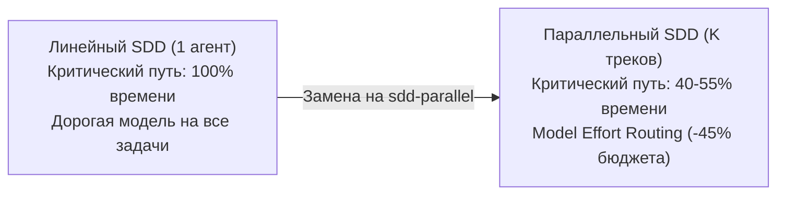

# 📋 SDD-Parallel — Core Product Brief & Executive Summary

**Продукт:** `sdd-parallel` (`parallel-flow`)  
**Категория:** Spec-Driven Concurrency & Blast-Radius Governance Harness  
**Версия:** 0.1.0  
**Назначение:** Документ первого уровня абстракции для C-Level стейкхолдеров, инвесторов, Product Owners и внешних исследователей. Описывает проблему, ценностное предложение, экономику токенов и ключевые продуктовые инварианты без привязки к деталям реализации кода.

---

## 1. Проблема: Линейное бутылочное горлышко агентной разработки (SDD)

Современная разработка с участием ИИ-агентов совершила скачок благодаря методологиям **Spec-Driven Development (SDD)**:
- **BMAD Method (v6/v7)**
- **GitHub Spec Kit (`.specify/`)**
- **GSD (Get Shit Done)**
- **OpenSpec & Beads**

Эти фреймворки гарантируют высокое качество за счёт пре-дизайна, контрактов и замороженных спецификаций. Однако они обладают **фундаментальным архитектурным ограничением**:
> **Все существующие SDD-киты исполняются СТРОГО ЛИНЕЙНО.**
> Входной бэклог из 10–20 историй исполняется по цепочке $T_1 \to T_2 \to \dots \to T_N$. Попытка наивно запустить нескольких агентов в одном репозитории или параллельных ветках неизбежно приводит к:
> 1. **Merge-Bombs в Git:** текстовые конфликты в общих конфигурациях и статусных файлах (`sprint-status.yaml`, `tasks.md`, `STATE.md`).
> 2. **Скрытым семантическим поломкам (Конфликты 2-го рода):** агент А меняет сигнатуру метода в одном модуле, а агент Б параллельно вызывает его старую сигнатуру из другого. Локальные тесты в обеих ветках зеленые, но итоговый билд ломается.
> 3. **Загрязнению рабочего дерева (Dirty Worktree Halts):** агенты создают временные файлы, сбрасывают `git status --porcelain` и блокируют исполнение собственных проверочных скриптов.

В результате команды вынуждены либо ждать часами завершения линейного пайплайна, либо вручную тратить дни на сведение веток.

---

## 2. Продуктовое видение (Product Vision)

**`sdd-parallel`** — это детерминированный надстроечный координационный слой (Safety & Concurrency Harness), который:
1. Автоматически анализирует существующие роадмапы и спецификации любого SDD-фреймворка.
2. Математически рассчитывает взвешенный радиус поражения кода (AST + Call Graph) и строит бесконфликтный Directed Acyclic Graph (DAG) параллельных волн.
3. Разворачивает изолированные `git worktree` со 100% чистым статусом Git.
4. В рантайме блокирует попытки агентов выйти за пределы выделенного скоупа (Runtime Blast-Radius Enforcement).
5. Барьерно объединяет результаты через детерминированный монотонный 3-way слиятель статусов и гейты качества.

**Формула ценности:**  
$$\text{Скорость роя агентов} + \text{Математическая строгость компилятора} - \text{Хаос конфликтов Git}$$

---

## 3. Ключевая ценность (Value Proposition) и ROI

### 1. Сокращение критического пути (Time-to-Ship) в 1.8x–2.5x
Параллельное проведение независимых фич из разных эпиков. Для типового спринта из 12–16 историй время поставки сокращается с 14 часов непрерывной агентной генерации до 5–6 часов за счёт безопасной упаковки в 3–4 волны.

### 2. Гарантия «Zero Merge-Bomb» (100% чистый мерж)
Исключение как синтаксических конфликтов Git ($W_A \cap W_B$), так и семантических нарушений типов ($W_A \cap I_B$). Слияние веток волны происходит автоматически через атомарные чекпоинты.

### 3. Экономика инференса: Model Effort Routing (Экономия 40–60% бюджета)
Большинство мульти-агентных систем гоняют единую флагманскую модель на всех этапах. `sdd-parallel` классифицирует каждую задачу по шкале риска и топологической позиции:
- **`High Effort` (флагманские reasoning-модели):** задачи, модифицирующие схемные ядра (Spine Locks), корневые интерфейсы или имеющие высокий радиус поражения ($I(T) \ge 0.5$).
- **`Medium Effort`:** стандартная изолированная бизнес-логика и адаптеры.
- **`Low Effort` (быстрые легкие модели):** тесты, документация, верстка, локализованные функции.
*Результат:* до 70% задач спринта исполняются быстрыми и экономичными моделями без риска для архитектуры проекта.

### 4. Нулевая инвазивность (Zero Lock-in)
`sdd-parallel` не требует переписывания системных промптов BMAD, Spec Kit или GSD. Он работает как прозрачный внешний супервизор через стандартные интерфейсы ОС, Git и протокол MCP.

---

## 4. Незыблемые инварианты продукта (Core Invariants)

1. **Zero Worktree Pollution:** Внутри изолированного рабочего дерева агента `git status --porcelain` обязан оставаться пустым. Инъекция контекста и локальных правил не загрязняет коммиты и не ломает пайплайны линтеров.
2. **Zero Cache Invalidation:** Оркестратор не инвалидирует `mtime` артефактов планирования (`epic-<N>-context.md`), сохраняя внутренние кеши SDD-фреймворков.
3. **100% Task Coverage:** Ни одна задача из бэклога не теряется, не дублируется и не игнорируется при планировании волн.
4. **Acyclic & Deterministic Execution:** Граф зависимостей и конфликтов гарантированно ацикличен (алгоритмы Кана / Тарьяна). Планирование полностью детерминировано (одинаковый вход дает одинаковый DAG волн).
5. **Blast-Radius Isolation & Three-Tier Guard:** Задачи, изменяющие сигнатуры взаимодействующих функций, физически разводятся по разным волнам, а выход за скоуп блокируется тремя рубежами защиты (PreToolUse, Terminal Guard, OS `chmod a-w`).
6. **Monotonic Progress State & LIFO Rollback:** Статус задачи в артефактах планирования (`backlog` $\to$ `ready-for-dev` $\to$ `in-progress` $\to$ `review` $\to$ `done`) является полурешёткой: слияние веток никогда не откатывает прогресс назад, а откат волн возможен только в строгом LIFO-порядке со страховочной веткой `backup/*`.
7. **Anti-Overfitting (Project-Agnostic Core):** Полный запрет хардкода проектных сущностей, путей и имён файлов в ядре движка. Роли файлов определяются исключительно объективными AST- и топологическими эвристиками.
8. **Fixed Track Slots ($O(1)$ Footprint):** Параметрический пул постоянных слотов `track-<id>` с in-place ресетом (`git checkout -B` + `git clean -fd`) предотвращает накопление папок и ошибку `Missing Folder` в клиентских приложениях.

---

## 5. Матрица целевых персон и сценариев использования

| Роль | Проблема без `sdd-parallel` | Результат с `sdd-parallel` |
| :--- | :--- | :--- |
| **Solo Engineer / Lead** | Агент пишет одну задачу 40 минут. Приходится ждать или переключаться контекстом. | Запуск спринта целиком: 3 параллельных трека делают работу за один обеденный перерыв. |
| **AI Team / Engineering Manager** | Счета за токены растут, а скорость упирается в ручное сведение веток разработчиками. | Сокращение TTM в 2 раза, сокращение расходов за счёт Model Effort Routing, 0 часов на ручные конфликты. |
| **Platform / Harness Maintainer** | Невозможно безопасно распараллелить агентов в корпоративном монорепозитории. | Подключение `sdd-parallel` через MCP к любому агенту (Cursor, Claude Code, Antigravity) с гарантией изоляции. |
