# 🔌 SDD-Parallel — Integration & Ecosystem Specification

**Продукт:** `sdd-parallel` (`parallel-flow`)  
**Категория:** Integration Protocols, Input/Output Contracts & Ecosystem Specification  
**Версия:** 0.1.0  
**Назначение:** Документ третьего уровня абстракции для инженеров интеграции, авторов агентных харнессов и разработчиков адаптеров. Описывает протоколы взаимодействия, входные/выходные форматы данных и правила неинвазивного сопряжения с внешними экосистемами.

---

## 1. Архитектура неинвазивной интеграции (Non-Invasive Adapter Layer)

`sdd-parallel` проектировался с нулевым навязыванием собственного формата спецификаций. Вместо создания очередного «проприетарного формата задач» система использует концепцию **канонической промежуточной модели (Canonical Task IR)**.

```mermaid
flowchart LR
    subgraph SDDKits["Входные экосистемы (Read-Only ACL)"]
        S1["BMAD Method\n(sprint-status.yaml + specs)"]
        S2["GitHub Spec Kit\n(tasks.md + constitution)"]
        S3["GSD (Get Shit Done)\n(phase-*-PLAN.md)"]
        S4["OpenSpec / Beads\n(changes / issues.jsonl)"]
        S5["Любой новый фреймворк\n(Custom Adapter)"]
    end

    subgraph IR["Канонический слой (Canonical IR)"]
        C1["CanonicalTask\n- id, title, epic_id\n- status, priority\n- write_files, read_files\n- depends_on, model_effort"]
    end

    subgraph CoreEngine["Движок sdd-parallel"]
        E1["Conflict Solver & BSP Scheduler"]
    end

    subgraph OutputContracts["Выходные артефакты и Рантаймы"]
        O1[".tmp/track-context.md\n(Контекст воркера)"]
        O2[".parallel-lock.json\n(PreToolUse Guard)"]
        O3["Git Worktrees & Branches"]
        O4["MCP Tool Endpoints\n(FastMCP / stdio)"]
    end

    SDDKits -->|Read-Only Ingestion| IR
    IR --> CoreEngine
    CoreEngine --> OutputContracts
```



### 1.1. Матрица разделения ответственности: Core Engine vs SDD Adapter

Архитектурная граница между ядром и адаптерами строго разделяет доменную специфику SDD-методологий и механизмы параллелизации:

| Подсистема / Операция | Кто отвечает | Архитектурная роль и механизмы |
| :--- | :---: | :--- |
| **Парсинг артефактов и задач** | `SDDAdapter` | Знает структуру файлов конкретного SDD (YAML, Markdown-чеклисты, JSONL). Преобразует разнородные задачи в канонический `TaskNode` (`write_files`, `read_files`, `depends_on`). |
| **Проверка pre-flight блокеров** | `SDDAdapter` | Знает правила готовности: проверка `epic-*-context.md` (BMAD), чистота чек-листов (Spec Kit), отсутствие незакрытых блокировок (Beads). |
| **AST-анализ и роли файлов** | `Core Engine` | 3-проходный статический анализатор (`ASTHotspotScanner`). Находит `SPINE`, `ADDITIVE_REGISTRY` и `STANDARD` модули без привязки к конкретным путям. |
| **Семантический радиус поражения** | `Core Engine` | Вычисляет взвешенный радиус поражения ($W_A \cap I_B$) через `CRGSidecarAdapter` (`code-review-graph v2.3.9` WAL). |
| **Планирование волн (BSP Scheduler)** | `Core Engine` | Детерминированный планировщик `BSPWaveScheduler` с гарантией 100% покрытия задач и ацикличности (алгоритм Кана). |
| **Подготовка слотов ворк-три** | `Core Engine` + `Adapter` | Ядро выделяет слоты `track-<id>` и права ОС (`chmod a-w`). Адаптер поставляет `get_allowed_write_globs()` и `get_forbidden_files()`. |
| **Инструкции запуска воркеров** | `SDDAdapter` | Формирует нативную команду для инструмента (`/bmad-build`, `/speckit.implement`, `/gsd-execute-phase`, `/openspec-apply`, `bd update`). |
| **Многоуровневый Scope Guard** | `Core Engine` | Перехватывает вызовы `PreToolUse`, терминальные команды (`Bash`, `run_command`) и предотвращает выход агента за пределы скоупа. |
| **3-Way слияние статусов задач** | `SDDAdapter` + `Core` | Ядро оркеструет Git-слияние; специализированный монотонный резолвер (`status_merger.py`) объединяет статусы без маркеров конфликта. |
| **Транзакционный откат волн (LIFO)** | `Core Engine` + `Adapter` | Ядро создаёт страховочную ветку `backup/wave-<K>-before-rollback-*` и возвращает `HEAD`; адаптер полиморфно сбрасывает статусы задач. |

### 1.2. Протокол сосуществования нескольких китов (Multi-Kit Coexistence) и изоляция

При наличии в проекте артефактов сразу нескольких SDD-фреймворков (например, завершённый `_bmad-output/` и активный `.specify/` от GitHub Spec Kit):
1. **Явная конфигурация:** Флаг `--kit <name>` в CLI или ключ `"default_kit"` в `.parallel-config.json` / `pyproject.toml` обладают абсолютным приоритетом.
2. **Эвристика активных задач (`kit="auto"`):** Авторезолвер опрашивает каждый обнаруженный адаптер через `load_tasks(include_done=False)`. Активируется первый фреймворк с незавершёнными задачами (`len(active_tasks) > 0`).
3. **Диагностические предупреждения:** Функция `diagnose_multi_kit_coexistence()` выводит понятное сообщение оператору о найденных альтернативных фреймворках без блокировки конвейера.
4. **Кросс-фреймворковая изоляция:** При генерации `.parallel-lock.json` каталоги всех неактивных SDD-систем автоматически добавляются в `forbidden_files` с причиной `"Locked by inactive SDD framework sandboxing"`, исключая повреждение чужих спецификаций параллельными агентами.

---

## 2. Спецификация входных адаптеров (Input Adapters)

Все адаптеры реализуют контракт чтения в режиме **Read-Only ACL**. Они никогда не модифицируют исходные спецификации во время планирования, сохраняя `mtime` файлов и кэш контекстов.

### 2.1. BMAD Method Adapter
- **Целевые файлы:** `_bmad-output/implementation-artifacts/sprint-status.yaml`, `epics.md`, `spec-*.md`.
- **Извлекаемые данные:**
  - Идентификатор истории (например, `11-2`, `14-1`) и текущий статус разработки.
  - Поле `## Code Map` из сгенерированных спек: извлечение путей `write_files` и `read_files`.
  - Зависимости по данным из `epic-<N>-context.md`.
- **Защита кэша:** Все результаты расчетов сохраняются в `.parallel/` или `_bmad-output/parallel-artifacts/`, не сбрасывая кеши BMAD.

### 2.2. GitHub Spec Kit Adapter
- **Целевые файлы:** `.specify/specs/*/tasks.md`, `.specify/memory/constitution.md`.
- **Извлекаемые данные:**
  - Задачи формата `- [ ] Task ID: Description`.
  - Маркеры параллелизма `[P]` (автоматически верифицируются через графовый анализ: если разработчик ошибочно поставил `[P]` на пересекающиеся задачи, `sdd-parallel` предотвратит конфликт).
  - Ссылки на правила архитектурной конституции для определения `Spine Lock` файлов.

### 2.3. GSD (Get Shit Done) — Режим «Artifact Hijack»
- **Целевые файлы:** `.planning/{phase}-*-PLAN.md`.
- **Проблема GSD:** Нативный GSD выполняет задачи в единой рабочей директории без Git Worktree, что приводит к порче `.planning/STATE.md` при конкурентных запусках.
- **Решение `sdd-parallel` (Artifact Hijack):** Адаптер считывает секции `files_modified` и `depends_on` из планов GSD, но исполняет их в физически изолированных рабочих деревьях, полностью изолируя `.planning/STATE.md`.

### 2.4. OpenSpec & Beads Adapters
- **OpenSpec:** Чтение директории `openspec/changes/` (манифесты `proposal.md`, `tasks.md`).
- **Beads:** Чтение потокового JSONL-лога задач `.beads/issues.jsonl` со связями `blocks` / `blocked_by`.

### 2.5. Сводная матрица защиты, изоляции и слияния 5 SDD-экосистем

| SDD-фреймворк (`kit`) | Входные дорожные карты / задачи | Разрешённые файлы метаданных (`allowed_write_globs`) | Защищённые файлы (`forbidden_files`) | Стратегия 3-way merge статусов | Команда воркера (`run-guide`) |
| :--- | :--- | :--- | :--- | :--- | :--- |
| **BMAD Method** (`bmad`) | `sprint-status.yaml`, `epics.md`, `spec-*.md` | `sprint-status.yaml`, `spec-{sid}*.md` | `epic-*-context.md` (*Zero Cache Invalidation*) | `merge_sprint_status_yaml` (монотонный $\max(\text{rank})$) | `/bmad-build <id>` |
| **GitHub Spec Kit** (`spec-kit`) | `.specify/specs/**/tasks.md` | `tasks.md`, `checklists/**` | `.specify/memory/constitution.md`, `spec.md`, `plan.md` | `merge_markdown_task_checklists` (монотонный `[x]`) | `/speckit.implement <id>` |
| **GSD** (`gsd`) | `.planning/phases/*-PLAN.md` | `.planning/phases/**` | `STATE.md`, `ROADMAP.md`, `PROJECT.md`, `REQUIREMENTS.md` | Изоляция в worktree (*Artifact Hijack*) | `/gsd-execute-phase <id>` |
| **OpenSpec** (`openspec`) | `openspec/changes/*/tasks.md` | `openspec/changes/{sid}/**` | `openspec/project.md`, `openspec/specs/**`, соседние changes | `merge_markdown_task_checklists` (монотонный `[x]`) | `/openspec-apply <id>` |
| **Beads** (`beads`) | `.beads/issues.jsonl` | `.beads/issues.jsonl` | `.beads/config.yaml` | `merge_beads_issues_jsonl` (монотонный по ID) | `bd update <id> --status in-progress` |

---

## 3. Спецификация выходных контрактов и IPC

### 3.1. Контракт контекста рабочего дерева (`.tmp/track-context.md`)
Генерируется в каждом изолированном `git worktree`. Монтируется в постоянную память агента через конфигурацию хоста.

```markdown
# PARALLEL TRACK CONTEXT BOUNDARY (ENFORCED)
- **Wave:** 1 | **Track:** track-a | **Assigned Stories:** 11-2
- **Recommended Model Effort:** high

## 1. Allowed Exclusive Write Scope
- `src/canonical/intervals.py`
- `tests/test_intervals.py`

## 2. Shared Additive Registries (Isolated Append Scope)
- `src/canonical/normalizer.py` (Scope: функция `_classify_reads` only)

## 3. Forbidden Files (Locked by Sibling Tracks in Wave 1)
- `src/canonical/manifest.py` (Locked by sibling track-b)
- `src/storage/schema.py` (Spine Lock Chain)
```

### 3.2. Манифест рантайм-блокировок (`.parallel-lock.json`)
Машиночитаемый манифест для мгновенной валидации прав на запись в хуках рантайма:

```json
{
  "wave_id": 1,
  "track_id": "track-a",
  "stories": ["11-2"],
  "allowed_write_globs": [
    "src/canonical/intervals.py",
    "src/canonical/normalizer.py",
    "tests/**"
  ],
  "additive_shared_files": [
    "src/canonical/normalizer.py"
  ],
  "forbidden_files": {
    "src/canonical/manifest.py": "Locked by track-b",
    "src/storage/schema.py": "Locked by Spine Chain"
  }
}
```

---

## 4. Спецификация интерфейсов оркестратора

### 4.1. CLI Интерфейс
Оркестратор предоставляет полный набор детерминированных команд:
- `sdd-parallel plan [--kit auto|bmad|spec-kit|gsd|openspec|beads] [--max-tracks K]`
  - Выполняет анализ графа, строит волны и сохраняет `wave-plan.json`.
- `sdd-parallel prepare --wave N [--dynamic-worktrees]`
  - Инициализирует постоянные слоты `track-<id>` с in-place сбросом (`git checkout -B` + `git clean -fd`), настраивает `info/exclude`, генерирует `.tmp/track-context.md`, `.parallel-lock.json` и накладывает OS read-only локи (`chmod a-w`). Флаг `--dynamic-worktrees` включает легаси-режим изолированных папок на каждую волну.
- `sdd-parallel run-guide --wave N`
  - Формирует форматированную матрицу запуска воркеров с путями и готовыми командами для оператора.
- `sdd-parallel verify-wave --wave N`
  - Верифицирует скоуп в активных треках, проверяя `PreToolUse` локи, отсутствие нарушений Terminal Guard и полный `git diff` против `merge-base` перед слиянием.
- `sdd-parallel merge --wave N [--cleanup] [--strict-gates] [--skip-gates]`
  - Запускает полиморфные гейты качества (Python, Node/TS, Rust, Go или `.parallel-config.json`), применяет транзакционный авто-откат при сбое гейта, выполняет барьерное слияние веток треков в основную ветку и применяет монотонный 3-way merger для статусных файлов.
- `sdd-parallel abort-wave --wave N`
  - Удаляет временные ветки треков и снимает блокировки неподмерженной волны.
- `sdd-parallel rollback-wave --wave N [--save-backup]`
  - Транзакционный LIFO-откат подмерженной волны с автоматической резервной веткой `backup/*` и полиморфным сбросом статусов задач.
- `sdd-parallel check-lock --file <path> [--tool <tool_name>]`
  - Диагностическая проверка прав доступа к файлу через рантайм-хук.

### 4.2. Протокол Model Context Protocol (MCP Server)
Для интеграции с Cursor, Windsurf, Claude Desktop, Antigravity и OpenHands `sdd-parallel` экспортирует стандартные инструменты MCP по протоколу JSON-RPC (stdio):
- **`sdd_plan_waves(scope, max_tracks)`**: Возвращает JSON-структуру волн с расчетом Model Effort для каждой задачи.
- **`sdd_prepare_track(wave, track)`**: Автоматически создает изолированное рабочее дерево и возвращает безопасные границы контекста.
- **`sdd_verify_and_merge(wave)`**: Запускает верификацию и выполняет бесконфликтное барьерное слияние.

---

## 5. Протокол расширения (Adding a New Framework)

Для добавления поддержки любого нового фреймворка требуется реализовать класс-адаптер в соответствии с единым типизированным протоколом `SDDAdapterProtocol` (`src/sdd_parallel/adapters/__init__.py`):

```python
class SDDAdapterProtocol(Protocol):
    """Единый полиморфный контракт расширения для всех поддерживаемых SDD-фреймворков."""

    kit_id: str

    def detect(self) -> bool:
        """Определяет, используется ли данный фреймворк в репозитории."""
        ...

    def load_tasks(self, include_done: bool = False) -> list[TaskNode]:
        """Парсит задачи и преобразует их в канонические задачи TaskNode."""
        ...

    def check_wave_zero_blockers(self, wave: Wave | None = None) -> list[str]:
        """Проверяет специфичные для фреймворка предусловия перед стартом волны."""
        ...

    def get_allowed_write_globs(self, track: WaveTrack) -> list[str]:
        """Возвращает шаблоны путей метаданных, разрешённых для записи внутри ворк-три."""
        ...

    def get_forbidden_files(self, wave: Wave, track: WaveTrack) -> dict[str, str]:
        """Возвращает словарь {rel_path: reason} защищённых файлов и канонических спецификаций."""
        ...

    def render_worker_command(self, track: WaveTrack) -> str:
        """Формирует команду запуска воркера для шпаргалки run-guide и Autopilot."""
        ...

    def reset_tasks_status(
        self,
        task_ids: Sequence[str],
        target_status: str = "ready-for-dev",
    ) -> None:
        """Полиморфно сбрасывает статус задач при транзакционном LIFO-откате волны."""
        ...

    def cleanup_wave_artifacts(
        self,
        wave_id: int,
        task_ids: Sequence[str],
    ) -> None:
        """Очищает промежуточные спеки и артефакты волны при откате."""
        ...
```

### 5.1. Пошаговое руководство: как создать новый SDD-адаптер в 1 файле

Чтобы подключить любую стороннюю или кастомную методологию (например, `CustomKit`), достаточно создать один файл `src/sdd_parallel/adapters/custom_kit.py`:

```python
from pathlib import Path
from collections.abc import Sequence
from sdd_parallel.models import TaskNode, TaskStatus, EffortTier, Wave, WaveTrack

class CustomKitAdapter:
    kit_id = "custom-kit"

    def __init__(self, repo_root: Path) -> None:
        self.repo_root = repo_root.resolve()

    def detect(self) -> bool:
        return (self.repo_root / ".custom-kit" / "tasks.json").is_file()

    def load_tasks(self, include_done: bool = False) -> list[TaskNode]:
        # Парсим .custom-kit/tasks.json и маппим задачи в TaskNode
        return [
            TaskNode(
                id="task-1",
                title="Реализация фичи",
                status=TaskStatus.READY_FOR_DEV,
                write_files=["src/feature.py"],
                read_files=["src/core.py"],
                depends_on=[],
                model_effort=EffortTier.MEDIUM,
            )
        ]

    def check_wave_zero_blockers(self, wave: Wave | None = None) -> list[str]:
        return []

    def get_allowed_write_globs(self, track: WaveTrack) -> list[str]:
        return [".custom-kit/tasks.json"]

    def get_forbidden_files(self, wave: Wave, track: WaveTrack) -> dict[str, str]:
        return {".custom-kit/config.json": "Locked by CustomKit governance"}

    def render_worker_command(self, track: WaveTrack) -> str:
        return f"`custom-kit-run {track.task_ids[0]}`"

    def reset_tasks_status(self, task_ids: Sequence[str], target_status: str = "ready-for-dev") -> None:
        pass

    def cleanup_wave_artifacts(self, wave_id: int, task_ids: Sequence[str]) -> None:
        pass
```

После регистрации нового класса в `detect_sdd_kits()` и `_instantiate_adapter()` в `src/sdd_parallel/adapters/__init__.py`, благодаря полиморфной модели `TaskNode` планировщик волн, AST-сканер, сайдкар графа ревью и менеджер ворк-три работают с новым фреймворком **без модификации ядра движка**.
