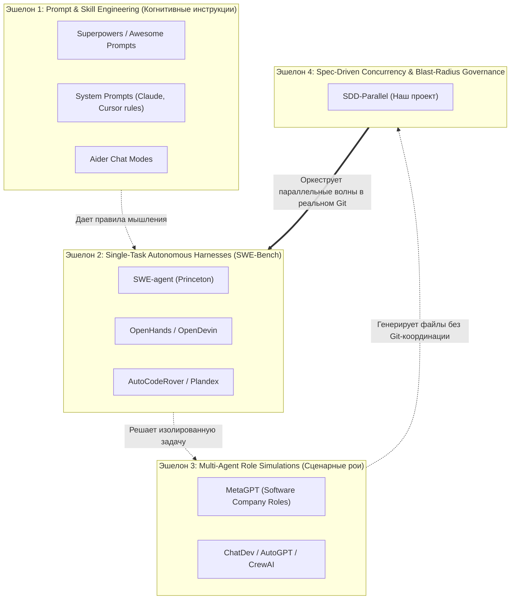

# 🔬 SDD-Parallel — Competitive & Benchmark Taxonomy

**Продукт:** `sdd-parallel` (`parallel-flow`)  
**Категория:** Market Taxonomy, Ecosystem Benchmark & Comparative Analysis  
**Версия:** 0.1.0  
**Назначение:** Документ четвертого уровня абстракции для AI-исследователей, аналитиков и авторов бенчмарков. Предоставляет строгую таксономию рынка агентной разработки, классифицирует популярные open-source фреймворки (10k–300k+ звёзд на GitHub) и формулирует методику доказательного тестирования.

---

## 1. Четырехэшелонная таксономия рынка AI-кодинга (Market Tiers)

Попытка напрямую сравнивать `sdd-parallel` с крупными open-source проектами часто наталкивается на **категориальную ошибку**: инструменты с сотнями тысяч звезд решают совершенно другие задачи в стеке разработки.

Рынок делится на 4 изолированных эшелона:

---

## 2. Анализ популярных open-source фреймворков и их слепые зоны

### 2.1. Эшелон 1: Промпт-фреймворки и скиллы (Superpowers, Cursor Rules, Aider)
- **Суть решений:** Наборы детальных системных инструкций, шаблонов рассуждений и правил форматирования ответов для LLM.
- **Сильная сторона:** Улучшают качество кода на уровне одиночной сессии или отдельной функции.
- **Слепая зона:** Полное отсутствие осведомленности об операционной системе, изоляции каталогов и контроле параллелизма в Git. Если запустить несколько агентов под управлением Superpowers в одном репозитории, они мгновенно сломают `git status` и создадут текстовые конфликты.

### 2.2. Эшелон 2: Автономные агенты решения багов (SWE-agent, OpenHands / OpenDevin, Aider)
- **Суть решений:** Однопоточные агентные обертки вокруг терминала/песочницы, оптимизированные под бенчмарк SWE-bench (исправление одного GitHub Issue за раз).
- **Сильная сторона:** Высокий процент прохождения SWE-bench, отличная работа с Docker-песочницами.
- **Слепая зона:** Они не предназначены для командной работы над роадмапом из 20 связанных историй. У них нет понятия «волны спринта», они не умеют читать спецификации BMAD или Spec Kit и не предотвращают конфликты 2-го рода между несколькими одновременно работающими агентами.
- **Возможность симбиоза:** `sdd-parallel` может выступать оркестратором, который разворачивает worktree и запускает экземпляры OpenHands / SWE-agent в качестве параллельных воркеров внутри волны.

### 2.3. Эшелон 3: Мульти-агентные ролевые симуляторы (MetaGPT, ChatDev, AutoGPT)
- **Суть решений:** Имитация ролей человеческой компании (Product Manager $\to$ Architect $\to$ Project Manager $\to$ Engineer $\to$ QA) через обмен сообщениями между агентами.
- **Сильная сторона:** Отличная концептуальная декомпозиция задач «с чистого листа» (greenfield).
- **Слепая зона:** Оторванность от продакшн-инженерии существующих кодовых баз (brownfield). Они генерируют проект целиком в пустую папку, но не умеют инкрементально коммитить в большой Git-репозиторий с 500k строками кода, миграциями БД и сложным графом типов.

### 2.4. Спецификационные фреймворки (BMAD Method, GitHub Spec Kit, GSD)
- **Суть решений:** Глубокая инженерия требований, замороженные контракты, валидация границ.
- **Слепая зона:** **Строгая линейность исполнения.** Они созданы под одного агента, работающего последовательно.

---

## 3. Сравнительная матрица функциональных возможностей

| Возможность / Критерий | Prompt / Skills (Superpowers) | SWE Harness (OpenHands, SWE-agent) | Multi-Agent Sim (MetaGPT, ChatDev) | SDD Kits (BMAD, Spec Kit) | **SDD-Parallel** |
| :--- | :---: | :---: | :---: | :---: | :---: |
| **Управление роадмапом спринта** | ❌ | ❌ (1 Issue) | ⚠️ (Внутренний) | ✅ (Линейно) | **✅ (Параллельный DAG)** |
| **Конфликты 1-го рода ($W_A \cap W_B$)** | ❌ | ❌ | ❌ | ⚠️ (Только линейно) | **✅ (AST Hotspots)** |
| **Конфликты 2-го рода ($W_A \cap I_B$)** | ❌ | ❌ | ❌ | ❌ | **✅ (CRG Impact Radius)** |
| **Изоляция в `git worktree`** | ❌ | ⚠️ (Docker-only) | ❌ | ❌ | **✅ (Zero-Pollution)** |
| **Чистый статус Git (`100% Clean`)** | ❌ | ❌ | ❌ | ⚠️ (Частично) | **✅ (`info/exclude`)** |
| **Рантайм-перехват (Scope Guard)** | ❌ | ❌ | ❌ | ❌ | **✅ (Three-Tier Scope Guard)** |
| **3-Way Merger статусов без конфликтов** | ❌ | ❌ | ❌ | ❌ | **✅ (Monotonic YAML)** |
| **Model Effort Routing (High/Low)** | ❌ | ❌ | ⚠️ (По ролям) | ❌ | **✅ (По риску кода)** |

---

## 4. Методология доказательного тестирования (Benchmark Methodology)

Для независимой валидации превосходства `sdd-parallel` над альтернативами исследовательский агент должен применять стандартизированный бенчмарк:

### Тест 1: «Семантическая мина» (The Merge-Bomb Benchmark)
- **Сценарий:** Берутся две параллельные истории, работающие над зависимыми компонентами.
  - Задача А: Рефакторит сигнатуру функции нормализации в `normalizer.py` (изменяет тип с `str` на `str | None`).
  - Задача Б: Реализует новый API-эндпоинт в `api.py`, вызывающий эту функцию.
- **Результаты:**
  - *Обычный рой (Superpowers / MetaGPT / ручные ветки):* Обе задачи успешно коммитят код. Локальные тесты в ветках зеленые. При слиянии веток синтаксического конфликта Git нет, но линтер `mypy --strict` и интеграционные тесты падают с фатальной ошибкой.
  - *SDD-Parallel:* Оркестратор обнаруживает семантическое пересечение ($W_A \cap I_B \neq \emptyset$) на этапе AST/CRG анализа и принудительно разносит задачи по последовательным волнам. 0 ошибок в продакшне.

### Тест 2: Коэффициент ускорения критического пути (Speedup Factor)
- **Формула:**
  $$S = \frac{T_{\text{linear}}}{T_{\text{parallel}}}, \quad \text{где } T_{\text{parallel}} = \sum_{w=1}^{W} \max_{k} (t_{w, k}) + \sum t_{\text{merge}}$$
- **Ожидаемый бенчмарк:** На бэклоге из 12–16 задач ускорение $S \ge 1.8\times$.

### Тест 3: Экономическая эффективность (Token Efficiency)
- **Формула:**
  $$E = \frac{\text{Стоимость вызовов моделей (USD)}}{\text{Количество принятых фич}}$$
- За счёт `Model Effort Routing` стоимость спринта с `sdd-parallel` на 40–50% ниже, чем при прогоне всего спринта на монолитной флагманской модели.
