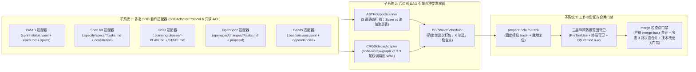

# 🏛️ SDD-Parallel — 系统架构单一可信源 (SSOT)

<p align="center">
  <b>🌐 语言 / Language:</b>
  <a href="../../../ARCHITECTURE.md">English</a> |
  <b>简体中文</b> |
  <a href="../es/ARCHITECTURE.md">Español</a> |
  <a href="../pt-BR/ARCHITECTURE.md">Português (BR)</a> |
  <a href="../ja/ARCHITECTURE.md">日本語</a> |
  <a href="../ko/ARCHITECTURE.md">한국어</a> |
  <a href="../ru/ARCHITECTURE.md">Русский</a>
</p>

**版本:** 0.1.0  
**状态:** 已批准架构核心基线 (SSOT)

---

## 1. 架构模块概览 (Architectural Module Overview)

`sdd-parallel` 系统由三个低耦合子系统组成，通过标准任务图模型（`src/sdd_parallel/models.py`）统一编排：



### 1.1. 六边形适配器架构与 `SDDAdapterProtocol`

遵循端口与适配器（六边形架构）原则，`sdd-parallel` 核心引擎与所有规范驱动开发（SDD）框架的交互严格受限于强类型协议 `SDDAdapterProtocol`（`src/sdd_parallel/adapters/__init__.py`）。核心引擎不包含任何领域路径硬编码或特定套件分支：

```python
class SDDAdapterProtocol(Protocol):
    """所有支持的 SDD 框架必须实现的多态扩展契约。"""

    kit_id: str

    def detect(self) -> bool:
        """检测代码仓库中是否存在该 SDD 框架的标记。"""
        ...

    def load_tasks(self, include_done: bool = False) -> list[TaskNode]:
        """解析路线图/迭代积压制品为标准 TaskNode 模型。"""
        ...

    def check_wave_zero_blockers(self, wave: Wave | None = None) -> list[str]:
        """校验框架特定的前置条件（Git 状态干净、已编译上下文、清单完整）。"""
        ...

    def get_allowed_write_globs(self, track: WaveTrack) -> list[str]:
        """返回工作树中允许修改的框架元数据 Glob 模式。"""
        ...

    def get_forbidden_files(self, wave: Wave, track: WaveTrack) -> dict[str, str]:
        """映射框架特定的受保护契约与不可变规范文件。"""
        ...

    def render_worker_command(self, track: WaveTrack) -> str:
        """为操作员运行指南和 Autopilot 模式生成原生 CLI 命令。"""
        ...

    def reset_tasks_status(
        self,
        task_ids: Sequence[str],
        target_status: str = "ready-for-dev",
    ) -> None:
        """在事务性 LIFO 波次回滚时多态重置任务状态。"""
        ...

    def cleanup_wave_artifacts(
        self,
        wave_id: int,
        task_ids: Sequence[str],
    ) -> None:
        """清理波次执行期间生成的临时规范与制品。"""
        ...
```

### 1.2. 职责划分矩阵：通用核心引擎 vs 多态套件适配器

架构边界清晰隔离了框架特定的解析与通用的并发控制机制：

| 阶段 / 关注点 | 负责子系统 | 架构角色与核心机制 |
| :--- | :---: | :--- |
| **制品解析与任务模型转换** | `SDDAdapter` | 解析套件特定格式（YAML、Markdown 清单、JSONL）。将任务转换为标准 `TaskNode` 对象（`write_files`, `read_files`, `depends_on`）。 |
| **前置波次阻塞项校验** | `SDDAdapter` | 执行套件特定的就绪检查（`check_wave_zero_blockers`）：Git 干净状态、BMAD 上下文完整性、Spec Kit 清单规范。 |
| **AST 文件角色分类** | `Core Engine` | 3 遍静态分析器（`ASTHotspotScanner`），无需硬编码路径即可识别 `SPINE`、`ADDITIVE_REGISTRY` 与 `STANDARD` 模块。 |
| **语义影响半径计算** | `Core Engine` | 使用 `CRGSidecarAdapter`（`code-review-graph v2.3.9` WAL）计算加权调用图爆炸半径（$W_A \cap I_B$）。 |
| **波次划分 (BSP 调度器)** | `Core Engine` | 确定性 `BSPWaveScheduler` 算法，保证 100% 任务覆盖率与 Kahn 无环性。 |
| **工作树槽位分配** | `Core Engine` + `Adapter` | 引擎分配固定槽位 `track-<id>` 并设置系统权限（`chmod a-w`）。适配器提供 `get_allowed_write_globs()` 与 `get_forbidden_files()`。 |
| **智能体启动指令生成** | `SDDAdapter` | 生成原生智能体命令（`/speckit.implement`、`/gsd-execute-phase`、`/opsx:apply`、`bd update`、`/bmad-build`）。 |
| **多层范围守卫** | `Core Engine` | 拦截 `PreToolUse` 调用、终端命令拦截（`Bash`, `run_command`）并施加 OS 只读锁。 |
| **3 路单调状态合并** | `SDDAdapter` + `Core` | 引擎编排屏障 Git 合并；专用半格合并器（`status_merger.py`）实现零冲突标记的状态合并。 |
| **事务性 LIFO 回滚** | `Core Engine` + `Adapter` | 引擎创建安全备份分支（`backup/wave-<K>-before-rollback-*`）并重置 `HEAD`；适配器多态还原任务状态。 |

### 1.3. 多套件共存与非活动沙箱隔离协议

实际企业级仓库常包含多个 SDD 框架的制品（例如历史 `_bmad-output/` 与现行 GitHub Spec Kit `.specify/` 并存）：
1. **显式优先级：** `--kit <name>` CLI 参数或 `.parallel-config.json` 中的 `"default_kit"` 拥有最高优先级。
2. **活动任务启发式检测 (`kit="auto"`)：** 自动解析器通过 `load_tasks(include_done=False)` 查询所有检测到的框架，激活首个包含未完成任务（`len(active_tasks) > 0`）的框架。
3. **诊断遥测：** `diagnose_multi_kit_coexistence()` 在不阻断流程的前提下向操作员发出多套件共存提示。
4. **跨框架沙箱锁定：** 构建 `.parallel-lock.json`（`build_lock_manifest`）时，所有**非活动** SDD 框架的目录会自动加入 `forbidden_files`，并标记原因 `"Locked by inactive SDD framework sandboxing"`。

---

## 2. 数学冲突模型与文件分类法 (Mathematical Conflict Model)

对于每个未完成的任务 $T_i$，引擎评估：
- $W(T_i)$ — 该任务**修改或创建**的文件集合（`write_files`）。
- $R(T_i)$ — 该任务作为前置依赖**读取或导入**的文件集合（`read_files`）。
- $I(T_i)$ — 围绕 $W(T_i)$ 的**加权影响半径**，由 `CRGSidecarAdapter` 计算（`code-review-graph v2.3.9`，直接解析模式，衰减系数 $\gamma = 0.7$）。

### 2.1. 代码库的三类文件角色

1. **核心骨干文件 (`FileRole.SPINE`):**
   - 数据库 Schema 定义、全局核心抽象、以及顺序执行的数据库迁移链（例如包含 `SCHEMA_VERSION`、`auto_migrate` 的模块或核心实体 `schema.py`/`models.py`）。
   - **规则：** 修改同一个 `SPINE` 文件的任务**绝不排入同一波次**，强制串行化依赖。
2. **共享追加注册表 (`FileRole.ADDITIVE_REGISTRY`):**
   - 供不同功能独立追加命令或端点的顶层入口（如带有 `@app.command` 的 `cli.py`，带有 `@mcp.tool` 的 `mcp/server.py`，定义 `__all__` 的 `__init__.py`）。
   - *架构不变量 (ADR-0002)：* 共享格式化工具库（`console.py`, `markdown.py`）严格排除在追加注册表外，归类为 `FileRole.STANDARD`。
   - **规则：** 仅在真实 `ADDITIVE_REGISTRY` 文件上产生交集且互不影响的任务，**允许在不同工作树槽位中并行执行**，并在 `.tmp/track-context.md` 中注入仅追加指引。
3. **标准业务模块 (`FileRole.STANDARD`):**
   - 业务逻辑、普通适配器、展现层模块。
   - **规则：** 任何交集 $W(A) \cap W(B) \neq \emptyset$ 均阻止同波次并发。`STANDARD` 文件从不豁免影响半径计算。

### 2.2. 三遍静态 AST 分析流水线 (`ASTHotspotScanner`)

根据 **Invariant 7（反过度拟合与通用抽象）**，文件角色纯动态计算：
1. **第 1 遍（签名解析）：** 扫描迁移关键字（`SCHEMA_VERSION`, `auto_migrate`）识别 Schema 核心。
2. **第 2 遍（导入图与装饰器遍历）：** 遍历 `Import`/`ImportFrom` 节点计算入度中心度（Fan-In），并检查装饰器（`command`, `tool`, `get`, `post`）。
3. **第 3 遍（确定性分类）：**
   - 测试文件（`tests/`）$\to$ 始终为 `STANDARD`。
   - `SPINE`：若含有 Schema 关键字 $\lor$ 文件名为 `models.py`/`schema.py` $\lor$ **入度中心度 $\ge 5$**。
   - `ADDITIVE_REGISTRY`：若包含注册装饰器 $\lor$ 文件名为 `cli.py`/`__init__.py`。
   - `STANDARD`：其余所有业务模块。

### 2.3. 冲突图边类型 (`ConflictEdge`)

1. **`EXPLICIT_DEP`（显式有向依赖 $A \to B$）：** 路线图中声明的显式任务依赖。
2. **`SPINE_ORDER`（骨干链有向依赖 $A \to B$）：** 修改同一 `SPINE` 文件的顺序链路。
3. **`DIRECT_COLLISION`（无向文件写冲突 $A \leftrightarrow B$）：** $W(A) \cap W(B) \setminus \text{AdditiveRegistries} \neq \emptyset$。禁止同波次执行。
4. **`SEMANTIC_COLLISION`（二类语义冲突 $A \leftrightarrow B$）：** $(W(A) \cap I(B)) \cup (W(B) \cap I(A)) \neq \emptyset$。任务 A 改变了任务 B 直接调用的外部接口。

---

## 3. 关键运行时契约制品 (Runtime Artifact Contracts)

### 3.1. 工作树上下文契约 (`.tmp/track-context.md`)

由 `sdd-parallel prepare --wave K` 生成并注入智能体上下文：

```markdown
# PARALLEL TRACK CONTEXT BOUNDARY (ENFORCED)
- **Wave:** 1 | **Track:** track-a | **Assigned Stories:** 11-2
- **Recommended Model Effort:** high

## 1. Allowed Exclusive Write Scope
- `src/canonical/intervals.py`
- `tests/test_intervals.py`

## 2. Shared Additive Registries (Isolated Append Scope)
- `src/canonical/normalizer.py` (Scope: function `_classify_reads` only)

## 3. Forbidden Files (Locked by Sibling Tracks in Wave 1)
- `src/canonical/manifest.py` (Locked by track-b)
- `src/storage/schema.py` (Spine Lock Chain)
```

### 3.2. 运行时范围锁定清单 (`.parallel-lock.json`)

供 `PreToolUse` 钩子进行亚毫秒级判定的机器可读清单：

```json
{
  "wave_id": 1,
  "track_id": "track-a",
  "stories": ["11-2"],
  "repo_root": "/workspace/project",
  "worktree_root": "/workspace/project/.worktrees/track-a",
  "allowed_write_globs": [
    "src/canonical/intervals.py",
    "src/canonical/normalizer.py",
    "tests/**",
    ".tmp/**"
  ],
  "additive_shared_files": [
    "src/canonical/normalizer.py"
  ],
  "forbidden_files": {
    "src/canonical/manifest.py": "Locked by track-b (story 11-3)",
    "src/storage/schema.py": "Locked by Spine Chain"
  }
}
```

---

## 4. 非侵入式技术机制与 5 套件支持 (Non-Invasive Mechanisms)

### 4.1. 工作树零污染注入机制

确保智能体在任何 SDD 框架下均以 `git status --porcelain == ""` 启动：
1. 编排上下文写入 `.tmp/track-context.md`（`.tmp/` 纳入 `.gitignore`）。
2. 锁定清单写入 `.parallel-lock.json`（纳入 `.gitignore`）。
3. 局部工作树忽略规则写入 `.git/worktrees/<name>/info/exclude`。
4. 环境变量（如 GitHub Spec Kit 的 `SPECIFY_FEATURE`）通过进程环境注入，不落盘产生脏改动。

### 4.2. 前置契约审计与不可变规范保护

在波次规划前，审计就绪状态并对规范文件实施只读保护（`FORBIDDEN_STATE_FILES`）：
- **GitHub Spec Kit：** 保护 `.specify/memory/constitution.md`、`.specify/feature.json`、`spec.md`、`plan.md`。
- **GSD (Get Shit Done)：** 保护 `.planning/STATE.md`、`ROADMAP.md`、`PROJECT.md`。
- **OpenSpec：** 保护 `openspec/project.md`、`openspec/specs/**`、`openspec/config.yaml`。
- **Beads：** 保护 `.beads/config.yaml` 与 `.beads/metadata.json`。
- **BMAD Method：** 校验并保护编译好的 `epic-<N>-context.md`。

### 4.3. 基于 `CRGSidecarAdapter` 的语义爆炸半径分析

1. **主仓库锚定：** 使用 `main_repo_root` 初始化 `code-review-graph`，规避工作树路径不匹配异常。
2. **WAL 模式兼容：** 支持 SQLite WAL 模式，确保多进程安全并发读取。
3. **噪声抑制：** 设置 `min_impact_score=0.5` 过滤多态解析虚警。

### 4.4. 多态确定性 3 路状态合并器

在波次屏障合并时（`sdd-parallel merge --wave K`），无缝整合不同框架的任务状态：
1. **BMAD (`sprint-status.yaml`):** 按单调半格秩合并：$\texttt{backlog} (0) < \texttt{ready-for-dev} (1) < \texttt{in-progress} (2) < \texttt{review} (3) < \texttt{done} (4)$，保留 YAML 原始排版与注释。
2. **GitHub Spec Kit 与 OpenSpec (`tasks.md` Markdown 清单):** 对齐 `- [ ]` 与 `- [x]` 任务行，任意分支完成即提升为 `[x]`，零冲突标记。
3. **Beads (`.beads/issues.jsonl`):** 流式解析 JSONL 记录，按任务 ID 单调推进状态（`open < in-progress < closed`）。
4. **UTF-8 BOM 兼容保护 (`utf-8-sig`):** 所有 I/O 均处理 Windows PowerShell 的 BOM 标记（`\ufeff`）。

### 4.5. 固定轨道槽位 (`track-<id>`) 与就地复位 ($O(1)$ 空间占用)

维护固定的 $K = \text{max\_tracks}$ 个永久槽位（`track-a`, `track-b`）：
- 消除反复创建/销毁目录带来的磁盘膨胀与 IDE 报丢目录问题。
- 通过原子指令就地重置分支：`git checkout -B parallel/<track_id> master ; git clean -fd`。

### 4.6. 三层纵深防御范围守卫

1. **第一层 (PreToolUse 钩子):** 亚毫秒级拦截文件修改工具（`write_file`, `edit_file`）。
2. **第二层 (Terminal Guard):** 拦截终端 Shell 工具（`Bash`, `run_command`），阻断重定向（`>`）或行编辑器（`sed -i`）越权改动。
3. **第三层 (OS 只读锁):** 结合 `chmod a-w` 与 `git config core.fileMode false`，在操作系统文件系统层面直接阻断未授权写入。
4. **验证门禁 (`verify_wave`):** 在合并前执行 `git diff $(git merge-base master HEAD)...HEAD` 多提交穿透审计。

### 4.7. LIFO 事务性波次回滚引擎

- **`abort-wave --wave K`：** 清理未合并的临时槽位和分支。
- **`rollback-wave --wave K [--save-backup]`：** 严格遵循 LIFO 后进先出顺序回滚最近合并的波次，自动保留备份分支 `backup/wave-<K>-before-rollback-*`，并多态恢复任务状态。

### 4.8. 技术栈无关的检查点门禁与事务自动撤销

- **通用门禁解析：** 优先读取 `.parallel-config.json` 或 `pyproject.toml` 中的 `checkpoint_gates`，支持跨语言自动识别（Python `pytest`, Node `npm test`, Rust `cargo test`, Go `go test`）。
- **事务自动撤销：** 若任意质量门禁在合并时失败，系统自动执行 `git reset --hard` 恢复主分支，同时完整保留各轨道现场供调试。

### 4.9. 独立离线 Merge-Bomb 演示命令 (`sdd-parallel demo`)

通过 `sdd-parallel demo [--kit {bmad,spec-kit,gsd,openspec,beads,all}]` 可以在 5 秒内离线完整验证 5 大不变量，无需 API 密钥。

### 4.10. 完整 CLI 命令与参数速查表

| 命令 | 用途 | 核心参数与标志 |
| :--- | :--- | :--- |
| `plan` | 计算冲突 DAG 并生成并行波次计划 | `--repo <path>`, `--max-tracks <K>`, `--kit <auto\|kit>`, `--plan-source <auto\|plan\|specs>`, `--include-done`, `--dry-run` |
| `prepare` | 分配固定槽位并为第 K 波次生成范围锁 | `--repo <path>`, `--wave <K>`, `--max-tracks <K>`, `--kit <auto\|kit>`, `--antigravity-layout`, `--dynamic-worktrees`, `--headless`, `--dry-run` |
| `claim-track` | 将范围锁附加到现有外部工作树槽位 | `--repo <path>`, `--wave <K>`, `--track <id>`, `--worktree <path>`, `--max-tracks <K>`, `--kit <auto\|kit>`, `--headless` |
| `run-guide` | 显示第 K 波次的操作员指引矩阵与启动命令 | `--repo <path>`, `--wave <K>`, `--max-tracks <K>`, `--kit <auto\|kit>`, `--antigravity-layout` |
| `verify-wave` | 审计工作树差异与锁合规性（对比 merge-base） | `--repo <path>`, `--wave <K>`, `--max-tracks <K>`, `--kit <auto\|kit>`, `--dynamic-worktrees` |
| `merge` | 栅障检查点合并（3 路状态合并与门禁） | `--repo <path>`, `--wave <K>`, `--max-tracks <K>`, `--kit <auto\|kit>`, `--strict-gates`, `--skip-gates`, `--cleanup`, `--dry-run`, `--dynamic-worktrees` |
| `merge-status` | 独立的 3 路确定性 sprint-status.yaml 合并工具 | `--base <file>`, `--ours <file>`, `--theirs <file>`, `--out <file>` |
| `check-lock` | 校验指定文件在当前工作树是否允许修改 | `--file <path>`, `--tool <name>`（输出带缩进的格式化 JSON，`indent=2`） |
| `install-plugin` | 打包并安装 Antigravity 便携插件 | `--target-dir <path>`（默认为 `~/.gemini/config/plugins/sdd-parallel`） |
| `autopilot` | 生成或执行多窗口 Autopilot 启动命令 | `--repo <path>`, `--wave <K>`, `--max-tracks <K>`, `--kit <auto\|kit>`, `--harness <antigravity\|claude-code\|codex>`, `--antigravity-layout`, `--execute` |
| `abort-wave` | 合并前中止波次并清理并行分支 | `--repo <path>`, `--wave <K>`, `--dynamic-worktrees` |
| `rollback-wave` | 事务性 LIFO 回滚已合入的波次并创建安全备份 | `--repo <path>`, `--wave <K>`, `--to-commit <hash>`, `--save-backup` / `--no-backup`, `--kit <auto\|kit>`, `--dynamic-worktrees` |
| `demo` | 运行 5 秒离线独立 Merge-Bomb 演示或搭建沙箱 | `--kit <bmad\|spec-kit\|gsd\|openspec\|beads\|all>`, `--keep-temp`, `--scaffold-only`, `--output-dir <path>` |

---

## 5. Google Antigravity 与 AI 智能体并行执行模型 (Execution Models)

在面对平台环境对**嵌套子智能体深度限制（`Max Subagent Depth = 1`）**时，系统提供两种主要执行模型：

### 5.1. 模式 A: `Two-Stage Assisted & Interactive Checkpoints` (推荐默认)

人机协同辅助流，带有明确的交互检查点：
1. **检查点 1 (方案确认):** 编排器计算波次 DAG，展示轨道分配，等待操作员确认。
2. **检查点 2 (轨道执行):**
   - 编排器分配永久槽位 `track-a`, `track-b` 并输出 `run-guide`。
   - 操作员在 Antigravity IDE / 终端窗口中打开槽位，以 `Depth 0` 执行原生命令：
     - **GitHub Spec Kit:** `/speckit.implement <task-id>`
     - **GSD:** `/gsd-execute-phase <phase-num>`
     - **OpenSpec:** `/opsx:apply <task-id>`
     - **Beads:** `bd update <task-id> --status in-progress`
     - **BMAD:** `/bmad-build <task-id>`
3. **检查点 3 (屏障合并):** 操作员在编排器执行 `sdd-parallel merge --wave K --cleanup`，自动完成差异审计、状态合并与门禁验证。

### 5.2. 模式 B: `Multi-Window Autopilot` (目标自动化)

全自动多窗口编排模式：
1. 编排器就地分配工作树。
2. `AutopilotLauncher`（`src/sdd_parallel/autopilot.py`）根据任务拓扑风险进行模型难度路由（`High` / `Medium` / `Low`），构建并发启动命令。
3. 编排器自动轮询分支提交与任务状态进展。
4. 全轨道完成后，自动触发屏障验证并合并入 `master`。

### 5.3. 模式 C: `In-Session Flat Dispatch` (已废弃 / 仅限紧急回退)

在单一会话中依次调度扁平子智能体链（`Spec -> Dev -> Review`）的做法**已废弃**，仅作为多窗口不可用时的应急后备。
