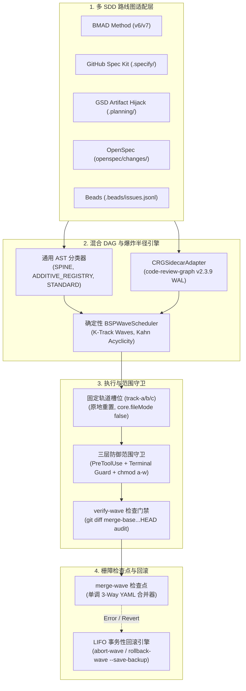

<!-- status: draft -->
# ⚡ SDD-Parallel

[](https://github.com/stopActingSoSmall/sdd-parallel/actions/workflows/ci.yml)
[](https://www.python.org/)
[](../../../LICENSE)
[](#-5秒离线演示零api密钥)

<p align="center">
  <b>🌐 语言 / Language:</b>
  <a href="../../../README.md">English</a> |
  <b>简体中文</b> |
  <a href="../es/README.md">Español</a> |
  <a href="../pt-BR/README.md">Português (BR)</a> |
  <a href="../ja/README.md">日本語</a> |
  <a href="../ko/README.md">한국어</a> |
  <a href="../ru/README.md">Русский</a>
</p>

> **面向 AI 编程智能体的规范驱动开发 (SDD) 并发与爆炸半径 (Blast Radius) 治理控制框架**  
> (Google Antigravity, Claude Code, OpenAI Codex)  
> *提供 `sdd-parallel` CLI 命令与便捷的 `parallel-flow` 别名。*

---

## 🎯 核心问题

现代规范驱动开发 (Spec-Driven Development, SDD) 框架——**BMAD Method (v6/v7)**、**GitHub Spec Kit (`.specify/`)**、**GSD (Get Shit Done)**、**OpenSpec** 以及 **Beads**——擅长将需求解构为可验证的单一任务规范。然而，在扩展至并行执行时，它们面临着**致命的架构瓶颈**：

1. **线性任务队列：** 调度器强制严格串行执行 (`Story 1 -> Story 2 -> Story 3`)，忽略了不同史诗 (Epic) 间的独立性。
2. **共享配置的合并炸弹 (Merge-Bombs)：** 并发智能体同时修改共享注册表与迭代状态文件 (`sprint-status.yaml`、`STATE.md`、`tasks.md`)，导致频繁合并冲突。
3. **二类语义冲突 (Type-2 Semantic Collisions, $W_A \cap I_B \neq \emptyset$)：** 智能体 A 修改共享接口签名，而并发智能体 B 仍调用旧签名。隔离分支下的本地测试全部通过，但合并后系统在运行时崩溃。
4. **子智能体嵌套深度限制：** 复杂的多智能体工作流（例如 BMAD 的 3 重独立审查镜头）在嵌套于平面子智能体中时会失效 (`Max Subagent Depth = 1`)。

---

## 💡 解决方案：`sdd-parallel`

`sdd-parallel` 是一个确定性编排与安全治理控制框架：
- **多态解析 SDD 路线图：** 零硬编码；跨 5 种主流 SDD 框架提取任务、依赖关系与代码映射。
- **求解语义爆炸半径 (AST + 调用图)：** 计算有向依赖、Spine Locks 以及二类影响重叠 ($W_A \cap I_B$)。
- **分配固定轨道槽位 (`track-a`, `track-b`, ...)：** 永久性分配 worktree 槽位并支持原地重置 (`git checkout -B` + `git clean -fd`)，保持 $O(1)$ 磁盘空间占用。
- **实施三层防御范围守卫 (Three-Tier Scope Guard)：** 通过 `PreToolUse` 钩子拦截越界编辑，拦截终端逃逸 (`Bash`, PowerShell)，并通过操作系统级 `chmod a-w` 锁定关键文件。
- **单调三方状态合并 (Monotonic 3-Way Merge)：** 基于半格排序 ($\max(\text{rank})$) 单调合并任务状态，杜绝任何 `<<<<<<<` 冲突标记。
- **保障 LIFO 事务性回滚：** 严格按照后进先出 (LIFO) 顺序安全撤销已合并波次，自动创建安全备份分支并多态重置任务状态。

---

## 🚀 5秒离线演示（零API密钥）

克隆代码仓库并在本地离线运行独立验证演示：

```bash
uv run sdd-parallel demo
```

```text
============================================================================
SDD-PARALLEL STANDALONE MERGE-BOMB DEMO (ZERO API KEYS / OFFLINE)
============================================================================
Workspace: /tmp/sdd-parallel-demo-xyz

[Step 1/4] AST & Architectural Role Classification
----------------------------------------------------------------------------
File Path                              | Detected Role          | Importers
----------------------------------------------------------------------------
src/demo_app/__init__.py               | additive_registry      | -
src/demo_app/api.py                    | standard               | -
src/demo_app/cli.py                    | additive_registry      | -
src/demo_app/exporter.py               | standard               | -
src/demo_app/normalizer.py             | standard               | src/demo_app/api.py
src/demo_app/schema.py                 | spine                  | -

[Step 2/4] Type-2 Semantic Merge-Bomb Detection & BSP Wave Schedule
----------------------------------------------------------------------------
  Collision Analysis:
    - Naive Scheduler : W(1-2)={normalizer.py, cli.py} vs W(2-1)={api.py}
                        -> DISJOINT WRITES (False Safe!)
    - BSPWaveScheduler: Detected semantic_collision between '1-2' and '2-1'
                        -> Overlap W(1-2) ^ I(2-1) on: src/demo_app/api.py
    - Additive Registry: Tasks '1-2' and '1-3' both touch 'src/demo_app/cli.py'
                        -> Role: ADDITIVE_REGISTRY (Parallel allowed in Wave 1)

  Wave Schedule:
    * Wave 1
        - track-a: Story 1-2 -> writes: src/demo_app/normalizer.py (+ shared: src/demo_app/cli.py)
        - track-b: Story 1-3 -> writes: src/demo_app/exporter.py (+ shared: src/demo_app/cli.py)
    * Wave 2
        - track-a: Story 1-1 -> writes: src/demo_app/schema.py
        - track-b: Story 2-1 -> writes: src/demo_app/api.py
    * Wave 3
        - track-a: Story 2-2 -> writes: src/demo_app/schema.py

[Step 3/4] Fixed-Slot Worktree Provisioning & PreToolUse Scope Guard
----------------------------------------------------------------------------
  Provisioned Fixed Slots (100% Clean git status: True):
    - track-a (.worktrees/track-a)
    - track-b (.worktrees/track-b)

  PreToolUse Scope Guard Check (track-a -> 'src/demo_app/schema.py'):
    - Decision : DENY
    - Violation: File 'src/demo_app/schema.py' cannot be modified by Wave 1 / track-a (stories ['1-2'])
    - Reason   : Locked by Spine Chain invariant.

[Step 4/4] Barrier Checkpoint & Monotonic 3-Way YAML Merge
----------------------------------------------------------------------------
  Merged Branches:
    - parallel/track-a
    - parallel/track-b

  Resolved sprint-status.yaml (0 conflict markers):
    - 1-2-normalize-telemetry-payload: done
    - 1-3-cli-batch-export: done
============================================================================
ALL 5 CORE INVARIANTS VERIFIED IN 3.21s
============================================================================
```

> 📖 **逐步演示解析、图论算法与交互式沙箱探索：**  
> 想要查看逐帧磁盘快照（`Before -> Wave Planning -> Slot Locking -> 3-Way Merge`）、理解角色分类图论（`SPINE` / `ADDITIVE_REGISTRY` / `STANDARD`，3遍 `ASTHotspotScanner`），并在 `--keep-temp` 沙箱或全新仓库中上手测试 `plan`、`prepare`、`check-lock`、`abort-wave` 和 `rollback-wave`？  
> 👉 请参阅算法原理解析 **[System Capabilities & Architectural White Paper](../../dossier/02_SYSTEM_CAPABILITIES_WHITE_PAPER.md)** 与实战教程 **[07_STANDALONE_DEMO_AND_E2E_WALKTHROUGH.md](07_STANDALONE_DEMO_AND_E2E_WALKTHROUGH.md)**。  
> 🏛️ 高管决策与架构师参考：**[产品简报与高管摘要](../../dossier/01_CORE_PRODUCT_BRIEF.md)** | **[系统架构单一可信源 SSOT](ARCHITECTURE.md)**。

---

## 📦 环境要求与安装

### 系统依赖
- **Python:** `>= 3.11` (Python 3.11, 3.12, 3.13)
- **Git:** `>= 2.30` (用于现代 `git worktree` 隔离与 `info/exclude` 掩码)
- **包管理器:** [`uv`](https://docs.astral.sh/uv/) (推荐) 或 `pipx`

### 安装方式

#### 作为独立 CLI 工具安装（推荐）
```bash
# 使用 uv（最快）
uv tool install sdd-parallel

# 或使用 pipx
pipx install sdd-parallel
```

#### 本地开发源码安装
```bash
git clone https://github.com/stopActingSoSmall/sdd-parallel.git
cd sdd-parallel
uv sync
```

安装完成后，CLI 工具可通过 `sdd-parallel`（或快捷别名 `parallel-flow`）全局调用。

---

## 🏛️ 系统架构



---

## 🛡️ 核心不变量 (Core Invariants)

1. **Zero Worktree Pollution（零工作区污染）：** 注入的上下文文件（`.tmp/track-context.md`、`.parallel-lock.json`、`ACTIVE_TRACK.md`）通过 `info/exclude` 完全屏蔽。`git status --porcelain` 始终保持 100% 干净。
2. **Zero Cache Invalidation（零缓存失效）：** `_bmad-output/planning-artifacts/` 下的史诗上下文只读访问；调度器状态独立写入 `_bmad-output/parallel-artifacts/`。
3. **100% Task Coverage & Acyclic Invariant（100%任务覆盖与无环保证）：** Kahn/Tarjan 拓扑验证确保无任何遗漏任务且依赖图严格无环。
4. **Blast-Radius Enforcement（爆炸半径隔离）：** 保证写入文件集互斥 ($W_A \cap W_B = \emptyset$) 且语义影响范围互斥 ($W_A \cap I_B = \emptyset$)。
5. **Universal Anti-Overfitting（通用防过拟合 - 不变量 7）：** 核心引擎严禁硬编码特定项目路径与实体。`SPINE`、`ADDITIVE_REGISTRY` 和 `STANDARD` 角色完全基于 AST 启发式与图拓扑中心度判定。
6. **Fixed Track Slots（固定槽位 - $O(1)$ 磁盘占用）：** 复用 `track-a`、`track-b`、`track-c` 槽位，通过 `git checkout -B` 和 `git clean -fd` 原地重置，避免文件夹爆炸。
7. **Three-Tier Defense-in-Depth Guard（三层纵深防御）：** `PreToolUse` 钩子 + 终端命令拦截 (`Bash`, `run_command`) + 操作系统 `chmod a-w` 锁定。
8. **Monotonic Status Semi-Lattice（单调状态半格）：** 状态单调演进：$\texttt{backlog} (0) < \dots < \texttt{done} (4)$，合并时零冲突标记。
9. **LIFO Transactional Rollbacks（后进先出事务回滚）：** 严格逆序回滚波次，自动保留备份分支 (`backup/wave-<K>-before-rollback-*`)。

---

## 🛠️ CLI 命令速查表

| 命令 | 用途 |
| :--- | :--- |
| `sdd-parallel demo [--kit {bmad,spec-kit,gsd,openspec,beads,all}] [--keep-temp] [--scaffold-only] [--output-dir DIR]` | 运行独立离线 Merge-Bomb 演示或搭建 5 大 SDD 框架的交互式沙箱。 |
| `sdd-parallel plan [--repo REPO] [--max-tracks N] [--kit auto] [--include-done] [--dry-run] [--plan-source {auto,plan,specs}] [--output-dir DIR]` | 分析路线图与代码库依赖图；生成 `execution-plan-parallel.md` 与 `wave-plan.json`。 |
| `sdd-parallel prepare --wave K [--repo REPO] [--max-tracks N] [--kit KIT] [--headless] [--antigravity-layout] [--dynamic-worktrees] [--dry-run]` | 配置工作树槽位 (`track-a`, `track-b`)，施加系统级只读锁，注入边界文件。 |
| `sdd-parallel claim-track --wave K --track <id> --worktree <path> [--repo REPO] [--max-tracks N] [--kit KIT] [--headless]` | 将边界锁清单附加绑定到现有外部工作树槽位。 |
| `sdd-parallel run-guide --wave K [--repo REPO] [--max-tracks N] [--kit KIT] [--antigravity-layout]` | 显示交互式操作员指引矩阵，包含各活跃轨道窗口的原生启动命令。 |
| `sdd-parallel verify-wave --wave K [--repo REPO] [--max-tracks N] [--kit KIT] [--dynamic-worktrees]` | 审计工作树是否符合 `.parallel-lock.json` 并对比 `merge-base` 检查多提交累积差异。 |
| `sdd-parallel merge --wave K [--repo REPO] [--max-tracks N] [--kit KIT] [--dynamic-worktrees] [--skip-gates] [--strict-gates] [--cleanup] [--dry-run]` | 栅障合并检查点：3 路状态合并、Git 合并、多态质量门禁与事务性自动回滚。 |
| `sdd-parallel abort-wave --wave K [--repo REPO] [--dynamic-worktrees]` | 中止未合并波次：重置槽位并清理临时并行分支。 |
| `sdd-parallel rollback-wave --wave K [--repo REPO] [--dynamic-worktrees] [--to-commit COMMIT] [--save-backup] [--no-backup] [--kit KIT]` | 按 LIFO 顺序回滚已合并波次，附带安全备份分支并多态重置任务状态。 |
| `sdd-parallel merge-status --base B --ours O --theirs T --out OUT` | 底层确定性 3-way YAML 状态合并工具。 |
| `sdd-parallel check-lock --file PATH [--tool TOOL]` | 验证文件写入操作是否符合当前工作树锁清单。 |
| `sdd-parallel install-plugin [--target-dir DIR]` | 打包并安装 Antigravity 便携插件。 |
| `sdd-parallel autopilot --wave K [--repo REPO] [--max-tracks N] [--kit KIT] [--harness <tool>] [--antigravity-layout] [--execute]` | 基于模型开销路由 (Model Effort Routing) 生成或执行多窗口 Autopilot 启动命令。 |

---

## 🧩 支持的 SDD 框架

| SDD 框架 | 状态 | 只读识别产物 | 状态同步策略 |
| :--- | :---: | :--- | :--- |
| **BMAD Method (`v6.3+` / `v7`)** | ✅ 已交付 | `sprint-status.yaml`, `epics.md`, `epic-*-context.md`, `spec-*.md` | 单调 3-Way YAML 合并 |
| **GitHub Spec Kit (`.specify/`)** | ✅ 已交付 | `.specify/specs/*/tasks.md`, `constitution.md` | Markdown 复选框同步 |
| **GSD (Get Shit Done)** | ✅ 已交付 | `.planning/phases/*-PLAN.md`, `ROADMAP.md` | Artifact Hijack (隔离 `STATE.md`) |
| **OpenSpec (`openspec/`)** | ✅ 已交付 | `openspec/changes/<id>/tasks.md` | 基于规范的任务跟踪 |
| **Beads (`.beads/`)** | ✅ 已交付 | `.beads/issues.jsonl` | 拓扑 JSONL 状态更新 |

---

## 🚢 发布矩阵：已实现 (v0.1.0) 对比 演进路线 (v0.2+)

### ✅ 已实现 (v0.1.0, 生产就绪)
- 具备 Kahn 无环验证的确定性大步同步并行 (BSP) 波次调度器。
- AST 热点扫描器与 `code-review-graph v2.3.9` 伴生进程集成。
- 固定轨道槽位架构 (`track-a`, `track-b`, `track-c`) 原地重置。
- 三层纵深防御范围守卫 (`PreToolUse` + Terminal Guard + OS `chmod a-w`)。
- 保留注释与格式的单调 3-Way YAML 合并器。
- 具备自动安全备份分支的 LIFO 事务性波次回滚引擎。
- Two-Stage Assisted (交互式 IDE 槽位) 执行标准 (`Depth 0`)。
- 支持 5 大 SDD 适配器（BMAD, Spec Kit, GSD Artifact Hijack, OpenSpec, Beads）。
- 独立离线 Merge-Bomb 演示 (`sdd-parallel demo`) 与 GitHub Actions CI 流水线。
- 95+ 自动化单元与集成测试、mypy --strict 与 ruff 质量门禁。

### 🚧 演进路线 (v0.2.0+)
- **社区适配器生态:** `mattpocock/skills` (`/implement-spec`) 与 `bmad-loop` v0.8+ frontmatter 状态适配器集成。
- **零污染环境同步:** `workz` 模式：固定槽位 `.venv` 和 `node_modules` 符号链接。
- **波次前静态符号链接器与动态范围提权:** 基于 AST 符号自动补全写入集与动态任务重排。
- **FinOps 与可观测性导出器:** OpenTelemetry spans 与 Langfuse Token 节约量度指标。
- **后台 Autopilot 守护进程:** 通过本地 RPC/子智能体调度器实现全自主无头执行。

---

## 🧪 开发与质量门禁

本地运行完整的测试与验证套件：

```bash
# 运行测试套件
uv run pytest

# 严格类型检查
uv run mypy --strict src/sdd_parallel

# 代码规范检查
uv run ruff check src/ tests/ scripts/

# 运行独立离线演示
uv run sdd-parallel demo
```

---

## 🤝 贡献与安全

- **参与贡献:** 请参阅 **[贡献指南](../../../CONTRIBUTING.md)** 了解开发环境搭建与拉取请求（PR）质量门禁要求。
- **安全策略:** 漏洞报告指南与披露策略详见 **[安全策略](../../../SECURITY.md)**。

---

## 📜 许可证

采用 MIT License 授权。详情参阅 [LICENSE](../../../LICENSE)。
