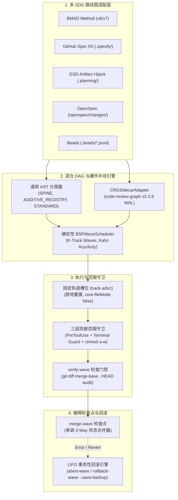

<p align="center">
  
</p>

<p align="center">
  <a href="https://github.com/stopActingSoSmall/sdd-parallel/actions/workflows/ci.yml"></a>
  <a href="https://pypi.org/project/sdd-parallel/"></a>
  <a href="https://www.python.org/"></a>
  <a href="../../../LICENSE"></a>
  <a href="#-5-秒极速体验零-api-key带详细注释的演练"></a>
  <br>
  <a href="#-无缝融入现有工具链零供应商锁定"></a>
  <a href="#-直观呈现您的-sdd-项目结构改造前后对比"></a>
</p>

<p align="center">
  <b>🌐 语言 / Language:</b>
  <a href="../../../README.md">English</a> |
  <b>简体中文</b> |
  <a href="../es/README.md">Español</a> |
  <a href="../pt-BR/README.md">Português (BR)</a> |
  <a href="../ja/README.md">日本語</a> |
  <a href="../ko/README.md">한국어</a> |
  <a href="../ru/README.md">Русский</a>
</p>

<p align="center">
  <a href="#-5-秒极速体验零-api-key带详细注释的演练">快速演示</a> ·
  <a href="#-为什么需要它通俗原理解析">为什么需要</a> ·
  <a href="#%EF%B8%8F-工作原理与日常-4-步工作流">工作原理</a> ·
  <a href="#-直观呈现您的-sdd-项目结构改造前后对比">SDD 项目结构</a> ·
  <a href="#-无缝融入现有工具链零供应商锁定">工具链集成</a> ·
  <a href="#%EF%B8%8F-完整-cli-命令参考手册">日常 CLI</a> ·
  <a href="#-系统架构数学模型与深度技术报告">深度技术报告</a>
</p>

> **并行运行多个 AI 编程智能体 —— 提速高达 3 倍，彻底告别合并炸弹 (Zero Merge-Bombs)。**  
> `sdd-parallel` 是连接您的 **Spec Kit / BMAD / GSD / OpenSpec / Beads** 任务代办积压与负责落地的编程智能体（**Claude Code**、**Codex**、**Antigravity** 或任何支持 worktree 的 CLI）之间的确定性交通管制调度员、worktree 隔离器和爆炸半径护卫门禁。

---

## ⚡ 为什么需要它？（通俗原理解析）

<p align="center">
  
</p>

面对 10–15 个规范（specs）或用户故事（stories）的积压待办，目前您通常只能在两种糟糕的方案中二选一：

1. **单智能体串行处理** —— 安全稳妥，但需要漫长等待 **6–8 小时**。
2. **3–4 个智能体在朴素的 `git worktree` 目录中并发执行** —— 编码阶段飞快，直到执行代码合并：
   - **一类直接碰撞（Type-1 direct collision）：** 两个智能体同时修改 `sprint-status.yaml`、`STATE.md` 或 `cli.py` → 每次合并都会出现 `<<<<<<<` 冲突标记。
   - **二类语义静默碰撞（Type-2 semantic, silent collision）：** 智能体 A 修改了 `normalizer.py` 中的函数签名；位于另一个 worktree 的智能体 B 却依然在 `api.py` 中按照旧签名调用。**Git 顺利自动合并且没有任何冲突标记 —— 但合并后 `main` 分支在运行时直接崩溃。**
   - **范围蔓延（Scope creep）：** 一个“自作聪明”的智能体擅自重写了全局共享的 `schema.py`，而这根本不在它的任务范围内。

**`sdd-parallel` 在消耗任何 LLM Token 之前就彻底解决了这一难题：** 它预先扫描代码库的抽象语法树（AST）与调用图，将经由数学证明绝对安全的任务分组归入并行的**波次（Waves）**，将每个智能体严格锁定在干净的固定槽位（`track-a`、`track-b`、……）中，在钩子（Hook）和操作系统内核级别拦截越界写入，并在质量门禁（Quality-Gate Barrier）后自动合并各个波次。

| 场景表现 | ❌ 串行执行（1 个智能体） | 💥 朴素并行（`--worktree`） | ✅ 使用 `sdd-parallel` |
| :--- | :--- | :--- | :--- |
| **12 个故事的冲刺周期** | ~6–8 小时（逐个顺序处理） | ~2 小时编码 + **~2 小时修复合并冲突与故障** | **约 2.5 小时完成（提速 2x–3x）** |
| **隐蔽的类型 / API 接口碰撞** | 仅能依靠单线程慢速运行避免 | **合并后破坏 `main` 分支** ($W_A \cap I_B \neq \emptyset$) | **前置阻断预防**（拆分为 Wave 1 → Wave 2） |
| **共享 CLI / 路由文件** | 每次仅允许 1 个智能体修改 | 每次合并必现 Git 冲突 | **并行安全**（`ADDITIVE_REGISTRY` 自动识别） |
| **`sprint-status.yaml` / `tasks.md` / `STATE.md`** | 串行更新 | 频繁产生 `<<<<<<<` 冲突标记 | **自动无损合并**（单调三方状态合并器） |
| **智能体越界修改非所属文件** | 仅靠 Prompt 提示“请不要修改” | 智能体可通过 `bash` / `sed` 轻易绕过 | **内核级阻断**（`PreToolUse` 钩子 + 终端守卫 + `chmod a-w`） |
| **工作树目录混乱堆积** | 无 | 残留 15 个孤立的 `.worktrees/task-*` 目录 | **固定复用槽位**（`track-a`、`track-b`、`track-c`） |

---

## 🚀 5 秒极速体验（零 API Key，带详细注释的演练）

无需 API Key，无需 LLM 订阅，无需预先 clone 仓库。只需通过 [`uv`](https://docs.astral.sh/uv/)（或 `pipx run sdd-parallel demo`）执行一条命令：

```bash
uvx sdd-parallel demo          # 或测试特定套件：uvx sdd-parallel demo --kit spec-kit
```

演示程序会自动脚手架生成一个包含 5 个任务和 6 个 Python 模块的临时演练仓库，运行真实的编排引擎，并在约 4 秒内完成。以下是 `--kit spec-kit` 运行输出的 4 个阶段解析：

#### `[Step 1/4]` AST 与角色分类 (AST & Role Classification)

```text
File Path                              | Detected Role          | Importers
----------------------------------------------------------------------------
src/demo_app/__init__.py               | additive_registry      | -
src/demo_app/api.py                    | standard               | -
src/demo_app/cli.py                    | additive_registry      | -
src/demo_app/exporter.py               | standard               | -
src/demo_app/normalizer.py             | standard               | src/demo_app/api.py
src/demo_app/schema.py                 | spine                  | -
```

零配置、零硬编码路径：扫描器自动将 `schema.py` 判定为 **`spine`**（核心脊柱文件，所有模块皆依赖它 → 必须串行化），将 `cli.py` 判定为 **`additive_registry`**（增量注册表，仅做命令追加注册 → 允许多轨共享并发），并准确捕获到 `api.py` 引入了 `normalizer.py`。

#### `[Step 2/4]` 拦截隐蔽的二类合并炸弹 (Catching the Hidden Type-2 Merge-Bomb)

```text
  Collision Analysis:
    - Naive Scheduler : W(T002)={normalizer.py, cli.py} vs W(T004)={api.py}
                        -> DISJOINT WRITES (False Safe!)
    - BSPWaveScheduler: Detected semantic_collision between 'T002' and 'T004'
                        -> Overlap W(T002) ^ I(T004) on: src/demo_app/api.py
  Wave Schedule:
    * Wave 1  track-a: T002 (normalizer.py + shared cli.py) | track-b: T003 (exporter.py + shared cli.py)
    * Wave 2  track-a: T001 (schema.py)                     | track-b: T004 (api.py)
    * Wave 3  track-a: T005 (schema.py)
```

在 `tasks.md` 中，`T002` 与 `T004` 都被人工标注了 `[P]`（可并行）标签，且两者的写入集合完全互斥（`normalizer.py ≠ api.py`）。普通的基于文件锁的调度器会错误地将它们安排在同一时刻并行。`BSPWaveScheduler` 深度洞察到 `T002` 的写入范围命中了 `T004` 的影响范围（Impact Set），从而果断将 `T004` 移入 **Wave 2**，确保其在已经完成合并的 `normalizer.py` 基础之上构建。与此同时，`T002` 和 `T003` 虽同时修改 `cli.py`，但因其属于增量注册表，因此仍被允许在 Wave 1 中安全并行。

#### `[Step 3/4]` 纯净固定槽位与范围守卫拦截 (Clean Fixed Slots & Scope Guard Interception)

```text
  Provisioned Fixed Slots (100% Clean git status: True):
    - track-a (.worktrees/track-a)
    - track-b (.worktrees/track-b)

  PreToolUse Scope Guard Check (track-a -> 'src/demo_app/schema.py'):
    - Decision : DENY
    - Violation: File 'src/demo_app/schema.py' cannot be modified by Wave 1 / track-a (stories ['T002'])
    - Reason   : Locked by Spine Chain invariant.
```

所有注入的边界文件（`ACTIVE_TRACK.md`、`.parallel-lock.json`、`.tmp/track-context.md`）均通过工作树的 `info/exclude` 隐形掩码隔离，因此 `git status --porcelain` 始终保持绝对纯净。当 `track-a` 智能体试图篡改 `schema.py` 时，写入请求在触及磁盘之前便被直接拦截拒绝。

#### `[Step 4/4]` 栅障检查点与零冲突三方合并 (Barrier Checkpoint & Zero-Conflict 3-Way Merge)

```text
  Merged Branches:
    - parallel/track-a
    - parallel/track-b
  Resolved tasks.md (0 conflict markers):
    - - [ ] T001 [US1] Upgrade schema in `src/demo_app/schema.py` (depends on T002)
    - - [x] T002 [P] [US1] Normalize `src/demo_app/normalizer.py`, `src/demo_app/cli.py`
    - - [x] T003 [P] [US1] Export `src/demo_app/exporter.py`, `src/demo_app/cli.py`
```

两个并行分支同时编辑了同一个 `tasks.md`。状态合并器利用单调偏序算子（`[ ] < [x]`、`backlog < … < done`）逐行自动解析，合并产物绝无任何 `<<<<<<<` 冲突标记。这套逻辑同样适用于 `sprint-status.yaml`、`STATE.md` 以及 `.beads/*.jsonl`。

<details>
<summary><b>🧪 点击查看 5 大套件验证矩阵（<code>uvx sdd-parallel demo --kit all</code>）与沙箱模式</b></summary>

```text
============================================================================
5/5 SDD KITS VERIFIED (BMAD, SPEC KIT, GSD, OPENSPEC, BEADS)
============================================================================
Kit          | Merge-Bomb   | Worktrees    | Scope Guard  | 3-Way Merge
----------------------------------------------------------------------------
bmad         | PASSED       | PASSED       | PASSED       | PASSED
spec-kit     | PASSED       | PASSED       | PASSED       | PASSED
gsd          | PASSED       | PASSED       | PASSED       | PASSED
openspec     | PASSED       | PASSED       | PASSED       | PASSED
beads        | PASSED       | PASSED       | PASSED       | PASSED
============================================================================
```

想亲手调试完整工作流？只需脚手架生成持久化沙箱并在其中执行真实命令：

```bash
uvx sdd-parallel demo --kit gsd --scaffold-only --output-dir ./sdd-sandbox
cd sdd-sandbox
sdd-parallel plan
sdd-parallel prepare --wave 1
```

</details>

---

## 🗺️ 工作原理与日常 4 步工作流

<p align="center">
  
</p>

**1. 一次性全局安装**（需满足 `Python >= 3.11`、`Git >= 2.30`）：

```bash
uv tool install sdd-parallel     # 或：pipx install sdd-parallel
```

安装后，`sdd-parallel` 以及快捷别名 `parallel-flow` 均全局可用。

**2. 在任何 SDD 项目中执行波次编排：**

```bash
# 1. 扫描规范与代码库 AST，生成安全波次计划
sdd-parallel plan

# 2. 将 Wave 1 分配到固定槽位，并打印各轨道的启动命令
sdd-parallel prepare --wave 1
sdd-parallel run-guide --wave 1

# 3. 在 .worktrees/track-a、track-b、... 中启动您的智能体（每个槽位一个）

# 4. 审计变更范围、执行质量门禁，并将 Wave 1 安全合并回 main 分支
sdd-parallel verify-wave --wave 1
sdd-parallel merge --wave 1
```

撤销操作：`sdd-parallel abort-wave --wave 1`（合并前中止）或 `sdd-parallel rollback-wave --wave 1`（合并后回滚；严格遵循 LIFO 逆序，自动创建 `backup/wave-<K>-before-rollback-*` 备份分支，并重置 SDD 任务状态）。

---

## 📂 直观呈现您的 SDD 项目结构（改造前后对比）

<p align="center">
  
</p>

`sdd-parallel` 原生直接读取您的框架规范文件 —— 无需格式迁移，无需新规范语法。

| SDD 框架 | 只读产物（槽位中锁定） | 任务发现途径 | 状态同步机制 |
| :--- | :--- | :--- | :--- |
| **GitHub Spec Kit** (`.specify/`) | `constitution.md`, `feature.json`, `spec.md`, `plan.md` | `specs/*/tasks.md` (`T001 [P]`) | 三方 Markdown 复选框单调合并 |
| **BMAD Method** (`v6.3+` / `v7`) | `epic-*-context.md` (零缓存失效) | `sprint-status.yaml`, `epics.md`, `spec-*.md` | 单调三方 YAML 状态合并 |
| **GSD** (`.planning/`) | `PROJECT.md`, `REQUIREMENTS.md`, `ROADMAP.md`, `STATE.md` | `phases/*/NN-NN-PLAN.md` | 产物劫持（合并时在中心统一更新 `STATE.md`） |
| **OpenSpec** (`openspec/`) | `openspec/specs/**`, `project.md`, `config.yaml`, 同级变更目录 | `openspec/changes/<slug>/tasks.md` | 三方 Markdown 复选框单调合并 |
| **Beads** (`.beads/`) | `.beads/config.yaml` | `.beads/*.jsonl` (`bd-101` + `blocks` 依赖边) | 逐行三方半格 JSONL 合并 |

下方所有文件树快照均取自执行 `plan` + `prepare --wave 1` 后的真实 `sdd-parallel demo --scaffold-only` 演练沙箱。为保持整洁，源代码目录统一折叠为 `src/…`。

<details>
<summary><b>🌱 GitHub Spec Kit (<code>.specify/</code> &amp; <code>specs/*/tasks.md</code>) — 点击查看改造前后结构对比</b></summary>

**执行前** — 项目原生结构：

```text
my-project/
├── .specify/
│   ├── memory/
│   │   └── constitution.md
│   ├── templates/
│   │   └── tasks-template.md
│   └── feature.json
├── specs/
│   └── 001-telemetry/
│       ├── plan.md
│       ├── spec.md
│       └── tasks.md
└── src/…
```

`specs/001-telemetry/tasks.md` — 注意手工标注在 `T004` 上的 `[P]` 标签，它与 `T002` 并行实际上并不安全：

```markdown
- [ ] T001 [US1] Upgrade schema in `src/demo_app/schema.py` (depends on T002)
- [ ] T002 [P] [US1] Normalize `src/demo_app/normalizer.py`, `src/demo_app/cli.py`
- [ ] T003 [P] [US1] Export `src/demo_app/exporter.py`, `src/demo_app/cli.py`
- [ ] T004 [P] [US2] Expose ingestion in `src/demo_app/api.py`
- [ ] T005 [US2] Add audit log in `src/demo_app/schema.py` (depends on T001)
```

**执行后** `sdd-parallel plan` + `prepare --wave 1`：

```text
my-project/
├── .parallel/                        # 调度器状态（新增）
│   ├── artifacts/
│   │   ├── execution-plan-parallel.md
│   │   └── wave-plan.json
│   ├── history/run-001-<timestamp>/wave-plan.json
│   └── state.json
├── .specify/…                        # 保持不变
├── .worktrees/
│   ├── track-a/                      # Wave 1 → T002
│   │   ├── .specify/memory/constitution.md   # 🔒 只读锁定
│   │   ├── specs/001-telemetry/
│   │   │   ├── plan.md               # 🔒 只读锁定
│   │   │   ├── spec.md               # 🔒 只读锁定
│   │   │   └── tasks.md
│   │   ├── src/…
│   │   ├── .tmp/track-context.md     # 👻 通过 info/exclude 隐形掩码
│   │   ├── .parallel-lock.json       # 👻 通过 info/exclude 隐形掩码
│   │   └── ACTIVE_TRACK.md           # 👻 → /speckit.implement T002
│   └── track-b/                      # Wave 1 → T003 (相同布局)
├── specs/…                           # 保持不变
└── src/…
```

</details>

<details>
<summary><b>📐 BMAD Method (<code>v6.3+ / v7</code> — <code>_bmad-output/</code>) — 点击查看改造前后结构对比</b></summary>

**执行前：**

```text
my-project/
├── _bmad-output/
│   ├── implementation-artifacts/
│   │   ├── epic-1-context.md
│   │   ├── epic-2-context.md
│   │   ├── epics.md
│   │   ├── spec-1-1-upgrade-schema-v2.md
│   │   ├── spec-1-2-normalize-telemetry-payload.md
│   │   ├── spec-1-3-cli-batch-export.md
│   │   ├── spec-2-1-expose-ingestion-api.md
│   │   ├── spec-2-2-add-audit-log-schema.md
│   │   └── sprint-status.yaml
│   └── planning-artifacts/
│       ├── epic-1-context.md
│       ├── epic-2-context.md
│       ├── epics.md
│       └── project-context.md
└── src/…
```

**执行后** `sdd-parallel plan` + `prepare --wave 1`：

```text
my-project/
├── .parallel/
│   ├── history/run-001-<timestamp>/wave-plan.json
│   └── state.json
├── .worktrees/
│   ├── track-a/                      # Wave 1 → story 1-2
│   │   ├── _bmad/custom/             # 👻 每个槽位独立的 BMAD 覆盖层 (隐藏)
│   │   │   ├── bmad-build.toml
│   │   │   ├── bmad-build.user.toml
│   │   │   ├── bmad-build-auto.toml
│   │   │   └── bmad-build-auto.user.toml
│   │   ├── _bmad-output/
│   │   │   ├── implementation-artifacts/   # sprint-status.yaml 执行三方合并
│   │   │   └── planning-artifacts/
│   │   │       ├── epic-1-context.md # 🔒 零缓存失效锁定
│   │   │       ├── epic-2-context.md # 🔒
│   │   │       └── project-context.md
│   │   ├── src/…
│   │   ├── .tmp/track-context.md     # 👻
│   │   ├── .parallel-lock.json       # 👻
│   │   └── ACTIVE_TRACK.md           # 👻 → /bmad-build 1-2
│   └── track-b/                      # Wave 1 → story 1-3
├── _bmad-output/
│   ├── implementation-artifacts/…
│   ├── parallel-artifacts/           # 规划器产物 (BMAD 将其保存在 _bmad-output 下)
│   │   ├── execution-plan-parallel.md
│   │   └── wave-plan.json
│   └── planning-artifacts/…
└── src/…
```

</details>

<details>
<summary><b>⚡ GSD — Get Shit Done (<code>.planning/phases/</code> 产物劫持) — 点击查看改造前后结构对比</b></summary>

**执行前：**

```text
my-project/
├── .planning/
│   ├── phases/
│   │   ├── 01-core/
│   │   │   ├── 01-01-PLAN.md
│   │   │   ├── 01-02-PLAN.md
│   │   │   └── 01-03-PLAN.md
│   │   └── 02-api/
│   │       ├── 02-01-PLAN.md
│   │       └── 02-02-PLAN.md
│   ├── PROJECT.md
│   ├── REQUIREMENTS.md
│   ├── ROADMAP.md
│   └── STATE.md
└── src/…
```

`01-02-PLAN.md`（normalizer）与 `02-01-PLAN.md`（API）位于不同阶段且没有共同修改的文件，但 `02-01` 在代码中调用了 `01-02`。规划器将它们智能安排到不同的波次中。

**执行后** `sdd-parallel plan` + `prepare --wave 1`：

```text
my-project/
├── .parallel/
│   ├── artifacts/
│   │   ├── execution-plan-parallel.md
│   │   └── wave-plan.json
│   ├── history/run-001-<timestamp>/wave-plan.json
│   └── state.json
├── .planning/…                       # main 分支中保持不变
├── .worktrees/
│   ├── track-a/                      # Wave 1 → 01-02
│   │   ├── .planning/
│   │   │   ├── phases/01-core/ · 02-api/
│   │   │   ├── PROJECT.md            # 🔒 只读锁定
│   │   │   ├── REQUIREMENTS.md       # 🔒 只读锁定
│   │   │   ├── ROADMAP.md            # 🔒 只读锁定
│   │   │   └── STATE.md              # 🔒 槽位中锁定，合并时由主干统一更新
│   │   ├── src/…
│   │   ├── .tmp/track-context.md     # 👻
│   │   ├── .parallel-lock.json       # 👻
│   │   └── ACTIVE_TRACK.md           # 👻 → /gsd-execute-phase 01-02
│   └── track-b/                      # Wave 1 → 01-03
└── src/…
```

</details>

<details>
<summary><b>📑 OpenSpec (<code>openspec/changes/</code>) — 点击查看改造前后结构对比</b></summary>

**执行前：**

```text
my-project/
├── openspec/
│   ├── changes/
│   │   ├── audit-log-schema/
│   │   ├── cli-batch-export/
│   │   ├── ingestion-api-endpoint/
│   │   ├── normalize-telemetry/
│   │   │   ├── design.md
│   │   │   ├── proposal.md
│   │   │   └── tasks.md
│   │   └── upgrade-schema-v2/
│   ├── specs/
│   │   └── telemetry/
│   │       └── spec.md
│   ├── config.yaml
│   └── project.md
└── src/…
```

**执行后** `sdd-parallel plan` + `prepare --wave 1`：

```text
my-project/
├── .parallel/
│   ├── artifacts/
│   │   ├── execution-plan-parallel.md
│   │   └── wave-plan.json
│   ├── history/run-001-<timestamp>/wave-plan.json
│   └── state.json
├── .worktrees/
│   ├── track-a/                      # Wave 1 → normalize-telemetry
│   │   ├── openspec/
│   │   │   ├── changes/
│   │   │   │   ├── normalize-telemetry/   # ✍️ 当前轨道的变更目录
│   │   │   │   ├── cli-batch-export/      # 🔒 被同级 track-b 锁定
│   │   │   │   └── …
│   │   │   ├── specs/                # 🔒 规范文件（仅通过 openspec archive 修改）
│   │   │   ├── config.yaml           # 🔒
│   │   │   └── project.md            # 🔒
│   │   ├── src/…
│   │   ├── .tmp/track-context.md     # 👻
│   │   ├── .parallel-lock.json       # 👻
│   │   └── ACTIVE_TRACK.md           # 👻 → /openspec-apply normalize-telemetry
│   └── track-b/                      # Wave 1 → cli-batch-export (镜像锁定)
├── openspec/…                        # 保持不变
└── src/…
```

</details>

<details>
<summary><b>🔗 Beads (<code>.beads/beads.jsonl</code>) — 点击查看改造前后结构对比</b></summary>

**执行前：**

```text
my-project/
├── .beads/
│   ├── beads.jsonl
│   ├── config.yaml
│   └── issues.jsonl
└── src/…
```

依赖图任务 `bd-101`、`bd-102`、`bd-103`、`bd-201`、`bd-202`，彼此间具有 `blocks` 阻断边：

```json
{"id": "bd-101", "title": "Upgrade schema to v2", "status": "open", "files": ["src/demo_app/schema.py"], "dependencies": [{"target": "bd-102", "type": "blocks"}], "priority": 1, "epic": "epic-1"}
{"id": "bd-102", "title": "Normalize telemetry payload", "status": "open", "files": ["src/demo_app/normalizer.py", "src/demo_app/cli.py"], "dependencies": [], "priority": 2, "epic": "epic-1"}
```

**执行后** `sdd-parallel plan` + `prepare --wave 1`：

```text
my-project/
├── .beads/…                          # 主干副本，在执行 `merge --wave 1` 时按行合并
├── .parallel/
│   ├── artifacts/
│   │   ├── execution-plan-parallel.md
│   │   └── wave-plan.json
│   ├── history/run-001-<timestamp>/wave-plan.json
│   └── state.json
├── .worktrees/
│   ├── track-a/                      # Wave 1 → bd-102
│   │   ├── .beads/
│   │   │   ├── beads.jsonl           # 状态编辑在合并时逐行执行三方合并 (open < closed)
│   │   │   ├── config.yaml           # 🔒 只读锁定
│   │   │   └── issues.jsonl
│   │   ├── src/…
│   │   ├── .tmp/track-context.md     # 👻
│   │   ├── .parallel-lock.json       # 👻
│   │   └── ACTIVE_TRACK.md           # 👻 → bd update bd-102 --status in-progress
│   └── track-b/                      # Wave 1 → bd-103
└── src/…
```

在执行 `merge --wave 1` 之后，`bd-102` 与 `bd-103` 在 `.beads/beads.jsonl` 中均自动更新为 `closed`，且具有 0 个冲突标记。

</details>

图例说明：🔒 只读保护（`chmod a-w` + `PreToolUse` 拒绝）· 👻 隐形注入，通过 `.git/worktrees/<slot>/info/exclude` 对 Git 完全隐藏 · ✍️ 当前轨道的可写范围。

---

## 🔌 无缝融入现有工具链（零供应商锁定）

保留您原有的智能体工具与 Prompt 习惯。在运行 `sdd-parallel prepare --wave 1` 之后，`sdd-parallel run-guide --wave 1` 会输出每个槽位的精准原生启动命令，并将相同的一行命令写入 `.worktrees/track-<id>/ACTIVE_TRACK.md`。您完全不需要手动输入任何上下文路径：

| SDD 套件 | 各轨道打印的原生启动命令 |
| :--- | :--- |
| GitHub Spec Kit | `/speckit.implement T002` |
| BMAD Method | `/bmad-build 1-2` |
| GSD | `/gsd-execute-phase 01-02` |
| OpenSpec | `/openspec-apply normalize-telemetry` |
| Beads | `bd update bd-102 --status in-progress` |

| 智能体运行时 (Harness) | 接入方式 |
| :--- | :--- |
| **Claude Code** (`claude`) | 在 `.worktrees/track-a` 内部启动 `claude`；越界写入与 Shell 绕过尝试将被 `PreToolUse` 钩子以及操作系统的 `chmod a-w` 坚决拒绝。或者直接使用 `sdd-parallel autopilot --wave 1 --harness claude-code` 并发拉起所有轨道。 |
| **OpenAI Codex CLI** (`codex`) | `codex --cd .worktrees/track-b`；只读文件受 `chmod a-w` 保护，`sdd-parallel verify-wave` 在合并前对代码 diff 进行严格审计。Autopilot 启动参数：`--harness codex`。 |
| **Google Antigravity** | `sdd-parallel prepare --wave 1 --antigravity-layout` 将槽位统一创建在 `~/.gemini/antigravity/worktrees/<Project>/track-a`；`ACTIVE_TRACK.md` 位于槽位根目录；`sdd-parallel install-plugin` 安装包含范围守卫钩子的便携式插件。 |
| **任何支持 worktree 的 CLI 或 IDE** — Cursor, Windsurf, OpenCode, Kimi CLI, MiniMax Code, Aider, Cline, Trae | 无需额外配置即可开箱即用：标准 `git worktree` 槽位（通过 `--max-tracks N` 维护 `track-a`、`track-b`、`track-c`、……）、系统级 `chmod a-w` 锁定、`ACTIVE_TRACK.md` 引导文件，以及通过 `sdd-parallel verify-wave` 进行事后差异验证。 |

---

## 🔍 系统架构、数学模型与深度技术报告

- 📖 **[01 — 核心产品简报与 ROI 模型](../../dossier/01_CORE_PRODUCT_BRIEF.md)**：高管摘要、Token FinOps 与模型开销路由
- 🏛️ **[02 — 系统能力白皮书](../../dossier/02_SYSTEM_CAPABILITIES_WHITE_PAPER.md)**：一类与二类冲突、3D 文件分类学、CRG 衰减公式
- 🔌 **[03 — 集成与生态规范](../../dossier/03_INTEGRATION_AND_ECOSYSTEM_SPEC.md)**：`CanonicalTask` 中间表示、`.tmp/track-context.md` 与 `.parallel-lock.json` 契约
- 📊 **[04 — 竞品与基准分类学](../../dossier/04_COMPETITIVE_AND_BENCHMARK_TAXONOMY.md)**：与相邻编排工具的定位对比
- 🧪 **[07 — 独立演示与端到端演练](07_STANDALONE_DEMO_AND_E2E_WALKTHROUGH.md)**：逐帧磁盘快照、`--keep-temp` 沙箱指南
- 📐 **[系统架构单一可信源 SSOT (`ARCHITECTURE.md`)](ARCHITECTURE.md)** · **[文档总览 (Dossier index)](../../dossier/README.md)** · **[俄语文档 (Russian dossier)](../ru/dossier/)**

<details>
<summary><b>🏛️ 点击展开：内部引擎架构与 9 大核心不变量</b></summary>

### 内部组件流向图 (Internal Component Flow)



### 9 大核心工程不变量 (The 9 Core Engineering Invariants)

1. **Zero Worktree Pollution（零工作区污染）：** 注入的上下文文件（`.tmp/track-context.md`、`.parallel-lock.json`、`ACTIVE_TRACK.md`）通过 git `info/exclude` 完全屏蔽；`git status --porcelain` 始终保持绝对纯净。
2. **Zero Cache Invalidation（零缓存失效）：** 预编译上下文文件（例如 BMAD 的 `epic-*-context.md`）在波次执行期间严格只读；规划器状态统一写入 `.parallel/`（针对 BMAD 为 `_bmad-output/parallel-artifacts/`）。
3. **100% Task Coverage & Acyclicity（100% 任务覆盖与无环保证）：** Kahn 拓扑排序验证确保零遗漏任务且依赖图严格无环。
4. **Blast-Radius Enforcement（爆炸半径隔离，一类与二类）：** 保证写入文件集严格互斥（$W_A \cap W_B = \emptyset$），且语义影响范围严格互斥（$W_A \cap I_B = \emptyset$）。
5. **Universal Anti-Overfitting（通用防过拟合）：** 核心引擎严禁硬编码特定项目或领域路径；`SPINE`、`ADDITIVE_REGISTRY` 与 `STANDARD` 角色完全基于 AST 启发式规则与图拓扑中心度计算判定。
6. **Fixed Track Slots（固定轨道槽位）：** 永久复用 `track-a`、`track-b`、`track-c` 槽位，通过 `git checkout -B` + `git clean -fd` 原地就地重置，避免目录混乱与磁盘膨胀。
7. **Three-Tier Defense-in-Depth Guard（三层纵深防御守卫）：** `PreToolUse` 钩子 + 终端命令拦截（`Bash`、`run_command`）+ 操作系统底层 `chmod a-w` 锁定。
8. **Monotonic Status Semi-Lattice（单调状态半格）：** 任务状态严格按 $\texttt{backlog}(0) < \dots < \texttt{done}(4)$ 单调演进，合并时绝无冲突标记。
9. **LIFO Transactional Rollbacks（后进先出事务性回滚）：** 已合并的波次严格按逆序安全回滚，并自动创建安全备份分支（`backup/wave-<K>-before-rollback-*`）。

</details>

---

## 🛠️ 完整 CLI 命令参考手册

<details>
<summary><b>点击展开：全部 13 个子命令与参数说明</b></summary>

| 命令 | 用途 |
| :--- | :--- |
| `sdd-parallel demo [--kit {bmad,spec-kit,gsd,openspec,beads,all}] [--keep-temp] [--scaffold-only] [--output-dir DIR]` | 运行离线 Merge-Bomb 演示或为 5 大 SDD 套件中的任意一个脚手架搭建交互式沙箱。 |
| `sdd-parallel plan [--repo REPO] [--max-tracks N] [--kit KIT] [--include-done] [--dry-run] [--plan-source {auto,plan,specs}] [--output-dir DIR]` | 分析路线图与代码调用图；输出 `execution-plan-parallel.md` 与 `wave-plan.json`。 |
| `sdd-parallel prepare --wave K [--repo REPO] [--max-tracks N] [--kit KIT] [--headless] [--antigravity-layout] [--dynamic-worktrees] [--dry-run]` | 配置工作树槽位（`track-a`、`track-b`、……），应用操作系统只读锁，注入边界文件。 |
| `sdd-parallel claim-track --wave K --track <id> --worktree <path> [--repo REPO] [--max-tracks N] [--kit KIT] [--headless]` | 将边界锁清单附加到现有的外部工作树槽位。 |
| `sdd-parallel run-guide --wave K [--repo REPO] [--max-tracks N] [--kit KIT] [--antigravity-layout]` | 打印操作员执行指南矩阵，包含每个轨道的原生启动命令。 |
| `sdd-parallel verify-wave --wave K [--repo REPO] [--max-tracks N] [--kit KIT] [--dynamic-worktrees]` | 审计工作树槽位是否符合 `.parallel-lock.json`，并针对 `merge-base` 检查多提交累积差异。 |
| `sdd-parallel merge --wave K [--repo REPO] [--max-tracks N] [--kit KIT] [--dynamic-worktrees] [--skip-gates] [--strict-gates] [--cleanup] [--dry-run]` | 栅障合并检查点：三方状态合并、Git 合并、质量门禁与事务性自动回滚。 |
| `sdd-parallel abort-wave --wave K [--repo REPO] [--dynamic-worktrees]` | 中止未合并波次：重置槽位并清理临时并行分支。 |
| `sdd-parallel rollback-wave --wave K [--repo REPO] [--dynamic-worktrees] [--to-commit COMMIT] [--save-backup] [--no-backup] [--kit KIT]` | 按 LIFO 顺序回滚已合并波次，附带安全备份分支并多态重置 SDD 任务状态。 |
| `sdd-parallel merge-status --base B --ours O --theirs T --out OUT` | 用于 `sprint-status.yaml` 的底层确定性三方状态合并工具。 |
| `sdd-parallel check-lock --file PATH [--tool TOOL]` | 验证文件写入操作是否符合当前工作树的锁清单。 |
| `sdd-parallel install-plugin [--target-dir DIR]` | 打包并安装便携式 Antigravity 插件。 |
| `sdd-parallel autopilot --wave K [--repo REPO] [--max-tracks N] [--kit KIT] [--harness {antigravity,claude-code,codex}] [--antigravity-layout] [--execute]` | 基于模型开销路由生成或执行多窗口 Autopilot 启动命令。 |

</details>

---

## 🚢 发布矩阵：已实现 (v0.1.0) vs 规划路线图 (v0.2+)

### ✅ 已在 `v0.1.0` 中发布

- [x] 具备 Kahn 无环验证的确定性大步同步并行 (BSP) 波次调度器。
- [x] AST 热点扫描器 + `code-review-graph v2.3.9` 伴生进程集成。
- [x] 固定轨道槽位（`track-a`、`track-b`、`track-c`）原地重置与 `info/exclude` 掩码隔离。
- [x] 三层范围守卫（`PreToolUse` + 终端守卫 + 操作系统 `chmod a-w`）。
- [x] 面向 YAML、Markdown 复选框列表、`STATE.md` 与 JSONL 的单调三方状态合并器。
- [x] 具备自动安全备份分支的 LIFO 事务性波次回滚机制。
- [x] 5 大 SDD 适配器：Spec Kit、BMAD、GSD（产物劫持）、OpenSpec、Beads，均配备各轨道原生 worker 启动命令。
- [x] 离线 Merge-Bomb 演示（`sdd-parallel demo --kit all`）与沙箱搭建功能（`--scaffold-only`）。
- [x] 面向 Antigravity、Claude Code 与 Codex 的多窗口 Autopilot。
- [x] 覆盖 Ubuntu / macOS / Windows、Python 3.11–3.13 的全新克隆 CI 流水线；PyPI 可信发布 (Trusted Publishing)。

### 🚧 规划路线图 (`v0.2.0+`)

- [ ] **社区适配器生态：** `mattpocock/skills`（`/implement-spec`）与 `bmad-loop` frontmatter 状态适配器。
- [ ] **零污染环境同步：** 将 `.venv` / `node_modules` 符号链接进固定槽位。
- [ ] **波次前静态符号链接器与动态范围提权：** 通过 AST 符号自动补全写入集，配合动态任务重排。
- [ ] **FinOps 与可观测性导出器：** OpenTelemetry spans 与 Langfuse Token 节约量度指标遥测。
- [ ] **无头 Autopilot 守护进程：** 通过本地 RPC / 子智能体派发进行智能体执行。

---

## 🤝 参与贡献、本地开发与安全规范

```bash
git clone https://github.com/stopActingSoSmall/sdd-parallel.git
cd sdd-parallel
uv sync

uv run pytest                          # 单元测试与集成测试套件
uv run mypy --strict src/sdd_parallel  # 严格类型检查
uv run ruff check src/ tests/ scripts/ # 代码规范与代码风格检查
uv run sdd-parallel demo --kit all     # 离线 5 大套件全量演示
```

- **参与贡献：** 请参阅 **[贡献指南](../../../CONTRIBUTING.md)** 了解开发环境搭建与拉取请求（PR）门禁规范。
- **安全策略：** 发现漏洞请按照 **[安全策略](../../../SECURITY.md)** 中的说明进行报告。
- **许可证：** MIT 授权 —— 详见 [LICENSE](../../../LICENSE)。
