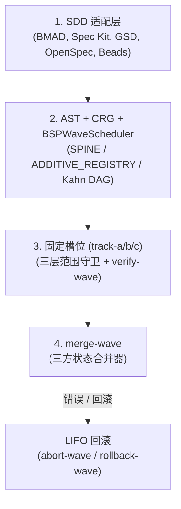

<p align="center">
  
</p>

<p align="center">
  <a href="https://github.com/stopActingSoSmall/sdd-parallel/actions/workflows/ci.yml"></a>
  <a href="https://pypi.org/project/sdd-parallel/"></a>
  <a href="https://www.python.org/"></a>
  <a href="../../../LICENSE"></a>
  <a href="#-5-秒极速体验零-api-key带详细注释的演练"></a>
  <br>
  <a href="#-无缝融入现有工具链零供应商锁定"></a>
  <a href="#-直观呈现您的-sdd-项目结构改造前后对比"></a>
</p>

<p align="center">
  <b>🌐 语言 / Language:</b>
  <a href="../../../README.md">English</a> |
  <a href="../es/README.md">Español</a> |
  <a href="../pt-BR/README.md">Português (BR)</a> |
  <a href="../ja/README.md">日本語</a> |
  <a href="../ko/README.md">한국어</a> |
  <b>简体中文</b> |
  <a href="../ru/README.md">Русский</a>
</p>

<p align="center">
  <a href="#-5-秒极速体验零-api-key带详细注释的演练">快速演示</a> ·
  <a href="#-为什么需要它通俗原理解析">为什么需要</a> ·
  <a href="#%EF%B8%8F-工作原理与日常-4-步工作流">工作原理</a> ·
  <a href="#-直观呈现您的-sdd-项目结构改造前后对比">SDD 项目结构</a> ·
  <a href="#-无缝融入现有工具链零供应商锁定">工具链集成</a> ·
  <a href="../../USER_GUIDE.md">User Guide (EN)</a> ·
  <a href="#%EF%B8%8F-完整-cli-命令参考手册">CLI</a> ·
  <a href="#-系统架构数学模型与深度技术报告">深度技术报告</a>
</p>

> **面向并行 AI 编程智能体的确定性波次调度器与隔离 worktree 沙箱 —— 在消耗哪怕一个 LLM Token 之前预防隐蔽的合并炸弹。**  
> `sdd-parallel` 位于您的 **Spec Kit / BMAD / GSD / OpenSpec / Beads** 待办积压与编程智能体（**Claude Code**、**Codex**、**Antigravity** 或任何支持 worktree 的 CLI）之间。

https://github.com/stopActingSoSmall/sdd-parallel/releases/download/v0.1.0/sdd-parallel-explainer-zh-CN.mp4

<p align="center"><em>🎬 <b>1080p 完整视频导览</b> — 可通过上方 <b>🌐 语言 / Language</b> 切换器观看 7 种语言配音。</em></p>

直接上手体验：**[⚡ 在线交互式 Wave Inspector](https://stopactingsosmall.github.io/sdd-parallel/?video=zh-CN)**（免安装浏览器演示）· **[📘 操作员指南与首日运行手册 (EN)](../../USER_GUIDE.md)**。

---

## ⚡ 为什么需要它？（通俗原理解析）

<p align="center">
  
</p>

面对 10–15 个规范（specs）或故事（stories），团队往往面临两种糟糕选择：
1. **单智能体串行处理** —— 安全稳妥，但需等待 **6–8 小时**。
2. **3–4 个智能体在朴素的 `git worktree` 中并发执行** —— 编码飞快，合并却成灾难：
   - **一类直接冲突（Type-1 direct）：** 两个智能体同时修改 `sprint-status.yaml`、`STATE.md` 或 `cli.py` → 产生 `<<<<<<<` 冲突。
   - **二类语义静默冲突（Type-2 semantic, silent）：** 智能体 A 修改了 `normalizer.py` 的函数签名；智能体 B 仍从 `api.py` 按旧签名调用。**Git 顺利合并 —— `main` 分支直接崩溃。**
   - **范围蔓延（Scope creep）：** 智能体擅自重写任务范围外的全局共享 `schema.py`。

**`sdd-parallel` 在消耗任何 Token 前就阻断此类风险：** 扫描 AST 与调用图，将安全任务打包进**波次（Waves）**，在可复用槽位（`track-a/b/c`）中隔离智能体，拦截越界修改，并在质量门禁后执行无损合并。

| 场景表现 | ❌ 串行执行 | 💥 朴素 `--worktree` | ✅ `sdd-parallel` |
| :--- | :--- | :--- | :--- |
| **12 个故事的冲刺** | ~6–8 小时 | ~2 小时编码 + **~2 小时修复合并** | **总计约 2.5 小时（提速 2x–3x）** |
| **隐蔽 API 碰撞** | 靠慢速串行规避 | **破坏 `main`** ($W_A \cap I_B \neq \emptyset$) | **前置预防**（拆分为 Wave 1 → 2） |
| **共享 CLI / 路由** | 串行修改 | 每次合并必冲突 | **并行安全**（`ADDITIVE_REGISTRY`） |
| **状态文件** | 串行更新 | 频繁出现 `<<<<<<<` 标记 | **单调三方合并**（0 冲突标记） |
| **越界修改** | 仅靠 Prompt 警告 | 可被 `bash`/`sed` 绕过 | **内核级阻断**（`PreToolUse` + 终端守卫 + `chmod a-w`） |
| **Worktree 杂乱** | 无 | 残留 15 个 `task-*` 目录 | **固定复用槽位**（`track-a/b/c`） |

*符号说明：$W$ = 修改的文件集合（Write set）；$I$ = 导入或依赖这些文件的文件集合（Impact radius）。*

---

## 🚀 5 秒极速体验（零 API Key，带详细注释的演练）

无需 API Key，无需 LLM 订阅，无需 clone 仓库。通过 [`uv`](https://docs.astral.sh/uv/)（或 `pipx run sdd-parallel demo`）直接运行：

```bash
uvx sdd-parallel demo --kit all   # 或单套件演示：uvx sdd-parallel demo --kit spec-kit
```

自动脚手架生成临时 Git 仓库（5 个任务、6 个 Python 模块），运行 AST 分析、测试 Scope Guard `DENY` 锁定并执行 0 冲突三方合并：

```text
================================================================
5/5 SDD KITS VERIFIED (BMAD, SPEC KIT, GSD, OPENSPEC, BEADS)
================================================================
Kit      | Merge-Bomb | Worktrees | Scope Guard | 3-Way Merge
----------------------------------------------------------------
bmad     | PASSED     | PASSED    | PASSED      | PASSED
spec-kit | PASSED     | PASSED    | PASSED      | PASSED
gsd      | PASSED     | PASSED    | PASSED      | PASSED
openspec | PASSED     | PASSED    | PASSED      | PASSED
beads    | PASSED     | PASSED    | PASSED      | PASSED
================================================================
```

<details>
<summary><b>🔍 点击展开：4 步完整演练解析（<code>--kit spec-kit</code>）与交互式沙箱</b></summary>

1. **`[Step 1/4]` AST 角色：** `schema.py` → `spine`（必须串行）；`cli.py` → `additive_registry`（仅追加注册）；`api.py` 导入 `normalizer.py`。
2. **`[Step 2/4]` 二类合并炸弹拦截：** `T002`（`normalizer.py`）与 `T004`（`api.py`）均标注 `[P]`，但 `BSPWaveScheduler` 检测到 $W(\text{T002}) \cap I(\text{T004}) \neq \emptyset$，将 `T004` 延后至 **Wave 2**，同时允许 `T002` + `T003` 在 **Wave 1** 安全共享 `cli.py`：
```text
Wave 1: [track-a: T002] [track-b: T003]  (normalizer.py + exporter.py + cli.py)
Wave 2: [track-a: T001] [track-b: T004]  (在 Wave 1 normalizer 合并后)
Wave 3: [track-a: T005]                  (schema 栅障)
```
3. **`[Step 3/4]` 纯净槽位与 Scope Guard：** 注入边界（`ACTIVE_TRACK.md`、`.parallel-lock.json`、`.tmp/track-context.md`）通过 `info/exclude` 隐形屏蔽（`Clean git status: True`）；`track-a` 越界触碰 `schema.py` 直接返回 `DENY`。
4. **`[Step 4/4]` 三方合并与沙箱：** 单调复选框合并按 `[ ] < [x]` 解析 `tasks.md`，**0 冲突标记**。完整快照见 [Dossier 07](07_STANDALONE_DEMO_AND_E2E_WALKTHROUGH.md)，或生成持久化沙箱：
```bash
uvx sdd-parallel demo --kit gsd --scaffold-only --output-dir ./sdd-sandbox
cd sdd-sandbox && sdd-parallel plan && sdd-parallel prepare --wave 1
```

</details>

---

## 🗺️ 工作原理与日常 4 步工作流

<p align="center">
  
</p>

`sdd-parallel` 遵循 **Bulk Synchronous Parallel (BSP，大步同步并行)** 模型：各隔离轨道零交叉修改并发运行，在质量门禁合并栅障处同步。

**1. 一次性安装**（`Python >= 3.11`，`Git >= 2.30`）：`uv tool install sdd-parallel`（或 `pipx install sdd-parallel`；全局注册 `sdd-parallel` 与 `parallel-flow`）。

**2. 运行一个波次：**

```bash
sdd-parallel plan                  # 1. 扫描规范 + AST 并构建波次
sdd-parallel prepare --wave 1      # 2. 初始化槽位并注入作用域锁
sdd-parallel run-guide --wave 1    #    打印各槽位原生启动命令
# 3. 在 .worktrees/track-a, track-b, ... 中运行智能体
sdd-parallel verify-wave --wave 1  # 4. 对照 .parallel-lock.json 审计 diff
sdd-parallel merge --wave 1        #    质量门禁与三方合并回 main
```

**撤销与检查：** `abort-wave --wave 1` · `rollback-wave --wave 1 --save-backup`（LIFO 逆序 + 安全备份分支）· `inspect --open`（`assets/inspector.html`）。

- **Mode A — 交互式辅助模式：** `plan` → `inspect --open` → 通过 **CLI Action Bridge** 复制 `prepare` / `merge` 命令，人工监督 `.worktrees/track-{a,b}`。
- **Mode B — 循环 Autopilot 模式：** `sdd-parallel autopilot --wave 1 --harness {antigravity,claude-code,codex} --execute --policy {single-shot,cyclic} [--max-review-rounds N] [--routing-file FILE]`。

👉 详见 **[`docs/USER_GUIDE.md`](../../USER_GUIDE.md#3-interactive-wave-inspector--orchestration-modes-mode-a-vs-mode-b)**（Wave Inspector 与编排模式）及 **[首日故障恢复手册](../../USER_GUIDE.md#4-day-1-troubleshooting--recovery-runbook)**。

---

## 📂 直观呈现您的 SDD 项目结构（改造前后对比）

<p align="center">
  
</p>

只读 **防腐层（Anti-Corruption Layer, ACL）** 适配器将 5 种 SDD 格式归一化为统一任务图，绝不修改您的原生规范：

| SDD 框架 | 只读产物（锁定） | 任务发现途径 | 状态同步机制 |
| :--- | :--- | :--- | :--- |
| **Spec Kit** (`.specify/`) | `constitution.md`, `feature.json`, `spec.md`, `plan.md` | `specs/*/tasks.md` (`T001 [P]`) | 三方 Markdown |
| **BMAD** (`v6.3+/v7`) | `epic-*-context.md`（零缓存失效） | `sprint-status.yaml`, `epics.md`, `spec-*.md` | 三方 YAML |
| **GSD** (`.planning/`) | `PROJECT.md`, `REQUIREMENTS.md`, `ROADMAP.md`, `STATE.md` | `phases/*/NN-NN-PLAN.md` | 中央 `STATE.md` 同步 |
| **OpenSpec** (`openspec/`) | `openspec/specs/**`, `project.md`, `config.yaml`, 同级变更 | `openspec/changes/<slug>/tasks.md` | 三方 Markdown |
| **Beads** (`.beads/`) | `.beads/config.yaml` | `.beads/*.jsonl` (`bd-101` + `blocks`) | 逐行三方 JSONL |

<details>
<summary><b>🌱 示例：GitHub Spec Kit (<code>.specify/</code> &amp; <code>specs/*/tasks.md</code>) — 执行 <code>plan</code> + <code>prepare --wave 1</code> 后</b></summary>

```text
my-project/
├── .parallel/{artifacts/wave-plan.json, history/, state.json}
├── .specify/…                         # 保持不变
├── .worktrees/
│   ├── track-a/                       # Wave 1 → T002
│   │   ├── .specify/memory/constitution.md    # 🔒 只读锁定
│   │   ├── specs/001-telemetry/{plan,spec}.md # 🔒 只读锁定
│   │   ├── specs/001-telemetry/tasks.md       # ✍️ 可写
│   │   ├── .tmp/track-context.md      # 👻 隐藏 (info/exclude)
│   │   ├── .parallel-lock.json        # 👻 隐藏 (info/exclude)
│   │   └── ACTIVE_TRACK.md            # 👻 → /speckit.implement T002
│   └── track-b/                       # Wave 1 → T003
└── specs/… & src/…                    # main 分支保持不变
```

</details>

图例：🔒 只读（`chmod a-w` + `PreToolUse` 拒绝）· 👻 隐藏（`info/exclude`）· ✍️ 可写范围。  
👉 查看全部 5 大框架改造前后树形对比（**Spec Kit, BMAD, GSD, OpenSpec, Beads & Custom SDD**）：**[《用户指南》第 2 节](../../USER_GUIDE.md#2-sdd-project-layouts-before--after-all-5-frameworks)**。

---

## 🔌 无缝融入现有工具链（零供应商锁定）

`sdd-parallel run-guide --wave 1` 打印各槽位的原生启动命令（并同步写入 `ACTIVE_TRACK.md`）：

| SDD 套件 | 各轨道原生命令 |
| :--- | :--- |
| GitHub Spec Kit | `/speckit.implement T002` |
| BMAD Method | `/bmad-build 1-2` |
| GSD | `/gsd-execute-phase 01-02` |
| OpenSpec | `/openspec-apply normalize-telemetry` |
| Beads | `bd update bd-102 --status in-progress` |

> 📦 **Spec Kit 扩展 (`extension.yml`)：** `specify extension add --from https://github.com/stopActingSoSmall/sdd-parallel/archive/refs/tags/v0.2.1.zip`（或 `specify extension add sdd-parallel`）添加 `/specify plan-waves`、`/specify prepare-wave --wave 1`、`/specify merge-wave --wave 1`。

| 智能体运行时 (Harness) | 接入方式 |
| :--- | :--- |
| **Claude Code** (`claude`) | 在 `.worktrees/track-a` 中运行 `claude`（`blockWritesOutsideWorkingDirectories` + `PreToolUse` + `chmod a-w`），或执行 `autopilot --wave 1 --harness claude-code`。 |
| **Codex CLI** (`codex`) | `codex --cd .worktrees/track-b`；`chmod a-w` 锁定契约，`verify-wave` 审计 diff。Autopilot：`--harness codex`。 |
| **Google Antigravity** (`agy`) | `prepare --wave 1 --antigravity-layout` 将槽位建于 `~/.gemini/antigravity/worktrees/<Project>/track-a`；`install-plugin` 安装范围守卫钩子。 |
| **Cursor, Windsurf, OpenCode, Kimi, Aider, Cline, Trae** | 零配置 `.worktrees/track-{a,b,c}`、`chmod a-w`、`ACTIVE_TRACK.md`、支持外部工作树的 `claim-track` 以及 `verify-wave`。 |

👉 连接配置方案（本地 `.worktrees/` vs `--antigravity-layout`、`claim-track`、MCP）见 **[《用户指南》第 1 节](../../USER_GUIDE.md#1-harness-connection-recipes-local-slots-vs-antigravity-layout)**。

---

## 🔍 系统架构、数学模型与深度技术报告

- 📘 **[操作员指南与首日运行手册 (`docs/USER_GUIDE.md`)](../../USER_GUIDE.md)**：运行时接入、5 套改造前后目录树、Wave Inspector、故障恢复手册
- 📖 **[01 — 核心产品简报](../../dossier/01_CORE_PRODUCT_BRIEF.md)** · **[02 — 系统能力白皮书](../../dossier/02_SYSTEM_CAPABILITIES_WHITE_PAPER.md)** · **[03 — 集成与生态规范](../../dossier/03_INTEGRATION_AND_ECOSYSTEM_SPEC.md)**
- 📊 **[04 — 竞品与基准分类学](../../dossier/04_COMPETITIVE_AND_BENCHMARK_TAXONOMY.md)** · **[07 — 独立演示与端到端演练](07_STANDALONE_DEMO_AND_E2E_WALKTHROUGH.md)** · **[架构 SSOT](ARCHITECTURE.md)** · **[文档总览](../../dossier/README.md)** · **[俄语文档](../ru/dossier/)**

<details>
<summary><b>❓ 硬核工程问答与诚实边界 (FAQ)</b></summary>

1. **在代码写出之前，调度器如何预知 `write_files`？**
   三层防护机制：**(a)** 规范中声明的显式路径（`Code Map`、`Files:`、GSD XML `<files>`、反引号路径）→ **(b)** 波次前 AST 符号链接器（Pre-Wave AST Symbol Linker），以 $O(1)$ 复杂度将提及的函数/类名解析到对应文件 → **(c)** 动态范围提权（`.tmp/scope-escalation.json`），在 `verify-wave` 栅障处将范围声明不足的任务安全延后至下一波次，绝不放任静默冲突。
2. **TypeScript、Go、Rust 或非 Python 代码库怎么办？**
   诚实边界：内置零依赖 AST 扫描器原生解析 Python。对于多语言代码库（TS/JS、Go、Rust），`sdd-parallel` 将显式规范文件列表与可选的 Tree-sitter 伴生工具 **`code-review-graph`**（`CRGSidecarAdapter`）相结合，从而计算跨文件导入与影响边。
3. **智能体能否通过 Shell（`sed -i`、`python -c`、`cp`）绕过 `PreToolUse` 钩子？**
   强制执行从不依赖单一钩子 —— 而是**三层纵深防御（3-Tier Defense-in-Depth）**：**第 1 层**（`PreToolUse` + 终端守卫检查 `Bash`/`run_command`/`powershell` 重定向与内联写入）→ **第 2 层**（对 Spine 及同级轨道所属文件施加操作系统级 `chmod a-w` 只读锁）→ **第 3 层**（`verify-wave` 审计实际的 `git diff merge-base...HEAD`，发现任何违规立即阻断合并）。
4. **AST 无法感知跨层契约（Pydantic JSON → TS 前端、SQL 外键、OpenAPI）！**
   完全正确 —— 静态导入图止步于语法边界。`sdd-parallel` 通过声明式的 **`DEFAULT_CONTRACT_GLOBS`**（`**/schemas/**`、`**/migrations/**`、`openapi.*`、`*.proto`、`*.graphql`）加 `.parallel-config.json` 中项目专属的 `file_roles` 弥合这一鸿沟，强制跨层契约进入严格的 `SPINE` 串行化。

</details>

<details>
<summary><b>🏛️ 内部引擎架构与 9 大核心不变量</b></summary>



1. **零工作区污染：** 通过 `info/exclude` 隐藏边界文件；`git status --porcelain` 保持纯净。
2. **零缓存失效：** 预编译上下文保持只读；调度状态写入 `.parallel/`。
3. **100% 覆盖与无环性：** Kahn 拓扑检查确保零遗漏任务且无环。
4. **爆炸半径隔离：** 写入互斥（$W_A \cap W_B = \emptyset$）且语义影响互斥（$W_A \cap I_B = \emptyset$）。
5. **通用防过拟合：** `SPINE`、`ADDITIVE_REGISTRY`、`STANDARD` 均基于 AST 与中心度计算。
6. **固定槽位：** `track-a/b/c` 原地重置（`git checkout -B` + `git clean -fd`）。
7. **三层守卫：** `PreToolUse` + 终端守卫（`Bash`、`run_command`）+ 操作系统 `chmod a-w`。
8. **单调状态半格：** $\texttt{backlog}(0) < \dots < \texttt{done}(4)$，0 冲突标记。
9. **LIFO 事务回滚：** 按逆序安全回退并创建 `backup/wave-<K>-before-rollback-*` 分支。

</details>

---

## 🛠️ 完整 CLI 命令参考手册

<details>
<summary><b>点击展开：全部 15 个子命令与参数</b></summary>

全局参数：`--repo REPO`、`--max-tracks N`、`--kit KIT`、`--routing-file FILE`、`--dry-run`、`--dynamic-worktrees`。

| 命令 | 专属参数与用途 |
| :--- | :--- |
| `sdd-parallel demo` | `[--kit {...,all}] [--keep-temp] [--scaffold-only] [--output-dir DIR]` — 离线演示 / 沙箱。 |
| `sdd-parallel plan` | `[--include-done] [--plan-source {auto,plan,specs}] [--output-dir DIR]` — 构建 `wave-plan.json`。 |
| `sdd-parallel prepare --wave K` | `[--headless] [--antigravity-layout]` — 准备槽位、OS 锁定与边界文件。 |
| `sdd-parallel claim-track --wave K` | `--track <id> --worktree <path> [--headless]` — 锁定外部已有工作树。 |
| `sdd-parallel run-guide --wave K` | `[--antigravity-layout]` — 打印各槽位原生启动命令。 |
| `sdd-parallel verify-wave --wave K` | 对照 `.parallel-lock.json` 与 `merge-base` diff 审计槽位。 |
| `sdd-parallel merge --wave K` | `[--skip-gates] [--strict-gates] [--cleanup]` — 门禁校验、三方合并、自动回滚。 |
| `sdd-parallel abort-wave --wave K` | 重置未合并槽位并清理临时分支。 |
| `sdd-parallel rollback-wave --wave K` | `[--to-commit COMMIT] [--save-backup\|--no-backup]` — LIFO 回滚 + 备份分支 + 状态重置。 |
| `sdd-parallel merge-status` | `--base B --ours O --theirs T --out OUT` — `sprint-status.yaml` 三方合并。 |
| `sdd-parallel check-lock` | `--file PATH [--tool TOOL]` — 对照活跃锁清单校验写入权限。 |
| `sdd-parallel install-plugin` | `[--target-dir DIR]` — 安装便携式 Antigravity 插件。 |
| `sdd-parallel autopilot --wave K` | `[--harness {antigravity,claude-code,codex}] [--antigravity-layout] [--execute] [--policy {single-shot,cyclic}] [--max-review-rounds N]` — 启动并行轨道。 |
| `sdd-parallel bench` | `[--since REV] [--until REV] [--demo] [--format {text,json}] [--output-file FILE]` — Merge-Bomb 回测。 |
| `sdd-parallel inspect` | `[--plan PATH] [--output PATH] [--open]` — 打开 HTML Wave Inspector。 |

</details>

---

## 🚢 发布矩阵：已实现 (v0.2.1) vs 规划路线图 (v0.3+)

### ✅ 已在 `v0.1.0 – v0.2.1` 中发布
- [x] BSP 波次调度器（Kahn 无环检查）+ AST 热点扫描器 + `code-review-graph v2.3.9` 伴生进程。
- [x] 固定槽位（`track-a/b/c`）原地重置、`info/exclude` 掩码与 `.venv`/`node_modules` 的 NTFS Junctions (Windows, no admin) / POSIX symlinks。
- [x] 三层 Scope Guard（`PreToolUse` + 终端守卫 + `chmod a-w`）、符号链接器、`.tmp/scope-escalation.json`。
- [x] 单调三方状态合并器（YAML、Markdown、`STATE.md`、JSONL）+ LIFO 事务性回滚。
- [x] 5 大 SDD 适配器（Spec Kit + `extension.yml`、BMAD + `mattpocock/skills` + `bmad-loop`、GSD、OpenSpec、Beads）。
- [x] 离线 `demo --kit all`、`bench` 回测、HTML Wave Inspector（`inspect --open`）、`--scaffold-only`。
- [x] 多窗口与 Depth-0 Autopilot（`agy`、Claude Code、Codex），支持 `--routing-file`、`TaskStructuralSignals`、`--policy cyclic`（`ADR-0009`）。
- [x] 全新克隆 CI（Ubuntu/macOS/Windows，Python 3.11–3.13）与 PyPI Trusted Publishing。

### 🚧 规划路线图 (`v0.3+`)
- [ ] 严格套件自动检测（零静默回退，TTY 消歧）
- [ ] 图安全提权与故障二分定位（波次部分着陆 + 修复循环）
- [ ] 原生多语言 Tree-sitter AST 与自动 CRG 索引（TS/JS、Go、Rust）
- [ ] 可选 System-1 预提取器（`--extractor none|gliner|clairic`）与自适应 `--max-tracks auto`

---

## 🤝 联系与合作

- **研究、资金资助与商业合作：** [sdd-parallel@metrichub.dev](mailto:sdd-parallel@metrichub.dev)
- **架构问答与社区讨论：** [GitHub Discussions](https://github.com/stopActingSoSmall/sdd-parallel/discussions)
- **安全漏洞披露：** 详见 [SECURITY.md](../../../SECURITY.md)

---

## 🛠️ 参与贡献、本地开发与安全规范

```bash
git clone https://github.com/stopActingSoSmall/sdd-parallel.git && cd sdd-parallel && uv sync
uv run pytest && uv run mypy --strict src/sdd_parallel && uv run ruff check src/ tests/ scripts/
uv run sdd-parallel demo --kit all
```

- **参与贡献：** [贡献指南](../../../CONTRIBUTING.md) · **安全策略：** [安全策略](../../../SECURITY.md) · **许可证：** [MIT](../../../LICENSE)（语音旁白由 [ElevenLabs](https://elevenlabs.io) 与 [Google Gemini](https://ai.google.dev/) 提供支持）。

### 💼 商业审计与企业级 Monorepo 支持

固定范围 B2B 审计（**Parallel SDD Readiness & Blast-Radius Audit**，\$500–\$2,500）：包含 `sdd-parallel bench` 历史回溯、定制 `.parallel-config.json`（`contract_globs`、脊柱串行化、质量门禁）以及通过 **[GitHub Discussions](https://github.com/stopActingSoSmall/sdd-parallel/discussions)** 交付的 HTML Wave Inspector 报告。
