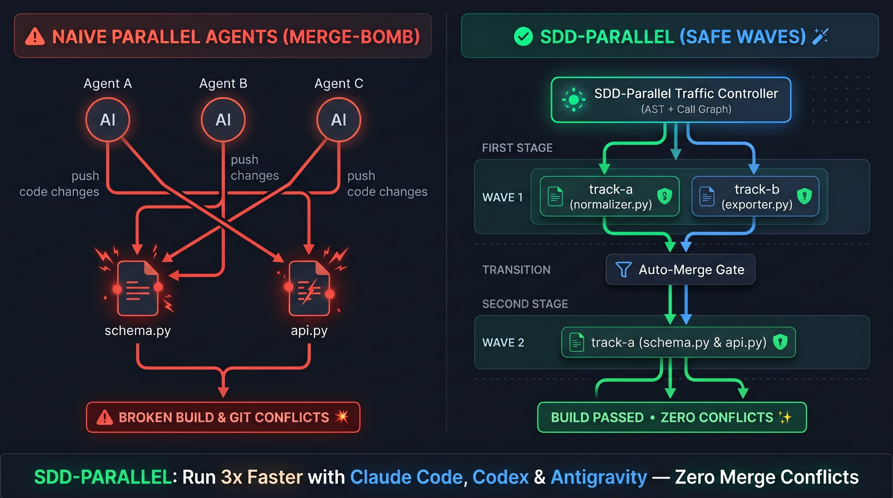
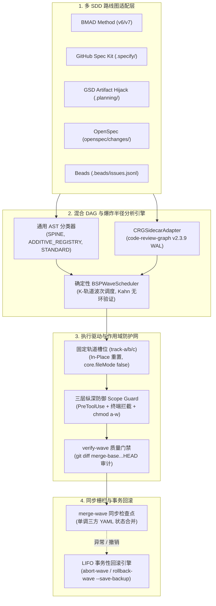

# ⚡ SDD-Parallel (`parallel-flow`)

[](https://github.com/stopActingSoSmall/sdd-parallel/actions/workflows/ci.yml)
[](https://pypi.org/project/sdd-parallel/)
[](https://www.python.org/)
[](../../../LICENSE)
[](#-5-秒终端极速体验零-api-密钥无需克隆)

<p align="center">
  
</p>

<p align="center">
  <b>🌐 语言 / Language:</b>
  <a href="../../../README.md">English</a> |
  <b>简体中文</b> |
  <a href="../es/README.md">Español</a> |
  <a href="../pt-BR/README.md">Português (BR)</a> |
  <a href="../ja/README.md">日本語</a> |
  <a href="../ko/README.md">한국어</a> |
  <a href="../ru/README.md">Русский</a>
</p>

> **让 3–4 个 AI 编程智能体安全并行工作 — 绝不破坏项目构建或污染 Git 提交历史。**  
> 专为在 **BMAD**、**GitHub Spec Kit**、**GSD**、**OpenSpec** 或 **Beads** 项目中运行的 **Claude Code**、**OpenAI Codex** 与 **Google Antigravity** 打造的确定性交通管制器、worktree 隔离器与爆炸半径 (Blast-Radius) 护栏。

---

## ⚡ 为什么需要它？（通俗易懂的解释）

当你在待办清单中积累了 10–15 个规范/用户故事时，通常面临痛苦的两难选择：
1. **单智能体串行执行：** 安全稳定，但需要枯坐等待 **6–8 小时**。
2. **多智能体盲目并行 (`git worktree`)：** 编码飞快，直到合并阶段遭遇惨烈的 **合并炸弹 (Merge-Bomb)**：
   - **直接 Git 冲突：** 多个智能体同时修改 `sprint-status.yaml`、`STATE.md` 或 `cli.py`。
   - **隐式语义破坏（二类冲突）：** 智能体 A 在 `normalizer.py` 中重命名了函数签名，而另一个 worktree 中的智能体 B 仍从 `api.py` 调用旧签名。**Git 在没有任何冲突标记的情况下顺利合并，随后 `main` 分支在运行时瞬间崩溃。**
   - **范围蔓延 (Scope Creep)：** 智能体擅自“热心修改”了分配任务之外的共享数据库结构 (`schema.py`)。

**`sdd-parallel` 在您的 SDD 需求规范与 AI 编程智能体之间充当编译器级的高级空中交通管制员。** 在花费任何 LLM Token 之前，它会扫描代码库 AST 与调用图，将互不影响的任务编组为并行的 **波次 (Waves)**，把每个智能体锁在干净的独立工作区 (`track-a`, `track-b`)，物理级拦截越界文件读写，并在波次完成后零冲突自动合并。

### 📊 对比：使用 `sdd-parallel` 前后

| 核心指标 | ❌ 串行 SDD（单智能体） | 💥 盲目并行 (`--worktree`) | ✅ 使用 `sdd-parallel` |
| :--- | :--- | :--- | :--- |
| **12 个故事的冲刺耗时** | ~6–8 小时（逐个执行） | ~2 小时编码 + **2 小时排查合并故障** | **~2.5 小时总计（2x–3x 提速）** |
| **隐式类型与 API 冲突** | 只能靠慢速串行来避免 | **合并后破坏 `main` 分支** ($W_A \cap I_B$) | **前期静态计算排除**（分流至第 1 波 → 第 2 波） |
| **共享 CLI 与路由文件** | 一次只能由一个智能体修改 | 每次合并产生大量冲突标记 | **支持安全并行**（自动识别 `ADDITIVE_REGISTRY`） |
| **`sprint-status.yaml` / `tasks.md`** | 必须串行按序写入 | 充斥 `<<<<<<<` 冲突符号 | **全自动无冲突合并**（单调三方状态合并器） |
| **智能体越权篡改文件** | 仅靠提示词祈求“请勿修改” | 智能体通过 `bash` / `sed` 绕过提示词 | **操作系统与钩子级强制拦截** (`chmod a-w` + `PreToolUse`) |
| **工作区文件夹泛滥** | 无 | 遗留 15 个 `.worktrees/task-*` 杂乱目录 | **固定复用槽位** (`track-a`, `track-b`, `track-c`) |

---

## 🚀 5 秒终端极速体验（零 API 密钥，无需克隆）

无需 API 密钥、LLM 订阅或现有项目，即可在终端直观感受 `sdd-parallel` 如何拦截隐式语义冲突。通过 [`uv`](https://docs.astral.sh/uv/)（或 `pipx run sdd-parallel demo`）运行单条命令：

```bash
uvx sdd-parallel demo
```

**3.2 秒内终端完成的操作：**
1. 自动生成包含 5 个任务故事与 6 个 Python 模块的临时沙箱仓库 (`schema.py`, `normalizer.py`, `api.py`, `exporter.py`, `cli.py`)。
2. **识破隐式陷阱：** 故事 `1-2` 修改 `normalizer.py`，而故事 `2-1` 修改调用了前者的 `api.py`。普通文件锁会误判它们安全 (`normalizer.py != api.py`)。`sdd-parallel` 精确检测到调用图影响重叠，自动将它们分流至 **第 1 波次** 与 **第 2 波次**。
3. **支持共享注册表的安全并行：** 将 `cli.py` 识别为 `ADDITIVE_REGISTRY`，允许故事 `1-2` 与 `1-3` 在 **第 1 波次** 依靠 (`track-a` 与 `track-b`) 安全并发。
4. **验证范围护栏与三方合并：** 现场拦截对 `schema.py` 的越权修改 (`DENY: Locked by Spine Chain invariant`)，并以 `0 个冲突标记` 自动合并两个并行分支。

<details>
<summary><b>📺 点击展开查看 <code>sdd-parallel demo</code> 完整终端输出</b></summary>

```text
============================================================================
SDD-PARALLEL STANDALONE MERGE-BOMB DEMO (ZERO API KEYS / OFFLINE)
============================================================================
Workspace: /tmp/sdd-parallel-demo-xyz

[Step 1/4] AST & Architectural Role Classification
----------------------------------------------------------------------------
File Path                              | Detected Role          | Importers
----------------------------------------------------------------------------
src/demo_app/__init__.py               | additive_registry      | -
src/demo_app/api.py                    | standard               | -
src/demo_app/cli.py                    | additive_registry      | -
src/demo_app/exporter.py               | standard               | -
src/demo_app/normalizer.py             | standard               | src/demo_app/api.py
src/demo_app/schema.py                 | spine                  | -

[Step 2/4] Type-2 Semantic Merge-Bomb Detection & BSP Wave Schedule
----------------------------------------------------------------------------
  Collision Analysis:
    - Naive Scheduler : W(1-2)={normalizer.py, cli.py} vs W(2-1)={api.py}
                        -> DISJOINT WRITES (False Safe!)
    - BSPWaveScheduler: Detected semantic_collision between '1-2' and '2-1'
                        -> Overlap W(1-2) ^ I(2-1) on: src/demo_app/api.py
    - Additive Registry: Tasks '1-2' and '1-3' both touch 'src/demo_app/cli.py'
                        -> Role: ADDITIVE_REGISTRY (Parallel allowed in Wave 1)

  Wave Schedule:
    * Wave 1
        - track-a: Story 1-2 -> writes: src/demo_app/normalizer.py (+ shared: src/demo_app/cli.py)
        - track-b: Story 1-3 -> writes: src/demo_app/exporter.py (+ shared: src/demo_app/cli.py)
    * Wave 2
        - track-a: Story 1-1 -> writes: src/demo_app/schema.py
        - track-b: Story 2-1 -> writes: src/demo_app/api.py
    * Wave 3
        - track-a: Story 2-2 -> writes: src/demo_app/schema.py

[Step 3/4] Fixed-Slot Worktree Provisioning & PreToolUse Scope Guard
----------------------------------------------------------------------------
  Provisioned Fixed Slots (100% Clean git status: True):
    - track-a (.worktrees/track-a)
    - track-b (.worktrees/track-b)

  PreToolUse Scope Guard Check (track-a -> 'src/demo_app/schema.py'):
    - Decision : DENY
    - Violation: File 'src/demo_app/schema.py' cannot be modified by Wave 1 / track-a (stories ['1-2'])
    - Reason   : Locked by Spine Chain invariant.

[Step 4/4] Barrier Checkpoint & Monotonic 3-Way YAML Merge
----------------------------------------------------------------------------
  Merged Branches:
    - parallel/track-a
    - parallel/track-b

  Resolved sprint-status.yaml (0 conflict markers):
    - 1-2-normalize-telemetry-payload: done
    - 1-3-cli-batch-export: done
============================================================================
ALL 5 CORE INVARIANTS VERIFIED IN 3.21s
============================================================================
```
</details>

---

## 🗺️ 工作原理可视化（从任务清单到无冲突合并）

不再一股脑将 5 个智能体扔进代码库并祈祷不要撞车，`sdd-parallel` 将整个冲刺转化为确定性的 **执行波次 (Waves)**：

```mermaid
flowchart LR
    subgraph Backlog["📋 1. SDD 待办清单"]
        direction TB
        T12["Story 1-2\n(normalizer.py + cli.py)"]
        T13["Story 1-3\n(exporter.py + cli.py)"]
        T21["Story 2-1\n(api.py -> 调用 normalizer)"]
        T11["Story 1-1\n(schema.py - 脊椎锁)"]
    end

    subgraph Planner["🧠 2. sdd-parallel plan"]
        direction TB
        Scan["AST 与调用图扫描\n• cli.py = 追加式注册表 (安全!)\n• 1-2 ↔ 2-1 = 影响碰撞!\n• schema.py = 脊椎锁定!"]
    end

    subgraph Wave1["🟢 3. 第 1 波次 (安全并行工作区)"]
        direction TB
        SlotA["📁 .worktrees/track-a\n智能体 1 执行 Story 1-2\n🔒 schema.py 与 api.py 已加锁"]
        SlotB["📁 .worktrees/track-b\n智能体 2 执行 Story 1-3\n🔒 schema.py 与 normalizer.py 已加锁"]
    end

    subgraph Gate["🛡️ 4. sdd-parallel merge --wave 1"]
        direction TB
        M1["✅ 作用域 Diff 审计通过\n✅ pytest / mypy / ruff 质检通过\n✅ 三方状态无冲突合并"]
    end

    subgraph Wave2["🔵 5. 第 2 波次 (复用相同工作区槽位)"]
        direction TB
        SlotA2["📁 .worktrees/track-a\n智能体 1 执行 Story 1-1"]
        SlotB2["📁 .worktrees/track-b\n智能体 2 执行 Story 2-1\n(直接读取更新后的 normalizer.py!)"]
    end

    Backlog --> Planner --> Wave1 --> Gate --> Wave2
```



---

## 🔌 无缝融入现有技术栈（零供应商绑定）

您**无需**重写任何规格文档，也不需要调整智能体提示词习惯。`sdd-parallel` 以只读模式直接接入现有框架规范文件：

| 使用的技术栈 | `sdd-parallel` 带来的增强体验 |
| :--- | :--- |
| **Claude Code** (`claude`) | 在调用 `--worktree` / `Agent Teams` 前增加确定性波次编排，通过 `PreToolUse` 拦截越界文件与终端修改，自动分流任务复杂度 (`High`/`Medium`/`Low`)。 |
| **OpenAI Codex CLI** (`codex`) | 在各槽位中预先排序冲突任务并锁定核心数据结构 (`chmod a-w`)，杜绝并行 worktree 竞态条件。 |
| **Google Antigravity** | 提供常驻复用槽位 (`track-a`, `track-b`, `track-c`)，避免 IDE 丢失工作区目录，并通过 `.git/worktrees/*/info/exclude` 保持 `git status --porcelain` 100% 纯净。 |
| **BMAD Method (`v6.3+` / `v7`)** | 将串行的 `sprint-status.yaml` 队列拆解为多 Epic 并行波次，单调合并故事状态 (`backlog -> done`)，零 YAML 冲突。 |
| **GitHub Spec Kit (`.specify/`)** | 依据代码库真实 AST 依赖核验 `tasks.md` 中的手动 `[P]` 并行标记，防止虚假并发破坏构建。 |
| **GSD / OpenSpec / Beads** | 在干净的隔离工作区中调度 `.planning/STATE.md` (Artifact Hijack 模式)、`openspec/changes/` 与 `.beads/issues.jsonl`。 |

---

## 🛠️ 仅需 4 条命令的日常工作流

### 1. 一次性全局安装
```bash
# 推荐使用 uv（或: pipx install sdd-parallel）
uv tool install sdd-parallel
```
*(系统将全局注册 `sdd-parallel` 命令及快捷别名 `parallel-flow`)*。

### 2. 在任意项目中执行并行波次
```bash
# 第 1 步：扫描 SDD 规格与 AST 依赖图，生成安全波次计划
sdd-parallel plan

# 第 2 步：在固定槽位 (.worktrees/track-a, track-b) 中预备第 1 波次
#         并输出各编程智能体的专属启动引导指令
sdd-parallel prepare --wave 1
sdd-parallel run-guide --wave 1

# 👉 第 3 步：由 AI 智能体 (Claude Code / Codex / Antigravity) 在各自
#            槽位 (track-a 与 track-b) 中同时实现业务代码。

# 第 4 步：校验零越界修改并将第 1 波次安全合并入主分支
sdd-parallel verify-wave --wave 1
sdd-parallel merge --wave 1
```
需要撤销波次？合并前可运行 `sdd-parallel abort-wave --wave 1`；合并后可运行 `sdd-parallel rollback-wave --wave 1`（自动生成备份分支并多态重置 SDD 任务状态）。

---

## 🧩 支持的 SDD 框架矩阵

| SDD 框架 | 支持状态 | 自动检测的只读工件 | 任务状态同步机制 |
| :--- | :---: | :--- | :--- |
| **BMAD Method (`v6.3+` / `v7`)** | ✅ 已发布 | `sprint-status.yaml`, `epics.md`, `epic-*-context.md`, `spec-*.md` | 单调三方 YAML 合并 |
| **GitHub Spec Kit (`.specify/`)** | ✅ 已发布 | `.specify/specs/*/tasks.md`, `constitution.md` | Markdown 状态复选框同步 |
| **GSD (Get Shit Done)** | ✅ 已发布 | `.planning/phases/*-PLAN.md`, `ROADMAP.md` | Artifact Hijack 劫持 (集中同步 `STATE.md`) |
| **OpenSpec (`openspec/`)** | ✅ 已发布 | `openspec/changes/<id>/tasks.md` | 规范驱动任务状态跟踪 |
| **Beads (`.beads/`)** | ✅ 已发布 | `.beads/issues.jsonl` | 拓扑级 Issue 状态原子化更新 |

---

## 🔍 深度技术解析（架构、不变性保证与完整 CLI 手册）

如需深入探究数学理论模型、内部模块架构或所有 CLI 参数，请展开下方折叠面板或直接查阅 **[架构与战略白皮书手册 (docs/dossier/)](../../dossier/README.md)**：

- 📖 **[01 — 核心产品大纲与投资回报率模型](../../dossier/01_CORE_PRODUCT_BRIEF.md)** *(管理层摘要、Token FinOps 与模型算力路由)*
- 🏛️ **[02 — 系统核心功能与学术白皮书](../../dossier/02_SYSTEM_CAPABILITIES_WHITE_PAPER.md)** *(一类与二类冲突、3D 文件分类学、CRG 衰减公式)*
- 🔌 **[03 — 跨生态集成与协议规范](../../dossier/03_INTEGRATION_AND_ECOSYSTEM_SPEC.md)** *(`CanonicalTask` 中间表示、`.tmp/track-context.md` 与 `.parallel-lock.json`)*
- 🧪 **[07 — 独立验证 Demo 与端到端交互指南](../../dossier/07_STANDALONE_DEMO_AND_E2E_WALKTHROUGH.md)** *(逐帧文件系统快照与 `--keep-temp` 调试指南)*
- 📐 **[系统核心架构规范 SSOT (`ARCHITECTURE.md`)](ARCHITECTURE.md)** | **[俄语白皮书](../../i18n/ru/dossier/)**

<details>
<summary><b>🏛️ 点击展开：内部引擎架构与 9 大核心工程不变性</b></summary>

### 内部核心组件数据流



### 9 大核心工程不变性

1. **零工作区污染 (Zero Worktree Pollution)：** 注入的上下文文件 (`.tmp/track-context.md`, `.parallel-lock.json`, `ACTIVE_TRACK.md`) 全部通过 `info/exclude` 过滤。`git status --porcelain` 永远保持 100% 纯净。
2. **零缓存失效 (Zero Cache Invalidation)：** `_bmad-output/planning-artifacts/` 中的史诗上下文严格只读；调度器状态写入独立的 `_bmad-output/parallel-artifacts/`。
3. **100% 任务覆盖与无环保证：** 基于 Kahn/Tarjan 的拓扑算法保证零故事遗漏与零依赖死锁。
4. **爆炸半径强制隔离（一类与二类）：** 互斥写入集 ($W_A \cap W_B = \emptyset$) 与互斥语义影响 ($W_A \cap I_B = \emptyset$) 双重保证。
5. **通用抗过拟合设计 (Invariant 7)：** 引擎核心绝不硬编码任何业务路径。严格基于 AST 启发式与图中心度分类 `SPINE`、`ADDITIVE_REGISTRY` 与 `STANDARD`。
6. **固定轨道槽位 ($O(1)$ 空间占用)：** 通过 `git checkout -B` 与 `git clean -fd` 原地复用 `track-a`、`track-b`、`track-c`，避免 IDE 杂乱。
7. **三层纵深防护体系：** `PreToolUse` 钩子拦截 + 终端命令拦截 (`Bash`, `run_command`) + 操作系统 `chmod a-w` 文件只读锁。
8. **单调状态半格理论：** 任务状态在半格拓扑中单调收敛：$\texttt{backlog} (0) < \dots < \texttt{done} (4)$，合并时绝无任何冲突标记。
9. **后进先出 (LIFO) 事务级回滚：** 严格倒序回滚合并波次，自动生成安全性备份分支 (`backup/wave-<K>-before-rollback-*`)。

</details>

<details>
<summary><b>🛠️ 点击展开：完整 CLI 指令集手册（全部 13 个子命令与参数）</b></summary>

| 命令 | 用途说明 |
| :--- | :--- |
| `sdd-parallel demo [--kit {bmad,spec-kit,gsd,openspec,beads,all}] [--keep-temp] [--scaffold-only] [--output-dir DIR]` | 运行单机离线防炸弹演示，或在 5 种 SDD 套件中生成交互式沙箱。 |
| `sdd-parallel plan [--repo REPO] [--max-tracks N] [--kit auto] [--include-done] [--dry-run] [--plan-source {auto,plan,specs}] [--output-dir DIR]` | 分析需求蓝图与代码依赖图；生成 `execution-plan-parallel.md` 与 `wave-plan.json`。 |
| `sdd-parallel prepare --wave K [--repo REPO] [--max-tracks N] [--kit KIT] [--headless] [--antigravity-layout] [--dynamic-worktrees] [--dry-run]` | 预备工作区槽位 (`track-a`, `track-b`)，配置操作系统锁并注入边界文件。 |
| `sdd-parallel claim-track --wave K --track <id> --worktree <path> [--repo REPO] [--max-tracks N] [--kit KIT] [--headless]` | 将安全锁和边界注入挂载至现有的外部工作区槽位。 |
| `sdd-parallel run-guide --wave K [--repo REPO] [--max-tracks N] [--kit KIT] [--antigravity-layout]` | 显示交互式操作员引导矩阵，输出每个工作区终端的专属启动指令。 |
| `sdd-parallel verify-wave --wave K [--repo REPO] [--max-tracks N] [--kit KIT] [--dynamic-worktrees]` | 审计工作区变更，根据 `.parallel-lock.json` 与 `merge-base` 检查多提交 diff。 |
| `sdd-parallel merge --wave K [--repo REPO] [--max-tracks N] [--kit KIT] [--dynamic-worktrees] [--skip-gates] [--strict-gates] [--cleanup] [--dry-run]` | 执行栅栏合并：三方状态合并、Git 合并、质量门禁校验与事务性自动回滚。 |
| `sdd-parallel abort-wave --wave K [--repo REPO] [--dynamic-worktrees]` | 中止未合并的波次：重置槽位并清理临时并行分支。 |
| `sdd-parallel rollback-wave --wave K [--repo REPO] [--dynamic-worktrees] [--to-commit COMMIT] [--save-backup] [--no-backup] [--kit KIT]` | 按 LIFO 顺序回滚已合并波次，自动保留备份分支并重置 SDD 任务状态。 |
| `sdd-parallel merge-status --base B --ours O --theirs T --out OUT` | 底层确定性 `sprint-status.yaml` 三方合并工具。 |
| `sdd-parallel check-lock --file PATH [--tool TOOL]` | 依据当前工作区锁清单校验文件写入权限。 |
| `sdd-parallel install-plugin [--target-dir DIR]` | 打包并安装 Google Antigravity 原生插件。 |
| `sdd-parallel autopilot --wave K [--repo REPO] [--max-tracks N] [--kit KIT] [--harness <tool>] [--antigravity-layout] [--execute]` | 生成或执行多对话自动化调度指令，支持按模型算力分流复杂度。 |

</details>

<details>
<summary><b>🧪 点击展开：本地开发与自动化质量门禁</b></summary>

### 环境要求
- **Python:** `>= 3.11` (Python 3.11, 3.12, 3.13)
- **Git:** `>= 2.30` (需要现代 `git worktree` 隔离与 `info/exclude` 过滤特性)
- **包管理器:** [`uv`](https://docs.astral.sh/uv/) (强烈推荐) 或 `pipx`

```bash
git clone https://github.com/stopActingSoSmall/sdd-parallel.git
cd sdd-parallel
uv sync

# 运行 99+ 项自动化单元与集成测试
uv run pytest

# 运行严格静态类型检查
uv run mypy --strict src/sdd_parallel

# 运行代码规范与格式检查
uv run ruff check src/ tests/ scripts/

# 运行单机离线端到端验证演示
uv run sdd-parallel demo
```

</details>

---

## 🚢 版本发布矩阵：已发布（v0.1.0）vs 路线图规划（v0.2+）

### ✅ `v0.1.0` 已交付生产特性
- 带有 Kahn 无环校验的确定性 Bulk-Synchronous Parallel (BSP) 波次调度算法。
- AST 热点扫描器与 `code-review-graph v2.3.9` 伴生容器支持。
- 具有原地重置能力的固定槽位架构 (`track-a`, `track-b`, `track-c`)。
- 三层纵深防御体系 (`PreToolUse` + 终端拦截 + 操作系统 `chmod a-w`)。
- 完美保留注释与格式的单调三方 YAML 合并器。
- 带有自动安全备份分支的后进先出 (LIFO) 事务级波次回滚引擎。
- 双阶段协作标准 (`Two-Stage Assisted`, Interactive IDE Slots, `Depth 0`)。
- 5 大主流 SDD 框架适配器 (BMAD, Spec Kit, GSD Artifact Hijack, OpenSpec, Beads)。
- 零 API 密钥单机离线演示 (`sdd-parallel demo`) 与完整 GitHub Actions CI 流水线。
- 99 项全覆盖自动化测试、`mypy --strict` 与 `ruff` 严格质量门禁。

### 🚧 `v0.2.0+` 路线图规划
- **社区生态适配器支持：** `mattpocock/skills` (`/implement-spec`) 以及 `bmad-loop` v0.8+ frontmatter 状态适配器。
- **环境隔离无损同步：** `workz` 模式支持通过符号链接将 `.venv` 与 `node_modules` 挂载至固定槽位。
- **波次前静态符号链接与动态范围提权：** 依据 AST 符号自动扩充写入集并实现动态任务重调度。
- **FinOps 成本与可观测性导出器：** OpenTelemetry 链路追踪与 Langfuse Token 节省数据上报。
- **后台常驻 Autopilot 守护进程：** 基于本地 RPC / 智能体派发的完全无头自主运行。

---

## 🤝 贡献与安全规范

- **参与贡献：** 请参阅 **[贡献指南](../../../CONTRIBUTING.md)** 获取本地开发环境配置说明与 Pull Request 门禁规范。
- **安全报告：** 安全漏洞披露准则详见 **[安全政策](../../../SECURITY.md)**。

## 📜 开源许可证

本项目基于 MIT 许可证开源。详情请见 [LICENSE](../../../LICENSE)。
